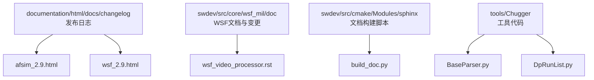
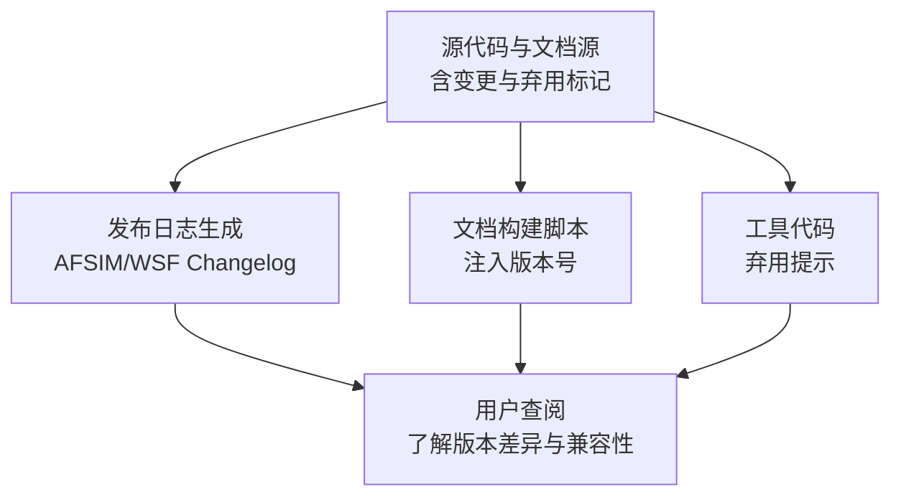
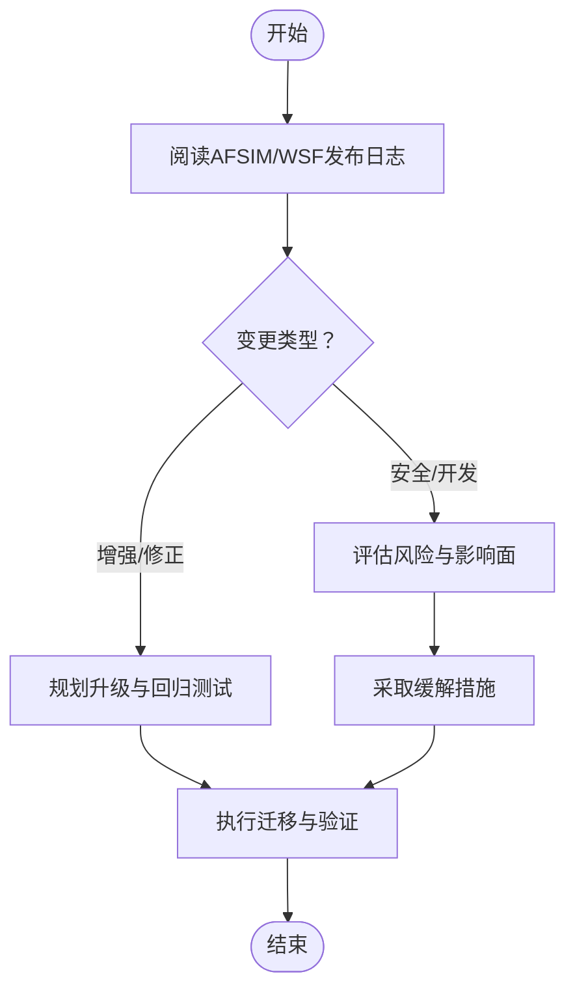
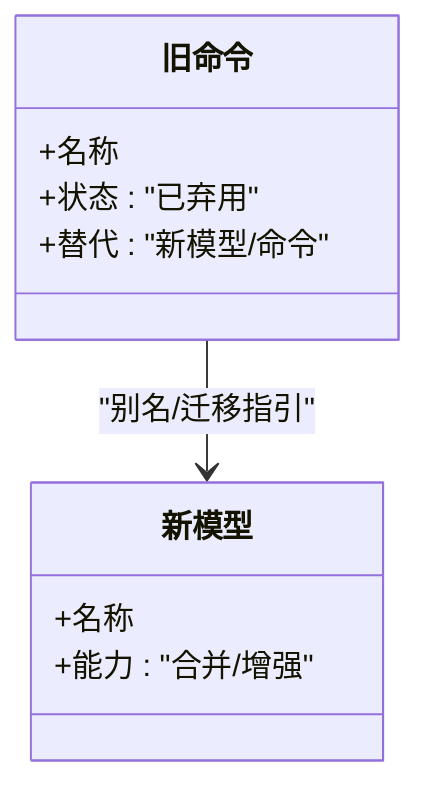
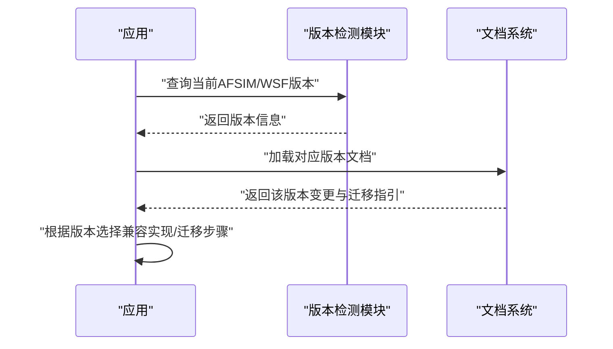
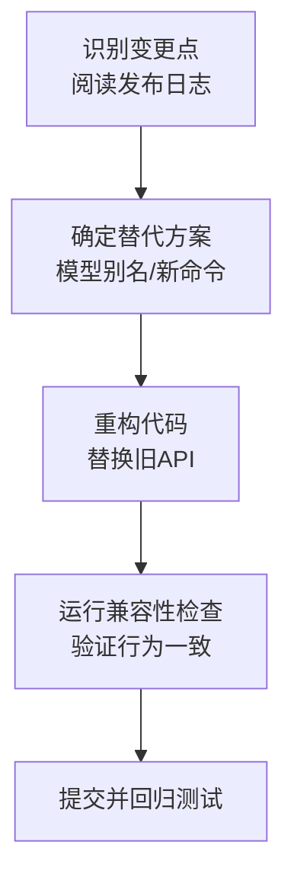
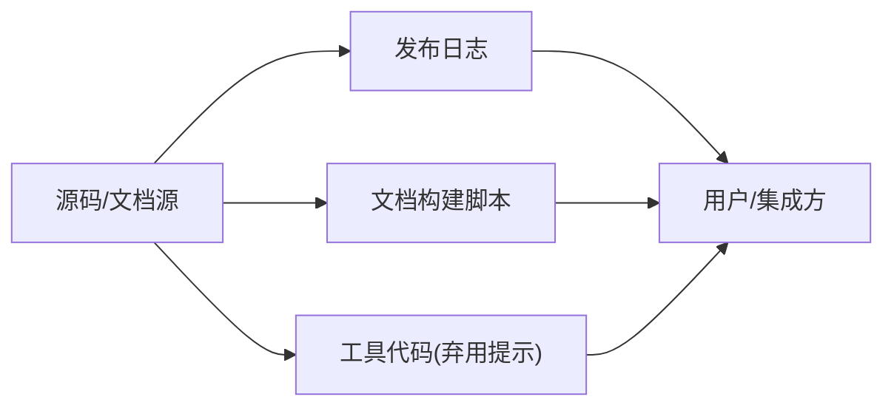

# API版本管理与兼容性

<cite>
**本文引用的文件**   
- [afsim_2.9.html](file://documentation/html/docs/changelog/afsim_2.9.html)
- [wsf_2.9.html](file://documentation/html/docs/changelog/wsf_2.9.html)
- [wsf_video_processor.rst](file://swdev/src/core/wsf_mil/doc/wsf_video_processor.rst)
- [build_doc.py](file://swdev/src/cmake/Modules/sphinx/build_doc.py)
- [wsf_1.05.0.rst](file://swdev/src/core/wsf_mil/doc/changelog/wsf_1.05.0.rst)
- [wsf_2.0.1.rst](file://swdev/src/core/wsf_mil/doc/changelog/wsf_2.0.1.rst)
- [BaseParser.py](file://tools/Chugger/chugger/parser/BaseParser.py)
- [DpRunList.py](file://tools/Chugger/chugger/server/DpRunList.py)
</cite>

## 目录
1. [简介](#简介)
2. [项目结构](#项目结构)
3. [核心组件](#核心组件)
4. [架构总览](#架构总览)
5. [详细组件分析](#详细组件分析)
6. [依赖关系分析](#依赖关系分析)
7. [性能考量](#性能考量)
8. [故障排查指南](#故障排查指南)
9. [结论](#结论)
10. [附录](#附录)

## 简介
本文件聚焦AFSIM的API版本管理与兼容性策略，围绕语义化版本控制、变更管理流程、向后兼容保证（废弃标记、迁移工具、兼容性检查）、接口稳定性与配置/数据格式演进、运行时版本检测与自动适配、升级路径与重构建议、以及兼容性测试与回归测试最佳实践进行系统化说明。文档内容基于仓库中的发布日志、构建脚本与工具链材料进行归纳与提炼，确保可追溯与可操作。

## 项目结构
AFSIM仓库中与版本管理和兼容性相关的材料主要分布在以下位置：
- documentation/html/docs/changelog: 各产品线的版本发布日志（AFSIM、WSF Core等）
- swdev/src/core/wsf_mil/doc: WSF相关文档与历史变更记录
- swdev/src/cmake/Modules/sphinx/build_doc.py: 文档构建时注入的版本信息
- tools/Chugger: 包含被标记为未来弃用的工具类

图表来源
- [afsim_2.9.html:1-308](file://documentation/html/docs/changelog/afsim_2.9.html#L1-L308)
- [wsf_2.9.html:1-301](file://documentation/html/docs/changelog/wsf_2.9.html#L1-L301)
- [wsf_video_processor.rst:1-19](file://swdev/src/core/wsf_mil/doc/wsf_video_processor.rst#L1-L19)
- [build_doc.py:64-65](file://swdev/src/cmake/Modules/sphinx/build_doc.py#L64-L65)
- [BaseParser.py:87](file://tools/Chugger/chugger/parser/BaseParser.py#L87)
- [DpRunList.py:16](file://tools/Chugger/chugger/server/DpRunList.py#L16)

章节来源
- [afsim_2.9.html:1-308](file://documentation/html/docs/changelog/afsim_2.9.html#L1-L308)
- [wsf_2.9.html:1-301](file://documentation/html/docs/changelog/wsf_2.9.html#L1-L301)
- [wsf_video_processor.rst:1-19](file://swdev/src/core/wsf_mil/doc/wsf_video_processor.rst#L1-L19)
- [build_doc.py:64-65](file://swdev/src/cmake/Modules/sphinx/build_doc.py#L64-L65)
- [BaseParser.py:87](file://tools/Chugger/chugger/parser/BaseParser.py#L87)
- [DpRunList.py:16](file://tools/Chugger/chugger/server/DpRunList.py#L16)

## 核心组件
- 版本发布日志（AFSIM与WSF Core）：记录每个版本的发布日期、安全更新、开发更新、功能增强与修正项，是理解语义化版本演进与兼容性承诺的关键依据。
- 文档构建脚本：在生成文档时注入版本号，支撑“按版本索引”的文档体系。
- 模型别名与合并：通过文档注释明确旧命令与新模型的等价关系，体现向后兼容策略。
- 工具弃用提示：在工具代码中显式标注未来弃用，便于用户提前迁移。

章节来源
- [afsim_2.9.html:73-145](file://documentation/html/docs/changelog/afsim_2.9.html#L73-L145)
- [wsf_2.9.html:74-301](file://documentation/html/docs/changelog/wsf_2.9.html#L74-L301)
- [wsf_video_processor.rst:15-18](file://swdev/src/core/wsf_mil/doc/wsf_video_processor.rst#L15-L18)
- [build_doc.py:64-65](file://swdev/src/cmake/Modules/sphinx/build_doc.py#L64-L65)
- [BaseParser.py:87](file://tools/Chugger/chugger/parser/BaseParser.py#L87)
- [DpRunList.py:16](file://tools/Chugger/chugger/server/DpRunList.py#L16)

## 架构总览
AFSIM的API版本管理与兼容性由“发布日志 + 文档构建 + 代码级弃用提示 + 模型别名/迁移指引”共同构成。下图展示从源码到文档与工具的端到端链路：

图表来源
- [afsim_2.9.html:73-145](file://documentation/html/docs/changelog/afsim_2.9.html#L73-L145)
- [wsf_2.9.html:74-301](file://documentation/html/docs/changelog/wsf_2.9.html#L74-L301)
- [build_doc.py:64-65](file://swdev/src/cmake/Modules/sphinx/build_doc.py#L64-L65)
- [BaseParser.py:87](file://tools/Chugger/chugger/parser/BaseParser.py#L87)
- [DpRunList.py:16](file://tools/Chugger/chugger/server/DpRunList.py#L16)

## 详细组件分析

### 语义化版本控制与变更管理流程
- 版本标识：AFSIM与WSF Core均提供明确的版本号与发布日期，例如AFSIM 2.9.0与WSF Core 2.9.0，便于用户按语义化版本进行升级决策。
- 变更分类：发布日志将变更分为安全更新、开发更新、功能增强与修正项，有助于评估对现有API的影响范围。
- 发布节奏：通过持续维护changelog，形成稳定的版本演进轨迹，支持跨版本对比与回归定位。

图表来源
- [afsim_2.9.html:73-145](file://documentation/html/docs/changelog/afsim_2.9.html#L73-L145)
- [wsf_2.9.html:74-301](file://documentation/html/docs/changelog/wsf_2.9.html#L74-L301)

章节来源
- [afsim_2.9.html:73-145](file://documentation/html/docs/changelog/afsim_2.9.html#L73-L145)
- [wsf_2.9.html:74-301](file://documentation/html/docs/changelog/wsf_2.9.html#L74-L301)

### 向后兼容性保证机制
- 废弃API标记：在工具代码中以注释形式明确标注未来弃用，提醒用户尽早迁移。
- 模型别名与合并：通过文档注释声明旧命令与新模型的等价关系，保持既有配置可用。
- 迁移指引：发布日志中提供迁移建议或替代方案，降低升级成本。

图表来源
- [wsf_video_processor.rst:15-18](file://swdev/src/core/wsf_mil/doc/wsf_video_processor.rst#L15-L18)
- [BaseParser.py:87](file://tools/Chugger/chugger/parser/BaseParser.py#L87)
- [DpRunList.py:16](file://tools/Chugger/chugger/server/DpRunList.py#L16)

章节来源
- [wsf_video_processor.rst:15-18](file://swdev/src/core/wsf_mil/doc/wsf_video_processor.rst#L15-L18)
- [BaseParser.py:87](file://tools/Chugger/chugger/parser/BaseParser.py#L87)
- [DpRunList.py:16](file://tools/Chugger/chugger/server/DpRunList.py#L16)

### API演进的设计原则
- 接口稳定性：通过发布日志明确新增、废弃与移除项，避免破坏性变更；必要时提供别名以维持稳定。
- 配置兼容性：在模型层面采用别名与合并策略，使旧配置在新版本中继续生效。
- 数据格式演进：通过文档与日志说明数据结构的变更与迁移方式，确保下游工具与脚本的平滑过渡。

章节来源
- [wsf_video_processor.rst:15-18](file://swdev/src/core/wsf_mil/doc/wsf_video_processor.rst#L15-L18)
- [afsim_2.9.html:73-145](file://documentation/html/docs/changelog/afsim_2.9.html#L73-L145)
- [wsf_2.9.html:74-301](file://documentation/html/docs/changelog/wsf_2.9.html#L74-L301)

### 版本检测和处理机制
- 文档构建阶段注入版本：构建脚本在生成文档时插入版本号，便于按版本检索与对比。
- 运行时版本检查与自动适配：建议在集成层实现版本探测与适配逻辑，根据目标AFSIM/WSF版本选择兼容分支或启用迁移路径。

图表来源
- [build_doc.py:64-65](file://swdev/src/cmake/Modules/sphinx/build_doc.py#L64-L65)
- [afsim_2.9.html:73-145](file://documentation/html/docs/changelog/afsim_2.9.html#L73-L145)
- [wsf_2.9.html:74-301](file://documentation/html/docs/changelog/wsf_2.9.html#L74-L301)

章节来源
- [build_doc.py:64-65](file://swdev/src/cmake/Modules/sphinx/build_doc.py#L64-L65)
- [afsim_2.9.html:73-145](file://documentation/html/docs/changelog/afsim_2.9.html#L73-L145)
- [wsf_2.9.html:74-301](file://documentation/html/docs/changelog/wsf_2.9.html#L74-L301)

### API迁移指南
- 升级路径：优先参考发布日志中的“增强/修正”条目，识别需要迁移的命令或模型。
- 代码重构建议：将旧命令替换为新模型或命令；若存在别名，逐步消除对别名的依赖。
- 工具支持：关注工具代码中的弃用提示，提前调整调用方式。

图表来源
- [wsf_video_processor.rst:15-18](file://swdev/src/core/wsf_mil/doc/wsf_video_processor.rst#L15-L18)
- [BaseParser.py:87](file://tools/Chugger/chugger/parser/BaseParser.py#L87)
- [DpRunList.py:16](file://tools/Chugger/chugger/server/DpRunList.py#L16)

章节来源
- [wsf_video_processor.rst:15-18](file://swdev/src/core/wsf_mil/doc/wsf_video_processor.rst#L15-L18)
- [BaseParser.py:87](file://tools/Chugger/chugger/parser/BaseParser.py#L87)
- [DpRunList.py:16](file://tools/Chugger/chugger/server/DpRunList.py#L16)

### 兼容性测试策略与回归测试最佳实践
- 基线用例：针对关键API与配置建立基线用例，覆盖新旧版本的行为一致性。
- 自动化检查：在CI中集成版本检测与兼容性断言，确保每次变更不引入破坏性差异。
- 回归矩阵：按AFSIM/WSF版本组合构建回归矩阵，重点覆盖弃用与迁移路径。

[本节为通用指导，不直接分析具体文件]

## 依赖关系分析
- 发布日志依赖源码变更与文档源，作为对外发布的权威依据。
- 文档构建脚本依赖Sphinx生态，负责注入版本信息。
- 工具代码中的弃用提示依赖开发者维护，需与发布日志同步更新。

图表来源
- [afsim_2.9.html:73-145](file://documentation/html/docs/changelog/afsim_2.9.html#L73-L145)
- [wsf_2.9.html:74-301](file://documentation/html/docs/changelog/wsf_2.9.html#L74-L301)
- [build_doc.py:64-65](file://swdev/src/cmake/Modules/sphinx/build_doc.py#L64-L65)
- [BaseParser.py:87](file://tools/Chugger/chugger/parser/BaseParser.py#L87)
- [DpRunList.py:16](file://tools/Chugger/chugger/server/DpRunList.py#L16)

章节来源
- [afsim_2.9.html:73-145](file://documentation/html/docs/changelog/afsim_2.9.html#L73-L145)
- [wsf_2.9.html:74-301](file://documentation/html/docs/changelog/wsf_2.9.html#L74-L301)
- [build_doc.py:64-65](file://swdev/src/cmake/Modules/sphinx/build_doc.py#L64-L65)
- [BaseParser.py:87](file://tools/Chugger/chugger/parser/BaseParser.py#L87)
- [DpRunList.py:16](file://tools/Chugger/chugger/server/DpRunList.py#L16)

## 性能考量
- 文档构建与版本注入：在大规模文档工程中，版本注入应尽可能缓存与增量构建，减少重复计算。
- 兼容性检查：建议在静态分析与单元测试中嵌入轻量级版本断言，避免运行时开销。

[本节为通用指导，不直接分析具体文件]

## 故障排查指南
- 版本不一致：确认构建脚本是否正确注入版本，核对AFSIM/WSF发布日志中的版本号。
- 弃用警告：检查工具代码中的弃用提示，及时替换为推荐API。
- 模型别名失效：确认是否仍在使用旧命令，参考文档注释迁移至新模型。

章节来源
- [build_doc.py:64-65](file://swdev/src/cmake/Modules/sphinx/build_doc.py#L64-L65)
- [BaseParser.py:87](file://tools/Chugger/chugger/parser/BaseParser.py#L87)
- [DpRunList.py:16](file://tools/Chugger/chugger/server/DpRunList.py#L16)
- [wsf_video_processor.rst:15-18](file://swdev/src/core/wsf_mil/doc/wsf_video_processor.rst#L15-L18)

## 结论
AFSIM的API版本管理与兼容性策略以发布日志为核心，辅以文档构建版本注入与工具代码弃用提示，形成从源码到用户的完整闭环。通过语义化版本控制、清晰的变更分类、模型别名与迁移指引，以及对弃用API的显式标记，AFSIM为用户提供了稳健的升级路径与兼容性保障。建议在集成侧实现版本检测与自动适配，并结合基线用例与回归矩阵，确保跨版本的一致性与可靠性。

[本节为总结性内容，不直接分析具体文件]

## 附录
- 历史版本参考：WSF早期版本（如1.05.0、2.0.1）的变更记录可作为长期兼容性演进的参考样本。

章节来源
- [wsf_1.05.0.rst:1-107](file://swdev/src/core/wsf_mil/doc/changelog/wsf_1.05.0.rst#L1-L107)
- [wsf_2.0.1.rst:1-21](file://swdev/src/core/wsf_mil/doc/changelog/wsf_2.0.1.rst#L1-L21)