# API设计与扩展开发

<cite>
**本文引用的文件**   
- [WsfApplication.hpp](file://swdev/src/core/wsf/source/WsfApplication.hpp)
- [WsfPlatform.hpp](file://swdev/src/core/wsf/source/WsfPlatform.hpp)
- [WsfSensor.hpp](file://swdev/src/core/wsf/source/sensor/WsfSensor.hpp)
- [WsfWeapon.hpp](file://swdev/src/core/wsf_mil/source/weapon/WsfWeapon.hpp)
- [WsfCoverageRegistration.cpp](file://swdev/src/wsf_plugins/wsf_coverage/source/WsfCoverageRegistration.cpp)
- [WsfUCI_Component.cpp](file://swdev/src/wsf_plugins/wsf_oms_uci/source/WsfUCI_Component.cpp)
- [P6DOF_DataSimInterface.hpp](file://swdev/src/warlock/plugins/P6DOF_Data/source/P6DOF_DataSimInterface.hpp)
- [FlightControlPkt.hpp](file://training/developer/core/labs/solution/xio/source/FlightControlPkt.hpp)
- [xio_interface_development.rst.txt](file://documentation/html/_sources/docs/xio_interface_development.rst.txt)
- [receiver.py](file://training/developer/core/labs/solution/observer/receiver.py)
</cite>

## 目录
1. [简介](#简介)
2. [项目结构](#项目结构)
3. [核心组件](#核心组件)
4. [架构总览](#架构总览)
5. [详细组件分析](#详细组件分析)
6. [依赖关系分析](#依赖关系分析)
7. [性能与并发特性](#性能与并发特性)
8. [故障排查指南](#故障排查指南)
9. [结论](#结论)
10. [附录：扩展开发示例与最佳实践](#附录扩展开发示例与最佳实践)

## 简介
本指南面向AFSIM的WSF（Warfare Simulation Framework）API设计与扩展开发者，系统阐述WSF框架的API设计原则、接口规范、类继承体系、虚函数约定与事件处理机制；文档化插件注册、生命周期管理与资源管理；说明Python脚本API的使用方法与扩展点；给出向后兼容性与版本管理策略；并提供自定义传感器、武器系统与行为逻辑的实现示例与最佳实践。

## 项目结构
AFSIM以WSF为核心仿真框架，围绕平台（Platform）、部件（Part）、传感器（Sensor）、武器（Weapon）、处理器（Processor）等抽象构建可扩展的模块化体系。应用层通过WsfApplication进行扩展与插件管理，场景与仿真对象由WsfScenario与WsfSimulation驱动。XIO提供外部交互能力，Warlock为可视化与数据交互插件宿主，Mystic提供脚本批处理能力。

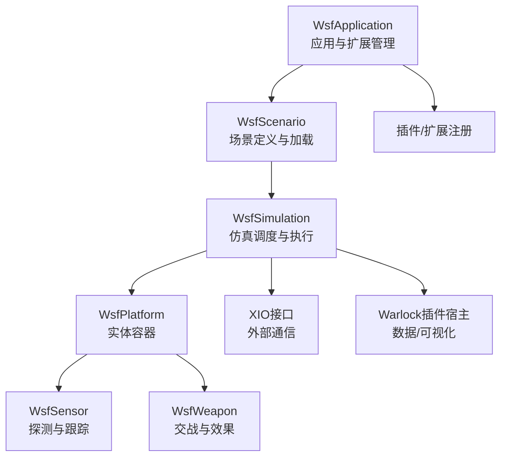

图示来源
- [WsfApplication.hpp:32-44](file://swdev/src/core/wsf/source/WsfApplication.hpp#L32-L44)
- [WsfPlatform.hpp:66-114](file://swdev/src/core/wsf/source/WsfPlatform.hpp#L66-L114)
- [WsfSensor.hpp:45-91](file://swdev/src/core/wsf/source/sensor/WsfSensor.hpp#L45-L91)
- [WsfWeapon.hpp:39-62](file://swdev/src/core/wsf_mil/source/weapon/WsfWeapon.hpp#L39-L62)
- [xio_interface_development.rst.txt:22-30](file://documentation/html/_sources/docs/xio_interface_development.rst.txt#L22-L30)

章节来源
- [WsfApplication.hpp:32-44](file://swdev/src/core/wsf/source/WsfApplication.hpp#L32-L44)
- [WsfPlatform.hpp:66-114](file://swdev/src/core/wsf/source/WsfPlatform.hpp#L66-L114)

## 核心组件
- WsfApplication：应用入口，负责扩展与插件注册、特性声明、命令行参数与脚本类型管理等。
- WsfPlatform：仿真实体容器，聚合运动器、燃料、地形上下文、签名列表、类别与分组、观察者等，提供更新与脚本执行钩子。
- WsfSensor：传感器基类，支持多模式、调度器与跟踪器、线程安全标记、观察者通知、检测尝试回调等。
- WsfWeapon：武器基类，支持模式、发射/齐射、库存与再装填、目标提示、干扰与EA控制、交战状态与统计等。

章节来源
- [WsfApplication.hpp:76-133](file://swdev/src/core/wsf/source/WsfApplication.hpp#L76-L133)
- [WsfPlatform.hpp:132-206](file://swdev/src/core/wsf/source/WsfPlatform.hpp#L132-L206)
- [WsfSensor.hpp:173-213](file://swdev/src/core/wsf/source/sensor/WsfSensor.hpp#L173-L213)
- [WsfWeapon.hpp:151-182](file://swdev/src/core/wsf_mil/source/weapon/WsfWeapon.hpp#L151-L182)

## 架构总览
WSF采用“应用-场景-仿真-平台-部件”的分层架构，配合插件与扩展机制实现功能解耦。传感器与武器作为平台部件，遵循统一的初始化与更新生命周期，并通过事件与观察者机制与仿真内核交互。XIO用于与外部系统互联，Warlock提供可视化与数据访问接口。

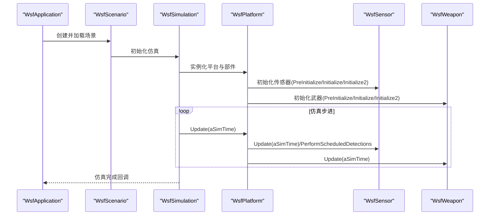

图示来源
- [WsfApplication.hpp:32-44](file://swdev/src/core/wsf/source/WsfApplication.hpp#L32-L44)
- [WsfPlatform.hpp:150-206](file://swdev/src/core/wsf/source/WsfPlatform.hpp#L150-L206)
- [WsfSensor.hpp:203-213](file://swdev/src/core/wsf/source/sensor/WsfSensor.hpp#L203-L213)
- [WsfWeapon.hpp:176-182](file://swdev/src/core/wsf_mil/source/weapon/WsfWeapon.hpp#L176-L182)

## 详细组件分析

### 应用与扩展（WsfApplication）
- 扩展注册：通过RegisterExtension与ExtensionDepends管理扩展及其依赖。
- 特性管理：RegisterFeature声明可用特性，供输入文件条件判断。
- 脚本类型：GetScriptTypes暴露脚本类型系统，便于扩展脚本API。
- 宏辅助：WSF_REGISTER_EXTENSION简化扩展注册流程。

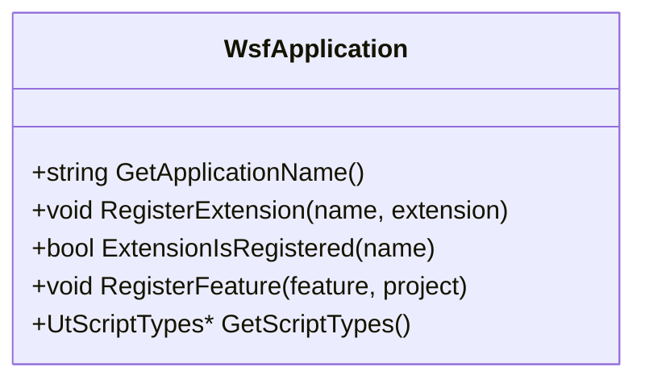

图示来源
- [WsfApplication.hpp:92-133](file://swdev/src/core/wsf/source/WsfApplication.hpp#L92-L133)
- [WsfApplication.hpp:192-214](file://swdev/src/core/wsf/source/WsfApplication.hpp#L192-L214)

章节来源
- [WsfApplication.hpp:76-133](file://swdev/src/core/wsf/source/WsfApplication.hpp#L76-L133)
- [WsfApplication.hpp:192-214](file://swdev/src/core/wsf/source/WsfApplication.hpp#L192-L214)

### 平台（WsfPlatform）
- 生命周期：CompleteLoad/Initialize/Initialize2/Update/NotifyUpdate/ExecuteScript/SendQueuedMessages。
- 外部控制：IsExternallyControlled/IsExternallyMoved/IsExternalShadow。
- 脚本集成：ExecuteScript/HasScript/GetScriptContext。
- 组件管理：AddComponent/GetComponents/AttachObserver/DetachObserver。

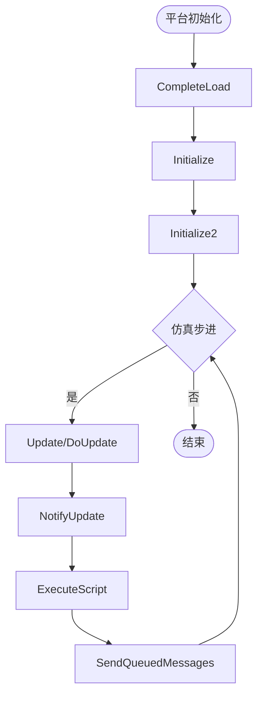

图示来源
- [WsfPlatform.hpp:149-206](file://swdev/src/core/wsf/source/WsfPlatform.hpp#L149-L206)

章节来源
- [WsfPlatform.hpp:132-206](file://swdev/src/core/wsf/source/WsfPlatform.hpp#L132-L206)

### 传感器（WsfSensor）
- 模式与调度：多模式选择、调度器与跟踪器、模式切换事件。
- 检测尝试：AttemptToDetect统一检测流程，支持Settings（所需Pd、锁定时间）。
- 观察者通知：TrackInitiated/Updated/Dropped、TargetUpdated、TurnedOn/Off等。
- 线程安全：ThreadSafe/SetThreadSafe/SetNotThreadSafe。

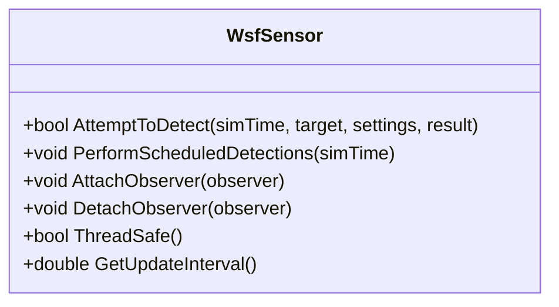

图示来源
- [WsfSensor.hpp:192-213](file://swdev/src/core/wsf/source/sensor/WsfSensor.hpp#L192-L213)
- [WsfSensor.hpp:230-244](file://swdev/src/core/wsf/source/sensor/WsfSensor.hpp#L230-L244)
- [WsfSensor.hpp:288-291](file://swdev/src/core/wsf/source/sensor/WsfSensor.hpp#L288-L291)

章节来源
- [WsfSensor.hpp:173-213](file://swdev/src/core/wsf/source/sensor/WsfSensor.hpp#L173-L213)
- [WsfSensor.hpp:230-244](file://swdev/src/core/wsf/source/sensor/WsfSensor.hpp#L230-L244)
- [WsfSensor.hpp:288-291](file://swdev/src/core/wsf/source/sensor/WsfSensor.hpp#L288-L291)

### 武器（WsfWeapon）
- 发射与齐射：Fire/FireSalvo/ContinueSalvo/AbortSalvo/CeaseFire。
- 库存与再装填：QuantityRemaining/ChangeQuantity/CompleteReloading/ReloadThreshold/Increment。
- 目标与提示：CueToTarget/CreateTargetTrack/GetTargetLocationWCS。
- 干扰与EA：StartJamming/StopJamming/SelectEA_Technique等。

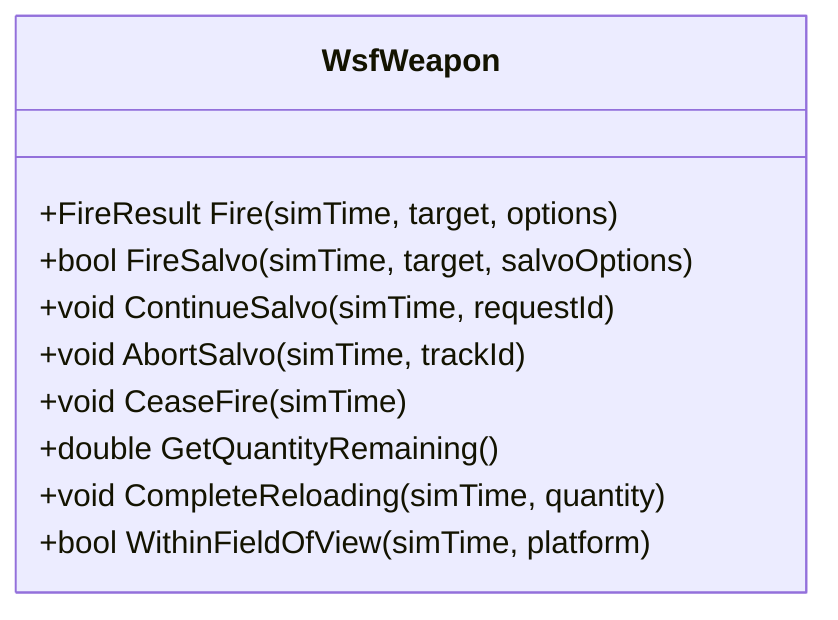

图示来源
- [WsfWeapon.hpp:343-363](file://swdev/src/core/wsf_mil/source/weapon/WsfWeapon.hpp#L343-L363)
- [WsfWeapon.hpp:404-447](file://swdev/src/core/wsf_mil/source/weapon/WsfWeapon.hpp#L404-L447)
- [WsfWeapon.hpp:449-478](file://swdev/src/core/wsf_mil/source/weapon/WsfWeapon.hpp#L449-L478)
- [WsfWeapon.hpp:480-519](file://swdev/src/core/wsf_mil/source/weapon/WsfWeapon.hpp#L480-L519)

章节来源
- [WsfWeapon.hpp:343-363](file://swdev/src/core/wsf_mil/source/weapon/WsfWeapon.hpp#L343-L363)
- [WsfWeapon.hpp:404-447](file://swdev/src/core/wsf_mil/source/weapon/WsfWeapon.hpp#L404-L447)
- [WsfWeapon.hpp:449-478](file://swdev/src/core/wsf_mil/source/weapon/WsfWeapon.hpp#L449-L478)
- [WsfWeapon.hpp:480-519](file://swdev/src/core/wsf_mil/source/weapon/WsfWeapon.hpp#L480-L519)

### 插件与扩展（示例：覆盖范围扩展）
- 应用扩展：ApplicationExtension覆写AddedToApplication与ScenarioCreated，在场景创建时注册场景级扩展。
- 特性注册：通过RegisterFeature声明扩展特性，避免重复注册。

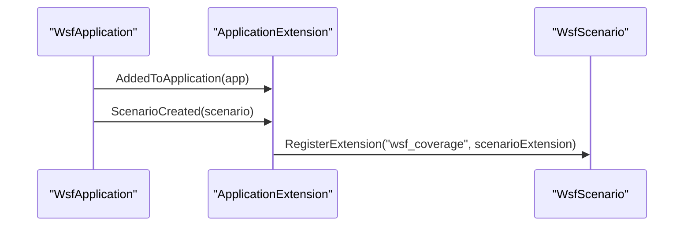

图示来源
- [WsfCoverageRegistration.cpp:24-35](file://swdev/src/wsf_plugins/wsf_coverage/source/WsfCoverageRegistration.cpp#L24-L35)
- [WsfCoverageRegistration.cpp:40-44](file://swdev/src/wsf_plugins/wsf_coverage/source/WsfCoverageRegistration.cpp#L40-L44)

章节来源
- [WsfCoverageRegistration.cpp:24-35](file://swdev/src/wsf_plugins/wsf_coverage/source/WsfCoverageRegistration.cpp#L24-L35)
- [WsfCoverageRegistration.cpp:40-44](file://swdev/src/wsf_plugins/wsf_coverage/source/WsfCoverageRegistration.cpp#L40-L44)

### UCI组件接口（示例）
- 组件角色：QueryInterface返回cWSF_COMPONENT_UCI或cWSF_COMPONENT_PLATFORM。
- 注册/注销：RegisterWithInterface/DeregisterWithInterface与接口交互。
- 能力注册：RegisterCapabilitiesWithInterface/DeregisterCapabilitiesWithInterface。

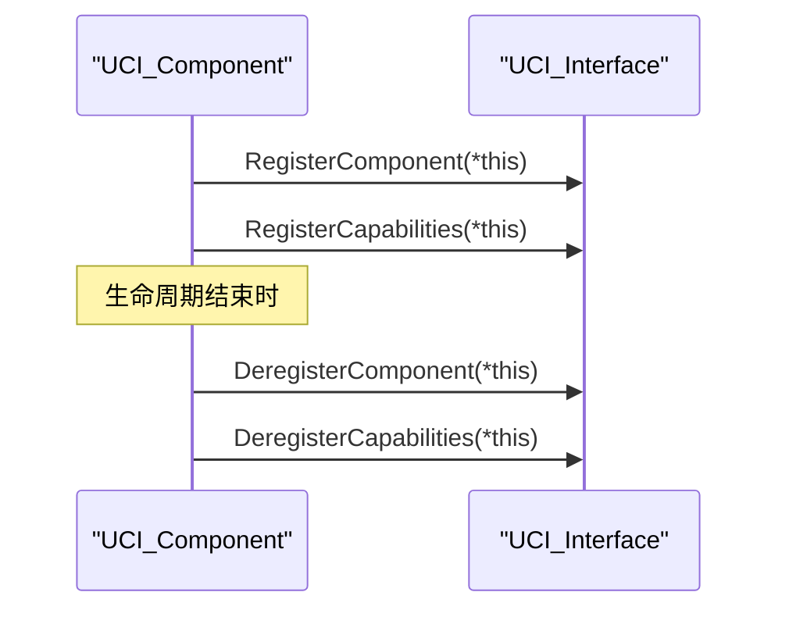

图示来源
- [WsfUCI_Component.cpp:94-140](file://swdev/src/wsf_plugins/wsf_oms_uci/source/WsfUCI_Component.cpp#L94-L140)

章节来源
- [WsfUCI_Component.cpp:94-140](file://swdev/src/wsf_plugins/wsf_oms_uci/source/WsfUCI_Component.cpp#L94-L140)

### Warlock数据接口（示例）
- 仿真线程回调：WallClockRead/SimulationComplete在仿真线程中读写数据。
- 平台事件：PlatformAdded/PlatformDeleted监听平台增删。

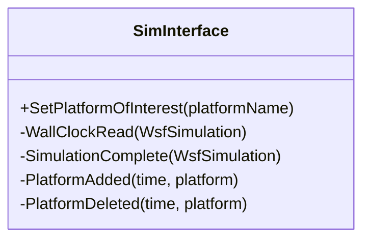

图示来源
- [P6DOF_DataSimInterface.hpp:25-41](file://swdev/src/warlock/plugins/P6DOF_Data/source/P6DOF_DataSimInterface.hpp#L25-L41)

章节来源
- [P6DOF_DataSimInterface.hpp:25-41](file://swdev/src/warlock/plugins/P6DOF_Data/source/P6DOF_DataSimInterface.hpp#L25-L41)

### XIO外部接口（示例）
- 初始化：WsfXIO::Create指定选项与应用类型。
- 数据包：自定义Packet继承WsfXIO_Packet并使用XIO_DEFINE_PACKET宏序列化。

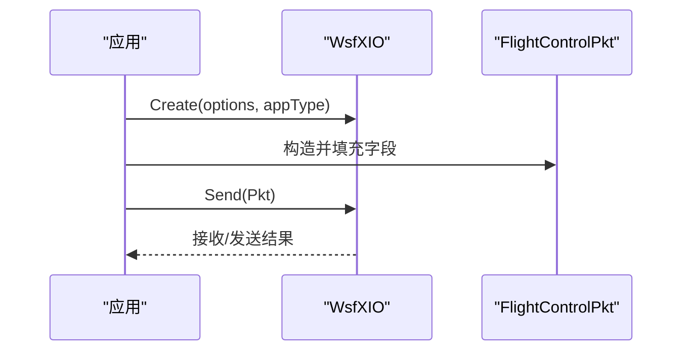

图示来源
- [xio_interface_development.rst.txt:22-30](file://documentation/html/_sources/docs/xio_interface_development.rst.txt#L22-L30)
- [FlightControlPkt.hpp:25-43](file://training/developer/core/labs/solution/xio/source/FlightControlPkt.hpp#L25-L43)

章节来源
- [xio_interface_development.rst.txt:22-30](file://documentation/html/_sources/docs/xio_interface_development.rst.txt#L22-L30)
- [FlightControlPkt.hpp:25-43](file://training/developer/core/labs/solution/xio/source/FlightControlPkt.hpp#L25-L43)

## 依赖关系分析
- 松耦合：WsfApplication与具体扩展通过接口与宏解耦；扩展通过RegisterExtension注入。
- 内聚性：WsfPlatform聚合平台相关子系统（传感器、武器、通信、导航误差等），职责清晰。
- 外部依赖：XIO与Warlock分别承担外部通信与可视化数据访问，不侵入核心仿真逻辑。

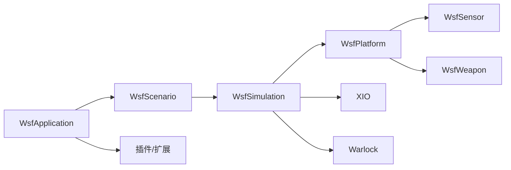

图示来源
- [WsfApplication.hpp:32-44](file://swdev/src/core/wsf/source/WsfApplication.hpp#L32-L44)
- [WsfPlatform.hpp:66-114](file://swdev/src/core/wsf/source/WsfPlatform.hpp#L66-L114)
- [xio_interface_development.rst.txt:22-30](file://documentation/html/_sources/docs/xio_interface_development.rst.txt#L22-L30)

章节来源
- [WsfApplication.hpp:32-44](file://swdev/src/core/wsf/source/WsfApplication.hpp#L32-L44)
- [WsfPlatform.hpp:66-114](file://swdev/src/core/wsf/source/WsfPlatform.hpp#L66-L114)

## 性能与并发特性
- 传感器线程安全：WsfSensor提供ThreadSafe/SetThreadSafe/SetNotThreadSafe，允许在多核环境下并行更新。
- 更新间隔控制：WsfSensor与WsfWeapon均支持SetUpdateInterval，由仿真调度器周期性调用Update。
- 批量检测优化：WsfSensorMode::AttemptToDetect建议先做低成本过滤（遮挡、视场、距离），再进行昂贵计算（地形遮蔽）。

章节来源
- [WsfSensor.hpp:215-221](file://swdev/src/core/wsf/source/sensor/WsfSensor.hpp#L215-L221)
- [WsfSensor.hpp:419-451](file://swdev/src/core/wsf/source/sensor/WsfSensor.hpp#L419-L451)
- [WsfWeapon.hpp:571-580](file://swdev/src/core/wsf_mil/source/weapon/WsfWeapon.hpp#L571-L580)

## 故障排查指南
- 扩展未生效：检查是否调用RegisterFeature与RegisterExtension，确认ExtensionIsRegistered返回true。
- 传感器未触发：确认UpdateInterval设置合理，WithinFieldOfView与AllowDetectionChancesFor逻辑正确。
- 武器未发射：检查Fire/FireSalvo返回值与库存状态（QuantityRemaining/ReloadThreshold）。
- XIO通信异常：核对Create的应用类型与端口配置，确保Packet序列号唯一且序列化字段一致。

章节来源
- [WsfCoverageRegistration.cpp:40-44](file://swdev/src/wsf_plugins/wsf_coverage/source/WsfCoverageRegistration.cpp#L40-L44)
- [WsfSensor.hpp:192-213](file://swdev/src/core/wsf/source/sensor/WsfSensor.hpp#L192-L213)
- [WsfWeapon.hpp:343-363](file://swdev/src/core/wsf_mil/source/weapon/WsfWeapon.hpp#L343-L363)
- [xio_interface_development.rst.txt:22-30](file://documentation/html/_sources/docs/xio_interface_development.rst.txt#L22-L30)

## 结论
WSF通过清晰的层次结构与扩展机制，为AFSIM提供了高内聚、低耦合的可扩展仿真平台。传感器与武器作为平台部件，遵循统一的初始化与更新生命周期，并通过事件与观察者机制与仿真内核交互。插件与扩展通过WsfApplication统一管理，XIO与Warlock分别提供外部通信与可视化能力。遵循本文档的API设计原则与最佳实践，可高效实现自定义传感器、武器系统与行为逻辑，并确保向后兼容与稳定演进。

## 附录：扩展开发示例与最佳实践

### Python脚本API使用与扩展点
- 数据接收示例：使用socket监听端口，解析AFSIM输出的观测数据。
- 扩展点：通过WSF脚本上下文与回调函数接入仿真事件，结合XIO进行双向交互。

章节来源
- [receiver.py:10-24](file://training/developer/core/labs/solution/observer/receiver.py#L10-L24)

### 自定义传感器实现要点
- 继承WsfSensor，实现Clone与AttemptToDetect。
- 使用WsfSensorModeList管理多模式，必要时自定义调度器与跟踪器。
- 合理使用Settings.mRequiredPd与mLockonTime优化检测流程。
- 通过AttachObserver/DetachObserver订阅Track与Target事件。

章节来源
- [WsfSensor.hpp:192-213](file://swdev/src/core/wsf/source/sensor/WsfSensor.hpp#L192-L213)
- [WsfSensor.hpp:230-244](file://swdev/src/core/wsf/source/sensor/WsfSensor.hpp#L230-L244)

### 自定义武器系统实现要点
- 继承WsfWeapon，实现Clone与Fire/FireSalvo。
- 管理库存与再装填，确保ChangeQuantity与SetTimeLastFired被调用。
- 使用CueToTarget与CreateTargetTrack准备目标数据。
- 如需干扰能力，实现StartJamming/StopJamming/SelectEA_Technique等接口。

章节来源
- [WsfWeapon.hpp:343-363](file://swdev/src/core/wsf_mil/source/weapon/WsfWeapon.hpp#L343-L363)
- [WsfWeapon.hpp:404-447](file://swdev/src/core/wsf_mil/source/weapon/WsfWeapon.hpp#L404-L447)
- [WsfWeapon.hpp:480-519](file://swdev/src/core/wsf_mil/source/weapon/WsfWeapon.hpp#L480-L519)

### 插件注册与生命周期管理
- 在ApplicationExtension中覆写AddedToApplication与ScenarioCreated，完成脚本类型与场景扩展注册。
- 使用RegisterFeature声明特性，避免重复注册。

章节来源
- [WsfCoverageRegistration.cpp:24-35](file://swdev/src/wsf_plugins/wsf_coverage/source/WsfCoverageRegistration.cpp#L24-L35)
- [WsfCoverageRegistration.cpp:40-44](file://swdev/src/wsf_plugins/wsf_coverage/source/WsfCoverageRegistration.cpp#L40-L44)

### 向后兼容性与版本管理
- 特性开关：通过RegisterFeature与条件编译/输入文件条件块控制新特性启用。
- 接口稳定：保持虚函数契约不变，新增能力通过可选方法或扩展接口提供。
- 版本号：在扩展名称与特性名中体现版本信息，便于运行时检测与降级。

章节来源
- [WsfApplication.hpp:107-133](file://swdev/src/core/wsf/source/WsfApplication.hpp#L107-L133)

### 常见陷阱与规避
- 忽略线程安全：非线程安全的传感器在多线程环境中可能导致数据竞争，需显式标记SetNotThreadSafe。
- 更新间隔不当：过短的UpdateInterval导致性能下降，应依据传感器扫描周期合理设置。
- 未释放观察者：忘记DetachObserver会导致悬垂指针，需在析构或销毁路径清理。
- XIO包冲突：Packet序列号重复或序列化不一致会导致解析失败，需严格校验。

章节来源
- [WsfSensor.hpp:215-221](file://swdev/src/core/wsf/source/sensor/WsfSensor.hpp#L215-L221)
- [WsfSensor.hpp:419-451](file://swdev/src/core/wsf/source/sensor/WsfSensor.hpp#L419-L451)
- [FlightControlPkt.hpp:25-43](file://training/developer/core/labs/solution/xio/source/FlightControlPkt.hpp#L25-L43)