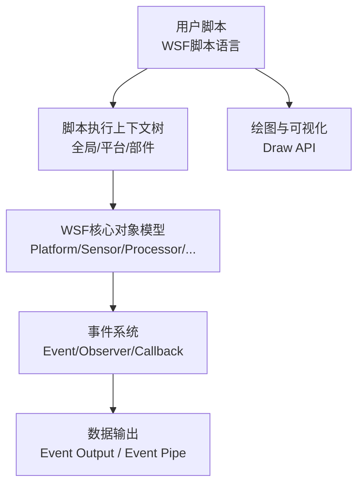
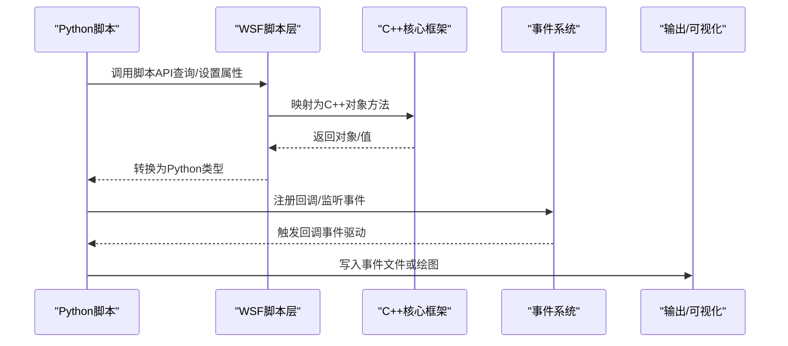
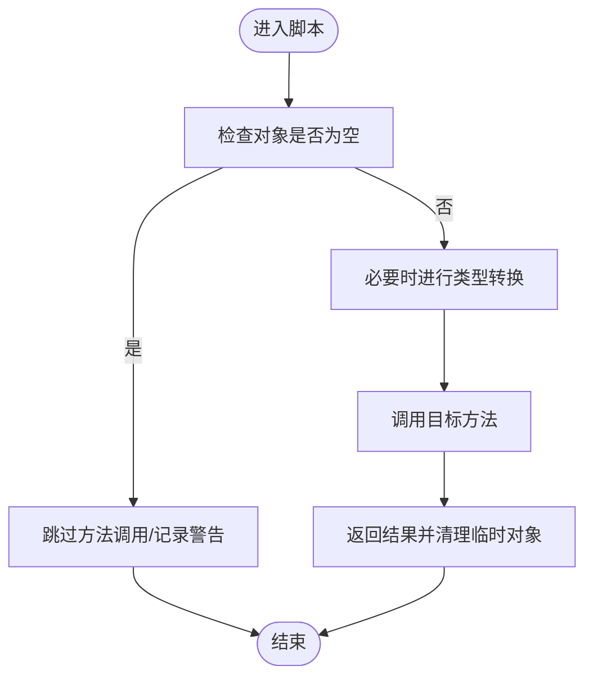
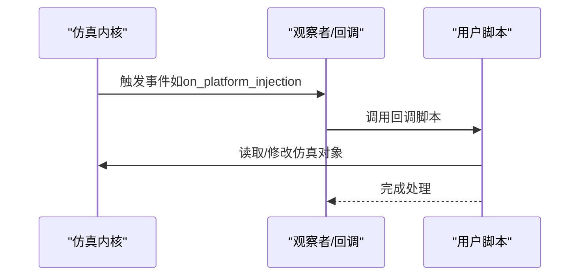
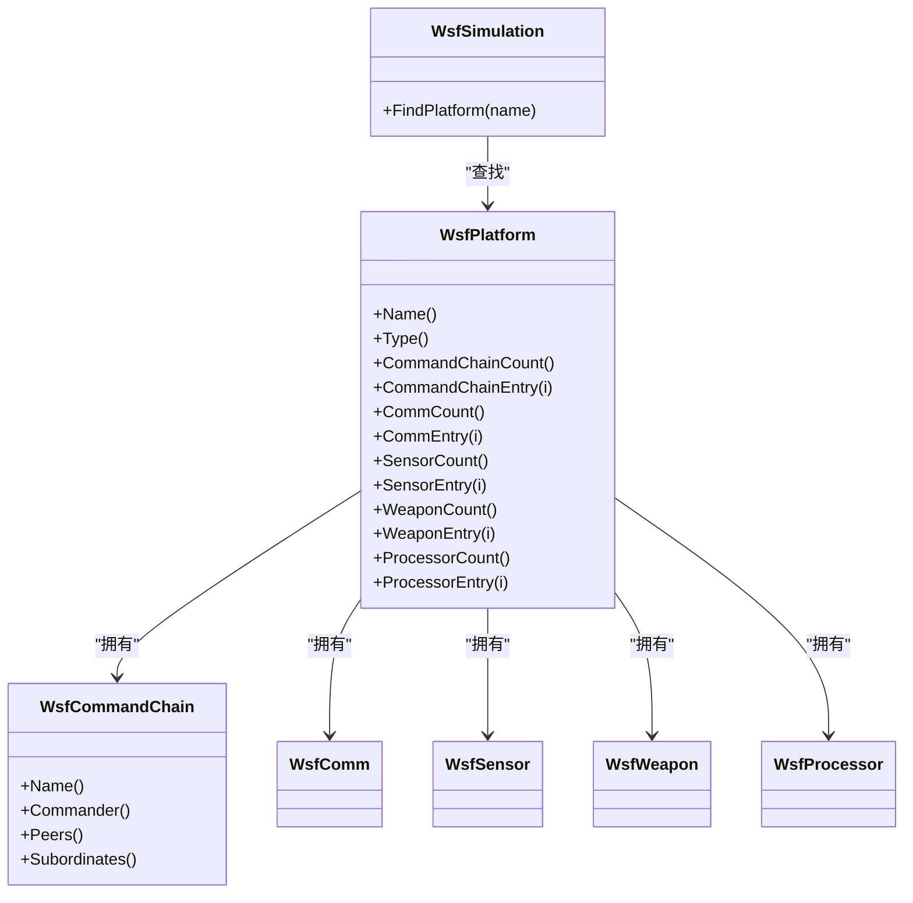
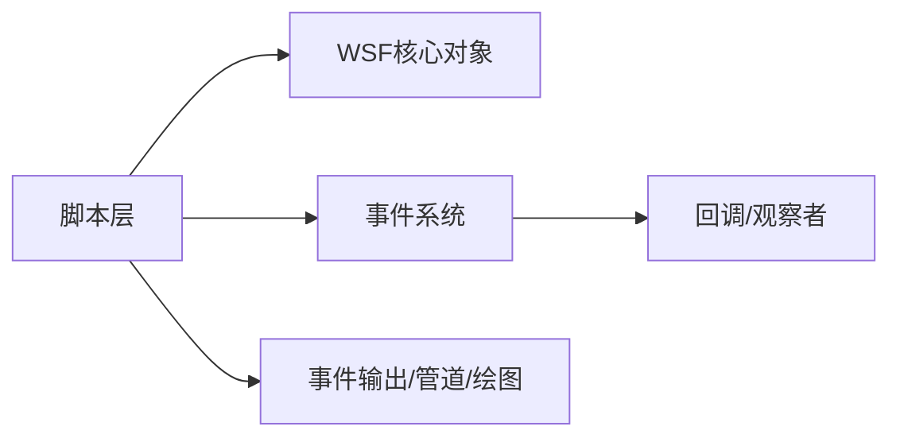

# Python脚本API

<cite>
**本文引用的文件**   
- [script.rst](file://documentation/html/_sources/docs/script.rst.txt)
- [script_interface.rst](file://documentation/html/_sources/docs/script_interface.rst.txt)
- [script_types.rst](file://documentation/html/_sources/docs/script_types.rst.txt)
- [script_demo_1.txt](file://demos/script_demos/script_demo_1.txt)
- [observer.rst](file://swdev/src/core/wsf/doc/observer.rst)
- [callback.rst](file://swdev/src/core/wsf/doc/callback.rst)
- [common_script_interface.rst](file://swdev/src/core/wsf/doc/common_script_interface.rst)
- [platform.rst](file://swdev/src/core/wsf/doc/platform.rst)
- [processor.rst](file://swdev/src/core/wsf/doc/processor.rst)
- [sensor.rst](file://swdev/src/core/wsf/doc/sensor.rst)
- [event_output.rst](file://swdev/src/core/wsf/doc/event_output.rst)
- [event_pipe.rst](file://swdev/src/core/wsf/doc/event_pipe.rst)
- [draw.rst](file://swdev/src/core/wsf/doc/draw.rst)
- [receiver.py](file://training/developer/core/labs/solution/observer/receiver.py)
</cite>

## 目录
1. [简介](#简介)
2. [项目结构](#项目结构)
3. [核心组件](#核心组件)
4. [架构总览](#架构总览)
5. [详细组件分析](#详细组件分析)
6. [依赖关系分析](#依赖关系分析)
7. [性能考虑](#性能考虑)
8. [故障排查指南](#故障排查指南)
9. [结论](#结论)
10. [附录](#附录)

## 简介
本文件面向使用AFSIM的Python脚本开发者，系统性说明Python与C++核心框架之间的绑定机制、类型转换、内存管理与异常处理；文档化脚本接口的设计原则（命名约定、参数传递、返回值处理）；解释回调函数的定义与使用方法（事件监听、状态监控、数据处理）；说明数据访问API（仿真对象查询、属性读写、批量操作）；并提供丰富的脚本示例路径，涵盖数据分析、自动化测试与可视化输出。同时给出性能优化技巧与常见问题解决方案。

## 项目结构
AFSIM的脚本能力由“脚本语言”和“脚本接口配置”两部分组成：
- 脚本语言：提供变量、类型、控制流、函数、类与方法等语法，用于在仿真上下文中编写逻辑。
- 脚本接口配置：通过script_interface块启用调试、定义全局可调用脚本等。
- 演示脚本：demos/script_demos下提供多组示例，展示处理器中脚本变量的使用、数组遍历、平台信息打印、命令链与子系统枚举等。

图表来源
- [script.rst:17-39](file://documentation/html/_sources/docs/script.rst.txt#L17-L39)
- [script_interface.rst:17-47](file://documentation/html/_sources/docs/script_interface.rst.txt#L17-L47)
- [script_demo_1.txt:25-31](file://demos/script_demos/script_demo_1.txt#L25-L31)

章节来源
- [script.rst:17-39](file://documentation/html/_sources/docs/script.rst.txt#L17-L39)
- [script_interface.rst:17-47](file://documentation/html/_sources/docs/script_interface.rst.txt#L17-L47)
- [script_demo_1.txt:25-31](file://demos/script_demos/script_demo_1.txt#L25-L31)

## 核心组件
- 脚本语言基础
  - 基本类型：int、bool、double、string，支持算术、比较与字符串拼接。
  - 脚本类：引用语义，包含静态方法与实例方法，支持空对象检测。
  - 作用域与生命周期：自动/全局/静态变量，父上下文继承，子上下文可见性。
- 脚本接口配置
  - script_interface块：开启debug/no_debug，定义全局脚本。
- 演示脚本
  - 在处理器中声明脚本变量、数组，并在on_initialize/on_update钩子中访问平台、命令链、通信、传感器、武器与处理器列表。

章节来源
- [script.rst:41-129](file://documentation/html/_sources/docs/script.rst.txt#L41-L129)
- [script_interface.rst:17-47](file://documentation/html/_sources/docs/script_interface.rst.txt#L17-L47)
- [script_demo_1.txt:45-179](file://demos/script_demos/script_demo_1.txt#L45-L179)

## 架构总览
下图展示了从Python侧到C++核心框架的交互路径：Python脚本通过WSF脚本层访问核心对象（平台、传感器、处理器等），并通过事件系统与回调机制进行状态监听与数据处理，最终将结果写入事件输出或绘制到可视化界面。

图表来源
- [script.rst:20-39](file://documentation/html/_sources/docs/script.rst.txt#L20-L39)
- [observer.rst](file://swdev/src/core/wsf/doc/observer.rst)
- [callback.rst](file://swdev/src/core/wsf/doc/callback.rst)
- [event_output.rst](file://swdev/src/core/wsf/doc/event_output.rst)
- [event_pipe.rst](file://swdev/src/core/wsf/doc/event_pipe.rst)
- [draw.rst](file://swdev/src/core/wsf/doc/draw.rst)

## 详细组件分析

### 类型转换与内存管理
- 基本类型按值拷贝，复杂类型（脚本类）按引用传递。
- 空对象检测：对未初始化的脚本对象需先判空再调用方法。
- 强制类型转换：支持基本类型之间互转，以及对象间的显式转换（需谨慎）。
- 内存管理：脚本对象的生命周期由执行上下文管理；避免在回调中持有长生命周期的大对象引用，必要时及时释放或转为轻量数据结构。

图表来源
- [script.rst:88-129](file://documentation/html/_sources/docs/script.rst.txt#L88-L129)
- [script.rst:240-253](file://documentation/html/_sources/docs/script.rst.txt#L240-L253)

章节来源
- [script.rst:88-129](file://documentation/html/_sources/docs/script.rst.txt#L88-L129)
- [script.rst:240-253](file://documentation/html/_sources/docs/script.rst.txt#L240-L253)

### 异常处理
- 脚本层错误：编译期错误可通过script_interface.debug开启详细输出；运行期错误通常抛出异常或中断当前脚本执行。
- 建议策略：
  - 在关键路径使用try/catch（若可用）或条件判断规避非法访问。
  - 对外部输入进行校验，避免越界与类型不匹配。
  - 在回调中捕获异常并记录日志，防止影响主仿真循环。

章节来源
- [script_interface.rst:31-41](file://documentation/html/_sources/docs/script_interface.rst.txt#L31-L41)

### 回调函数与事件监听
- 回调机制：通过观察者模式与回调接口，允许在特定事件发生时执行用户脚本。
- 常见用法：
  - 事件监听：订阅平台状态变化、传感器探测、武器发射等事件。
  - 状态监控：周期性更新指标、统计量或阈值告警。
  - 数据处理：在回调中对数据进行过滤、聚合与导出。

图表来源
- [observer.rst](file://swdev/src/core/wsf/doc/observer.rst)
- [callback.rst](file://swdev/src/core/wsf/doc/callback.rst)

章节来源
- [observer.rst](file://swdev/src/core/wsf/doc/observer.rst)
- [callback.rst](file://swdev/src/core/wsf/doc/callback.rst)

### 数据访问API（查询、读写、批量）
- 对象查询：通过WsfSimulation等平台查找接口获取仿真实体。
- 属性读写：对平台、传感器、武器、处理器等进行开关、参数与状态读写。
- 批量操作：遍历命令链、通信设备、传感器、武器与处理器集合，进行统一处理。

图表来源
- [script_demo_1.txt:124-179](file://demos/script_demos/script_demo_1.txt#L124-L179)
- [platform.rst](file://swdev/src/core/wsf/doc/platform.rst)
- [processor.rst](file://swdev/src/core/wsf/doc/processor.rst)
- [sensor.rst](file://swdev/src/core/wsf/doc/sensor.rst)

章节来源
- [script_demo_1.txt:124-179](file://demos/script_demos/script_demo_1.txt#L124-L179)
- [platform.rst](file://swdev/src/core/wsf/doc/platform.rst)
- [processor.rst](file://swdev/src/core/wsf/doc/processor.rst)
- [sensor.rst](file://swdev/src/core/wsf/doc/sensor.rst)

### 脚本接口设计原则
- 命名约定：
  - 脚本名称与方法名采用可读性强的小驼峰或下划线风格，保持与WSF对象命名一致。
  - 全局脚本在script_interface中声明，便于跨平台复用。
- 参数传递：
  - 基本类型按值传递，复杂对象按引用传递；避免在高频回调中创建大对象。
- 返回值处理：
  - 明确返回类型；对可能为空的对象进行判空处理；对数值范围进行边界检查。

章节来源
- [script_interface.rst:17-47](file://documentation/html/_sources/docs/script_interface.rst.txt#L17-L47)
- [script.rst:88-129](file://documentation/html/_sources/docs/script.rst.txt#L88-L129)

### 脚本示例与最佳实践
- 示例路径
  - 基础脚本示例：[script_demo_1.txt](file://demos/script_demos/script_demo_1.txt)
  - 观察者接收端示例（Python）：[receiver.py](file://training/developer/core/labs/solution/observer/receiver.py)
- 数据分析
  - 在on_update中采集平台指标，使用数组/映射存储，定期汇总并写入事件输出。
- 自动化测试
  - 通过脚本构造场景、注入平台、触发事件，断言预期行为。
- 可视化输出
  - 使用Draw API绘制轨迹、区域与标注；结合事件管道实时输出。

章节来源
- [script_demo_1.txt:45-179](file://demos/script_demos/script_demo_1.txt#L45-L179)
- [receiver.py:1-24](file://training/developer/core/labs/solution/observer/receiver.py#L1-L24)
- [draw.rst](file://swdev/src/core/wsf/doc/draw.rst)

## 依赖关系分析
- 脚本层依赖WSF核心对象模型（平台、传感器、处理器等）。
- 事件系统作为中间层，连接仿真内核与用户脚本回调。
- 输出模块（事件输出、事件管道、绘图）依赖脚本层的数据生成。

图表来源
- [script.rst:20-39](file://documentation/html/_sources/docs/script.rst.txt#L20-L39)
- [observer.rst](file://swdev/src/core/wsf/doc/observer.rst)
- [event_output.rst](file://swdev/src/core/wsf/doc/event_output.rst)
- [event_pipe.rst](file://swdev/src/core/wsf/doc/event_pipe.rst)
- [draw.rst](file://swdev/src/core/wsf/doc/draw.rst)

章节来源
- [script.rst:20-39](file://documentation/html/_sources/docs/script.rst.txt#L20-L39)
- [observer.rst](file://swdev/src/core/wsf/doc/observer.rst)
- [event_output.rst](file://swdev/src/core/wsf/doc/event_output.rst)
- [event_pipe.rst](file://swdev/src/core/wsf/doc/event_pipe.rst)
- [draw.rst](file://swdev/src/core/wsf/doc/draw.rst)

## 性能考虑
- 减少对象创建：在高频回调中复用对象，避免频繁分配与释放。
- 批量操作优先：尽量使用集合遍历与批量读写，减少逐条调用的开销。
- 合理采样频率：根据需求调整on_update间隔，避免过度采样。
- I/O优化：合并写入、缓冲输出，降低事件输出与文件I/O压力。
- 调试开关：仅在开发阶段启用script_interface.debug，发布版本关闭以减少开销。

章节来源
- [script_interface.rst:31-41](file://documentation/html/_sources/docs/script_interface.rst.txt#L31-L41)
- [script_demo_1.txt:45-179](file://demos/script_demos/script_demo_1.txt#L45-L179)

## 故障排查指南
- 编译期错误
  - 启用script_interface.debug查看详细错误信息。
- 运行期错误
  - 检查对象是否为空后再调用方法。
  - 确认类型转换是否安全，避免非法强转。
- 回调未触发
  - 确认事件订阅是否正确，回调函数签名与参数是否匹配。
- 数据不一致
  - 检查on_update与on_initialize的执行顺序与条件。
  - 验证批量操作的索引与边界。

章节来源
- [script_interface.rst:31-41](file://documentation/html/_sources/docs/script_interface.rst.txt#L31-L41)
- [script.rst:88-129](file://documentation/html/_sources/docs/script.rst.txt#L88-L129)
- [script_demo_1.txt:45-179](file://demos/script_demos/script_demo_1.txt#L45-L179)

## 结论
AFSIM的脚本体系通过清晰的类型系统、灵活的回调机制与丰富的数据访问API，为Python与C++核心框架提供了稳定高效的集成方式。遵循本文的设计原则与最佳实践，可在保证性能与稳定性的前提下，实现复杂的数据分析、自动化测试与可视化输出。

## 附录
- 脚本类型参考：[script_types.rst](file://documentation/html/_sources/docs/script_types.rst.txt)
- 通用脚本接口：[common_script_interface.rst](file://swdev/src/core/wsf/doc/common_script_interface.rst)
- 事件输出与管道：[event_output.rst](file://swdev/src/core/wsf/doc/event_output.rst)、[event_pipe.rst](file://swdev/src/core/wsf/doc/event_pipe.rst)