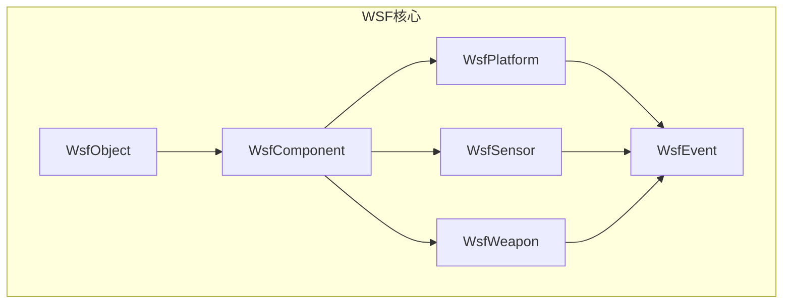
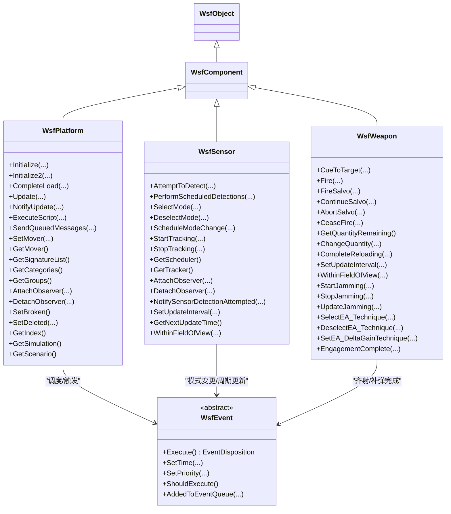
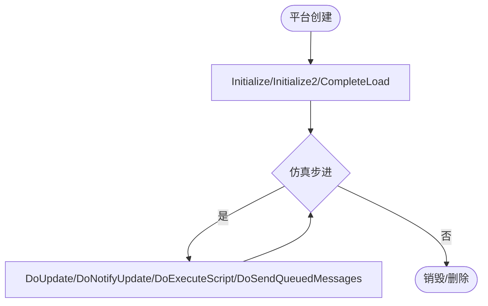
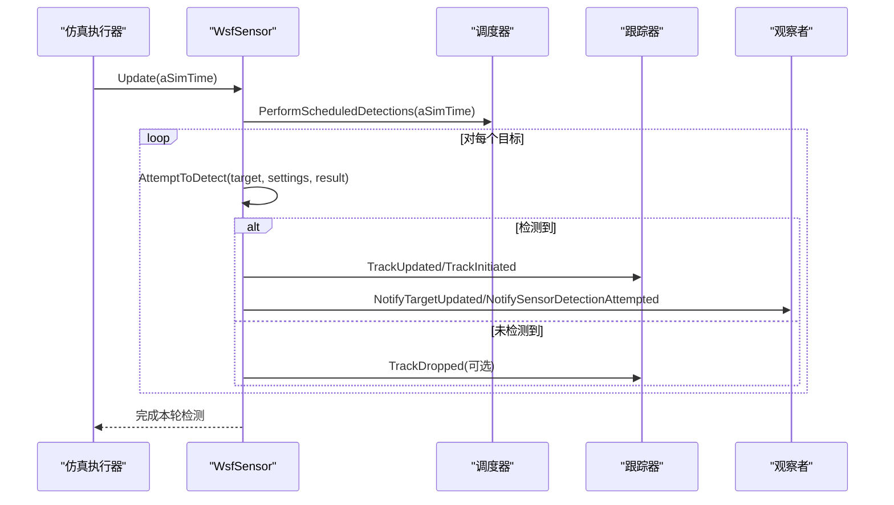
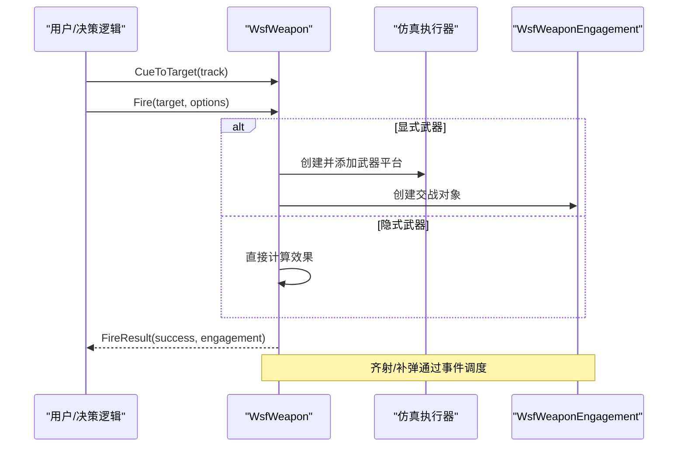
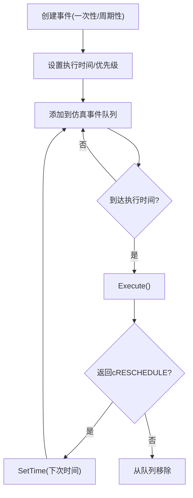
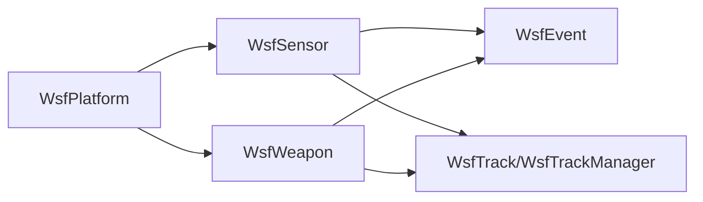

# WSF框架API设计

<cite>
**本文引用的文件**   
- [WsfPlatform.hpp](file://swdev/src/core/wsf/source/WsfPlatform.hpp)
- [WsfSensor.hpp](file://swdev/src/core/wsf/source/sensor/WsfSensor.hpp)
- [WsfWeapon.hpp](file://swdev/src/core/wsf_mil/source/weapon/WsfWeapon.hpp)
- [WsfEvent.hpp](file://swdev/src/core/wsf/source/WsfEvent.hpp)
- [WsfObject.hpp](file://swdev/src/core/wsf/source/WsfObject.hpp)
- [WsfComponent.hpp](file://swdev/src/core/wsf/source/WsfComponent.hpp)
</cite>

## 目录
1. [简介](#简介)
2. [项目结构](#项目结构)
3. [核心组件](#核心组件)
4. [架构总览](#架构总览)
5. [详细组件分析](#详细组件分析)
6. [依赖关系分析](#依赖关系分析)
7. [性能考虑](#性能考虑)
8. [故障排查指南](#故障排查指南)
9. [结论](#结论)
10. [附录](#附录)

## 简介
本文件面向WSF（Warfare Simulation Framework）框架的API设计与扩展实践，聚焦以下目标：
- 梳理核心基类继承体系与虚函数约定，包括平台（Platform）、传感器（Sensor）、武器（Weapon）等。
- 文档化事件驱动机制的API接口，涵盖事件注册、回调函数定义与处理流程。
- 说明平台管理系统的API，包括实体创建、属性访问与生命周期管理。
- 解释配置系统的设计思路，包括声明式语法解析与运行时对象构建。
- 提供具体API使用示例与最佳实践，覆盖错误处理、内存管理与性能优化。

## 项目结构
WSF核心代码位于 swdev/src/core/wsf 及其相关子模块中。本次文档重点围绕以下头文件展开：
- WsfPlatform.hpp：平台抽象与生命周期、组件装配、脚本上下文、轨迹管理等。
- WsfSensor.hpp：传感器抽象、模式列表、调度器/跟踪器、检测尝试流程等。
- WsfWeapon.hpp：武器抽象、发射/齐射、库存与补弹、交战状态等。
- WsfEvent.hpp：事件基类、一次性/周期性事件适配器。
- WsfObject.hpp / WsfComponent.hpp：对象与组件基础设施。

图表来源
- [WsfPlatform.hpp:108-115](file://swdev/src/core/wsf/source/WsfPlatform.hpp#L108-L115)
- [WsfSensor.hpp:91-92](file://swdev/src/core/wsf/source/sensor/WsfSensor.hpp#L91-L92)
- [WsfWeapon.hpp:62-63](file://swdev/src/core/wsf_mil/source/weapon/WsfWeapon.hpp#L62-L63)
- [WsfEvent.hpp:28-29](file://swdev/src/core/wsf/source/WsfEvent.hpp#L28-L29)

章节来源
- [WsfPlatform.hpp:108-115](file://swdev/src/core/wsf/source/WsfPlatform.hpp#L108-L115)
- [WsfSensor.hpp:91-92](file://swdev/src/core/wsf/source/sensor/WsfSensor.hpp#L91-L92)
- [WsfWeapon.hpp:62-63](file://swdev/src/core/wsf_mil/source/weapon/WsfWeapon.hpp#L62-L63)
- [WsfEvent.hpp:28-29](file://swdev/src/core/wsf/source/WsfEvent.hpp#L28-L29)

## 核心组件
- 平台（WsfPlatform）
  - 作为仿真实体的容器，负责装配子系统（传感器、通信、处理器等），并提供位置更新、燃料、外观、类别/分组、轨迹管理、观察者通知等能力。
  - 关键生命周期方法：Initialize/Initialize2/CompleteLoad/Update/NotifyUpdate/ExecuteScript/SendQueuedMessages。
  - 组件管理：AddComponent/GetComponents/CloneComponent/QueryInterface。
  - 外部控制与影子实体：IsExternallyControlled/SetIsExternallyControlled、IsExternalShadow/SetIsExternalShadow。
  - 破坏与删除：OnBrokenEvent/SetBroken/IsBroken/SetDeleted/IsDeleted。
  - 索引与存在性：GetIndex/SetIndex/GetSimulation/GetScenario。
  - 运动与地形：SetMover/GetMover、GetTerrain/GetHeightAboveTerrain/GetTerrainHeight。
  - 质量与尺寸：GetMass/GetEmptyMass/GetPayloadMass/GetFuelMass/Set*、GetLength/GetWidth/GetHeight/Set*。
  - 外观与能力：GetAppearance/SetAppearance/ScriptOverride、GetCapabilities/SetCapabilities、GetConcealmentFactor/SetConcealmentFactor、GetDamageFactor/SetDamageFactor。
  - 类别与分组：GetCategories/AddCategory/IsCategoryMember、GetGroups/JoinGroup/LeaveGroup/IsGroupMember。
  - 观察者：AttachObserver/DetachObserver/NotifyDeleted/NotifyDeleting。

- 传感器（WsfSensor）
  - 多模式传感器抽象，包含模式列表、调度器（Scheduler）与跟踪器（Tracker）。
  - 检测尝试：AttemptToDetect(aSimTime, target, settings, result)，遵循“先易后难”的检测流程（遮蔽、范围、地平线遮挡、视场、探测概率、地形遮挡）。
  - 运行控制：TurnOn/TurnOff/SetOperational/SetNonOperational/PartBroken。
  - 线程安全：ThreadSafe/SetThreadSafe/SetNotThreadSafe。
  - 模式选择：SelectMode/DeselectMode/ScheduleModeChange/GetCurrentMode/GetModeCount/GetModeList。
  - 请求与跟踪：StartTracking/StopTracking/HaveRequestFor/GetActiveRequestCount/GetMaximumRequestCount、TrackUpdated/TrackDropped/TrackCoasted。
  - 事件与观察者：NotifySensorDetectionAttempted、AttachObserver/DetachObserver/NotifyDeleted/NotifyTrackInitiated/NotifyTrackUpdated/NotifyTrackDropped/NotifyTargetUpdated/NotifyTurnedOff/NotifyTurnedOn。
  - 更新间隔与周期事件：SetUpdateInterval/GetNextUpdateTime/AdjustNextUpdateTime/IncrementUpdateEventEpoch/UpdateEventActive。
  - EM收发器访问：GetEM_Rcvr*/GetEM_Xmtr*。
  - 视场判断：WithinFieldOfView(platform/track)。

- 武器（WsfWeapon）
  - 武器抽象，支持显式（发射新平台）与隐式（直接效果）两类武器。
  - 发射与齐射：CueToTarget/Fire/FireSalvo/ContinueSalvo/AbortSalvo/CeaseFire。
  - 库存与补弹：GetQuantityRemaining/ChangeQuantity/CompleteReloading/IsReloading/InhibitWhileReloading/ReloadThreshold/ReloadIncrement/ReloadInventory。
  - 时间参数：GetFiringDelay/GetSalvoInterval/GetFiringInterval/SetFiringInterval。
  - 模式与组件：GetCurrentMode/GetModeCount/SelectMode/DeselectMode、GetComponents。
  - 发射结果与交战：FireResult（含成功标志与Engagement指针）、EngagementComplete。
  - IFC与武器服务器：SetIFCEnabled/GetIFCEnabled、AllocateTheWeapon/SetState/GetState。
  - 视场与干扰：WithinFieldOfView、StartJamming/StopJamming/UpdateJamming、SelectEA_Technique/DeselectEA_Technique/SetEA_DeltaGainTechnique。

- 事件（WsfEvent）
  - 抽象基类，定义Execute()返回处置（cDELETE/cRESCHEDULE）。
  - 一次性事件：WsfOneShotEvent（执行一次后删除）。
  - 周期性事件：WsfRecurringEvent（可重调度，需设置下次执行时间）。
  - 通用属性：GetTime/SetTime、GetPriority/SetPriority、ShouldExecute/SetShouldExecute、AddedToEventQueue。

章节来源
- [WsfPlatform.hpp:108-700](file://swdev/src/core/wsf/source/WsfPlatform.hpp#L108-L700)
- [WsfSensor.hpp:45-582](file://swdev/src/core/wsf/source/sensor/WsfSensor.hpp#L45-L582)
- [WsfWeapon.hpp:39-865](file://swdev/src/core/wsf_mil/source/weapon/WsfWeapon.hpp#L39-L865)
- [WsfEvent.hpp:21-175](file://swdev/src/core/wsf/source/WsfEvent.hpp#L21-L175)

## 架构总览
WSF采用“平台-部件-事件”的三层架构：
- 平台（WsfPlatform）是仿真实体容器，装配各类部件（传感器、武器、通信、处理器等）。
- 部件（如WsfSensor、WsfWeapon）通过统一的组件接口参与初始化、更新与销毁流程。
- 事件（WsfEvent）驱动仿真时序，支持一次性与周期性任务。

图表来源
- [WsfPlatform.hpp:108-700](file://swdev/src/core/wsf/source/WsfPlatform.hpp#L108-L700)
- [WsfSensor.hpp:91-582](file://swdev/src/core/wsf/source/sensor/WsfSensor.hpp#L91-L582)
- [WsfWeapon.hpp:62-865](file://swdev/src/core/wsf_mil/source/weapon/WsfWeapon.hpp#L62-L865)
- [WsfEvent.hpp:28-175](file://swdev/src/core/wsf/source/WsfEvent.hpp#L28-L175)

## 详细组件分析

### 平台（WsfPlatform）API与生命周期
- 创建与装配
  - 构造后必须设置唯一名称与阵营（side），然后装配Mover与各子系统（传感器、通信、处理器等），通过AddComponent加入平台。
  - 典型流程：实例化 -> SetName/SetSide -> SetMover -> AddComponent(子系统)。
- 生命周期钩子
  - Initialize/Initialize2/CompleteLoad：在仿真初始化阶段被调用，用于建立内部状态与依赖。
  - Update/NotifyUpdate/ExecuteScript/SendQueuedMessages：仿真步进时由执行器按序调用。
- 属性访问
  - 阵营/图标/标记：GetSide/SetSide、GetIcon/SetIcon、GetMarking/SetMarking。
  - 空间域：GetSpatialDomain/SetSpatialDomain。
  - 外观/能力/隐蔽/损伤：GetAppearance/SetAppearance/ScriptOverride、GetCapabilities/SetCapabilities、GetConcealmentFactor/SetConcealmentFactor、GetDamageFactor/SetDamageFactor。
  - 尺寸/质量：GetLength/GetWidth/GetHeight/Set*、GetMass/GetEmptyMass/GetPayloadMass/GetFuelMass/Set*。
- 轨迹与观察
  - GetNextTrackId/GetMasterTrackList/GetMasterRawTrackList/GetTrackManager。
  - AttachObserver/DetachObserver/NotifyDeleted/NotifyDeleting。
- 外部控制与影子实体
  - IsExternallyControlled/SetIsExternallyControlled、IsExternalShadow/SetIsExternalShadow。
- 破坏与删除
  - OnBrokenEvent/SetBroken/IsBroken、SetDeleted/IsDeleted。
- 索引与存在性
  - GetIndex/SetIndex、GetSimulation/GetScenario。

图表来源
- [WsfPlatform.hpp:150-206](file://swdev/src/core/wsf/source/WsfPlatform.hpp#L150-L206)
- [WsfPlatform.hpp:593-607](file://swdev/src/core/wsf/source/WsfPlatform.hpp#L593-L607)

章节来源
- [WsfPlatform.hpp:66-115](file://swdev/src/core/wsf/source/WsfPlatform.hpp#L66-L115)
- [WsfPlatform.hpp:150-206](file://swdev/src/core/wsf/source/WsfPlatform.hpp#L150-L206)
- [WsfPlatform.hpp:211-331](file://swdev/src/core/wsf/source/WsfPlatform.hpp#L211-L331)
- [WsfPlatform.hpp:333-580](file://swdev/src/core/wsf/source/WsfPlatform.hpp#L333-L580)
- [WsfPlatform.hpp:593-607](file://swdev/src/core/wsf/source/WsfPlatform.hpp#L593-L607)

### 传感器（WsfSensor）API与检测流程
- 模式与组件
  - 多模式：SelectMode/DeselectMode/ScheduleModeChange/GetCurrentMode/GetModeCount/GetModeList。
  - 组件列表：GetComponents。
- 检测尝试
  - AttemptToDetect：实现“先易后难”的检测流程，最终输出WsfSensorResult。
  - PerformScheduledDetections：调度器驱动的批量检测。
- 跟踪与请求
  - StartTracking/StopTracking/HaveRequestFor/GetActiveRequestCount/GetMaximumRequestCount。
  - TrackUpdated/TrackDropped/TrackCoasted。
- 观察者与通知
  - NotifySensorDetectionAttempted、AttachObserver/DetachObserver、NotifyTrackInitiated/NotifyTrackUpdated/NotifyTrackDropped/NotifyTargetUpdated/NotifyTurnedOff/NotifyTurnedOn。
- 线程安全与更新间隔
  - ThreadSafe/SetThreadSafe/SetNotThreadSafe。
  - SetUpdateInterval/GetNextUpdateTime/AdjustNextUpdateTime/IncrementUpdateEventEpoch/UpdateEventActive。
- 视场与EM收发器
  - WithinFieldOfView(platform/track)、GetEM_Rcvr*/GetEM_Xmtr*。

图表来源
- [WsfSensor.hpp:192-213](file://swdev/src/core/wsf/source/sensor/WsfSensor.hpp#L192-L213)
- [WsfSensor.hpp:336-371](file://swdev/src/core/wsf/source/sensor/WsfSensor.hpp#L336-L371)
- [WsfSensor.hpp:400-451](file://swdev/src/core/wsf/source/sensor/WsfSensor.hpp#L400-L451)

章节来源
- [WsfSensor.hpp:45-90](file://swdev/src/core/wsf/source/sensor/WsfSensor.hpp#L45-L90)
- [WsfSensor.hpp:192-213](file://swdev/src/core/wsf/source/sensor/WsfSensor.hpp#L192-L213)
- [WsfSensor.hpp:230-244](file://swdev/src/core/wsf/source/sensor/WsfSensor.hpp#L230-L244)
- [WsfSensor.hpp:336-371](file://swdev/src/core/wsf/source/sensor/WsfSensor.hpp#L336-L371)
- [WsfSensor.hpp:400-451](file://swdev/src/core/wsf/source/sensor/WsfSensor.hpp#L400-L451)

### 武器（WsfWeapon）API与发射流程
- 发射与齐射
  - CueToTarget/Fire/FireSalvo/ContinueSalvo/AbortSalvo/CeaseFire。
  - FireResult包含成功标志与Engagement指针。
- 库存与补弹
  - GetQuantityRemaining/ChangeQuantity/CompleteReloading/IsReloading/InhibitWhileReloading/ReloadThreshold/ReloadIncrement/ReloadInventory。
- 时间与间隔
  - GetFiringDelay/GetSalvoInterval/GetFiringInterval/SetFiringInterval。
- 模式与组件
  - GetCurrentMode/GetModeCount/SelectMode/DeselectMode、GetComponents。
- 视场与干扰
  - WithinFieldOfView、StartJamming/StopJamming/UpdateJamming、SelectEA_Technique/DeselectEA_Technique/SetEA_DeltaGainTechnique。
- 更新与事件
  - SetUpdateInterval、SalvoEvent/CompleteReloadEvent（继承自WsfEvent）。

图表来源
- [WsfWeapon.hpp:343-363](file://swdev/src/core/wsf_mil/source/weapon/WsfWeapon.hpp#L343-L363)
- [WsfWeapon.hpp:404-447](file://swdev/src/core/wsf_mil/source/weapon/WsfWeapon.hpp#L404-L447)
- [WsfWeapon.hpp:631-655](file://swdev/src/core/wsf_mil/source/weapon/WsfWeapon.hpp#L631-L655)

章节来源
- [WsfWeapon.hpp:39-62](file://swdev/src/core/wsf_mil/source/weapon/WsfWeapon.hpp#L39-L62)
- [WsfWeapon.hpp:343-363](file://swdev/src/core/wsf_mil/source/weapon/WsfWeapon.hpp#L343-L363)
- [WsfWeapon.hpp:404-447](file://swdev/src/core/wsf_mil/source/weapon/WsfWeapon.hpp#L404-L447)
- [WsfWeapon.hpp:631-655](file://swdev/src/core/wsf_mil/source/weapon/WsfWeapon.hpp#L631-L655)

### 事件驱动机制（WsfEvent）
- 事件基类
  - Execute()返回EventDisposition（cDELETE或cRESCHEDULE）。
  - 支持设置执行时间、优先级、是否执行、所属仿真。
- 一次性事件（WsfOneShotEvent）
  - 构造函数接收std::function<void()>，执行一次后自动删除。
- 周期性事件（WsfRecurringEvent）
  - 构造函数接收std::function<EventDisposition(WsfEvent&)>，可在回调中设置下一次执行时间并重调度。

图表来源
- [WsfEvent.hpp:28-113](file://swdev/src/core/wsf/source/WsfEvent.hpp#L28-L113)
- [WsfEvent.hpp:134-172](file://swdev/src/core/wsf/source/WsfEvent.hpp#L134-L172)

章节来源
- [WsfEvent.hpp:21-113](file://swdev/src/core/wsf/source/WsfEvent.hpp#L21-L113)
- [WsfEvent.hpp:134-172](file://swdev/src/core/wsf/source/WsfEvent.hpp#L134-L172)

## 依赖关系分析
- 组件耦合
  - WsfPlatform聚合多个WsfComponent子类（传感器、武器、通信、处理器等），并通过组件角色与初始化顺序协调生命周期。
  - WsfSensor与WsfWeapon均继承自WsfArticulatedPart（通过WsfComponent体系），具备独立的Update/PreInput/ProcessInput等生命周期。
- 事件依赖
  - 传感器与武器通过WsfEvent进行周期更新与业务事件调度；平台在Update循环中触发各部件的更新。
- 外部依赖
  - 传感器/武器可访问EM收发器（WsfEM_Rcvr/WsfEM_Xmtr），并与轨迹系统（WsfTrack/WsfTrackManager）交互。

图表来源
- [WsfPlatform.hpp:108-115](file://swdev/src/core/wsf/source/WsfPlatform.hpp#L108-L115)
- [WsfSensor.hpp:91-92](file://swdev/src/core/wsf/source/sensor/WsfSensor.hpp#L91-L92)
- [WsfWeapon.hpp:62-63](file://swdev/src/core/wsf_mil/source/weapon/WsfWeapon.hpp#L62-L63)
- [WsfEvent.hpp:28-29](file://swdev/src/core/wsf/source/WsfEvent.hpp#L28-L29)

章节来源
- [WsfPlatform.hpp:108-115](file://swdev/src/core/wsf/source/WsfPlatform.hpp#L108-L115)
- [WsfSensor.hpp:91-92](file://swdev/src/core/wsf/source/sensor/WsfSensor.hpp#L91-L92)
- [WsfWeapon.hpp:62-63](file://swdev/src/core/wsf_mil/source/weapon/WsfWeapon.hpp#L62-L63)
- [WsfEvent.hpp:28-29](file://swdev/src/core/wsf/source/WsfEvent.hpp#L28-L29)

## 性能考虑
- 传感器检测优化
  - 遵循“先易后难”的检测流程，尽早跳过昂贵计算（如地形遮挡）。
  - 使用Settings.mRequiredPd进行阈值优化，避免不必要的地形遮挡计算。
- 线程安全
  - 传感器可通过SetThreadSafe标记为线程安全，以支持多线程更新池。
- 更新间隔与事件调度
  - 合理设置UpdateInterval，避免过于频繁的周期更新。
  - 使用WsfRecurringEvent进行周期性任务，减少重复分配开销。
- 平台更新锁
  - mUpdateLocked用于多线程管理器锁定平台更新，避免并发冲突。

[本节为通用指导，不直接分析具体文件]

## 故障排查指南
- 平台未正确初始化
  - 检查Initialize/Initialize2/CompleteLoad是否被调用，确保所有依赖已就绪。
- 传感器未产生检测
  - 确认AttemptToDetect实现遵循检测流程；检查WithinFieldOfView与模式选择是否正确。
  - 验证调度器与跟踪器是否启用，以及观察者通知是否被正确处理。
- 武器未发射或齐射失败
  - 检查库存数量与补弹逻辑；确认FireOptions/FireTarget参数有效。
  - 查看FireResult.success与Engagement指针是否为空。
- 事件未执行或重复执行
  - 检查Execute返回值（cDELETE/cRESCHEDULE）与SetTime设置；确认事件优先级与调度时机。

章节来源
- [WsfPlatform.hpp:150-206](file://swdev/src/core/wsf/source/WsfPlatform.hpp#L150-L206)
- [WsfSensor.hpp:192-213](file://swdev/src/core/wsf/source/sensor/WsfSensor.hpp#L192-L213)
- [WsfWeapon.hpp:343-363](file://swdev/src/core/wsf_mil/source/weapon/WsfWeapon.hpp#L343-L363)
- [WsfEvent.hpp:28-113](file://swdev/src/core/wsf/source/WsfEvent.hpp#L28-L113)

## 结论
WSF框架通过清晰的继承体系与事件驱动机制，提供了可扩展的平台、传感器与武器抽象。开发者应遵循基类的虚函数约定，合理使用事件与观察者模式，并在实现中注意性能优化与错误处理。通过声明式配置与运行时对象构建，WSF能够灵活支撑复杂仿真场景的建模与扩展。

[本节为总结性内容，不直接分析具体文件]

## 附录
- API使用示例（路径引用）
  - 平台创建与装配：参考[WsfPlatform.hpp:66-115](file://swdev/src/core/wsf/source/WsfPlatform.hpp#L66-L115)
  - 传感器检测实现：参考[WsfSensor.hpp:45-90](file://swdev/src/core/wsf/source/sensor/WsfSensor.hpp#L45-L90)
  - 武器发射流程：参考[WsfWeapon.hpp:343-363](file://swdev/src/core/wsf_mil/source/weapon/WsfWeapon.hpp#L343-L363)
  - 事件适配器使用：参考[WsfEvent.hpp:134-172](file://swdev/src/core/wsf/source/WsfEvent.hpp#L134-L172)

[本节为补充信息，不直接分析具体文件]