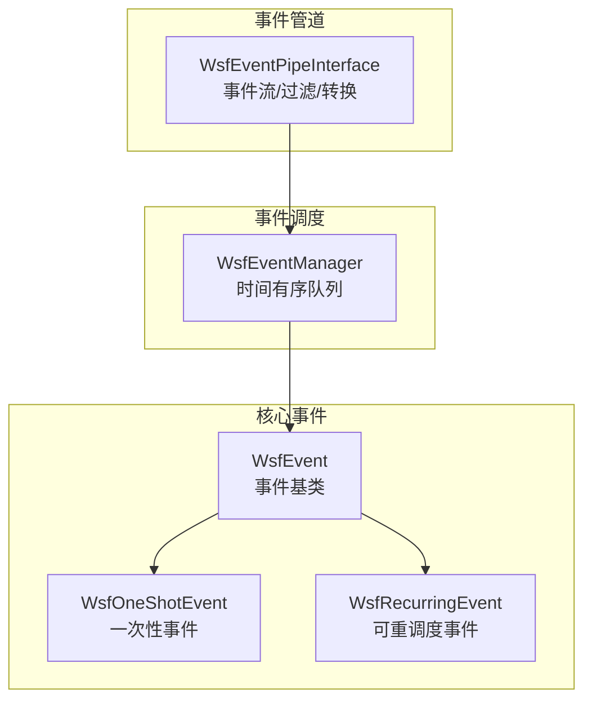
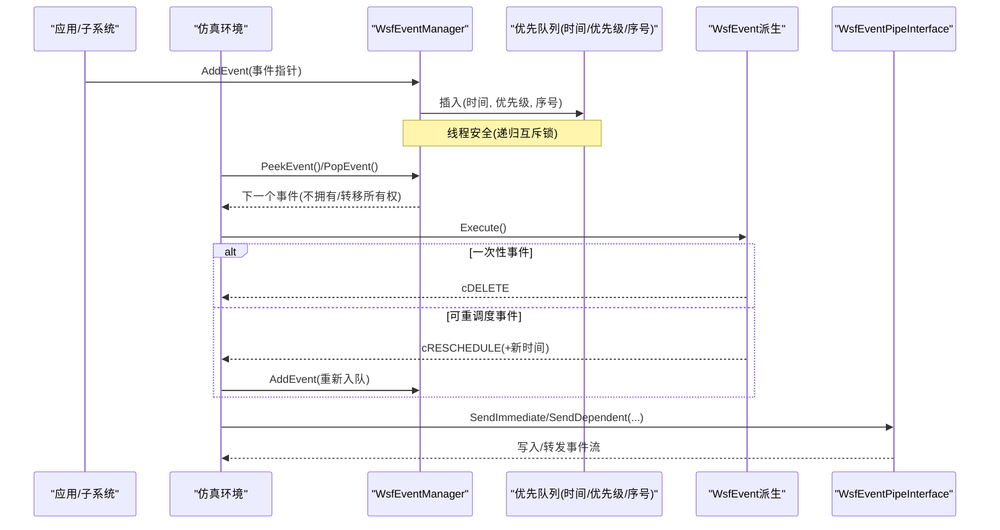
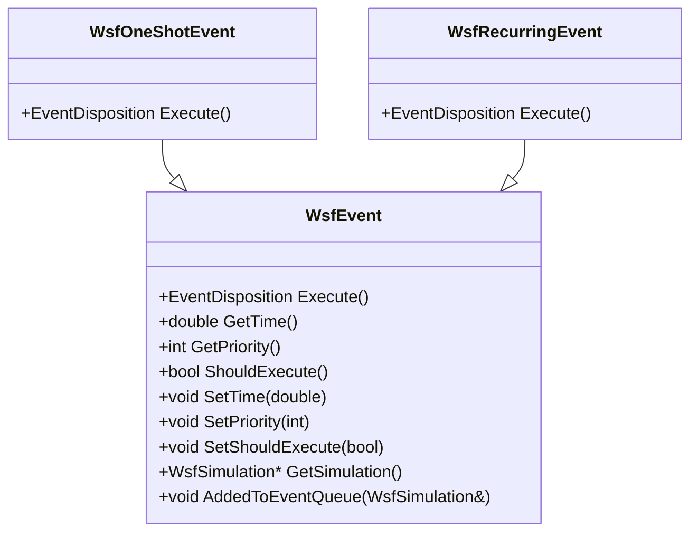
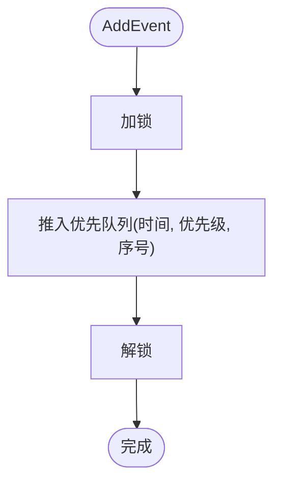
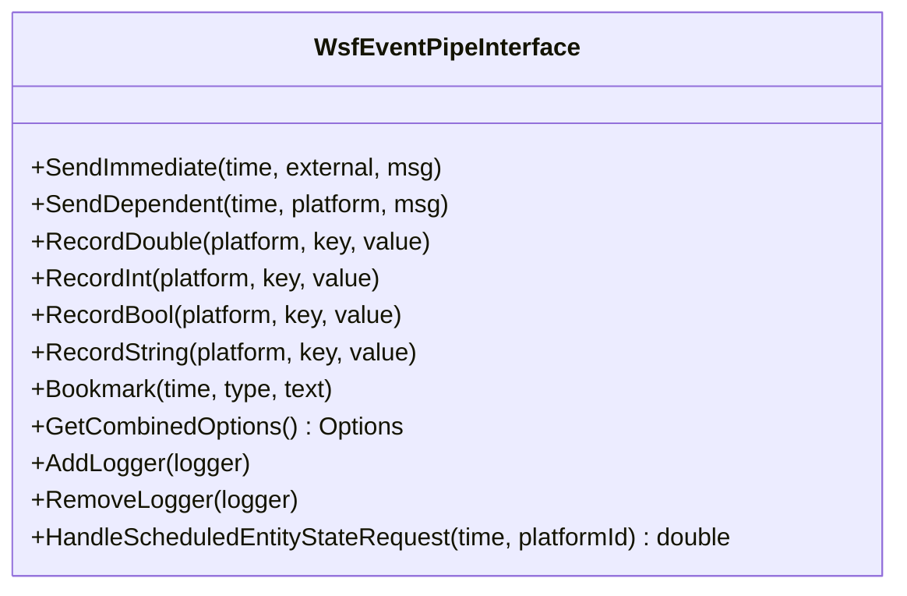
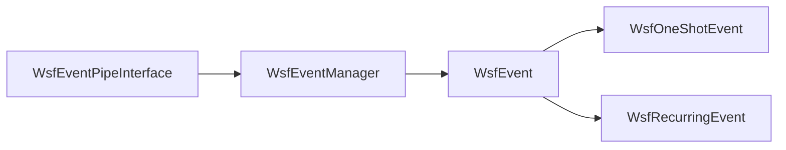

# 事件系统API

<cite>
**本文引用的文件**   
- [WsfEvent.hpp](file://swdev/src/core/wsf/source/WsfEvent.hpp)
- [WsfEventManager.hpp](file://swdev/src/core/wsf/source/WsfEventManager.hpp)
- [WsfEventManager.cpp](file://swdev/src/core/wsf/source/WsfEventManager.cpp)
- [WsfEventPipeInterface.hpp](file://swdev/src/core/wsf/source/event_pipe/WsfEventPipeInterface.hpp)
</cite>

## 目录
1. [简介](#简介)
2. [项目结构](#项目结构)
3. [核心组件](#核心组件)
4. [架构总览](#架构总览)
5. [详细组件分析](#详细组件分析)
6. [依赖关系分析](#依赖关系分析)
7. [性能与内存优化](#性能与内存优化)
8. [故障排查指南](#故障排查指南)
9. [结论](#结论)
10. [附录：示例与最佳实践](#附录示例与最佳实践)

## 简介
本文件面向AFSIM的WSF事件系统，系统性说明以下主题：
- WsfEvent基类的设计与事件对象生命周期管理
- WsfEventManager的事件注册、调度与分发机制（含同步/异步处理模式）
- 事件管道（Event Pipe）的API接口，包括事件流处理、过滤与转换
- 事件回调函数定义规范与错误处理机制
- 事件驱动编程示例：订阅事件、处理回调、管理队列
- 性能优化、内存管理与调试工具使用建议

## 项目结构
围绕事件系统的核心代码位于core/wsf模块中，主要包含：
- 事件基类与适配器：WsfEvent.hpp
- 事件管理器（时间有序队列）：WsfEventManager.hpp/.cpp
- 事件管道接口（高吞吐事件输出/订阅）：event_pipe/WsfEventPipeInterface.hpp

图表来源
- [WsfEvent.hpp:28-172](file://swdev/src/core/wsf/source/WsfEvent.hpp#L28-L172)
- [WsfEventManager.hpp:40-110](file://swdev/src/core/wsf/source/WsfEventManager.hpp#L40-L110)
- [WsfEventPipeInterface.hpp:86-159](file://swdev/src/core/wsf/source/event_pipe/WsfEventPipeInterface.hpp#L86-L159)

章节来源
- [WsfEvent.hpp:28-172](file://swdev/src/core/wsf/source/WsfEvent.hpp#L28-L172)
- [WsfEventManager.hpp:40-110](file://swdev/src/core/wsf/source/WsfEventManager.hpp#L40-L110)
- [WsfEventPipeInterface.hpp:86-159](file://swdev/src/core/wsf/source/event_pipe/WsfEventPipeInterface.hpp#L86-L159)

## 核心组件
- WsfEvent：所有事件的抽象基类，定义执行契约、调度时间与优先级、是否执行标记等。
- WsfOneShotEvent / WsfRecurringEvent：基于std::function的便捷事件适配器，分别用于一次性与可重调度场景。
- WsfEventManager：维护一个按仿真时间排序、同时间按优先级和入队顺序稳定的事件优先队列，提供AddEvent/PeekEvent/PopEvent/Reset等操作。
- WsfEventPipeInterface：面向高吞吐事件流的扩展接口，负责事件打包、过滤、日志记录、平台相关消息发送与订阅管理等。

章节来源
- [WsfEvent.hpp:28-172](file://swdev/src/core/wsf/source/WsfEvent.hpp#L28-L172)
- [WsfEventManager.hpp:40-110](file://swdev/src/core/wsf/source/WsfEventManager.hpp#L40-L110)
- [WsfEventManager.cpp:22-53](file://swdev/src/core/wsf/source/WsfEventManager.cpp#L22-L53)
- [WsfEventPipeInterface.hpp:86-159](file://swdev/src/core/wsf/source/event_pipe/WsfEventPipeInterface.hpp#L86-L159)

## 架构总览
下图展示事件从创建到分发的关键路径，以及事件管道的参与点。

图表来源
- [WsfEventManager.hpp:50-79](file://swdev/src/core/wsf/source/WsfEventManager.hpp#L50-L79)
- [WsfEventManager.cpp:22-53](file://swdev/src/core/wsf/source/WsfEventManager.cpp#L22-L53)
- [WsfEvent.hpp:31-67](file://swdev/src/core/wsf/source/WsfEvent.hpp#L31-L67)
- [WsfEventPipeInterface.hpp:103-108](file://swdev/src/core/wsf/source/event_pipe/WsfEventPipeInterface.hpp#L103-L108)

## 详细组件分析

### WsfEvent 基类与适配器
- 设计要点
  - Execute()为纯虚函数，返回EventDisposition(cDELETE或cRESCHEDULE)，由调度器决定删除或重排。
  - 支持设置仿真时间GetTime/SetTime、优先级GetPriority/SetPriority、是否执行ShouldExecute/SetShouldExecute。
  - AddedToEventQueue将事件与所属仿真关联，便于在事件内访问仿真上下文。
- 适配器
  - WsfOneShotEvent：构造时传入std::function<void()>，执行后返回cDELETE。
  - WsfRecurringEvent：构造时传入std::function<EventDisposition(WsfEvent&)>，可在回调中调用SetTime并返回cRESCHEDULE实现周期调度。

图表来源
- [WsfEvent.hpp:28-172](file://swdev/src/core/wsf/source/WsfEvent.hpp#L28-L172)

章节来源
- [WsfEvent.hpp:28-172](file://swdev/src/core/wsf/source/WsfEvent.hpp#L28-L172)

### WsfEventManager 事件队列
- 职责
  - 维护时间有序的严格弱序队列；同时间按优先级排序；同时间同优先级按入队顺序稳定。
  - 提供AddEvent/PeekEvent/PopEvent/Reset。
- 并发与安全
  - 内部使用递归互斥锁保护队列操作，保证多线程安全。
- 复杂度
  - 入队O(log N)，出队O(log N)，查询顶部O(1)。

图表来源
- [WsfEventManager.cpp:22-29](file://swdev/src/core/wsf/source/WsfEventManager.cpp#L22-L29)

章节来源
- [WsfEventManager.hpp:40-110](file://swdev/src/core/wsf/source/WsfEventManager.hpp#L40-L110)
- [WsfEventManager.cpp:22-53](file://swdev/src/core/wsf/source/WsfEventManager.cpp#L22-L53)

### 事件管道 API（WsfEventPipeInterface）
- 定位
  - 作为仿真扩展，提供高吞吐、可配置的事件流输出与订阅能力，常用于观测、回放、外部系统集成。
- 关键接口
  - SendImmediate：立即发送无平台依赖的消息。
  - SendDependent：尽可能绑定平台依赖的消息。
  - RecordDouble/Int/Bool/String：以键值形式记录平台数据。
  - Bookmark：打书签。
  - GetCombinedOptions：获取当前启用的选项并集，用于确定观察者连接范围。
  - AddLogger/RemoveLogger：添加/移除日志记录器。
  - HandleScheduledEntityStateRequest：定时实体状态请求调度与去抖。
- 过滤与转换
  - 通过输入配置与过滤器（Filter/DetailSettingData）对平台细节级别进行筛选，减少不必要的数据传输。
  - 内部维护多种回调集合（检测、跟踪、通信、绘制等），在对应事件发生时触发数据打包与发送。

图表来源
- [WsfEventPipeInterface.hpp:97-159](file://swdev/src/core/wsf/source/event_pipe/WsfEventPipeInterface.hpp#L97-L159)

章节来源
- [WsfEventPipeInterface.hpp:86-159](file://swdev/src/core/wsf/source/event_pipe/WsfEventPipeInterface.hpp#L86-L159)

### 事件回调函数定义规范与错误处理
- 回调定义
  - 使用WsfEventAdapterT封装std::function，避免手写继承；一次性/周期性分别适配不同签名。
- 错误处理
  - Execute应返回明确的EventDisposition；若需取消执行，可通过SetShouldExecute(false)使调度器跳过。
  - 对于周期性事件，应在回调中正确更新SetTime，否则可能导致重复调度或死循环。
  - 管道侧通过AddLogger/RemoveLogger集中记录异常与诊断信息，便于问题定位。

章节来源
- [WsfEvent.hpp:115-172](file://swdev/src/core/wsf/source/WsfEvent.hpp#L115-L172)
- [WsfEventPipeInterface.hpp:121-122](file://swdev/src/core/wsf/source/event_pipe/WsfEventPipeInterface.hpp#L121-L122)

## 依赖关系分析
- WsfEvent是基础类型，被WsfOneShotEvent与WsfRecurringEvent继承。
- WsfEventManager持有WsfEvent指针（unique_ptr），负责其生命周期与调度。
- WsfEventPipeInterface作为仿真扩展，与仿真框架及各类子系统交互，但不直接持有事件队列，而是通过即时/依赖消息接口向外输出事件流。

图表来源
- [WsfEvent.hpp:28-172](file://swdev/src/core/wsf/source/WsfEvent.hpp#L28-L172)
- [WsfEventManager.hpp:40-110](file://swdev/src/core/wsf/source/WsfEventManager.hpp#L40-L110)
- [WsfEventPipeInterface.hpp:86-159](file://swdev/src/core/wsf/source/event_pipe/WsfEventPipeInterface.hpp#L86-L159)

章节来源
- [WsfEvent.hpp:28-172](file://swdev/src/core/wsf/source/WsfEvent.hpp#L28-L172)
- [WsfEventManager.hpp:40-110](file://swdev/src/core/wsf/source/WsfEventManager.hpp#L40-L110)
- [WsfEventPipeInterface.hpp:86-159](file://swdev/src/core/wsf/source/event_pipe/WsfEventPipeInterface.hpp#L86-L159)

## 性能与内存优化
- 事件调度
  - 尽量复用WsfRecurringEvent并通过SetTime增量调度，避免频繁new/delete。
  - 合理设置优先级，确保关键事件在同时间步内先执行。
- 管道I/O
  - 使用SendDependent绑定平台以减少跨域查找开销。
  - 利用RecordXxx批量记录标量，减少复杂对象序列化成本。
  - 通过GetCombinedOptions控制观察者订阅范围，降低无关事件流量。
- 并发与锁
  - 事件队列内部已加锁，避免在回调中进行长时间阻塞操作；必要时拆分耗时逻辑至后台任务。
- 内存管理
  - 使用unique_ptr管理事件所有权，避免手动释放；周期性事件在Execute中返回cRESCHEDULE即可自动重入队。

[本节为通用指导，不直接分析具体文件]

## 故障排查指南
- 事件未执行
  - 检查ShouldExecute是否为true；确认AddedToEventQueue已被调用（通常由AddEvent完成）。
- 事件重复执行或不再执行
  - 周期性事件未在回调中更新SetTime，或错误返回cDELETE。
- 管道无输出
  - 确认已启用相应选项（GetCombinedOptions），并已AddLogger；检查SendImmediate/SendDependent调用路径。
- 性能退化
  - 观察回调耗时与锁竞争；减少在Execute中的重型计算，改为异步或批处理。

章节来源
- [WsfEventManager.cpp:22-53](file://swdev/src/core/wsf/source/WsfEventManager.cpp#L22-L53)
- [WsfEventPipeInterface.hpp:103-159](file://swdev/src/core/wsf/source/event_pipe/WsfEventPipeInterface.hpp#L103-L159)

## 结论
WSF事件系统以WsfEvent为核心抽象，配合WsfEventManager的时间有序队列，提供了稳定、可扩展的事件调度机制。WsfEventPipeInterface在高吞吐场景下提供事件流输出与订阅能力，结合过滤与日志记录，满足仿真观测与外部集成需求。通过合理使用一次性/周期性事件适配器、合理的优先级与时间设置，以及管道侧的精细化订阅与记录，可以在保证功能完整性的同时获得良好的性能与可维护性。

[本节为总结性内容，不直接分析具体文件]

## 附录：示例与最佳实践

### 示例一：订阅与处理一次性事件
- 步骤
  - 构造WsfOneShotEvent，传入仿真时间与回调。
  - 通过仿真或事件管理器将其加入队列。
  - 在Execute中执行业务逻辑，无需返回重调度。

章节来源
- [WsfEvent.hpp:134-151](file://swdev/src/core/wsf/source/WsfEvent.hpp#L134-L151)

### 示例二：周期性事件与重调度
- 步骤
  - 构造WsfRecurringEvent，传入回调。
  - 在回调中根据业务需要更新SetTime，并返回cRESCHEDULE。
  - 如需终止，返回cDELETE或在回调中SetShouldExecute(false)。

章节来源
- [WsfEvent.hpp:153-172](file://swdev/src/core/wsf/source/WsfEvent.hpp#L153-L172)

### 示例三：事件管道记录与书签
- 步骤
  - 使用RecordDouble/Int/Bool/String记录平台指标。
  - 使用Bookmark在关键时间点打书签，便于回放与分析。
  - 通过AddLogger接入日志记录器，统一收集诊断信息。

章节来源
- [WsfEventPipeInterface.hpp:143-159](file://swdev/src/core/wsf/source/event_pipe/WsfEventPipeInterface.hpp#L143-L159)

### 示例四：事件调度时序图（同步/异步）
- 同步：主循环依次PopEvent并Execute，适用于轻量级回调。
- 异步：Execute中仅做快速判断与入队，将耗时逻辑投递到后台任务，避免阻塞调度器。

章节来源
- [WsfEventManager.cpp:44-53](file://swdev/src/core/wsf/source/WsfEventManager.cpp#L44-L53)