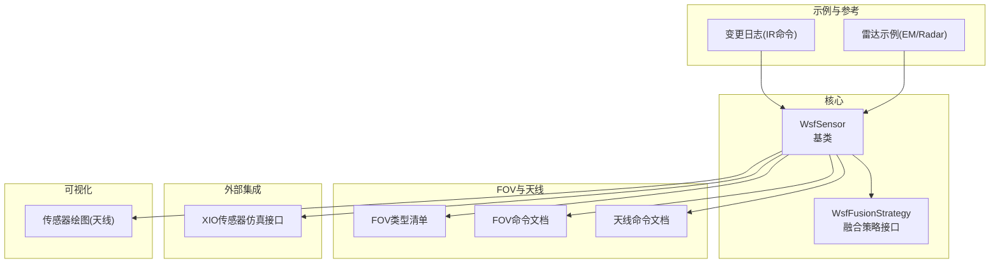
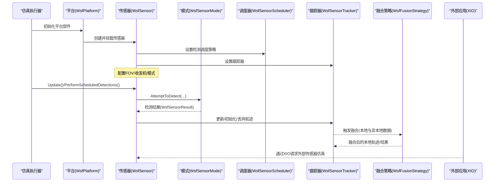
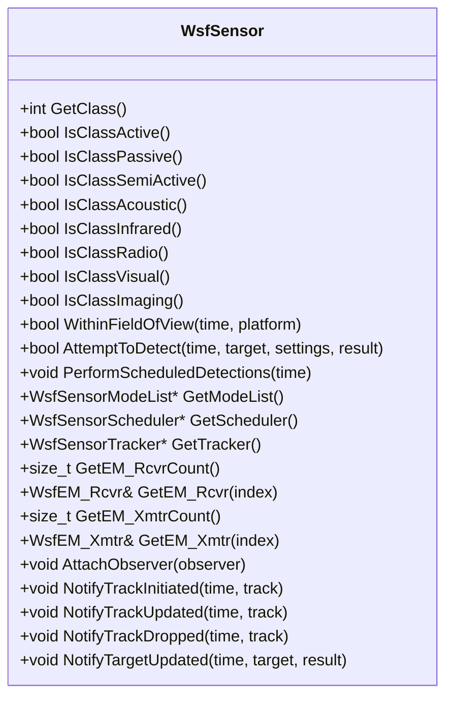
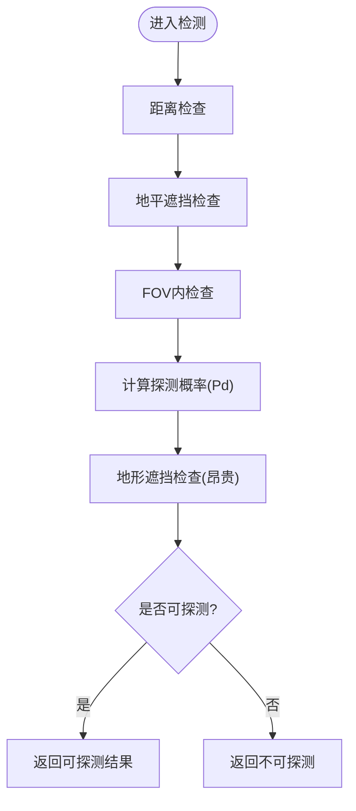
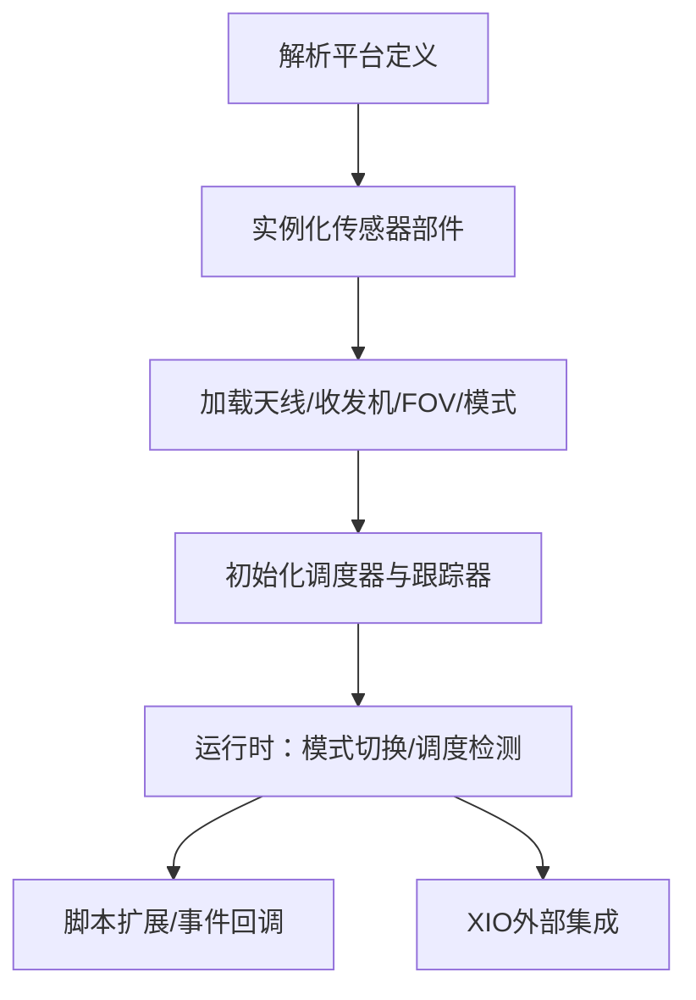
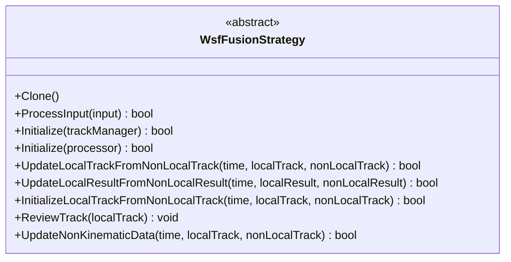
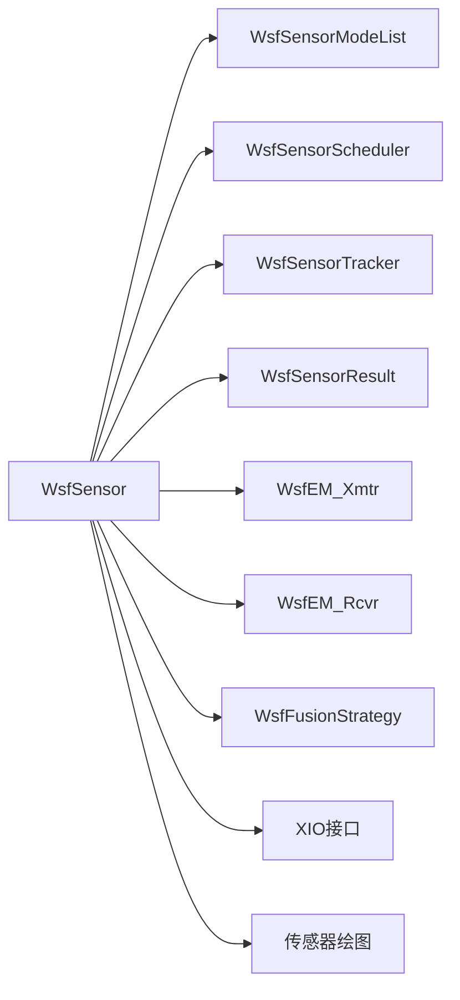

# 传感器系统API

<cite>
**本文引用的文件**   
- [WsfSensor.hpp](file://swdev/src/core/wsf/source/sensor/WsfSensor.hpp)
- [field_of_view_types.txt](file://swdev/src/core/wsf/doc/field_of_view_types.txt)
- [field_of_view_commands.rst.txt](file://documentation/html/_sources/docs/field_of_view_commands.rst.txt)
- [antenna_commands.rst](file://swdev/src/core/wsf/doc/antenna_commands.rst)
- [WsfFusionStrategy.hpp](file://swdev/src/core/wsf/source/WsfFusionStrategy.hpp)
- [xio_interface_development.rst.txt](file://documentation/html/_sources/docs/xio_interface_development.rst.txt)
- [sensor_plot_antenna_plot.rst](file://swdev/src/core/sensor_plot_lib/doc/sensor_plot_antenna_plot.rst)
- [wsf_1.05.1.rst.txt](file://documentation/html/_sources/docs/changelog/wsf_1.05.1.rst.txt)
- [EW_RADAR_SENSOR示例](file://training/user/10_Other_Topics/bam/scenarios/floridistan/27_floridistan_cluster_gci/sensors/radar/ew_radar.txt)
</cite>

## 目录
1. [简介](#简介)
2. [项目结构](#项目结构)
3. [核心组件](#核心组件)
4. [架构总览](#架构总览)
5. [详细组件分析](#详细组件分析)
6. [依赖关系分析](#依赖关系分析)
7. [性能考虑](#性能考虑)
8. [故障排查指南](#故障排查指南)
9. [结论](#结论)
10. [附录](#附录)

## 简介
本文件面向AFSIM传感器系统的API与实现，聚焦以下主题：
- WsfSensor基类的架构设计与虚函数约定，探测算法的抽象接口与实现模式
- 视场(Field of View, FOV)系统的API与几何形状定义、计算接口
- 传感器配置语法与运行时参数管理机制
- 传感器融合策略接口设计（多传感器数据关联与跟踪更新）
- 雷达、红外、ESM等具体传感器类型的API使用要点与示例路径
- 传感器性能建模、噪声处理与误差分析的编程接口

## 项目结构
围绕传感器子系统的关键代码与文档分布如下：
- 核心基类与通用能力：WsfSensor及其相关类型（模式、调度器、跟踪器、结果等）
- 视场定义与命令：文档与类型清单
- 融合策略：融合接口与扩展点
- XIO外部传感器仿真接口
- 天线/波束绘图工具
- 具体传感器类型示例与变更日志

**图表来源** 
- [WsfSensor.hpp:45-90](file://swdev/src/core/wsf/source/sensor/WsfSensor.hpp#L45-L90)
- [field_of_view_types.txt:1-14](file://swdev/src/core/wsf/doc/field_of_view_types.txt#L1-L14)
- [field_of_view_commands.rst.txt:12-30](file://documentation/html/_sources/docs/field_of_view_commands.rst.txt#L12-L30)
- [antenna_commands.rst:192-210](file://swdev/src/core/wsf/doc/antenna_commands.rst#L192-L210)
- [WsfFusionStrategy.hpp:34-49](file://swdev/src/core/wsf/source/WsfFusionStrategy.hpp#L34-L49)
- [xio_interface_development.rst.txt:88-94](file://documentation/html/_sources/docs/xio_interface_development.rst.txt#L88-L94)
- [sensor_plot_antenna_plot.rst:10-45](file://swdev/src/core/sensor_plot_lib/doc/sensor_plot_antenna_plot.rst#L10-L45)
- [EW_RADAR_SENSOR示例:24-42](file://training/user/10_Other_Topics/bam/scenarios/floridistan/27_floridistan_cluster_gci/sensors/radar/ew_radar.txt#L24-L42)
- [wsf_1.05.1.rst.txt:27-27](file://documentation/html/_sources/docs/changelog/wsf_1.05.1.rst.txt#L27-L27)

**章节来源**
- [WsfSensor.hpp:45-90](file://swdev/src/core/wsf/source/sensor/WsfSensor.hpp#L45-L90)
- [field_of_view_types.txt:1-14](file://swdev/src/core/wsf/doc/field_of_view_types.txt#L1-L14)
- [field_of_view_commands.rst.txt:12-30](file://documentation/html/_sources/docs/field_of_view_commands.rst.txt#L12-L30)
- [antenna_commands.rst:192-210](file://swdev/src/core/wsf/doc/antenna_commands.rst#L192-L210)
- [WsfFusionStrategy.hpp:34-49](file://swdev/src/core/wsf/source/WsfFusionStrategy.hpp#L34-L49)
- [xio_interface_development.rst.txt:88-94](file://documentation/html/_sources/docs/xio_interface_development.rst.txt#L88-L94)
- [sensor_plot_antenna_plot.rst:10-45](file://swdev/src/core/sensor_plot_lib/doc/sensor_plot_antenna_plot.rst#L10-L45)
- [EW_RADAR_SENSOR示例:24-42](file://training/user/10_Other_Topics/bam/scenarios/floridistan/27_floridistan_cluster_gci/sensors/radar/ew_radar.txt#L24-L42)
- [wsf_1.05.1.rst.txt:27-27](file://documentation/html/_sources/docs/changelog/wsf_1.05.1.rst.txt#L27-L27)

## 核心组件
- WsfSensor：所有传感器类型的基类，提供模式管理、调度器/跟踪器接入、FOV判断、发射/接收机访问、事件通知、脚本扩展等能力。
- WsfFusionStrategy：融合策略抽象接口，用于将非本地轨道/结果与本地对象进行关联与更新。
- FOV系统：通过命令与类型清单定义矩形、圆形、多边形、赤道坐标系等多种几何视场。
- XIO接口：允许外部应用为仿真建模传感器并可选回传航迹。
- 传感器绘图：支持天线方向图绘制与分析。

**章节来源**
- [WsfSensor.hpp:45-90](file://swdev/src/core/wsf/source/sensor/WsfSensor.hpp#L45-L90)
- [WsfFusionStrategy.hpp:34-49](file://swdev/src/core/wsf/source/WsfFusionStrategy.hpp#L34-L49)
- [field_of_view_types.txt:1-14](file://swdev/src/core/wsf/doc/field_of_view_types.txt#L1-L14)
- [field_of_view_commands.rst.txt:12-30](file://documentation/html/_sources/docs/field_of_view_commands.rst.txt#L12-L30)
- [xio_interface_development.rst.txt:88-94](file://documentation/html/_sources/docs/xio_interface_development.rst.txt#L88-L94)
- [sensor_plot_antenna_plot.rst:10-45](file://swdev/src/core/sensor_plot_lib/doc/sensor_plot_antenna_plot.rst#L10-L45)

## 架构总览
下图展示传感器在仿真中的关键交互：平台挂载传感器，传感器包含发射/接收机与FOV；检测尝试由模式实现；调度器决定何时检测；跟踪器基于检测结果维护航迹；融合策略对多源数据进行关联更新；XIO可引入外部传感器模型；绘图工具用于天线特性分析。

**图表来源**
- [WsfSensor.hpp:45-90](file://swdev/src/core/wsf/source/sensor/WsfSensor.hpp#L45-L90)
- [WsfSensor.hpp:192-213](file://swdev/src/core/wsf/source/sensor/WsfSensor.hpp#L192-L213)
- [WsfFusionStrategy.hpp:79-113](file://swdev/src/core/wsf/source/WsfFusionStrategy.hpp#L79-L113)
- [xio_interface_development.rst.txt:88-94](file://documentation/html/_sources/docs/xio_interface_development.rst.txt#L88-L94)

## 详细组件分析

### WsfSensor基类与探测算法约定
- 设计要点
  - 传感器以“模式”组织运行特性，每个模式负责一次检测尝试。
  - 典型检测流程遵循“先易后难”的顺序：隐蔽性检查→距离检查→地平遮挡→FOV检查→概率计算→地形遮挡。
  - 支持多模式切换、调度器控制检测时机、跟踪器管理航迹生命周期。
  - 提供线程安全标记、观察者通知、脚本扩展点。
- 关键接口
  - 探测入口：AttemptToDetect(...)
  - 状态与生命周期：PreInitialize/Initialize/Update/UpdatePosition
  - 模式管理：SelectMode/DeselectMode/ScheduleModeChange
  - 调度与跟踪：Get/Set Scheduler/Tracker
  - FOV判断：WithinFieldOfView(...)
  - 收发机访问：GetEM_Rcvr/GetEM_Xmtr
  - 通知机制：NotifyTrackInitiated/Updated/Dropped, NotifyTargetUpdated等

**图表来源**
- [WsfSensor.hpp:98-128](file://swdev/src/core/wsf/source/sensor/WsfSensor.hpp#L98-L128)
- [WsfSensor.hpp:192-213](file://swdev/src/core/wsf/source/sensor/WsfSensor.hpp#L192-L213)
- [WsfSensor.hpp:292-310](file://swdev/src/core/wsf/source/sensor/WsfSensor.hpp#L292-L310)
- [WsfSensor.hpp:305-334](file://swdev/src/core/wsf/source/sensor/WsfSensor.hpp#L305-L334)
- [WsfSensor.hpp:400-417](file://swdev/src/core/wsf/source/sensor/WsfSensor.hpp#L400-L417)
- [WsfSensor.hpp:230-244](file://swdev/src/core/wsf/source/sensor/WsfSensor.hpp#L230-L244)

**章节来源**
- [WsfSensor.hpp:45-90](file://swdev/src/core/wsf/source/sensor/WsfSensor.hpp#L45-L90)
- [WsfSensor.hpp:192-213](file://swdev/src/core/wsf/source/sensor/WsfSensor.hpp#L192-L213)
- [WsfSensor.hpp:292-310](file://swdev/src/core/wsf/source/sensor/WsfSensor.hpp#L292-L310)
- [WsfSensor.hpp:305-334](file://swdev/src/core/wsf/source/sensor/WsfSensor.hpp#L305-L334)
- [WsfSensor.hpp:400-417](file://swdev/src/core/wsf/source/sensor/WsfSensor.hpp#L400-L417)
- [WsfSensor.hpp:230-244](file://swdev/src/core/wsf/source/sensor/WsfSensor.hpp#L230-L244)

### 视场(FOV)系统API
- 支持的几何类型
  - 矩形(rectangular)：方位角/俯仰角范围
  - 圆形(circular)：半角定义的圆锥视场
  - 多边形(polygonal)：按方位角/俯仰角点序列定义
  - 赤道坐标系(equatorial)：以地球瞬时投影赤道为基准的球面坐标视场
- 命令与用法
  - 通过 field_of_view ... end_field_of_view 块声明
  - 各类型拥有专属关键字（如 azimuth_field_of_view/elevation_field_of_view、half_angle、azimuth_elevation、equatorial_field_of_view/polar_field_of_view）
  - 默认提供矩形FOV，可通过脚本动态调整（例如 SetFOV）
- 与天线/扫描的关系
  - FOV用于电磁天线的初始筛选，若启用扫描稳定化，FOV体积会随扫描体一起稳定

**图表来源**
- [WsfSensor.hpp:71-83](file://swdev/src/core/wsf/source/sensor/WsfSensor.hpp#L71-L83)
- [field_of_view_commands.rst.txt:36-161](file://documentation/html/_sources/docs/field_of_view_commands.rst.txt#L36-L161)
- [antenna_commands.rst:192-210](file://swdev/src/core/wsf/doc/antenna_commands.rst#L192-L210)

**章节来源**
- [field_of_view_types.txt:1-14](file://swdev/src/core/wsf/doc/field_of_view_types.txt#L1-L14)
- [field_of_view_commands.rst.txt:12-30](file://documentation/html/_sources/docs/field_of_view_commands.rst.txt#L12-L30)
- [field_of_view_commands.rst.txt:36-161](file://documentation/html/_sources/docs/field_of_view_commands.rst.txt#L36-L161)
- [antenna_commands.rst:192-210](file://swdev/src/core/wsf/doc/antenna_commands.rst#L192-L210)

### 传感器配置语法与运行时参数管理
- 配置语法
  - 传感器作为平台部件定义，通常包含天线、发射机、接收机、模式、FOV等子块
  - 示例：雷达传感器中定义天线方向图、发射机功率/频率、扫描模式与限制等
- 运行时参数管理
  - 通过模式选择与调度器控制检测时机
  - 支持脚本扩展与事件回调（如检测脚本）
  - 可通过XIO接口从外部应用注入传感器行为或反馈航迹

**图表来源**
- [EW_RADAR_SENSOR示例:24-42](file://training/user/10_Other_Topics/bam/scenarios/floridistan/27_floridistan_cluster_gci/sensors/radar/ew_radar.txt#L24-L42)
- [WsfSensor.hpp:192-213](file://swdev/src/core/wsf/source/sensor/WsfSensor.hpp#L192-L213)
- [xio_interface_development.rst.txt:88-94](file://documentation/html/_sources/docs/xio_interface_development.rst.txt#L88-L94)

**章节来源**
- [EW_RADAR_SENSOR示例:24-42](file://training/user/10_Other_Topics/bam/scenarios/floridistan/27_floridistan_cluster_gci/sensors/radar/ew_radar.txt#L24-L42)
- [WsfSensor.hpp:192-213](file://swdev/src/core/wsf/source/sensor/WsfSensor.hpp#L192-L213)
- [xio_interface_development.rst.txt:88-94](file://documentation/html/_sources/docs/xio_interface_development.rst.txt#L88-L94)

### 传感器融合策略接口设计
- 目标
  - 将非本地轨道/结果与本地对象进行关联与更新，支持IFF、侧别、类型、空间域、质量、信噪比、信号列表、辅助数据等多维度融合
- 关键方法
  - UpdateLocalTrackFromNonLocalTrack：将非本地轨道融合到本地轨道
  - UpdateLocalResultFromNonLocalResult：将非本地结果融合到本地结果
  - InitializeLocalTrackFromNonLocalTrack：首次融合初始化
  - ReviewTrack：对轨道进行复核（如IFF/质量）
- 扩展方式
  - 继承WsfFusionStrategy并重写上述方法
  - 注册新原型至类型列表以便工厂创建

**图表来源**
- [WsfFusionStrategy.hpp:34-49](file://swdev/src/core/wsf/source/WsfFusionStrategy.hpp#L34-L49)
- [WsfFusionStrategy.hpp:79-113](file://swdev/src/core/wsf/source/WsfFusionStrategy.hpp#L79-L113)
- [WsfFusionStrategy.hpp:115-184](file://swdev/src/core/wsf/source/WsfFusionStrategy.hpp#L115-L184)

**章节来源**
- [WsfFusionStrategy.hpp:34-49](file://swdev/src/core/wsf/source/WsfFusionStrategy.hpp#L34-L49)
- [WsfFusionStrategy.hpp:79-113](file://swdev/src/core/wsf/source/WsfFusionStrategy.hpp#L79-L113)
- [WsfFusionStrategy.hpp:115-184](file://swdev/src/core/wsf/source/WsfFusionStrategy.hpp#L115-L184)

### 具体传感器类型API使用示例
- 雷达(WSF_RADAR_SENSOR)
  - 示例路径：[EW_RADAR_SENSOR示例:24-42](file://training/user/10_Other_Topics/bam/scenarios/floridistan/27_floridistan_cluster_gci/sensors/radar/ew_radar.txt#L24-L42)
  - 要点：定义天线方向图、发射机参数、扫描模式与限制、帧时间等
- 红外(WSF_IR10T_SENSOR)
  - 参考变更日志中新增命令：ranging_time、ranging_time_track_quality
  - 参考路径：[wsf_1.05.1.rst.txt:27-27](file://documentation/html/_sources/docs/changelog/wsf_1.05.1.rst.txt#L27-L27)
- ESM(电子支援措施)
  - 在EW/传感器生态中与雷达/通信干扰协同工作，常见于电子战场景
  - 参考路径：[EW_RADAR_SENSOR示例:24-42](file://training/user/10_Other_Topics/bam/scenarios/floridistan/27_floridistan_cluster_gci/sensors/radar/ew_radar.txt#L24-L42)

**章节来源**
- [EW_RADAR_SENSOR示例:24-42](file://training/user/10_Other_Topics/bam/scenarios/floridistan/27_floridistan_cluster_gci/sensors/radar/ew_radar.txt#L24-L42)
- [wsf_1.05.1.rst.txt:27-27](file://documentation/html/_sources/docs/changelog/wsf_1.05.1.rst.txt#L27-L27)

### 传感器性能建模、噪声处理与误差分析接口
- 性能建模
  - 通过传感器模式实现探测概率(Pd)计算，结合环境、目标特性、天线增益、传播损耗等
  - 可使用传感器绘图工具分析天线方向图与波束特性
  - 参考路径：[sensor_plot_antenna_plot.rst:10-45](file://swdev/src/core/sensor_plot_lib/doc/sensor_plot_antenna_plot.rst#L10-L45)
- 噪声与误差
  - 框架提供误差模型类型体系（如空误差模型、统计误差模型等），可在模式中引用
  - 参考路径：[WsfSensorErrorModelTypes.hpp:24-24](file://swdev/src/core/wsf/source/sensor/WsfSensorErrorModelTypes.hpp#L24-L24)
- 编程接口建议
  - 在AttemptToDetect中优先进行低成本筛选（距离、FOV），再进行昂贵的地形遮挡与复杂误差计算
  - 利用随机数生成器与所需Pd阈值优化计算路径

**章节来源**
- [sensor_plot_antenna_plot.rst:10-45](file://swdev/src/core/sensor_plot_lib/doc/sensor_plot_antenna_plot.rst#L10-L45)
- [WsfSensorErrorModelTypes.hpp:24-24](file://swdev/src/core/wsf/source/sensor/WsfSensorErrorModelTypes.hpp#L24-L24)
- [WsfSensor.hpp:71-83](file://swdev/src/core/wsf/source/sensor/WsfSensor.hpp#L71-L83)

## 依赖关系分析
- 组件耦合
  - WsfSensor依赖WsfSensorModeList、WsfSensorScheduler、WsfSensorTracker、WsfSensorResult
  - 与发射/接收机(WsfEM_Xmtr/WsfEM_Rcvr)解耦，便于复用与扩展
  - 融合策略独立于传感器，通过轨道/结果接口协作
- 外部依赖
  - XIO接口允许外部应用参与传感器仿真
  - 绘图库提供天线方向图分析能力

**图表来源**
- [WsfSensor.hpp:192-213](file://swdev/src/core/wsf/source/sensor/WsfSensor.hpp#L192-L213)
- [WsfSensor.hpp:292-310](file://swdev/src/core/wsf/source/sensor/WsfSensor.hpp#L292-L310)
- [WsfFusionStrategy.hpp:79-113](file://swdev/src/core/wsf/source/WsfFusionStrategy.hpp#L79-L113)
- [xio_interface_development.rst.txt:88-94](file://documentation/html/_sources/docs/xio_interface_development.rst.txt#L88-L94)
- [sensor_plot_antenna_plot.rst:10-45](file://swdev/src/core/sensor_plot_lib/doc/sensor_plot_antenna_plot.rst#L10-L45)

**章节来源**
- [WsfSensor.hpp:192-213](file://swdev/src/core/wsf/source/sensor/WsfSensor.hpp#L192-L213)
- [WsfSensor.hpp:292-310](file://swdev/src/core/wsf/source/sensor/WsfSensor.hpp#L292-L310)
- [WsfFusionStrategy.hpp:79-113](file://swdev/src/core/wsf/source/WsfFusionStrategy.hpp#L79-L113)
- [xio_interface_development.rst.txt:88-94](file://documentation/html/_sources/docs/xio_interface_development.rst.txt#L88-L94)
- [sensor_plot_antenna_plot.rst:10-45](file://swdev/src/core/sensor_plot_lib/doc/sensor_plot_antenna_plot.rst#L10-L45)

## 性能考虑
- 检测流程优化
  - 遵循“先易后难”原则：隐蔽性→距离→地平→FOV→Pd→地形遮挡
  - 使用RequiredPd阈值避免不必要的地形遮挡计算
- 多线程与调度
  - 通过ThreadSafe标记与调度器控制检测频率，减少重复计算
- 资源管理
  - 合理设置更新间隔与事件epoch，避免过期事件影响
- 可视化与分析
  - 使用天线绘图工具评估波束覆盖与增益分布，指导FOV与扫描策略

[本节为通用指导，不直接分析具体文件]

## 故障排查指南
- 常见问题定位
  - 传感器未产生检测：检查模式是否正确激活、调度器是否启用、FOV是否包含目标
  - 航迹异常：检查跟踪器逻辑、融合策略是否更新成功
  - 外部集成问题：确认XIO请求与反馈通道配置正确
- 调试建议
  - 启用传感器观察者通知，跟踪检测尝试与目标更新事件
  - 使用绘图工具验证天线方向图与扫描范围
  - 参考变更日志与示例配置对比差异

**章节来源**
- [WsfSensor.hpp:230-244](file://swdev/src/core/wsf/source/sensor/WsfSensor.hpp#L230-L244)
- [sensor_plot_antenna_plot.rst:10-45](file://swdev/src/core/sensor_plot_lib/doc/sensor_plot_antenna_plot.rst#L10-L45)
- [xio_interface_development.rst.txt:88-94](file://documentation/html/_sources/docs/xio_interface_development.rst.txt#L88-L94)

## 结论
AFSIM传感器系统以WsfSensor为核心，提供灵活的探测算法抽象、完善的FOV几何定义、可扩展的融合策略接口以及外部集成能力。通过合理的配置语法与运行时参数管理，用户可构建雷达、红外、ESM等多种传感器模型，并结合绘图工具进行性能分析与调优。

[本节为总结性内容，不直接分析具体文件]

## 附录
- 常用命令与类型清单
  - FOV类型：rectangular/circular/polygonal/equatorial
  - FOV命令：azimuth_field_of_view/elevation_field_of_view/half_angle/azimuth_elevation/equatorial_field_of_view/polar_field_of_view
- 示例与参考
  - 雷达传感器示例：[EW_RADAR_SENSOR示例:24-42](file://training/user/10_Other_Topics/bam/scenarios/floridistan/27_floridistan_cluster_gci/sensors/radar/ew_radar.txt#L24-L42)
  - 红外命令变更：[wsf_1.05.1.rst.txt:27-27](file://documentation/html/_sources/docs/changelog/wsf_1.05.1.rst.txt#L27-L27)
  - 天线绘图：[sensor_plot_antenna_plot.rst:10-45](file://swdev/src/core/sensor_plot_lib/doc/sensor_plot_antenna_plot.rst#L10-L45)

**章节来源**
- [field_of_view_types.txt:1-14](file://swdev/src/core/wsf/doc/field_of_view_types.txt#L1-L14)
- [field_of_view_commands.rst.txt:36-161](file://documentation/html/_sources/docs/field_of_view_commands.rst.txt#L36-L161)
- [EW_RADAR_SENSOR示例:24-42](file://training/user/10_Other_Topics/bam/scenarios/floridistan/27_floridistan_cluster_gci/sensors/radar/ew_radar.txt#L24-L42)
- [wsf_1.05.1.rst.txt:27-27](file://documentation/html/_sources/docs/changelog/wsf_1.05.1.rst.txt#L27-L27)
- [sensor_plot_antenna_plot.rst:10-45](file://swdev/src/core/sensor_plot_lib/doc/sensor_plot_antenna_plot.rst#L10-L45)