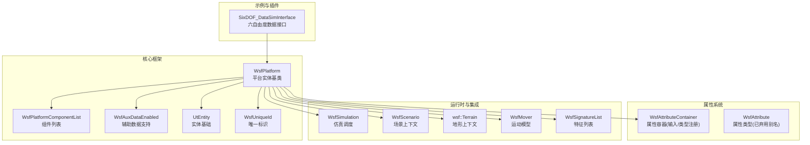
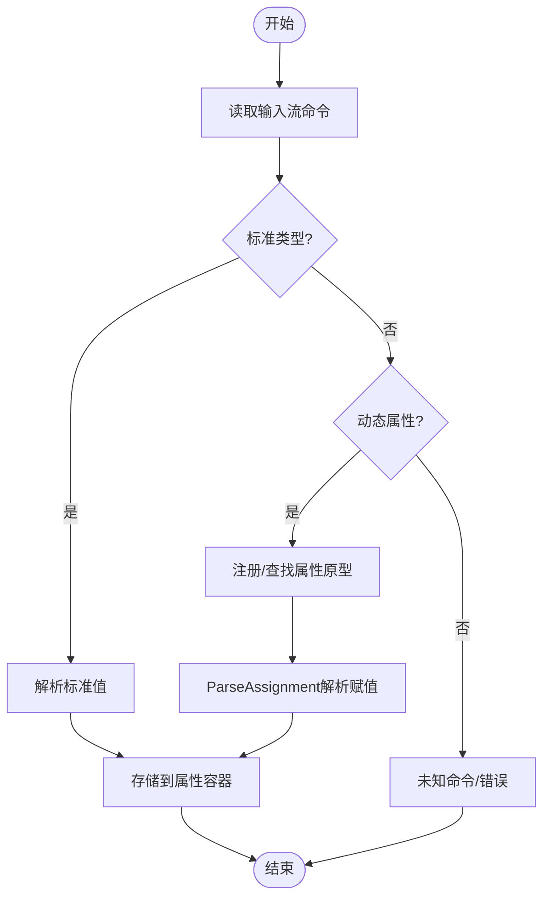
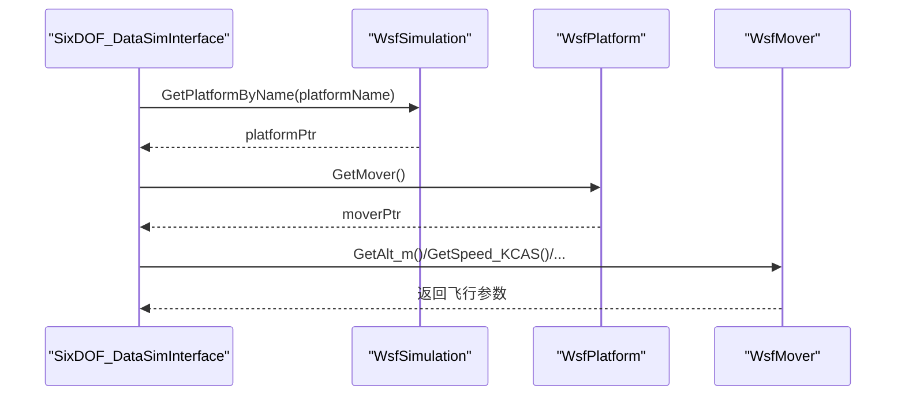
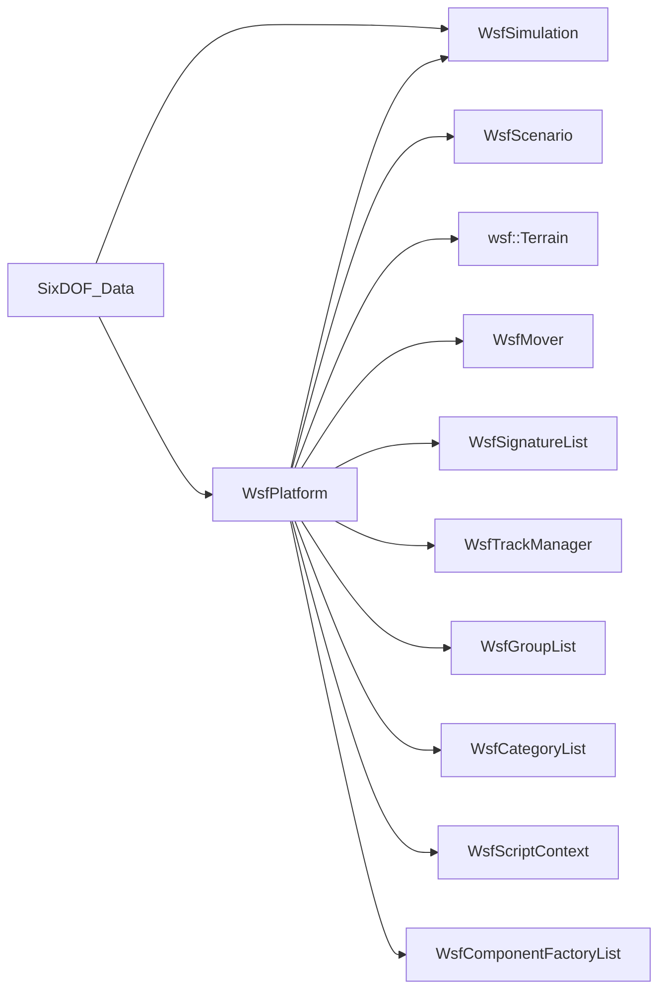

# 平台系统API

<cite>
**本文引用的文件**   
- [WsfPlatform.hpp](file://swdev/src/core/wsf/source/WsfPlatform.hpp)
- [WsfPlatform.cpp](file://swdev/src/core/wsf/source/WsfPlatform.cpp)
- [WsfAttributeContainer.hpp](file://swdev/src/core/wsf/source/WsfAttributeContainer.hpp)
- [WsfAttribute.hpp](file://swdev/src/core/wsf/source/WsfAttribute.hpp)
- [SixDOF_DataSimInterface.cpp](file://swdev/src/warlock/plugins/SixDOF_Data/source/SixDOF_DataSimInterface.cpp)
</cite>

## 目录
1. [引言](#引言)
2. [项目结构](#项目结构)
3. [核心组件](#核心组件)
4. [架构总览](#架构总览)
5. [详细组件分析](#详细组件分析)
6. [依赖关系分析](#依赖关系分析)
7. [性能与内存管理](#性能与内存管理)
8. [故障排查指南](#故障排查指南)
9. [结论](#结论)
10. [附录：示例与最佳实践](#附录示例与最佳实践)

## 引言
本文件面向AFSIM平台系统的扩展开发者，系统性说明WsfPlatform基类的设计模式、生命周期管理、属性访问机制、状态控制方法、事件处理与消息传递接口、组件管理体系，以及继承体系与自定义平台类型的实现要点。文档同时给出内存管理与性能优化建议，并提供可操作的示例路径，帮助读者快速上手并正确扩展平台能力。

## 项目结构
围绕平台系统的关键代码位于core/wsf模块中，其中WsfPlatform是平台实体的核心抽象；属性容器由WsfAttributeContainer提供；脚本与数据交互通过UtScriptContext等基础设施完成；六自由度插件示例展示了如何从外部读取平台状态。



图表来源
- [WsfPlatform.hpp:108-115](file://swdev/src/core/wsf/source/WsfPlatform.hpp#L108-L115)
- [WsfPlatform.hpp:619-694](file://swdev/src/core/wsf/source/WsfPlatform.hpp#L619-L694)
- [WsfAttributeContainer.hpp:21-50](file://swdev/src/core/wsf/source/WsfAttributeContainer.hpp#L21-L50)
- [WsfAttribute.hpp:20-29](file://swdev/src/core/wsf/source/WsfAttribute.hpp#L20-L29)
- [SixDOF_DataSimInterface.cpp:41-65](file://swdev/src/warlock/plugins/SixDOF_Data/source/SixDOF_DataSimInterface.cpp#L41-L65)

章节来源
- [WsfPlatform.hpp:66-115](file://swdev/src/core/wsf/source/WsfPlatform.hpp#L66-L115)
- [WsfAttributeContainer.hpp:21-50](file://swdev/src/core/wsf/source/WsfAttributeContainer.hpp#L21-L50)
- [WsfAttribute.hpp:20-29](file://swdev/src/core/wsf/source/WsfAttribute.hpp#L20-L29)
- [SixDOF_DataSimInterface.cpp:41-65](file://swdev/src/warlock/plugins/SixDOF_Data/source/SixDOF_DataSimInterface.cpp#L41-L65)

## 核心组件
- WsfPlatform：平台实体基类，封装了平台的身份、状态、组件、脚本、地形、轨迹、类别与分组、外观与能力、质量与尺寸、破坏与不可摧毁行为、更新与通知、消息队列等。
- WsfAttributeContainer：用于从输入流加载动态属性的容器，支持类型注册与赋值解析。
- WsfAttribute：旧版属性类型别名（已弃用），指向新的UtAttribute系列类型。
- 示例SixDOF_DataSimInterface：展示如何通过仿真获取平台指针并访问其运动器以读取飞行状态。

章节来源
- [WsfPlatform.hpp:108-700](file://swdev/src/core/wsf/source/WsfPlatform.hpp#L108-L700)
- [WsfAttributeContainer.hpp:21-50](file://swdev/src/core/wsf/source/WsfAttributeContainer.hpp#L21-L50)
- [WsfAttribute.hpp:20-29](file://swdev/src/core/wsf/source/WsfAttribute.hpp#L20-L29)
- [SixDOF_DataSimInterface.cpp:41-65](file://swdev/src/warlock/plugins/SixDOF_Data/source/SixDOF_DataSimInterface.cpp#L41-L65)

## 架构总览
WsfPlatform采用多重继承组合多种职责：对象标识、组件列表、实体基础、辅助数据、唯一ID等。平台在仿真生命周期内经历创建、绑定仿真、初始化两阶段、运行期更新、销毁等阶段。组件通过工厂机制动态添加，脚本上下文在初始化阶段建立，地形与签名系统在适当时机创建与初始化。

```mermaid
classDiagram
class WsfPlatform {
+GetSide()
+SetSide()
+GetIcon()
+SetIcon()
+GetMarking()
+SetMarking()
+GetSpatialDomain()
+SetSpatialDomain()
+GetCreationTime()
+InitializeCreationTime()
+SetCreationTime()
+GetLastUpdateTime()
+GetSimTime()
+SetUpdateLocked()
+IsExternallyControlled()
+SetIsExternallyControlled()
+IsExternallyMoved()
+SetIsExternallyMoved()
+IsExternalShadow()
+SetIsExternalShadow()
+IsIndestructible()
+SetIsIndestructible()
+GetOnBrokenAction()
+SetOnBrokenAction()
+OnBrokenEvent()
+IsBroken()
+IsDeleted()
+IsInitialized()
+GetIndex()
+SetIndex()
+GetSimulation()
+GetScenario()
+PlatformAdded()
+PlatformDeleted()
+GetLocationErrorWCS()
+ExecuteScript()
+HasScript()
+GetArticulatedPart()
+GetComponents()
+SetMover()
+SwapMover()
+GetMover()
+GetFuel()
+GetTerrain()
+GetHeightAboveTerrain()
+GetTerrainHeight()
+IsFalseTarget()
+SetIsFalseTarget()
+GetMass()
+GetEmptyMass()
+GetPayloadMass()
+GetFuelMass()
+SetFuelMass()
+SetPayloadMass()
+SetEmptyMass()
+GetSignatureList()
+GetHeight()
+GetLength()
+GetWidth()
+SetLength()
+SetWidth()
+SetHeight()
+GetAppearance()
+SetAppearance()
+ScriptOverride()
+GetCapabilities()
+SetCapabilities()
+GetConcealmentFactor()
+SetConcealmentFactor()
+GetDamageFactor()
+SetDamageFactor()
+Comment()
+IsStopped()
+IsPaused()
+IsExtrapolating()
+GetNextTrackId()
+GetMasterTrackList()
+GetMasterRawTrackList()
+GetTrackManager()
+GetCategories()
+AddCategory()
+IsCategoryMember()
+GetGroups()
+JoinGroup()
+LeaveGroup()
+IsGroupMember()
+AttachObserver()
+DetachObserver()
+NotifyDeleted()
+NotifyDeleting()
+ProcessInputBlock()
+SetBroken()
+SetDeleted()
-DoUpdate()
-DoUpdateMultiThread()
-DoMoverUpdate()
-DoNotifyUpdate()
-DoExecuteScript()
-DoSendQueuedMessages()
-CreateSignatureList()
-UpdatePersistentPointers()
}
class WsfAttributeContainer {
+Clone()
+ProcessInput()
+LoadType()
+ClearTypes()
-ParseAssignment()
-ProcessAttribute()
-ProcessStruct()
}
class WsfAttribute {
<<deprecated>>
}
WsfPlatform --> WsfAttributeContainer : "使用辅助数据/属性"
WsfPlatform --> WsfAttribute : "历史兼容(弃用)"
```



图表来源
- [WsfPlatform.hpp:108-700](file://swdev/src/core/wsf/source/WsfPlatform.hpp#L108-L700)
- [WsfAttributeContainer.hpp:21-50](file://swdev/src/core/wsf/source/WsfAttributeContainer.hpp#L21-L50)
- [WsfAttribute.hpp:20-29](file://swdev/src/core/wsf/source/WsfAttribute.hpp#L20-L29)

## 详细组件分析

### WsfPlatform设计模式与核心接口
- 设计模式
  - 组合与委托：平台聚合组件（传感器、通信、处理器等）并通过WsfPlatformComponentList统一管理，生命周期与初始化顺序由框架控制。
  - 观察者模式：平台维护观察者列表，并在更新后通知；同时通过WsfObserver::MoverUpdated向仿真级观察者广播运动更新。
  - 工厂模式：组件通过WsfComponentFactoryList进行动态添加/编辑/删除，支持平台类型与实例的声明式配置。
  - 模板与策略：运动模型通过WsfMover注入，允许不同平台使用不同运动策略。
- 核心接口分类
  - 生命周期：Initialize/Initialize2/CompleteLoad/AssignToSimulation/Update/UpdateMultiThread/NotifyUpdate/ExecuteScript/SendQueuedMessages
  - 身份与归属：GetIndex/SetIndex/GetSimulation/GetScenario/GetName/SetName
  - 状态控制：IsBroken/SetBroken/IsDeleted/SetDeleted/IsInitialized/IsIndestructible/OnBrokenAction/IsExternallyControlled/Moved/Shadow
  - 外观与能力：GetAppearance/SetAppearance/GetCapabilities/SetCapabilities/GetConcealmentFactor/SetConcealmentFactor/GetDamageFactor/SetDamageFactor
  - 空间与地形：GetSpatialDomain/SetSpatialDomain/GetTerrain/GetHeightAboveTerrain/GetTerrainHeight
  - 质量与尺寸：GetMass/GetEmptyMass/GetPayloadMass/GetFuelMass/Set*Mass/GetHeight/GetWidth/GetLength/Set*
  - 组件与部件：GetComponents/AddComponent/DeleteComponent/GetArticulatedPart/SetMover/SwapMover/GetMover/GetFuel
  - 跟踪与类别分组：GetTrackManager/GetMasterTrackList/GetMasterRawTrackList/GetNextTrackId/GetCategories/AddCategory/IsCategoryMember/GetGroups/JoinGroup/LeaveGroup/IsGroupMember
  - 脚本与事件：ExecuteScript/HasScript/GetScriptContext/GetScriptAccessibleContext/Comment/AttachObserver/DetachObserver/NotifyDeleted/NotifyDeleting
  - 输入处理：ProcessInput/ProcessInputBlock

章节来源
- [WsfPlatform.hpp:108-700](file://swdev/src/core/wsf/source/WsfPlatform.hpp#L108-L700)
- [WsfPlatform.cpp:249-403](file://swdev/src/core/wsf/source/WsfPlatform.cpp#L249-L403)
- [WsfPlatform.cpp:747-797](file://swdev/src/core/wsf/source/WsfPlatform.cpp#L747-L797)

### 平台实体生命周期管理
- 创建与绑定
  - AssignToSimulation：将平台绑定到仿真，设置脚本父上下文、地形初始化、分配唯一ID。
- 初始化阶段
  - Initialize：设置创建时间、最小步长、坐标参考系、图标默认值、组初始化、脚本上下文初始化、变量解析、签名系统初始化、组件预初始化与第一阶段初始化。
  - Initialize2：第二阶段初始化，检查Initialize是否成功，执行脚本与组件的Initialize2，标记平台为已初始化，并允许更新。
- 运行期更新
  - Update/UpdateMultiThread：根据最小步长与锁标志决定是否调用DoUpdate/DoUpdateMultiThread。
  - DoUpdate：更新时间、调用DoMoverUpdate、DoNotifyUpdate、DoExecuteScript。
  - DoMoverUpdate：若存在运动器且允许更新，则调用其Update。
  - DoNotifyUpdate：广播运动更新给仿真观察者与平台观察者。
- 销毁
  - 析构函数确保离开所有组、删除所有组件、释放签名与地形资源；禁止直接删除仍在仿真中的平台。

```mermaid
sequenceDiagram
participant Sim as "WsfSimulation"
participant Plat as "WsfPlatform"
participant Comp as "组件列表"
participant Mover as "WsfMover"
participant Obs as "观察者"
Sim->>Plat : AssignToSimulation()
Sim->>Plat : Initialize(aSimTime)
Plat->>Plat : SetECI_ReferenceEpoch()/SetCentralPoint()/SetTime()
Plat->>Comp : PreInitialize()
Plat->>Comp : Initialize()
Plat->>Plat : SetConcealmentFactor()
Sim->>Plat : Initialize2(aSimTime)
Plat->>Comp : Initialize2()
Plat->>Plat : mIsInitialized=true; mUpdateAllowed=(mIndex!=0)
loop 每帧
Sim->>Plat : Update(aSimTime)
Plat->>Plat : DoUpdate(aSimTime)
Plat->>Mover : Update(aSimTime)
Plat->>Obs : MoverUpdated()/OnPlatformUpdated()
Plat->>Plat : DoExecuteScript(aSimTime)
end
Sim->>Plat : DeletePlatform()/SetDeleted()
Plat-->>Sim : 清理资源(析构时)
```

图表来源
- [WsfPlatform.cpp:212-219](file://swdev/src/core/wsf/source/WsfPlatform.cpp#L212-L219)
- [WsfPlatform.cpp:249-403](file://swdev/src/core/wsf/source/WsfPlatform.cpp#L249-L403)
- [WsfPlatform.cpp:747-797](file://swdev/src/core/wsf/source/WsfPlatform.cpp#L747-L797)
- [WsfPlatform.cpp:140-166](file://swdev/src/core/wsf/source/WsfPlatform.cpp#L140-L166)

章节来源
- [WsfPlatform.cpp:212-219](file://swdev/src/core/wsf/source/WsfPlatform.cpp#L212-L219)
- [WsfPlatform.cpp:249-403](file://swdev/src/core/wsf/source/WsfPlatform.cpp#L249-L403)
- [WsfPlatform.cpp:747-797](file://swdev/src/core/wsf/source/WsfPlatform.cpp#L747-L797)
- [WsfPlatform.cpp:140-166](file://swdev/src/core/wsf/source/WsfPlatform.cpp#L140-L166)

### 属性容器系统与动态属性
- WsfAttributeContainer提供从输入流加载属性的能力，支持标准类型与“attribute”形式的动态属性，可通过RegisterPrototype注册类型原型，ParseAssignment解析赋值语句，ProcessStruct注册struct类型。
- WsfAttribute为旧版属性类型别名（已弃用），建议使用UtAttribute系列类型。
- 平台通过WsfAuxDataEnabled启用辅助数据，从而可使用属性容器提供的GetAuxValue等工具函数访问动态属性。



图表来源
- [WsfAttributeContainer.hpp:21-50](file://swdev/src/core/wsf/source/WsfAttributeContainer.hpp#L21-L50)
- [WsfAttribute.hpp:20-29](file://swdev/src/core/wsf/source/WsfAttribute.hpp#L20-L29)

章节来源
- [WsfAttributeContainer.hpp:21-50](file://swdev/src/core/wsf/source/WsfAttributeContainer.hpp#L21-L50)
- [WsfAttribute.hpp:20-29](file://swdev/src/core/wsf/source/WsfAttribute.hpp#L20-L29)

### 平台事件处理、消息传递与组件管理
- 事件处理
  - OnBrokenEvent：处理平台损坏事件，依据on_broken_action决定移除、禁用或仅禁用子系统但保持移动。
  - AttachObserver/DetachObserver/NotifyDeleted/NotifyDeleting：平台级观察者回调，用于订阅位置更新与销毁通知。
  - DoNotifyUpdate：通过WsfObserver::MoverUpdated广播运动更新，并逐个调用平台观察者。
- 消息传递
  - SendQueuedMessages：发送平台上的排队消息（具体实现细节在DoSendQueuedMessages）。
  - 脚本执行：ExecuteScript/DoExecuteScript支持在更新周期中执行平台脚本。
- 组件管理
  - AddComponent/DeleteComponent/GetComponents：通过WsfPlatformComponentList管理组件。
  - ProcessInputBlock：统一处理add/edit/delete命令，委派给组件工厂。

章节来源
- [WsfPlatform.hpp:285-293](file://swdev/src/core/wsf/source/WsfPlatform.hpp#L285-L293)
- [WsfPlatform.hpp:567-574](file://swdev/src/core/wsf/source/WsfPlatform.hpp#L567-L574)
- [WsfPlatform.cpp:747-797](file://swdev/src/core/wsf/source/WsfPlatform.cpp#L747-L797)
- [WsfPlatform.cpp:660-715](file://swdev/src/core/wsf/source/WsfPlatform.cpp#L660-L715)

### 继承体系与自定义平台类型
- 继承关系
  - WsfPlatform继承自WsfObject、WsfPlatformComponent、WsfPlatformComponentList、WsfUniqueId、UtEntity、WsfAuxDataEnabled，组合了对象、组件、标识、实体与辅助数据能力。
- 自定义平台类型
  - 通常不需要直接继承WsfPlatform，而是通过定义平台类型（platform_type）并在输入文件中声明组件（mover、sensor、comm、processor等），由框架自动构建实例。
  - 如需扩展平台行为，可在组件层面扩展（如WsfPlatformComponent派生），或通过脚本扩展平台逻辑。
  - 示例：训练材料中的LatinumComponent/ShieldComponent展示了如何继承WsfPlatformComponent或WsfPlatformPart来扩展平台功能。

章节来源
- [WsfPlatform.hpp:108-115](file://swdev/src/core/wsf/source/WsfPlatform.hpp#L108-L115)
- [training/developer/core/labs/solution/component/source/LatinumComponent.hpp:30](file://training/developer/core/labs/solution/component/source/LatinumComponent.hpp#L30)
- [training/developer/core/labs/solution/component/source/ShieldComponent.hpp:30](file://training/developer/core/labs/solution/component/source/ShieldComponent.hpp#L30)

### 运行时操作与示例
- 通过仿真获取平台并读取运动状态（六自由度示例）
  - 使用WsfSimulation.GetPlatformByName获取平台指针。
  - 通过platform->GetMover()获取运动器，并读取高度、速度、姿态等状态。



图表来源
- [SixDOF_DataSimInterface.cpp:41-65](file://swdev/src/warlock/plugins/SixDOF_Data/source/SixDOF_DataSimInterface.cpp#L41-L65)

章节来源
- [SixDOF_DataSimInterface.cpp:41-65](file://swdev/src/warlock/plugins/SixDOF_Data/source/SixDOF_DataSimInterface.cpp#L41-L65)

## 依赖关系分析
- 内部依赖
  - WsfPlatform依赖WsfSimulation（仿真调度）、WsfScenario（场景上下文）、wsf::Terrain（地形）、WsfMover（运动模型）、WsfSignatureList（特征）、WsfTrackManager（跟踪管理）、WsfGroupList/WsfCategoryList（分组与类别）、WsfScriptContext（脚本上下文）。
  - 组件通过WsfComponentFactoryList进行动态装配，支持多类组件（武器、导航误差、替代位置等）。
- 外部依赖
  - 插件与工具（如SixDOF_DataSimInterface）通过WsfSimulation与WsfPlatform接口访问平台状态。



图表来源
- [WsfPlatform.hpp:619-694](file://swdev/src/core/wsf/source/WsfPlatform.hpp#L619-L694)
- [WsfPlatform.cpp:314-351](file://swdev/src/core/wsf/source/WsfPlatform.cpp#L314-L351)
- [SixDOF_DataSimInterface.cpp:41-65](file://swdev/src/warlock/plugins/SixDOF_Data/source/SixDOF_DataSimInterface.cpp#L41-L65)

章节来源
- [WsfPlatform.hpp:619-694](file://swdev/src/core/wsf/source/WsfPlatform.hpp#L619-L694)
- [WsfPlatform.cpp:314-351](file://swdev/src/core/wsf/source/WsfPlatform.cpp#L314-L351)
- [SixDOF_DataSimInterface.cpp:41-65](file://swdev/src/warlock/plugins/SixDOF_Data/source/SixDOF_DataSimInterface.cpp#L41-L65)

## 性能与内存管理
- 更新节流
  - Update/UpdateMultiThread基于最小步长与最后更新时间判断是否真正执行DoUpdate，避免频繁计算。
  - mUpdateLocked与mUpdateAllowed控制更新权限，多线程环境下由WsfMultiThreadManager锁定非线程池更新。
- 内存管理
  - 析构时先LeaveAllGroups，再DeleteAllComponents，最后释放签名与地形资源，确保引用计数与观察者解绑安全。
  - 禁止直接删除仍在仿真中的平台，应通过WsfSimulation::DeletePlatform。
- 性能优化建议
  - 合理设置最小步长，避免过度频繁的DoUpdate。
  - 谨慎使用脚本执行（DoExecuteScript），仅在必要时启用on_update脚本。
  - 减少不必要的组件初始化与克隆，优先复用平台类型。
  - 使用索引而非持久指针访问平台，防止平台被销毁后的悬空指针。

章节来源
- [WsfPlatform.hpp:165-181](file://swdev/src/core/wsf/source/WsfPlatform.hpp#L165-L181)
- [WsfPlatform.cpp:747-797](file://swdev/src/core/wsf/source/WsfPlatform.cpp#L747-L797)
- [WsfPlatform.cpp:140-166](file://swdev/src/core/wsf/source/WsfPlatform.cpp#L140-L166)

## 故障排查指南
- 平台无法更新
  - 检查mUpdateAllowed与mUpdateLocked标志，确认Initialize2已完成且平台已加入仿真。
  - 确认最小步长设置合理，避免DoUpdate被跳过。
- 平台未正确销毁
  - 确保通过WsfSimulation::DeletePlatform删除平台，避免直接调用析构。
  - 检查是否在析构前仍持有平台指针，应改用平台索引。
- 属性加载失败
  - 检查WsfAttributeContainer的ProcessInput是否正确注册属性原型。
  - 验证输入语法与类型匹配，关注ParseAssignment的错误分支。
- 脚本执行异常
  - 确认mHasOnUpdateScript是否存在，避免无意义的脚本调用。
  - 检查脚本上下文初始化顺序，确保全局上下文与本地上下文正确关联。

章节来源
- [WsfPlatform.cpp:249-403](file://swdev/src/core/wsf/source/WsfPlatform.cpp#L249-L403)
- [WsfPlatform.cpp:747-797](file://swdev/src/core/wsf/source/WsfPlatform.cpp#L747-L797)
- [WsfAttributeContainer.hpp:21-50](file://swdev/src/core/wsf/source/WsfAttributeContainer.hpp#L21-L50)

## 结论
WsfPlatform作为AFSIM平台系统的核心抽象，提供了完整的生命周期管理、组件装配、脚本与事件机制、属性容器与辅助数据支持。通过合理的继承与组合，开发者可以灵活扩展平台行为，满足复杂仿真需求。遵循本文档的最佳实践与性能建议，可有效提升系统的稳定性与效率。

## 附录：示例与最佳实践
- 平台对象的创建与配置
  - 通过平台类型（platform_type）声明组件（mover、sensor、comm、processor等），在输入文件中组织add/edit/delete命令。
  - 使用ProcessInputBlock统一处理组件装配，避免手动管理组件生命周期。
- 运行时操作
  - 使用WsfSimulation.GetPlatformByName或GetPlatformByIndex获取平台指针。
  - 通过GetMover访问运动模型，读取或设置平台状态。
- 内存与性能
  - 使用平台索引而非持久指针，避免悬空引用。
  - 控制脚本执行频率，避免在高频更新路径中进行昂贵操作。
  - 合理使用最小步长与更新锁，平衡精度与性能。

章节来源
- [WsfPlatform.cpp:660-715](file://swdev/src/core/wsf/source/WsfPlatform.cpp#L660-L715)
- [SixDOF_DataSimInterface.cpp:41-65](file://swdev/src/warlock/plugins/SixDOF_Data/source/SixDOF_DataSimInterface.cpp#L41-L65)