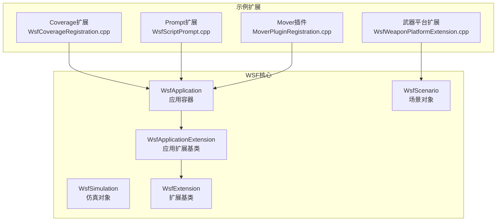
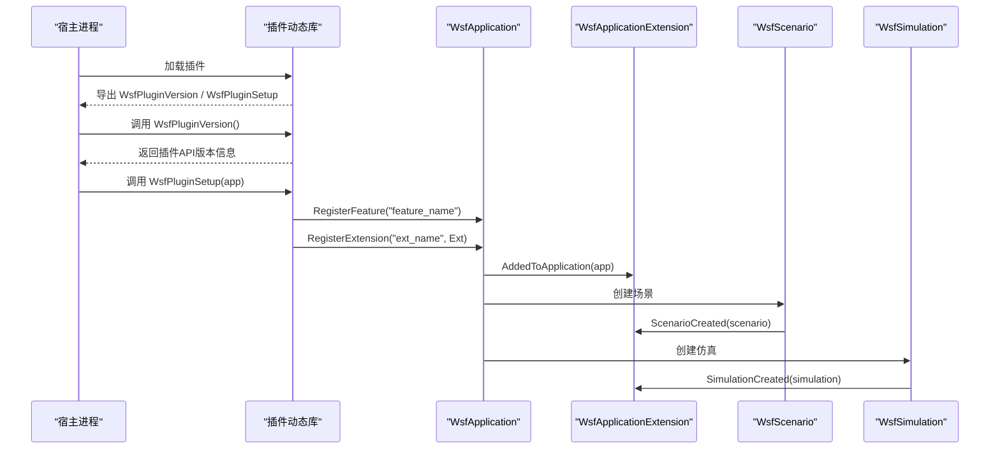
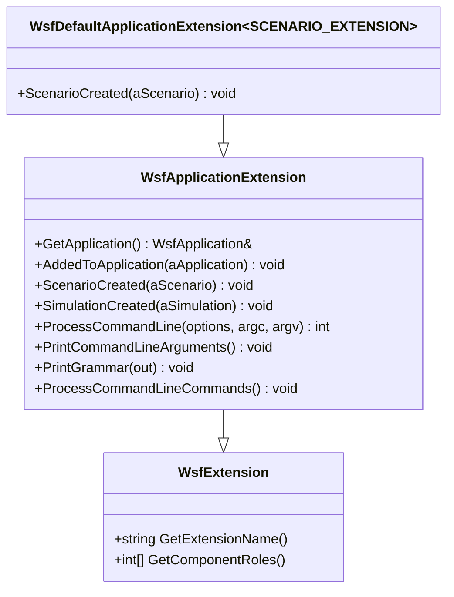
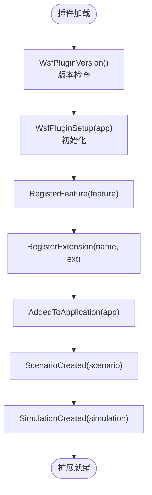
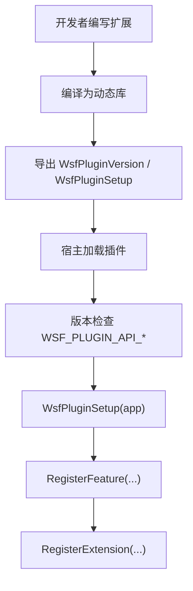
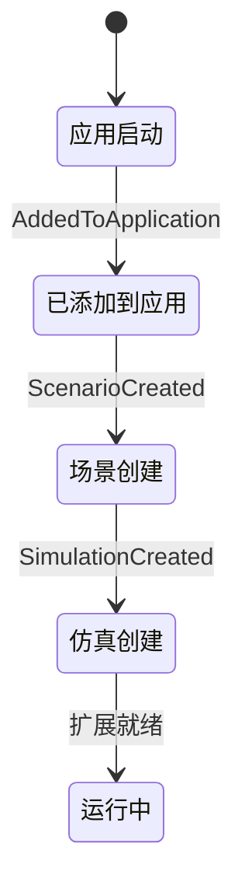
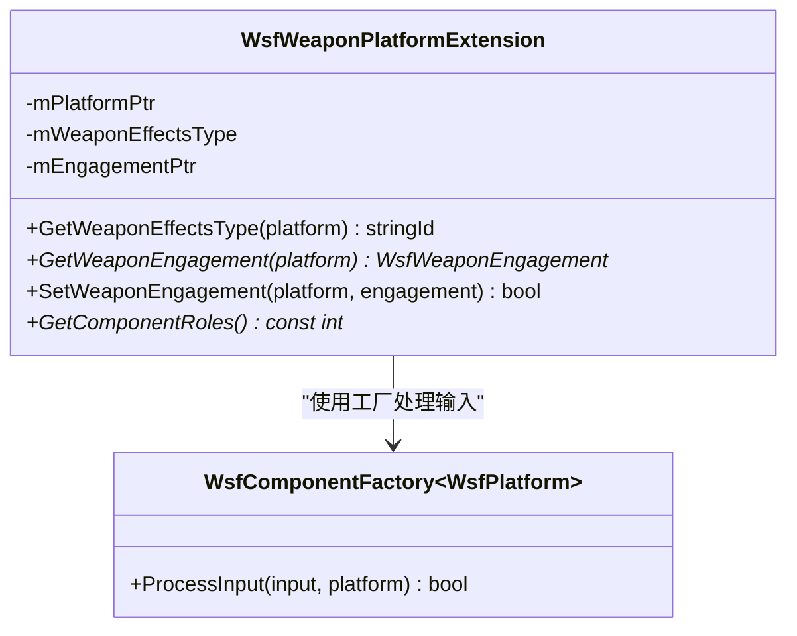
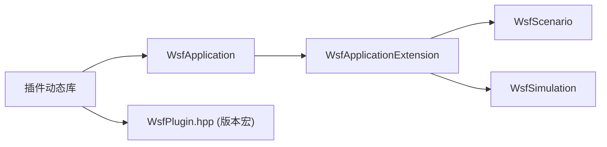

# 扩展开发API

<cite>
**本文引用的文件**   
- [WsfApplicationExtension.hpp](file://swdev/src/core/wsf/source/WsfApplicationExtension.hpp)
- [WsfPlugin.hpp](file://swdev/src/core/wsf/source/WsfPlugin.hpp)
- [WsfCoverageRegistration.cpp](file://swdev/src/wsf_plugins/wsf_coverage/source/WsfCoverageRegistration.cpp)
- [WsfScriptPrompt.cpp](file://swdev/src/warlock/plugins/WsfPrompt/source/wsf_prompt/source/WsfScriptPrompt.cpp)
- [MoverPluginRegistration.cpp](file://training/developer/core/labs/solution/mover/source/MoverPluginRegistration.cpp)
- [WsfWeaponPlatformExtension.cpp](file://swdev/src/core/wsf_mil/source/weapon/WsfWeaponPlatformExtension.cpp)
</cite>

## 目录
1. [简介](#简介)
2. [项目结构](#项目结构)
3. [核心组件](#核心组件)
4. [架构总览](#架构总览)
5. [详细组件分析](#详细组件分析)
6. [依赖关系分析](#依赖关系分析)
7. [性能考虑](#性能考虑)
8. [故障排查指南](#故障排查指南)
9. [结论](#结论)
10. [附录](#附录)

## 简介
本文件面向AFSIM的WSF（Warfare Simulation Framework）扩展开发者，系统说明扩展开发API与最佳实践。重点包括：
- WsfExtension基类的设计模式与插件生命周期管理
- WsfApplicationExtension的应用程序扩展机制与接口规范
- 模块注册、依赖管理与版本控制（插件API）
- 扩展点（Extension Points）的定义与使用模式
- 自定义处理器、传感器与武器的扩展示例指引
- 扩展打包、部署与调试的完整工作流程

## 项目结构
AFSIM的扩展体系围绕WSF核心库构建，典型扩展位于wsf_plugins或warlock等子系统中，通过统一的插件入口进行注册与加载。核心头文件与示例如下：
- 应用程序扩展基类：WsfApplicationExtension
- 插件API与版本宏：WsfPlugin.hpp
- 覆盖分析扩展注册示例：WsfCoverageRegistration.cpp
- 提示器扩展注册示例：WsfScriptPrompt.cpp
- 训练示例中的移动器插件注册：MoverPluginRegistration.cpp
- 武器平台扩展实现示例：WsfWeaponPlatformExtension.cpp

图表来源
- [WsfApplicationExtension.hpp:28-119](file://swdev/src/core/wsf/source/WsfApplicationExtension.hpp#L28-L119)
- [WsfCoverageRegistration.cpp:21-47](file://swdev/src/wsf_plugins/wsf_coverage/source/WsfCoverageRegistration.cpp#L21-L47)
- [WsfScriptPrompt.cpp:25-57](file://swdev/src/warlock/plugins/WsfPrompt/source/wsf_prompt/source/WsfScriptPrompt.cpp#L25-L57)
- [MoverPluginRegistration.cpp:27-40](file://training/developer/core/labs/solution/mover/source/MoverPluginRegistration.cpp#L27-L40)
- [WsfWeaponPlatformExtension.cpp:25-41](file://swdev/src/core/wsf_mil/source/weapon/WsfWeaponPlatformExtension.cpp#L25-L41)

章节来源
- [WsfApplicationExtension.hpp:28-119](file://swdev/src/core/wsf/source/WsfApplicationExtension.hpp#L28-L119)
- [WsfPlugin.hpp:15-20](file://swdev/src/core/wsf/source/WsfPlugin.hpp#L15-L20)

## 核心组件
- WsfExtension：所有扩展的抽象基类，提供扩展名、组件角色等通用能力。
- WsfApplicationExtension：应用程序级扩展基类，提供AddedToApplication、ScenarioCreated、SimulationCreated等生命周期回调，以及命令行处理、语法打印等标准应用方法。
- 插件API：通过WsfPlugin.hpp暴露WSF_PLUGIN_API_*宏，用于插件与宿主版本一致性校验。

关键要点
- 扩展通过继承WsfApplicationExtension并覆写生命周期回调来接入系统。
- 在AddedToApplication中可注册脚本类型、命令、功能特性等。
- ScenarioCreated/SimulationCreated分别用于在场景和仿真创建时注入扩展行为。
- 插件导出函数WsfPluginVersion与WsfPluginSetup负责版本检查与初始化。

章节来源
- [WsfApplicationExtension.hpp:28-119](file://swdev/src/core/wsf/source/WsfApplicationExtension.hpp#L28-L119)
- [WsfPlugin.hpp:15-20](file://swdev/src/core/wsf/source/WsfPlugin.hpp#L15-L20)

## 架构总览
下图展示扩展从加载到运行的整体流程，涵盖插件入口、应用扩展注册、场景与仿真扩展注入。

图表来源
- [WsfScriptPrompt.cpp:48-74](file://swdev/src/warlock/plugins/WsfPrompt/source/wsf_prompt/source/WsfScriptPrompt.cpp#L48-L74)
- [WsfCoverageRegistration.cpp:40-59](file://swdev/src/wsf_plugins/wsf_coverage/source/WsfCoverageRegistration.cpp#L40-L59)
- [WsfApplicationExtension.hpp:96-109](file://swdev/src/core/wsf/source/WsfApplicationExtension.hpp#L96-L109)

## 详细组件分析

### WsfApplicationExtension 设计模式与生命周期
- 设计模式
  - 模板化默认扩展：WsfDefaultApplicationExtension<SCENARIO_EXTENSION>为每个场景自动注册一个场景扩展，简化常见用例。
  - 钩子回调：AddedToApplication、ScenarioCreated、SimulationCreated构成扩展生命周期的三个关键阶段。
  - 标准应用集成：ProcessCommandLine、PrintCommandLineArguments、PrintGrammar、ProcessCommandLineCommands便于扩展参与命令行解析与语法输出。
- 生命周期管理
  - 应用启动后，先调用AddedToApplication，适合注册脚本类型、命令、功能特性。
  - 场景创建后，调用ScenarioCreated，适合注册场景级扩展或订阅事件。
  - 仿真创建后，调用SimulationCreated，适合注册仿真级扩展或观察者。

图表来源
- [WsfApplicationExtension.hpp:85-138](file://swdev/src/core/wsf/source/WsfApplicationExtension.hpp#L85-L138)

章节来源
- [WsfApplicationExtension.hpp:28-138](file://swdev/src/core/wsf/source/WsfApplicationExtension.hpp#L28-L138)

### 应用程序扩展机制与第三方集成
- 覆盖分析扩展（wsf_coverage）
  - 在Register_wsf_coverage中注册功能特性与扩展实例。
  - 在ScenarioCreated中将场景扩展注册到当前场景。
- 提示器扩展（wsf_prompt）
  - 在AddedToApplication中向脚本类型注册新的脚本类。
  - 在SimulationCreated中注册仿真扩展（如观察者）。
  - 通过WsfPluginVersion与WsfPluginSetup完成插件版本与初始化。

图表来源
- [WsfCoverageRegistration.cpp:40-59](file://swdev/src/wsf_plugins/wsf_coverage/source/WsfCoverageRegistration.cpp#L40-L59)
- [WsfScriptPrompt.cpp:48-74](file://swdev/src/warlock/plugins/WsfPrompt/source/wsf_prompt/source/WsfScriptPrompt.cpp#L48-L74)

章节来源
- [WsfCoverageRegistration.cpp:21-59](file://swdev/src/wsf_plugins/wsf_coverage/source/WsfCoverageRegistration.cpp#L21-L59)
- [WsfScriptPrompt.cpp:25-74](file://swdev/src/warlock/plugins/WsfPrompt/source/wsf_prompt/source/WsfScriptPrompt.cpp#L25-L74)

### 模块注册、依赖管理与版本控制
- 模块注册
  - 通过WsfApplication::RegisterFeature声明功能特性。
  - 通过WsfApplication::RegisterExtension将扩展实例绑定到应用。
- 依赖管理
  - 扩展可在AddedToApplication中访问脚本类型、命令系统等全局资源。
  - 场景/仿真扩展通过ScenarioCreated/SimulationCreated获取上下文对象。
- 版本控制
  - 插件需实现WsfPluginVersion以返回WSF_PLUGIN_API_MAJOR_VERSION/WSF_PLUGIN_API_MINOR_VERSION。
  - 宿主侧通过WsfPluginManager进行版本匹配。

图表来源
- [WsfPlugin.hpp:15-20](file://swdev/src/core/wsf/source/WsfPlugin.hpp#L15-L20)
- [WsfScriptPrompt.cpp:61-74](file://swdev/src/warlock/plugins/WsfPrompt/source/wsf_prompt/source/WsfScriptPrompt.cpp#L61-L74)
- [WsfCoverageRegistration.cpp:50-59](file://swdev/src/wsf_plugins/wsf_coverage/source/WsfCoverageRegistration.cpp#L50-L59)

章节来源
- [WsfPlugin.hpp:15-20](file://swdev/src/core/wsf/source/WsfPlugin.hpp#L15-L20)
- [WsfScriptPrompt.cpp:61-74](file://swdev/src/warlock/plugins/WsfPrompt/source/wsf_prompt/source/WsfScriptPrompt.cpp#L61-L74)
- [WsfCoverageRegistration.cpp:50-59](file://swdev/src/wsf_plugins/wsf_coverage/source/WsfCoverageRegistration.cpp#L50-L59)

### 扩展点（Extension Points）定义与使用模式
- 应用扩展点：WsfApplicationExtension的生命周期回调是主要扩展点，允许在应用、场景、仿真不同阶段注入行为。
- 场景扩展点：通过WsfDefaultApplicationExtension模板或手动在ScenarioCreated中注册WsfScenarioExtension。
- 仿真扩展点：在SimulationCreated中注册仿真级扩展（如观察者、计时器等）。

图表来源
- [WsfApplicationExtension.hpp:96-109](file://swdev/src/core/wsf/source/WsfApplicationExtension.hpp#L96-L109)

章节来源
- [WsfApplicationExtension.hpp:96-109](file://swdev/src/core/wsf/source/WsfApplicationExtension.hpp#L96-L109)

### 自定义处理器、传感器与武器的扩展示例
- 自定义处理器
  - 可通过脚本处理器（WSF_SCRIPT_PROCESSOR）在平台类型中定义处理器逻辑，并在处理器on_update等回调中执行自定义行为。
  - 参考示例路径：demos/simple_scenario/platforms/blue_strikers.txt（处理器定义与脚本回调）。
- 自定义传感器
  - 传感器扩展通常继承传感器基类并实现探测、扫描、更新等逻辑；在场景中通过sensor节点挂载。
  - 参考示例路径：demos/sensor_demos/*.txt（多种传感器配置与用法）。
- 自定义武器
  - 武器扩展通常继承武器基类并实现发射、制导、效果等逻辑；在平台类型中通过weapon节点定义。
  - 参考示例路径：demos/air_to_air/weapons/aam/*.txt（空空导弹武器定义）。

注意：以上示例为配置文件层面的扩展方式，适用于快速原型与脚本驱动扩展；若需C++级别扩展，应遵循WsfApplicationExtension模式并通过插件机制注册。

章节来源
- [blue_strikers.txt:14-39](file://demos/simple_scenario/platforms/blue_strikers.txt#L14-L39)

### 武器平台扩展（WsfWeaponPlatformExtension）
- 作用：为平台附加武器相关扩展数据（如武器效果类型、交战对象），并提供静态工具方法查询与设置。
- 关键点
  - 通过组件工厂处理平台输入（如weapon_effects、weapon_effects_type命令）。
  - 提供Get/Set WeaponEngagement等方法管理交战状态。
  - 组件角色标识cWSF_COMPONENT_WEAPON_PLATFORM_EXTENSION用于系统识别。

图表来源
- [WsfWeaponPlatformExtension.cpp:25-41](file://swdev/src/core/wsf_mil/source/weapon/WsfWeaponPlatformExtension.cpp#L25-L41)
- [WsfWeaponPlatformExtension.cpp:81-156](file://swdev/src/core/wsf_mil/source/weapon/WsfWeaponPlatformExtension.cpp#L81-L156)

章节来源
- [WsfWeaponPlatformExtension.cpp:25-41](file://swdev/src/core/wsf_mil/source/weapon/WsfWeaponPlatformExtension.cpp#L25-L41)
- [WsfWeaponPlatformExtension.cpp:81-156](file://swdev/src/core/wsf_mil/source/weapon/WsfWeaponPlatformExtension.cpp#L81-L156)

## 依赖关系分析
- 组件耦合
  - WsfApplicationExtension依赖WsfApplication、WsfScenario、WsfSimulation以获取上下文。
  - 示例扩展（coverage、prompt）依赖WsfApplication进行功能与扩展注册。
- 直接依赖
  - 插件通过WsfPlugin.hpp提供的宏与宿主进行版本对齐。
- 间接依赖
  - 场景/仿真扩展通过WsfScenarioExtension与WsfSimulation扩展点间接与系统交互。

图表来源
- [WsfApplicationExtension.hpp:28-119](file://swdev/src/core/wsf/source/WsfApplicationExtension.hpp#L28-L119)
- [WsfPlugin.hpp:15-20](file://swdev/src/core/wsf/source/WsfPlugin.hpp#L15-L20)

章节来源
- [WsfApplicationExtension.hpp:28-119](file://swdev/src/core/wsf/source/WsfApplicationExtension.hpp#L28-L119)
- [WsfPlugin.hpp:15-20](file://swdev/src/core/wsf/source/WsfPlugin.hpp#L15-L20)

## 性能考虑
- 扩展注册开销：尽量在AddedToApplication中一次性注册脚本类型与命令，避免运行时重复注册。
- 场景/仿真扩展：仅在必要时注册观察者或监听器，减少回调链长度。
- 武器平台扩展：避免在高频更新路径中进行昂贵计算，建议缓存结果或使用增量更新策略。
- 插件加载：合理拆分插件粒度，避免单插件过大导致加载缓慢。

[本节为通用指导，不直接分析具体文件]

## 故障排查指南
- 插件未加载或功能不可用
  - 检查是否实现了WsfPluginVersion与WsfPluginSetup，并确保版本号与宿主一致。
  - 确认RegisterFeature与RegisterExtension调用顺序正确。
- 扩展回调未触发
  - 验证是否在正确的生命周期回调中注册了所需扩展（如ScenarioCreated中注册场景扩展）。
- 脚本类型未生效
  - 在AddedToApplication中确保脚本类型已注册到脚本类型管理器。
- 武器平台扩展无效
  - 检查平台输入命令是否正确（如weapon_effects_type），并确认组件角色已正确声明。

章节来源
- [WsfScriptPrompt.cpp:61-74](file://swdev/src/warlock/plugins/WsfPrompt/source/wsf_prompt/source/WsfScriptPrompt.cpp#L61-L74)
- [WsfCoverageRegistration.cpp:40-59](file://swdev/src/wsf_plugins/wsf_coverage/source/WsfCoverageRegistration.cpp#L40-L59)
- [WsfWeaponPlatformExtension.cpp:25-41](file://swdev/src/core/wsf_mil/source/weapon/WsfWeaponPlatformExtension.cpp#L25-L41)

## 结论
AFSIM的WSF扩展体系通过WsfApplicationExtension提供了清晰的应用级扩展点，配合插件API的版本控制与注册机制，使第三方功能与自定义模块能够安全、可控地集成到仿真系统中。开发者应遵循生命周期回调约定，合理使用功能特性注册与脚本类型扩展，并结合示例扩展（coverage、prompt、mover）快速上手。对于处理器、传感器与武器等实体级扩展，既可采用脚本配置方式快速原型，也可通过C++扩展实现高性能定制。

[本节为总结性内容，不直接分析具体文件]

## 附录
- 扩展打包与部署
  - 将扩展编译为动态库，确保导出WsfPluginVersion与WsfPluginSetup。
  - 在宿主应用中通过插件管理器加载动态库。
- 调试建议
  - 启用日志输出，定位扩展注册与回调执行情况。
  - 逐步断点在AddedToApplication、ScenarioCreated、SimulationCreated中观察上下文对象。

[本节为通用指导，不直接分析具体文件]