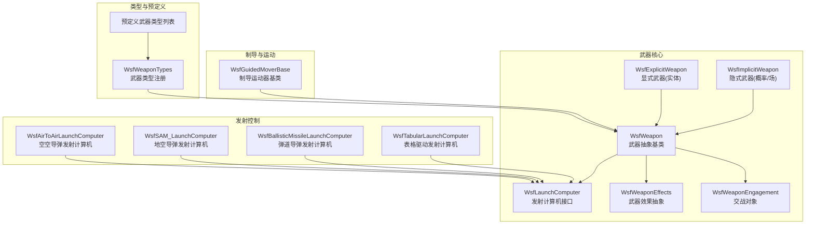
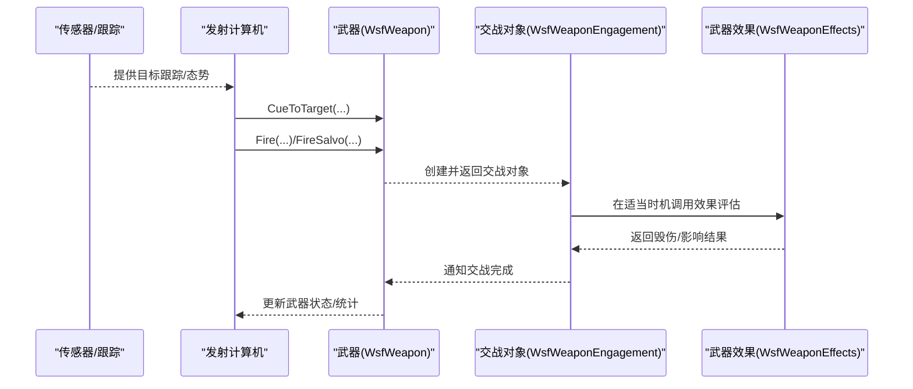
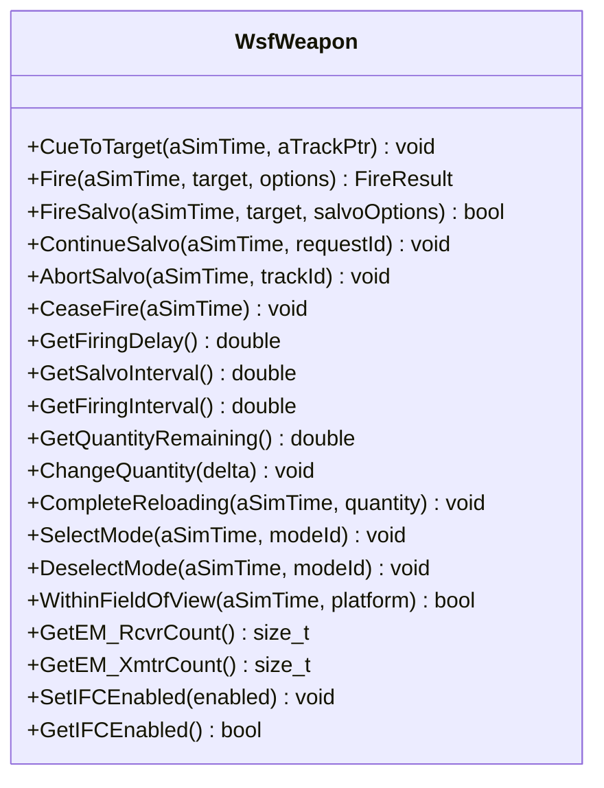
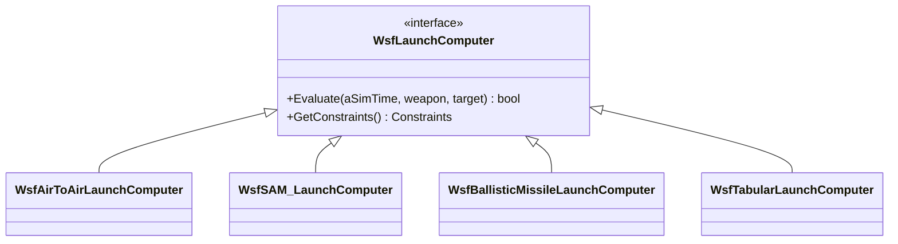
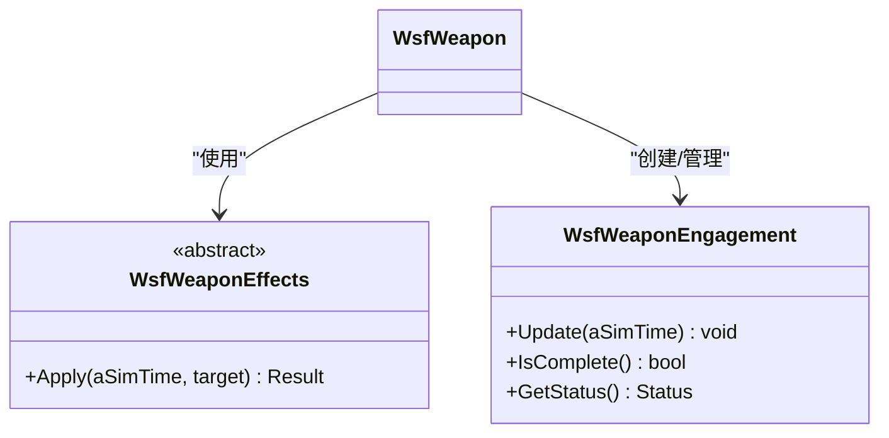
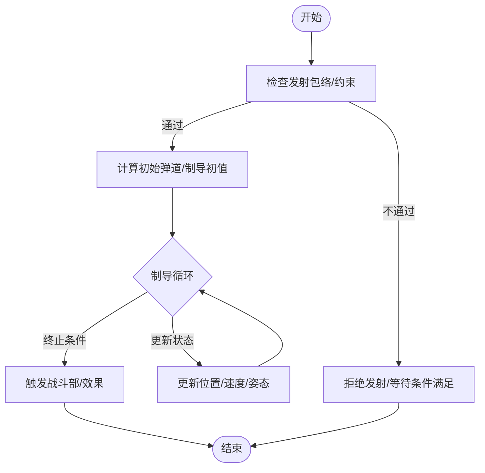
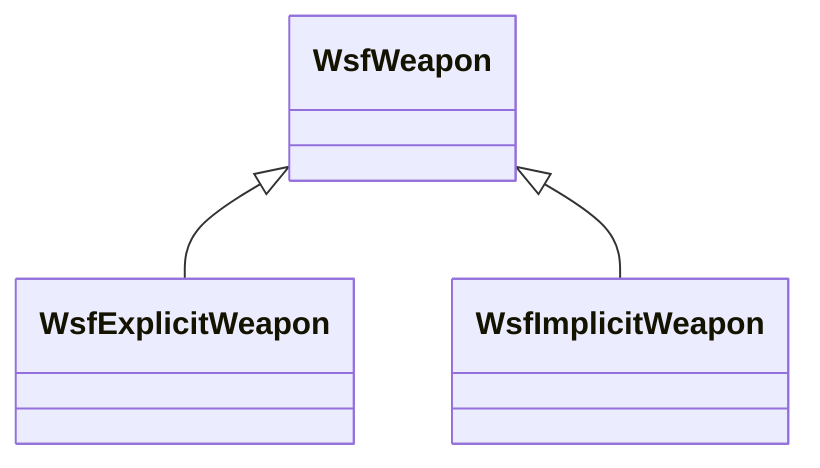
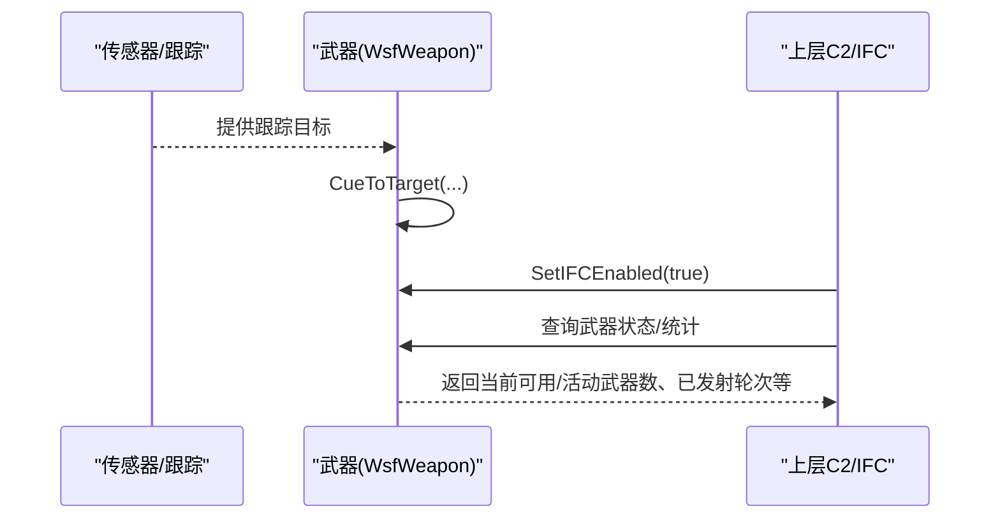
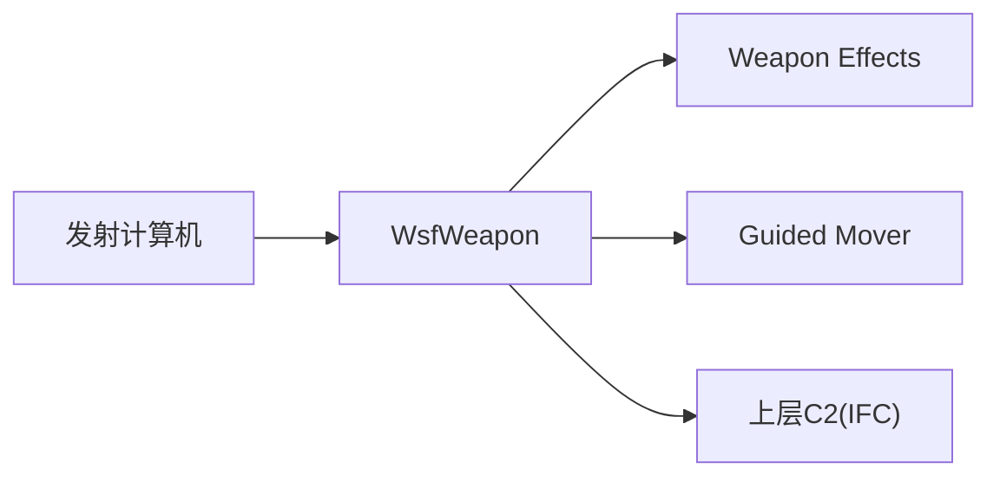

# 武器系统API

<cite>
**本文引用的文件**   
- [WsfWeapon.hpp](file://swdev/src/core/wsf_mil/source/weapon/WsfWeapon.hpp)
- [WsfLaunchComputer.hpp](file://swdev/src/core/wsf_mil/source/weapon/WsfLaunchComputer.hpp)
- [WsfWeaponEffects.hpp](file://swdev/src/core/wsf_mil/source/weapon/WsfWeaponEffects.hpp)
- [WsfWeaponEngagement.hpp](file://swdev/src/core/wsf_mil/source/weapon/WsfWeaponEngagement.hpp)
- [WsfExplicitWeapon.hpp](file://swdev/src/core/wsf_mil/source/weapon/WsfExplicitWeapon.hpp)
- [WsfImplicitWeapon.hpp](file://swdev/src/core/wsf_mil/source/weapon/WsfImplicitWeapon.hpp)
- [WsfAirToAirLaunchComputer.hpp](file://swdev/src/core/wsf_mil/source/weapon/WsfAirToAirLaunchComputer.hpp)
- [WsfSAM_LaunchComputer.hpp](file://swdev/src/core/wsf_mil/source/weapon/WsfSAM_LaunchComputer.hpp)
- [WsfBallisticMissileLaunchComputer.hpp](file://swdev/src/core/wsf_mil/source/weapon/WsfBallisticMissileLaunchComputer.hpp)
- [WsfTabularLaunchComputer.hpp](file://swdev/src/core/wsf_mil/source/weapon/WsfTabularLaunchComputer.hpp)
- [WsfGuidedMoverBase.hpp](file://swdev/src/core/wsf_mil/source/mover/WsfGuidedMoverBase.hpp)
- [WsfWeaponTypes.hpp](file://swdev/src/core/wsf_mil/source/weapon/WsfWeaponTypes.hpp)
- [predefined_weapon_types.txt](file://swdev/src/core/wsf_nx/doc/_predefined_weapon_types.txt)
- [launch_computer_simple_mrm_table.txt](file://demos/behavior_tree/weapons/aam/launch_computer_simple_mrm_table.txt)
</cite>

## 目录
1. [简介](#简介)
2. [项目结构](#项目结构)
3. [核心组件](#核心组件)
4. [架构总览](#架构总览)
5. [详细组件分析](#详细组件分析)
6. [依赖关系分析](#依赖关系分析)
7. [性能与命中概率](#性能与命中概率)
8. [故障排查指南](#故障排查指南)
9. [结论](#结论)
10. [附录：配置与示例路径](#附录配置与示例路径)

## 简介
本文件面向AFSIM武器系统API，聚焦于WsfWeapon基类与发射控制（Launch Computer）体系的设计模式，覆盖武器发射、制导、效果评估的核心接口；梳理空空导弹、地空导弹、反舰导弹等典型武器类型的实现模式；解释弹道计算、制导律与战斗部效果的编程接口；说明武器与传感器的交互机制（目标锁定、数据链接口）；并提供武器配置、发射控制与效果模拟的参考路径。文档以代码级事实为依据，辅以可视化图示帮助理解。

## 项目结构
武器系统相关代码主要位于wsf_mil模块的weapon子目录，同时涉及mover（制导运动器）、launcher（发射机，概念性入口）以及若干demos中的场景与表驱动配置。关键文件包括：
- WsfWeapon.hpp：武器抽象基类，定义发射、状态、库存、模式、EM收发器访问、IFC支持等
- Launch Computer系列：按任务域划分（空空、地空、弹道、表格驱动等）
- Weapon Effects系列：伤害/毁伤模型抽象与具体实现
- Guided Mover Base：制导飞行器的通用运动器基类
- Weapon Types：武器类型注册与枚举

图表来源
- [WsfWeapon.hpp:39-62](file://swdev/src/core/wsf_mil/source/weapon/WsfWeapon.hpp#L39-L62)
- [WsfLaunchComputer.hpp](file://swdev/src/core/wsf_mil/source/weapon/WsfLaunchComputer.hpp)
- [WsfWeaponEffects.hpp](file://swdev/src/core/wsf_mil/source/weapon/WsfWeaponEffects.hpp)
- [WsfWeaponEngagement.hpp](file://swdev/src/core/wsf_mil/source/weapon/WsfWeaponEngagement.hpp)
- [WsfExplicitWeapon.hpp](file://swdev/src/core/wsf_mil/source/weapon/WsfExplicitWeapon.hpp)
- [WsfImplicitWeapon.hpp](file://swdev/src/core/wsf_mil/source/weapon/WsfImplicitWeapon.hpp)
- [WsfAirToAirLaunchComputer.hpp](file://swdev/src/core/wsf_mil/source/weapon/WsfAirToAirLaunchComputer.hpp)
- [WsfSAM_LaunchComputer.hpp](file://swdev/src/core/wsf_mil/source/weapon/WsfSAM_LaunchComputer.hpp)
- [WsfBallisticMissileLaunchComputer.hpp](file://swdev/src/core/wsf_mil/source/weapon/WsfBallisticMissileLaunchComputer.hpp)
- [WsfTabularLaunchComputer.hpp](file://swdev/src/core/wsf_mil/source/weapon/WsfTabularLaunchComputer.hpp)
- [WsfGuidedMoverBase.hpp](file://swdev/src/core/wsf_mil/source/mover/WsfGuidedMoverBase.hpp)
- [WsfWeaponTypes.hpp](file://swdev/src/core/wsf_mil/source/weapon/WsfWeaponTypes.hpp)
- [predefined_weapon_types.txt:1-11](file://swdev/src/core/wsf_nx/doc/_predefined_weapon_types.txt#L1-L11)

章节来源
- [WsfWeapon.hpp:39-62](file://swdev/src/core/wsf_mil/source/weapon/WsfWeapon.hpp#L39-L62)
- [predefined_weapon_types.txt:1-11](file://swdev/src/core/wsf_nx/doc/_predefined_weapon_types.txt#L1-L11)

## 核心组件
- WsfWeapon（武器抽象基类）
  - 提供武器生命周期、状态管理、发射接口（Cue/Fire/Salvo）、库存与再装填、多模式（如干扰）控制、EM收发器访问、IFC集成开关、目标视场判断等能力
  - 明确区分显式武器（创建新平台，如导弹/炸弹）与隐式武器（直接作用，如激光/电子战）
- 发射计算机（Launch Computer）
  - 负责“是否可发射”“何时发射”“向哪个目标发射”的决策逻辑，按任务域划分为空空、地空、弹道、表格驱动等
- 武器效果（Weapon Effects）
  - 抽象出对目标的毁伤/影响计算接口，具体由子类实现（球形、梯度、表驱动、HEL等）
- 交战对象（Weapon Engagement）
  - 封装一次武器发射后的完整交战上下文，贯穿从发射到终止的全流程
- 制导运动器（Guided Mover Base）
  - 为制导武器提供统一的运动学/制导律接入点，与发射计算机协同完成轨迹生成与控制指令输出
- 武器类型（Weapon Types）
  - 集中注册与管理武器类型，配合预定义武器类型清单进行实例化

章节来源
- [WsfWeapon.hpp:39-62](file://swdev/src/core/wsf_mil/source/weapon/WsfWeapon.hpp#L39-L62)
- [WsfWeapon.hpp:111-149](file://swdev/src/core/wsf_mil/source/weapon/WsfWeapon.hpp#L111-L149)
- [WsfWeapon.hpp:209-239](file://swdev/src/core/wsf_mil/source/weapon/WsfWeapon.hpp#L209-L239)
- [WsfWeapon.hpp:343-393](file://swdev/src/core/wsf_mil/source/weapon/WsfWeapon.hpp#L343-L393)
- [WsfWeapon.hpp:404-447](file://swdev/src/core/wsf_mil/source/weapon/WsfWeapon.hpp#L404-L447)
- [WsfWeapon.hpp:473-519](file://swdev/src/core/wsf_mil/source/weapon/WsfWeapon.hpp#L473-L519)
- [WsfWeapon.hpp:597-612](file://swdev/src/core/wsf_mil/source/weapon/WsfWeapon.hpp#L597-L612)

## 架构总览
武器系统的整体调用链围绕“传感器→跟踪→发射计算机→武器→效果”展开。传感器产生目标跟踪，发射计算机根据战术规则与包络检查决定是否发射，武器执行发射并进入交战生命周期，最终通过武器效果对目标施加毁伤或影响。

图表来源
- [WsfWeapon.hpp:343-393](file://swdev/src/core/wsf_mil/source/weapon/WsfWeapon.hpp#L343-L393)
- [WsfWeaponEngagement.hpp](file://swdev/src/core/wsf_mil/source/weapon/WsfWeaponEngagement.hpp)
- [WsfWeaponEffects.hpp](file://swdev/src/core/wsf_mil/source/weapon/WsfWeaponEffects.hpp)

## 详细组件分析

### WsfWeapon 基类设计
- 设计要点
  - 统一抽象：所有武器类型继承自WsfWeapon，确保一致的初始化、输入处理、更新、状态切换与生命周期回调
  - 双形态武器：显式武器（创建实体平台）与隐式武器（直接作用）共用同一套发射与状态接口
  - 多模式支持：内置模式列表与选择/取消接口，适用于干扰器等多模态武器
  - EM收发器访问：提供获取接收器/发射器数量与实例的方法，便于电子战/通信集成
  - IFC集成：支持综合火控开关，便于上层C2系统调度
- 关键接口
  - 发射与编队：CueToTarget、Fire、FireSalvo、ContinueSalvo、AbortSalvo、CeaseFire
  - 时间与间隔：GetFiringDelay、GetSalvoInterval、GetFiringInterval
  - 库存与再装填：GetQuantityRemaining/Committed/Maximum/TotalUsed、ChangeQuantity、CompleteReloading、ReloadThreshold/Increment/Inventory
  - 模式与视场：GetCurrentModeName/SelectMode/DeselectMode、WithinFieldOfView
  - 状态与统计：TurnOn/TurnOff/SetOperational/SetNonOperational、TimeLastFired、WeaponsActiveFor等静态查询
  - 目标辅助：CreateTargetTrack、GetTargetLocationWCS、SetTargetIndex/GetTargetedLocationWCS

图表来源
- [WsfWeapon.hpp:343-393](file://swdev/src/core/wsf_mil/source/weapon/WsfWeapon.hpp#L343-L393)
- [WsfWeapon.hpp:404-447](file://swdev/src/core/wsf_mil/source/weapon/WsfWeapon.hpp#L404-L447)
- [WsfWeapon.hpp:473-519](file://swdev/src/core/wsf_mil/source/weapon/WsfWeapon.hpp#L473-L519)
- [WsfWeapon.hpp:597-612](file://swdev/src/core/wsf_mil/source/weapon/WsfWeapon.hpp#L597-L612)

章节来源
- [WsfWeapon.hpp:39-62](file://swdev/src/core/wsf_mil/source/weapon/WsfWeapon.hpp#L39-L62)
- [WsfWeapon.hpp:343-393](file://swdev/src/core/wsf_mil/source/weapon/WsfWeapon.hpp#L343-L393)
- [WsfWeapon.hpp:404-447](file://swdev/src/core/wsf_mil/source/weapon/WsfWeapon.hpp#L404-L447)
- [WsfWeapon.hpp:473-519](file://swdev/src/core/wsf_mil/source/weapon/WsfWeapon.hpp#L473-L519)
- [WsfWeapon.hpp:597-612](file://swdev/src/core/wsf_mil/source/weapon/WsfWeapon.hpp#L597-L612)

### 发射计算机（Launch Computer）体系
- 设计模式
  - 策略模式：不同任务域的发射逻辑以独立类实现，统一通过WsfLaunchComputer接口被武器引用
  - 表格驱动：支持基于外部表的决策（如行为树生成的发射表），便于离线标定与在线复用
- 典型实现
  - WsfAirToAirLaunchComputer：空空导弹发射决策（包络、敌我识别、威胁排序等）
  - WsfSAM_LaunchComputer：地空导弹发射决策（阵地/区域约束、防空火力分配）
  - WsfBallisticMissileLaunchComputer：弹道导弹发射决策（弹道窗口、再入段约束）
  - WsfTabularLaunchComputer：表格驱动发射计算机（结合demos中的launch_computer_table）

图表来源
- [WsfLaunchComputer.hpp](file://swdev/src/core/wsf_mil/source/weapon/WsfLaunchComputer.hpp)
- [WsfAirToAirLaunchComputer.hpp](file://swdev/src/core/wsf_mil/source/weapon/WsfAirToAirLaunchComputer.hpp)
- [WsfSAM_LaunchComputer.hpp](file://swdev/src/core/wsf_mil/source/weapon/WsfSAM_LaunchComputer.hpp)
- [WsfBallisticMissileLaunchComputer.hpp](file://swdev/src/core/wsf_mil/source/weapon/WsfBallisticMissileLaunchComputer.hpp)
- [WsfTabularLaunchComputer.hpp](file://swdev/src/core/wsf_mil/source/weapon/WsfTabularLaunchComputer.hpp)
- [launch_computer_simple_mrm_table.txt:10-32](file://demos/behavior_tree/weapons/aam/launch_computer_simple_mrm_table.txt#L10-L32)

章节来源
- [WsfAirToAirLaunchComputer.hpp](file://swdev/src/core/wsf_mil/source/weapon/WsfAirToAirLaunchComputer.hpp)
- [WsfSAM_LaunchComputer.hpp](file://swdev/src/core/wsf_mil/source/weapon/WsfSAM_LaunchComputer.hpp)
- [WsfBallisticMissileLaunchComputer.hpp](file://swdev/src/core/wsf_mil/source/weapon/WsfBallisticMissileLaunchComputer.hpp)
- [WsfTabularLaunchComputer.hpp](file://swdev/src/core/wsf_mil/source/weapon/WsfTabularLaunchComputer.hpp)
- [launch_computer_simple_mrm_table.txt:10-32](file://demos/behavior_tree/weapons/aam/launch_computer_simple_mrm_table.txt#L10-L32)

### 武器效果（Weapon Effects）与交战对象（Weapon Engagement）
- 武器效果
  - 抽象接口：定义对目标的作用方式（如球形杀伤、梯度毁伤、表驱动、高能激光等）
  - 扩展点：通过武器类型字符串关联具体效果实现
- 交战对象
  - 封装一次发射的生命周期：从发射时刻到终止判定，期间协调制导、运动、效果触发与统计

图表来源
- [WsfWeaponEffects.hpp](file://swdev/src/core/wsf_mil/source/weapon/WsfWeaponEffects.hpp)
- [WsfWeaponEngagement.hpp](file://swdev/src/core/wsf_mil/source/weapon/WsfWeaponEngagement.hpp)
- [WsfWeapon.hpp:232-239](file://swdev/src/core/wsf_mil/source/weapon/WsfWeapon.hpp#L232-L239)

章节来源
- [WsfWeaponEffects.hpp](file://swdev/src/core/wsf_mil/source/weapon/WsfWeaponEffects.hpp)
- [WsfWeaponEngagement.hpp](file://swdev/src/core/wsf_mil/source/weapon/WsfWeaponEngagement.hpp)
- [WsfWeapon.hpp:232-239](file://swdev/src/core/wsf_mil/source/weapon/WsfWeapon.hpp#L232-L239)

### 制导与弹道（Guided Mover & Ballistics）
- 制导运动器基类
  - 提供制导武器通用的运动学与制导律接入点，供各类导弹实现具体制导算法（比例导引、能量管理等）
- 弹道计算
  - 弹道导弹发射计算机负责弹道窗口与再入段约束；具体弹道积分通常由运动器子系统完成

图表来源
- [WsfGuidedMoverBase.hpp](file://swdev/src/core/wsf_mil/source/mover/WsfGuidedMoverBase.hpp)
- [WsfBallisticMissileLaunchComputer.hpp](file://swdev/src/core/wsf_mil/source/weapon/WsfBallisticMissileLaunchComputer.hpp)

章节来源
- [WsfGuidedMoverBase.hpp](file://swdev/src/core/wsf_mil/source/mover/WsfGuidedMoverBase.hpp)
- [WsfBallisticMissileLaunchComputer.hpp](file://swdev/src/core/wsf_mil/source/weapon/WsfBallisticMissileLaunchComputer.hpp)

### 武器类型继承体系与典型实现模式
- 显式武器（WsfExplicitWeapon）
  - 发射时创建新的平台实体（如空空/地空/反舰导弹、炸弹），具备独立的运动器、传感器、效果等
- 隐式武器（WsfImplicitWeapon）
  - 不创建实体平台，直接对目标施加效果（如定向能、电子战干扰）
- 典型武器类型
  - 空空导弹（AAM）：结合WsfAirToAirLaunchComputer与制导运动器
  - 地空导弹（SAM）：结合WsfSAM_LaunchComputer与阵地约束
  - 反舰导弹（SSM）：结合相应发射计算机与海面环境约束
  - 其他：炸弹、火箭、定向能、电子战设备等

图表来源
- [WsfExplicitWeapon.hpp](file://swdev/src/core/wsf_mil/source/weapon/WsfExplicitWeapon.hpp)
- [WsfImplicitWeapon.hpp](file://swdev/src/core/wsf_mil/source/weapon/WsfImplicitWeapon.hpp)
- [WsfWeapon.hpp:39-62](file://swdev/src/core/wsf_mil/source/weapon/WsfWeapon.hpp#L39-L62)

章节来源
- [WsfExplicitWeapon.hpp](file://swdev/src/core/wsf_mil/source/weapon/WsfExplicitWeapon.hpp)
- [WsfImplicitWeapon.hpp](file://swdev/src/core/wsf_mil/source/weapon/WsfImplicitWeapon.hpp)
- [WsfWeapon.hpp:39-62](file://swdev/src/core/wsf_mil/source/weapon/WsfWeapon.hpp#L39-L62)

### 武器与传感器交互机制（目标锁定与数据链接口）
- 目标锁定
  - 通过WsfWeapon::CueToTarget将跟踪目标绑定至武器，用于后续发射与效果瞄准
  - 目标位置可通过CreateTargetTrack/GetTargetLocationWCS构造或获取
- 数据链接口
  - IFC开关（SetIFCEnabled/GetIFCEnabled）允许上层C2系统参与发射决策与资源调度
  - 武器状态与统计方法（如WeaponsActiveFor、RoundsFiredAt）供上层监控与回放

图表来源
- [WsfWeapon.hpp:343-393](file://swdev/src/core/wsf_mil/source/weapon/WsfWeapon.hpp#L343-L393)
- [WsfWeapon.hpp:597-612](file://swdev/src/core/wsf_mil/source/weapon/WsfWeapon.hpp#L597-L612)

章节来源
- [WsfWeapon.hpp:343-393](file://swdev/src/core/wsf_mil/source/weapon/WsfWeapon.hpp#L343-L393)
- [WsfWeapon.hpp:597-612](file://swdev/src/core/wsf_mil/source/weapon/WsfWeapon.hpp#L597-L612)

## 依赖关系分析
- 组件耦合
  - WsfWeapon与Launch Computer、Weapon Effects、Weapon Engagement存在强耦合（发射、效果、生命周期）
  - 制导运动器与发射计算机通过“包络/约束”间接耦合
- 外部依赖
  - 传感器/跟踪系统提供目标数据
  - 上层C2通过IFC参与调度
- 潜在循环依赖
  - 通过接口解耦（Launch Computer、Weapon Effects）避免直接循环

图表来源
- [WsfWeapon.hpp:343-393](file://swdev/src/core/wsf_mil/source/weapon/WsfWeapon.hpp#L343-L393)
- [WsfLaunchComputer.hpp](file://swdev/src/core/wsf_mil/source/weapon/WsfLaunchComputer.hpp)
- [WsfWeaponEffects.hpp](file://swdev/src/core/wsf_mil/source/weapon/WsfWeaponEffects.hpp)
- [WsfGuidedMoverBase.hpp](file://swdev/src/core/wsf_mil/source/mover/WsfGuidedMoverBase.hpp)

章节来源
- [WsfWeapon.hpp:343-393](file://swdev/src/core/wsf_mil/source/weapon/WsfWeapon.hpp#L343-L393)
- [WsfLaunchComputer.hpp](file://swdev/src/core/wsf_mil/source/weapon/WsfLaunchComputer.hpp)
- [WsfWeaponEffects.hpp](file://swdev/src/core/wsf_mil/source/weapon/WsfWeaponEffects.hpp)
- [WsfGuidedMoverBase.hpp](file://swdev/src/core/wsf_mil/source/mover/WsfGuidedMoverBase.hpp)

## 性能与命中概率
- 性能考量
  - 发射间隔与编队间隔：通过GetFiringInterval/GetSalvoInterval控制武器发射节奏，避免瞬时过载
  - 更新间隔：武器Update周期由仿真执行器控制，合理设置可减少计算开销
  - 库存与再装填：ReloadThreshold/Increment/Inventory影响持续作战能力与后台补给效率
- 命中概率与毁伤评估
  - 命中概率通常由发射计算机的包络检查与武器效果模型共同决定
  - 毁伤评估通过Weapon Effects子类实现，可结合目标特性与环境因素
- 建议
  - 使用表格驱动发射计算机（WsfTabularLaunchComputer）与demos中的launch_computer_table进行离线标定与在线复用
  - 针对高动态目标，细化制导律与运动器参数以提升命中率

章节来源
- [WsfWeapon.hpp:370-393](file://swdev/src/core/wsf_mil/source/weapon/WsfWeapon.hpp#L370-L393)
- [WsfWeapon.hpp:420-447](file://swdev/src/core/wsf_mil/source/weapon/WsfWeapon.hpp#L420-L447)
- [launch_computer_simple_mrm_table.txt:10-32](file://demos/behavior_tree/weapons/aam/launch_computer_simple_mrm_table.txt#L10-L32)

## 故障排查指南
- 常见问题
  - 发射失败：检查发射包络、库存不足、发射间隔未满足、IFC未启用
  - 目标丢失：确认CueToTarget是否正确调用，跟踪质量是否足够
  - 效果未触发：核对Weapon Effects类型是否与武器类型匹配
- 诊断步骤
  - 使用武器状态查询方法（WeaponsActiveFor、RoundsFiredAt等）定位发射阶段
  - 检查ReloadThreshold/Inventory是否导致补货中断
  - 验证Launch Computer配置（尤其是表格驱动表）

章节来源
- [WsfWeapon.hpp:111-149](file://swdev/src/core/wsf_mil/source/weapon/WsfWeapon.hpp#L111-L149)
- [WsfWeapon.hpp:420-447](file://swdev/src/core/wsf_mil/source/weapon/WsfWeapon.hpp#L420-L447)

## 结论
AFSIM武器系统API以WsfWeapon为核心抽象，通过发射计算机、武器效果与制导运动器的分层解耦，实现了从空空导弹到地空导弹、弹道导弹等多种武器类型的统一建模与扩展。借助IFC与表格驱动发射计算机，系统既支持高层C2集成，也支持离线标定与在线复用，具备良好的可扩展性与工程实用性。

## 附录：配置与示例路径
- 预定义武器类型清单
  - 路径：[predefined_weapon_types.txt:1-11](file://swdev/src/core/wsf_nx/doc/_predefined_weapon_types.txt#L1-L11)
- 发射计算机表格（行为树生成）
  - 路径：[launch_computer_simple_mrm_table.txt:10-32](file://demos/behavior_tree/weapons/aam/launch_computer_simple_mrm_table.txt#L10-L32)
- 武器基类与接口
  - 路径：[WsfWeapon.hpp:39-62](file://swdev/src/core/wsf_mil/source/weapon/WsfWeapon.hpp#L39-L62), [WsfWeapon.hpp:343-393](file://swdev/src/core/wsf_mil/source/weapon/WsfWeapon.hpp#L343-L393)
- 发射计算机实现
  - 路径：[WsfAirToAirLaunchComputer.hpp](file://swdev/src/core/wsf_mil/source/weapon/WsfAirToAirLaunchComputer.hpp), [WsfSAM_LaunchComputer.hpp](file://swdev/src/core/wsf_mil/source/weapon/WsfSAM_LaunchComputer.hpp), [WsfBallisticMissileLaunchComputer.hpp](file://swdev/src/core/wsf_mil/source/weapon/WsfBallisticMissileLaunchComputer.hpp), [WsfTabularLaunchComputer.hpp](file://swdev/src/core/wsf_mil/source/weapon/WsfTabularLaunchComputer.hpp)
- 武器效果与交战对象
  - 路径：[WsfWeaponEffects.hpp](file://swdev/src/core/wsf_mil/source/weapon/WsfWeaponEffects.hpp), [WsfWeaponEngagement.hpp](file://swdev/src/core/wsf_mil/source/weapon/WsfWeaponEngagement.hpp)
- 制导运动器
  - 路径：[WsfGuidedMoverBase.hpp](file://swdev/src/core/wsf_mil/source/mover/WsfGuidedMoverBase.hpp)