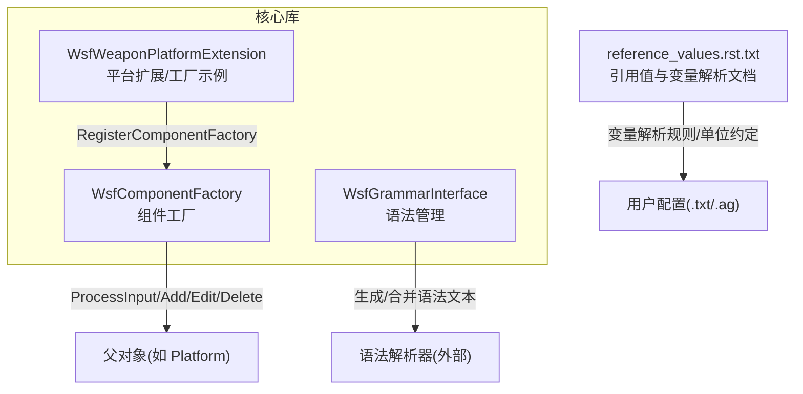
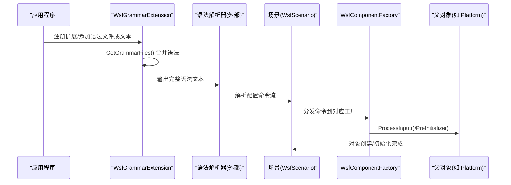
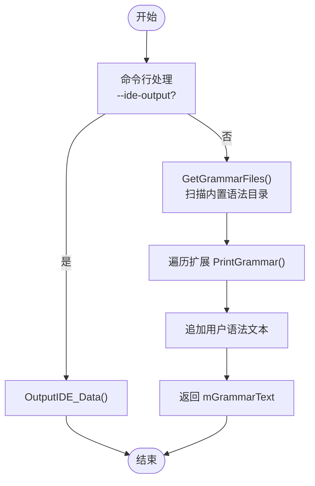
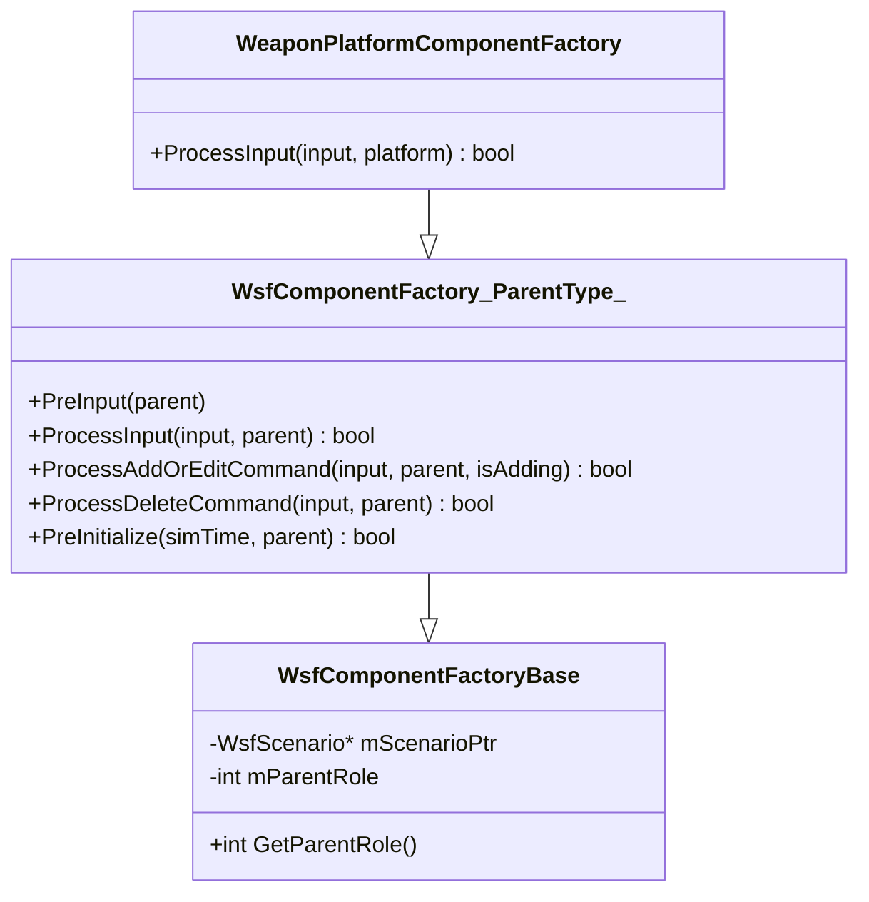
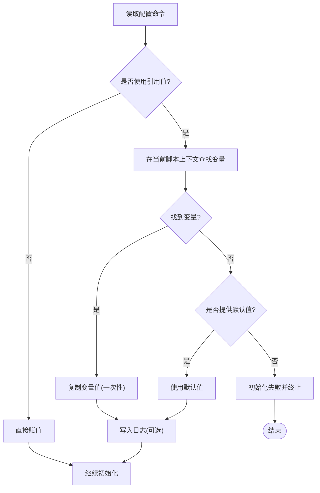
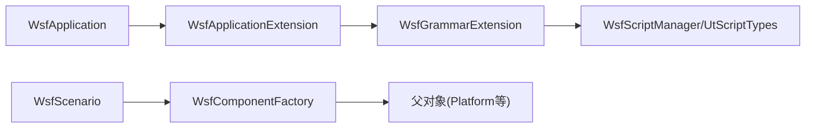

# 配置系统API

<cite>
**本文引用的文件**   
- [WsfGrammarInterface.hpp](file://swdev/src/core/wsf/source/WsfGrammarInterface.hpp)
- [WsfGrammarInterface.cpp](file://swdev/src/core/wsf/source/WsfGrammarInterface.cpp)
- [WsfComponentFactory.hpp](file://swdev/src/core/wsf/source/WsfComponentFactory.hpp)
- [WsfComponentFactory.cpp](file://swdev/src/core/wsf/source/WsfComponentFactory.cpp)
- [WsfWeaponPlatformExtension.cpp](file://swdev/src/core/wsf_mil/source/weapon/WsfWeaponPlatformExtension.cpp)
- [reference_values.rst.txt](file://documentation/html/_sources/docs/reference_values.rst.txt)
</cite>

## 目录
1. [简介](#简介)
2. [项目结构](#项目结构)
3. [核心组件](#核心组件)
4. [架构总览](#架构总览)
5. [详细组件分析](#详细组件分析)
6. [依赖关系分析](#依赖关系分析)
7. [性能考虑](#性能考虑)
8. [故障排查指南](#故障排查指南)
9. [结论](#结论)
10. [附录](#附录)

## 简介
本文件面向AFSIM的WSF（Warfare Simulation Framework）配置系统，聚焦以下目标：
- 说明声明式语法的解析与扩展机制（WsfGrammarInterface）。
- 文档化对象工厂模式（WsfComponentFactory），展示如何通过配置文件动态创建和初始化仿真对象。
- 解释脚本引擎集成接口与变量交换机制（参考值、脚本上下文）。
- 说明配置文件的层次结构与继承机制。
- 提供自定义语法与对象创建的编程示例路径。
- 给出配置验证、错误处理与性能优化的最佳实践。

## 项目结构
围绕配置系统的核心代码位于core/wsf与core/wsf_mil等模块中，关键文件包括：
- WsfGrammarInterface.*：负责语法文件加载、合并与IDE数据输出。
- WsfComponentFactory.*：定义组件工厂基类与模板，用于按父对象角色创建子组件。
- WsfWeaponPlatformExtension.cpp：演示如何注册并实现针对平台的组件工厂。
- reference_values.rst.txt：官方文档中对“引用值”与变量解析规则的描述。

图示来源
- [WsfGrammarInterface.cpp:29-38](file://swdev/src/core/wsf/source/WsfGrammarInterface.cpp#L29-L38)
- [WsfComponentFactory.hpp:51-106](file://swdev/src/core/wsf/source/WsfComponentFactory.hpp#L51-L106)
- [WsfWeaponPlatformExtension.cpp:76-79](file://swdev/src/core/wsf_mil/source/weapon/WsfWeaponPlatformExtension.cpp#L76-L79)
- [reference_values.rst.txt:107-166](file://documentation/html/_sources/docs/reference_values.rst.txt#L107-L166)

章节来源
- [WsfGrammarInterface.hpp:22-53](file://swdev/src/core/wsf/source/WsfGrammarInterface.hpp#L22-L53)
- [WsfComponentFactory.hpp:23-106](file://swdev/src/core/wsf/source/WsfComponentFactory.hpp#L23-L106)
- [WsfWeaponPlatformExtension.cpp:27-79](file://swdev/src/core/wsf_mil/source/weapon/WsfWeaponPlatformExtension.cpp#L27-L79)
- [reference_values.rst.txt:107-166](file://documentation/html/_sources/docs/reference_values.rst.txt#L107-L166)

## 核心组件
- WsfGrammarExtension：管理语法文件与文本，支持从二进制路径自动发现内置语法目录、追加扩展语法、合并输入语法块，并提供IDE数据导出能力。
- WsfComponentFactoryBase / WsfComponentFactory<PARENT_TYPE>：定义组件工厂的通用接口，包含PreInput、ProcessAddOrEditCommand、ProcessDeleteCommand、PreInitialize等生命周期钩子，配合父对象的角色体系完成对象的按需创建与初始化。
- 平台扩展中的工厂示例：通过RegisterComponentFactory将自定义工厂注册到场景，并在ProcessInput中解析特定命令（如 weapon_effects、on_death）以驱动对象行为。

章节来源
- [WsfGrammarInterface.hpp:22-53](file://swdev/src/core/wsf/source/WsfGrammarInterface.hpp#L22-L53)
- [WsfComponentFactory.hpp:23-106](file://swdev/src/core/wsf/source/WsfComponentFactory.hpp#L23-L106)
- [WsfWeaponPlatformExtension.cpp:27-79](file://swdev/src/core/wsf_mil/source/weapon/WsfWeaponPlatformExtension.cpp#L27-L79)

## 架构总览
下图展示了从应用启动到语法解析、再到对象工厂创建组件的整体流程。

图示来源
- [WsfGrammarInterface.cpp:29-38](file://swdev/src/core/wsf/source/WsfGrammarInterface.cpp#L29-L38)
- [WsfGrammarInterface.cpp:119-183](file://swdev/src/core/wsf/source/WsfGrammarInterface.cpp#L119-L183)
- [WsfComponentFactory.hpp:61-106](file://swdev/src/core/wsf/source/WsfComponentFactory.hpp#L61-L106)

## 详细组件分析

### 语法接口与扩展机制（WsfGrammarInterface）
- 功能要点
  - 支持通过 AddGrammarFile/AddGrammarText/AddGrammarDirectory 注入语法。
  - 自动扫描二进制安装路径下的 grammar 或 <app>_grammar 目录，加载 .ag 文件。
  - 收集各扩展的 PrintGrammar 输出，合并为统一语法文本。
  - 提供 OutputIDE_Data 输出供IDE使用，包含脚本类型、方法签名、版本与应用名等信息。
- 扩展点
  - 扩展可通过 Register_grammar_interface 注册自身，并通过 PrintGrammar 贡献语法片段。
  - IDE模式下可导出完整的语法与脚本元数据，便于静态分析与补全。

图示来源
- [WsfGrammarInterface.cpp:55-84](file://swdev/src/core/wsf/source/WsfGrammarInterface.cpp#L55-L84)
- [WsfGrammarInterface.cpp:119-183](file://swdev/src/core/wsf/source/WsfGrammarInterface.cpp#L119-L183)
- [WsfGrammarInterface.cpp:185-281](file://swdev/src/core/wsf/source/WsfGrammarInterface.cpp#L185-L281)

章节来源
- [WsfGrammarInterface.hpp:22-53](file://swdev/src/core/wsf/source/WsfGrammarInterface.hpp#L22-L53)
- [WsfGrammarInterface.cpp:29-38](file://swdev/src/core/wsf/source/WsfGrammarInterface.cpp#L29-L38)
- [WsfGrammarInterface.cpp:86-117](file://swdev/src/core/wsf/source/WsfGrammarInterface.cpp#L86-L117)
- [WsfGrammarInterface.cpp:119-183](file://swdev/src/core/wsf/source/WsfGrammarInterface.cpp#L119-L183)
- [WsfGrammarInterface.cpp:185-281](file://swdev/src/core/wsf/source/WsfGrammarInterface.cpp#L185-L281)

### 对象工厂模式（WsfComponentFactory）
- 设计要点
  - 基类 WsfComponentFactoryBase 持有父角色与场景指针。
  - 模板类 WsfComponentFactory<PARENT_TYPE> 提供统一的输入处理与生命周期钩子：
    - PreInput：在父对象初始化前对输入进行预处理。
    - ProcessInput：识别并处理具体命令。
    - ProcessAddOrEditCommand：处理显式 add/edit 命令。
    - ProcessDeleteCommand：处理 delete 命令。
    - PreInitialize：在父对象真正初始化之前执行校验或补充逻辑。
- 典型用法
  - 在扩展中定义一个派生自 WsfComponentFactory<WsfPlatform> 的工厂类。
  - 在扩展的 RegisterComponentFactory 中将工厂注册到场景。
  - 在 ProcessInput 中解析特定命令并设置对象属性或行为。

图示来源
- [WsfComponentFactory.hpp:23-106](file://swdev/src/core/wsf/source/WsfComponentFactory.hpp#L23-L106)
- [WsfWeaponPlatformExtension.cpp:27-79](file://swdev/src/core/wsf_mil/source/weapon/WsfWeaponPlatformExtension.cpp#L27-L79)

章节来源
- [WsfComponentFactory.hpp:23-106](file://swdev/src/core/wsf/source/WsfComponentFactory.hpp#L23-L106)
- [WsfComponentFactory.cpp:14-22](file://swdev/src/core/wsf/source/WsfComponentFactory.cpp#L14-L22)
- [WsfWeaponPlatformExtension.cpp:27-79](file://swdev/src/core/wsf_mil/source/weapon/WsfWeaponPlatformExtension.cpp#L27-L79)

### 脚本引擎集成与变量交换机制
- 引用值（Reference Values）
  - 允许在配置中使用 /variable <name> /default <value> 的形式，在对象加入运行仿真时解析变量。
  - 解析顺序：从当前脚本上下文向上查找（通常为平台级→全局级）。
  - 解析结果仅复制一次；若未找到且无默认值，则初始化失败并终止仿真。
  - 已解析的值会写入日志文件，便于核对。
- 脚本类型与IDE辅助
  - WsfGrammarExtension::OutputIDE_Data 会输出脚本类、方法签名、模板参数、隐式/显式转换等元数据，供IDE进行语法高亮与补全。

图示来源
- [reference_values.rst.txt:107-166](file://documentation/html/_sources/docs/reference_values.rst.txt#L107-L166)
- [WsfGrammarInterface.cpp:185-281](file://swdev/src/core/wsf/source/WsfGrammarInterface.cpp#L185-L281)

章节来源
- [reference_values.rst.txt:107-166](file://documentation/html/_sources/docs/reference_values.rst.txt#L107-L166)
- [WsfGrammarInterface.cpp:185-281](file://swdev/src/core/wsf/source/WsfGrammarInterface.cpp#L185-L281)

### 配置文件的层次结构与继承机制
- 层次结构
  - 顶层：场景/仿真环境配置。
  - 平台层：平台及其子组件（传感器、处理器、武器等）的配置。
  - 组件层：具体模型参数、行为开关、脚本块等。
- 继承机制
  - 通过“引用值”在平台级与全局级之间共享变量，减少重复配置。
  - 通过扩展的 PrintGrammar 与 AddGrammarText 注入公共语法片段，形成“语法层面的复用”。
  - 通过工厂的 PreInitialize 在父对象初始化前补齐必需子组件，保证层级完整性。

章节来源
- [reference_values.rst.txt:107-166](file://documentation/html/_sources/docs/reference_values.rst.txt#L107-L166)
- [WsfGrammarInterface.cpp:119-183](file://swdev/src/core/wsf/source/WsfGrammarInterface.cpp#L119-L183)
- [WsfComponentFactory.hpp:93-106](file://swdev/src/core/wsf/source/WsfComponentFactory.hpp#L93-L106)

### 自定义配置语法与对象创建的编程示例
- 自定义语法
  - 在扩展中调用 AddGrammarText 或 AddGrammarFile 注入新的语法片段。
  - 在扩展的 PrintGrammar 中输出该语法片段，以便被解析器识别。
- 自定义对象创建
  - 定义派生自 WsfComponentFactory<WsfPlatform> 的工厂类，重写 ProcessInput 或 ProcessAddOrEditCommand。
  - 在扩展的 RegisterComponentFactory 中将工厂注册到场景。
  - 在 ProcessInput 中解析新命令并设置平台属性或触发行为。

章节来源
- [WsfGrammarInterface.cpp:86-117](file://swdev/src/core/wsf/source/WsfGrammarInterface.cpp#L86-L117)
- [WsfComponentFactory.hpp:61-106](file://swdev/src/core/wsf/source/WsfComponentFactory.hpp#L61-L106)
- [WsfWeaponPlatformExtension.cpp:76-79](file://swdev/src/core/wsf_mil/source/weapon/WsfWeaponPlatformExtension.cpp#L76-L79)

## 依赖关系分析
- 耦合关系
  - WsfGrammarExtension 依赖应用扩展框架（WsfApplicationExtension）与各扩展的 PrintGrammar。
  - WsfComponentFactory 依赖场景（WsfScenario）与父对象角色体系。
  - 平台扩展通过 RegisterComponentFactory 将工厂与场景解耦绑定。
- 外部依赖
  - 语法解析器由外部构建选项控制（wsf_parser），WsfGrammarExtension 在构建时测试其可用性。
  - IDE数据输出依赖脚本类型系统（UtScriptTypes）与脚本管理器（WsfScriptManager）。

图示来源
- [WsfGrammarInterface.cpp:29-38](file://swdev/src/core/wsf/source/WsfGrammarInterface.cpp#L29-L38)
- [WsfGrammarInterface.cpp:185-281](file://swdev/src/core/wsf/source/WsfGrammarInterface.cpp#L185-L281)
- [WsfComponentFactory.hpp:23-106](file://swdev/src/core/wsf/source/WsfComponentFactory.hpp#L23-L106)

章节来源
- [WsfGrammarInterface.cpp:29-38](file://swdev/src/core/wsf/source/WsfGrammarInterface.cpp#L29-L38)
- [WsfComponentFactory.hpp:23-106](file://swdev/src/core/wsf/source/WsfComponentFactory.hpp#L23-L106)

## 性能考虑
- 语法加载优化
  - 仅在首次需要时扫描并合并语法文件，避免重复IO。
  - 批量追加用户语法文本后清空临时列表，减少内存占用。
- 变量解析优化
  - 引用值仅在对象加入仿真时解析一次，避免运行时频繁查找。
  - 建议将常用变量置于平台级或全局级，缩短查找路径。
- 工厂初始化优化
  - 在 PreInitialize 中进行必要校验与补齐，避免后续初始化阶段出现分支判断开销。

[本节为通用指导，不直接分析具体文件]

## 故障排查指南
- 常见问题
  - 变量未解析：检查是否在对象初始化阶段使用了引用值；确认变量作用域与默认值设置。
  - 语法未生效：确认扩展是否正确注册，PrintGrammar 是否输出，AddGrammarText/File 是否被调用。
  - 工厂未处理命令：检查 ProcessInput 的命令匹配逻辑与返回值（false表示交由下一个工厂处理）。
- 定位手段
  - 启用日志输出，查看引用值解析结果。
  - 使用IDE模式导出语法与脚本元数据，验证语法与方法签名是否正确。

章节来源
- [reference_values.rst.txt:145-166](file://documentation/html/_sources/docs/reference_values.rst.txt#L145-L166)
- [WsfGrammarInterface.cpp:185-281](file://swdev/src/core/wsf/source/WsfGrammarInterface.cpp#L185-L281)
- [WsfComponentFactory.hpp:61-106](file://swdev/src/core/wsf/source/WsfComponentFactory.hpp#L61-L106)

## 结论
WSF配置系统通过WsfGrammarInterface与WsfComponentFactory两大核心抽象，实现了声明式语法的可扩展解析与基于角色的对象工厂创建。结合引用值机制与脚本类型元数据导出，既保证了配置的灵活性与可维护性，也为IDE与工具链提供了强大的支撑。遵循本文的最佳实践，可在复杂仿真场景中高效地组织配置、扩展语法与对象行为。

[本节为总结性内容，不直接分析具体文件]

## 附录
- 术语
  - 引用值：在配置中以 /variable 形式声明，在对象初始化时解析为实际值的变量引用。
  - 工厂：根据父对象角色与输入命令创建并初始化子组件的对象。
  - 扩展：通过WsfApplicationExtension接入应用生命周期的功能模块。

[本节为概念性内容，不直接分析具体文件]