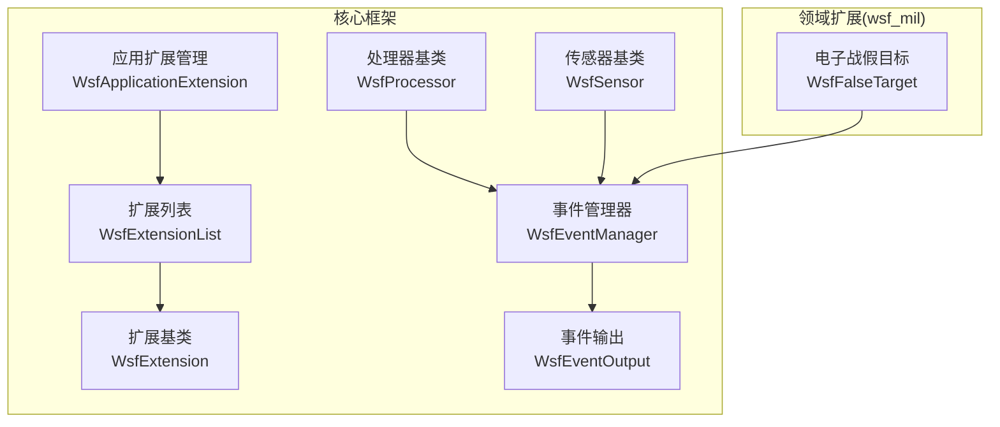
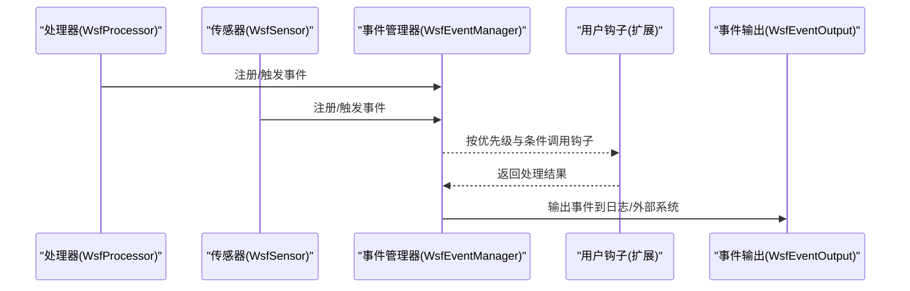
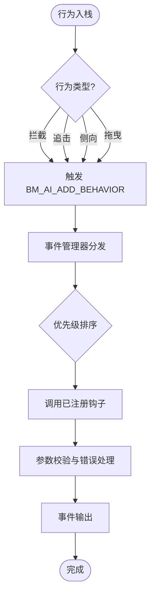
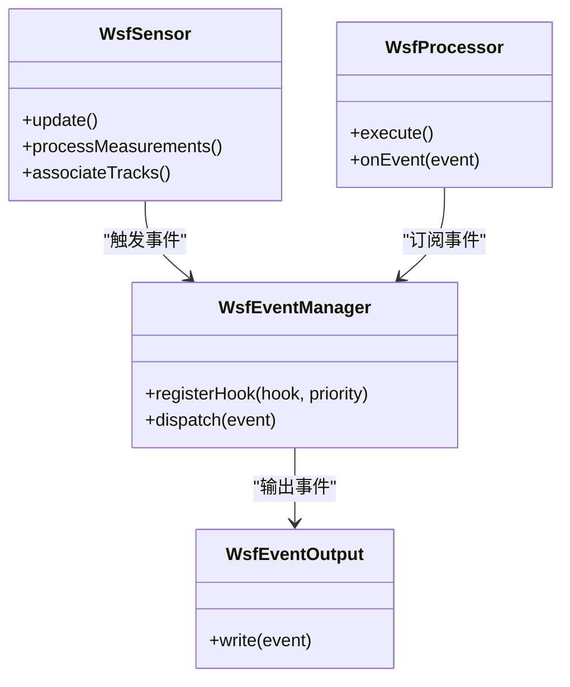
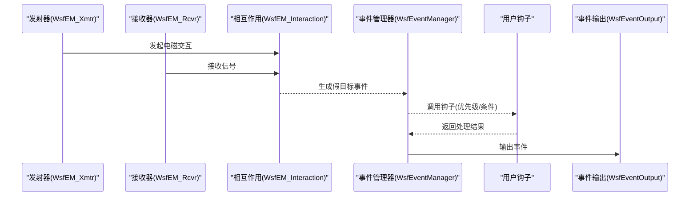
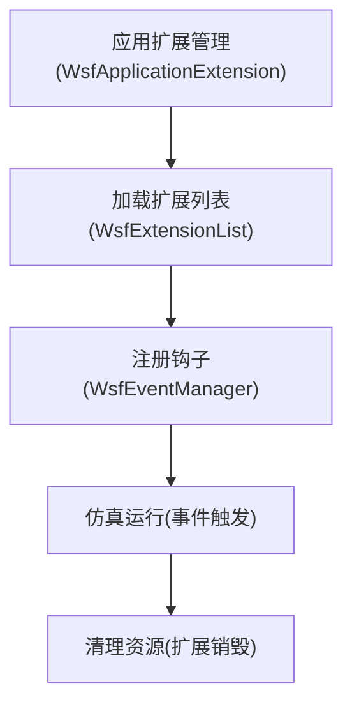
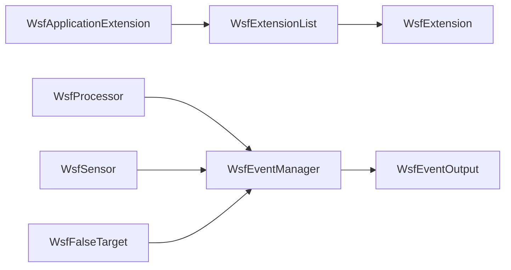

# 扩展点与钩子

<cite>
**本文引用的文件**   
- [documentation/html/docs/event/bm_ai_add_behavior.html](file://documentation/html/docs/event/bm_ai_add_behavior.html)
- [swdev/src/core/wsf/source/WsfEventManager.cpp](file://swdev/src/core/wsf/source/WsfEventManager.cpp)
- [swdev/src/core/wsf/source/WsfEventOutput.cpp](file://swdev/src/core/wsf/source/WsfEventOutput.cpp)
- [swdev/src/core/wsf/source/WsfApplicationExtension.cpp](file://swdev/src/core/wsf/source/WsfApplicationExtension.cpp)
- [swdev/src/core/wsf/source/WsfExtension.cpp](file://swdev/src/core/wsf/source/WsfExtension.cpp)
- [swdev/src/core/wsf/source/WsfExtensionList.cpp](file://swdev/src/core/wsf/source/WsfExtensionList.cpp)
- [swdev/src/core/wsf/source/processor/WsfProcessor.cpp](file://swdev/src/core/wsf/source/processor/WsfProcessor.cpp)
- [swdev/src/core/wsf/source/sensor/WsfSensor.cpp](file://swdev/src/core/wsf/source/sensor/WsfSensor.cpp)
- [swdev/src/core/wsf_mil/source/ew/WsfFalseTarget.hpp](file://swdev/src/core/wsf_mil/source/ew/WsfFalseTarget.hpp)
</cite>

## 目录
1. [简介](#简介)
2. [项目结构](#项目结构)
3. [核心组件](#核心组件)
4. [架构总览](#架构总览)
5. [详细组件分析](#详细组件分析)
6. [依赖关系分析](#依赖关系分析)
7. [性能考虑](#性能考虑)
8. [故障排查指南](#故障排查指南)
9. [结论](#结论)
10. [附录](#附录)

## 简介
本文件系统性梳理 AFSIM 的扩展点与钩子机制，聚焦三类扩展点：传感器处理钩子、武器效果钩子、行为决策钩子。文档覆盖钩子的注册方式、调用时机、优先级与条件触发、接口规范（参数校验与错误处理）、自定义处理器与算法集成方式（数据格式与性能考量），并提供可操作的扩展开发案例与版本兼容性说明。

## 项目结构
AFSIM 的扩展能力由核心框架与领域扩展共同构成：
- 核心事件系统：负责事件的定义、分发与输出（WsfEventManager、WsfEventOutput）。
- 扩展生命周期：应用扩展的加载与初始化（WsfApplicationExtension、WsfExtension、WsfExtensionList）。
- 处理器与传感器：提供可扩展的处理管线（WsfProcessor、WsfSensor）。
- 领域扩展（wsf_mil）：在电子战等场景中实现具体扩展点（如 WsfFalseTarget）。

图表来源
- [swdev/src/core/wsf/source/WsfEventManager.cpp:1-200](file://swdev/src/core/wsf/source/WsfEventManager.cpp#L1-L200)
- [swdev/src/core/wsf/source/WsfEventOutput.cpp:1-200](file://swdev/src/core/wsf/source/WsfEventOutput.cpp#L1-L200)
- [swdev/src/core/wsf/source/WsfApplicationExtension.cpp:1-200](file://swdev/src/core/wsf/source/WsfApplicationExtension.cpp#L1-L200)
- [swdev/src/core/wsf/source/WsfExtension.cpp:1-200](file://swdev/src/core/wsf/source/WsfExtension.cpp#L1-L200)
- [swdev/src/core/wsf/source/WsfExtensionList.cpp:1-200](file://swdev/src/core/wsf/source/WsfExtensionList.cpp#L1-L200)
- [swdev/src/core/wsf/source/processor/WsfProcessor.cpp:1-200](file://swdev/src/core/wsf/source/processor/WsfProcessor.cpp#L1-L200)
- [swdev/src/core/wsf/source/sensor/WsfSensor.cpp:1-200](file://swdev/src/core/wsf/source/sensor/WsfSensor.cpp#L1-L200)
- [swdev/src/core/wsf_mil/source/ew/WsfFalseTarget.hpp:1-200](file://swdev/src/core/wsf_mil/source/ew/WsfFalseTarget.hpp#L1-L200)

章节来源
- [swdev/src/core/wsf/source/WsfEventManager.cpp:1-200](file://swdev/src/core/wsf/source/WsfEventManager.cpp#L1-L200)
- [swdev/src/core/wsf/source/WsfEventOutput.cpp:1-200](file://swdev/src/core/wsf/source/WsfEventOutput.cpp#L1-L200)
- [swdev/src/core/wsf/source/WsfApplicationExtension.cpp:1-200](file://swdev/src/core/wsf/source/WsfApplicationExtension.cpp#L1-L200)
- [swdev/src/core/wsf/source/WsfExtension.cpp:1-200](file://swdev/src/core/wsf/source/WsfExtension.cpp#L1-L200)
- [swdev/src/core/wsf/source/WsfExtensionList.cpp:1-200](file://swdev/src/core/wsf/source/WsfExtensionList.cpp#L1-L200)
- [swdev/src/core/wsf/source/processor/WsfProcessor.cpp:1-200](file://swdev/src/core/wsf/source/processor/WsfProcessor.cpp#L1-L200)
- [swdev/src/core/wsf/source/sensor/WsfSensor.cpp:1-200](file://swdev/src/core/wsf/source/sensor/WsfSensor.cpp#L1-L200)
- [swdev/src/core/wsf_mil/source/ew/WsfFalseTarget.hpp:1-200](file://swdev/src/core/wsf_mil/source/ew/WsfFalseTarget.hpp#L1-L200)

## 核心组件
- 事件系统与钩子
  - 事件管理器负责事件注册、调度与分发；事件输出负责将事件写入日志或外部系统。
  - 通过事件回调机制，用户代码可在关键阶段插入自定义逻辑（钩子）。
- 扩展生命周期
  - 应用扩展管理在仿真启动时加载扩展；扩展基类提供统一的初始化与销毁接口；扩展列表维护扩展实例集合。
- 处理器与传感器
  - 处理器用于数据处理流水线；传感器用于探测与观测。二者均可通过事件系统进行扩展。
- 领域扩展（电子战）
  - 以假目标为例，展示如何在电子战场景中注入扩展逻辑并参与仿真流程。

章节来源
- [swdev/src/core/wsf/source/WsfEventManager.cpp:1-200](file://swdev/src/core/wsf/source/WsfEventManager.cpp#L1-L200)
- [swdev/src/core/wsf/source/WsfEventOutput.cpp:1-200](file://swdev/src/core/wsf/source/WsfEventOutput.cpp#L1-L200)
- [swdev/src/core/wsf/source/WsfApplicationExtension.cpp:1-200](file://swdev/src/core/wsf/source/WsfApplicationExtension.cpp#L1-L200)
- [swdev/src/core/wsf/source/WsfExtension.cpp:1-200](file://swdev/src/core/wsf/source/WsfExtension.cpp#L1-L200)
- [swdev/src/core/wsf/source/WsfExtensionList.cpp:1-200](file://swdev/src/core/wsf/source/WsfExtensionList.cpp#L1-L200)
- [swdev/src/core/wsf/source/processor/WsfProcessor.cpp:1-200](file://swdev/src/core/wsf/source/processor/WsfProcessor.cpp#L1-L200)
- [swdev/src/core/wsf/source/sensor/WsfSensor.cpp:1-200](file://swdev/src/core/wsf/source/sensor/WsfSensor.cpp#L1-L200)
- [swdev/src/core/wsf_mil/source/ew/WsfFalseTarget.hpp:1-200](file://swdev/src/core/wsf_mil/source/ew/WsfFalseTarget.hpp#L1-L200)

## 架构总览
下图展示了扩展点与钩子在 AFSIM 中的整体交互：处理器与传感器产生事件，事件管理器统一分发，事件输出记录结果；扩展在生命周期内注册钩子并在指定时机被调用。

图表来源
- [swdev/src/core/wsf/source/WsfEventManager.cpp:1-200](file://swdev/src/core/wsf/source/WsfEventManager.cpp#L1-L200)
- [swdev/src/core/wsf/source/WsfEventOutput.cpp:1-200](file://swdev/src/core/wsf/source/WsfEventOutput.cpp#L1-L200)
- [swdev/src/core/wsf/source/processor/WsfProcessor.cpp:1-200](file://swdev/src/core/wsf/source/processor/WsfProcessor.cpp#L1-L200)
- [swdev/src/core/wsf/source/sensor/WsfSensor.cpp:1-200](file://swdev/src/core/wsf/source/sensor/WsfSensor.cpp#L1-L200)

## 详细组件分析

### 行为决策钩子（武器管理 AI 行为栈）
- 扩展点说明
  - 当武器管理 AI 向行为栈添加“拦截”“追击”“侧向”“拖曳”等行为时，会触发行为相关事件，供外部监听与扩展。
- 调用时机
  - 行为入栈时立即触发，携带平台位置、目标距离、区域距离与跟踪 ID 等信息。
- 优先级与条件
  - 可通过事件系统的优先级机制控制多个钩子的执行顺序；条件触发基于事件字段（如行为类型、平台侧别、距离阈值等）。
- 接口规范
  - 钩子函数应接收事件上下文对象，包含时间戳、行为类型、平台标识、地理坐标与跟踪信息；需进行输入校验与异常处理。
- 示例参考
  - 行为事件 BM_AI_ADD_BEHAVIOR 的定义与字段说明见文档页面。

图表来源
- [documentation/html/docs/event/bm_ai_add_behavior.html:74-112](file://documentation/html/docs/event/bm_ai_add_behavior.html#L74-L112)
- [swdev/src/core/wsf/source/WsfEventManager.cpp:1-200](file://swdev/src/core/wsf/source/WsfEventManager.cpp#L1-L200)
- [swdev/src/core/wsf/source/WsfEventOutput.cpp:1-200](file://swdev/src/core/wsf/source/WsfEventOutput.cpp#L1-L200)

章节来源
- [documentation/html/docs/event/bm_ai_add_behavior.html:74-112](file://documentation/html/docs/event/bm_ai_add_behavior.html#L74-L112)
- [swdev/src/core/wsf/source/WsfEventManager.cpp:1-200](file://swdev/src/core/wsf/source/WsfEventManager.cpp#L1-L200)
- [swdev/src/core/wsf/source/WsfEventOutput.cpp:1-200](file://swdev/src/core/wsf/source/WsfEventOutput.cpp#L1-L200)

### 传感器处理钩子
- 扩展点说明
  - 传感器在探测、跟踪、融合等阶段可触发事件，允许用户插入自定义处理逻辑（例如轨迹修正、多源融合策略切换）。
- 调用时机
  - 在传感器更新周期中，关键步骤（如测量生成、关联、跟踪建立/删除）触发事件。
- 优先级与条件
  - 支持按场景配置优先级；条件触发可基于传感器类型、目标属性、环境参数等。
- 接口规范
  - 钩子函数接收传感器上下文与测量/跟踪对象；需验证数据类型与范围，处理缺失值与异常。
- 集成方式
  - 通过扩展基类注册钩子；在处理器链中插入自定义处理器以实现复杂算法。

图表来源
- [swdev/src/core/wsf/source/sensor/WsfSensor.cpp:1-200](file://swdev/src/core/wsf/source/sensor/WsfSensor.cpp#L1-L200)
- [swdev/src/core/wsf/source/processor/WsfProcessor.cpp:1-200](file://swdev/src/core/wsf/source/processor/WsfProcessor.cpp#L1-L200)
- [swdev/src/core/wsf/source/WsfEventManager.cpp:1-200](file://swdev/src/core/wsf/source/WsfEventManager.cpp#L1-L200)
- [swdev/src/core/wsf/source/WsfEventOutput.cpp:1-200](file://swdev/src/core/wsf/source/WsfEventOutput.cpp#L1-L200)

章节来源
- [swdev/src/core/wsf/source/sensor/WsfSensor.cpp:1-200](file://swdev/src/core/wsf/source/sensor/WsfSensor.cpp#L1-L200)
- [swdev/src/core/wsf/source/processor/WsfProcessor.cpp:1-200](file://swdev/src/core/wsf/source/processor/WsfProcessor.cpp#L1-L200)
- [swdev/src/core/wsf/source/WsfEventManager.cpp:1-200](file://swdev/src/core/wsf/source/WsfEventManager.cpp#L1-L200)
- [swdev/src/core/wsf/source/WsfEventOutput.cpp:1-200](file://swdev/src/core/wsf/source/WsfEventOutput.cpp#L1-L200)

### 武器效果钩子（电子战假目标）
- 扩展点说明
  - 在电子战场景中，武器效果（如干扰、假目标）可触发事件，允许外部系统介入评估与响应。
- 调用时机
  - 当发射器/接收器交互计算产生假目标感知时，触发相应事件。
- 优先级与条件
  - 可根据干扰模式、频段、功率等条件触发；优先级决定与其他效果的叠加顺序。
- 接口规范
  - 钩子函数接收电子战上下文（发射器、接收器、相互作用对象）；需校验参数有效性并处理异常。
- 集成方式
  - 通过扩展基类注册钩子；在处理器链中插入自定义算法对假目标进行建模与分析。

图表来源
- [swdev/src/core/wsf_mil/source/ew/WsfFalseTarget.hpp:1-200](file://swdev/src/core/wsf_mil/source/ew/WsfFalseTarget.hpp#L1-L200)
- [swdev/src/core/wsf/source/WsfEventManager.cpp:1-200](file://swdev/src/core/wsf/source/WsfEventManager.cpp#L1-L200)
- [swdev/src/core/wsf/source/WsfEventOutput.cpp:1-200](file://swdev/src/core/wsf/source/WsfEventOutput.cpp#L1-L200)

章节来源
- [swdev/src/core/wsf_mil/source/ew/WsfFalseTarget.hpp:1-200](file://swdev/src/core/wsf_mil/source/ew/WsfFalseTarget.hpp#L1-L200)
- [swdev/src/core/wsf/source/WsfEventManager.cpp:1-200](file://swdev/src/core/wsf/source/WsfEventManager.cpp#L1-L200)
- [swdev/src/core/wsf/source/WsfEventOutput.cpp:1-200](file://swdev/src/core/wsf/source/WsfEventOutput.cpp#L1-L200)

### 扩展生命周期与注册方法
- 扩展加载
  - 应用扩展管理在仿真启动时加载扩展列表；扩展基类提供统一的初始化与销毁接口。
- 钩子注册
  - 在扩展初始化阶段，向事件管理器注册钩子，指定优先级与条件表达式。
- 调用与清理
  - 仿真运行期间，事件管理器按优先级与条件调用钩子；仿真结束时清理资源。

图表来源
- [swdev/src/core/wsf/source/WsfApplicationExtension.cpp:1-200](file://swdev/src/core/wsf/source/WsfApplicationExtension.cpp#L1-L200)
- [swdev/src/core/wsf/source/WsfExtensionList.cpp:1-200](file://swdev/src/core/wsf/source/WsfExtensionList.cpp#L1-L200)
- [swdev/src/core/wsf/source/WsfExtension.cpp:1-200](file://swdev/src/core/wsf/source/WsfExtension.cpp#L1-L200)
- [swdev/src/core/wsf/source/WsfEventManager.cpp:1-200](file://swdev/src/core/wsf/source/WsfEventManager.cpp#L1-L200)

章节来源
- [swdev/src/core/wsf/source/WsfApplicationExtension.cpp:1-200](file://swdev/src/core/wsf/source/WsfApplicationExtension.cpp#L1-L200)
- [swdev/src/core/wsf/source/WsfExtensionList.cpp:1-200](file://swdev/src/core/wsf/source/WsfExtensionList.cpp#L1-L200)
- [swdev/src/core/wsf/source/WsfExtension.cpp:1-200](file://swdev/src/core/wsf/source/WsfExtension.cpp#L1-L200)
- [swdev/src/core/wsf/source/WsfEventManager.cpp:1-200](file://swdev/src/core/wsf/source/WsfEventManager.cpp#L1-L200)

## 依赖关系分析
- 组件耦合
  - 事件管理器与事件输出为松耦合；处理器与传感器通过事件系统间接耦合。
  - 扩展基类与应用扩展管理形成清晰的依赖方向：应用扩展管理依赖扩展列表，扩展列表持有扩展实例。
- 直接/间接依赖
  - 领域扩展（如电子战假目标）依赖核心事件系统；不直接依赖 UI 或可视化模块。
- 循环依赖
  - 通过抽象基类与接口解耦，避免循环依赖。
- 外部依赖
  - 事件输出可对接外部系统（日志、网络），但核心框架保持独立。

图表来源
- [swdev/src/core/wsf/source/WsfApplicationExtension.cpp:1-200](file://swdev/src/core/wsf/source/WsfApplicationExtension.cpp#L1-L200)
- [swdev/src/core/wsf/source/WsfExtensionList.cpp:1-200](file://swdev/src/core/wsf/source/WsfExtensionList.cpp#L1-L200)
- [swdev/src/core/wsf/source/WsfExtension.cpp:1-200](file://swdev/src/core/wsf/source/WsfExtension.cpp#L1-L200)
- [swdev/src/core/wsf/source/WsfEventManager.cpp:1-200](file://swdev/src/core/wsf/source/WsfEventManager.cpp#L1-L200)
- [swdev/src/core/wsf/source/WsfEventOutput.cpp:1-200](file://swdev/src/core/wsf/source/WsfEventOutput.cpp#L1-L200)
- [swdev/src/core/wsf/source/processor/WsfProcessor.cpp:1-200](file://swdev/src/core/wsf/source/processor/WsfProcessor.cpp#L1-L200)
- [swdev/src/core/wsf/source/sensor/WsfSensor.cpp:1-200](file://swdev/src/core/wsf/source/sensor/WsfSensor.cpp#L1-L200)
- [swdev/src/core/wsf_mil/source/ew/WsfFalseTarget.hpp:1-200](file://swdev/src/core/wsf_mil/source/ew/WsfFalseTarget.hpp#L1-L200)

章节来源
- [swdev/src/core/wsf/source/WsfApplicationExtension.cpp:1-200](file://swdev/src/core/wsf/source/WsfApplicationExtension.cpp#L1-L200)
- [swdev/src/core/wsf/source/WsfExtensionList.cpp:1-200](file://swdev/src/core/wsf/source/WsfExtensionList.cpp#L1-L200)
- [swdev/src/core/wsf/source/WsfExtension.cpp:1-200](file://swdev/src/core/wsf/source/WsfExtension.cpp#L1-L200)
- [swdev/src/core/wsf/source/WsfEventManager.cpp:1-200](file://swdev/src/core/wsf/source/WsfEventManager.cpp#L1-L200)
- [swdev/src/core/wsf/source/WsfEventOutput.cpp:1-200](file://swdev/src/core/wsf/source/WsfEventOutput.cpp#L1-L200)
- [swdev/src/core/wsf/source/processor/WsfProcessor.cpp:1-200](file://swdev/src/core/wsf/source/processor/WsfProcessor.cpp#L1-L200)
- [swdev/src/core/wsf/source/sensor/WsfSensor.cpp:1-200](file://swdev/src/core/wsf/source/sensor/WsfSensor.cpp#L1-L200)
- [swdev/src/core/wsf_mil/source/ew/WsfFalseTarget.hpp:1-200](file://swdev/src/core/wsf_mil/source/ew/WsfFalseTarget.hpp#L1-L200)

## 性能考虑
- 事件分发开销
  - 高频事件（如传感器测量）建议批量处理与节流；合理设置优先级以减少不必要的钩子调用。
- 钩子复杂度
  - 钩子函数应避免重型计算；必要时使用异步或缓存策略。
- I/O 影响
  - 事件输出可能成为瓶颈；建议按需启用输出与批量化写入。
- 内存与线程安全
  - 扩展需保证线程安全；避免在钩子中进行长时间锁操作。

[本节为通用指导，不涉及具体文件分析]

## 故障排查指南
- 常见问题
  - 钩子未触发：检查是否成功注册、优先级与条件是否正确。
  - 事件输出为空：确认事件输出模块已启用且路径正确。
  - 扩展初始化失败：检查扩展依赖与加载顺序。
- 诊断步骤
  - 启用调试日志，查看事件注册与分发过程。
  - 逐步禁用钩子定位问题钩子。
  - 验证事件数据结构与字段完整性。

章节来源
- [swdev/src/core/wsf/source/WsfEventManager.cpp:1-200](file://swdev/src/core/wsf/source/WsfEventManager.cpp#L1-L200)
- [swdev/src/core/wsf/source/WsfEventOutput.cpp:1-200](file://swdev/src/core/wsf/source/WsfEventOutput.cpp#L1-L200)
- [swdev/src/core/wsf/source/WsfApplicationExtension.cpp:1-200](file://swdev/src/core/wsf/source/WsfApplicationExtension.cpp#L1-L200)

## 结论
AFSIM 通过事件系统与扩展生命周期管理提供了灵活的扩展点与钩子机制。传感器处理、武器效果与行为决策三类扩展点覆盖了仿真关键环节。开发者可依据接口规范与性能建议，快速集成自定义处理器与算法，并通过优先级与条件触发实现复杂业务逻辑。建议在扩展开发中重视参数校验、错误处理与版本兼容性，确保系统稳定与可维护性。

[本节为总结性内容，不涉及具体文件分析]

## 附录
- 扩展开发最佳实践
  - 明确扩展职责边界，避免过度耦合。
  - 使用事件系统而非直接调用内部模块。
  - 编写单元测试覆盖钩子逻辑与异常分支。
- 版本兼容性与向后兼容
  - 遵循扩展基类的接口约定，避免破坏性变更。
  - 在升级核心框架时，优先测试现有扩展的兼容性。
  - 对事件字段进行版本化与可选字段处理，确保旧扩展仍可运行。

[本节为通用指导，不涉及具体文件分析]