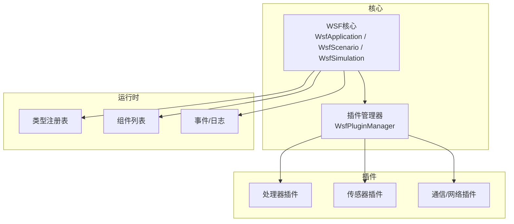
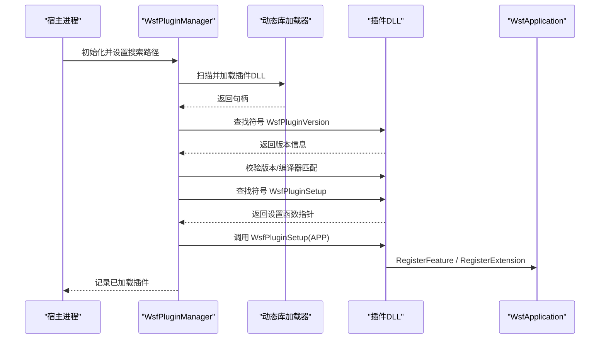
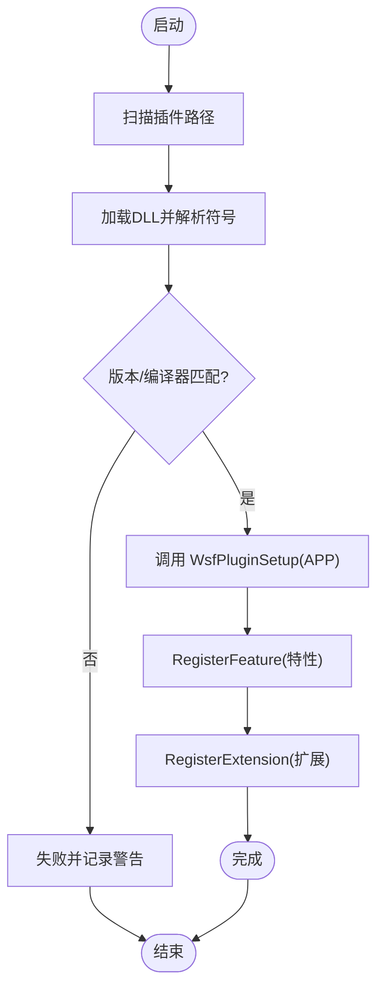
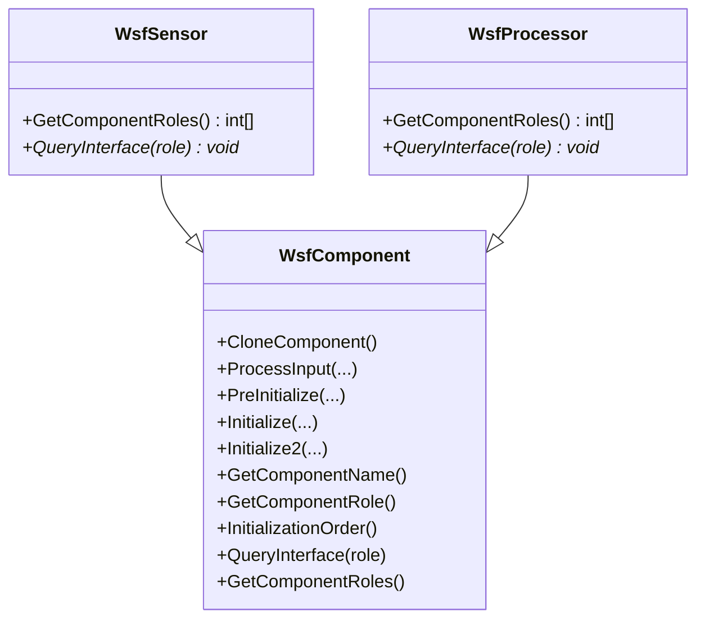
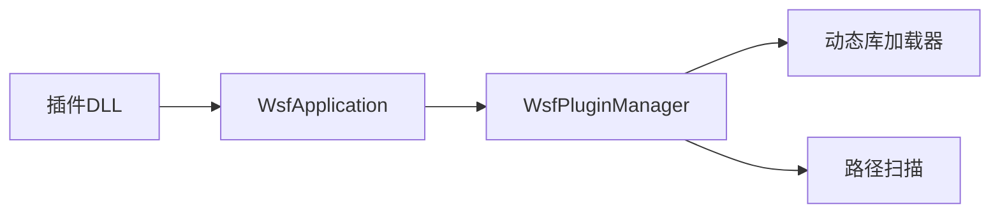

# 插件开发指南

<cite>
**本文引用的文件**   
- [WsfApplication.hpp](file://swdev/src/core/wsf/source/WsfApplication.hpp)
- [WsfPluginManager.cpp](file://swdev/src/core/wsf/source/WsfPluginManager.cpp)
- [integration_guide.html](file://documentation/html/docs/developer/integration_guide.html)
- [build_instructions.rst.txt](file://documentation/html/_sources/docs/developer/build_instructions.rst.txt)
- [wsf_configuring_extensions_for_core.rst.txt](file://documentation/html/docs/wsf_configuring_extensions_for_core.rst.txt)
- [P6DOF_DataSimInterface.hpp](file://swdev/src/warlock/plugins/P6DOF_Data/source/P6DOF_DataSimInterface.hpp)
- [WsfUCI_Component.cpp](file://swdev/src/wsf_plugins/wsf_oms_uci/source/WsfUCI_Component.cpp)
</cite>

## 目录
1. [简介](#简介)
2. [项目结构](#项目结构)
3. [核心组件](#核心组件)
4. [架构总览](#架构总览)
5. [详细组件分析](#详细组件分析)
6. [依赖关系分析](#依赖关系分析)
7. [性能与资源管理](#性能与资源管理)
8. [调试与故障排查](#调试与故障排查)
9. [结论](#结论)
10. [附录：示例与模板](#附录示例与模板)

## 简介
本指南面向AFSIM插件开发者，系统阐述插件架构设计原理、模块注册机制、动态加载系统与生命周期管理；文档化插件开发接口（wsf_module标识文件、CMake集成配置与依赖管理）；解释插件与核心框架的交互方式（服务发现、接口调用、数据交换）；说明资源管理机制（配置文件加载、模型文件管理与内存优化）；并提供从简单处理器插件到复杂传感器插件的完整开发示例，以及调试技巧、性能分析与部署策略。

## 项目结构
AFSIM采用“应用-场景-仿真-平台”的分层架构，插件以扩展形式注入到应用或场景中，通过类型工厂与组件列表进行服务发现与实例化。典型目录组织如下：
- 顶层swdev包含核心库与多个可选项目（core/wsf, warlock, wizard等）
- documentation提供开发者与用户文档
- demos为示例场景与脚本
- resources存放共享数据、模型与着色器

图表来源
- [WsfApplication.hpp:32-44](file://swdev/src/core/wsf/source/WsfApplication.hpp#L32-L44)
- [WsfPluginManager.cpp:32-46](file://swdev/src/core/wsf/source/WsfPluginManager.cpp#L32-L46)

章节来源
- [integration_guide.html:148-176](file://documentation/html/docs/developer/integration_guide.html#L148-L176)

## 核心组件
- WsfApplication：应用单例，负责扩展与插件管理、脚本类型注册、特性开关、命令参数处理、系统日志与测试环境初始化。
- WsfPluginManager：插件动态加载与版本校验、入口函数解析（WsfPluginVersion/WsfPluginSetup）、插件搜索路径管理、已加载插件清单打印。
- 扩展体系：应用扩展、场景扩展、仿真扩展三类，分别在不同生命周期阶段注入能力。

章节来源
- [WsfApplication.hpp:32-44](file://swdev/src/core/wsf/source/WsfApplication.hpp#L32-L44)
- [WsfApplication.hpp:92-105](file://swdev/src/core/wsf/source/WsfApplication.hpp#L92-L105)
- [WsfApplication.hpp:107-133](file://swdev/src/core/wsf/source/WsfApplication.hpp#L107-L133)
- [WsfPluginManager.cpp:32-46](file://swdev/src/core/wsf/source/WsfPluginManager.cpp#L32-L46)

## 架构总览
AFSIM插件体系基于组件化架构（CBA），通过类型枚举与角色查询实现多态与解耦。插件在加载时暴露统一API（WsfPluginVersion/WsfPluginSetup），由WsfPluginManager完成版本校验并调用设置函数，进而向WsfApplication注册扩展与类型。

图表来源
- [WsfPluginManager.cpp:72-101](file://swdev/src/core/wsf/source/WsfPluginManager.cpp#L72-L101)
- [WsfPluginManager.cpp:105-149](file://swdev/src/core/wsf/source/WsfPluginManager.cpp#L105-L149)
- [integration_guide.html:601-641](file://documentation/html/docs/developer/integration_guide.html#L601-L641)

## 详细组件分析

### 插件生命周期与注册流程
- 加载前：WsfPluginManager根据搜索路径（环境变量或默认目录）扫描插件，支持递归与非递归。
- 加载时：解析WsfPluginVersion，校验主/次版本号与编译器字符串；若匹配则解析WsfPluginSetup并调用。
- 注册期：插件内部调用WsfApplication::RegisterFeature与RegisterExtension，将自身能力注册到应用级扩展列表中。
- 运行期：场景创建后，扩展可进一步注册场景级类型（如处理器、传感器等）。

图表来源
- [WsfPluginManager.cpp:72-101](file://swdev/src/core/wsf/source/WsfPluginManager.cpp#L72-L101)
- [WsfPluginManager.cpp:105-149](file://swdev/src/core/wsf/source/WsfPluginManager.cpp#L105-L149)
- [integration_guide.html:601-641](file://documentation/html/docs/developer/integration_guide.html#L601-L641)

章节来源
- [WsfApplication.hpp:92-105](file://swdev/src/core/wsf/source/WsfApplication.hpp#L92-L105)
- [WsfApplication.hpp:107-133](file://swdev/src/core/wsf/source/WsfApplication.hpp#L107-L133)
- [WsfPluginManager.cpp:72-101](file://swdev/src/core/wsf/source/WsfPluginManager.cpp#L72-L101)
- [WsfPluginManager.cpp:105-149](file://swdev/src/core/wsf/source/WsfPluginManager.cpp#L105-L149)
- [integration_guide.html:601-641](file://documentation/html/docs/developer/integration_guide.html#L601-L641)

### 模块注册机制与类型系统
- 组件基类与角色：通过声明组件角色类型（例如传感器、处理器）并在GetComponentRoles中返回角色数组，QueryInterface按角色返回对应接口指针。
- 类型注册：在扩展的AddedToScenario或类似回调中，通过类型管理器（如WsfProcessorTypes）AddCoreType注册新类型，供场景脚本使用。
- 脚本绑定：应用扩展可在AddedToApplication中将脚本类注册到UtScriptTypes，使脚本语言可直接调用。

图表来源
- [integration_guide.html:168-179](file://documentation/html/docs/developer/integration_guide.html#L168-L179)
- [integration_guide.html:190-233](file://documentation/html/docs/developer/integration_guide.html#L190-L233)

章节来源
- [integration_guide.html:168-179](file://documentation/html/docs/developer/integration_guide.html#L168-L179)
- [integration_guide.html:190-233](file://documentation/html/docs/developer/integration_guide.html#L190-L233)

### CMake集成与wsf_module标识
- wsf_module：空文件，作为CMake识别扩展目录的标志。
- wsf_cmake_extension.cmake：声明WSF_EXT_NAME、WSF_EXT_SOURCE_PATH、WSF_EXT_TYPE（lib/plugin/exe）、WSF_EXT_BUILD等变量，控制是否构建与构建类型。
- 顶层CMakeLists.txt与source/CMakeLists.txt：定义项目名称、子目录、语法文件、导出头、链接库与安装规则；当WSF_PLUGIN_BUILD启用时切换为插件安装目标。

章节来源
- [build_instructions.rst.txt:365-365](file://documentation/html/_sources/docs/developer/build_instructions.rst.txt#L365-L365)
- [wsf_configuring_extensions_for_core.rst.txt:30-51](file://documentation/html/docs/wsf_configuring_extensions_for_core.rst.txt#L30-L51)
- [integration_guide.html:316-399](file://documentation/html/docs/developer/integration_guide.html#L316-L399)
- [integration_guide.html:547-599](file://documentation/html/docs/developer/integration_guide.html#L547-L599)

### 插件与核心框架的交互
- 服务发现：通过组件列表按名称或角色查找组件（FindComponentByRole），结合全局角色枚举实现跨项目解耦。
- 接口调用：QueryInterface返回具体接口指针，便于多态调用。
- 数据交换：通过事件管道、观察者模式、XIO/DIS等外部接口进行数据交换；仿真线程内读取/写入仿真状态（如Warlock插件中的WallClockRead/SimulationComplete）。

章节来源
- [integration_guide.html:168-179](file://documentation/html/docs/developer/integration_guide.html#L168-L179)
- [P6DOF_DataSimInterface.hpp:25-41](file://swdev/src/warlock/plugins/P6DOF_Data/source/P6DOF_DataSimInterface.hpp#L25-L41)

### 资源管理与生命周期
- 配置文件加载：扩展在AddedToScenario中注册类型与脚本类，场景输入解析时按需加载。
- 模型文件管理：通过include_once/相对路径引用模型与数据文件，确保可移植性。
- 内存优化：避免在高频回调中进行大对象分配；使用对象池或预分配缓冲区；谨慎使用全局状态。

章节来源
- [integration_guide.html:402-537](file://documentation/html/docs/developer/integration_guide.html#L402-L537)
- [WsfUCI_Component.cpp:28-51](file://swdev/src/wsf_plugins/wsf_oms_uci/source/WsfUCI_Component.cpp#L28-L51)

## 依赖关系分析
- WsfApplication依赖WsfPluginManager进行插件管理，同时维护扩展列表、特性集合与脚本类型。
- WsfPluginManager依赖动态库加载工具与路径扫描工具，负责符号解析与版本校验。
- 插件通过WsfApplication提供的API注册扩展与特性，间接影响场景与仿真行为。

图表来源
- [WsfApplication.hpp:170-183](file://swdev/src/core/wsf/source/WsfApplication.hpp#L170-L183)
- [WsfPluginManager.cpp:18-24](file://swdev/src/core/wsf/source/WsfPluginManager.cpp#L18-L24)

章节来源
- [WsfApplication.hpp:170-183](file://swdev/src/core/wsf/source/WsfApplication.hpp#L170-L183)
- [WsfPluginManager.cpp:18-24](file://swdev/src/core/wsf/source/WsfPluginManager.cpp#L18-L24)

## 性能与资源管理
- 插件加载开销：仅在需要时加载插件，避免不必要的扫描；合理设置搜索路径减少磁盘IO。
- 运行时性能：在仿真循环中避免频繁日志输出与大对象拷贝；使用轻量数据结构与缓存。
- 内存管理：遵循RAII原则，析构时释放资源；对长生命周期对象使用智能指针；避免悬垂指针。
- I/O优化：批量读写文件，减少系统调用次数；使用异步I/O（如适用）降低阻塞。

[本节为通用指导，不直接分析具体文件]

## 调试与故障排查
- 插件未加载：检查WsfPluginVersion是否存在、版本与编译器是否匹配；确认WSF_PLUGIN_BUILD配置正确。
- 功能不可用：确认RegisterFeature与RegisterExtension已调用；检查扩展依赖关系（ExtensionDepends）。
- 类型未注册：在AddedToScenario中确认AddCoreType调用；验证语法文件与脚本类注册。
- 日志定位：利用WsfApplication的系统日志与WsfPluginManager的已加载插件打印信息进行问题定位。

章节来源
- [WsfPluginManager.cpp:105-149](file://swdev/src/core/wsf/source/WsfPluginManager.cpp#L105-L149)
- [WsfApplication.hpp:135-142](file://swdev/src/core/wsf/source/WsfApplication.hpp#L135-L142)
- [integration_guide.html:601-641](file://documentation/html/docs/developer/integration_guide.html#L601-L641)

## 结论
AFSIM插件体系通过统一的API与严格的版本/编译器校验，实现了高内聚、低耦合的可插拔架构。开发者只需遵循wsf_module与CMake集成规范，即可快速将处理器、传感器等能力以插件形式交付，并通过WsfApplication与WsfPluginManager完成注册与生命周期管理。配合完善的调试与性能优化手段，可显著提升扩展的可维护性与可移植性。

[本节为总结性内容，不直接分析具体文件]

## 附录：示例与模板
- 简单处理器插件：在扩展的AddedToScenario中注册处理器类型，并在场景文件中通过PROCESSOR命令实例化。
- 复杂传感器插件：继承WsfSensor，实现GetComponentRoles与QueryInterface，注册雷达/ESM等类型，并在仿真循环中计算探测概率与轨迹更新。
- Warlock可视化插件：通过SimInterfaceT订阅仿真事件，在WallClockRead中读取平台状态，在SimulationComplete中清理资源。

章节来源
- [integration_guide.html:402-537](file://documentation/html/docs/developer/integration_guide.html#L402-L537)
- [P6DOF_DataSimInterface.hpp:25-41](file://swdev/src/warlock/plugins/P6DOF_Data/source/P6DOF_DataSimInterface.hpp#L25-L41)