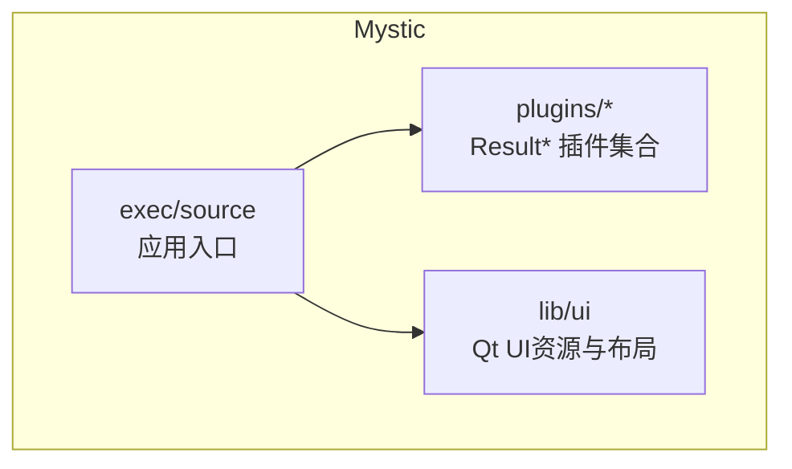
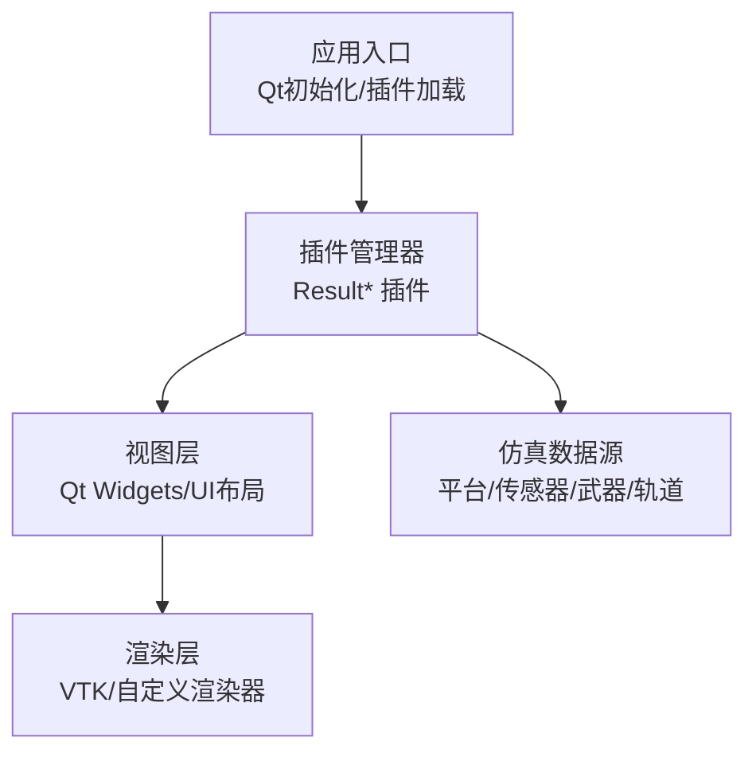
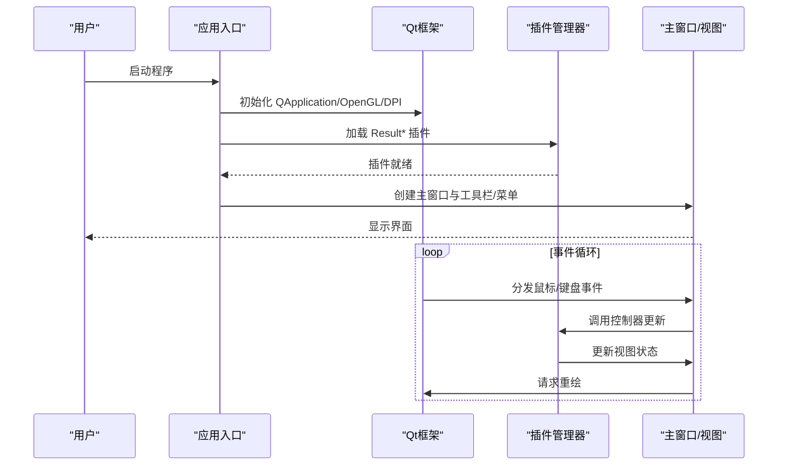
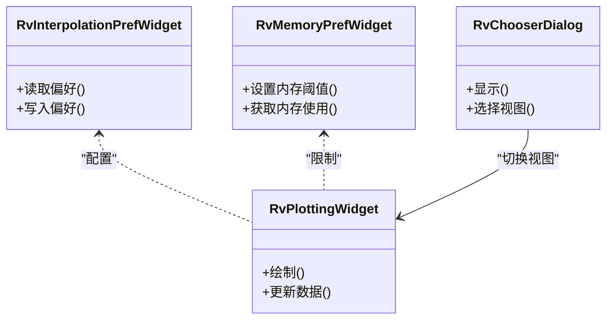
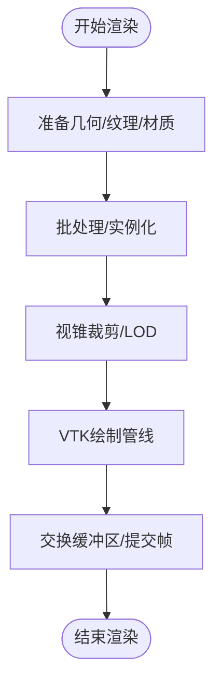
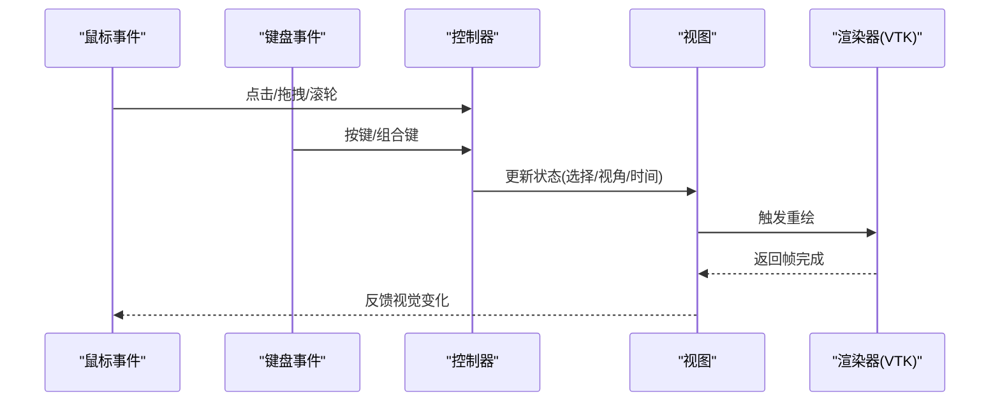
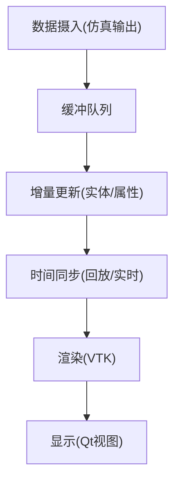
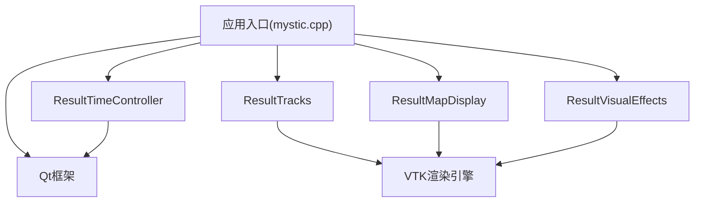

# Mystic GUI界面架构

<cite>
**本文引用的文件**   
- [mystic.cpp](file://swdev/src/mystic/exec/source/mystic.cpp)
- [RvChooserDialog.ui](file://swdev/src/mystic/lib/ui/RvChooserDialog.ui)
- [RvInterpolationPrefWidget.ui](file://swdev/src/mystic/lib/ui/RvInterpolationPrefWidget.ui)
- [RvMemoryPrefWidget.ui](file://swdev/src/mystic/lib/ui/RvMemoryPrefWidget.ui)
- [RvPlottingWidget.ui](file://swdev/src/mystic/lib/ui/RvPlottingWidget.ui)
- [ResultTracks](file://swdev/src/mystic/plugins/ResultTracks)
- [ResultMapDisplay](file://swdev/src/mystic/plugins/ResultMapDisplay)
- [ResultVisualEffects](file://swdev/src/mystic/plugins/ResultVisualEffects)
- [ResultTimeController](file://swdev/src/mystic/plugins/ResultTimeController)
- [ResultPlatformBrowser](file://swdev/src/mystic/plugins/ResultPlatformBrowser)
- [ResultPerformance](file://swdev/src/mystic/plugins/ResultPerformance)
- [ResultVideoCapture](file://swdev/src/mystic/plugins/ResultVideoCapture)
- [ResultCoverageOverlay](file://swdev/src/mystic/plugins/ResultCoverageOverlay)
- [ResultInteractionPlots](file://swdev/src/mystic/plugins/ResultInteractionPlots)
- [ResultDataAirCombat](file://swdev/src/mystic/plugins/ResultDataAirCombat)
- [ResultDataSpace](file://swdev/src/mystic/plugins/ResultDataSpace)
- [ResultDataSixDOF](file://swdev/src/mystic/plugins/ResultDataSixDOF)
- [ResultP6DOFData](file://swdev/src/mystic/plugins/ResultP6DOFData)
- [ResultSensorVolumes](file://swdev/src/mystic/plugins/ResultSensorVolumes)
- [ResultVisibility](file://swdev/src/mystic/plugins/ResultVisibility)
- [ResultWsfDraw](file://swdev/src/mystic/plugins/ResultWsfDraw)
- [ResultZones](file://swdev/src/mystic/plugins/ResultZones)
- [ResultOrbit](file://swdev/src/mystic/plugins/ResultOrbit)
- [ResultRoute](file://swdev/src/mystic/plugins/ResultRoute)
- [ResultSatelliteTether](file://swdev/src/mystic/plugins/ResultSatelliteTether)
- [ResultHeadDownView](file://swdev/src/mystic/plugins/ResultHeadDownView)
- [ResultHeadUpView](file://swdev/src/mystic/plugins/ResultHeadUpView)
- [ResultTetherView](file://swdev/src/mystic/plugins/ResultTetherView)
- [ResultSituationAwarenessDisplay](file://swdev/src/mystic/plugins/ResultSituationAwarenessDisplay)
- [ResultMerger](file://swdev/src/mystic/plugins/ResultMerger)
- [ResultModelBrowser](file://swdev/src/mystic/plugins/ResultModelBrowser)
- [ResultProjector](file://swdev/src/mystic/plugins/ResultProjector)
- [ResultTerrainTools](file://swdev/src/mystic/plugins/ResultTerrainTools)
- [ResultUnitConverterTool](file://swdev/src/mystic/plugins/ResultUnitConverterTool)
- [ResultPositionConverterTool](file://swdev/src/mystic/plugins/ResultPositionConverterTool)
- [ResultStatistics](file://swdev/src/mystic/plugins/ResultStatistics)
- [ResultQuantumTaskerData](file://swdev/src/mystic/plugins/ResultQuantumTaskerData)
- [ResultEventMarker](file://swdev/src/mystic/plugins/ResultEventMarker)
- [ResultComment](file://swdev/src/mystic/plugins/ResultComment)
- [ResultAuxData](file://swdev/src/mystic/plugins/ResultAuxData)
- [ResultScriptDataFeed](file://swdev/src/mystic/plugins/ResultScriptDataFeed)
- [ResultDetectionReport](file://swdev/src/mystic/plugins/ResultDetectionReport)
- [ResultCommVis](file://swdev/src/mystic/plugins/ResultCommVis)
- [ResultBattleManagement](file://swdev/src/mystic/plugins/ResultBattleManagement)
- [ResultBehaviorAnalysisTool](file://swdev/src/mystic/plugins/ResultBehaviorAnalysisTool)
- [ResultAirCombatVisualization](file://swdev/src/mystic/plugins/ResultAirCombatVisualization)
- [ResultAcesDisplay](file://swdev/src/mystic/plugins/ResultAcesDisplay)
</cite>

## 目录
1. [简介](#简介)
2. [项目结构](#项目结构)
3. [核心组件](#核心组件)
4. [架构总览](#架构总览)
5. [详细组件分析](#详细组件分析)
6. [依赖关系分析](#依赖关系分析)
7. [性能考虑](#性能考虑)
8. [故障排查指南](#故障排查指南)
9. [结论](#结论)
10. [附录：扩展GUI开发指南](#附录扩展gui开发指南)

## 简介
本文件面向Mystic图形用户界面的架构与实现，聚焦基于Qt的GUI框架设计、主窗口与视图层职责分离、控制器机制、3D可视化引擎（VTK）集成方式、用户交互处理机制、仿真数据与GUI显示的同步策略，以及插件化扩展方法。文档同时提供架构图、流程图和类图，帮助读者快速理解并扩展Mystic GUI功能。

## 项目结构
Mystic位于swdev/src/mystic下，采用“执行入口 + 库 + 插件”的分层组织：
- exec: 应用可执行入口，负责初始化Qt应用、加载插件、启动主界面。
- lib/ui: Qt UI资源与UI布局文件，定义偏好设置对话框与绘图控件布局。
- plugins: 以Result*命名的结果展示插件集合，每个插件封装一种可视化或工具能力。

图表来源
- [mystic.cpp:1-200](file://swdev/src/mystic/exec/source/mystic.cpp#L1-L200)

章节来源
- [mystic.cpp:1-200](file://swdev/src/mystic/exec/source/mystic.cpp#L1-L200)

## 核心组件
- 应用入口与生命周期管理：负责Qt事件循环、OpenGL上下文共享、高DPI缩放等全局设置，并启动主窗口。
- 视图层（Qt Widgets）：包含偏好设置对话框与绘图控件的UI布局，用于配置渲染行为与显示参数。
- 控制器与状态管理：由插件体系承担，将仿真数据转换为可视对象，响应鼠标/键盘输入，更新视图状态。
- 3D可视化引擎：通过VTK进行场景构建与渲染，结合自定义渲染器实现高性能实时可视化。
- 数据同步机制：插件订阅仿真数据流，按时间步增量更新，避免全量重绘，保证实时性。

章节来源
- [mystic.cpp:1-200](file://swdev/src/mystic/exec/source/mystic.cpp#L1-L200)
- [RvChooserDialog.ui](file://swdev/src/mystic/lib/ui/RvChooserDialog.ui)
- [RvInterpolationPrefWidget.ui](file://swdev/src/mystic/lib/ui/RvInterpolationPrefWidget.ui)
- [RvMemoryPrefWidget.ui](file://swdev/src/mystic/lib/ui/RvMemoryPrefWidget.ui)
- [RvPlottingWidget.ui](file://swdev/src/mystic/lib/ui/RvPlottingWidget.ui)

## 架构总览
Mystic采用“入口-插件-视图-渲染”四层架构：
- 入口层：初始化Qt、OpenGL、加载插件、创建主窗口。
- 插件层：每个Result*插件实现特定可视化或工具逻辑，统一接口接入。
- 视图层：Qt Widgets承载UI元素，包括地图、轨道、轨迹、统计面板等。
- 渲染层：VTK负责3D场景绘制，支持自定义着色器与几何体。

图表来源
- [mystic.cpp:1-200](file://swdev/src/mystic/exec/source/mystic.cpp#L1-L200)
- [ResultTracks](file://swdev/src/mystic/plugins/ResultTracks)
- [ResultMapDisplay](file://swdev/src/mystic/plugins/ResultMapDisplay)
- [ResultVisualEffects](file://swdev/src/mystic/plugins/ResultVisualEffects)

## 详细组件分析

### 应用入口与主窗口
- 职责：初始化Qt应用、启用OpenGL共享上下文、设置高DPI缩放、创建主窗口、加载插件、进入事件循环。
- 关键点：确保多线程渲染安全；为插件提供统一的初始化钩子。

图表来源
- [mystic.cpp:1-200](file://swdev/src/mystic/exec/source/mystic.cpp#L1-L200)

章节来源
- [mystic.cpp:1-200](file://swdev/src/mystic/exec/source/mystic.cpp#L1-L200)

### 视图层与UI布局
- 包含偏好设置对话框与绘图控件的UI布局文件，用于控制插值、内存使用、绘图行为等。
- 典型UI组件：选择对话框、插值偏好、内存偏好、绘图控件。

图表来源
- [RvChooserDialog.ui](file://swdev/src/mystic/lib/ui/RvChooserDialog.ui)
- [RvInterpolationPrefWidget.ui](file://swdev/src/mystic/lib/ui/RvInterpolationPrefWidget.ui)
- [RvMemoryPrefWidget.ui](file://swdev/src/mystic/lib/ui/RvMemoryPrefWidget.ui)
- [RvPlottingWidget.ui](file://swdev/src/mystic/lib/ui/RvPlottingWidget.ui)

章节来源
- [RvChooserDialog.ui](file://swdev/src/mystic/lib/ui/RvChooserDialog.ui)
- [RvInterpolationPrefWidget.ui](file://swdev/src/mystic/lib/ui/RvInterpolationPrefWidget.ui)
- [RvMemoryPrefWidget.ui](file://swdev/src/mystic/lib/ui/RvMemoryPrefWidget.ui)
- [RvPlottingWidget.ui](file://swdev/src/mystic/lib/ui/RvPlottingWidget.ui)

### 控制器与插件体系
- 插件命名规范：Result*，每个插件对应一个可视化或工具能力。
- 控制器职责：解析仿真数据、维护视图状态、响应用户交互、调度渲染。
- 典型插件：
  - 地图与态势：ResultMapDisplay、ResultSituationAwarenessDisplay
  - 轨迹与轨道：ResultTracks、ResultOrbit、ResultRoute
  - 视觉效果：ResultVisualEffects、ResultWsfDraw
  - 时间与回放：ResultTimeController
  - 平台与模型：ResultPlatformBrowser、ResultModelBrowser
  - 性能与录制：ResultPerformance、ResultVideoCapture
  - 覆盖与区域：ResultCoverageOverlay、ResultZones
  - 交互与图表：ResultInteractionPlots、ResultStatistics
  - 数据通道：ResultDataAirCombat、ResultDataSpace、ResultDataSixDOF、ResultP6DOFData
  - 传感器与可见性：ResultSensorVolumes、ResultVisibility
  - 其他工具：ResultUnitConverterTool、ResultPositionConverterTool、ResultTerrainTools、ResultProjector、ResultMerger、ResultEventMarker、ResultComment、ResultAuxData、ResultScriptDataFeed、ResultDetectionReport、ResultCommVis、ResultBattleManagement、ResultBehaviorAnalysisTool、ResultAirCombatVisualization、ResultAcesDisplay、ResultHeadDownView、ResultHeadUpView、ResultTetherView、ResultSatelliteTether

```mermaid
classDiagram
class ResultPlugin {
<<抽象>>
+初始化()
+更新(数据)
+渲染()
+处理交互(事件)
}
class ResultTracks
class ResultMapDisplay
class ResultVisualEffects
class ResultTimeController
class ResultPlatformBrowser
class ResultPerformance
class ResultVideoCapture
class ResultCoverageOverlay
class ResultInteractionPlots
class ResultDataAirCombat
class ResultDataSpace
class ResultDataSixDOF
class ResultP6DOFData
class ResultSensorVolumes
class ResultVisibility
class ResultWsfDraw
class ResultZones
class ResultOrbit
class ResultRoute
class ResultSatelliteTether
class ResultHeadDownView
class ResultHeadUpView
class ResultTetherView
class ResultSituationAwarenessDisplay
class ResultMerger
class ResultModelBrowser
class ResultProjector
class ResultTerrainTools
class ResultUnitConverterTool
class ResultPositionConverterTool
class ResultStatistics
class ResultQuantumTaskerData
class ResultEventMarker
class ResultComment
class ResultAuxData
class ResultScriptDataFeed
class ResultDetectionReport
class ResultCommVis
class ResultBattleManagement
class ResultBehaviorAnalysisTool
class ResultAirCombatVisualization
class ResultAcesDisplay
ResultPlugin <|.. ResultTracks
ResultPlugin <|.. ResultMapDisplay
ResultPlugin <|.. ResultVisualEffects
ResultPlugin <|.. ResultTimeController
ResultPlugin <|.. ResultPlatformBrowser
ResultPlugin <|.. ResultPerformance
ResultPlugin <|.. ResultVideoCapture
ResultPlugin <|.. ResultCoverageOverlay
ResultPlugin <|.. ResultInteractionPlots
ResultPlugin <|.. ResultDataAirCombat
ResultPlugin <|.. ResultDataSpace
ResultPlugin <|.. ResultDataSixDOF
ResultPlugin <|.. ResultP6DOFData
ResultPlugin <|.. ResultSensorVolumes
ResultPlugin <|.. ResultVisibility
ResultPlugin <|.. ResultWsfDraw
ResultPlugin <|.. ResultZones
ResultPlugin <|.. ResultOrbit
ResultPlugin <|.. ResultRoute
ResultPlugin <|.. ResultSatelliteTether
ResultPlugin <|.. ResultHeadDownView
ResultPlugin <|.. ResultHeadUpView
ResultPlugin <|.. ResultTetherView
ResultPlugin <|.. ResultSituationAwarenessDisplay
ResultPlugin <|.. ResultMerger
ResultPlugin <|.. ResultModelBrowser
ResultPlugin <|.. ResultProjector
ResultPlugin <|.. ResultTerrainTools
ResultPlugin <|.. ResultUnitConverterTool
ResultPlugin <|.. ResultPositionConverterTool
ResultPlugin <|.. ResultStatistics
ResultPlugin <|.. ResultQuantumTaskerData
ResultPlugin <|.. ResultEventMarker
ResultPlugin <|.. ResultComment
ResultPlugin <|.. ResultAuxData
ResultPlugin <|.. ResultScriptDataFeed
ResultPlugin <|.. ResultDetectionReport
ResultPlugin <|.. ResultCommVis
ResultPlugin <|.. ResultBattleManagement
ResultPlugin <|.. ResultBehaviorAnalysisTool
ResultPlugin <|.. ResultAirCombatVisualization
ResultPlugin <|.. ResultAcesDisplay
```

图表来源
- [ResultTracks](file://swdev/src/mystic/plugins/ResultTracks)
- [ResultMapDisplay](file://swdev/src/mystic/plugins/ResultMapDisplay)
- [ResultVisualEffects](file://swdev/src/mystic/plugins/ResultVisualEffects)
- [ResultTimeController](file://swdev/src/mystic/plugins/ResultTimeController)
- [ResultPlatformBrowser](file://swdev/src/mystic/plugins/ResultPlatformBrowser)
- [ResultPerformance](file://swdev/src/mystic/plugins/ResultPerformance)
- [ResultVideoCapture](file://swdev/src/mystic/plugins/ResultVideoCapture)
- [ResultCoverageOverlay](file://swdev/src/mystic/plugins/ResultCoverageOverlay)
- [ResultInteractionPlots](file://swdev/src/mystic/plugins/ResultInteractionPlots)
- [ResultDataAirCombat](file://swdev/src/mystic/plugins/ResultDataAirCombat)
- [ResultDataSpace](file://swdev/src/mystic/plugins/ResultDataSpace)
- [ResultDataSixDOF](file://swdev/src/mystic/plugins/ResultDataSixDOF)
- [ResultP6DOFData](file://swdev/src/mystic/plugins/ResultP6DOFData)
- [ResultSensorVolumes](file://swdev/src/mystic/plugins/ResultSensorVolumes)
- [ResultVisibility](file://swdev/src/mystic/plugins/ResultVisibility)
- [ResultWsfDraw](file://swdev/src/mystic/plugins/ResultWsfDraw)
- [ResultZones](file://swdev/src/mystic/plugins/ResultZones)
- [ResultOrbit](file://swdev/src/mystic/plugins/ResultOrbit)
- [ResultRoute](file://swdev/src/mystic/plugins/ResultRoute)
- [ResultSatelliteTether](file://swdev/src/mystic/plugins/ResultSatelliteTether)
- [ResultHeadDownView](file://swdev/src/mystic/plugins/ResultHeadDownView)
- [ResultHeadUpView](file://swdev/src/mystic/plugins/ResultHeadUpView)
- [ResultTetherView](file://swdev/src/mystic/plugins/ResultTetherView)
- [ResultSituationAwarenessDisplay](file://swdev/src/mystic/plugins/ResultSituationAwarenessDisplay)
- [ResultMerger](file://swdev/src/mystic/plugins/ResultMerger)
- [ResultModelBrowser](file://swdev/src/mystic/plugins/ResultModelBrowser)
- [ResultProjector](file://swdev/src/mystic/plugins/ResultProjector)
- [ResultTerrainTools](file://swdev/src/mystic/plugins/ResultTerrainTools)
- [ResultUnitConverterTool](file://swdev/src/mystic/plugins/ResultUnitConverterTool)
- [ResultPositionConverterTool](file://swdev/src/mystic/plugins/ResultPositionConverterTool)
- [ResultStatistics](file://swdev/src/mystic/plugins/ResultStatistics)
- [ResultQuantumTaskerData](file://swdev/src/mystic/plugins/ResultQuantumTaskerData)
- [ResultEventMarker](file://swdev/src/mystic/plugins/ResultEventMarker)
- [ResultComment](file://swdev/src/mystic/plugins/ResultComment)
- [ResultAuxData](file://swdev/src/mystic/plugins/ResultAuxData)
- [ResultScriptDataFeed](file://swdev/src/mystic/plugins/ResultScriptDataFeed)
- [ResultDetectionReport](file://swdev/src/mystic/plugins/ResultDetectionReport)
- [ResultCommVis](file://swdev/src/mystic/plugins/ResultCommVis)
- [ResultBattleManagement](file://swdev/src/mystic/plugins/ResultBattleManagement)
- [ResultBehaviorAnalysisTool](file://swdev/src/mystic/plugins/ResultBehaviorAnalysisTool)
- [ResultAirCombatVisualization](file://swdev/src/mystic/plugins/ResultAirCombatVisualization)
- [ResultAcesDisplay](file://swdev/src/mystic/plugins/ResultAcesDisplay)

章节来源
- [ResultTracks](file://swdev/src/mystic/plugins/ResultTracks)
- [ResultMapDisplay](file://swdev/src/mystic/plugins/ResultMapDisplay)
- [ResultVisualEffects](file://swdev/src/mystic/plugins/ResultVisualEffects)
- [ResultTimeController](file://swdev/src/mystic/plugins/ResultTimeController)
- [ResultPlatformBrowser](file://swdev/src/mystic/plugins/ResultPlatformBrowser)
- [ResultPerformance](file://swdev/src/mystic/plugins/ResultPerformance)
- [ResultVideoCapture](file://swdev/src/mystic/plugins/ResultVideoCapture)
- [ResultCoverageOverlay](file://swdev/src/mystic/plugins/ResultCoverageOverlay)
- [ResultInteractionPlots](file://swdev/src/mystic/plugins/ResultInteractionPlots)
- [ResultDataAirCombat](file://swdev/src/mystic/plugins/ResultDataAirCombat)
- [ResultDataSpace](file://swdev/src/mystic/plugins/ResultDataSpace)
- [ResultDataSixDOF](file://swdev/src/mystic/plugins/ResultDataSixDOF)
- [ResultP6DOFData](file://swdev/src/mystic/plugins/ResultP6DOFData)
- [ResultSensorVolumes](file://swdev/src/mystic/plugins/ResultSensorVolumes)
- [ResultVisibility](file://swdev/src/mystic/plugins/ResultVisibility)
- [ResultWsfDraw](file://swdev/src/mystic/plugins/ResultWsfDraw)
- [ResultZones](file://swdev/src/mystic/plugins/ResultZones)
- [ResultOrbit](file://swdev/src/mystic/plugins/ResultOrbit)
- [ResultRoute](file://swdev/src/mystic/plugins/ResultRoute)
- [ResultSatelliteTether](file://swdev/src/mystic/plugins/ResultSatelliteTether)
- [ResultHeadDownView](file://swdev/src/mystic/plugins/ResultHeadDownView)
- [ResultHeadUpView](file://swdev/src/mystic/plugins/ResultHeadUpView)
- [ResultTetherView](file://swdev/src/mystic/plugins/ResultTetherView)
- [ResultSituationAwarenessDisplay](file://swdev/src/mystic/plugins/ResultSituationAwarenessDisplay)
- [ResultMerger](file://swdev/src/mystic/plugins/ResultMerger)
- [ResultModelBrowser](file://swdev/src/mystic/plugins/ResultModelBrowser)
- [ResultProjector](file://swdev/src/mystic/plugins/ResultProjector)
- [ResultTerrainTools](file://swdev/src/mystic/plugins/ResultTerrainTools)
- [ResultUnitConverterTool](file://swdev/src/mystic/plugins/ResultUnitConverterTool)
- [ResultPositionConverterTool](file://swdev/src/mystic/plugins/ResultPositionConverterTool)
- [ResultStatistics](file://swdev/src/mystic/plugins/ResultStatistics)
- [ResultQuantumTaskerData](file://swdev/src/mystic/plugins/ResultQuantumTaskerData)
- [ResultEventMarker](file://swdev/src/mystic/plugins/ResultEventMarker)
- [ResultComment](file://swdev/src/mystic/plugins/ResultComment)
- [ResultAuxData](file://swdev/src/mystic/plugins/ResultAuxData)
- [ResultScriptDataFeed](file://swdev/src/mystic/plugins/ResultScriptDataFeed)
- [ResultDetectionReport](file://swdev/src/mystic/plugins/ResultDetectionReport)
- [ResultCommVis](file://swdev/src/mystic/plugins/ResultCommVis)
- [ResultBattleManagement](file://swdev/src/mystic/plugins/ResultBattleManagement)
- [ResultBehaviorAnalysisTool](file://swdev/src/mystic/plugins/ResultBehaviorAnalysisTool)
- [ResultAirCombatVisualization](file://swdev/src/mystic/plugins/ResultAirCombatVisualization)
- [ResultAcesDisplay](file://swdev/src/mystic/plugins/ResultAcesDisplay)

### 3D可视化引擎与VTK集成
- VTK作为底层渲染引擎，负责几何体、纹理、光照、管线控制。
- 自定义渲染器：在VTK之上封装渲染流程，支持批量实例化、LOD、视锥裁剪、GPU加速。
- 与Qt集成：通过QOpenGLWidget嵌入VTK渲染上下文，确保多线程安全与帧率稳定。

图表来源
- [ResultVisualEffects](file://swdev/src/mystic/plugins/ResultVisualEffects)
- [ResultWsfDraw](file://swdev/src/mystic/plugins/ResultWsfDraw)

章节来源
- [ResultVisualEffects](file://swdev/src/mystic/plugins/ResultVisualEffects)
- [ResultWsfDraw](file://swdev/src/mystic/plugins/ResultWsfDraw)

### 用户交互处理机制
- 鼠标事件：平移、缩放、旋转、选择目标、框选区域。
- 键盘输入：快捷键切换视图、回放控制、截图录制。
- 界面状态管理：当前选中实体、视图模式、时间轴位置、图层开关。

图表来源
- [ResultTimeController](file://swdev/src/mystic/plugins/ResultTimeController)
- [ResultMapDisplay](file://swdev/src/mystic/plugins/ResultMapDisplay)
- [ResultVisualEffects](file://swdev/src/mystic/plugins/ResultVisualEffects)

章节来源
- [ResultTimeController](file://swdev/src/mystic/plugins/ResultTimeController)
- [ResultMapDisplay](file://swdev/src/mystic/plugins/ResultMapDisplay)
- [ResultVisualEffects](file://swdev/src/mystic/plugins/ResultVisualEffects)

### 仿真数据与GUI显示同步机制
- 数据订阅：插件订阅平台、传感器、武器、轨道等数据流。
- 增量更新：仅更新变化的实体与属性，避免全量重建。
- 时间同步：与回放/实时时钟对齐，确保多视图一致。
- 性能优化：异步线程拉取数据，主线程仅做轻量更新与渲染。

图表来源
- [ResultTracks](file://swdev/src/mystic/plugins/ResultTracks)
- [ResultDataAirCombat](file://swdev/src/mystic/plugins/ResultDataAirCombat)
- [ResultDataSpace](file://swdev/src/mystic/plugins/ResultDataSpace)
- [ResultDataSixDOF](file://swdev/src/mystic/plugins/ResultDataSixDOF)
- [ResultP6DOFData](file://swdev/src/mystic/plugins/ResultP6DOFData)

章节来源
- [ResultTracks](file://swdev/src/mystic/plugins/ResultTracks)
- [ResultDataAirCombat](file://swdev/src/mystic/plugins/ResultDataAirCombat)
- [ResultDataSpace](file://swdev/src/mystic/plugins/ResultDataSpace)
- [ResultDataSixDOF](file://swdev/src/mystic/plugins/ResultDataSixDOF)
- [ResultP6DOFData](file://swdev/src/mystic/plugins/ResultP6DOFData)

## 依赖关系分析
Mystic插件之间通过统一接口耦合，降低直接依赖；与Qt/VTK的依赖集中在入口与渲染层。

图表来源
- [mystic.cpp:1-200](file://swdev/src/mystic/exec/source/mystic.cpp#L1-L200)
- [ResultTracks](file://swdev/src/mystic/plugins/ResultTracks)
- [ResultMapDisplay](file://swdev/src/mystic/plugins/ResultMapDisplay)
- [ResultVisualEffects](file://swdev/src/mystic/plugins/ResultVisualEffects)
- [ResultTimeController](file://swdev/src/mystic/plugins/ResultTimeController)

章节来源
- [mystic.cpp:1-200](file://swdev/src/mystic/exec/source/mystic.cpp#L1-L200)
- [ResultTracks](file://swdev/src/mystic/plugins/ResultTracks)
- [ResultMapDisplay](file://swdev/src/mystic/plugins/ResultMapDisplay)
- [ResultVisualEffects](file://swdev/src/mystic/plugins/ResultVisualEffects)
- [ResultTimeController](file://swdev/src/mystic/plugins/ResultTimeController)

## 性能考虑
- 渲染优化：批处理与实例化减少Draw Call；视锥裁剪与LOD降低顶点压力；GPU加速纹理与着色器。
- 数据更新：增量更新与时间同步避免全量重建；异步数据摄入与主线程轻量更新。
- 内存管理：通过内存偏好控件限制缓存大小，及时释放不再使用的几何体与纹理。
- 多线程：OpenGL上下文共享与线程安全的事件分发，避免阻塞UI。

[本节为通用指导，不直接分析具体文件]

## 故障排查指南
- 无法加载插件：检查插件路径与命名规范；确认入口已正确扫描并加载Result*插件。
- 渲染异常：验证OpenGL上下文共享是否启用；检查VTK版本与驱动兼容性。
- 卡顿或掉帧：开启性能监控插件，定位瓶颈（CPU/GPU/IO）；调整插值与内存阈值。
- 数据不同步：核对时间控制器设置；检查数据流订阅与增量更新逻辑。
- 交互无响应：确认事件分发链路；检查控制器状态机是否正确更新。

章节来源
- [mystic.cpp:1-200](file://swdev/src/mystic/exec/source/mystic.cpp#L1-L200)
- [ResultPerformance](file://swdev/src/mystic/plugins/ResultPerformance)
- [ResultTimeController](file://swdev/src/mystic/plugins/ResultTimeController)

## 结论
Mystic GUI以Qt为框架基础，采用插件化的Result*架构，将视图、控制器与渲染解耦，并通过VTK实现高性能3D可视化。其数据同步机制与用户交互处理确保了实时性与可用性。通过遵循插件接口与UI布局规范，开发者可以快速扩展新的可视化与工具能力。

[本节为总结，不直接分析具体文件]

## 附录：扩展GUI开发指南
- 新建插件：
  - 在plugins下新增ResultYourFeature目录，实现统一插件接口（初始化、更新、渲染、交互）。
  - 在入口中注册插件，确保被自动加载。
- 自定义视图：
  - 基于Qt Widgets创建新视图，复用RvPlottingWidget等基类。
  - 在UI布局文件中定义控件与信号槽连接。
- 自定义渲染器：
  - 继承VTK渲染管线，封装批处理、LOD、视锥裁剪逻辑。
  - 与Qt OpenGL上下文集成，确保线程安全。
- 数据同步：
  - 订阅仿真数据流，实现增量更新与时间同步。
  - 使用异步线程拉取数据，主线程仅做轻量更新与渲染。
- 用户交互：
  - 实现鼠标/键盘事件处理，更新控制器状态。
  - 提供快捷键与工具栏操作，提升用户体验。

章节来源
- [ResultTracks](file://swdev/src/mystic/plugins/ResultTracks)
- [ResultMapDisplay](file://swdev/src/mystic/plugins/ResultMapDisplay)
- [ResultVisualEffects](file://swdev/src/mystic/plugins/ResultVisualEffects)
- [ResultTimeController](file://swdev/src/mystic/plugins/ResultTimeController)
- [RvPlottingWidget.ui](file://swdev/src/mystic/lib/ui/RvPlottingWidget.ui)