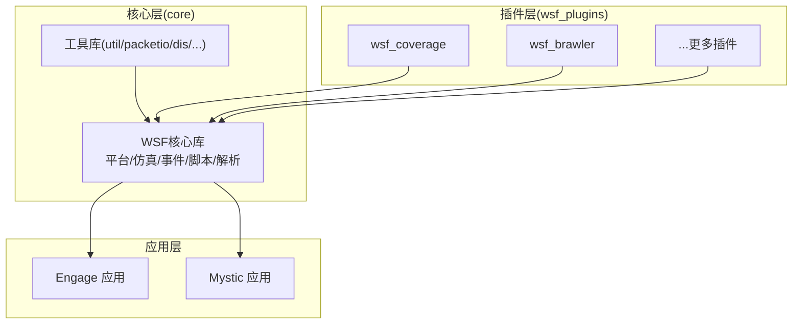
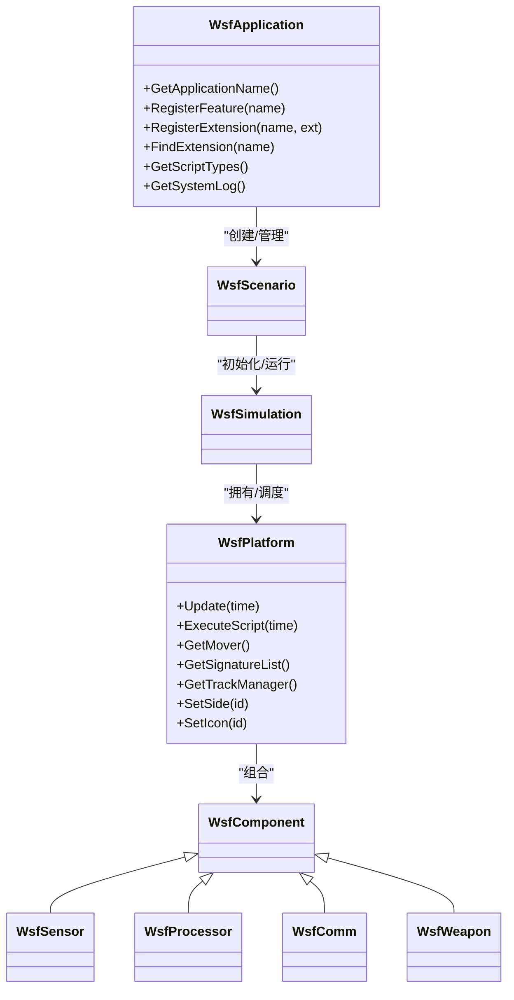
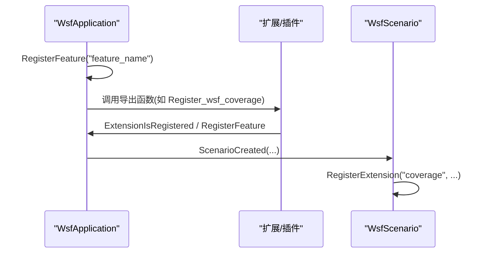
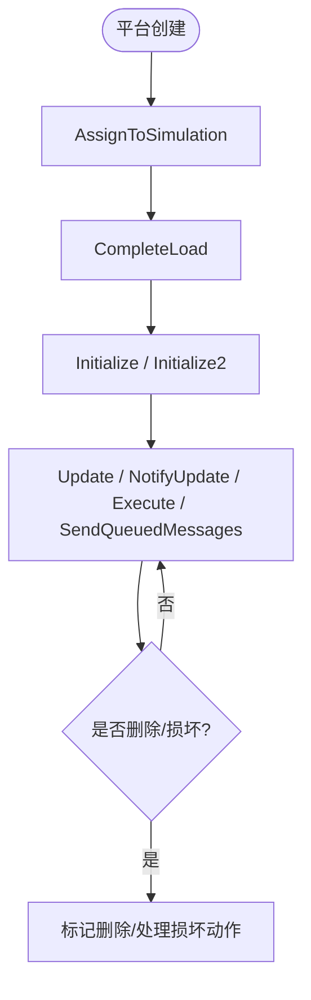
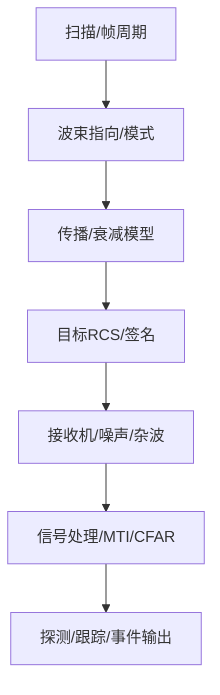
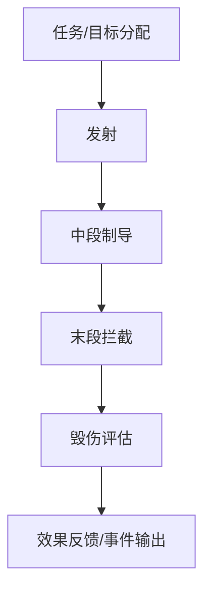
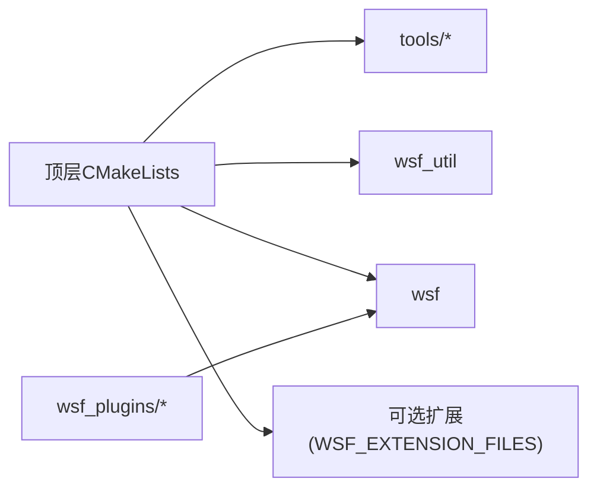

# 代码架构与模块组织

<cite>
**本文引用的文件**   
- [CMakeLists.txt](file://swdev/src/CMakeLists.txt)
- [wsf CMakeLists.txt](file://swdev/src/core/wsf/CMakeLists.txt)
- [WsfApplication.hpp](file://swdev/src/core/wsf/source/WsfApplication.hpp)
- [WsfPlatform.hpp](file://swdev/src/core/wsf/source/WsfPlatform.hpp)
- [WsfCoverageRegistration.cpp](file://swdev/src/wsf_plugins/wsf_coverage/source/WsfCoverageRegistration.cpp)
</cite>

## 目录
1. [简介](#简介)
2. [项目结构](#项目结构)
3. [核心组件](#核心组件)
4. [架构总览](#架构总览)
5. [详细组件分析](#详细组件分析)
6. [依赖关系分析](#依赖关系分析)
7. [性能考量](#性能考量)
8. [故障排查指南](#故障排查指南)
9. [结论](#结论)
10. [附录](#附录)

## 简介
本文件面向AFSIM（Advanced Framework for Simulation, Integration, and Modeling）的代码架构与模块组织，重点说明：
- 整体分层：核心层(core)、应用层(engage、mystic)与插件层(wsf_plugins)的职责划分与交互关系。
- WSF框架的模块化设计：平台管理、传感器系统、武器系统等核心组件的组织方式。
- 模块间依赖与数据流向，以及通过插件机制扩展功能的方式。
- 命名约定、目录与文件组织的最佳实践。

## 项目结构
AFSIM采用“核心库 + 应用 + 插件”的分层组织：
- core：WSF核心库与基础能力（平台、仿真、事件、脚本、解析器、工具等）。
- engage/mystic：面向具体应用场景的应用层，复用core能力并封装领域模型。
- wsf_plugins：按领域/能力划分的插件集合，通过统一注册接口向WSF注入新类型、处理器、传感器、行为等。
- tools/demos/training/documentation：工具链、示例、培训与文档。

图表来源
- [CMakeLists.txt:364-395](file://swdev/src/CMakeLists.txt#L364-L395)
- [wsf CMakeLists.txt:16-43](file://swdev/src/core/wsf/CMakeLists.txt#L16-L43)

章节来源
- [CMakeLists.txt:364-395](file://swdev/src/CMakeLists.txt#L364-L395)
- [wsf CMakeLists.txt:16-43](file://swdev/src/core/wsf/CMakeLists.txt#L16-L43)

## 核心组件
- WsfApplication：WSF应用生命周期与扩展/插件管理器入口，负责特性注册、扩展发现、脚本类型与系统日志等全局对象管理。
- WsfPlatform：仿真中的实体容器，聚合移动器、通信、传感器、处理器、燃料、轨迹管理等子系统，提供更新、脚本执行、状态查询等能力。
- 插件注册点：以wsf_plugins为边界，通过统一的Register_*函数将领域能力注入到WSF中。

章节来源
- [WsfApplication.hpp:32-44](file://swdev/src/core/wsf/source/WsfApplication.hpp#L32-L44)
- [WsfPlatform.hpp:66-114](file://swdev/src/core/wsf/source/WsfPlatform.hpp#L66-L114)

## 架构总览
WSF采用“应用-场景-仿真-平台-组件”的层次化建模：
- 应用(WsfApplication)管理扩展与插件，暴露特性开关。
- 场景(WsfScenario)定义输入与对象图。
- 仿真(WsfSimulation)驱动时间推进与调度。
- 平台(WsfPlatform)作为实体容器，组合各类子系统组件。
- 组件包括传感器、处理器、通信、武器、燃料、导航误差等。

图表来源
- [WsfApplication.hpp:32-44](file://swdev/src/core/wsf/source/WsfApplication.hpp#L32-L44)
- [WsfPlatform.hpp:66-114](file://swdev/src/core/wsf/source/WsfPlatform.hpp#L66-L114)

## 详细组件分析

### 应用与扩展/插件机制
- 应用实例唯一：每个WSF应用仅允许一个WsfApplication实例存在，集中管理扩展、插件与特性。
- 扩展注册：通过RegisterExtension添加扩展，支持依赖声明与查找。
- 特性开关：RegisterFeature用于声明可用特性，供条件编译或运行时检测。
- 插件加载：顶层构建系统扫描wsf_module与wsf_cmake_extension.cmake，自动纳入可选扩展；插件通过导出函数向应用注册能力。

图表来源
- [WsfApplication.hpp:92-133](file://swdev/src/core/wsf/source/WsfApplication.hpp#L92-L133)
- [WsfCoverageRegistration.cpp:24-44](file://swdev/src/wsf_plugins/wsf_coverage/source/WsfCoverageRegistration.cpp#L24-L44)

章节来源
- [WsfApplication.hpp:76-133](file://swdev/src/core/wsf/source/WsfApplication.hpp#L76-L133)
- [WsfCoverageRegistration.cpp:24-44](file://swdev/src/wsf_plugins/wsf_coverage/source/WsfCoverageRegistration.cpp#L24-L44)

### 平台与子系统组织
- 平台是仿真实体的容器，聚合移动器、传感器、处理器、通信、燃料、导航误差、签名列表、轨迹管理等。
- 平台生命周期：创建→赋值仿真→CompleteLoad→Initialize/Initialize2→Update/NotifyUpdate/Execute/SendQueuedMessages。
- 外部控制/影子实体：支持被其他应用控制或镜像外部实体，便于分布式仿真与可视化。
- 脚本上下文：平台持有脚本上下文，支持在指定时间执行脚本回调。

图表来源
- [WsfPlatform.hpp:149-206](file://swdev/src/core/wsf/source/WsfPlatform.hpp#L149-L206)
- [WsfPlatform.hpp:228-270](file://swdev/src/core/wsf/source/WsfPlatform.hpp#L228-L270)
- [WsfPlatform.hpp:596-601](file://swdev/src/core/wsf/source/WsfPlatform.hpp#L596-L601)

章节来源
- [WsfPlatform.hpp:66-114](file://swdev/src/core/wsf/source/WsfPlatform.hpp#L66-L114)
- [WsfPlatform.hpp:149-206](file://swdev/src/core/wsf/source/WsfPlatform.hpp#L149-L206)
- [WsfPlatform.hpp:228-270](file://swdev/src/core/wsf/source/WsfPlatform.hpp#L228-L270)
- [WsfPlatform.hpp:596-601](file://swdev/src/core/wsf/source/WsfPlatform.hpp#L596-L601)

### 传感器系统与数据处理
- 传感器作为平台组件之一，通常包含天线、发射机、接收机、信号处理器等子部件。
- 典型流程：扫描/帧周期→波束指向→传播/衰减→目标反射→接收→信号处理→输出探测/跟踪结果。
- 可通过扩展/插件新增传感器类型或信号处理器类型，并在输入语法中引用。

图表来源
- [wsf CMakeLists.txt:16-27](file://swdev/src/core/wsf/CMakeLists.txt#L16-L27)

章节来源
- [wsf CMakeLists.txt:16-27](file://swdev/src/core/wsf/CMakeLists.txt#L16-L27)

### 武器系统与交战流程
- 武器系统由发射器、制导、战斗部、效应器等组成，挂载于平台并通过处理器协调交战逻辑。
- 典型流程：任务规划→目标分配→发射→中段制导→末段拦截→毁伤评估→效果反馈。

图表来源
- [WsfPlatform.hpp:401-414](file://swdev/src/core/wsf/source/WsfPlatform.hpp#L401-L414)

章节来源
- [WsfPlatform.hpp:401-414](file://swdev/src/core/wsf/source/WsfPlatform.hpp#L401-L414)

## 依赖关系分析
- 构建期依赖：顶层CMakeLists将tools、wsf_util、wsf等子项目加入构建，并启用可选扩展。
- 运行时依赖：应用层(engage/mystic)依赖wsf核心库；插件通过导出函数向wsf注册能力。
- 扩展发现：通过wsf_module与wsf_cmake_extension.cmake定位扩展，再由optional_projects.cmake统一纳入。

图表来源
- [CMakeLists.txt:364-395](file://swdev/src/CMakeLists.txt#L364-L395)

章节来源
- [CMakeLists.txt:364-395](file://swdev/src/CMakeLists.txt#L364-L395)

## 性能考量
- 多线程更新：平台提供UpdateMultiThread与DoUpdateMultiThread钩子，配合多核调度提升大规模仿真吞吐。
- 更新锁：通过SetUpdateLocked避免在多线程池中重复更新，保证一致性。
- 延迟更新：Update内部检查更新时间戳，减少不必要的计算。
- 构建优化：Release默认-O3，支持Unity Build与ccache加速编译。

章节来源
- [WsfPlatform.hpp:174-181](file://swdev/src/core/wsf/source/WsfPlatform.hpp#L174-L181)
- [WsfPlatform.hpp:223-226](file://swdev/src/core/wsf/source/WsfPlatform.hpp#L223-L226)
- [CMakeLists.txt:260-337](file://swdev/src/CMakeLists.txt#L260-L337)

## 故障排查指南
- 扩展未注册：确认插件导出函数已调用RegisterFeature/ExtensionIsRegistered，且wsf_module路径正确。
- 平台未更新：检查UpdateAllowed/UpdateLocked标志，确保未被外部锁定或禁用。
- 外部控制/影子实体：若平台被外部应用控制或为影子实体，需相应调整传感器/处理器逻辑以避免误检。
- 脚本执行失败：核对平台脚本上下文与回调触发时机，必要时在DoExecuteUpdate/DoSendQueuedMessages中增加日志。

章节来源
- [WsfApplication.hpp:92-133](file://swdev/src/core/wsf/source/WsfApplication.hpp#L92-L133)
- [WsfPlatform.hpp:165-206](file://swdev/src/core/wsf/source/WsfPlatform.hpp#L165-L206)
- [WsfPlatform.hpp:228-270](file://swdev/src/core/wsf/source/WsfPlatform.hpp#L228-L270)

## 结论
AFSIM以WSF为核心，采用清晰的分层与插件化架构：
- 核心层提供平台、仿真、事件、脚本与解析等基础能力。
- 应用层封装领域模型，快速构建特定场景。
- 插件层按能力扩展，保持核心稳定与可演进性。
通过严格的命名与目录规范、统一的扩展/插件注册机制，AFSIM实现了高内聚、低耦合的可扩展仿真平台。

## 附录
- 命名约定
  - 类名前缀：Wsf*（WSF相关）、Ut*（通用工具）、Wk*（Warlock/Mystic UI相关）。
  - 插件命名：wsf_<capability>，导出函数Register_<plugin>(WsfApplication&)。
- 目录组织
  - swdev/src/core：核心库与基础工具。
  - swdev/src/engage、mystic：应用层。
  - swdev/src/wsf_plugins：插件集合。
  - demos/tools/training/documentation：示例、工具、培训与文档。
- 文件组织最佳实践
  - 每个扩展/插件提供wsf_module与wsf_cmake_extension.cmake以便自动发现。
  - 输入语法与文档随模块一起安装，便于IDE与用户查阅。
  - 测试用例与示例置于对应模块的test/demo目录，便于回归与演示。