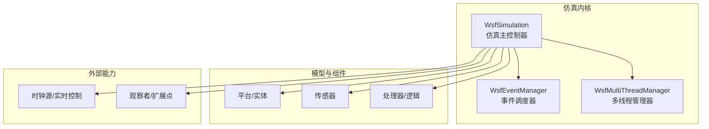
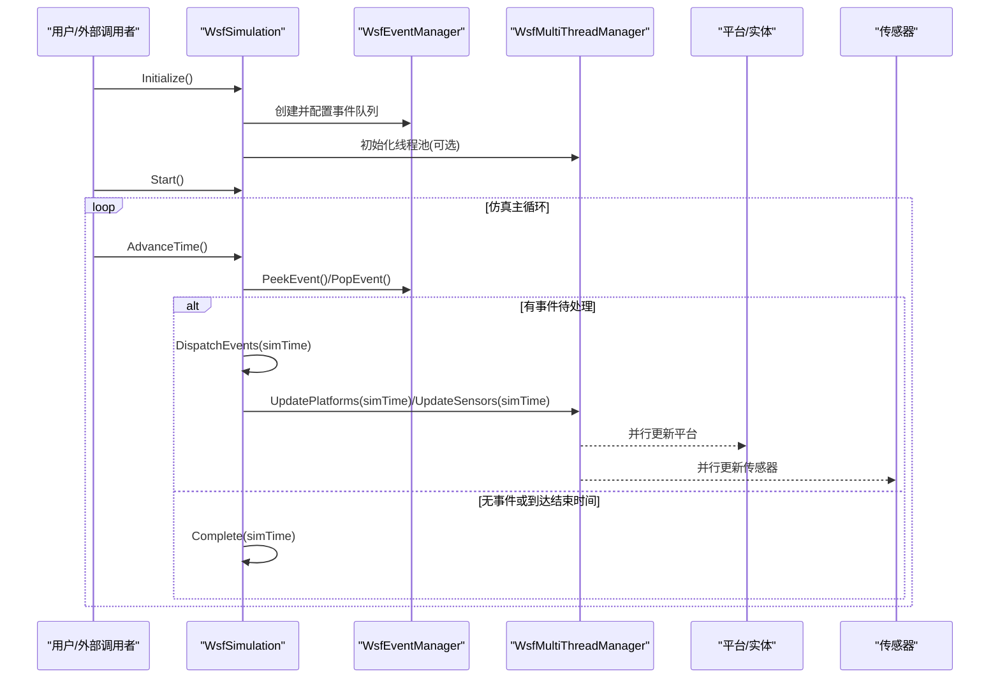
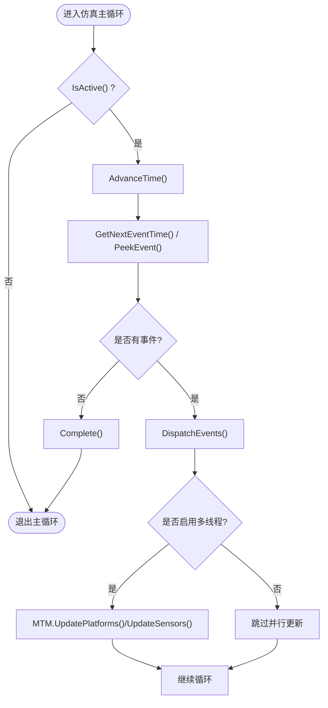
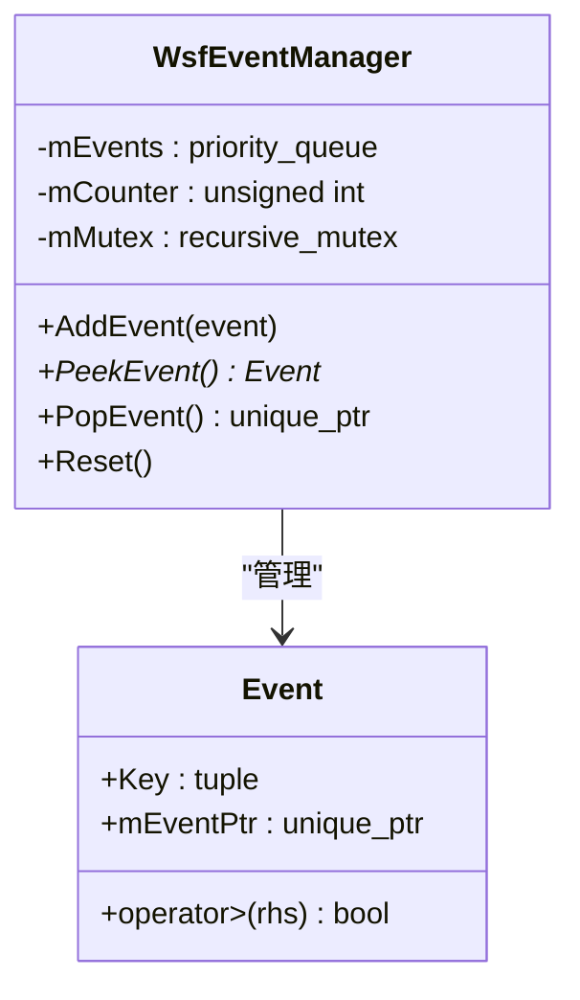
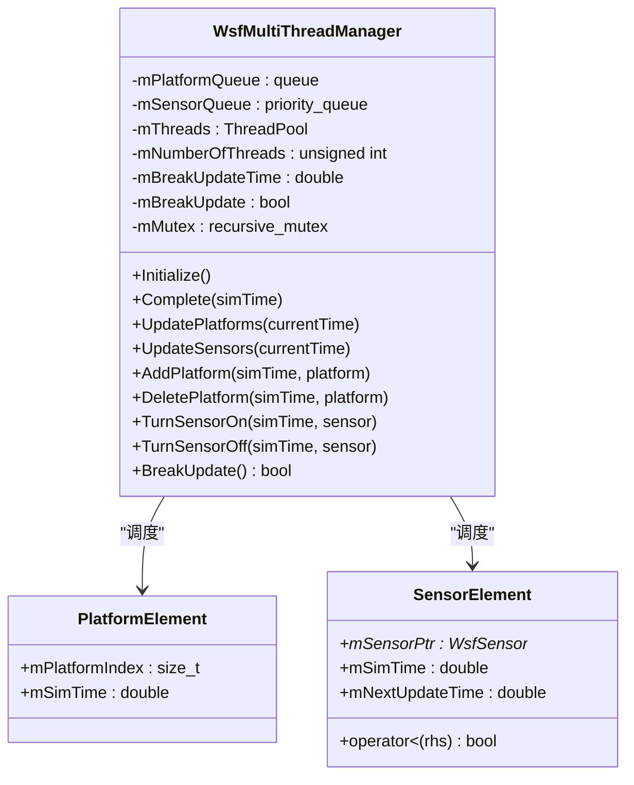
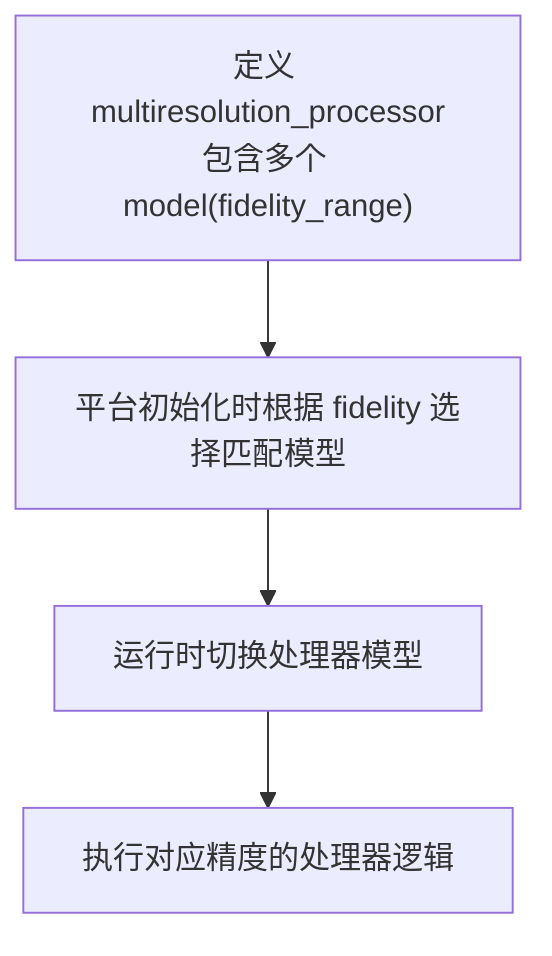
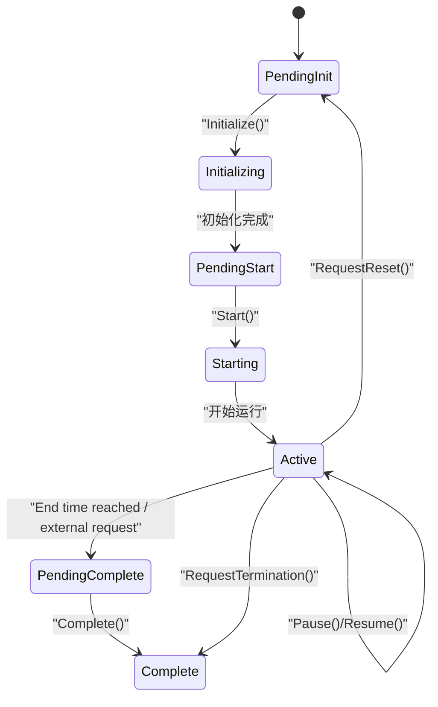
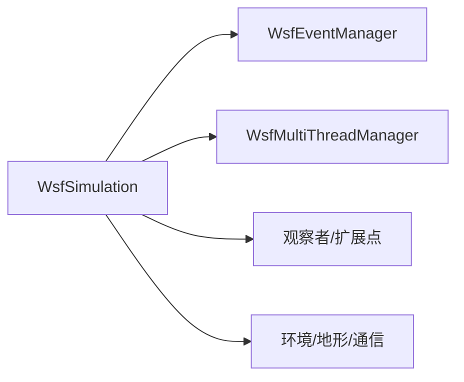

# 仿真引擎架构

<cite>
**本文引用的文件**   
- [WsfSimulation.hpp](file://swdev/src/core/wsf/source/WsfSimulation.hpp)
- [WsfEventManager.hpp](file://swdev/src/core/wsf/source/WsfEventManager.hpp)
- [WsfMultiThreadManager.hpp](file://swdev/src/core/wsf/source/WsfMultiThreadManager.hpp)
- [multiresolution_processor.html](file://documentation/html/docs/multiresolution_processor.html)
</cite>

## 目录
1. [简介](#简介)
2. [项目结构](#项目结构)
3. [核心组件](#核心组件)
4. [架构总览](#架构总览)
5. [详细组件分析](#详细组件分析)
6. [依赖关系分析](#依赖关系分析)
7. [性能考虑](#性能考虑)
8. [故障排查指南](#故障排查指南)
9. [结论](#结论)
10. [附录](#附录)

## 简介
本文件面向AFSIM仿真引擎的架构与实现，聚焦以下关键主题：
- 仿真时间管理：时间步进、事件调度器与仿真循环
- 多分辨率仿真：精度级别选择与协调机制
- 并行仿真：多线程处理与分布式扩展点
- 仿真状态管理与检查点：暂停、恢复与重启
- 架构图与数据流：时间管理、实体管理、传感器计算等核心组件协作
- 性能优化与调试技巧

## 项目结构
AFSIM的核心仿真框架位于core/wsf目录，其中：
- WsfSimulation：仿真主控制器，负责时间推进、事件调度、平台生命周期、观察者与扩展点
- WsfEventManager：基于优先队列的时间有序事件管理器
- WsfMultiThreadManager：线程池驱动的平台/传感器更新并行化
- 文档中关于多分辨率处理器（multiresolution_processor）的定义与用法

**图示来源**
- [WsfSimulation.hpp:91-121](file://swdev/src/core/wsf/source/WsfSimulation.hpp#L91-L121)
- [WsfEventManager.hpp:28-40](file://swdev/src/core/wsf/source/WsfEventManager.hpp#L28-L40)
- [WsfMultiThreadManager.hpp:28-32](file://swdev/src/core/wsf/source/WsfMultiThreadManager.hpp#L28-L32)

**章节来源**
- [WsfSimulation.hpp:91-121](file://swdev/src/core/wsf/source/WsfSimulation.hpp#L91-L121)
- [WsfEventManager.hpp:28-40](file://swdev/src/core/wsf/source/WsfEventManager.hpp#L28-L40)
- [WsfMultiThreadManager.hpp:28-32](file://swdev/src/core/wsf/source/WsfMultiThreadManager.hpp#L28-L32)

## 核心组件
- 仿真主控制器（WsfSimulation）
  - 维护仿真状态机（初始化、启动、运行、完成等）
  - 提供时间推进接口（AdvanceTime）、结束时间设置、实时模式控制
  - 管理事件队列（通过WsfEventManager），分发仿真事件与墙钟事件
  - 管理平台列表、子系统开关、观察者与扩展点
- 事件调度器（WsfEventManager）
  - 基于优先队列按仿真时间排序，同时间按优先级与入队顺序稳定排序
  - 提供添加、查看、弹出事件与重置能力
- 多线程管理器（WsfMultiThreadManager）
  - 使用线程池对平台与传感器更新进行并行化
  - 维护平台/传感器任务队列，支持断点更新与线程安全

**章节来源**
- [WsfSimulation.hpp:108-121](file://swdev/src/core/wsf/source/WsfSimulation.hpp#L108-L121)
- [WsfSimulation.hpp:179-329](file://swdev/src/core/wsf/source/WsfSimulation.hpp#L179-L329)
- [WsfEventManager.hpp:28-40](file://swdev/src/core/wsf/source/WsfEventManager.hpp#L28-L40)
- [WsfMultiThreadManager.hpp:28-32](file://swdev/src/core/wsf/source/WsfMultiThreadManager.hpp#L28-L32)

## 架构总览
下图展示仿真主循环、事件调度与多线程更新的协作关系。

**图示来源**
- [WsfSimulation.hpp:179-223](file://swdev/src/core/wsf/source/WsfSimulation.hpp#L179-L223)
- [WsfEventManager.hpp:50-79](file://swdev/src/core/wsf/source/WsfEventManager.hpp#L50-L79)
- [WsfMultiThreadManager.hpp:47-53](file://swdev/src/core/wsf/source/WsfMultiThreadManager.hpp#L47-L53)

## 详细组件分析

### 仿真时间管理与仿真循环
- 仿真状态机
  - 状态包括：cPENDING_INITIALIZE、cINITIALIZING、cPENDING_START、cSTARTING、cACTIVE、cPENDING_COMPLETE、cCOMPLETE
  - 完成原因包括：cEND_TIME_REACHED、cRESET、cTERMINATE、cOTHER
- 时间推进
  - AdvanceTime()/AdvanceTime(double)：推进到下一事件或固定步长
  - GetNextEventTime()：查询下一个事件时间
  - SetEndTime()/GetEndTime()：设置/获取仿真结束时间
  - IsRealTime()/SetRealtime()：实时模式控制
  - GetTimestep()/GetSyncTimestep()：固定步长与同步步长
- 事件分发
  - AddEvent()/AddWallEvent()：向仿真事件或墙钟事件队列添加事件
  - DispatchEvents()/DispatchSimEvents()/DispatchWallEvents()：分发事件
- 暂停/恢复/重启
  - Pause()/Resume()/RequestReset()/RequestTermination()：控制仿真暂停、恢复、重置与终止
  - WaitForAdvanceTime()：等待时间推进完成

**图示来源**
- [WsfSimulation.hpp:179-223](file://swdev/src/core/wsf/source/WsfSimulation.hpp#L179-L223)
- [WsfSimulation.hpp:261-296](file://swdev/src/core/wsf/source/WsfSimulation.hpp#L261-L296)
- [WsfSimulation.hpp:511-513](file://swdev/src/core/wsf/source/WsfSimulation.hpp#L511-L513)

**章节来源**
- [WsfSimulation.hpp:108-131](file://swdev/src/core/wsf/source/WsfSimulation.hpp#L108-L131)
- [WsfSimulation.hpp:179-223](file://swdev/src/core/wsf/source/WsfSimulation.hpp#L179-L223)
- [WsfSimulation.hpp:261-296](file://swdev/src/core/wsf/source/WsfSimulation.hpp#L261-L296)
- [WsfSimulation.hpp:511-513](file://swdev/src/core/wsf/source/WsfSimulation.hpp#L511-L513)

### 事件调度器（WsfEventManager）
- 设计要点
  - 以仿真时间为第一关键字，优先级为第二关键字，入队序号为第三关键字，保证稳定顺序
  - 线程安全：内部使用递归互斥保护队列操作
- 主要接口
  - AddEvent()：添加事件
  - PeekEvent()/PopEvent()：查看/取出下一个事件
  - Reset()：清空队列

**图示来源**
- [WsfEventManager.hpp:28-40](file://swdev/src/core/wsf/source/WsfEventManager.hpp#L28-L40)
- [WsfEventManager.hpp:50-109](file://swdev/src/core/wsf/source/WsfEventManager.hpp#L50-L109)

**章节来源**
- [WsfEventManager.hpp:28-40](file://swdev/src/core/wsf/source/WsfEventManager.hpp#L28-L40)
- [WsfEventManager.hpp:50-109](file://swdev/src/core/wsf/source/WsfEventManager.hpp#L50-L109)

### 多线程仿真（WsfMultiThreadManager）
- 设计要点
  - 使用线程池执行平台与传感器的更新任务
  - 分别维护平台队列与传感器优先队列（按下次更新时间排序）
  - 支持断点更新（BreakUpdate）与线程安全访问
- 主要接口
  - Initialize()/Complete()：生命周期管理
  - UpdatePlatforms()/UpdateSensors()：并行更新入口
  - AddPlatform()/DeletePlatform()：动态注册/注销平台
  - TurnSensorOn()/TurnSensorOff()：传感器启停

**图示来源**
- [WsfMultiThreadManager.hpp:28-32](file://swdev/src/core/wsf/source/WsfMultiThreadManager.hpp#L28-L32)
- [WsfMultiThreadManager.hpp:47-53](file://swdev/src/core/wsf/source/WsfMultiThreadManager.hpp#L47-L53)
- [WsfMultiThreadManager.hpp:76-118](file://swdev/src/core/wsf/source/WsfMultiThreadManager.hpp#L76-L118)
- [WsfMultiThreadManager.hpp:169-187](file://swdev/src/core/wsf/source/WsfMultiThreadManager.hpp#L169-L187)

**章节来源**
- [WsfMultiThreadManager.hpp:28-32](file://swdev/src/core/wsf/source/WsfMultiThreadManager.hpp#L28-L32)
- [WsfMultiThreadManager.hpp:47-53](file://swdev/src/core/wsf/source/WsfMultiThreadManager.hpp#L47-L53)
- [WsfMultiThreadManager.hpp:76-118](file://swdev/src/core/wsf/source/WsfMultiThreadManager.hpp#L76-L118)
- [WsfMultiThreadManager.hpp:169-187](file://swdev/src/core/wsf/source/WsfMultiThreadManager.hpp#L169-L187)

### 多分辨率仿真支持
- 多分辨率处理器（multiresolution_processor）
  - 在平台组件上定义多个处理器模型，每个模型指定fidelity_range
  - 运行时根据组件的fidelity值选择匹配的处理器模型
  - 典型用法：在platform_type中定义容器，在platform实例中设置fidelity，延迟到运行时选择具体处理器

**图示来源**
- [multiresolution_processor.html:127-133](file://documentation/html/docs/multiresolution_processor.html#L127-L133)
- [multiresolution_processor.html:146-150](file://documentation/html/docs/multiresolution_processor.html#L146-L150)

**章节来源**
- [multiresolution_processor.html:127-133](file://documentation/html/docs/multiresolution_processor.html#L127-L133)
- [multiresolution_processor.html:146-150](file://documentation/html/docs/multiresolution_processor.html#L146-L150)

### 仿真状态管理与检查点
- 状态管理
  - State枚举与CompletionReason枚举定义了完整的仿真生命周期与完成原因
  - IsActive()/GetState()/GetStateString()用于查询当前状态
- 暂停/恢复/重启
  - Pause()/Resume()：暂停与恢复仿真
  - RequestReset()/RequestTermination()：请求重置或终止
  - WaitForAdvanceTime()：等待时间推进完成，便于外部同步
- 检查点
  - 代码库未直接暴露“检查点”API；通常由上层应用通过保存/恢复平台状态、事件队列快照与随机数种子来实现
  - 建议策略：在Complete()/Pause()时机序列化关键状态，并在Restart()时反序列化

**图示来源**
- [WsfSimulation.hpp:111-131](file://swdev/src/core/wsf/source/WsfSimulation.hpp#L111-L131)
- [WsfSimulation.hpp:215-227](file://swdev/src/core/wsf/source/WsfSimulation.hpp#L215-L227)

**章节来源**
- [WsfSimulation.hpp:111-131](file://swdev/src/core/wsf/source/WsfSimulation.hpp#L111-L131)
- [WsfSimulation.hpp:215-227](file://swdev/src/core/wsf/source/WsfSimulation.hpp#L215-L227)

## 依赖关系分析
- WsfSimulation依赖
  - WsfEventManager：事件队列与调度
  - WsfMultiThreadManager：并行更新平台/传感器
  - 其他子系统：观察者、脚本执行器、环境、地形、通信网络等
- 耦合性
  - Simulation与EventManager松耦合（通过接口交互）
  - Simulation与MultiThreadManager解耦（通过方法调用）
  - 平台/传感器作为被调度对象，不反向依赖调度器

**图示来源**
- [WsfSimulation.hpp:406-460](file://swdev/src/core/wsf/source/WsfSimulation.hpp#L406-L460)
- [WsfSimulation.hpp:526-533](file://swdev/src/core/wsf/source/WsfSimulation.hpp#L526-L533)
- [WsfMultiThreadManager.hpp:169-187](file://swdev/src/core/wsf/source/WsfMultiThreadManager.hpp#L169-L187)

**章节来源**
- [WsfSimulation.hpp:406-460](file://swdev/src/core/wsf/source/WsfSimulation.hpp#L406-L460)
- [WsfSimulation.hpp:526-533](file://swdev/src/core/wsf/source/WsfSimulation.hpp#L526-L533)
- [WsfMultiThreadManager.hpp:169-187](file://swdev/src/core/wsf/source/WsfMultiThreadManager.hpp#L169-L187)

## 性能考虑
- 事件调度
  - 合理设置事件优先级，避免大量同时间事件导致频繁上下文切换
  - 批量添加事件以减少锁竞争
- 多线程更新
  - 调整线程数量与BreakUpdateTime，平衡吞吐与延迟
  - 将高开销传感器更新与平台更新分离，减少锁粒度
- 时间步进
  - 对于高频传感器，适当增大步长或使用事件驱动模式
  - 使用GetSyncTimestep()监控同步步长，避免过度缩放
- I/O与日志
  - 降低输出频率，合并事件输出，减少磁盘I/O
- 随机数
  - 使用LockRandom()/UnlockRandom()确保多线程下随机数安全，避免热点竞争

[本节为通用指导，无需特定文件引用]

## 故障排查指南
- 仿真卡住或无法推进
  - 检查是否有未处理的事件堆积（PeekEvent/PopEvent）
  - 确认AdvanceTime()是否在活跃状态下被调用
- 多线程不稳定
  - 检查平台/传感器更新是否正确使用线程安全接口
  - 观察BreakUpdate标志位，必要时调整BreakUpdateTime
- 实时模式异常
  - 校验IsRealTime()/SetRealtime()配置
  - 使用GetTimeBehind()评估仿真时钟落后程度
- 状态不一致
  - 在Pause()/Resume()前后记录关键状态快照
  - 使用GetState()/GetStateString()诊断状态转换路径

**章节来源**
- [WsfEventManager.hpp:50-79](file://swdev/src/core/wsf/source/WsfEventManager.hpp#L50-L79)
- [WsfMultiThreadManager.hpp:47-53](file://swdev/src/core/wsf/source/WsfMultiThreadManager.hpp#L47-L53)
- [WsfSimulation.hpp:271-296](file://swdev/src/core/wsf/source/WsfSimulation.hpp#L271-L296)

## 结论
AFSIM仿真引擎以WsfSimulation为核心，结合WsfEventManager与WsfMultiThreadManager实现了可扩展、可并行、可控制的仿真时间管理与执行循环。多分辨率处理器提供了运行时精度切换能力，观察者与扩展点机制增强了系统的可观测性与可定制性。通过合理的参数调优与调试策略，可在大规模场景中获得稳定且高效的仿真性能。

[本节为总结性内容，无需特定文件引用]

## 附录
- 常用接口速查
  - 时间管理：AdvanceTime(), GetNextEventTime(), SetEndTime(), GetTimestep(), GetSyncTimestep()
  - 状态控制：Start(), Pause(), Resume(), RequestReset(), RequestTermination(), Complete()
  - 事件管理：AddEvent(), AddWallEvent(), DispatchEvents()
  - 并行更新：MTM.UpdatePlatforms(), MTM.UpdateSensors()
  - 多分辨率：multiresolution_processor.fidelity/fidelity_range

**章节来源**
- [WsfSimulation.hpp:179-329](file://swdev/src/core/wsf/source/WsfSimulation.hpp#L179-L329)
- [WsfEventManager.hpp:50-79](file://swdev/src/core/wsf/source/WsfEventManager.hpp#L50-L79)
- [WsfMultiThreadManager.hpp:47-53](file://swdev/src/core/wsf/source/WsfMultiThreadManager.hpp#L47-L53)
- [multiresolution_processor.html:146-150](file://documentation/html/docs/multiresolution_processor.html#L146-L150)