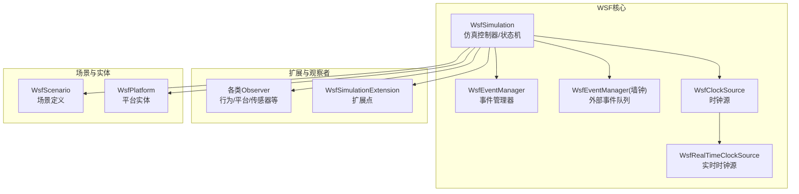
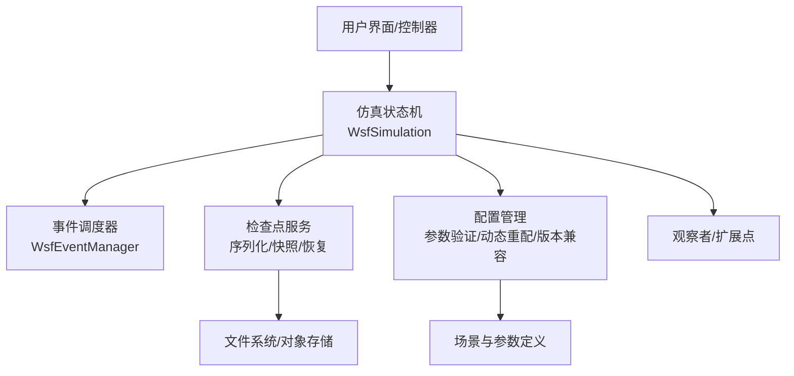
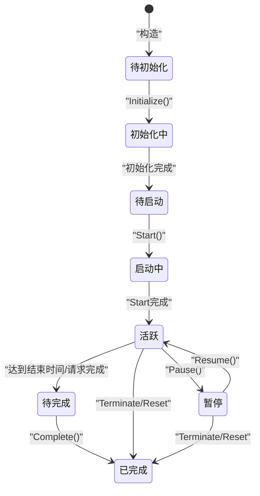
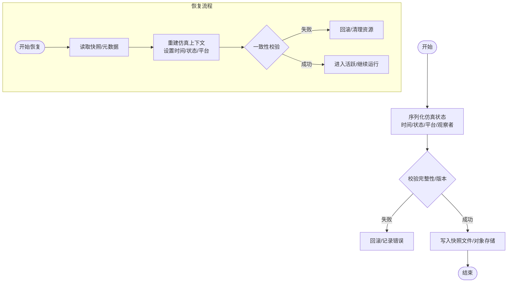
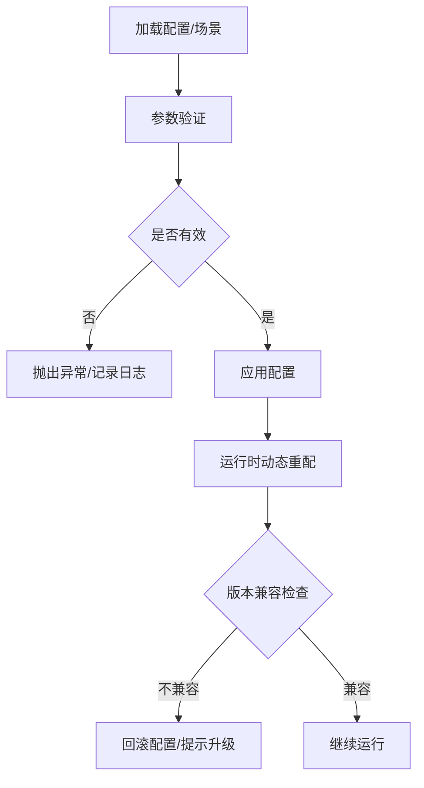
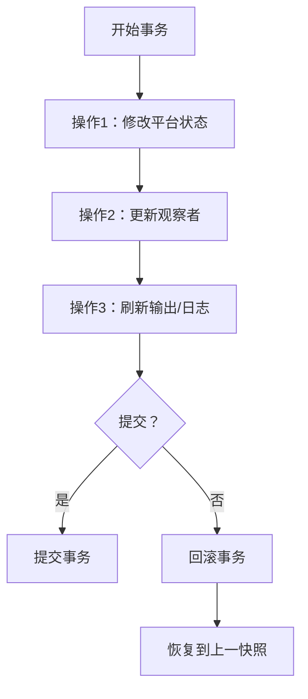
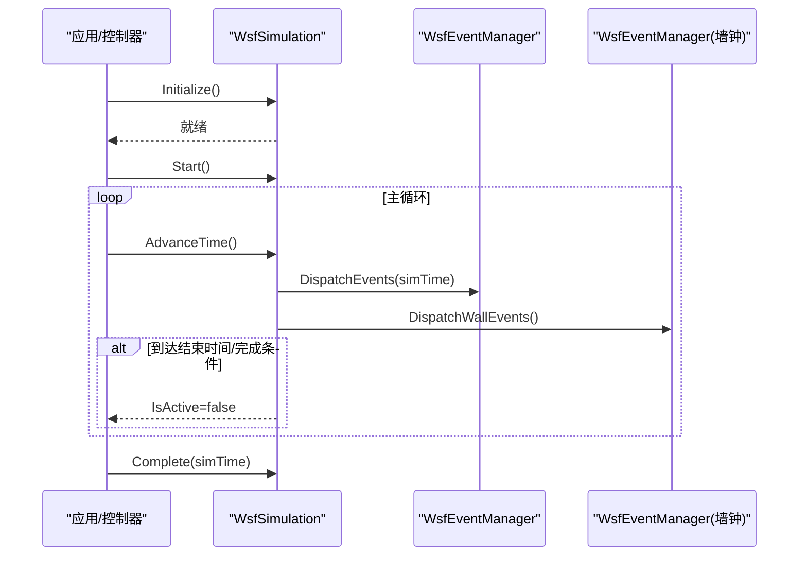
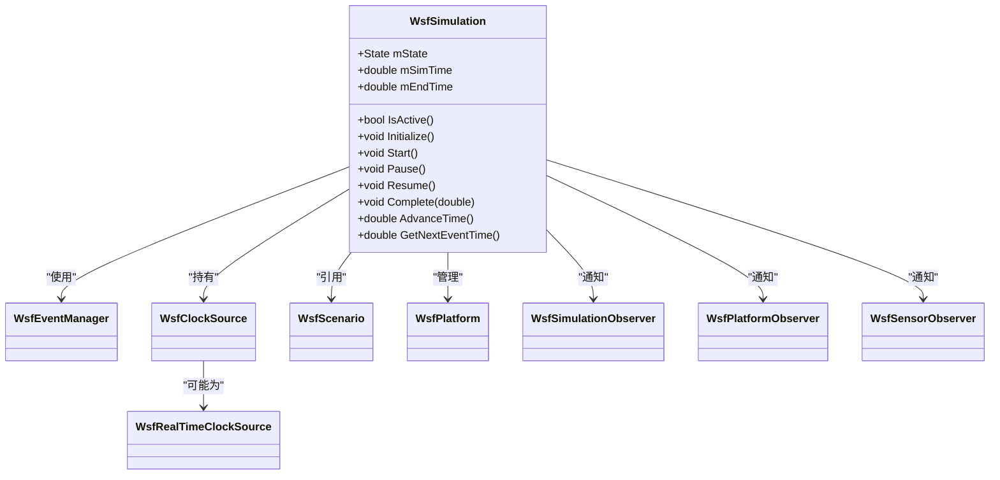

# 仿真状态管理

<cite>
**本文引用的文件**   
- [WsfSimulation.hpp](file://swdev/src/core/wsf/source/WsfSimulation.hpp)
</cite>

## 目录
1. [简介](#简介)
2. [项目结构](#项目结构)
3. [核心组件](#核心组件)
4. [架构总览](#架构总览)
5. [详细组件分析](#详细组件分析)
6. [依赖关系分析](#依赖关系分析)
7. [性能考量](#性能考量)
8. [故障排查指南](#故障排查指南)
9. [结论](#结论)
10. [附录：API参考与最佳实践](#附录api参考与最佳实践)

## 简介
本文件聚焦AFSIM仿真状态管理系统，围绕仿真生命周期（初始化、运行、暂停、恢复、终止）、检查点机制（序列化、快照存储与恢复）、配置管理（参数验证、动态重配、版本兼容）以及一致性维护（事务处理与回滚）进行系统化说明。文档同时提供架构图、状态机与时序图，并给出面向开发者的API参考与最佳实践建议，帮助读者在理解实现的同时快速上手。

## 项目结构
AFSIM的仿真核心位于WSF（Warfare Simulation Framework）中，仿真状态管理与调度由WsfSimulation类统一负责。该文件定义了仿真状态枚举、生命周期方法、时间推进、事件调度、平台管理等关键接口与内部字段，是状态管理的权威来源。

图示来源
- [WsfSimulation.hpp:91-121](file://swdev/src/core/wsf/source/WsfSimulation.hpp#L91-L121)
- [WsfSimulation.hpp:179-329](file://swdev/src/core/wsf/source/WsfSimulation.hpp#L179-L329)
- [WsfSimulation.hpp:406-434](file://swdev/src/core/wsf/source/WsfSimulation.hpp#L406-L434)
- [WsfSimulation.hpp:529-540](file://swdev/src/core/wsf/source/WsfSimulation.hpp#L529-L540)
- [WsfSimulation.hpp:594-600](file://swdev/src/core/wsf/source/WsfSimulation.hpp#L594-L600)

章节来源
- [WsfSimulation.hpp:91-121](file://swdev/src/core/wsf/source/WsfSimulation.hpp#L91-L121)
- [WsfSimulation.hpp:179-329](file://swdev/src/core/wsf/source/WsfSimulation.hpp#L179-L329)
- [WsfSimulation.hpp:406-434](file://swdev/src/core/wsf/source/WsfSimulation.hpp#L406-L434)
- [WsfSimulation.hpp:529-540](file://swdev/src/core/wsf/source/WsfSimulation.hpp#L529-L540)
- [WsfSimulation.hpp:594-600](file://swdev/src/core/wsf/source/WsfSimulation.hpp#L594-L600)

## 核心组件
- 仿真状态机：通过State枚举与相关方法控制仿真从“待初始化”到“完成”的全生命周期。
- 时间与调度：AdvanceTime系列方法驱动仿真推进；GetNextEventTime用于获取下一事件时间；支持实时与非实时模式。
- 事件系统：AddEvent/AddWallEvent将事件加入仿真或墙钟事件队列；Dispatch*系列方法分发执行。
- 平台管理：AddPlatform/DeletePlatform等平台增删与查询接口，配合平台列表维护。
- 观察者与扩展：统一的Observer注册与访问接口，以及扩展点机制，便于功能扩展与监控。

章节来源
- [WsfSimulation.hpp:111-131](file://swdev/src/core/wsf/source/WsfSimulation.hpp#L111-L131)
- [WsfSimulation.hpp:181-227](file://swdev/src/core/wsf/source/WsfSimulation.hpp#L181-L227)
- [WsfSimulation.hpp:331-368](file://swdev/src/core/wsf/source/WsfSimulation.hpp#L331-L368)
- [WsfSimulation.hpp:406-434](file://swdev/src/core/wsf/source/WsfSimulation.hpp#L406-L434)

## 架构总览
下图展示仿真状态机、持久化层（检查点）与配置管理之间的关系。尽管当前代码未直接暴露检查点与配置管理的具体实现，但可通过WsfSimulation提供的状态与时间接口构建上层服务。

图示来源
- [WsfSimulation.hpp:111-131](file://swdev/src/core/wsf/source/WsfSimulation.hpp#L111-L131)
- [WsfSimulation.hpp:181-227](file://swdev/src/core/wsf/source/WsfSimulation.hpp#L181-L227)
- [WsfSimulation.hpp:406-434](file://swdev/src/core/wsf/source/WsfSimulation.hpp#L406-L434)

## 详细组件分析

### 仿真生命周期与状态转换
仿真状态机包含以下关键状态与方法：
- 状态枚举：cPENDING_INITIALIZE、cINITIALIZING、cPENDING_START、cSTARTING、cACTIVE、cPENDING_COMPLETE、cCOMPLETE。
- 生命周期方法：Initialize、PrepareSimulation、Start、Pause、Resume、Complete、RequestReset、RequestTermination。
- 时间推进：AdvanceTime(double)、AdvanceTime()、GetNextEventTime()。
- 运行控制：IsActive()、SetEndTime()、IsRealTime()、SetRealtime()。

图示来源
- [WsfSimulation.hpp:111-131](file://swdev/src/core/wsf/source/WsfSimulation.hpp#L111-L131)
- [WsfSimulation.hpp:181-227](file://swdev/src/core/wsf/source/WsfSimulation.hpp#L181-L227)
- [WsfSimulation.hpp:242-259](file://swdev/src/core/wsf/source/WsfSimulation.hpp#L242-L259)

章节来源
- [WsfSimulation.hpp:111-131](file://swdev/src/core/wsf/source/WsfSimulation.hpp#L111-L131)
- [WsfSimulation.hpp:181-227](file://swdev/src/core/wsf/source/WsfSimulation.hpp#L181-L227)
- [WsfSimulation.hpp:242-259](file://swdev/src/core/wsf/source/WsfSimulation.hpp#L242-L259)

### 检查点机制（序列化、快照存储与恢复）
检查点服务通常基于WsfSimulation提供的状态与时间信息进行工作：
- 状态序列化：读取mSimTime、mState、mEndTime、平台列表与观测者状态，生成可持久化的快照。
- 快照存储：将序列化数据写入文件或对象存储，附带元数据（版本号、时间戳、随机种子）。
- 恢复流程：加载快照，重建仿真上下文，设置时间、状态与平台集合，必要时校验版本兼容性。

图示来源
- [WsfSimulation.hpp:242-259](file://swdev/src/core/wsf/source/WsfSimulation.hpp#L242-L259)
- [WsfSimulation.hpp:542-581](file://swdev/src/core/wsf/source/WsfSimulation.hpp#L542-L581)
- [WsfSimulation.hpp:679-687](file://swdev/src/core/wsf/source/WsfSimulation.hpp#L679-L687)

章节来源
- [WsfSimulation.hpp:242-259](file://swdev/src/core/wsf/source/WsfSimulation.hpp#L242-L259)
- [WsfSimulation.hpp:542-581](file://swdev/src/core/wsf/source/WsfSimulation.hpp#L542-L581)
- [WsfSimulation.hpp:679-687](file://swdev/src/core/wsf/source/WsfSimulation.hpp#L679-L687)

### 仿真配置管理（参数验证、动态重配、版本兼容）
配置管理应围绕WsfSimulation与场景定义展开：
- 参数验证：在Initialize/PrepareSimulation阶段对场景参数进行合法性检查，确保后续运行稳定。
- 动态重配：在Active状态下允许部分参数更新（如输出频率、观察间隔），需保证线程安全与一致性。
- 版本兼容：快照与配置文件的版本标识需在加载时进行向后/向前兼容判断，避免破坏性变更。

图示来源
- [WsfSimulation.hpp:181-183](file://swdev/src/core/wsf/source/WsfSimulation.hpp#L181-L183)
- [WsfSimulation.hpp:261-268](file://swdev/src/core/wsf/source/WsfSimulation.hpp#L261-L268)

章节来源
- [WsfSimulation.hpp:181-183](file://swdev/src/core/wsf/source/WsfSimulation.hpp#L181-L183)
- [WsfSimulation.hpp:261-268](file://swdev/src/core/wsf/source/WsfSimulation.hpp#L261-L268)

### 一致性维护（事务处理与回滚）
为确保仿真状态的一致性，建议在检查点与动态重配过程中引入事务语义：
- 事务边界：以一次快照或一次批量参数更新为事务单元。
- 原子性：所有子操作要么全部成功，要么全部回滚。
- 隔离性：在Active状态下，对共享状态的修改需加锁或使用不可变数据结构。
- 回滚策略：记录旧状态副本，失败时恢复至一致点。

图示来源
- [WsfSimulation.hpp:406-434](file://swdev/src/core/wsf/source/WsfSimulation.hpp#L406-L434)
- [WsfSimulation.hpp:679-687](file://swdev/src/core/wsf/source/WsfSimulation.hpp#L679-L687)

章节来源
- [WsfSimulation.hpp:406-434](file://swdev/src/core/wsf/source/WsfSimulation.hpp#L406-L434)
- [WsfSimulation.hpp:679-687](file://swdev/src/core/wsf/source/WsfSimulation.hpp#L679-L687)

### 事件调度与时间推进
仿真主循环通过AdvanceTime推进时间，并在每个时间点分发事件。墙钟事件与仿真事件分别由不同队列管理，支持实时与非实时模式。

图示来源
- [WsfSimulation.hpp:181-227](file://swdev/src/core/wsf/source/WsfSimulation.hpp#L181-L227)
- [WsfSimulation.hpp:529-540](file://swdev/src/core/wsf/source/WsfSimulation.hpp#L529-L540)

章节来源
- [WsfSimulation.hpp:181-227](file://swdev/src/core/wsf/source/WsfSimulation.hpp#L181-L227)
- [WsfSimulation.hpp:529-540](file://swdev/src/core/wsf/source/WsfSimulation.hpp#L529-L540)

## 依赖关系分析
WsfSimulation依赖多个子系统与组件，包括事件管理器、时钟源、观察者、平台与场景等。这些依赖关系决定了状态管理的可扩展性与稳定性。

图示来源
- [WsfSimulation.hpp:91-121](file://swdev/src/core/wsf/source/WsfSimulation.hpp#L91-L121)
- [WsfSimulation.hpp:179-329](file://swdev/src/core/wsf/source/WsfSimulation.hpp#L179-L329)
- [WsfSimulation.hpp:406-434](file://swdev/src/core/wsf/source/WsfSimulation.hpp#L406-L434)
- [WsfSimulation.hpp:529-540](file://swdev/src/core/wsf/source/WsfSimulation.hpp#L529-L540)
- [WsfSimulation.hpp:594-600](file://swdev/src/core/wsf/source/WsfSimulation.hpp#L594-L600)

章节来源
- [WsfSimulation.hpp:91-121](file://swdev/src/core/wsf/source/WsfSimulation.hpp#L91-L121)
- [WsfSimulation.hpp:179-329](file://swdev/src/core/wsf/source/WsfSimulation.hpp#L179-L329)
- [WsfSimulation.hpp:406-434](file://swdev/src/core/wsf/source/WsfSimulation.hpp#L406-L434)
- [WsfSimulation.hpp:529-540](file://swdev/src/core/wsf/source/WsfSimulation.hpp#L529-L540)
- [WsfSimulation.hpp:594-600](file://swdev/src/core/wsf/source/WsfSimulation.hpp#L594-L600)

## 性能考量
- 事件调度开销：频繁的事件创建与分发会增加CPU占用，建议批量事件与节流策略。
- 实时模式：在实时模式下需考虑墙钟同步与延迟补偿，避免掉帧与滞后。
- 多线程：启用多线程时需确保随机数、平台列表与观察者通知的线程安全。
- I/O瓶颈：检查点快照的序列化与落盘应避免阻塞主循环，采用异步I/O与增量快照。

[本节为通用指导，无需具体文件引用]

## 故障排查指南
- 状态不一致：检查Initialize/Start/Complete调用顺序是否正确，确认IsActive返回是否符合预期。
- 时间推进异常：核对End Time设置与AdvanceTime返回值，确认GetNextEventTime是否合理。
- 事件丢失：检查AddEvent/AddWallEvent的使用方式，确认DispatchEvents/DispatchWallEvents是否被正确调用。
- 观察者回调异常：确认Observer注册与移除时机，避免在回调中修改被遍历的容器。
- 检查点恢复失败：校验快照元数据与版本兼容性，确保平台ID与名称映射一致。

章节来源
- [WsfSimulation.hpp:181-227](file://swdev/src/core/wsf/source/WsfSimulation.hpp#L181-L227)
- [WsfSimulation.hpp:242-259](file://swdev/src/core/wsf/source/WsfSimulation.hpp#L242-L259)
- [WsfSimulation.hpp:406-434](file://swdev/src/core/wsf/source/WsfSimulation.hpp#L406-L434)

## 结论
WsfSimulation作为AFSIM的核心控制器，提供了完整的仿真状态机、时间推进与事件调度能力。在此基础上，结合检查点服务与配置管理，可实现稳健的仿真生命周期管理与高可用的运行环境。遵循本文的最佳实践与API参考，开发者可以高效地扩展与集成仿真功能，并确保状态一致性与性能表现。

[本节为总结性内容，无需具体文件引用]

## 附录：API参考与最佳实践

### API参考（节选）
- 状态与时间
  - GetState()/GetStateString()：获取当前状态与字符串表示
  - GetCompletionReason()/GetCompletionReasonString()：获取完成原因
  - SetEndTime()/GetEndTime()：设置/获取结束时间
  - GetSimTime()/GetRealTime()/GetWallTime()：获取仿真时间、真实时间与墙钟时间
  - IsRealTime()/SetRealtime()：实时模式开关
- 生命周期
  - Initialize()/PrepareSimulation()：初始化准备
  - Start()/Pause()/Resume()/Complete()：运行控制
  - RequestReset()/RequestTermination()：重置与终止
- 事件与调度
  - AddEvent()/AddWallEvent()：添加事件
  - AdvanceTime()/AdvanceTime(double)/GetNextEventTime()：时间推进
- 平台管理
  - AddPlatform()/DeletePlatform()/GetPlatformCount()/GetPlatformEntry()：平台增删查
- 观察者与扩展
  - Get*Observer()：获取各类观察者
  - FindExtension()/RegisterExtension()：扩展点管理

章节来源
- [WsfSimulation.hpp:111-131](file://swdev/src/core/wsf/source/WsfSimulation.hpp#L111-L131)
- [WsfSimulation.hpp:181-227](file://swdev/src/core/wsf/source/WsfSimulation.hpp#L181-L227)
- [WsfSimulation.hpp:242-259](file://swdev/src/core/wsf/source/WsfSimulation.hpp#L242-L259)
- [WsfSimulation.hpp:331-368](file://swdev/src/core/wsf/source/WsfSimulation.hpp#L331-L368)
- [WsfSimulation.hpp:406-434](file://swdev/src/core/wsf/source/WsfSimulation.hpp#L406-L434)

### 最佳实践
- 生命周期规范
  - 严格遵循Initialize→Start→(Pause/Resume)*→Complete的顺序
  - 在Complete前确保所有异步任务完成
- 检查点设计
  - 定期快照与增量快照结合，减少I/O压力
  - 快照元数据包含版本、时间戳、随机种子与平台映射
- 配置管理
  - 在Initialize阶段完成参数验证，避免运行时崩溃
  - 动态重配需原子化与可回滚
- 一致性保障
  - 使用事务包装批量状态变更
  - 观察者回调中避免长时间阻塞与写操作
- 性能优化
  - 批量事件与节流策略
  - 异步I/O与内存池复用
  - 多线程下对共享资源的互斥保护

[本节为通用指导，无需具体文件引用]