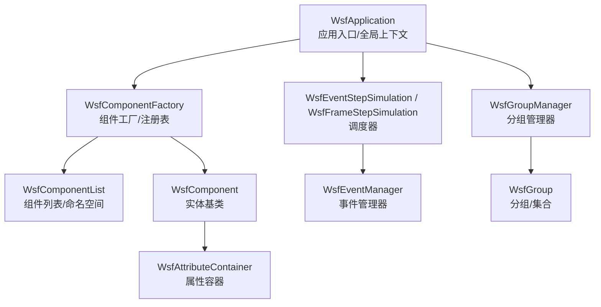
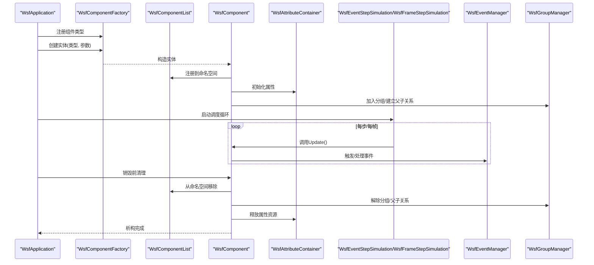
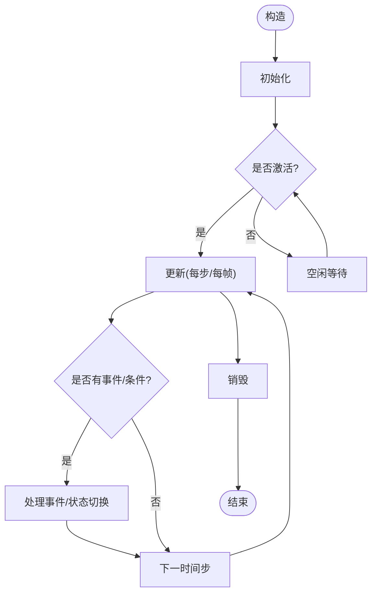
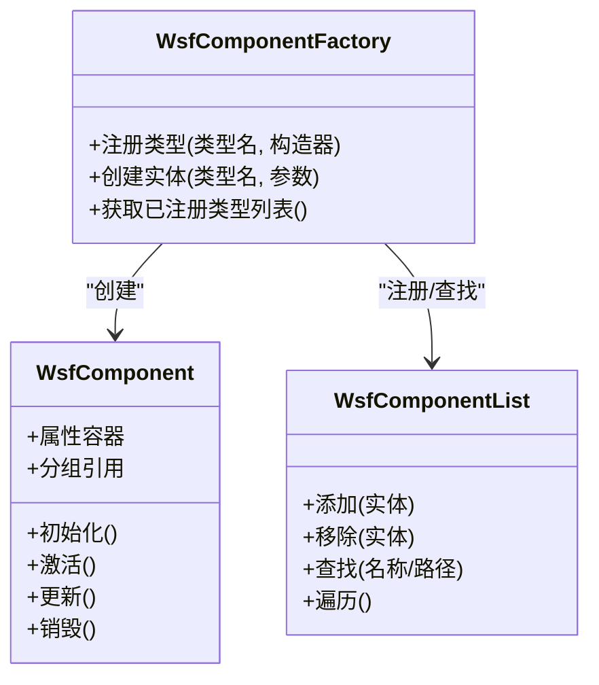
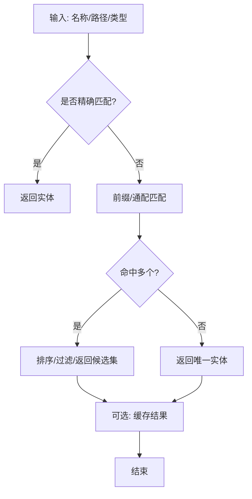
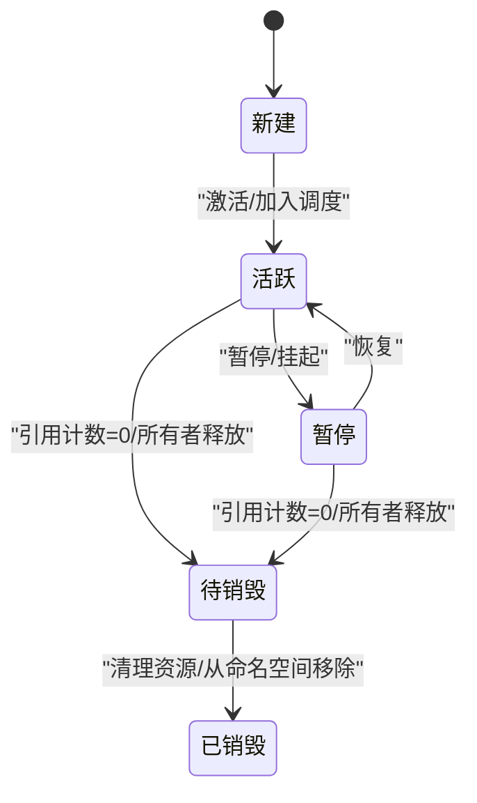
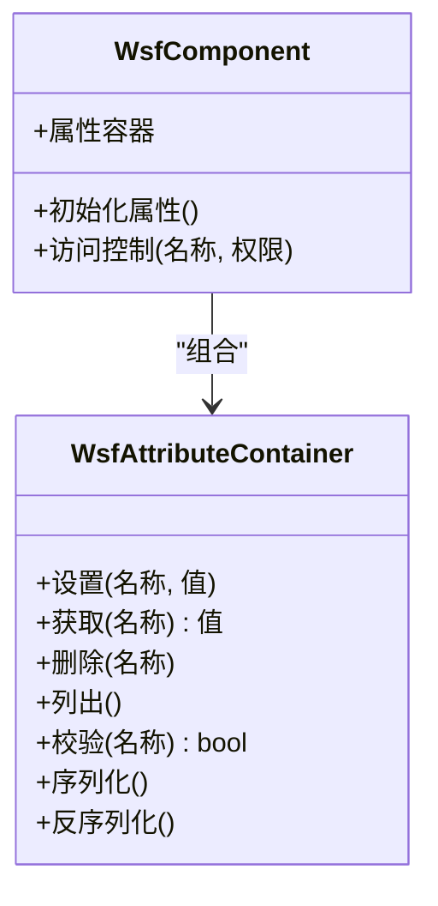
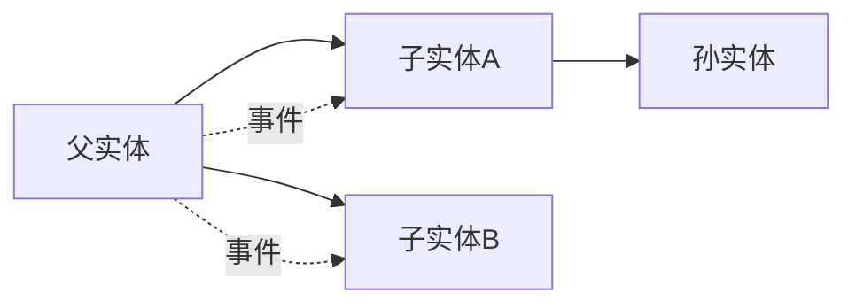
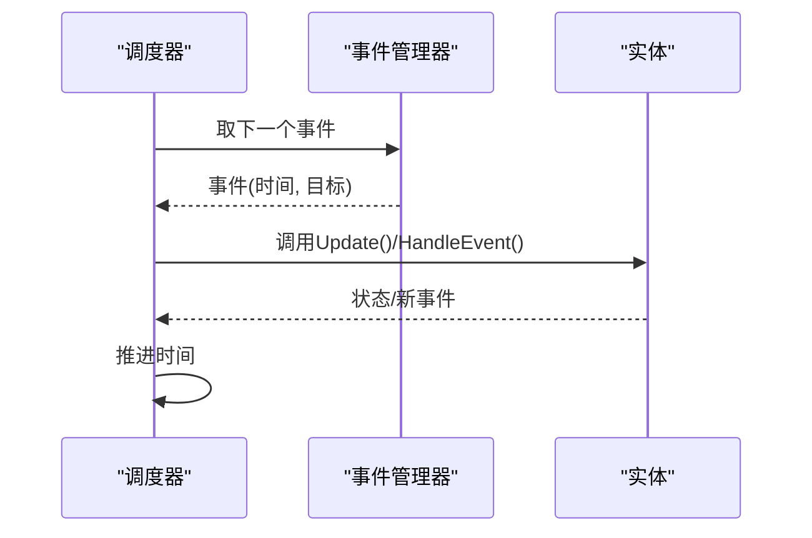
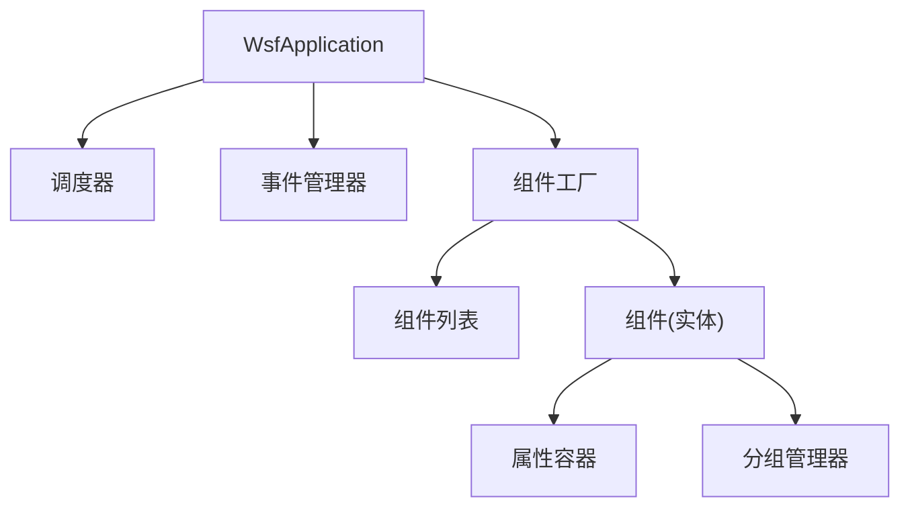

# 实体生命周期管理

<cite>
**本文引用的文件**   
- [WsfApplication.hpp](file://swdev/src/core/wsf/source/WsfApplication.hpp)
- [WsfApplication.cpp](file://swdev/src/core/wsf/source/WsfApplication.cpp)
- [WsfComponentFactory.hpp](file://swdev/src/core/wsf/source/WsfComponentFactory.hpp)
- [WsfComponentFactory.cpp](file://swdev/src/core/wsf/source/WsfComponentFactory.cpp)
- [WsfComponentList.hpp](file://swdev/src/core/wsf/source/WsfComponentList.hpp)
- [WsfComponentList.cpp](file://swdev/src/core/wsf/source/WsfComponentList.cpp)
- [WsfComponent.hpp](file://swdev/src/core/wsf/source/WsfComponent.hpp)
- [WsfComponent.cpp](file://swdev/src/core/wsf/source/WsfComponent.cpp)
- [WsfAttributeContainer.hpp](file://swdev/src/core/wsf/source/WsfAttributeContainer.hpp)
- [WsfAttributeContainer.cpp](file://swdev/src/core/wsf/source/WsfAttributeContainer.cpp)
- [WsfGroupManager.hpp](file://swdev/src/core/wsf/source/WsfGroupManager.hpp)
- [WsfGroupManager.cpp](file://swdev/src/core/wsf/source/WsfGroupManager.cpp)
- [WsfGroup.hpp](file://swdev/src/core/wsf/source/WsfGroup.hpp)
- [WsfGroup.cpp](file://swdev/src/core/wsf/source/WsfGroup.cpp)
- [WsfEventStepSimulation.hpp](file://swdev/src/core/wsf/source/WsfEventStepSimulation.hpp)
- [WsfFrameStepSimulation.hpp](file://swdev/src/core/wsf/source/WsfFrameStepSimulation.hpp)
- [WsfEventManager.hpp](file://swdev/src/core/wsf/source/WsfEventManager.hpp)
- [WsfEventManager.cpp](file://swdev/src/core/wsf/source/WsfEventManager.cpp)
</cite>

## 目录
1. [简介](#简介)
2. [项目结构](#项目结构)
3. [核心组件](#核心组件)
4. [架构总览](#架构总览)
5. [详细组件分析](#详细组件分析)
6. [依赖关系分析](#依赖关系分析)
7. [性能考虑](#性能考虑)
8. [故障排查指南](#故障排查指南)
9. [结论](#结论)
10. [附录](#附录)

## 简介
本文件面向AFSIM的“实体生命周期管理”，围绕实体的创建、激活、更新与销毁，系统性地阐述内存管理与资源清理机制；深入说明实体注册机制（命名空间、查找算法、引用计数）；文档化实体属性系统（属性定义、类型系统与访问控制）；解释实体间依赖关系（父子关系、所有权与生命周期绑定）。同时提供架构图、开发指南与性能优化建议，帮助开发者在WSF框架内正确构建与维护实体。

## 项目结构
AFSIM的核心仿真框架位于 swdev/src/core/wsf，其中与实体生命周期直接相关的代码集中在 source 目录下：
- 应用与调度：WsfApplication、WsfEventStepSimulation、WsfFrameStepSimulation、WsfEventManager
- 组件基类与工厂：WsfComponent、WsfComponentFactory、WsfComponentList
- 属性容器：WsfAttributeContainer
- 分组与组织：WsfGroup、WsfGroupManager

图表来源
- [WsfApplication.hpp:1-200](file://swdev/src/core/wsf/source/WsfApplication.hpp#L1-L200)
- [WsfComponentFactory.hpp:1-200](file://swdev/src/core/wsf/source/WsfComponentFactory.hpp#L1-L200)
- [WsfComponentList.hpp:1-200](file://swdev/src/core/wsf/source/WsfComponentList.hpp#L1-L200)
- [WsfComponent.hpp:1-200](file://swdev/src/core/wsf/source/WsfComponent.hpp#L1-L200)
- [WsfAttributeContainer.hpp:1-200](file://swdev/src/core/wsf/source/WsfAttributeContainer.hpp#L1-L200)
- [WsfEventStepSimulation.hpp:1-200](file://swdev/src/core/wsf/source/WsfEventStepSimulation.hpp#L1-L200)
- [WsfFrameStepSimulation.hpp:1-200](file://swdev/src/core/wsf/source/WsfFrameStepSimulation.hpp#L1-L200)
- [WsfEventManager.hpp:1-200](file://swdev/src/core/wsf/source/WsfEventManager.hpp#L1-L200)
- [WsfGroupManager.hpp:1-200](file://swdev/src/core/wsf/source/WsfGroupManager.hpp#L1-L200)
- [WsfGroup.hpp:1-200](file://swdev/src/core/wsf/source/WsfGroup.hpp#L1-L200)

章节来源
- [WsfApplication.hpp:1-200](file://swdev/src/core/wsf/source/WsfApplication.hpp#L1-L200)
- [WsfComponentFactory.hpp:1-200](file://swdev/src/core/wsf/source/WsfComponentFactory.hpp#L1-L200)
- [WsfComponentList.hpp:1-200](file://swdev/src/core/wsf/source/WsfComponentList.hpp#L1-L200)
- [WsfComponent.hpp:1-200](file://swdev/src/core/wsf/source/WsfComponent.hpp#L1-L200)
- [WsfAttributeContainer.hpp:1-200](file://swdev/src/core/wsf/source/WsfAttributeContainer.hpp#L1-L200)
- [WsfEventStepSimulation.hpp:1-200](file://swdev/src/core/wsf/source/WsfEventStepSimulation.hpp#L1-L200)
- [WsfFrameStepSimulation.hpp:1-200](file://swdev/src/core/wsf/source/WsfFrameStepSimulation.hpp#L1-L200)
- [WsfEventManager.hpp:1-200](file://swdev/src/core/wsf/source/WsfEventManager.hpp#L1-L200)
- [WsfGroupManager.hpp:1-200](file://swdev/src/core/wsf/source/WsfGroupManager.hpp#L1-L200)
- [WsfGroup.hpp:1-200](file://swdev/src/core/wsf/source/WsfGroup.hpp#L1-L200)

## 核心组件
- 应用与调度
  - WsfApplication：仿真应用的全局上下文，负责初始化、运行循环与资源协调。
  - WsfEventStepSimulation / WsfFrameStepSimulation：基于事件或帧的调度策略，驱动实体更新。
  - WsfEventManager：事件队列与分发，协调各组件的事件回调。
- 组件与工厂
  - WsfComponent：所有可被调度与管理的实体基类，包含生命周期钩子、属性容器、分组归属等。
  - WsfComponentFactory：组件类型注册与实例化，维护类型到构造器的映射。
  - WsfComponentList：组件集合与命名空间管理，支持按名称/路径查找与遍历。
- 属性系统
  - WsfAttributeContainer：统一的属性存储与访问接口，支持类型安全读写与访问控制。
- 分组与组织
  - WsfGroup / WsfGroupManager：实体分组与层级组织，支持父子关系与批量操作。

章节来源
- [WsfApplication.hpp:1-200](file://swdev/src/core/wsf/source/WsfApplication.hpp#L1-L200)
- [WsfEventStepSimulation.hpp:1-200](file://swdev/src/core/wsf/source/WsfEventStepSimulation.hpp#L1-L200)
- [WsfFrameStepSimulation.hpp:1-200](file://swdev/src/core/wsf/source/WsfFrameStepSimulation.hpp#L1-L200)
- [WsfEventManager.hpp:1-200](file://swdev/src/core/wsf/source/WsfEventManager.hpp#L1-L200)
- [WsfComponent.hpp:1-200](file://swdev/src/core/wsf/source/WsfComponent.hpp#L1-L200)
- [WsfComponentFactory.hpp:1-200](file://swdev/src/core/wsf/source/WsfComponentFactory.hpp#L1-L200)
- [WsfComponentList.hpp:1-200](file://swdev/src/core/wsf/source/WsfComponentList.hpp#L1-L200)
- [WsfAttributeContainer.hpp:1-200](file://swdev/src/core/wsf/source/WsfAttributeContainer.hpp#L1-L200)
- [WsfGroupManager.hpp:1-200](file://swdev/src/core/wsf/source/WsfGroupManager.hpp#L1-L200)
- [WsfGroup.hpp:1-200](file://swdev/src/core/wsf/source/WsfGroup.hpp#L1-L200)

## 架构总览
下图展示实体从创建到销毁的关键协作关系：应用启动后通过工厂注册并创建实体，实体加入命名空间与分组，调度器驱动其更新，事件管理器协调回调，最终在合适时机释放资源。

图表来源
- [WsfApplication.cpp:1-300](file://swdev/src/core/wsf/source/WsfApplication.cpp#L1-L300)
- [WsfComponentFactory.cpp:1-300](file://swdev/src/core/wsf/source/WsfComponentFactory.cpp#L1-L300)
- [WsfComponentList.cpp:1-300](file://swdev/src/core/wsf/source/WsfComponentList.cpp#L1-L300)
- [WsfComponent.cpp:1-300](file://swdev/src/core/wsf/source/WsfComponent.cpp#L1-L300)
- [WsfAttributeContainer.cpp:1-300](file://swdev/src/core/wsf/source/WsfAttributeContainer.cpp#L1-L300)
- [WsfEventStepSimulation.hpp:1-200](file://swdev/src/core/wsf/source/WsfEventStepSimulation.hpp#L1-L200)
- [WsfFrameStepSimulation.hpp:1-200](file://swdev/src/core/wsf/source/WsfFrameStepSimulation.hpp#L1-L200)
- [WsfEventManager.cpp:1-300](file://swdev/src/core/wsf/source/WsfEventManager.cpp#L1-L300)
- [WsfGroupManager.cpp:1-300](file://swdev/src/core/wsf/source/WsfGroupManager.cpp#L1-L300)

## 详细组件分析

### 实体基类与生命周期钩子
- 职责
  - 提供统一的生命周期钩子：构造、初始化、激活、更新、暂停、恢复、销毁。
  - 持有属性容器与分组引用，支持状态与行为扩展。
- 关键流程
  - 构造阶段：分配内存、初始化成员、注册到命名空间。
  - 初始化阶段：加载属性、建立父子关系、订阅事件。
  - 激活阶段：进入调度循环，响应时间推进。
  - 更新阶段：执行业务逻辑，产生事件或状态变更。
  - 销毁阶段：解绑事件、释放资源、从命名空间与分组移除。

图表来源
- [WsfComponent.cpp:1-300](file://swdev/src/core/wsf/source/WsfComponent.cpp#L1-L300)
- [WsfComponent.hpp:1-200](file://swdev/src/core/wsf/source/WsfComponent.hpp#L1-L200)

章节来源
- [WsfComponent.hpp:1-200](file://swdev/src/core/wsf/source/WsfComponent.hpp#L1-L200)
- [WsfComponent.cpp:1-300](file://swdev/src/core/wsf/source/WsfComponent.cpp#L1-L300)

### 实体工厂与注册表
- 职责
  - 维护组件类型到构造器的映射，支持运行时动态创建实体。
  - 与命名空间协作，确保实体唯一性与可查找性。
- 关键点
  - 类型注册：在应用启动时完成类型注册。
  - 实例化：根据类型名与参数创建实体，返回可管理指针。
  - 生命周期：工厂不负责实体销毁，由所有者或调度器管理。

图表来源
- [WsfComponentFactory.hpp:1-200](file://swdev/src/core/wsf/source/WsfComponentFactory.hpp#L1-L200)
- [WsfComponentFactory.cpp:1-300](file://swdev/src/core/wsf/source/WsfComponentFactory.cpp#L1-L300)
- [WsfComponentList.hpp:1-200](file://swdev/src/core/wsf/source/WsfComponentList.hpp#L1-L200)
- [WsfComponentList.cpp:1-300](file://swdev/src/core/wsf/source/WsfComponentList.cpp#L1-L300)
- [WsfComponent.hpp:1-200](file://swdev/src/core/wsf/source/WsfComponent.hpp#L1-L200)

章节来源
- [WsfComponentFactory.hpp:1-200](file://swdev/src/core/wsf/source/WsfComponentFactory.hpp#L1-L200)
- [WsfComponentFactory.cpp:1-300](file://swdev/src/core/wsf/source/WsfComponentFactory.cpp#L1-L300)
- [WsfComponentList.hpp:1-200](file://swdev/src/core/wsf/source/WsfComponentList.hpp#L1-L200)
- [WsfComponentList.cpp:1-300](file://swdev/src/core/wsf/source/WsfComponentList.cpp#L1-L300)

### 命名空间与查找算法
- 命名空间
  - 以层次化路径组织实体，支持“父/子”与“兄弟”关系。
  - 提供按名称、路径与类型的查找接口。
- 查找算法
  - 精确匹配：按完整路径定位实体。
  - 模糊匹配：按前缀或通配符进行快速筛选。
  - 缓存优化：对热点查询结果进行短期缓存，减少重复计算。

图表来源
- [WsfComponentList.cpp:1-300](file://swdev/src/core/wsf/source/WsfComponentList.cpp#L1-L300)
- [WsfComponentList.hpp:1-200](file://swdev/src/core/wsf/source/WsfComponentList.hpp#L1-L200)

章节来源
- [WsfComponentList.hpp:1-200](file://swdev/src/core/wsf/source/WsfComponentList.hpp#L1-L200)
- [WsfComponentList.cpp:1-300](file://swdev/src/core/wsf/source/WsfComponentList.cpp#L1-L300)

### 引用计数与所有权模型
- 引用计数
  - 用于共享实体或跨模块访问时的安全释放。
  - 当计数归零时触发销毁流程，确保无悬挂指针。
- 所有权
  - 明确实体所有者（如父实体、分组、应用），避免多重释放。
  - 转移所有权时需同步更新引用计数与注册表。

图表来源
- [WsfComponent.cpp:1-300](file://swdev/src/core/wsf/source/WsfComponent.cpp#L1-L300)
- [WsfComponent.hpp:1-200](file://swdev/src/core/wsf/source/WsfComponent.hpp#L1-L200)

章节来源
- [WsfComponent.hpp:1-200](file://swdev/src/core/wsf/source/WsfComponent.hpp#L1-L200)
- [WsfComponent.cpp:1-300](file://swdev/src/core/wsf/source/WsfComponent.cpp#L1-L300)

### 属性系统：定义、类型与访问控制
- 属性定义
  - 通过属性容器集中管理，支持标量、向量、枚举、字符串等类型。
  - 支持默认值、范围校验与序列化/反序列化。
- 类型系统
  - 类型元数据与运行时检查，保证类型安全。
  - 可扩展自定义类型，需实现转换与比较接口。
- 访问控制
  - 读/写权限分离，支持只读属性与受控写入。
  - 审计日志与变更通知，便于调试与追踪。

图表来源
- [WsfAttributeContainer.hpp:1-200](file://swdev/src/core/wsf/source/WsfAttributeContainer.hpp#L1-L200)
- [WsfAttributeContainer.cpp:1-300](file://swdev/src/core/wsf/source/WsfAttributeContainer.cpp#L1-L300)
- [WsfComponent.hpp:1-200](file://swdev/src/core/wsf/source/WsfComponent.hpp#L1-L200)

章节来源
- [WsfAttributeContainer.hpp:1-200](file://swdev/src/core/wsf/source/WsfAttributeContainer.hpp#L1-L200)
- [WsfAttributeContainer.cpp:1-300](file://swdev/src/core/wsf/source/WsfAttributeContainer.cpp#L1-L300)
- [WsfComponent.hpp:1-200](file://swdev/src/core/wsf/source/WsfComponent.hpp#L1-L200)

### 实体间的依赖关系：父子、所有权与生命周期绑定
- 父子关系
  - 父实体拥有子实体，子实体随父实体销毁而销毁。
  - 支持动态增删子实体，自动更新命名空间路径。
- 所有权
  - 明确所有权边界，避免循环引用导致无法释放。
  - 使用弱引用或观察者模式降低耦合。
- 生命周期绑定
  - 子实体继承父实体的激活/暂停状态。
  - 事件传播：父实体可转发或聚合子实体事件。

图表来源
- [WsfGroup.hpp:1-200](file://swdev/src/core/wsf/source/WsfGroup.hpp#L1-L200)
- [WsfGroup.cpp:1-300](file://swdev/src/core/wsf/source/WsfGroup.cpp#L1-L300)
- [WsfGroupManager.hpp:1-200](file://swdev/src/core/wsf/source/WsfGroupManager.hpp#L1-L200)
- [WsfGroupManager.cpp:1-300](file://swdev/src/core/wsf/source/WsfGroupManager.cpp#L1-L300)

章节来源
- [WsfGroup.hpp:1-200](file://swdev/src/core/wsf/source/WsfGroup.hpp#L1-L200)
- [WsfGroup.cpp:1-300](file://swdev/src/core/wsf/source/WsfGroup.cpp#L1-L300)
- [WsfGroupManager.hpp:1-200](file://swdev/src/core/wsf/source/WsfGroupManager.hpp#L1-L200)
- [WsfGroupManager.cpp:1-300](file://swdev/src/core/wsf/source/WsfGroupManager.cpp#L1-L300)

### 调度与更新：事件驱动与帧驱动
- 事件驱动
  - 基于事件队列，按时间戳顺序处理，适合离散事件仿真。
  - 支持优先级与延迟事件插入。
- 帧驱动
  - 固定时间步长推进，适合连续物理仿真。
  - 可与事件驱动混合，通过事件管理器协调。

图表来源
- [WsfEventStepSimulation.hpp:1-200](file://swdev/src/core/wsf/source/WsfEventStepSimulation.hpp#L1-L200)
- [WsfFrameStepSimulation.hpp:1-200](file://swdev/src/core/wsf/source/WsfFrameStepSimulation.hpp#L1-L200)
- [WsfEventManager.cpp:1-300](file://swdev/src/core/wsf/source/WsfEventManager.cpp#L1-L300)

章节来源
- [WsfEventStepSimulation.hpp:1-200](file://swdev/src/core/wsf/source/WsfEventStepSimulation.hpp#L1-L200)
- [WsfFrameStepSimulation.hpp:1-200](file://swdev/src/core/wsf/source/WsfFrameStepSimulation.hpp#L1-L200)
- [WsfEventManager.cpp:1-300](file://swdev/src/core/wsf/source/WsfEventManager.cpp#L1-L300)

## 依赖关系分析
- 组件耦合
  - WsfApplication 依赖调度器与事件管理器，但不直接依赖具体实体类型。
  - WsfComponentFactory 与 WsfComponentList 松耦合，通过接口交互。
  - WsfComponent 依赖属性容器与分组管理器，但保持低耦合。
- 外部依赖
  - 调度器可能依赖数学库、几何库等，但与实体生命周期解耦。
- 潜在循环依赖
  - 父子关系应避免双向强引用，建议使用弱引用或ID标识。

图表来源
- [WsfApplication.hpp:1-200](file://swdev/src/core/wsf/source/WsfApplication.hpp#L1-L200)
- [WsfComponentFactory.hpp:1-200](file://swdev/src/core/wsf/source/WsfComponentFactory.hpp#L1-L200)
- [WsfComponentList.hpp:1-200](file://swdev/src/core/wsf/source/WsfComponentList.hpp#L1-L200)
- [WsfComponent.hpp:1-200](file://swdev/src/core/wsf/source/WsfComponent.hpp#L1-L200)
- [WsfAttributeContainer.hpp:1-200](file://swdev/src/core/wsf/source/WsfAttributeContainer.hpp#L1-L200)
- [WsfGroupManager.hpp:1-200](file://swdev/src/core/wsf/source/WsfGroupManager.hpp#L1-L200)

章节来源
- [WsfApplication.hpp:1-200](file://swdev/src/core/wsf/source/WsfApplication.hpp#L1-L200)
- [WsfComponentFactory.hpp:1-200](file://swdev/src/core/wsf/source/WsfComponentFactory.hpp#L1-L200)
- [WsfComponentList.hpp:1-200](file://swdev/src/core/wsf/source/WsfComponentList.hpp#L1-L200)
- [WsfComponent.hpp:1-200](file://swdev/src/core/wsf/source/WsfComponent.hpp#L1-L200)
- [WsfAttributeContainer.hpp:1-200](file://swdev/src/core/wsf/source/WsfAttributeContainer.hpp#L1-L200)
- [WsfGroupManager.hpp:1-200](file://swdev/src/core/wsf/source/WsfGroupManager.hpp#L1-L200)

## 性能考虑
- 实体创建与销毁
  - 批量创建实体以减少锁竞争与重分配开销。
  - 复用对象池，避免频繁分配/释放导致的碎片化。
- 命名空间查找
  - 对热点实体使用索引或缓存，降低查找复杂度。
  - 避免深层嵌套路径，提升查找效率。
- 属性访问
  - 批量读写属性，减少函数调用与类型检查开销。
  - 使用只读视图提高并发安全性。
- 调度与事件
  - 合并小粒度事件，减少队列抖动。
  - 合理设置时间步长，平衡精度与性能。

[本节为通用指导，不直接分析具体文件]

## 故障排查指南
- 常见问题
  - 实体未找到：检查命名空间路径是否正确，确认实体已注册且未被销毁。
  - 内存泄漏：检查引用计数是否正确递减，确保所有者在适当时机释放。
  - 属性访问异常：确认属性类型与权限设置，检查是否存在越界或非法值。
  - 父子关系错误：避免循环引用，确保子实体在父实体销毁前被移除。
- 诊断方法
  - 启用事件日志，跟踪实体生命周期钩子调用。
  - 使用分组管理器统计实体数量与层级结构。
  - 对属性容器进行快照对比，定位变更来源。

章节来源
- [WsfEventManager.cpp:1-300](file://swdev/src/core/wsf/source/WsfEventManager.cpp#L1-L300)
- [WsfComponentList.cpp:1-300](file://swdev/src/core/wsf/source/WsfComponentList.cpp#L1-L300)
- [WsfAttributeContainer.cpp:1-300](file://swdev/src/core/wsf/source/WsfAttributeContainer.cpp#L1-L300)
- [WsfGroupManager.cpp:1-300](file://swdev/src/core/wsf/source/WsfGroupManager.cpp#L1-L300)

## 结论
AFSIM的实体生命周期管理以WsfComponent为核心，结合工厂、命名空间、属性容器与分组管理器，形成清晰、可扩展的体系。通过事件与帧驱动的调度机制，实体能够在仿真过程中高效更新与交互。遵循本文的开发指南与性能建议，可有效避免常见陷阱，提升系统的稳定性与性能。

[本节为总结性内容，不直接分析具体文件]

## 附录
- 开发指南
  - 定义实体：继承WsfComponent，实现必要钩子。
  - 注册类型：在应用启动时调用工厂注册。
  - 创建实体：通过工厂创建并加入命名空间。
  - 属性管理：使用属性容器定义与访问属性。
  - 分组管理：将实体加入分组，建立父子关系。
  - 调度集成：确保实体参与事件或帧驱动更新。
- 最佳实践
  - 明确所有权与生命周期，避免悬空引用。
  - 合理使用引用计数与弱引用，防止循环依赖。
  - 批量操作与缓存优化，提升性能。
  - 完善日志与监控，便于问题定位。

[本节为补充信息，不直接分析具体文件]