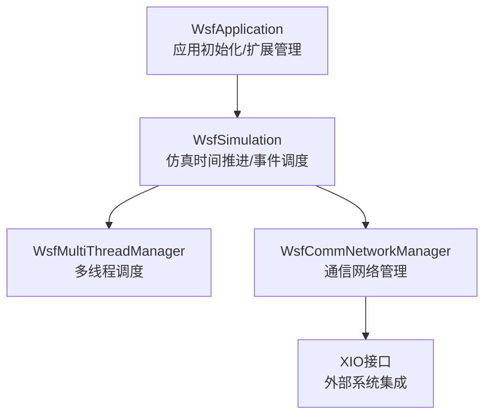
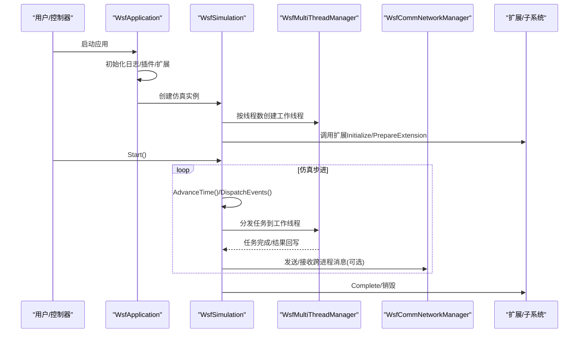
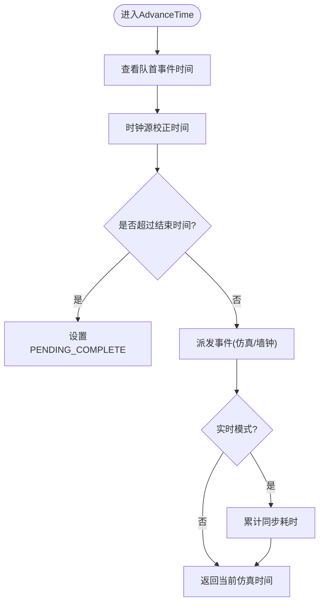
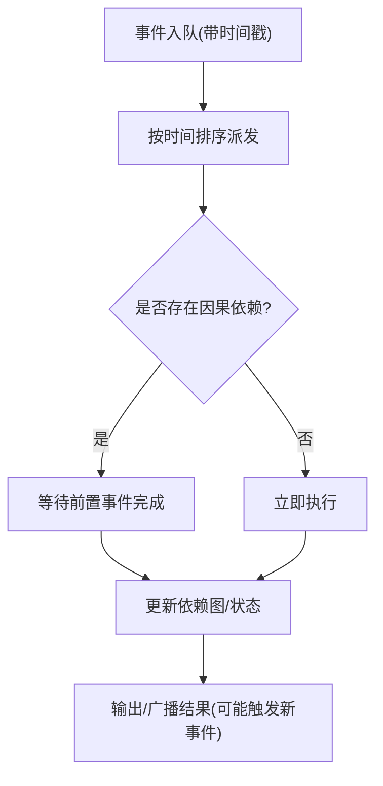
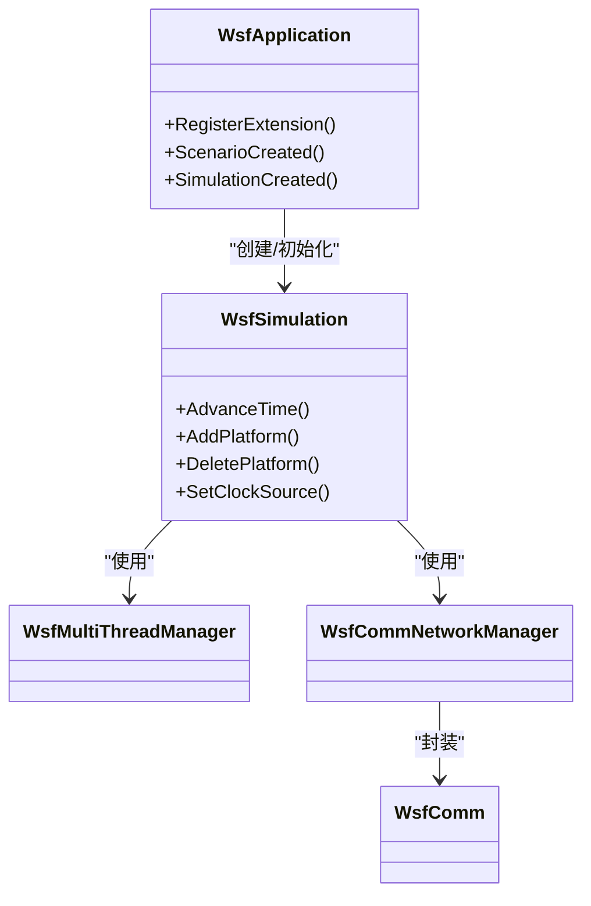

# 并行仿真架构

<cite>
**本文引用的文件**   
- [WsfApplication.cpp](file://swdev/src/core/wsf/source/WsfApplication.cpp)
- [WsfSimulation.cpp](file://swdev/src/core/wsf/source/WsfSimulation.cpp)
- [WsfMultiThreadManager.hpp](file://swdev/src/core/wsf/source/WsfMultiThreadManager.hpp)
- [WsfComm.hpp](file://swdev/src/core/wsf/source/WsfComm.hpp)
- [WsfCommNetworkManager.hpp](file://swdev/src/core/wsf/source/WsfCommNetworkManager.hpp)
- [XIO接口开发文档.rst](file://documentation/html/_sources/docs/xio_interface_development.rst.txt)
</cite>

## 目录
1. [简介](#简介)
2. [项目结构](#项目结构)
3. [核心组件](#核心组件)
4. [架构总览](#架构总览)
5. [详细组件分析](#详细组件分析)
6. [依赖关系分析](#依赖关系分析)
7. [性能考量](#性能考量)
8. [故障排查指南](#故障排查指南)
9. [结论](#结论)
10. [附录](#附录)

## 简介
本文件面向AFSIM的并行仿真能力，系统性阐述多线程与分布式（跨进程）仿真架构、线程安全机制、数据共享与同步策略、因果与时序一致性保证、实体分配与负载均衡，以及主从式多进程通信与控制流。文档同时提供可操作的配置要点与性能优化建议，帮助读者在工程实践中正确启用并调优并行仿真。

## 项目结构
AFSIM的核心仿真框架位于 swdev/src/core/wsf 下，其中：
- WsfApplication 负责应用级初始化、插件加载与扩展生命周期管理；
- WsfSimulation 负责仿真时间推进、事件调度、平台生命周期与扩展协调；
- WsfMultiThreadManager 提供多线程调度与管理；
- WsfComm / WsfCommNetworkManager 提供通信抽象与网络管理器；
- XIO 接口文档说明外部系统互联与分布式集成方式。



图表来源
- [WsfApplication.cpp:47-121](file://swdev/src/core/wsf/source/WsfApplication.cpp#L47-L121)
- [WsfSimulation.cpp:94-132](file://swdev/src/core/wsf/source/WsfSimulation.cpp#L94-L132)
- [WsfMultiThreadManager.hpp](file://swdev/src/core/wsf/source/WsfMultiThreadManager.hpp)
- [WsfComm.hpp](file://swdev/src/core/wsf/source/WsfComm.hpp)
- [WsfCommNetworkManager.hpp](file://swdev/src/core/wsf/source/WsfCommNetworkManager.hpp)
- [XIO接口开发文档.rst:19-30](file://documentation/html/_sources/docs/xio_interface_development.rst.txt#L19-L30)

章节来源
- [WsfApplication.cpp:47-121](file://swdev/src/core/wsf/source/WsfApplication.cpp#L47-L121)
- [WsfSimulation.cpp:94-132](file://swdev/src/core/wsf/source/WsfSimulation.cpp#L94-L132)

## 核心组件
- 应用层（WsfApplication）
  - 单例应用实例、插件加载、扩展注册与依赖排序、脚本类型注册、测试环境初始化等。
- 仿真内核（WsfSimulation）
  - 仿真状态机、时钟源、事件队列（仿真时间与墙钟时间）、平台增删、观察者回调、扩展生命周期钩子。
- 多线程管理（WsfMultiThreadManager）
  - 根据仿真输入参数创建与管理工作线程，支持断点更新与调试开关。
- 通信与网络（WsfComm / WsfCommNetworkManager）
  - 为分布式仿真提供进程间通信抽象与网络拓扑管理。
- XIO接口
  - 用于WSF应用开发者接入外部系统，支持自动连接与应用类型选择。

章节来源
- [WsfApplication.cpp:47-121](file://swdev/src/core/wsf/source/WsfApplication.cpp#L47-L121)
- [WsfSimulation.cpp:94-132](file://swdev/src/core/wsf/source/WsfSimulation.cpp#L94-L132)
- [WsfMultiThreadManager.hpp](file://swdev/src/core/wsf/source/WsfMultiThreadManager.hpp)
- [WsfComm.hpp](file://swdev/src/core/wsf/source/WsfComm.hpp)
- [WsfCommNetworkManager.hpp](file://swdev/src/core/wsf/source/WsfCommNetworkManager.hpp)
- [XIO接口开发文档.rst:19-30](file://documentation/html/_sources/docs/xio_interface_development.rst.txt#L19-L30)

## 架构总览
AFSIM采用“主从式”的多进程/多线程混合架构：
- 主进程（Sage/Simulation）作为控制面，负责场景加载、仿真推进、事件调度与全局状态维护；
- 工作进程或工作线程作为计算面，执行平台、传感器、处理器等实体的计算任务；
- 通过WsfCommNetworkManager与XIO进行进程间消息交换，实现数据分片与负载均衡。



图表来源
- [WsfApplication.cpp:47-121](file://swdev/src/core/wsf/source/WsfApplication.cpp#L47-L121)
- [WsfSimulation.cpp:186-228](file://swdev/src/core/wsf/source/WsfSimulation.cpp#L186-L228)
- [WsfMultiThreadManager.hpp](file://swdev/src/core/wsf/source/WsfMultiThreadManager.hpp)
- [WsfCommNetworkManager.hpp](file://swdev/src/core/wsf/source/WsfCommNetworkManager.hpp)

## 详细组件分析

### 多线程仿真模型与线程安全
- 线程创建与配置
  - WsfSimulation在构造时依据仿真输入参数（线程数、断点更新时间、调试开关）初始化WsfMultiThreadManager，从而建立多线程运行环境。
- 事件驱动与时间推进
  - WsfSimulation::AdvanceTime/AdvanceTime(double) 推进仿真时间，统一派发事件；在实时模式下结合墙钟时间进行同步。
- 线程安全要点
  - 应用级扩展初始化使用递归互斥锁保护扩展排序与回调顺序，确保多线程环境下扩展生命周期一致。
  - 平台增删通过事件化流程（AddPlatform/DeletePlatform）避免在活跃事件中直接修改容器，降低并发风险。
  - 观察者回调与扩展钩子在关键路径上被有序调用，便于在多线程环境中保持一致性。



图表来源
- [WsfSimulation.cpp:186-228](file://swdev/src/core/wsf/source/WsfSimulation.cpp#L186-L228)

章节来源
- [WsfSimulation.cpp:94-132](file://swdev/src/core/wsf/source/WsfSimulation.cpp#L94-L132)
- [WsfSimulation.cpp:186-228](file://swdev/src/core/wsf/source/WsfSimulation.cpp#L186-L228)
- [WsfApplication.cpp:286-319](file://swdev/src/core/wsf/source/WsfApplication.cpp#L286-L319)

### 分布式仿真与进程间通信
- 通信抽象与网络管理
  - WsfComm 提供统一的通信接口；WsfCommNetworkManager 管理网络拓扑、节点与通道。
- XIO接口
  - 通过WsfXIO::Create初始化，支持cAPP_SIMULATION与cAPP_USER两种应用类型；默认不主动连接其他应用，可通过AddConnectType添加自动连接类型。
- 数据分片与负载均衡
  - 典型做法是将平台/传感器/处理器等实体按地理区域、阵营或功能域划分到不同进程或线程，由网络管理器路由消息，减少热点竞争。

```mermaid
graph LR
NodeA["进程A<br/>平台/传感器/处理器"] < --> Net["WsfCommNetworkManager<br/>网络拓扑/路由"]
NodeB["进程B<br/>平台/传感器/处理器"] < --> Net
Net < --> XIO["XIO接口<br/>外部系统集成"]
```

图表来源
- [WsfComm.hpp](file://swdev/src/core/wsf/source/WsfComm.hpp)
- [WsfCommNetworkManager.hpp](file://swdev/src/core/wsf/source/WsfCommNetworkManager.hpp)
- [XIO接口开发文档.rst:19-30](file://documentation/html/_sources/docs/xio_interface_development.rst.txt#L19-L30)

章节来源
- [WsfComm.hpp](file://swdev/src/core/wsf/source/WsfComm.hpp)
- [WsfCommNetworkManager.hpp](file://swdev/src/core/wsf/source/WsfCommNetworkManager.hpp)
- [XIO接口开发文档.rst:19-30](file://documentation/html/_sources/docs/xio_interface_development.rst.txt#L19-L30)

### 一致性保证：因果、时序与冲突检测
- 因果一致性
  - 通过事件时间戳与严格的事件派发顺序保证因果关系不被破坏；新增/删除平台等操作以事件形式入队，避免在活跃事件内直接变更状态。
- 时序一致性
  - 仿真时间推进由单一时钟源控制，所有事件按时间单调递增派发；实时模式下通过墙钟同步保持与真实时间的对齐。
- 冲突检测
  - 平台重复添加、同名冲突等在AddPlatform中进行检查与日志记录，防止状态不一致。



图表来源
- [WsfSimulation.cpp:452-502](file://swdev/src/core/wsf/source/WsfSimulation.cpp#L452-L502)
- [WsfSimulation.cpp:295-379](file://swdev/src/core/wsf/source/WsfSimulation.cpp#L295-L379)

章节来源
- [WsfSimulation.cpp:452-502](file://swdev/src/core/wsf/source/WsfSimulation.cpp#L452-L502)
- [WsfSimulation.cpp:295-379](file://swdev/src/core/wsf/source/WsfSimulation.cpp#L295-L379)

### 实体分配策略与资源利用优化
- 线程内部分片
  - 将平台集合按ID范围、阵营或空间区域切分，分配到不同工作线程，减少锁竞争。
- 进程内分片
  - 对高负载子系统（如传感器探测、轨迹更新）独立线程池处理，避免阻塞主调度循环。
- 动态再平衡
  - 基于运行时统计（CPU占用、事件延迟）调整分片粒度，必要时迁移实体至空闲线程/进程。

[本节为概念性内容，未直接分析具体文件]

## 依赖关系分析
- WsfApplication 依赖插件管理器、扩展列表、脚本类型与系统日志；
- WsfSimulation 依赖事件管理器、时钟源、通信网络管理器、多线程管理器、平台/传感器/处理器等子系统；
- 多线程管理器与仿真内核紧密耦合，共同决定调度粒度与同步点；
- 通信模块与XIO接口为分布式扩展提供基础能力。



图表来源
- [WsfApplication.cpp:47-121](file://swdev/src/core/wsf/source/WsfApplication.cpp#L47-L121)
- [WsfSimulation.cpp:94-132](file://swdev/src/core/wsf/source/WsfSimulation.cpp#L94-L132)
- [WsfMultiThreadManager.hpp](file://swdev/src/core/wsf/source/WsfMultiThreadManager.hpp)
- [WsfComm.hpp](file://swdev/src/core/wsf/source/WsfComm.hpp)
- [WsfCommNetworkManager.hpp](file://swdev/src/core/wsf/source/WsfCommNetworkManager.hpp)

章节来源
- [WsfApplication.cpp:47-121](file://swdev/src/core/wsf/source/WsfApplication.cpp#L47-L121)
- [WsfSimulation.cpp:94-132](file://swdev/src/core/wsf/source/WsfSimulation.cpp#L94-L132)

## 性能考量
- 线程数与断点更新
  - 合理设置线程数与BreakUpdateTime，避免过细粒度的同步导致开销上升。
- 事件批处理
  - 尽量批量处理平台/传感器更新，减少事件数量与上下文切换。
- I/O与通信
  - 将高频I/O与通信操作异步化，避免阻塞仿真主循环。
- 缓存与局部性
  - 对热点数据结构（如地图、地形查询）做缓存，提升访问局部性。
- 实时同步
  - 在实时模式下谨慎调节时钟速率与同步阈值，避免频繁抖动。

[本节为通用指导，未直接分析具体文件]

## 故障排查指南
- 应用初始化失败
  - 检查插件路径与环境变量WSF_PLUGIN_PATH是否正确；确认扩展依赖已满足。
- 仿真无法启动或卡死
  - 检查是否有未完成的扩展初始化；观察是否有大量事件堆积或死锁。
- 平台添加/删除异常
  - 核对平台名称唯一性与指针有效性；关注日志中的重复添加或空指针错误。
- 分布式通信问题
  - 校验XIO初始化与应用类型；确认网络连接与端口配置；检查消息路由表。

章节来源
- [WsfApplication.cpp:47-121](file://swdev/src/core/wsf/source/WsfApplication.cpp#L47-L121)
- [WsfSimulation.cpp:295-379](file://swdev/src/core/wsf/source/WsfSimulation.cpp#L295-L379)
- [XIO接口开发文档.rst:19-30](file://documentation/html/_sources/docs/xio_interface_development.rst.txt#L19-L30)

## 结论
AFSIM的并行仿真以事件驱动为核心，通过WsfApplication与WsfSimulation构建稳定的应用与仿真内核，借助WsfMultiThreadManager实现多线程调度，并通过WsfCommNetworkManager与XIO支撑分布式扩展。通过严格的因果与时序一致性保障、合理的实体分配与负载均衡策略，以及完善的线程安全机制，AFSIM能够在大规模复杂场景中提供高效、可靠的并行仿真能力。

[本节为总结性内容，未直接分析具体文件]

## 附录
- 并行仿真配置要点
  - 启用多线程：在仿真输入中设置线程数与断点更新时间；
  - 分布式通信：通过XIO初始化并配置连接类型；
  - 扩展与插件：确保扩展依赖顺序与插件路径正确。
- 性能优化清单
  - 调整线程数与断点粒度；
  - 批量化事件处理；
  - 异步I/O与通信；
  - 热点数据缓存与局部性优化；
  - 实时模式下的时钟同步调优。

[本节为补充信息，未直接分析具体文件]