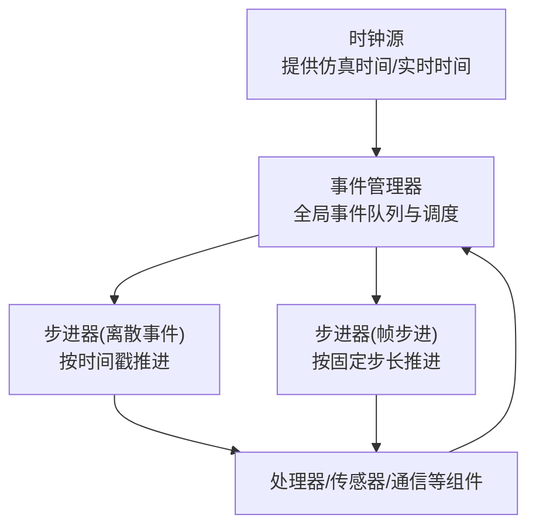
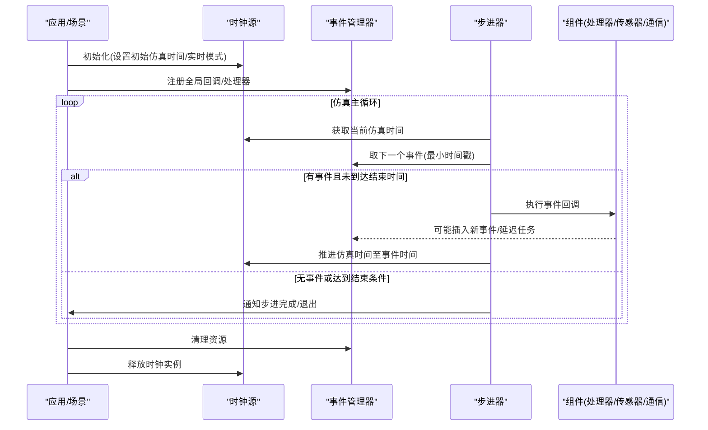
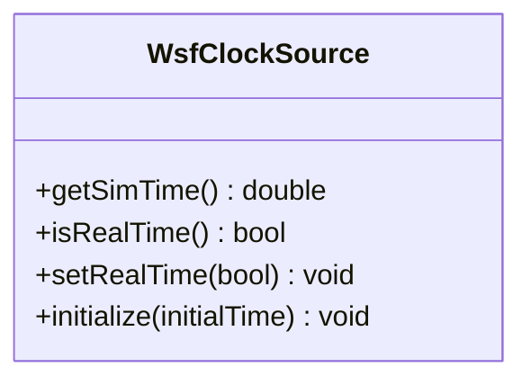
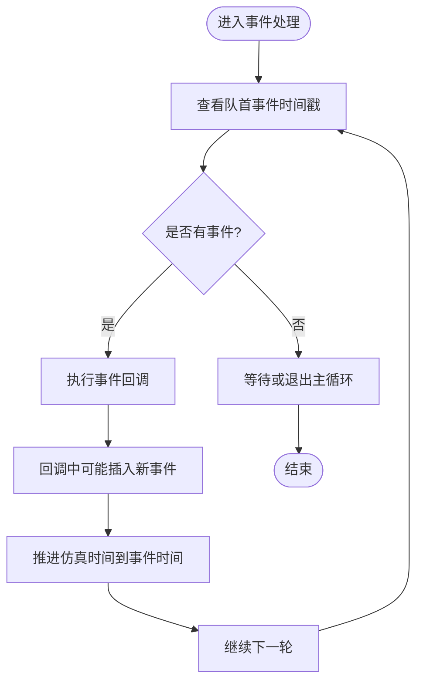
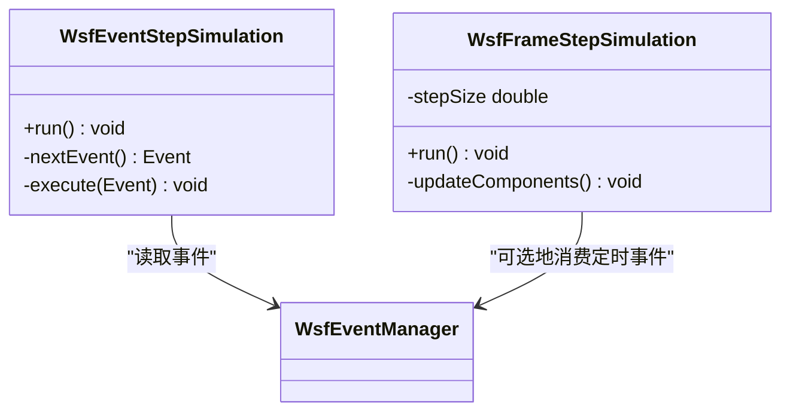
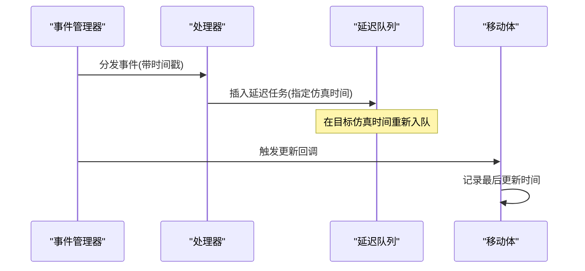
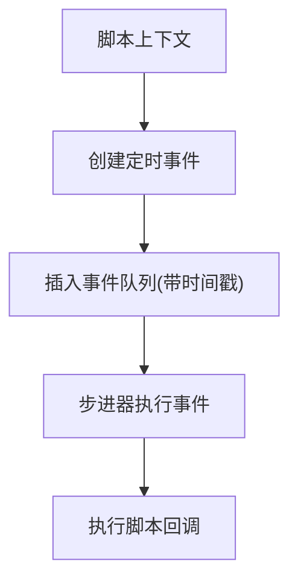
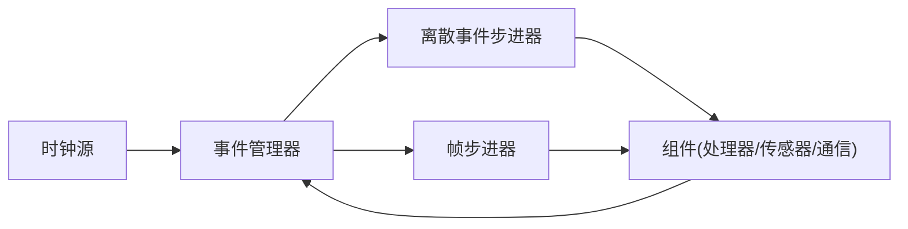

# 时间管理系统

<cite>
**本文引用的文件**   
- [WsfClockSource.hpp](file://swdev/src/core/wsf/source/WsfClockSource.hpp)
- [WsfClockSource.cpp](file://swdev/src/core/wsf/source/WsfClockSource.cpp)
- [test_wsfclocksource.cpp](file://swdev/src/core/wsf/test/test_wsfclocksource.cpp)
- [WsfEventManager.hpp](file://swdev/src/core/wsf/source/WsfEventManager.hpp)
- [WsfEventManager.cpp](file://swdev/src/core/wsf/source/WsfEventManager.cpp)
- [WsfEventStepSimulation.hpp](file://swdev/src/core/wsf/source/WsfEventStepSimulation.hpp)
- [WsfEventStepSimulation.cpp](file://swdev/src/core/wsf/source/WsfEventStepSimulation.cpp)
- [WsfFrameStepSimulation.hpp](file://swdev/src/core/wsf/source/WsfFrameStepSimulation.hpp)
- [WsfFrameStepSimulation.cpp](file://swdev/src/core/wsf/source/WsfFrameStepSimulation.cpp)
- [WsfTaskManager.cpp](file://swdev/src/core/wsf/source/processor/WsfTaskManager.cpp)
- [WsfScriptContext.cpp](file://swdev/src/core/wsf/source/script/WsfScriptContext.cpp)
- [WsfMover.cpp](file://swdev/src/core/wsf/source/mover/WsfMover.cpp)
- [WsfBrawlerMover.cpp](file://swdev/src/wsf_plugins/wsf_brawler/source/WsfBrawlerMover.cpp)
- [tips.txt](file://swdev/src/warlock/warlock_core/ui/resources/tips.txt)
</cite>

## 目录
1. [简介](#简介)
2. [项目结构](#项目结构)
3. [核心组件](#核心组件)
4. [架构总览](#架构总览)
5. [详细组件分析](#详细组件分析)
6. [依赖关系分析](#依赖关系分析)
7. [性能考虑](#性能考虑)
8. [故障排查指南](#故障排查指南)
9. [结论](#结论)
10. [附录](#附录)

## 简介
本文件面向AFSIM仿真系统的时间管理子系统，聚焦以下目标：
- 解释离散事件调度、时间推进算法与多分辨率时钟同步策略
- 说明事件队列的优先级排序、时间戳管理与处理顺序
- 文档化仿真循环的核心逻辑（初始化、主循环、清理）
- 阐述多分辨率仿真的时间协调机制与一致性保证
- 提供时间管理架构图、配置选项与性能调优建议

## 项目结构
时间管理相关代码主要位于WSF核心库中，围绕“时钟源—事件管理器—步进器”三层组织：
- 时钟源：提供仿真时间与实时时间的抽象接口
- 事件管理器：维护全局事件队列与调度策略
- 步进器：定义不同推进模式（离散事件步进、帧步进）下的主循环行为
- 处理器/移动体等组件在各自更新周期内注册或消费事件，遵循统一时间语义

图示来源
- [WsfClockSource.hpp:1-200](file://swdev/src/core/wsf/source/WsfClockSource.hpp#L1-L200)
- [WsfEventManager.hpp:1-200](file://swdev/src/core/wsf/source/WsfEventManager.hpp#L1-L200)
- [WsfEventStepSimulation.hpp:1-200](file://swdev/src/core/wsf/source/WsfEventStepSimulation.hpp#L1-L200)
- [WsfFrameStepSimulation.hpp:1-200](file://swdev/src/core/wsf/source/WsfFrameStepSimulation.hpp#L1-L200)

章节来源
- [WsfClockSource.hpp:1-200](file://swdev/src/core/wsf/source/WsfClockSource.hpp#L1-L200)
- [WsfEventManager.hpp:1-200](file://swdev/src/core/wsf/source/WsfEventManager.hpp#L1-L200)
- [WsfEventStepSimulation.hpp:1-200](file://swdev/src/core/wsf/source/WsfEventStepSimulation.hpp#L1-L200)
- [WsfFrameStepSimulation.hpp:1-200](file://swdev/src/core/wsf/source/WsfFrameStepSimulation.hpp#L1-L200)

## 核心组件
- 时钟源（Clock Source）
  - 职责：提供仿真时间、实时时间、是否实时运行等能力；为步进器与组件提供一致的时间视图
  - 关键点：支持真实时钟与仿真时钟两种实现；可切换实时/非实时模式
- 事件管理器（Event Manager）
  - 职责：维护全局事件队列，负责事件的插入、删除、按时间戳排序与执行
  - 关键点：确保事件按时间单调递增顺序处理；支持延迟任务与周期性任务
- 步进器（Stepper）
  - 离散事件步进（Event Stepper）：从事件队列取出最早事件，推进仿真时间到该事件时间并执行
  - 帧步进（Frame Stepper）：以固定时间步长推进，每步触发组件更新回调
- 处理器与移动体
  - 处理器：通过消息管道与内部链路在特定时间消费/产生事件
  - 移动体：在每次更新时记录更新时间，保证运动状态与仿真时间一致

章节来源
- [WsfClockSource.hpp:1-200](file://swdev/src/core/wsf/source/WsfClockSource.hpp#L1-L200)
- [WsfEventManager.hpp:1-200](file://swdev/src/core/wsf/source/WsfEventManager.hpp#L1-L200)
- [WsfEventStepSimulation.hpp:1-200](file://swdev/src/core/wsf/source/WsfEventStepSimulation.hpp#L1-L200)
- [WsfFrameStepSimulation.hpp:1-200](file://swdev/src/core/wsf/source/WsfFrameStepSimulation.hpp#L1-L200)
- [WsfMover.cpp:300-320](file://swdev/src/core/wsf/source/mover/WsfMover.cpp#L300-L320)

## 架构总览
下图展示时间推进器、事件调度器与仿真状态之间的关系，以及它们在仿真循环中的交互。

图示来源
- [WsfClockSource.cpp:1-200](file://swdev/src/core/wsf/source/WsfClockSource.cpp#L1-L200)
- [WsfEventManager.cpp:1-200](file://swdev/src/core/wsf/source/WsfEventManager.cpp#L1-L200)
- [WsfEventStepSimulation.cpp:1-200](file://swdev/src/core/wsf/source/WsfEventStepSimulation.cpp#L1-L200)
- [WsfFrameStepSimulation.cpp:1-200](file://swdev/src/core/wsf/source/WsfFrameStepSimulation.cpp#L1-L200)

## 详细组件分析

### 时钟源（Clock Source）
- 设计要点
  - 抽象出仿真时间与实时时间的访问接口，便于在真实时钟与仿真时钟之间切换
  - 提供“是否实时运行”的状态，驱动步进器在实时模式下进行节流控制
- 关键行为
  - 初始化时设定初始仿真时间
  - 在实时模式下，根据系统时钟计算等待时间，避免过快推进
  - 在非实时模式下，直接由步进器推进仿真时间

图示来源
- [WsfClockSource.hpp:1-200](file://swdev/src/core/wsf/source/WsfClockSource.hpp#L1-L200)
- [WsfClockSource.cpp:1-200](file://swdev/src/core/wsf/source/WsfClockSource.cpp#L1-L200)
- [test_wsfclocksource.cpp:100-120](file://swdev/src/core/wsf/test/test_wsfclocksource.cpp#L100-L120)

章节来源
- [WsfClockSource.hpp:1-200](file://swdev/src/core/wsf/source/WsfClockSource.hpp#L1-L200)
- [WsfClockSource.cpp:1-200](file://swdev/src/core/wsf/source/WsfClockSource.cpp#L1-L200)
- [test_wsfclocksource.cpp:100-120](file://swdev/src/core/wsf/test/test_wsfclocksource.cpp#L100-L120)

### 事件管理器（Event Manager）
- 设计要点
  - 维护全局事件队列，按时间戳升序排列
  - 提供插入、删除、遍历与批量操作接口
  - 与步进器协作，确保事件处理的因果顺序
- 关键行为
  - 插入事件时根据时间戳定位插入位置
  - 步进器请求下一个事件时返回队首元素
  - 支持延迟任务（如延时处理器）在指定仿真时间重新入队

图示来源
- [WsfEventManager.cpp:1-200](file://swdev/src/core/wsf/source/WsfEventManager.cpp#L1-L200)
- [WsfEventStepSimulation.cpp:1-200](file://swdev/src/core/wsf/source/WsfEventStepSimulation.cpp#L1-L200)

章节来源
- [WsfEventManager.cpp:1-200](file://swdev/src/core/wsf/source/WsfEventManager.cpp#L1-L200)
- [WsfEventStepSimulation.cpp:1-200](file://swdev/src/core/wsf/source/WsfEventStepSimulation.cpp#L1-L200)

### 步进器（Stepper）
- 离散事件步进（Event Stepper）
  - 从事件管理器获取下一个事件，将仿真时间推进到该事件时间，然后执行事件回调
  - 适合纯离散事件驱动的仿真，保证严格的时间顺序
- 帧步进（Frame Stepper）
  - 以固定步长推进仿真时间，每步调用各组件的更新回调
  - 适合需要固定时间片进行数值积分或渲染的场景

图示来源
- [WsfEventStepSimulation.hpp:1-200](file://swdev/src/core/wsf/source/WsfEventStepSimulation.hpp#L1-L200)
- [WsfEventStepSimulation.cpp:1-200](file://swdev/src/core/wsf/source/WsfEventStepSimulation.cpp#L1-L200)
- [WsfFrameStepSimulation.hpp:1-200](file://swdev/src/core/wsf/source/WsfFrameStepSimulation.hpp#L1-L200)
- [WsfFrameStepSimulation.cpp:1-200](file://swdev/src/core/wsf/source/WsfFrameStepSimulation.cpp#L1-L200)

章节来源
- [WsfEventStepSimulation.hpp:1-200](file://swdev/src/core/wsf/source/WsfEventStepSimulation.hpp#L1-L200)
- [WsfEventStepSimulation.cpp:1-200](file://swdev/src/core/wsf/source/WsfEventStepSimulation.cpp#L1-L200)
- [WsfFrameStepSimulation.hpp:1-200](file://swdev/src/core/wsf/source/WsfFrameStepSimulation.hpp#L1-L200)
- [WsfFrameStepSimulation.cpp:1-200](file://swdev/src/core/wsf/source/WsfFrameStepSimulation.cpp#L1-L200)

### 处理器与移动体的时间一致性
- 处理器（Processor）
  - 通过消息管道接收事件，并在指定仿真时间进行处理
  - 使用延迟队列（如任务管理器中的延迟请求）实现延时处理
- 移动体（Mover）
  - 在每次更新后必须记录最后更新时间，以保证状态与仿真时间一致
  - 派生类需遵循此约定，否则会导致轨迹插值或观测不一致

图示来源
- [WsfTaskManager.cpp:110-120](file://swdev/src/core/wsf/source/processor/WsfTaskManager.cpp#L110-L120)
- [WsfMover.cpp:300-320](file://swdev/src/core/wsf/source/mover/WsfMover.cpp#L300-L320)
- [WsfBrawlerMover.cpp:220-230](file://swdev/src/wsf_plugins/wsf_brawler/source/WsfBrawlerMover.cpp#L220-L230)

章节来源
- [WsfTaskManager.cpp:110-120](file://swdev/src/core/wsf/source/processor/WsfTaskManager.cpp#L110-L120)
- [WsfMover.cpp:300-320](file://swdev/src/core/wsf/source/mover/WsfMover.cpp#L300-L320)
- [WsfBrawlerMover.cpp:220-230](file://swdev/src/wsf_plugins/wsf_brawler/source/WsfBrawlerMover.cpp#L220-L230)

### 脚本与定时事件
- 脚本上下文支持定时事件，用于在特定仿真时间执行用户脚本逻辑
- 定时事件通常作为延迟任务插入事件队列，在目标时间触发

图示来源
- [WsfScriptContext.cpp:650-670](file://swdev/src/core/wsf/source/script/WsfScriptContext.cpp#L650-L670)

章节来源
- [WsfScriptContext.cpp:650-670](file://swdev/src/core/wsf/source/script/WsfScriptContext.cpp#L650-L670)

### 多分辨率仿真时间协调
- 多分辨率仿真涉及不同精度级别（例如高精度物理模型与低精度战术模型）之间的时间同步
- 协调策略
  - 高层（低精度）采用较大步长，底层（高精度）采用较小步长
  - 通过“时间对齐点”将高层时间推进到与底层一致的边界，再交换状态
  - 使用统一的仿真时间源，确保所有分辨率共享同一时间基准
- 一致性保证
  - 所有分辨率的事件均基于同一时间戳排序
  - 在时间对齐点进行状态快照与回滚，避免时序倒挂

[本节为概念性说明，不直接分析具体文件]

## 依赖关系分析
时间管理子系统的依赖关系如下：
- 步进器依赖事件管理器与组件回调
- 事件管理器依赖时钟源提供的仿真时间
- 处理器/移动体等组件依赖事件管理器进行事件消费与生产
- 脚本层通过事件管理器间接参与调度

图示来源
- [WsfClockSource.hpp:1-200](file://swdev/src/core/wsf/source/WsfClockSource.hpp#L1-L200)
- [WsfEventManager.hpp:1-200](file://swdev/src/core/wsf/source/WsfEventManager.hpp#L1-L200)
- [WsfEventStepSimulation.hpp:1-200](file://swdev/src/core/wsf/source/WsfEventStepSimulation.hpp#L1-L200)
- [WsfFrameStepSimulation.hpp:1-200](file://swdev/src/core/wsf/source/WsfFrameStepSimulation.hpp#L1-L200)

章节来源
- [WsfClockSource.hpp:1-200](file://swdev/src/core/wsf/source/WsfClockSource.hpp#L1-L200)
- [WsfEventManager.hpp:1-200](file://swdev/src/core/wsf/source/WsfEventManager.hpp#L1-L200)
- [WsfEventStepSimulation.hpp:1-200](file://swdev/src/core/wsf/source/WsfEventStepSimulation.hpp#L1-L200)
- [WsfFrameStepSimulation.hpp:1-200](file://swdev/src/core/wsf/source/WsfFrameStepSimulation.hpp#L1-L200)

## 性能考虑
- 事件队列优化
  - 使用优先队列或有序容器以减少插入与查找开销
  - 批量插入时尽量合并时间相近的事件，减少频繁重排
- 步进器选择
  - 高事件密度场景优先使用离散事件步进，避免空转
  - 需要固定时间片的场景使用帧步进，便于与渲染或外部系统同步
- 实时模式节流
  - 在实时模式下合理设置等待间隔，避免CPU占用过高
- 处理器与移动体更新
  - 减少不必要的状态复制与日志输出
  - 移动体更新后及时记录更新时间，避免重复计算

[本节为通用指导，不直接分析具体文件]

## 故障排查指南
- 事件顺序异常
  - 检查事件时间戳是否正确设置
  - 确认事件插入时按时间戳排序
- 移动体状态不一致
  - 确保移动体在每次更新后记录最后更新时间
  - 派生类遵循基类约定，避免覆盖更新逻辑导致时间不同步
- 脚本定时事件未触发
  - 检查脚本上下文创建的定时事件是否成功插入事件队列
  - 确认步进器正在执行事件回调
- 界面“提前到时间”功能
  - 该功能允许跳过到指定仿真时间，适用于已知感兴趣事件发生时刻的快速跳转

章节来源
- [WsfMover.cpp:300-320](file://swdev/src/core/wsf/source/mover/WsfMover.cpp#L300-L320)
- [WsfBrawlerMover.cpp:220-230](file://swdev/src/wsf_plugins/wsf_brawler/source/WsfBrawlerMover.cpp#L220-L230)
- [WsfScriptContext.cpp:650-670](file://swdev/src/core/wsf/source/script/WsfScriptContext.cpp#L650-L670)
- [tips.txt:69-76](file://swdev/src/warlock/warlock_core/ui/resources/tips.txt#L69-L76)

## 结论
AFSIM的时间管理系统以时钟源、事件管理器与步进器为核心，构建了稳定、可扩展的仿真时间推进框架。通过严格的离散事件调度与可选的帧步进模式，系统在保持时间一致性的同时兼顾了性能与灵活性。在多分辨率仿真场景中，统一时间基准与对齐策略确保了不同精度级别间的协调一致。结合合理的配置与性能调优，可在复杂仿真环境中获得高效、可靠的仿真体验。

## 附录
- 配置选项建议
  - 选择步进器类型：离散事件步进 vs 帧步进
  - 设置初始仿真时间与实时模式
  - 调整事件批处理大小与延迟任务粒度
- 最佳实践
  - 为高频事件设计聚合策略，降低队列压力
  - 在处理器中避免长时间阻塞，必要时拆分任务
  - 移动体更新逻辑保持轻量，及时更新时间戳

[本节为通用指导，不直接分析具体文件]