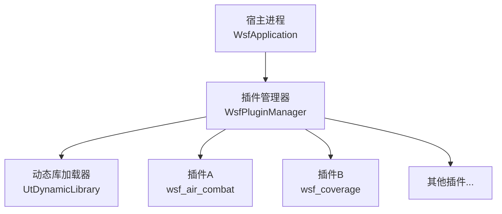
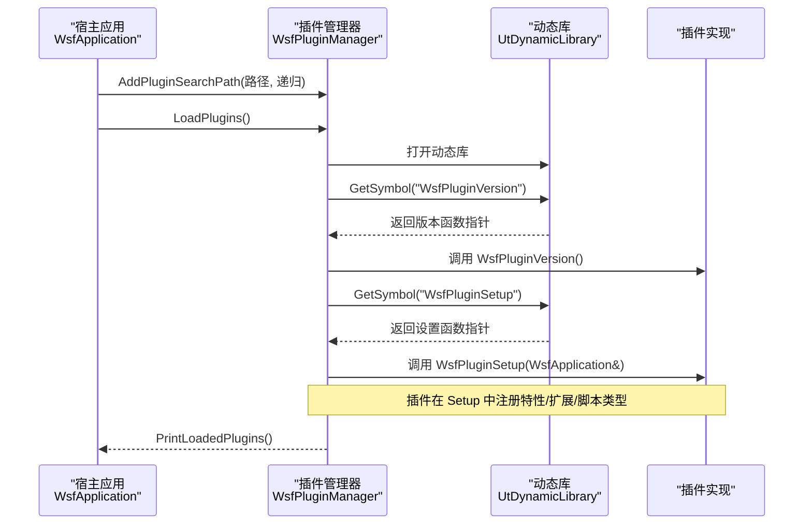
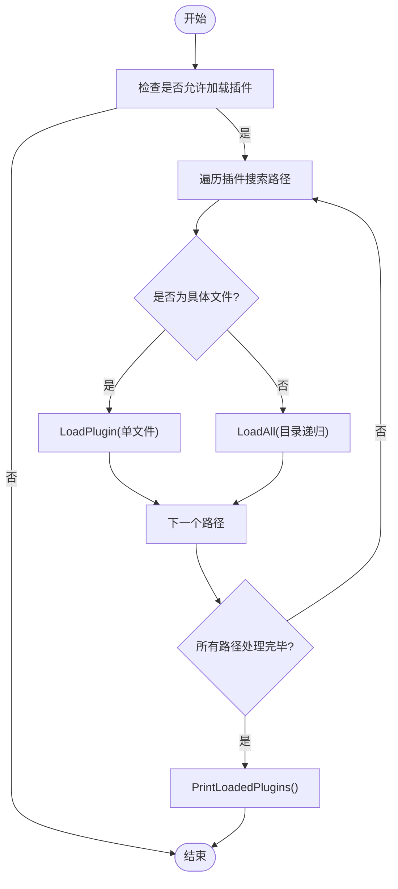
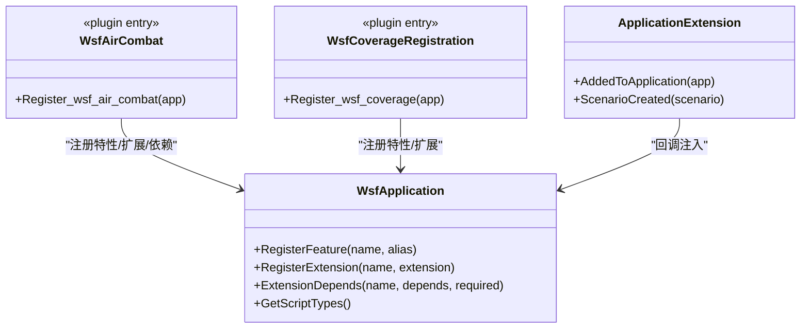
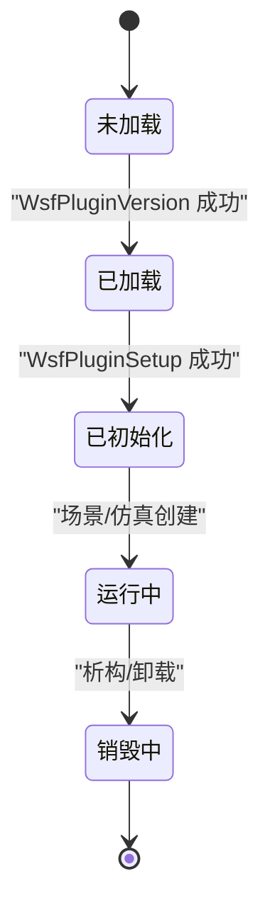
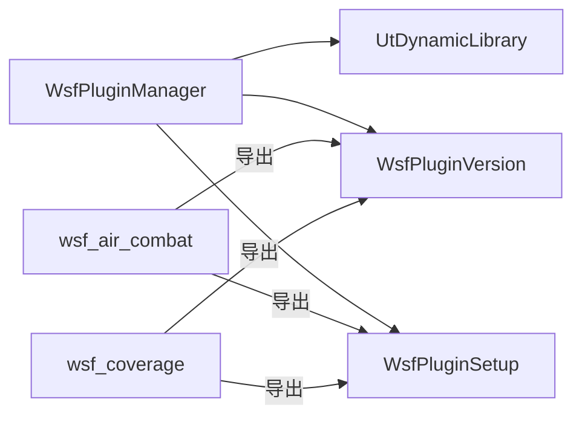

# 插件系统架构

<cite>
**本文引用的文件**   
- [WsfPluginManager.cpp](file://swdev/src/core/wsf/source/WsfPluginManager.cpp)
- [WsfPluginManager.hpp](file://swdev/src/core/wsf/source/WsfPluginManager.hpp)
- [WsfAirCombat.cpp](file://swdev/src/wsf_plugins/wsf_air_combat/source/WsfAirCombat.cpp)
- [WsfCoverageRegistration.cpp](file://swdev/src/wsf_plugins/wsf_coverage/source/WsfCoverageRegistration.cpp)
- [UtPlugin.hpp](file://swdev/src/tools/util/source/UtPlugin.hpp)
- [integration_guide.rst](file://swdev/src/doc/developer/integration_guide.rst)
</cite>

## 目录
1. [引言](#引言)
2. [项目结构](#项目结构)
3. [核心组件](#核心组件)
4. [架构总览](#架构总览)
5. [详细组件分析](#详细组件分析)
6. [依赖关系分析](#依赖关系分析)
7. [性能与可扩展性](#性能与可扩展性)
8. [故障排查指南](#故障排查指南)
9. [结论](#结论)
10. [附录：插件开发指南](#附录插件开发指南)

## 引言
本文件系统化阐述 AFSIM 的 WSF 插件体系，包括动态加载机制、模块注册流程、接口约定、wsf_module 标识符的作用与发现机制、插件生命周期管理（初始化、运行、销毁）、插件间通信与数据共享方式，并提供架构图、流程图和面向开发者的实践指南。

## 项目结构
WSF 插件位于 swdev/src/wsf_plugins 下，每个插件是一个独立的 CMake 扩展，通过统一的导出符号与宿主进行交互。核心插件管理器位于 core/wsf 中，负责扫描路径、加载动态库、校验版本并调用插件入口完成注册。

图表来源
- [WsfPluginManager.cpp:72-101](file://swdev/src/core/wsf/source/WsfPluginManager.cpp#L72-L101)
- [WsfPluginManager.cpp:105-149](file://swdev/src/core/wsf/source/WsfPluginManager.cpp#L105-L149)
- [WsfAirCombat.cpp:67-83](file://swdev/src/wsf_plugins/wsf_air_combat/source/WsfAirCombat.cpp#L67-L83)
- [WsfCoverageRegistration.cpp:50-59](file://swdev/src/wsf_plugins/wsf_coverage/source/WsfCoverageRegistration.cpp#L50-L59)

章节来源
- [WsfPluginManager.cpp:32-46](file://swdev/src/core/wsf/source/WsfPluginManager.cpp#L32-L46)
- [WsfPluginManager.hpp:35-55](file://swdev/src/core/wsf/source/WsfPluginManager.hpp#L35-L55)

## 核心组件
- WsfPluginManager：插件发现与加载、版本校验、生命周期钩子调度、已加载插件清单打印。
- UtDynamicLibrary：底层动态库加载与符号解析。
- UT_PLUGIN_EXPORT / UT_PLUGIN_VERSION_CREATE：跨平台导出宏与版本常量，保证 ABI 兼容。
- 插件入口函数：WsfPluginVersion、WsfPluginSetup（以及可选的 WSF_PluginComplete）。

章节来源
- [WsfPluginManager.cpp:72-101](file://swdev/src/core/wsf/source/WsfPluginManager.cpp#L72-L101)
- [WsfPluginManager.cpp:105-149](file://swdev/src/core/wsf/source/WsfPluginManager.cpp#L105-L149)
- [WsfPluginManager.hpp:26-33](file://swdev/src/core/wsf/source/WsfPluginManager.hpp#L26-L33)
- [UtPlugin.hpp:330-333](file://swdev/src/tools/util/source/UtPlugin.hpp#L330-L333)

## 架构总览
WSF 插件采用“宿主-管理器-动态库”三层模型：
- 宿主（WsfApplication）提供应用上下文与扩展注册表。
- 管理器（WsfPluginManager）负责搜索路径、加载动态库、校验 API 版本、调用插件初始化函数。
- 插件（动态库）暴露标准符号，向宿主注册功能、脚本类型、场景扩展等。

图表来源
- [WsfPluginManager.cpp:66-101](file://swdev/src/core/wsf/source/WsfPluginManager.cpp#L66-L101)
- [WsfPluginManager.cpp:105-149](file://swdev/src/core/wsf/source/WsfPluginManager.cpp#L105-L149)
- [WsfAirCombat.cpp:67-83](file://swdev/src/wsf_plugins/wsf_air_combat/source/WsfAirCombat.cpp#L67-L83)
- [WsfCoverageRegistration.cpp:50-59](file://swdev/src/wsf_plugins/wsf_coverage/source/WsfCoverageRegistration.cpp#L50-L59)

## 详细组件分析

### 插件管理器（WsfPluginManager）
职责
- 维护插件搜索路径列表，支持单文件或目录递归扫描。
- 加载动态库，解析并调用 WsfPluginVersion 与 WsfPluginSetup。
- 校验插件 API 主/次版本与编译器字符串是否匹配。
- 析构时尝试调用可选的 WSF_PluginComplete 清理资源。

关键流程
- LoadPlugins：遍历搜索路径，区分文件与目录；对目录递归加载。
- LoadPluginInitialize：获取符号、校验版本、调用 Setup。
- PrintLoadedPlugins：输出已加载插件文件名。

错误处理
- 找不到 WsfPluginVersion 或 WsfPluginSetup 时记录警告并跳过该插件。
- 版本不匹配（主/次版本或编译器字符串不一致）时拒绝加载。

图表来源
- [WsfPluginManager.cpp:72-101](file://swdev/src/core/wsf/source/WsfPluginManager.cpp#L72-L101)
- [WsfPluginManager.cpp:151-168](file://swdev/src/core/wsf/source/WsfPluginManager.cpp#L151-L168)

章节来源
- [WsfPluginManager.cpp:32-46](file://swdev/src/core/wsf/source/WsfPluginManager.cpp#L32-L46)
- [WsfPluginManager.cpp:66-101](file://swdev/src/core/wsf/source/WsfPluginManager.cpp#L66-L101)
- [WsfPluginManager.cpp:105-149](file://swdev/src/core/wsf/source/WsfPluginManager.cpp#L105-L149)
- [WsfPluginManager.cpp:151-168](file://swdev/src/core/wsf/source/WsfPluginManager.cpp#L151-L168)
- [WsfPluginManager.hpp:39-68](file://swdev/src/core/wsf/source/WsfPluginManager.hpp#L39-L68)

### 插件入口与注册（示例：空战与覆盖度）
- 空战插件（wsf_air_combat）：
  - 定义 ApplicationExtension，在 AddedToApplication 中注册脚本类型，在 ScenarioCreated 中注册场景扩展。
  - Register_wsf_air_combat 注册特性与依赖（如 wsf_mil、wsf_brawler、wsf_p6dof、wsf_six_dof），并通过宏注册扩展。
  - 导出 WsfPluginVersion 与 WsfPluginSetup。
- 覆盖度插件（wsf_coverage）：
  - 类似地注册特性与场景扩展，导出统一入口。

图表来源
- [WsfAirCombat.cpp:23-64](file://swdev/src/wsf_plugins/wsf_air_combat/source/WsfAirCombat.cpp#L23-L64)
- [WsfAirCombat.cpp:67-83](file://swdev/src/wsf_plugins/wsf_air_combat/source/WsfAirCombat.cpp#L67-L83)
- [WsfCoverageRegistration.cpp:21-47](file://swdev/src/wsf_plugins/wsf_coverage/source/WsfCoverageRegistration.cpp#L21-L47)
- [WsfCoverageRegistration.cpp:50-59](file://swdev/src/wsf_plugins/wsf_coverage/source/WsfCoverageRegistration.cpp#L50-L59)

章节来源
- [WsfAirCombat.cpp:23-83](file://swdev/src/wsf_plugins/wsf_air_combat/source/WsfAirCombat.cpp#L23-L83)
- [WsfCoverageRegistration.cpp:21-59](file://swdev/src/wsf_plugins/wsf_coverage/source/WsfCoverageRegistration.cpp#L21-L59)

### 生命周期管理
- 初始化阶段：
  - 宿主调用 WsfPluginVersion 校验版本。
  - 宿主调用 WsfPluginSetup 执行插件内注册逻辑。
- 运行阶段：
  - 插件通过 ApplicationExtension 的 AddedToApplication/ScenarioCreated 等回调接入宿主生命周期。
- 销毁阶段：
  - 管理器析构时尝试调用 WSF_PluginComplete 以释放插件资源。

图表来源
- [WsfPluginManager.cpp:105-149](file://swdev/src/core/wsf/source/WsfPluginManager.cpp#L105-L149)
- [WsfPluginManager.cpp:50-64](file://swdev/src/core/wsf/source/WsfPluginManager.cpp#L50-L64)

章节来源
- [WsfPluginManager.cpp:50-64](file://swdev/src/core/wsf/source/WsfPluginManager.cpp#L50-L64)
- [WsfPluginManager.cpp:105-149](file://swdev/src/core/wsf/source/WsfPluginManager.cpp#L105-L149)

### 插件发现与 wsf_module 标识符
- wsf_module 是 CMake 用于识别扩展目录的标记文件（无内容、无扩展名）。CMake 通过它决定是否将插件纳入构建与安装流程。
- 文档指出：扩展根目录必须包含 wsf_module，以便主 CMakeLists.txt 能将其加入 WSF 的 CMake 处理流程。

章节来源
- [integration_guide.rst:522-535](file://swdev/src/doc/developer/integration_guide.rst#L522-L535)

### 插件间通信与数据共享
- 通过 WsfApplication 的扩展机制与脚本类型注册，插件可共享能力与对象类型。
- 典型模式：
  - 在 AddedToApplication 中将自定义类注册到脚本类型系统，供脚本与其他插件访问。
  - 在 ScenarioCreated 中向场景注册扩展，使同一仿真中的多个插件可协作。
- 运行时数据可通过平台部件、事件管道、结果数据库等机制共享（由上层框架提供）。

章节来源
- [WsfAirCombat.cpp:23-41](file://swdev/src/wsf_plugins/wsf_air_combat/source/WsfAirCombat.cpp#L23-L41)
- [WsfCoverageRegistration.cpp:21-36](file://swdev/src/wsf_plugins/wsf_coverage/source/WsfCoverageRegistration.cpp#L21-L36)

## 依赖关系分析
- 插件对外仅暴露两个关键符号：WsfPluginVersion 与 WsfPluginSetup。
- 管理器内部依赖 UtDynamicLibrary 进行动态库加载与符号解析。
- 插件之间通过宿主提供的扩展与特性系统进行解耦协作，避免直接耦合。

图表来源
- [WsfPluginManager.cpp:105-149](file://swdev/src/core/wsf/source/WsfPluginManager.cpp#L105-L149)
- [WsfAirCombat.cpp:67-83](file://swdev/src/wsf_plugins/wsf_air_combat/source/WsfAirCombat.cpp#L67-L83)
- [WsfCoverageRegistration.cpp:50-59](file://swdev/src/wsf_plugins/wsf_coverage/source/WsfCoverageRegistration.cpp#L50-L59)

章节来源
- [WsfPluginManager.hpp:39-68](file://swdev/src/core/wsf/source/WsfPluginManager.hpp#L39-L68)
- [WsfPluginManager.cpp:105-149](file://swdev/src/core/wsf/source/WsfPluginManager.cpp#L105-L149)

## 性能与可扩展性
- 插件加载仅在启动阶段执行一次，后续通过回调接入生命周期，开销可控。
- 通过特性与扩展注册实现功能开关与按需启用，有利于模块化与并行扩展。
- 建议：
  - 将重型初始化放入 WsfPluginSetup 或场景扩展中，避免重复计算。
  - 使用特性开关控制可选功能，减少不必要的依赖与内存占用。

[本节为通用指导，不涉及具体文件分析]

## 故障排查指南
常见问题与定位要点
- 无法找到 WsfPluginVersion 或 WsfPluginSetup：
  - 检查插件是否正确导出符号，名称与签名是否与约定一致。
  - 确认编译选项与 ABI 宏（UT_PLUGIN_EXPORT）正确配置。
- 版本不匹配或编译器不匹配：
  - 确保插件与宿主使用相同的 WSF 插件 API 主/次版本与编译器字符串。
- 插件未被加载：
  - 检查搜索路径是否添加，路径指向的是文件还是目录。
  - 若为目录，确认递归标志与目录结构符合预期。
- 插件功能未生效：
  - 检查是否在 WsfPluginSetup 中调用了 Register_wsf_xxx 并完成特性/扩展注册。
  - 检查依赖特性是否已先注册（例如 wsf_mil、wsf_brawler 等）。

章节来源
- [WsfPluginManager.cpp:105-149](file://swdev/src/core/wsf/source/WsfPluginManager.cpp#L105-L149)
- [WsfAirCombat.cpp:44-64](file://swdev/src/wsf_plugins/wsf_air_combat/source/WsfAirCombat.cpp#L44-L64)

## 结论
AFSIM 的 WSF 插件体系通过标准化的导出符号与统一的插件管理器，实现了松耦合的动态加载与生命周期管理。插件通过特性与扩展机制与宿主及其他插件协作，具备良好的可扩展性与可维护性。遵循本文的开发指南与最佳实践，可快速构建高质量的自定义处理器、传感器与武器系统插件。

[本节为总结性内容，不涉及具体文件分析]

## 附录：插件开发指南

### 如何创建自定义处理器、传感器与武器系统
- 步骤概览
  - 在 swdev/src/wsf_plugins 下新建插件目录，并在根目录放置空的 wsf_module 文件作为 CMake 发现标记。
  - 编写插件源文件，实现 Register_wsf_xxx 函数，在其中注册特性、扩展与依赖。
  - 导出 WsfPluginVersion 与 WsfPluginSetup 符号。
  - 在 AddedToApplication 中注册脚本类型（如需），在 ScenarioCreated 中注册场景扩展（如需）。
  - 在 CMake 中将该插件纳入构建与安装流程（参考集成指南）。

- 关键约定
  - 导出符号：WsfPluginVersion(UtPluginVersion&), WsfPluginSetup(WsfApplication&)。
  - 版本宏：WSF_PLUGIN_API_MAJOR_VERSION、WSF_PLUGIN_API_MINOR_VERSION、WSF_PLUGIN_API_COMPILER_STRING。
  - 导出宏：UT_PLUGIN_EXPORT。

- 参考实现
  - 空战插件：展示特性注册、依赖声明与扩展注册。
  - 覆盖度插件：展示最小化插件结构与注册流程。

章节来源
- [WsfAirCombat.cpp:23-83](file://swdev/src/wsf_plugins/wsf_air_combat/source/WsfAirCombat.cpp#L23-L83)
- [WsfCoverageRegistration.cpp:21-59](file://swdev/src/wsf_plugins/wsf_coverage/source/WsfCoverageRegistration.cpp#L21-L59)
- [integration_guide.rst:522-535](file://swdev/src/doc/developer/integration_guide.rst#L522-L535)

### 打包、部署与版本管理策略
- 打包
  - 使用 CMake 构建插件动态库，并确保导出符号可见。
  - 将插件二进制与必要的资源文件按宿主期望的路径组织。
- 部署
  - 将插件所在目录添加到 WsfPluginManager 的搜索路径中（或通过宿主配置自动发现）。
  - 确保 wsf_module 存在于插件根目录，便于 CMake 与工具链识别。
- 版本管理
  - 插件需与宿主保持相同的 WSF 插件 API 版本与编译器字符串。
  - 建议在插件元数据中显式声明版本信息，便于诊断与回滚。

章节来源
- [WsfPluginManager.cpp:105-149](file://swdev/src/core/wsf/source/WsfPluginManager.cpp#L105-L149)
- [integration_guide.rst:522-535](file://swdev/src/doc/developer/integration_guide.rst#L522-L535)