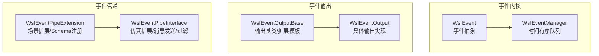
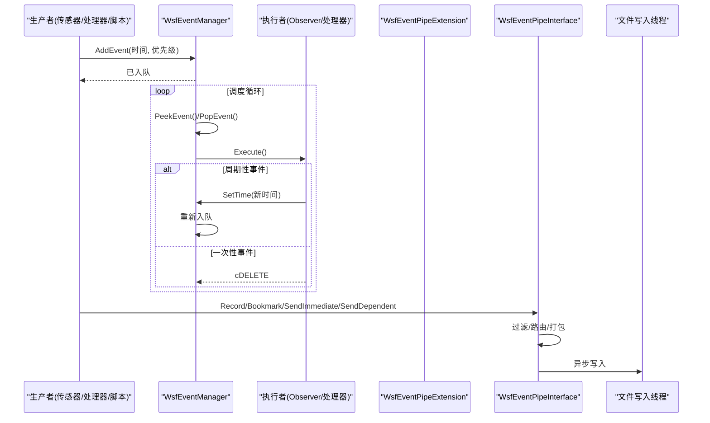
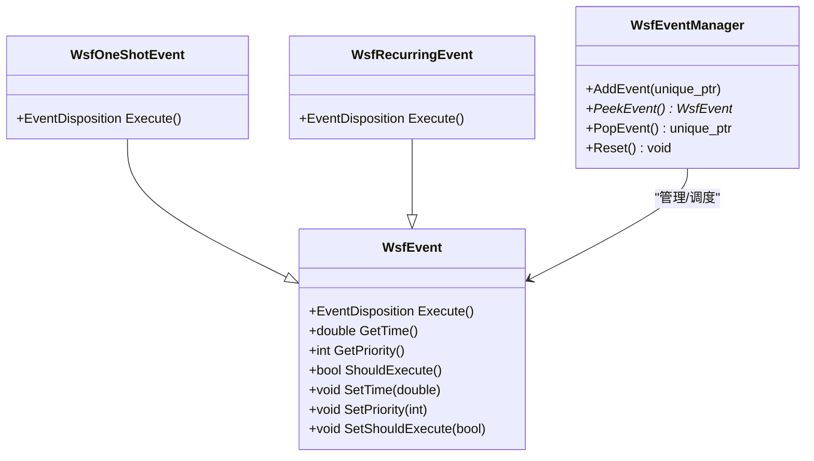
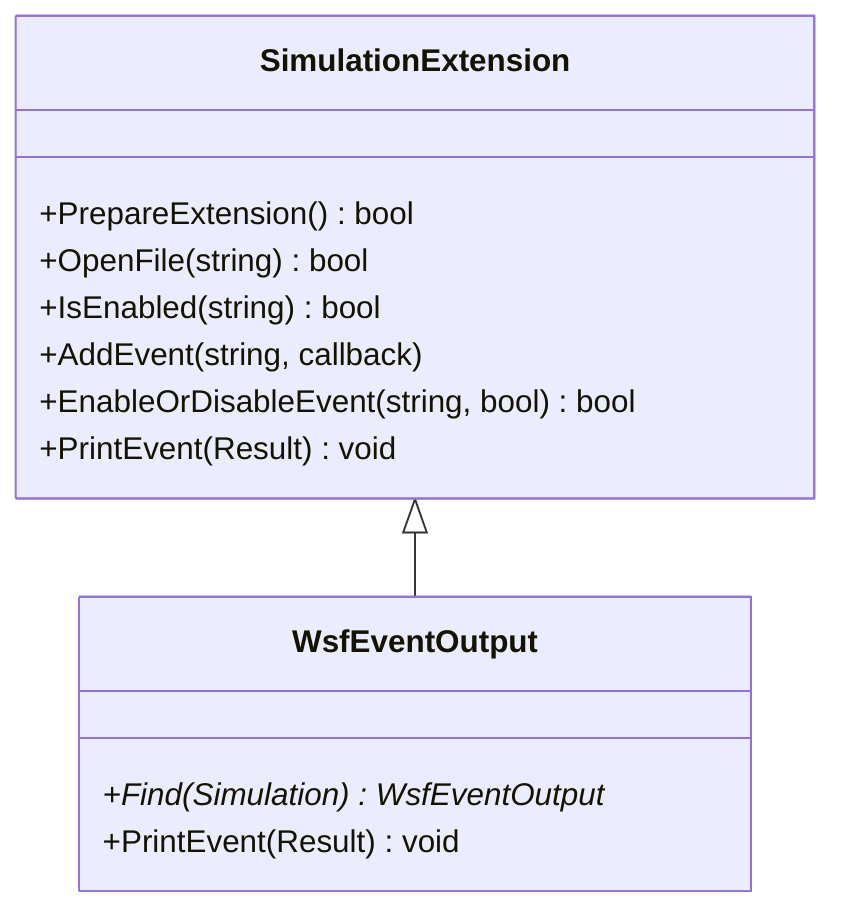
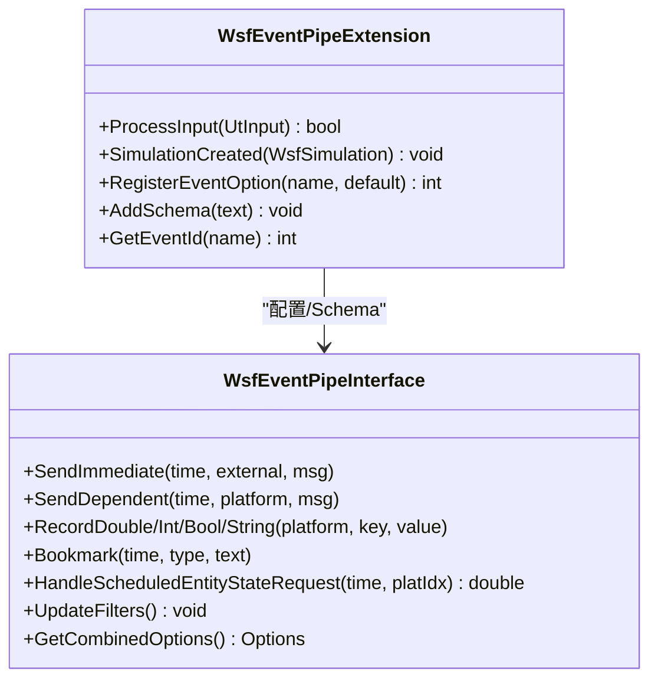
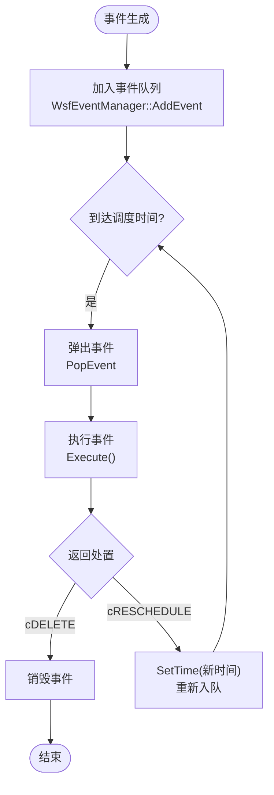
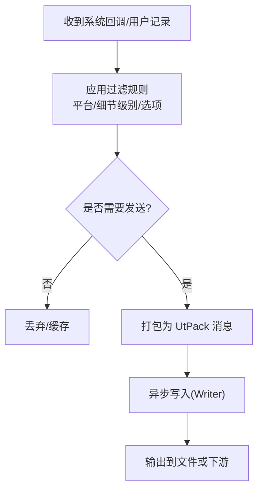
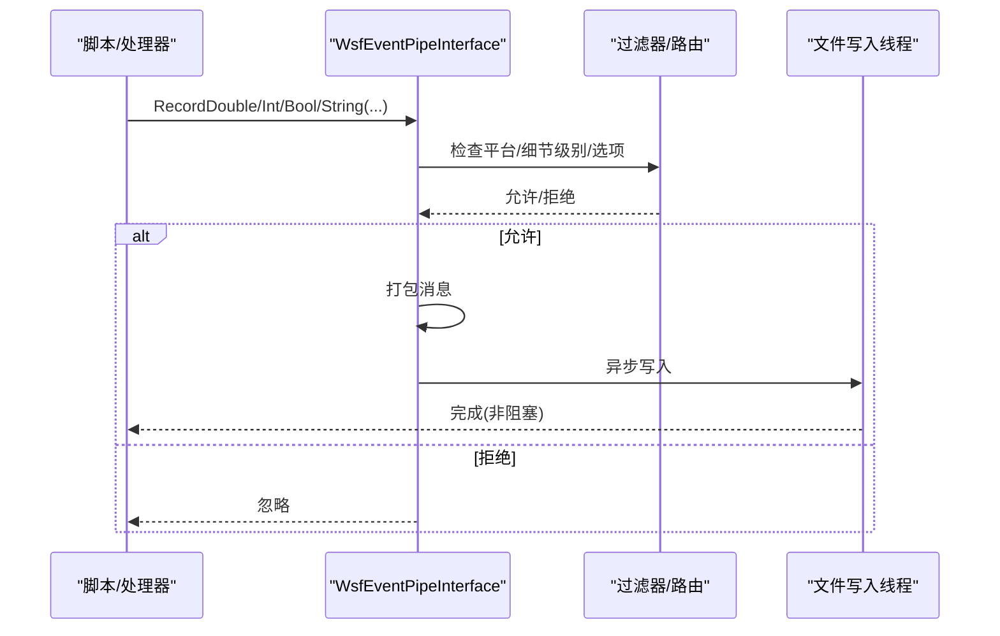
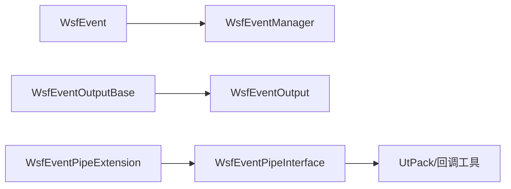

# 事件系统架构

<cite>
**本文引用的文件**   
- [WsfEvent.hpp](file://swdev/src/core/wsf/source/WsfEvent.hpp)
- [WsfEventManager.hpp](file://swdev/src/core/wsf/source/WsfEventManager.hpp)
- [WsfEventManager.cpp](file://swdev/src/core/wsf/source/WsfEventManager.cpp)
- [WsfEventOutputBase.hpp](file://swdev/src/core/wsf/source/WsfEventOutputBase.hpp)
- [WsfEventOutput.hpp](file://swdev/src/core/wsf/source/WsfEventOutput.hpp)
- [WsfEventPipe.hpp](file://swdev/src/core/wsf/source/event_pipe/WsfEventPipe.hpp)
- [WsfEventPipeInterface.hpp](file://swdev/src/core/wsf/source/event_pipe/WsfEventPipeInterface.hpp)
</cite>

## 目录
1. [简介](#简介)
2. [项目结构](#项目结构)
3. [核心组件](#核心组件)
4. [架构总览](#架构总览)
5. [详细组件分析](#详细组件分析)
6. [依赖关系分析](#依赖关系分析)
7. [性能考虑](#性能考虑)
8. [故障排查指南](#故障排查指南)
9. [结论](#结论)
10. [附录](#附录)

## 简介
本文件系统化梳理 AFSIM 的事件驱动架构，围绕“事件的创建、分发与处理”“事件管道（Event Pipe）的队列管理、优先级与异步输出”“事件生命周期”“过滤与路由机制”“性能优化策略”“调试与监控工具使用”展开。文档面向不同技术背景的读者，提供从概念到代码级实现的渐进式说明，并辅以架构图与时序图帮助理解。

## 项目结构
AFSIM 的核心事件能力位于 core/wsf 模块中，主要包含：
- 事件模型与管理器：WsfEvent、WsfEventManager
- 事件输出框架：WsfEventOutputBase、WsfEventOutput
- 事件管道子系统：WsfEventPipeExtension、WsfEventPipeInterface

图表来源
- [WsfEvent.hpp:21-113](file://swdev/src/core/wsf/source/WsfEvent.hpp#L21-L113)
- [WsfEventManager.hpp:28-110](file://swdev/src/core/wsf/source/WsfEventManager.hpp#L28-L110)
- [WsfEventOutputBase.hpp:46-160](file://swdev/src/core/wsf/source/WsfEventOutputBase.hpp#L46-L160)
- [WsfEventOutput.hpp:31-47](file://swdev/src/core/wsf/source/WsfEventOutput.hpp#L31-L47)
- [WsfEventPipe.hpp:34-84](file://swdev/src/core/wsf/source/event_pipe/WsfEventPipe.hpp#L34-L84)
- [WsfEventPipeInterface.hpp:86-120](file://swdev/src/core/wsf/source/event_pipe/WsfEventPipeInterface.hpp#L86-L120)

章节来源
- [WsfEvent.hpp:21-113](file://swdev/src/core/wsf/source/WsfEvent.hpp#L21-L113)
- [WsfEventManager.hpp:28-110](file://swdev/src/core/wsf/source/WsfEventManager.hpp#L28-L110)
- [WsfEventOutputBase.hpp:46-160](file://swdev/src/core/wsf/source/WsfEventOutputBase.hpp#L46-L160)
- [WsfEventOutput.hpp:31-47](file://swdev/src/core/wsf/source/WsfEventOutput.hpp#L31-L47)
- [WsfEventPipe.hpp:34-84](file://swdev/src/core/wsf/source/event_pipe/WsfEventPipe.hpp#L34-L84)
- [WsfEventPipeInterface.hpp:86-120](file://swdev/src/core/wsf/source/event_pipe/WsfEventPipeInterface.hpp#L86-L120)

## 核心组件
- WsfEvent：所有事件的抽象基类，定义执行接口、调度时间、优先级、是否可取消等语义；并提供一次性与周期性事件适配器。
- WsfEventManager：基于优先队列的时间有序事件管理器，支持按仿真时间、优先级、入队顺序稳定排序，线程安全地增删查。
- WsfEventOutputBase / WsfEventOutput：事件输出的通用框架与具体实现，负责打开文件、启用/禁用事件、格式化打印。
- WsfEventPipeExtension：事件管道的场景扩展，负责解析配置、注册 Schema、维护事件名与 ID 映射。
- WsfEventPipeInterface：事件管道的仿真扩展，负责订阅系统回调、过滤与路由、打包消息、异步写入文件。

章节来源
- [WsfEvent.hpp:21-172](file://swdev/src/core/wsf/source/WsfEvent.hpp#L21-L172)
- [WsfEventManager.hpp:28-110](file://swdev/src/core/wsf/source/WsfEventManager.hpp#L28-L110)
- [WsfEventOutputBase.hpp:46-160](file://swdev/src/core/wsf/source/WsfEventOutputBase.hpp#L46-L160)
- [WsfEventOutput.hpp:31-47](file://swdev/src/core/wsf/source/WsfEventOutput.hpp#L31-L47)
- [WsfEventPipe.hpp:34-84](file://swdev/src/core/wsf/source/event_pipe/WsfEventPipe.hpp#L34-L84)
- [WsfEventPipeInterface.hpp:86-120](file://swdev/src/core/wsf/source/event_pipe/WsfEventPipeInterface.hpp#L86-L120)

## 架构总览
AFSIM 的事件系统由三层构成：
- 事件内核层：WsfEvent + WsfEventManager，负责事件的生命周期与调度。
- 事件输出层：WsfEventOutputBase/WsfEventOutput，将观测到的事件结果持久化。
- 事件管道层：WsfEventPipeExtension + WsfEventPipeInterface，提供高性能、可配置、可扩展的事件流通道，用于可视化与外部集成。

图表来源
- [WsfEventManager.cpp:22-54](file://swdev/src/core/wsf/source/WsfEventManager.cpp#L22-L54)
- [WsfEvent.hpp:115-172](file://swdev/src/core/wsf/source/WsfEvent.hpp#L115-L172)
- [WsfEventPipeInterface.hpp:103-159](file://swdev/src/core/wsf/source/event_pipe/WsfEventPipeInterface.hpp#L103-L159)

## 详细组件分析

### 事件模型与调度（WsfEvent / WsfEventManager）
- 事件模型
  - 抽象基类 WsfEvent 定义了 Execute() 返回处置（删除或重调度），以及 Get/Set Time/Priority、ShouldExecute 控制是否执行。
  - 提供 WsfOneShotEvent（一次性）与 WsfRecurringEvent（周期性）适配器，简化常见用法。
- 事件队列
  - WsfEventManager 使用 priority_queue 存储 Event，键为 (仿真时间, 优先级, 入队序号)，保证稳定排序。
  - 线程安全：内部使用递归互斥锁保护队列操作。
  - 提供 AddEvent、PeekEvent、PopEvent、Reset 等接口。

图表来源
- [WsfEvent.hpp:21-172](file://swdev/src/core/wsf/source/WsfEvent.hpp#L21-L172)
- [WsfEventManager.hpp:28-110](file://swdev/src/core/wsf/source/WsfEventManager.hpp#L28-L110)

章节来源
- [WsfEvent.hpp:21-172](file://swdev/src/core/wsf/source/WsfEvent.hpp#L21-L172)
- [WsfEventManager.hpp:28-110](file://swdev/src/core/wsf/source/WsfEventManager.hpp#L28-L110)
- [WsfEventManager.cpp:22-54](file://swdev/src/core/wsf/source/WsfEventManager.cpp#L22-L54)

### 事件输出框架（WsfEventOutputBase / WsfEventOutput）
- 抽象基类 SimulationExtension 提供：
  - 事件开关、别名、消息打印函数注册、事件钩子（Entry/Exit）、文件流管理。
  - 通过模板 ScenarioExtension 将场景配置与仿真扩展解耦。
- WsfEventOutput 继承该基类，实现具体输出逻辑（如打印格式、选项）。

图表来源
- [WsfEventOutputBase.hpp:46-160](file://swdev/src/core/wsf/source/WsfEventOutputBase.hpp#L46-L160)
- [WsfEventOutput.hpp:31-47](file://swdev/src/core/wsf/source/WsfEventOutput.hpp#L31-L47)

章节来源
- [WsfEventOutputBase.hpp:46-160](file://swdev/src/core/wsf/source/WsfEventOutputBase.hpp#L46-L160)
- [WsfEventOutput.hpp:31-47](file://swdev/src/core/wsf/source/WsfEventOutput.hpp#L31-L47)

### 事件管道（WsfEventPipeExtension / WsfEventPipeInterface）
- 场景扩展 WsfEventPipeExtension
  - 读取 event_pipe 配置，注册 Schema，维护事件名与 ID 映射，支持扩展点 RegisterExtensionMessages。
- 仿真扩展 WsfEventPipeInterface
  - 订阅平台、传感器、通信、轨迹、行为树、状态机等系统回调，生成结构化消息。
  - 提供 Record/Bookmark/SendImmediate/SendDependent 等 API，供脚本与 C++ 调用。
  - 内部维护过滤器（Filter）、细节级别（DetailSettingData）、组合选项（CombinedOptions）等，完成条件匹配与目标选择。
  - 通过 FileWriterWorker 异步写入，降低主线程开销。

图表来源
- [WsfEventPipe.hpp:34-84](file://swdev/src/core/wsf/source/event_pipe/WsfEventPipe.hpp#L34-L84)
- [WsfEventPipeInterface.hpp:86-159](file://swdev/src/core/wsf/source/event_pipe/WsfEventPipeInterface.hpp#L86-L159)

章节来源
- [WsfEventPipe.hpp:34-84](file://swdev/src/core/wsf/source/event_pipe/WsfEventPipe.hpp#L34-L84)
- [WsfEventPipeInterface.hpp:86-159](file://swdev/src/core/wsf/source/event_pipe/WsfEventPipeInterface.hpp#L86-L159)

### 事件生命周期（从生成到销毁）
- 生成：生产者（传感器/处理器/脚本）通过 WsfEventPipeInterface.Record/Bookmark 或直接 AddEvent 创建事件。
- 入队：WsfEventManager.AddEvent 将事件按 (时间, 优先级, 序号) 入队。
- 调度：调度循环 PopEvent 取出下一个事件，调用 Execute。
- 处理：Execute 内执行业务逻辑；周期性事件 SetTime 后返回 cRESCHEDULE，一次性事件返回 cDELETE。
- 销毁：cDELETE 时事件被释放；周期性事件在下次调度前保持存活。

图表来源
- [WsfEventManager.cpp:22-54](file://swdev/src/core/wsf/source/WsfEventManager.cpp#L22-L54)
- [WsfEvent.hpp:115-172](file://swdev/src/core/wsf/source/WsfEvent.hpp#L115-L172)

### 过滤与路由机制
- 过滤维度
  - 平台维度：按平台属性/分组/侧别等筛选（Filter 结构体中的 Criteria）。
  - 细节级别：DetailSettingData 聚合 Options 与活跃平台计数，决定输出粒度。
  - 组合选项：CombinedOptions 表示当前至少一个平台启用的选项并集，用于决定订阅哪些 Observer。
- 路由策略
  - SendImmediate：无平台依赖的消息立即发送。
  - SendDependent：带平台依赖的消息缓存，待 PlatformInfo 后再发送。
  - 实体状态更新：根据位置/姿态变化阈值与间隔控制发送频率。
  - 分区/模式/轨迹/通信等子系统事件统一经 Interface 转发至管道。

图表来源
- [WsfEventPipeInterface.hpp:103-159](file://swdev/src/core/wsf/source/event_pipe/WsfEventPipeInterface.hpp#L103-L159)
- [WsfEventPipeInterface.hpp:377-401](file://swdev/src/core/wsf/source/event_pipe/WsfEventPipeInterface.hpp#L377-L401)

### 事件管道数据流时序

图表来源
- [WsfEventPipeInterface.hpp:103-159](file://swdev/src/core/wsf/source/event_pipe/WsfEventPipeInterface.hpp#L103-L159)

## 依赖关系分析
- 低耦合：WsfEvent 与 WsfEventManager 仅通过接口交互，不感知具体业务。
- 扩展点：WsfEventOutputBase 与 WsfEventPipeExtension/Interface 提供清晰的扩展点，便于新增输出格式与事件类型。
- 外部依赖：UtPack/UtCallback 等工具库用于序列化与回调管理。

图表来源
- [WsfEvent.hpp:21-172](file://swdev/src/core/wsf/source/WsfEvent.hpp#L21-L172)
- [WsfEventManager.hpp:28-110](file://swdev/src/core/wsf/source/WsfEventManager.hpp#L28-L110)
- [WsfEventOutputBase.hpp:46-160](file://swdev/src/core/wsf/source/WsfEventOutputBase.hpp#L46-L160)
- [WsfEventOutput.hpp:31-47](file://swdev/src/core/wsf/source/WsfEventOutput.hpp#L31-L47)
- [WsfEventPipe.hpp:34-84](file://swdev/src/core/wsf/source/event_pipe/WsfEventPipe.hpp#L34-L84)
- [WsfEventPipeInterface.hpp:86-159](file://swdev/src/core/wsf/source/event_pipe/WsfEventPipeInterface.hpp#L86-L159)

## 性能考虑
- 批量处理
  - 对高频事件（如轨迹更新、传感器检测）采用合并与节流策略，减少重复输出。
  - 利用 HandleScheduledEntityStateRequest 的间隔控制，避免频繁发送实体状态。
- 内存池与对象复用
  - 周期性事件通过 cRESCHEDULE 复用对象，避免频繁分配/释放。
  - 管道消息打包复用缓冲区，降低 GC/分配压力。
- 异步 I/O
  - 文件写入走独立线程，主线程仅做轻量打包与投递。
- 优先级与稳定性
  - 同时间事件按优先级与入队序号稳定排序，确保关键事件优先处理。
- 过滤前置
  - 在管道入口进行粗粒度过滤，减少后续处理与序列化成本。

[本节为通用指导，不直接分析具体文件]

## 故障排查指南
- 事件未触发
  - 检查 ShouldExecute 是否被置为 false；确认事件时间设置正确且未被覆盖。
  - 核对优先级与入队顺序是否符合预期。
- 事件重复或丢失
  - 周期性事件需确保 Execute 中 SetTime 正确递增；一次性事件不应误返回 cRESCHEDULE。
  - 检查是否存在并发修改队列的情况（应通过公共接口）。
- 管道无输出
  - 确认 event_pipe 配置已启用对应事件与平台；检查 DetailSetting 与 CombinedOptions。
  - 查看 Writer 线程是否异常退出；必要时开启日志。
- 性能瓶颈
  - 评估过滤条件是否过宽；适当提高实体状态更新阈值与间隔。
  - 减少高开销的序列化内容；按需启用高级特性（如行为树/状态机详情）。

章节来源
- [WsfEvent.hpp:77-99](file://swdev/src/core/wsf/source/WsfEvent.hpp#L77-L99)
- [WsfEventManager.cpp:22-54](file://swdev/src/core/wsf/source/WsfEventManager.cpp#L22-L54)
- [WsfEventPipeInterface.hpp:103-159](file://swdev/src/core/wsf/source/event_pipe/WsfEventPipeInterface.hpp#L103-L159)

## 结论
AFSIM 的事件系统以 WsfEvent/WsfEventManager 为核心，结合 WsfEventOutput 与 WsfEventPipe 形成完整的事件生产-调度-消费-输出闭环。其设计强调可扩展性、可配置性与高性能，通过优先级调度、异步写入与细粒度过滤满足大规模仿真场景的需求。开发者可在此基础上快速扩展新的事件类型与输出格式，并通过管道机制对外暴露高质量的事件流。

## 附录
- 常用 API 速览
  - 事件调度：WsfEventManager::AddEvent/PeekEvent/PopEvent
  - 事件执行：WsfEvent::Execute（返回 cDELETE/cRESCHEDULE）
  - 管道记录：WsfEventPipeInterface::RecordDouble/Int/Bool/String、Bookmark
  - 管道发送：SendImmediate/SendDependent
  - 输出控制：WsfEventOutputBase::EnableOrDisableEvent、AddEventAlias

[本节为概览性内容，不直接分析具体文件]