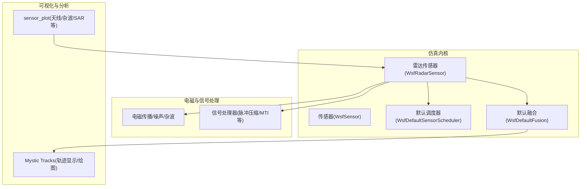
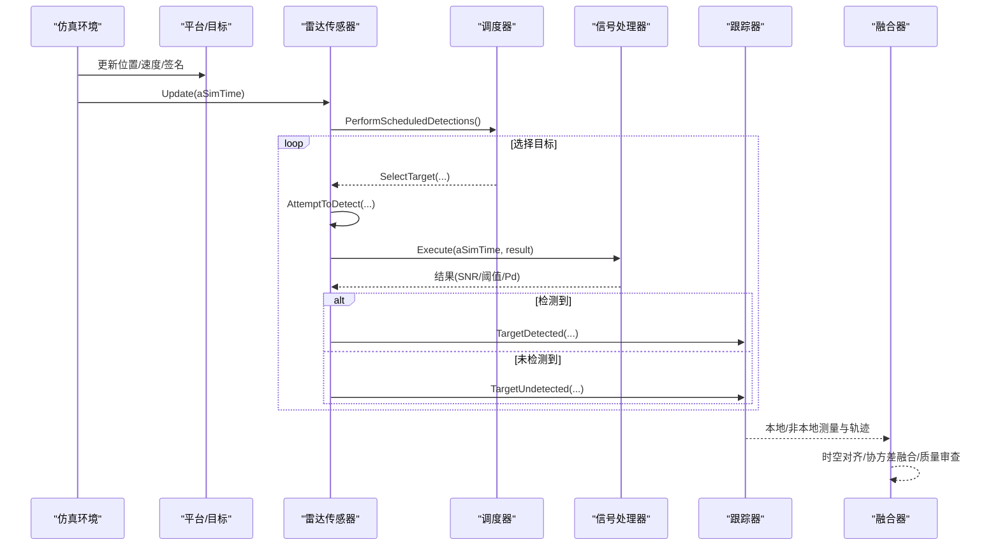
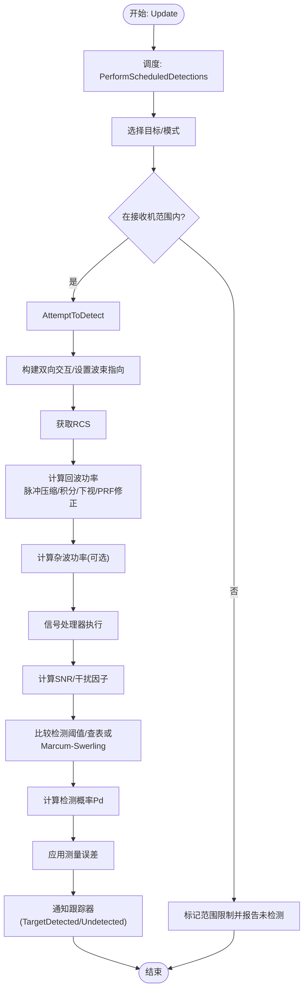
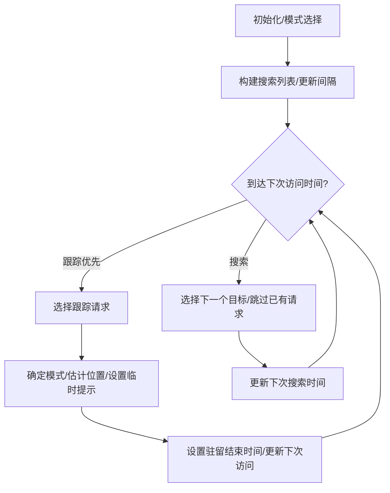
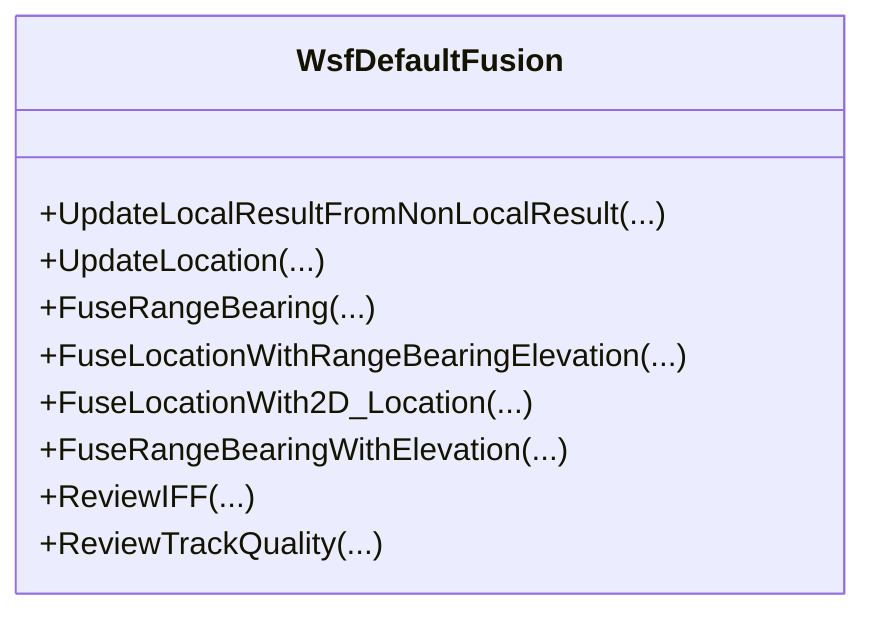
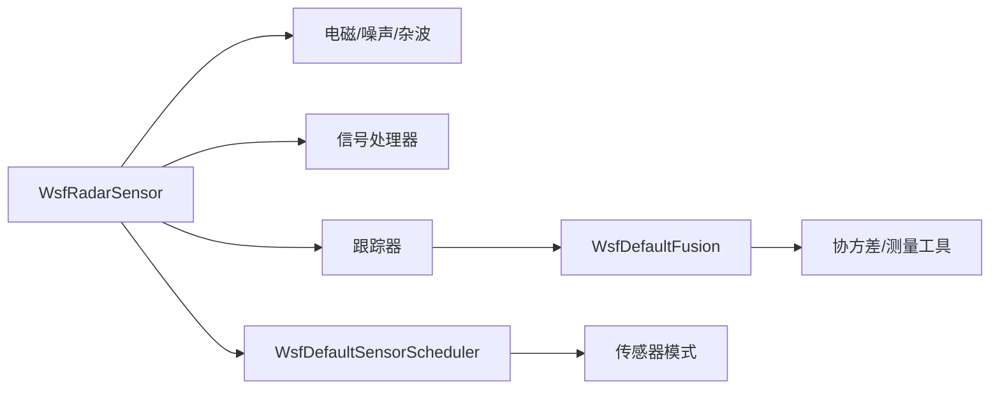
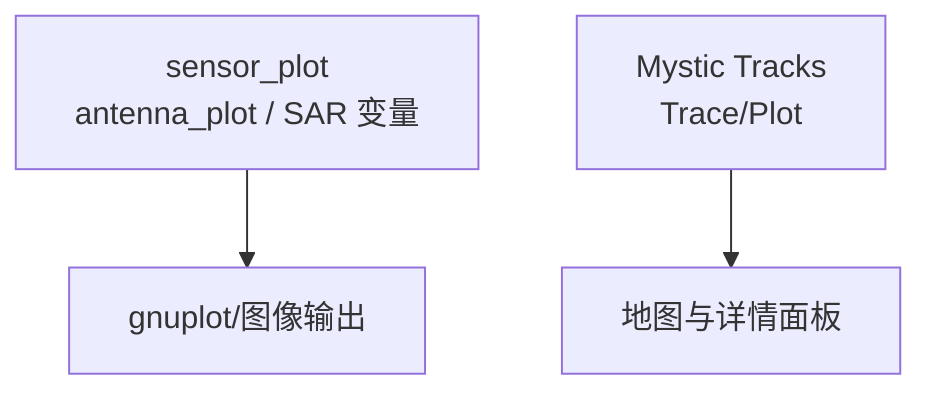

# 传感器数据流

<cite>
**本文引用的文件**   
- [WsfRadarSensor.cpp](file://swdev/src/core/wsf/source/sensor/WsfRadarSensor.cpp)
- [WsfDefaultSensorScheduler.cpp](file://swdev/src/core/wsf/source/sensor/WsfDefaultSensorScheduler.cpp)
- [WsfDefaultFusion.cpp](file://swdev/src/core/wsf/source/WsfDefaultFusion.cpp)
- [sensor_plot_antenna_plot.rst](file://swdev/src/core/sensor_plot_lib/doc/sensor_plot_antenna_plot.rst)
- [sc_example.txt](file://demos/sensor_plot/sar/sc_example.txt)
- [rv_tracks.rst](file://swdev/src/mystic/plugins/ResultTracks/doc/wkf_plugin/rv_tracks.rst)
</cite>

## 目录
1. [引言](#引言)
2. [项目结构](#项目结构)
3. [核心组件](#核心组件)
4. [架构总览](#架构总览)
5. [详细组件分析](#详细组件分析)
6. [依赖关系分析](#依赖关系分析)
7. [性能与质量评估](#性能与质量评估)
8. [可视化与分析工具指南](#可视化与分析工具指南)
9. [故障排查](#故障排查)
10. [结论](#结论)

## 引言
本文件系统化说明 AFSIM 中传感器数据从物理探测到数字信号、再到跟踪融合的全链路流程。重点覆盖：
- 物理探测模型到数字信号的转换（雷达方程、杂波、噪声、检测概率）
- 信号处理链（检测、噪声建模、杂波抑制、目标关联）
- 多传感器数据融合（时空对齐、置信度评估、跟踪建立）
- 传感器配置参数对数据质量的影响（分辨率、灵敏度、更新频率）
- 性能分析方法（探测概率、定位精度、虚警率）
- 可视化与分析工具使用指南（sensor_plot、Mystic Tracks）

## 项目结构
AFSIM 的传感器子系统位于 core/wsf 模块，包含传感器基类、雷达传感器实现、调度器、融合策略等；演示与文档位于 demos 与 documentation；可视化与分析工具包括 sensor_plot 与 Mystic 的 Tracks 功能。

图表来源
- [WsfRadarSensor.cpp:54-70](file://swdev/src/core/wsf/source/sensor/WsfRadarSensor.cpp#L54-L70)
- [WsfDefaultSensorScheduler.cpp:56-106](file://swdev/src/core/wsf/source/sensor/WsfDefaultSensorScheduler.cpp#L56-L106)
- [WsfDefaultFusion.cpp:43-83](file://swdev/src/core/wsf/source/WsfDefaultFusion.cpp#L43-L83)

章节来源
- [WsfRadarSensor.cpp:54-70](file://swdev/src/core/wsf/source/sensor/WsfRadarSensor.cpp#L54-L70)
- [WsfDefaultSensorScheduler.cpp:56-106](file://swdev/src/core/wsf/source/sensor/WsfDefaultSensorScheduler.cpp#L56-L106)
- [WsfDefaultFusion.cpp:43-83](file://swdev/src/core/wsf/source/WsfDefaultFusion.cpp#L43-L83)

## 核心组件
- 雷达传感器 WsfRadarSensor：封装发射/接收、波束、模式、检测计算、误差与信号处理集成。
- 默认调度器 WsfDefaultSensorScheduler：管理搜索与跟踪请求、帧时间、扫描策略、访问时序。
- 默认融合 WsfDefaultFusion：负责本地与非本地测量/轨迹的融合、协方差加权平均、IFF与质量审查。
- 可视化与分析：sensor_plot 用于天线方向图、杂波、SAR 等离线分析；Mystic Tracks 用于在线轨迹展示与历史回放。

章节来源
- [WsfRadarSensor.cpp:54-70](file://swdev/src/core/wsf/source/sensor/WsfRadarSensor.cpp#L54-L70)
- [WsfDefaultSensorScheduler.cpp:56-106](file://swdev/src/core/wsf/source/sensor/WsfDefaultSensorScheduler.cpp#L56-L106)
- [WsfDefaultFusion.cpp:43-83](file://swdev/src/core/wsf/source/WsfDefaultFusion.cpp#L43-L83)

## 架构总览
下图展示了从平台/目标到传感器检测、信号处理、跟踪与融合的端到端数据流。

图表来源
- [WsfRadarSensor.cpp:299-428](file://swdev/src/core/wsf/source/sensor/WsfRadarSensor.cpp#L299-L428)
- [WsfDefaultSensorScheduler.cpp:374-556](file://swdev/src/core/wsf/source/sensor/WsfDefaultSensorScheduler.cpp#L374-L556)
- [WsfDefaultFusion.cpp:121-392](file://swdev/src/core/wsf/source/WsfDefaultFusion.cpp#L121-L392)

## 详细组件分析

### 雷达传感器与探测链路
- 初始化与模式管理：设置主动射频类别、模式列表、默认调度器与跟踪器。
- 更新循环：按更新时间触发调度，执行计划内探测。
- 探测尝试：
  - 构建双向交互，获取目标雷达截面积(RCS)。
  - 计算回波功率，考虑脉冲压缩增益、积分增益、下视因子、PRF因子等。
  - 杂波功率计算（可选杂波模型）。
  - 信号处理器执行（如MTI/MTD/脉冲压缩等），调整阈值或SNR。
  - 计算信噪比，结合检测阈值与检测概率表/探测器，得到Pd。
  - 应用干扰因子与分量效应，判定是否满足所需Pd。
- 误差与观测：应用测量误差模型，通知跟踪器更新。

图表来源
- [WsfRadarSensor.cpp:561-756](file://swdev/src/core/wsf/source/sensor/WsfRadarSensor.cpp#L561-L756)
- [WsfRadarSensor.cpp:299-428](file://swdev/src/core/wsf/source/sensor/WsfRadarSensor.cpp#L299-L428)

章节来源
- [WsfRadarSensor.cpp:54-70](file://swdev/src/core/wsf/source/sensor/WsfRadarSensor.cpp#L54-L70)
- [WsfRadarSensor.cpp:299-428](file://swdev/src/core/wsf/source/sensor/WsfRadarSensor.cpp#L299-L428)
- [WsfRadarSensor.cpp:561-756](file://swdev/src/core/wsf/source/sensor/WsfRadarSensor.cpp#L561-L756)

### 调度器：搜索与跟踪时序
- 维护搜索队列与跟踪请求队列，支持随机/输入顺序/逆序扫描策略。
- 根据帧时间与驻留时间控制下一次访问时刻，避免重复探测。
- 当存在外部跟踪请求时，优先服务跟踪通道；否则进行周期性搜索。
- 支持模式切换、最大并发请求数、临时提示（Transient Cue）等。

图表来源
- [WsfDefaultSensorScheduler.cpp:255-332](file://swdev/src/core/wsf/source/sensor/WsfDefaultSensorScheduler.cpp#L255-L332)
- [WsfDefaultSensorScheduler.cpp:374-556](file://swdev/src/core/wsf/source/sensor/WsfDefaultSensorScheduler.cpp#L374-L556)

章节来源
- [WsfDefaultSensorScheduler.cpp:56-106](file://swdev/src/core/wsf/source/sensor/WsfDefaultSensorScheduler.cpp#L56-L106)
- [WsfDefaultSensorScheduler.cpp:255-332](file://swdev/src/core/wsf/source/sensor/WsfDefaultSensorScheduler.cpp#L255-L332)
- [WsfDefaultSensorScheduler.cpp:374-556](file://swdev/src/core/wsf/source/sensor/WsfDefaultSensorScheduler.cpp#L374-L556)

### 融合：时空对齐、置信度与跟踪建立
- 本地与非本地测量/轨迹的融合：
  - 支持镜像轨迹直接替换与标准融合路径。
  - 支持RBE（距离-方位-俯仰）与三维位置的互转与融合。
  - 协方差加权平均融合（需要状态协方差矩阵）。
  - 高度查找器（仅俯仰）与测距测角雷达的互补融合。
- IFF与轨迹质量审查：
  - 基于原始轨迹集合推断IFF一致性。
  - 取最高质量的原始轨迹作为本地轨迹质量指标。
- 时空对齐：
  - 将非本地测量外推到本地轨迹时间，必要时进行运动学更新。
  - 根据传感器位置差异与曲率影响，判断是否适合特定融合方式。

图表来源
- [WsfDefaultFusion.cpp:121-392](file://swdev/src/core/wsf/source/WsfDefaultFusion.cpp#L121-L392)
- [WsfDefaultFusion.cpp:507-683](file://swdev/src/core/wsf/source/WsfDefaultFusion.cpp#L507-L683)
- [WsfDefaultFusion.cpp:714-777](file://swdev/src/core/wsf/source/WsfDefaultFusion.cpp#L714-L777)

章节来源
- [WsfDefaultFusion.cpp:121-392](file://swdev/src/core/wsf/source/WsfDefaultFusion.cpp#L121-L392)
- [WsfDefaultFusion.cpp:507-683](file://swdev/src/core/wsf/source/WsfDefaultFusion.cpp#L507-L683)
- [WsfDefaultFusion.cpp:714-777](file://swdev/src/core/wsf/source/WsfDefaultFusion.cpp#L714-L777)

## 依赖关系分析
- 雷达传感器依赖：
  - 电磁模型（天线、发射机、接收机、传播、噪声、杂波）
  - 信号处理器（可插拔，用于MTI/MTD/脉冲压缩等）
  - 调度器与跟踪器（时序与关联）
  - 误差模型（角度、距离、多普勒等）
- 调度器依赖：
  - 模式列表（帧时间、驻留时间、重访时间、最大请求数）
  - 仿真环境（平台枚举、随机数）
- 融合依赖：
  - 轨迹管理器、协方差矩阵、测量工具函数
  - 脚本上下文（可扩展规则）

图表来源
- [WsfRadarSensor.cpp:54-70](file://swdev/src/core/wsf/source/sensor/WsfRadarSensor.cpp#L54-L70)
- [WsfDefaultSensorScheduler.cpp:171-199](file://swdev/src/core/wsf/source/sensor/WsfDefaultSensorScheduler.cpp#L171-L199)
- [WsfDefaultFusion.cpp:43-83](file://swdev/src/core/wsf/source/WsfDefaultFusion.cpp#L43-L83)

章节来源
- [WsfRadarSensor.cpp:54-70](file://swdev/src/core/wsf/source/sensor/WsfRadarSensor.cpp#L54-L70)
- [WsfDefaultSensorScheduler.cpp:171-199](file://swdev/src/core/wsf/source/sensor/WsfDefaultSensorScheduler.cpp#L171-L199)
- [WsfDefaultFusion.cpp:43-83](file://swdev/src/core/wsf/source/WsfDefaultFusion.cpp#L43-L83)

## 性能与质量评估
- 探测概率（Pd）：
  - 由信噪比与检测阈值决定，可通过检测概率表或Marcum-Swerling探测器计算。
  - 受脉冲压缩、积分增益、干扰因子、后锁定阈值调整等影响。
- 定位精度：
  - 取决于误差模型（方位/俯仰/距离/多普勒）、协方差融合策略、传感器几何与基线长度。
  - 融合时若提供状态协方差，可进行加权平均提升精度。
- 虚警率（假目标）：
  - 与检测阈值、杂波功率、干扰因子相关；合理设置阈值与杂波模型可降低虚警。
- 关键配置参数影响：
  - 分辨率：方位/俯仰波束宽度、脉冲宽度、多普勒分辨率。
  - 灵敏度：峰值增益、频率、内部损耗、噪声系数。
  - 更新频率：帧时间、驻留时间、重访时间、扫描策略。
- SAR/杂波示例变量：
  - 杂波噪声比、驻留时间、多普勒折叠、角度等变量可用于敏感性分析。

章节来源
- [WsfRadarSensor.cpp:617-756](file://swdev/src/core/wsf/source/sensor/WsfRadarSensor.cpp#L617-L756)
- [WsfDefaultFusion.cpp:400-501](file://swdev/src/core/wsf/source/WsfDefaultFusion.cpp#L400-L501)
- [sc_example.txt:53-67](file://demos/sensor_plot/sar/sc_example.txt#L53-L67)

## 可视化与分析工具指南
- sensor_plot（天线/杂波/SAR等）
  - 通过 antenna_plot 命令绘制天线方向图，支持方位/俯仰范围、步进、倾斜角、频率、极化、电子波束偏转等参数。
  - SAR 示例场景提供杂波噪声比、驻留时间、多普勒折叠等变量的水平地图输出，便于参数扫描与可视化。
- Mystic Tracks（轨迹显示/绘图）
  - 在地图显示上呈现本地轨迹图标，平台详情面板列出主轨迹与传感器轨迹。
  - 右键轨迹可“Trace”查看历史，“Plot”绘制指标随时间变化曲线，并可叠加真实值与贡献传感器轨迹。

图表来源
- [sensor_plot_antenna_plot.rst:15-41](file://swdev/src/core/sensor_plot_lib/doc/sensor_plot_antenna_plot.rst#L15-L41)
- [sc_example.txt:53-67](file://demos/sensor_plot/sar/sc_example.txt#L53-L67)
- [rv_tracks.rst:15-41](file://swdev/src/mystic/plugins/ResultTracks/doc/wkf_plugin/rv_tracks.rst#L15-L41)

章节来源
- [sensor_plot_antenna_plot.rst:15-41](file://swdev/src/core/sensor_plot_lib/doc/sensor_plot_antenna_plot.rst#L15-L41)
- [sc_example.txt:53-67](file://demos/sensor_plot/sar/sc_example.txt#L53-L67)
- [rv_tracks.rst:15-41](file://swdev/src/mystic/plugins/ResultTracks/doc/wkf_plugin/rv_tracks.rst#L15-L41)

## 故障排查
- 无检测或频繁漏检：
  - 检查是否在接收机范围内、RCS是否过低、杂波/噪声是否过高。
  - 确认信号处理器是否引入额外衰减或阈值提高。
  - 验证检测概率表/探测器参数与所需Pd是否匹配。
- 虚警过多：
  - 提高检测阈值或优化杂波模型；检查干扰因子与后锁定阈值调整。
- 轨迹抖动或丢失：
  - 检查调度器的帧时间/驻留时间/重访时间是否合理；扫描策略是否导致访问不均。
  - 融合协方差是否正确传递；是否存在非共址传感器导致的融合不恰当。
- 可视化异常：
  - sensor_plot 参数（方位/俯仰范围、步进、频率、极化）是否与传感器配置一致。
  - Mystic Tracks 的 Trace/Plot 是否选择了正确的轨迹与指标。

章节来源
- [WsfRadarSensor.cpp:617-756](file://swdev/src/core/wsf/source/sensor/WsfRadarSensor.cpp#L617-L756)
- [WsfDefaultSensorScheduler.cpp:374-556](file://swdev/src/core/wsf/source/sensor/WsfDefaultSensorScheduler.cpp#L374-L556)
- [WsfDefaultFusion.cpp:400-501](file://swdev/src/core/wsf/source/WsfDefaultFusion.cpp#L400-L501)

## 结论
AFSIM 的传感器数据流以雷达传感器为核心，结合调度器与时序控制，完成从物理探测到数字信号、检测与信号处理、再到跟踪与融合的全链路处理。通过合理的配置参数与融合策略，可在复杂环境中获得稳定的探测与高精度定位。借助 sensor_plot 与 Mystic Tracks，用户可对天线特性、杂波与SAR性能进行离线分析，并对轨迹进行在线可视化与历史回放，从而支撑系统设计与效能评估。