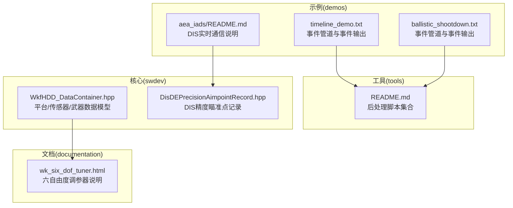
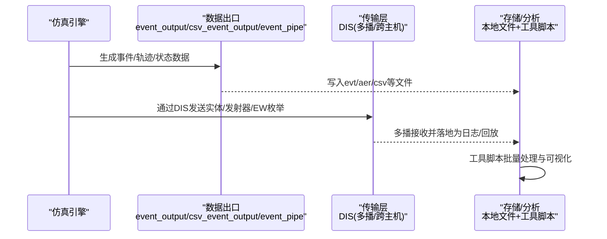
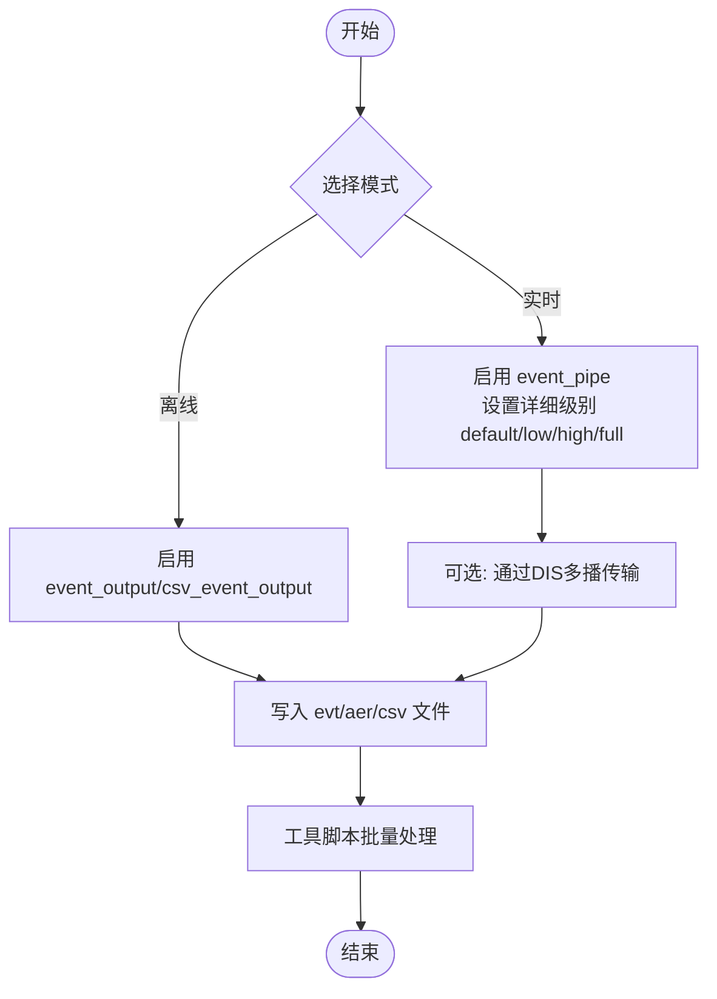
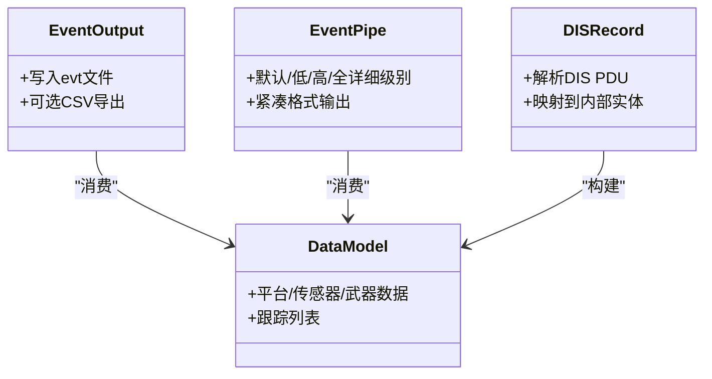
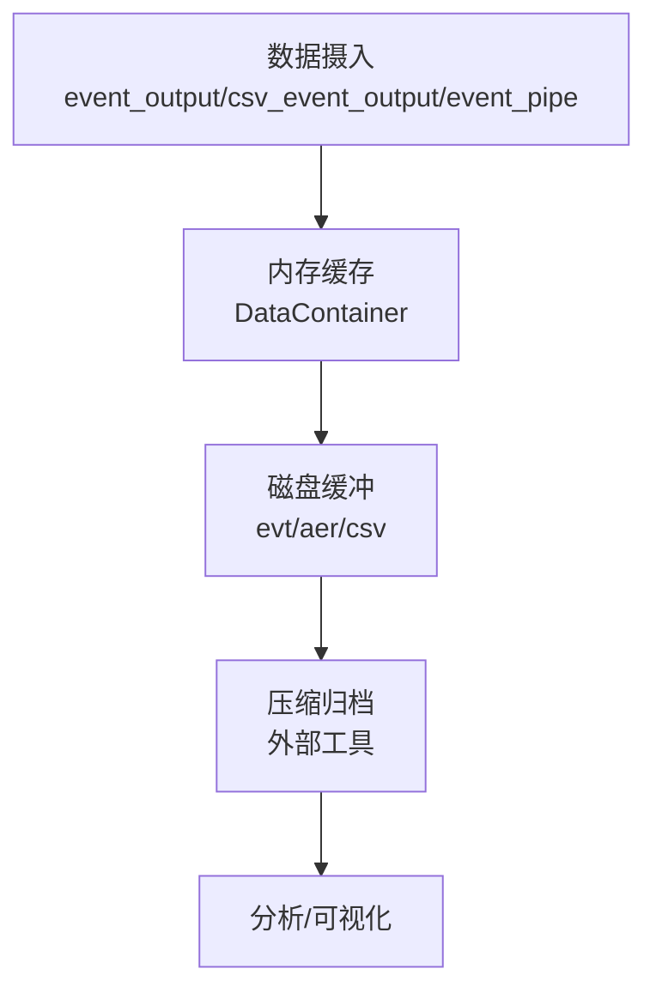
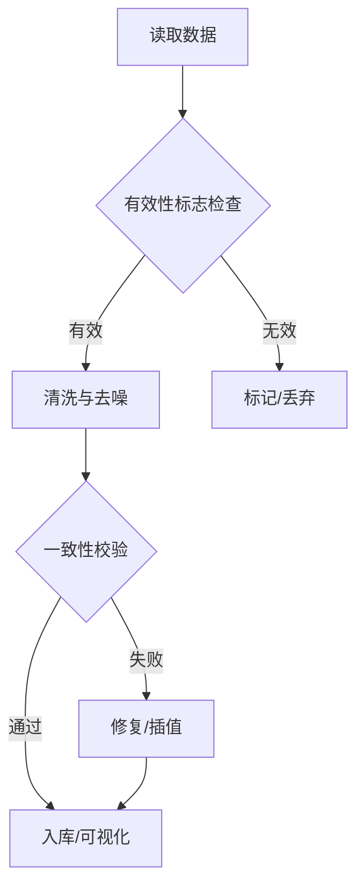
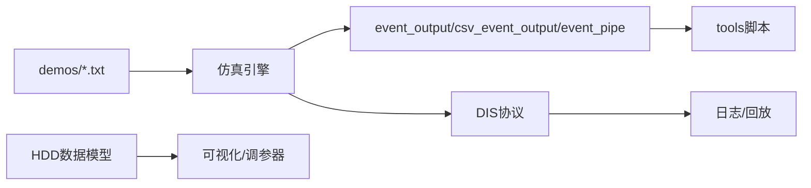

# 数据处理管道

<cite>
**本文引用的文件**   
- [tools/README.md](file://tools/README.md)
- [demos/aea_iads/README.md](file://demos/aea_iads/README.md)
- [demos/timeline/timeline_demo.txt](file://demos/timeline/timeline_demo.txt)
- [demos/ballistic_missile_shootdown/ballistic_shootdown.txt](file://demos/ballistic_missile_shootdown/ballistic_shootdown.txt)
- [swdev/src/tools/wkf/air_combat/wkf_air_combat_common/source/hdd/WkfHDD_DataContainer.hpp](file://swdev/src/tools/wkf/air_combat/wkf_air_combat_common/source/hdd/WkfHDD_DataContainer.hpp)
- [documentation/html/docs/wkf_plugin/wk_six_dof_tuner.html](file://documentation/html/docs/wkf_plugin/wk_six_dof_tuner.html)
</cite>

## 目录
1. [简介](#简介)
2. [项目结构](#项目结构)
3. [核心组件](#核心组件)
4. [架构总览](#架构总览)
5. [详细组件分析](#详细组件分析)
6. [依赖关系分析](#依赖关系分析)
7. [性能考虑](#性能考虑)
8. [故障排查指南](#故障排查指南)
9. [结论](#结论)
10. [附录](#附录)

## 简介
本文件面向AFSIM的数据处理管道，系统说明仿真数据的采集、传输与存储机制，覆盖实时数据流与离线批处理两种模式；阐述数据格式转换与标准化流程，以及子系统间的数据接口定义；文档化数据缓存策略（内存管理、磁盘缓冲与压缩）；解释数据质量控制（异常检测、清洗与完整性校验）；总结性能优化技术（并行计算、流水线调度与资源调度）；并提供数据分析工具与后处理脚本的使用指南，帮助用户进行仿真结果分析与可视化。

## 项目结构
AFSIM仓库中与数据处理相关的代码与示例主要分布在以下位置：
- tools：提供Python/Perl等后处理脚本与实用工具，用于对AFSIM输出进行批量处理与分析。
- demos：包含多种场景的输入与输出配置，演示事件输出、CSV输出与事件管道（event_pipe）等数据采集方式。
- swdev：核心实现与工具库，包含数据结构定义（如HDD数据容器）、DIS协议记录类型等。
- documentation：用户手册与插件文档，包含六自由度调参器（SixDOF Tuner）等工具的说明。

图表来源
- [demos/timeline/timeline_demo.txt:20-24](file://demos/timeline/timeline_demo.txt#L20-L24)
- [demos/ballistic_missile_shootdown/ballistic_shootdown.txt:12-19](file://demos/ballistic_missile_shootdown/ballistic_shootdown.txt#L12-L19)
- [demos/aea_iads/README.md:15-24](file://demos/aea_iads/README.md#L15-L24)
- [tools/README.md:1-10](file://tools/README.md#L1-L10)
- [swdev/src/tools/wkf/air_combat/wkf_air_combat_common/source/hdd/WkfHDD_DataContainer.hpp:1-22](file://swdev/src/tools/wkf/air_combat/wkf_air_combat_common/source/hdd/WkfHDD_DataContainer.hpp#L1-L22)
- [documentation/html/docs/wkf_plugin/wk_six_dof_tuner.html:86-114](file://documentation/html/docs/wkf_plugin/wk_six_dof_tuner.html#L86-L114)

章节来源
- [tools/README.md:1-10](file://tools/README.md#L1-L10)
- [demos/aea_iads/README.md:15-24](file://demos/aea_iads/README.md#L15-L24)
- [demos/timeline/timeline_demo.txt:20-24](file://demos/timeline/timeline_demo.txt#L20-L24)
- [demos/ballistic_missile_shootdown/ballistic_shootdown.txt:12-19](file://demos/ballistic_missile_shootdown/ballistic_shootdown.txt#L12-L19)

## 核心组件
- 事件输出(event_output)：将仿真事件写入文本或CSV文件，便于离线分析。
- CSV事件输出(csv_event_output)：结构化表格输出，适合批量处理与可视化。
- 事件管道(event_pipe)：以二进制或紧凑格式输出高吞吐量的实时数据流，支持不同详细级别（default/low/high/full）。
- DIS接口：通过DIS协议在多个WSF应用之间传输实体、发射器与电子战技术枚举等数据，支持多播与跨主机运行。
- 数据模型：HDD数据容器封装平台状态、导航、燃油、飞行控制、武器与目标跟踪等数据，供可视化工具使用。

章节来源
- [demos/timeline/timeline_demo.txt:20-24](file://demos/timeline/timeline_demo.txt#L20-L24)
- [demos/ballistic_missile_shootdown/ballistic_shootdown.txt:12-19](file://demos/ballistic_missile_shootdown/ballistic_shootdown.txt#L12-L19)
- [demos/aea_iads/README.md:15-24](file://demos/aea_iads/README.md#L15-L24)
- [swdev/src/tools/wkf/air_combat/wkf_air_combat_common/source/hdd/WkfHDD_DataContainer.hpp:29-81](file://swdev/src/tools/wkf/air_combat/wkf_air_combat_common/source/hdd/WkfHDD_DataContainer.hpp#L29-L81)

## 架构总览
AFSIM数据处理管道由“仿真引擎—数据出口—传输层—存储/分析”构成。仿真引擎产生平台、传感器与武器数据；数据出口包括事件输出、CSV输出与事件管道；传输层通过DIS协议在多应用间分发；存储与分析层由本地文件与工具脚本组成。

图表来源
- [demos/timeline/timeline_demo.txt:20-24](file://demos/timeline/timeline_demo.txt#L20-L24)
- [demos/ballistic_missile_shootdown/ballistic_shootdown.txt:12-19](file://demos/ballistic_missile_shootdown/ballistic_shootdown.txt#L12-L19)
- [demos/aea_iads/README.md:15-24](file://demos/aea_iads/README.md#L15-L24)
- [tools/README.md:1-10](file://tools/README.md#L1-L10)

## 详细组件分析

### 数据采集与传输机制
- 实时数据流（event_pipe）：在高吞吐场景下使用，支持预设详细级别（default/low/high/full），适用于大规模轨迹与传感器数据。
- 离线事件输出（event_output/csv_event_output）：适合事后分析与统计，CSV格式便于导入表格软件或Python/Pandas处理。
- DIS实时通信：多个WSF应用可通过DIS在同一主机或多主机上并发运行，使用多播地址与端口进行通信，Warlock可用于可视化监控。

图表来源
- [demos/ballistic_missile_shootdown/ballistic_shootdown.txt:12-19](file://demos/ballistic_missile_shootdown/ballistic_shootdown.txt#L12-L19)
- [demos/timeline/timeline_demo.txt:20-24](file://demos/timeline/timeline_demo.txt#L20-L24)
- [demos/aea_iads/README.md:15-24](file://demos/aea_iads/README.md#L15-L24)

章节来源
- [demos/ballistic_missile_shootdown/ballistic_shootdown.txt:12-19](file://demos/ballistic_missile_shootdown/ballistic_shootdown.txt#L12-L19)
- [demos/timeline/timeline_demo.txt:20-24](file://demos/timeline/timeline_demo.txt#L20-L24)
- [demos/aea_iads/README.md:15-24](file://demos/aea_iads/README.md#L15-L24)

### 数据格式转换与标准化
- 事件到CSV：csv_event_output将事件转换为结构化表格，字段可映射至平台ID、时间戳、位置、速度、航向等。
- 事件管道到文本/二进制：event_pipe输出紧凑格式，便于高效I/O与后续解析。
- DIS消息到内部模型：DIS记录（如精度瞄准点）被解析为内部实体与交互对象，供传感器与武器逻辑使用。

图表来源
- [demos/timeline/timeline_demo.txt:20-24](file://demos/timeline/timeline_demo.txt#L20-L24)
- [demos/ballistic_missile_shootdown/ballistic_shootdown.txt:12-19](file://demos/ballistic_missile_shootdown/ballistic_shootdown.txt#L12-L19)
- [swdev/src/tools/dis/source/DisDEPrecisionAimpointRecord.hpp:15-42](file://swdev/src/tools/dis/source/DisDEPrecisionAimpointRecord.hpp#L15-L42)
- [swdev/src/tools/wkf/air_combat/wkf_air_combat_common/source/hdd/WkfHDD_DataContainer.hpp:29-81](file://swdev/src/tools/wkf/air_combat/wkf_air_combat_common/source/hdd/WkfHDD_DataContainer.hpp#L29-L81)

章节来源
- [demos/timeline/timeline_demo.txt:20-24](file://demos/timeline/timeline_demo.txt#L20-L24)
- [demos/ballistic_missile_shootdown/ballistic_shootdown.txt:12-19](file://demos/ballistic_missile_shootdown/ballistic_shootdown.txt#L12-L19)
- [swdev/src/tools/dis/source/DisDEPrecisionAimpointRecord.hpp:15-42](file://swdev/src/tools/dis/source/DisDEPrecisionAimpointRecord.hpp#L15-L42)
- [swdev/src/tools/wkf/air_combat/wkf_air_combat_common/source/hdd/WkfHDD_DataContainer.hpp:29-81](file://swdev/src/tools/wkf/air_combat/wkf_air_combat_common/source/hdd/WkfHDD_DataContainer.hpp#L29-L81)

### 数据缓存策略（内存、磁盘与压缩）
- 内存管理：HDD数据容器集中维护平台、导航、燃油、飞行控制、武器与跟踪数据，便于UI与可视化快速访问。
- 磁盘缓冲：event_pipe与event_output按时间步或事件触发落盘，避免频繁IO；CSV输出适合批量写入。
- 压缩技术：event_pipe采用紧凑格式以降低体积与提升吞吐；外部工具可对evt/aer/csv进行归档与压缩。

图表来源
- [swdev/src/tools/wkf/air_combat/wkf_air_combat_common/source/hdd/WkfHDD_DataContainer.hpp:290-330](file://swdev/src/tools/wkf/air_combat/wkf_air_combat_common/source/hdd/WkfHDD_DataContainer.hpp#L290-L330)
- [demos/timeline/timeline_demo.txt:20-24](file://demos/timeline/timeline_demo.txt#L20-L24)
- [demos/ballistic_missile_shootdown/ballistic_shootdown.txt:12-19](file://demos/ballistic_missile_shootdown/ballistic_shootdown.txt#L12-L19)

章节来源
- [swdev/src/tools/wkf/air_combat/wkf_air_combat_common/source/hdd/WkfHDD_DataContainer.hpp:290-330](file://swdev/src/tools/wkf/air_combat/wkf_air_combat_common/source/hdd/WkfHDD_DataContainer.hpp#L290-L330)
- [demos/timeline/timeline_demo.txt:20-24](file://demos/timeline/timeline_demo.txt#L20-L24)
- [demos/ballistic_missile_shootdown/ballistic_shootdown.txt:12-19](file://demos/ballistic_missile_shootdown/ballistic_shootdown.txt#L12-L19)

### 数据质量控制（异常检测、清洗与完整性验证）
- 异常检测：通过有效性标志位（如latLonValid、altitudeValid、rangeValid等）判断数据是否有效；对无效数据进行过滤或插值。
- 数据清洗：基于阈值与一致性检查（如速度、高度、航向范围）剔除噪声；结合传感器与跟踪处理器进行去重与关联。
- 完整性验证：确保事件序列的时间顺序与实体ID一致性；对缺失帧进行补全或标记。

图表来源
- [swdev/src/tools/wkf/air_combat/wkf_air_combat_common/source/hdd/WkfHDD_DataContainer.hpp:38-69](file://swdev/src/tools/wkf/air_combat/wkf_air_combat_common/source/hdd/WkfHDD_DataContainer.hpp#L38-L69)

章节来源
- [swdev/src/tools/wkf/air_combat/wkf_air_combat_common/source/hdd/WkfHDD_DataContainer.hpp:38-69](file://swdev/src/tools/wkf/air_combat/wkf_air_combat_common/source/hdd/WkfHDD_DataContainer.hpp#L38-L69)

### 性能优化（并行、流水线与资源调度）
- 并行计算：多WSF应用通过DIS并发运行，可在同一主机或多主机上扩展规模。
- 流水线调度：event_pipe与event_output可并行写入，减少主循环阻塞；CSV输出适合异步批处理。
- 资源调度：根据场景规模调整event_pipe详细级别与输出频率，平衡吞吐与存储压力。

章节来源
- [demos/aea_iads/README.md:15-24](file://demos/aea_iads/README.md#L15-L24)
- [demos/timeline/timeline_demo.txt:20-24](file://demos/timeline/timeline_demo.txt#L20-L24)
- [demos/ballistic_missile_shootdown/ballistic_shootdown.txt:12-19](file://demos/ballistic_missile_shootdown/ballistic_shootdown.txt#L12-L19)

### 数据分析工具与后处理脚本
- tools目录提供Python/Perl脚本，用于批量处理AFSIM输出，支持事件提取、汇总、过滤与可视化。
- 推荐流程：从evt/aer/csv中抽取关键指标，进行统计分析、趋势图与热力图绘制。

章节来源
- [tools/README.md:1-10](file://tools/README.md#L1-L10)

### 可视化与调参（六自由度调参器）
- SixDOF Tuner提供PID控制器参数调节、命令下发与实时观测界面，支持连续命令与时间管理命令。
- 调参过程涉及目标状态设定、误差权重与超调权重等优化参数，帮助提升平台姿态与轨迹控制质量。

章节来源
- [documentation/html/docs/wkf_plugin/wk_six_dof_tuner.html:86-114](file://documentation/html/docs/wkf_plugin/wk_six_dof_tuner.html#L86-L114)
- [documentation/html/docs/wkf_plugin/wk_six_dof_tuner.html:125-144](file://documentation/html/docs/wkf_plugin/wk_six_dof_tuner.html#L125-L144)

## 依赖关系分析
- 示例与工具：demos中的输入文件驱动仿真引擎，输出evt/aer/csv；tools脚本消费这些文件进行分析。
- 核心数据模型：HDD数据容器为可视化与UI提供统一数据视图，依赖平台/传感器/武器数据。
- DIS协议：DIS记录类型作为网络传输的底层数据结构，支撑多应用间的实时通信。

图表来源
- [demos/timeline/timeline_demo.txt:20-24](file://demos/timeline/timeline_demo.txt#L20-L24)
- [demos/ballistic_missile_shootdown/ballistic_shootdown.txt:12-19](file://demos/ballistic_missile_shootdown/ballistic_shootdown.txt#L12-L19)
- [swdev/src/tools/wkf/air_combat/wkf_air_combat_common/source/hdd/WkfHDD_DataContainer.hpp:290-330](file://swdev/src/tools/wkf/air_combat/wkf_air_combat_common/source/hdd/WkfHDD_DataContainer.hpp#L290-L330)
- [documentation/html/docs/wkf_plugin/wk_six_dof_tuner.html:86-114](file://documentation/html/docs/wkf_plugin/wk_six_dof_tuner.html#L86-L114)

## 性能考虑
- I/O吞吐：优先使用event_pipe降低序列化开销；合理设置详细级别以避免过度输出。
- 内存占用：按需加载HDD数据子集，避免一次性载入全部跟踪与资产列表。
- 并行扩展：利用DIS多播将负载分散到多个进程/主机，提高整体仿真规模。
- 批处理效率：CSV输出适合离线分析，但需注意文件体积与解析成本。

## 故障排查指南
- 无输出文件：检查event_output/csv_event_output/event_pipe是否正确启用与路径变量替换。
- 数据不完整：确认有效性标志位与时间戳连续性；必要时启用更详细的event_pipe级别。
- DIS通信失败：核对多播地址、端口与防火墙设置；确保各WSF应用正确配置dis_interface。
- 可视化卡顿：减少同时可视化的实体数量；分时段加载数据或使用时间控制器。

章节来源
- [demos/timeline/timeline_demo.txt:20-24](file://demos/timeline/timeline_demo.txt#L20-L24)
- [demos/ballistic_missile_shootdown/ballistic_shootdown.txt:12-19](file://demos/ballistic_missile_shootdown/ballistic_shootdown.txt#L12-L19)
- [demos/aea_iads/README.md:15-24](file://demos/aea_iads/README.md#L15-L24)

## 结论
AFSIM的数据处理管道通过事件输出、CSV输出与事件管道实现了灵活的采集与传输能力，并结合DIS协议支持分布式实时通信。HDD数据模型为可视化与分析提供了统一的数据视图。借助tools目录的后处理脚本与SixDOF调参器等工具，用户能够高效完成仿真结果的清洗、分析与可视化。在实际工程中，建议根据场景规模选择合适的输出模式与详细级别，配合并行与流水线优化，以获得最佳的性能与可维护性。

## 附录
- 常用命令参考：
  - event_output：启用事件输出，指定文件路径与内容项。
  - csv_event_output：启用CSV事件输出，便于表格化处理。
  - event_pipe：启用事件管道，设置详细级别与输出文件。
- 典型用法：
  - 单应用离线仿真：启用event_output与csv_event_output，运行后使用tools脚本分析。
  - 多应用实时仿真：启用DIS多播，使用Warlock监控；event_pipe输出高吞吐数据。

章节来源
- [demos/timeline/timeline_demo.txt:20-24](file://demos/timeline/timeline_demo.txt#L20-L24)
- [demos/ballistic_missile_shootdown/ballistic_shootdown.txt:12-19](file://demos/ballistic_missile_shootdown/ballistic_shootdown.txt#L12-L19)
- [demos/aea_iads/README.md:15-24](file://demos/aea_iads/README.md#L15-L24)
- [tools/README.md:1-10](file://tools/README.md#L1-L10)