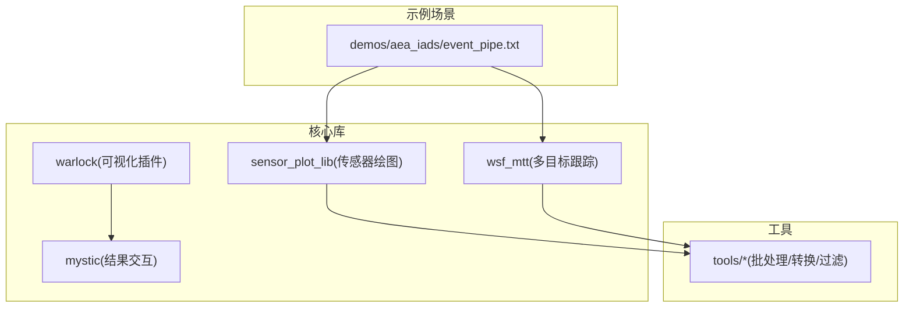
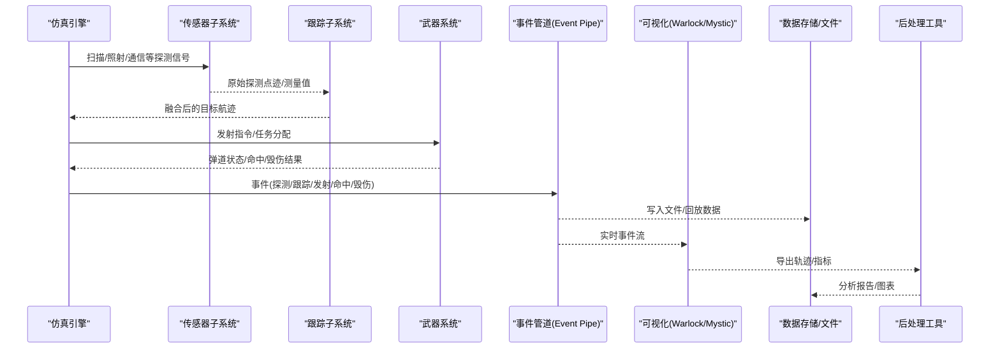
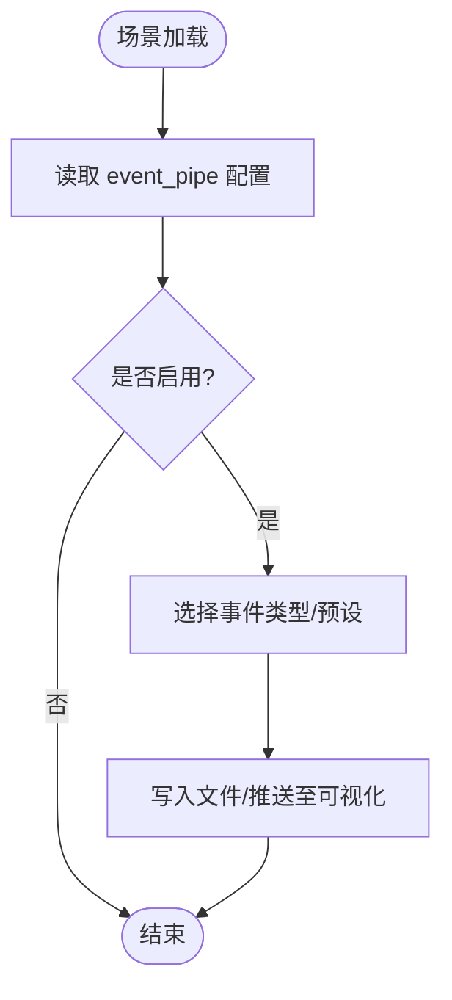
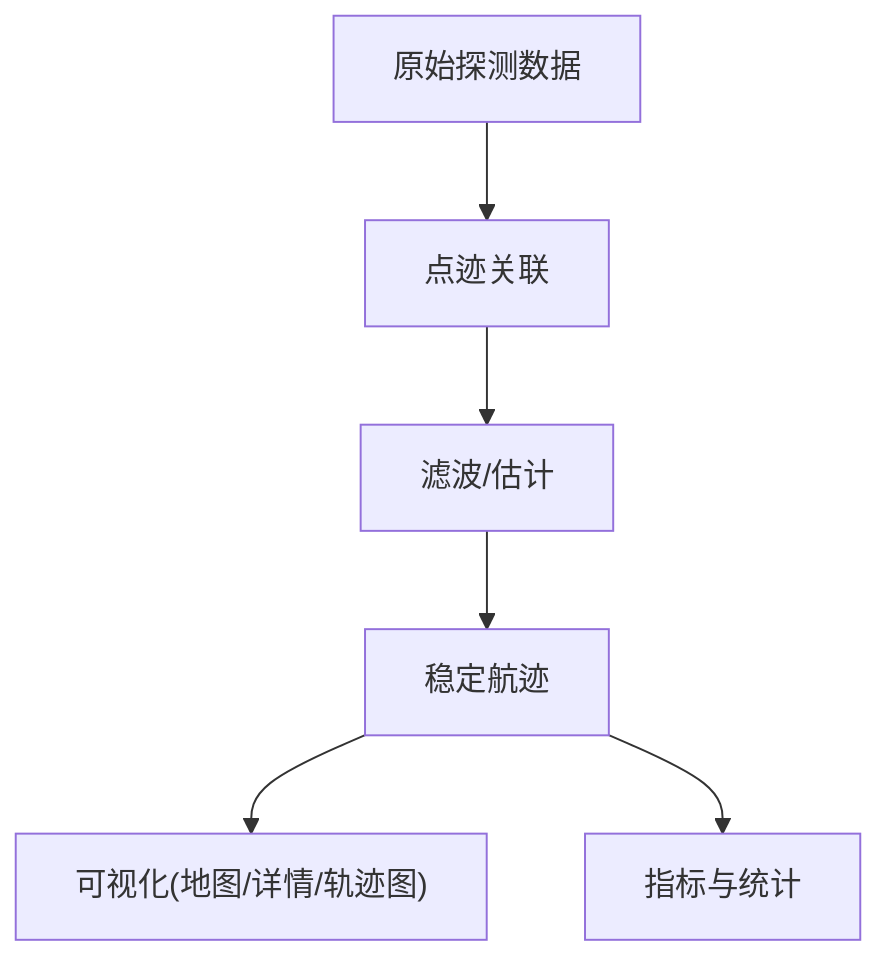
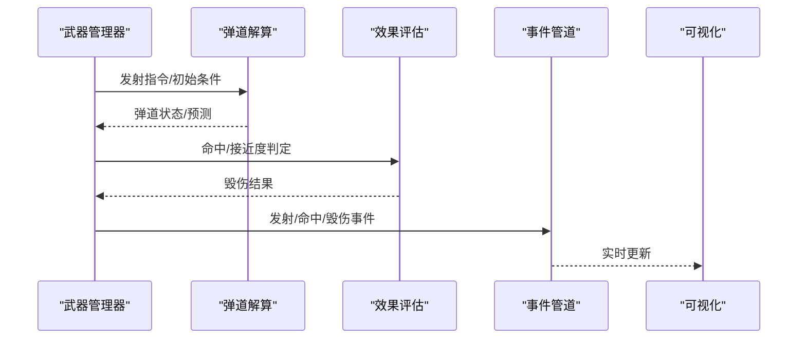
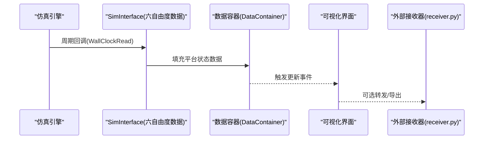
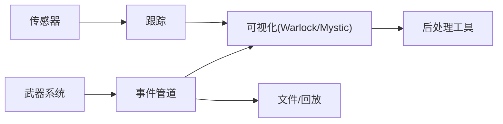
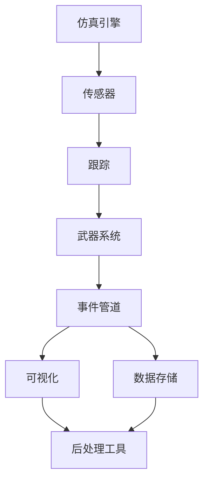

# 数据流架构

<cite>
**本文引用的文件**   
- [event_pipe.txt](file://demos/aea_iads/event_pipe.txt)
- [README.md](file://swdev/src/core/sensor_plot_lib/README.md)
- [README.md](file://swdev/src/core/wsf_mtt/README.md)
- [SixDOF_DataSimInterface.cpp](file://swdev/src/warlock/plugins/SixDOF_Data/source/SixDOF_DataSimInterface.cpp)
- [P6DOF_DataSimInterface.hpp](file://swdev/src/warlock/plugins/P6DOF_Controller/source/P6DOF_ControllerDataContainer.cpp)
- [RvPlatformDataDockWidget.cpp](file://swdev/src/mystic/lib/source/RvPlatformDataDockWidget.cpp)
- [receiver.py](file://training/developer/core/labs/solution/observer/receiver.py)
</cite>

## 目录
1. [简介](#简介)
2. [项目结构](#项目结构)
3. [核心组件](#核心组件)
4. [架构总览](#架构总览)
5. [详细组件分析](#详细组件分析)
6. [依赖关系分析](#依赖关系分析)
7. [性能考虑](#性能考虑)
8. [故障排查指南](#故障排查指南)
9. [结论](#结论)
10. [附录](#附录)

## 简介
本文件面向AFSIM的数据流架构，聚焦仿真数据的产生、传输与处理全链路。内容涵盖：
- 事件管道（Event Pipe）的缓冲策略与实时输出机制
- 传感器探测到目标跟踪的数据链路与缓存
- 武器系统从发射指令到弹道计算与效果评估的数据传递
- 可视化与数据存储的输出路径
- 数据分析与后处理工具使用指南

## 项目结构
仓库采用“示例场景 + 核心库 + 插件 + 工具”的分层组织方式：
- demos：大量可运行场景，包含事件管道配置与典型数据流用例
- swdev/src：核心库与插件实现，包括传感器绘图库、多目标跟踪、六自由度运动模型、Warlock/Mystic可视化插件等
- tools：数据处理与分析脚本集合
- documentation：用户与开发者文档

图表来源
- [event_pipe.txt:1-15](file://demos/aea_iads/event_pipe.txt#L1-L15)
- [README.md](file://swdev/src/core/sensor_plot_lib/README.md)
- [README.md](file://swdev/src/core/wsf_mtt/README.md)

章节来源
- [event_pipe.txt:1-15](file://demos/aea_iads/event_pipe.txt#L1-L15)
- [README.md](file://swdev/src/core/sensor_plot_lib/README.md)
- [README.md](file://swdev/src/core/wsf_mtt/README.md)

## 核心组件
- 事件管道（Event Pipe）
  - 负责将仿真事件以结构化格式输出至文件或网络端口，供外部系统或可视化工具消费
  - 通过场景配置文件启用并选择消息类型
- 传感器与跟踪子系统
  - 传感器生成原始探测数据，跟踪器进行关联与滤波，形成稳定航迹
  - 提供轨迹历史、指标曲线与贡献传感器可视化
- 武器系统数据流
  - 发射指令经武器管理器调度，进入弹道解算与命中/毁伤评估模块
- 可视化与结果交互
  - Warlock/Mystic插件订阅仿真事件，渲染地图、轨迹与平台详情
- 数据导出与后处理
  - 支持CSV/文本事件输出，配合tools脚本进行批量分析与可视化

章节来源
- [event_pipe.txt:1-15](file://demos/aea_iads/event_pipe.txt#L1-L15)
- [README.md](file://swdev/src/core/sensor_plot_lib/README.md)
- [README.md](file://swdev/src/core/wsf_mtt/README.md)

## 架构总览
下图展示从仿真引擎到可视化与数据存储的完整数据路径，以及事件管道的关键节点。

图表来源
- [event_pipe.txt:1-15](file://demos/aea_iads/event_pipe.txt#L1-L15)
- [SixDOF_DataSimInterface.cpp:39-128](file://swdev/src/warlock/plugins/SixDOF_Data/source/SixDOF_DataSimInterface.cpp#L39-L128)
- [P6DOF_DataSimInterface.hpp:25-41](file://swdev/src/warlock/plugins/P6DOF_Controller/source/P6DOF_ControllerDataContainer.cpp#L1-L37)
- [RvPlatformDataDockWidget.cpp:36-41](file://swdev/src/mystic/lib/source/RvPlatformDataDockWidget.cpp#L36-L41)

## 详细组件分析

### 事件管道（Event Pipe）
- 作用
  - 统一输出仿真事件，支持文件回放与实时分发
  - 通过场景配置选择输出内容与预设
- 配置要点
  - 指定输出文件与预设（如 default），控制事件类别与频率
- 典型用法
  - 在场景中启用 event_pipe，并指向 replay.aer 等回放文件

图表来源
- [event_pipe.txt:1-15](file://demos/aea_iads/event_pipe.txt#L1-L15)

章节来源
- [event_pipe.txt:1-15](file://demos/aea_iads/event_pipe.txt#L1-L15)

### 传感器数据到目标跟踪链路
- 数据流
  - 传感器产生原始探测（点迹/测量值）
  - 跟踪器执行关联、滤波与航迹维持
  - 输出稳定航迹与指标（距离、方位、速度估计等）
- 可视化
  - 地图显示本地航迹图标
  - 平台详情面板列出主航迹与传感器航迹
  - 支持轨迹追踪与指标绘制
- 关键点
  - 传感器绘图库提供雷达包络、覆盖范围等辅助能力
  - 多目标跟踪库支撑复杂场景下的航迹管理

图表来源
- [README.md](file://swdev/src/core/sensor_plot_lib/README.md)
- [README.md](file://swdev/src/core/wsf_mtt/README.md)

章节来源
- [README.md](file://swdev/src/core/sensor_plot_lib/README.md)
- [README.md](file://swdev/src/core/wsf_mtt/README.md)

### 武器系统数据流（发射—弹道—效果评估）
- 流程
  - 武器管理器接收发射指令，完成目标分配与任务编排
  - 弹道模块计算飞行轨迹、制导律与再入段
  - 效果评估模块判定命中概率与毁伤等级
- 数据接口
  - 通过仿真事件与平台属性更新向可视化与存储输出
  - 六自由度数据插件周期性采集平台状态并转换为事件

图表来源
- [SixDOF_DataSimInterface.cpp:39-128](file://swdev/src/warlock/plugins/SixDOF_Data/source/SixDOF_DataSimInterface.cpp#L39-L128)

章节来源
- [SixDOF_DataSimInterface.cpp:39-128](file://swdev/src/warlock/plugins/SixDOF_Data/source/SixDOF_DataSimInterface.cpp#L39-L128)

### 实时数据流与可视化
- 数据订阅
  - Warlock/Mystic插件通过仿真接口订阅平台新增/删除与周期更新事件
  - 将平台状态（姿态、速度、过载、燃料等）转化为UI可渲染的数据
- 交互
  - 平台详情面板展示主航迹与传感器航迹列表
  - 右键菜单支持轨迹追踪与指标绘制
- 外部接收
  - 可通过UDP套接字接收仿真输出的文本事件，便于二次开发

图表来源
- [P6DOF_DataSimInterface.hpp:25-41](file://swdev/src/warlock/plugins/P6DOF_Controller/source/P6DOF_ControllerDataContainer.cpp#L1-L37)
- [SixDOF_DataSimInterface.cpp:39-128](file://swdev/src/warlock/plugins/SixDOF_Data/source/SixDOF_DataSimInterface.cpp#L39-L128)
- [RvPlatformDataDockWidget.cpp:36-41](file://swdev/src/mystic/lib/source/RvPlatformDataDockWidget.cpp#L36-L41)
- [receiver.py:1-24](file://training/developer/core/labs/solution/observer/receiver.py#L1-L24)

章节来源
- [P6DOF_DataSimInterface.hpp:25-41](file://swdev/src/warlock/plugins/P6DOF_Controller/source/P6DOF_ControllerDataContainer.cpp#L1-L37)
- [SixDOF_DataSimInterface.cpp:39-128](file://swdev/src/warlock/plugins/SixDOF_Data/source/SixDOF_DataSimInterface.cpp#L39-L128)
- [RvPlatformDataDockWidget.cpp:36-41](file://swdev/src/mystic/lib/source/RvPlatformDataDockWidget.cpp#L36-L41)
- [receiver.py:1-24](file://training/developer/core/labs/solution/observer/receiver.py#L1-L24)

## 依赖关系分析
- 组件耦合
  - 事件管道与可视化强耦合（实时事件驱动）
  - 传感器与跟踪子系统相对独立，通过标准航迹接口交互
  - 武器系统与弹道/效果评估通过事件与平台状态解耦
- 外部依赖
  - 可视化依赖Warlock/Mystic插件体系
  - 后处理依赖tools脚本与通用文件格式（CSV/文本）

图表来源
- [event_pipe.txt:1-15](file://demos/aea_iads/event_pipe.txt#L1-L15)
- [README.md](file://swdev/src/core/sensor_plot_lib/README.md)
- [README.md](file://swdev/src/core/wsf_mtt/README.md)

章节来源
- [event_pipe.txt:1-15](file://demos/aea_iads/event_pipe.txt#L1-L15)
- [README.md](file://swdev/src/core/sensor_plot_lib/README.md)
- [README.md](file://swdev/src/core/wsf_mtt/README.md)

## 性能考虑
- 事件管道
  - 合理选择事件类型与输出频率，避免I/O瓶颈
  - 对高频事件采用批写与压缩回放文件
- 传感器与跟踪
  - 调整关联阈值与滤波参数，降低误关联与计算开销
  - 对大规模点迹采用分层处理与区域裁剪
- 可视化
  - 按需订阅平台与指标，减少不必要的数据刷新
  - 使用增量更新与降采样绘制长时轨迹
- 武器系统
  - 弹道解算与效果评估异步化，避免阻塞主循环
  - 命中/毁伤事件合并与去抖

[本节为通用指导，不直接分析具体文件]

## 故障排查指南
- 事件未输出
  - 检查场景中的 event_pipe 配置是否启用与预设是否正确
  - 确认输出文件路径权限与磁盘空间
- 可视化无数据
  - 确认Warlock/Mystic插件已加载且订阅了相应事件
  - 检查平台名称与ID映射是否正确
- 外部接收异常
  - 核对UDP端口与协议是否与仿真输出一致
  - 检查防火墙与网络连通性

章节来源
- [event_pipe.txt:1-15](file://demos/aea_iads/event_pipe.txt#L1-L15)
- [receiver.py:1-24](file://training/developer/core/labs/solution/observer/receiver.py#L1-L24)

## 结论
AFSIM的数据流架构以事件管道为核心枢纽，串联传感器、跟踪、武器系统与可视化/存储。通过模块化设计与插件体系，既保证了高内聚低耦合，又提供了灵活的扩展能力。结合tools后处理工具，可实现从原始探测到战术决策的全链路数据分析与可视化。

[本节为总结性内容，不直接分析具体文件]

## 附录
- 数据流图（概念）

[此图为概念示意，不对应具体源码文件]