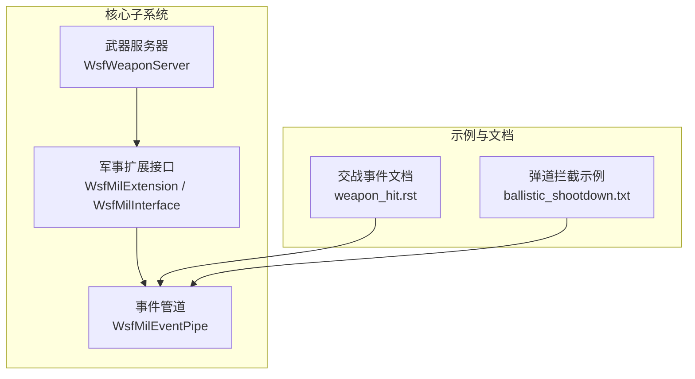
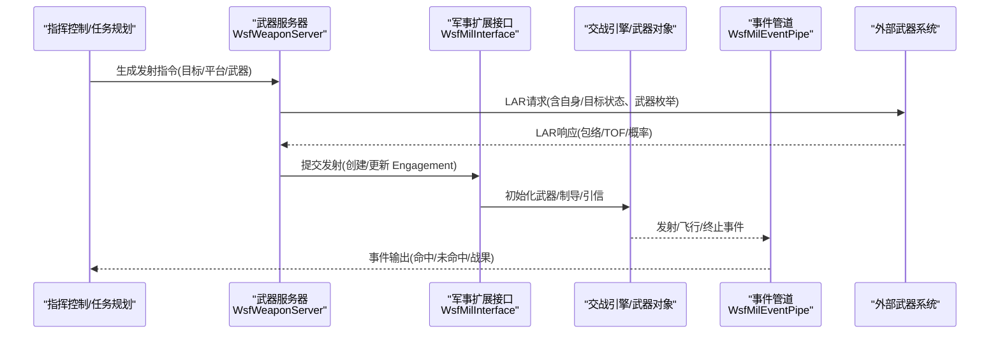
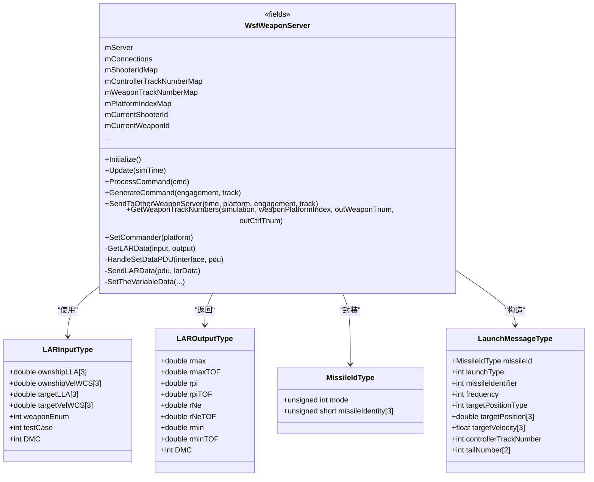
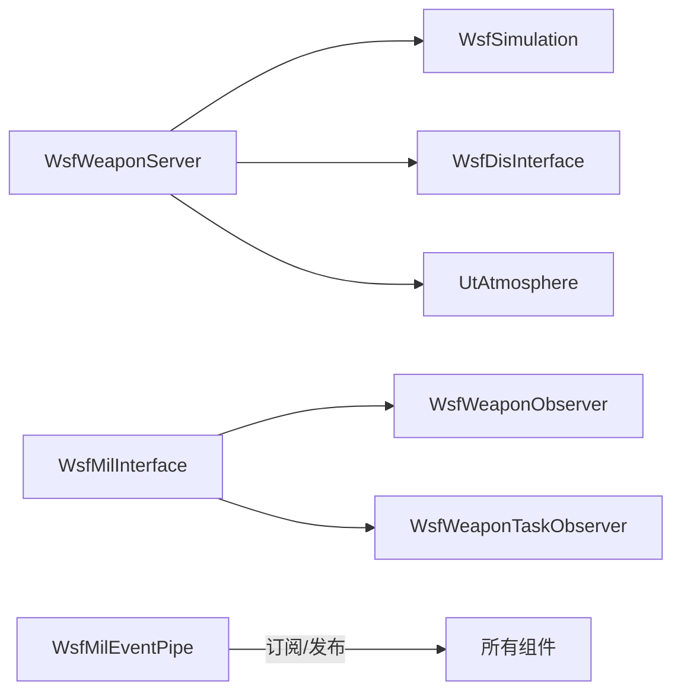
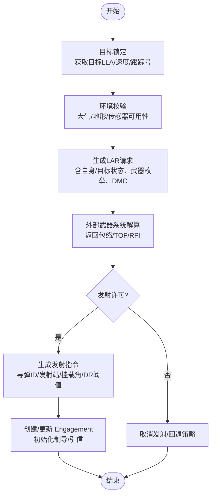
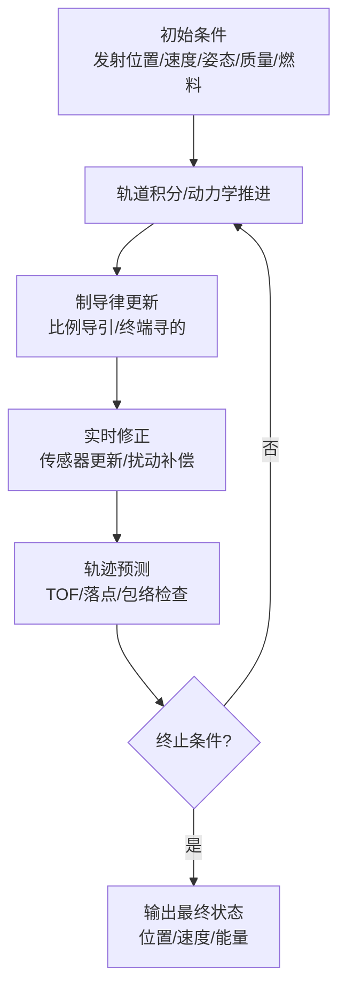
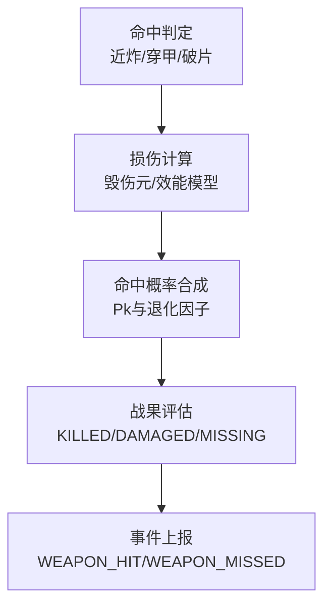
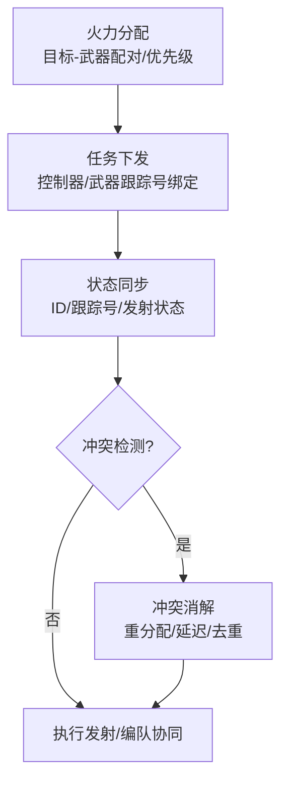

# 武器数据流

<cite>
**本文引用的文件**   
- [WsfWeaponServer.hpp](file://swdev/src/core/wsf_weapon_server/source/WsfWeaponServer.hpp)
- [WsfMil.hpp](file://swdev/src/core/wsf_mil/source/WsfMil.hpp)
- [WsfMilEventPipe.hpp](file://swdev/src/core/wsf_mil/source/WsfMilEventPipe.hpp)
- [weapon_hit.rst](file://swdev/src/engage/doc/engage_event/weapon_hit.rst)
- [ballistic_shootdown.txt](file://demos/ballistic_missile_shootdown/ballistic_shootdown.txt)
</cite>

## 目录
1. [简介](#简介)
2. [项目结构](#项目结构)
3. [核心组件](#核心组件)
4. [架构总览](#架构总览)
5. [详细组件分析](#详细组件分析)
6. [依赖关系分析](#依赖关系分析)
7. [性能考虑](#性能考虑)
8. [故障排查指南](#故障排查指南)
9. [结论](#结论)
10. [附录](#附录)

## 简介
本文件面向AFSIM武器系统的数据流，围绕以下目标展开：
- 武器发射指令的生成与传递机制（目标锁定、发射许可、火控解算）
- 弹道计算的数据流（初始条件获取、轨迹预测、实时修正）
- 武器效果评估的数据处理（命中判定、损伤计算、战果评估）
- 多武器协同作战的数据同步（火力分配、冲突避免）
- 武器仿真精度验证方法（弹道对比分析、误差统计分析）
- 武器性能测试与分析工具使用指南

## 项目结构
与武器数据流直接相关的代码与文档主要分布在以下位置：
- 核心武器服务与接口：core/wsf_weapon_server、core/wsf_mil
- 事件管道与观测：core/wsf_mil/source/WsfMilEventPipe.hpp
- 交战事件定义与输出格式：engage/doc/engage_event/weapon_hit.rst
- 示例场景与事件输出配置：demos/ballistic_missile_shootdown/ballistic_shootdown.txt

图表来源
- [WsfWeaponServer.hpp:106-437](file://swdev/src/core/wsf_weapon_server/source/WsfWeaponServer.hpp#L106-L437)
- [WsfMil.hpp:62-156](file://swdev/src/core/wsf_mil/source/WsfMil.hpp#L62-L156)
- [WsfMilEventPipe.hpp:31-163](file://swdev/src/core/wsf_mil/source/WsfMilEventPipe.hpp#L31-L163)
- [weapon_hit.rst:12-147](file://swdev/src/engage/doc/engage_event/weapon_hit.rst#L12-L147)
- [ballistic_shootdown.txt:1-28](file://demos/ballistic_missile_shootdown/ballistic_shootdown.txt#L1-L28)

章节来源
- [WsfWeaponServer.hpp:106-437](file://swdev/src/core/wsf_weapon_server/source/WsfWeaponServer.hpp#L106-L437)
- [WsfMil.hpp:62-156](file://swdev/src/core/wsf_mil/source/WsfMil.hpp#L62-L156)
- [WsfMilEventPipe.hpp:31-163](file://swdev/src/core/wsf_mil/source/WsfMilEventPipe.hpp#L31-L163)
- [weapon_hit.rst:12-147](file://swdev/src/engage/doc/engage_event/weapon_hit.rst#L12-L147)
- [ballistic_shootdown.txt:1-28](file://demos/ballistic_missile_shootdown/ballistic_shootdown.txt#L1-L28)

## 核心组件
- 武器服务器（WsfWeaponServer）
  - 负责外部武器系统通信（TCP/DIS）、LAR（Launch Authorization Request）数据交换、发射ID与跟踪号管理、与仿真和DIS接口的集成。
  - 关键能力：命令生成与解析、LAR输入/输出结构体、导弹ID与遥测变量、平台索引映射、控制器/武器跟踪号映射。
- 军事扩展接口（WsfMilExtension / WsfMilInterface）
  - 提供武器类型、武器效应、制导程序、电子战等类型管理器；在仿真生命周期中注册观察者与任务处理器。
- 事件管道（WsfMilEventPipe）
  - 订阅并广播武器相关事件（选择、开/关、发射、终止、模式激活/停用、数量变化、干扰请求等），用于可视化、记录与外部系统集成。

章节来源
- [WsfWeaponServer.hpp:106-437](file://swdev/src/core/wsf_weapon_server/source/WsfWeaponServer.hpp#L106-L437)
- [WsfMil.hpp:62-156](file://swdev/src/core/wsf_mil/source/WsfMil.hpp#L62-L156)
- [WsfMilEventPipe.hpp:31-163](file://swdev/src/core/wsf_mil/source/WsfMilEventPipe.hpp#L31-L163)

## 架构总览
武器数据流贯穿“目标锁定—发射许可—火控解算—弹道飞行—效果评估—结果上报”的全链路。

图表来源
- [WsfWeaponServer.hpp:240-294](file://swdev/src/core/wsf_weapon_server/source/WsfWeaponServer.hpp#L240-L294)
- [WsfMil.hpp:119-156](file://swdev/src/core/wsf_mil/source/WsfMil.hpp#L119-L156)
- [WsfMilEventPipe.hpp:45-87](file://swdev/src/core/wsf_mil/source/WsfMilEventPipe.hpp#L45-L87)

## 详细组件分析

### 武器服务器（WsfWeaponServer）
- 职责
  - 维护外部武器系统连接（TCP/客户端/服务端模式）。
  - 解析并生成LAR数据（包含自身/目标LLA与速度、武器枚举、DMC等）。
  - 管理导弹ID、发射站、挂载角、DR时间阈值、模拟时间等上下文。
  - 将内部Engagement与外部实体ID进行映射，支持DIS ID覆盖与尾号。
- 关键数据结构
  - LARInputType/LAROutputType：LAR请求/响应的核心字段（最大/最小包络、RPI、TOF、DMC等）。
  - MissileIdType/InitVariablesType/UmbilicalVariablesType/LaunchVariablesType/TelemetryVariablesType：导弹全生命周期变量。
  - LaunchMessageType：发射消息（目标位置/速度、控制器跟踪号、尾号等）。
- 交互点
  - 通过GetWeaponTrackNumbers、SendToOtherWeaponServer、GenerateCommand等方法与仿真和外部系统对接。
  - 通过UniqueWeaponKey对“射手+控制器+武器”进行唯一标识，避免多武器并发冲突。

图表来源
- [WsfWeaponServer.hpp:140-238](file://swdev/src/core/wsf_weapon_server/source/WsfWeaponServer.hpp#L140-L238)
- [WsfWeaponServer.hpp:240-437](file://swdev/src/core/wsf_weapon_server/source/WsfWeaponServer.hpp#L240-L437)

章节来源
- [WsfWeaponServer.hpp:140-238](file://swdev/src/core/wsf_weapon_server/source/WsfWeaponServer.hpp#L140-L238)
- [WsfWeaponServer.hpp:240-437](file://swdev/src/core/wsf_weapon_server/source/WsfWeaponServer.hpp#L240-L437)

### 军事扩展接口（WsfMilExtension / WsfMilInterface）
- 职责
  - 管理武器类型、武器效应、制导程序、电子战效果等类型库。
  - 在仿真运行期注册武器观察者与任务观察者，统一调度武器状态变更与任务执行。
- 关键点
  - GetWeaponTypes()/GetWeaponEffectsTypes()暴露类型访问入口。
  - WeaponObserver/WeaponTaskObserver提供武器生命周期回调钩子。

章节来源
- [WsfMil.hpp:62-116](file://swdev/src/core/wsf_mil/source/WsfMil.hpp#L62-L116)
- [WsfMil.hpp:119-156](file://swdev/src/core/wsf_mil/source/WsfMil.hpp#L119-L156)

### 事件管道（WsfMilEventPipe）
- 职责
  - 订阅并广播武器相关事件：选择、开/关、发射、终止、模式激活/停用、数量变化、干扰请求等。
  - 为可视化、日志与外部系统提供标准化事件流。
- 关键方法
  - WeaponFireRequested/Fired/Terminated、WeaponTurnedOn/Off、WeaponModeActivated/Deactivated、JammingRequestInitiated/Updated/Canceled等。

章节来源
- [WsfMilEventPipe.hpp:31-163](file://swdev/src/core/wsf_mil/source/WsfMilEventPipe.hpp#L31-L163)

### 交战事件与输出（weapon_hit.rst）
- 说明
  - WEAPON_HIT/WEAPON_MISSED事件输出格式，包含发射方/目标信息、交战序号、开始时间、Pk（命中概率）及退化因子、距离/坐标/速度等几何与运动学参数。
  - 区分隐式/显式交战时的字段差异。

章节来源
- [weapon_hit.rst:12-147](file://swdev/src/engage/doc/engage_event/weapon_hit.rst#L12-L147)

### 示例场景（ballistic_shootdown.txt）
- 说明
  - 展示如何启用event_output与event_pipe，并包含平台类型与对抗脚本（红方弹道导弹、蓝方反导拦截）。
  - 可用于复现弹道拦截与武器事件输出。

章节来源
- [ballistic_shootdown.txt:1-28](file://demos/ballistic_missile_shootdown/ballistic_shootdown.txt#L1-L28)

## 依赖关系分析
- 组件耦合
  - WsfWeaponServer依赖WsfSimulation与WsfDisInterface以接入仿真与DIS网络。
  - WsfMilInterface持有WsfWeaponObserver与WsfWeaponTaskObserver，统一管理武器状态与任务。
  - WsfMilEventPipe作为事件总线，被武器系统各阶段回调触发。
- 外部依赖
  - TCP/DIS协议栈（由上层基础设施提供）。
  - 大气模型（UtAtmosphere）用于LAR解算与环境修正。

图表来源
- [WsfWeaponServer.hpp:24-44](file://swdev/src/core/wsf_weapon_server/source/WsfWeaponServer.hpp#L24-L44)
- [WsfMil.hpp:119-156](file://swdev/src/core/wsf_mil/source/WsfMil.hpp#L119-L156)
- [WsfMilEventPipe.hpp:31-163](file://swdev/src/core/wsf_mil/source/WsfMilEventPipe.hpp#L31-L163)

章节来源
- [WsfWeaponServer.hpp:24-44](file://swdev/src/core/wsf_weapon_server/source/WsfWeaponServer.hpp#L24-L44)
- [WsfMil.hpp:119-156](file://swdev/src/core/wsf_mil/source/WsfMil.hpp#L119-L156)
- [WsfMilEventPipe.hpp:31-163](file://swdev/src/core/wsf_mil/source/WsfMilEventPipe.hpp#L31-L163)

## 性能考虑
- 线程安全
  - 武器服务器当前非线程安全，需避免多线程并发调用其API；通过AddedToSimulation/UpdateAsServer等钩子在单线程上下文中更新。
- 事件风暴
  - 高频武器事件（如干扰请求更新、模式切换）可能产生大量事件；建议合理设置事件订阅粒度与采样频率。
- I/O瓶颈
  - 外部武器系统通信（TCP/DIS）在高并发下可能成为瓶颈；可考虑批量发送与异步处理策略。

[本节为通用指导，不直接分析具体文件]

## 故障排查指南
- 常见问题
  - LAR请求失败：检查LAR输入字段（自身/目标LLA与速度、武器枚举、DMC）是否完整有效。
  - 发射ID冲突：确认UniqueWeaponKey（射手+控制器+武器）唯一性，避免重复ID导致状态错乱。
  - 事件缺失：检查WsfMilEventPipe订阅配置与事件开关，确保WeaponFireRequested/Fired/Terminated等回调已注册。
- 定位手段
  - 启用调试输出（mDebugSetData、错误/警告字符串）查看LAR与SetData PDU处理过程。
  - 通过event_output与event_pipe输出比对，确认事件序列是否符合预期。

章节来源
- [WsfWeaponServer.hpp:373-437](file://swdev/src/core/wsf_weapon_server/source/WsfWeaponServer.hpp#L373-L437)
- [WsfMilEventPipe.hpp:45-87](file://swdev/src/core/wsf_mil/source/WsfMilEventPipe.hpp#L45-L87)

## 结论
AFSIM武器数据流以WsfWeaponServer为核心对外接口，结合WsfMilInterface的类型管理与WsfMilEventPipe的事件总线，形成从目标锁定、发射许可、火控解算到弹道飞行与效果评估的闭环。通过标准化的LAR结构与事件输出，既支持外部武器系统集成，也便于仿真内观测与分析。在多武器协同场景中，应重点关注ID唯一性与事件订阅粒度，以确保数据一致性与性能稳定。

[本节为总结性内容，不直接分析具体文件]

## 附录

### 武器发射指令生成与传递流程（目标锁定—发射许可—火控解算）

图表来源
- [WsfWeaponServer.hpp:140-238](file://swdev/src/core/wsf_weapon_server/source/WsfWeaponServer.hpp#L140-L238)
- [WsfMil.hpp:119-156](file://swdev/src/core/wsf_mil/source/WsfMil.hpp#L119-L156)

### 弹道计算数据流（初始条件—轨迹预测—实时修正）

图表来源
- [WsfWeaponServer.hpp:169-224](file://swdev/src/core/wsf_weapon_server/source/WsfWeaponServer.hpp#L169-L224)
- [WsfMil.hpp:62-116](file://swdev/src/core/wsf_mil/source/WsfMil.hpp#L62-L116)

### 武器效果评估数据处理（命中判定—损伤计算—战果评估）

图表来源
- [weapon_hit.rst:83-147](file://swdev/src/engage/doc/engage_event/weapon_hit.rst#L83-L147)

### 多武器协同作战数据同步（火力分配—冲突避免）

图表来源
- [WsfWeaponServer.hpp:306-350](file://swdev/src/core/wsf_weapon_server/source/WsfWeaponServer.hpp#L306-L350)

### 武器仿真精度验证方法
- 弹道对比分析
  - 基于event_pipe输出的轨迹点（位置/速度/姿态）与参考弹道进行逐点对比，计算RMSE、最大偏差、TOE误差等指标。
- 误差统计分析
  - 对多次仿真样本统计Pk分布、落点散布椭圆、TOF偏差均值与方差，评估模型稳定性与一致性。
- 工具建议
  - 使用event_filter/evt_summary等工具提取与汇总事件，结合Python脚本进行可视化与统计。

[本节为通用指导，不直接分析具体文件]

### 武器性能测试与分析工具使用指南
- 启用事件输出
  - 在场景文件中启用event_output与event_pipe，选择合适的预设（default/low/high/full）以平衡数据量与细节。
- 典型用例
  - 弹道拦截示例：参考ballistic_shootdown.txt，观察拦截弹的发射、飞行与命中事件。
- 数据分析
  - 通过event_pipe输出（.aer/.evt）提取武器状态与轨迹，绘制包络曲线、Pk随时间变化图、命中率统计等。

章节来源
- [ballistic_shootdown.txt:1-28](file://demos/ballistic_missile_shootdown/ballistic_shootdown.txt#L1-L28)