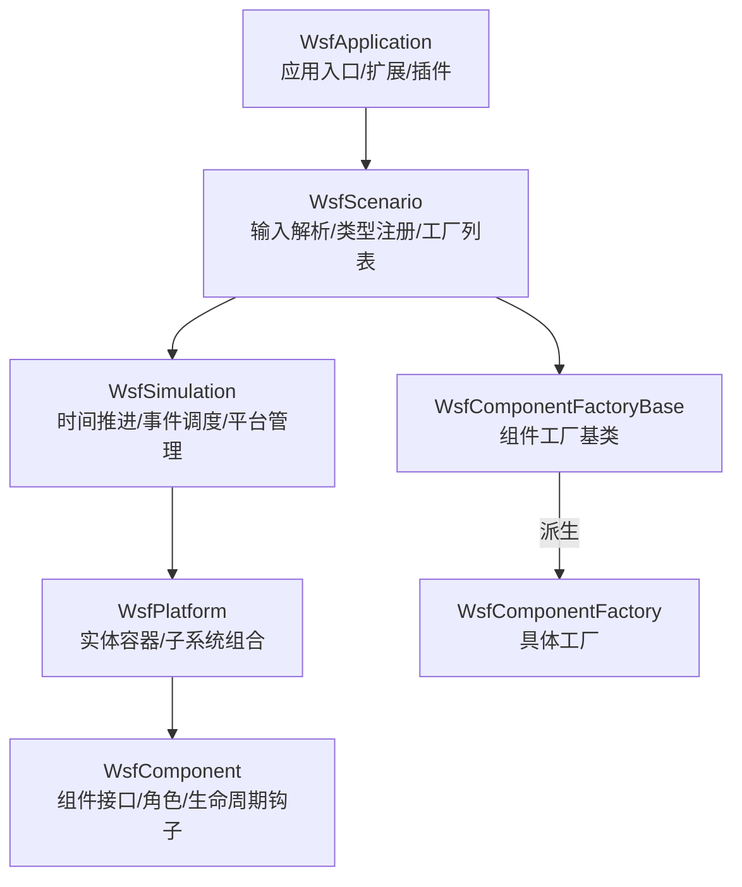
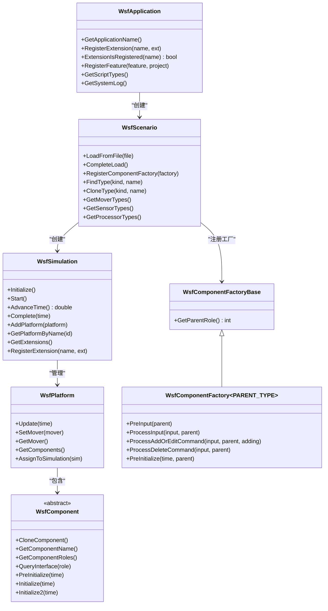
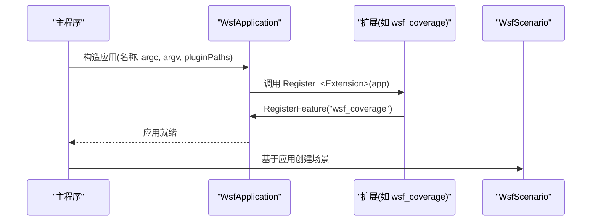
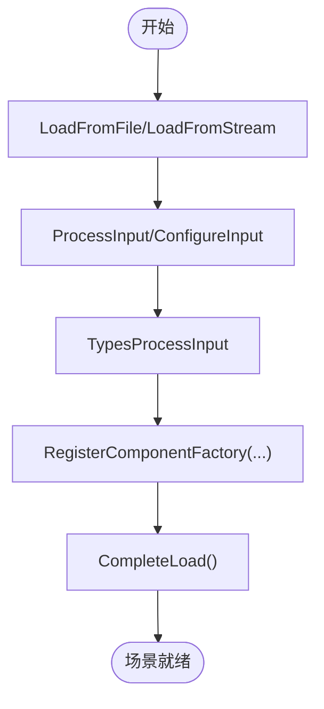
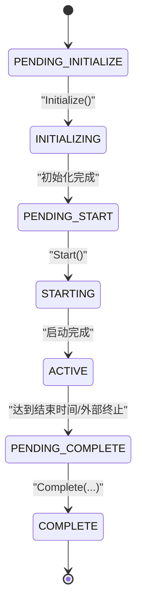
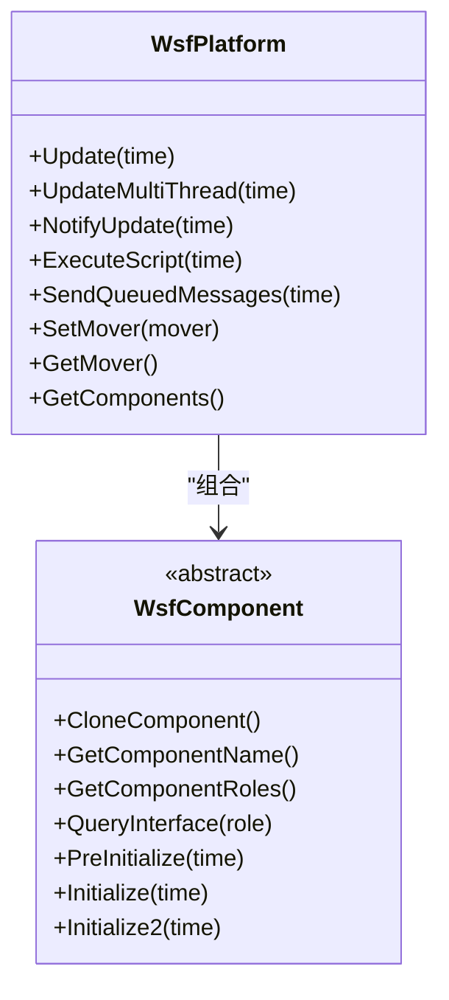
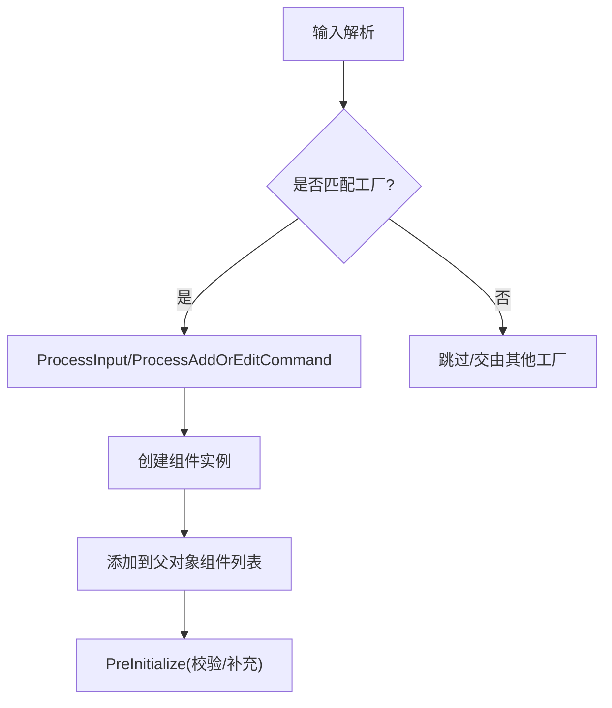
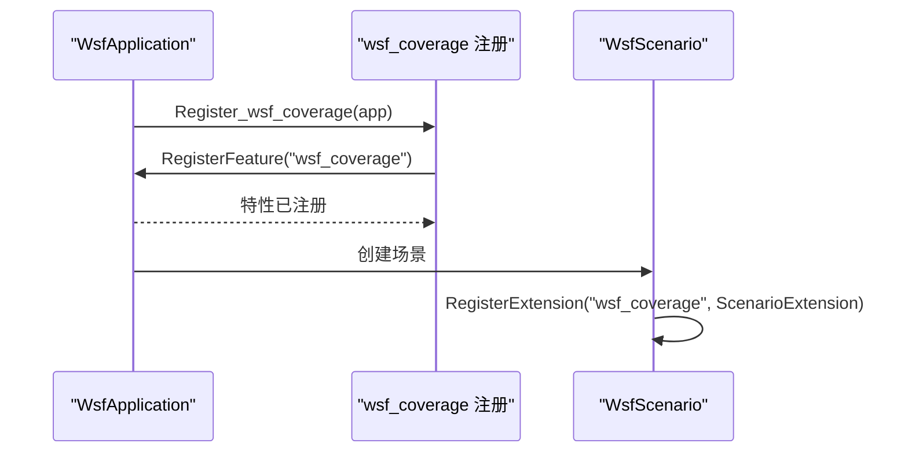
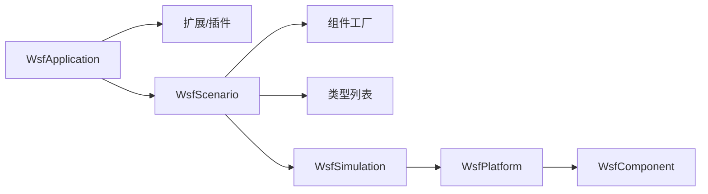

# WSF框架核心

<cite>
**本文引用的文件**   
- [WsfApplication.hpp](file://swdev/src/core/wsf/source/WsfApplication.hpp)
- [WsfScenario.hpp](file://swdev/src/core/wsf/source/WsfScenario.hpp)
- [WsfSimulation.hpp](file://swdev/src/core/wsf/source/WsfSimulation.hpp)
- [WsfPlatform.hpp](file://swdev/src/core/wsf/source/WsfPlatform.hpp)
- [WsfComponent.hpp](file://swdev/src/core/wsf/source/WsfComponent.hpp)
- [WsfComponentFactory.hpp](file://swdev/src/core/wsf/source/WsfComponentFactory.hpp)
- [WsfCoverageRegistration.cpp](file://swdev/src/wsf_plugins/wsf_coverage/source/WsfCoverageRegistration.cpp)
</cite>

## 目录
1. [简介](#简介)
2. [项目结构](#项目结构)
3. [核心组件](#核心组件)
4. [架构总览](#架构总览)
5. [详细组件分析](#详细组件分析)
6. [依赖关系分析](#依赖关系分析)
7. [性能考量](#性能考量)
8. [故障排查指南](#故障排查指南)
9. [结论](#结论)
10. [附录](#附录)

## 简介
本文件面向WSF（Warfare Simulation Framework）框架的核心设计与实现，聚焦以下目标：
- 应用程序生命周期管理：初始化、运行与销毁流程
- 组件系统的设计模式：组件注册、发现与生命周期管理
- 组件工厂机制：动态创建与管理仿真对象
- 扩展系统：插件加载与接口定义
- 自定义扩展示例：如何创建自定义组件并扩展WSF功能
- 架构图表：核心组件间的依赖关系与交互流程

## 项目结构
WSF核心位于 swdev/src/core/wsf，围绕应用、场景、仿真、平台与组件五大层次组织。扩展与插件通过 WsfApplicationExtension / WsfScenarioExtension / WsfSimulationExtension 等扩展点接入。

图示来源
- [WsfApplication.hpp:32-44](file://swdev/src/core/wsf/source/WsfApplication.hpp#L32-L44)
- [WsfScenario.hpp:109-122](file://swdev/src/core/wsf/source/WsfScenario.hpp#L109-L122)
- [WsfSimulation.hpp:91-106](file://swdev/src/core/wsf/source/WsfSimulation.hpp#L91-L106)
- [WsfPlatform.hpp:66-115](file://swdev/src/core/wsf/source/WsfPlatform.hpp#L66-L115)
- [WsfComponent.hpp:35-112](file://swdev/src/core/wsf/source/WsfComponent.hpp#L35-L112)
- [WsfComponentFactory.hpp:23-49](file://swdev/src/core/wsf/source/WsfComponentFactory.hpp#L23-L49)

章节来源
- [WsfApplication.hpp:32-44](file://swdev/src/core/wsf/source/WsfApplication.hpp#L32-L44)
- [WsfScenario.hpp:109-122](file://swdev/src/core/wsf/source/WsfScenario.hpp#L109-L122)
- [WsfSimulation.hpp:91-106](file://swdev/src/core/wsf/source/WsfSimulation.hpp#L91-L106)
- [WsfPlatform.hpp:66-115](file://swdev/src/core/wsf/source/WsfPlatform.hpp#L66-L115)
- [WsfComponent.hpp:35-112](file://swdev/src/core/wsf/source/WsfComponent.hpp#L35-L112)
- [WsfComponentFactory.hpp:23-49](file://swdev/src/core/wsf/source/WsfComponentFactory.hpp#L23-L49)

## 核心组件
- WsfApplication：应用级单例，负责扩展注册、特性声明、脚本类型与系统日志，以及插件管理器。
- WsfScenario：场景对象，负责输入解析、类型列表维护、组件工厂注册与查找、脚本环境。
- WsfSimulation：仿真控制器，负责时间推进、事件队列、平台增删、观察者与扩展。
- WsfPlatform：平台实体，作为子系统容器，提供组件管理与更新循环。
- WsfComponent：通用组件抽象，定义克隆、名称、角色与查询接口，以及可选的初始化钩子。
- WsfComponentFactoryBase/WsfComponentFactory：组件工厂体系，支持按父角色进行输入处理与预初始化。

章节来源
- [WsfApplication.hpp:32-44](file://swdev/src/core/wsf/source/WsfApplication.hpp#L32-L44)
- [WsfScenario.hpp:109-122](file://swdev/src/core/wsf/source/WsfScenario.hpp#L109-L122)
- [WsfSimulation.hpp:91-106](file://swdev/src/core/wsf/source/WsfSimulation.hpp#L91-L106)
- [WsfPlatform.hpp:66-115](file://swdev/src/core/wsf/source/WsfPlatform.hpp#L66-L115)
- [WsfComponent.hpp:35-112](file://swdev/src/core/wsf/source/WsfComponent.hpp#L35-L112)
- [WsfComponentFactory.hpp:23-49](file://swdev/src/core/wsf/source/WsfComponentFactory.hpp#L23-L49)

## 架构总览
WSF采用“应用-场景-仿真-平台-组件”的分层架构，配合扩展点与工厂机制实现松耦合与可插拔。

图示来源
- [WsfApplication.hpp:32-44](file://swdev/src/core/wsf/source/WsfApplication.hpp#L32-L44)
- [WsfScenario.hpp:109-122](file://swdev/src/core/wsf/source/WsfScenario.hpp#L109-L122)
- [WsfSimulation.hpp:91-106](file://swdev/src/core/wsf/source/WsfSimulation.hpp#L91-L106)
- [WsfPlatform.hpp:66-115](file://swdev/src/core/wsf/source/WsfPlatform.hpp#L66-L115)
- [WsfComponent.hpp:35-112](file://swdev/src/core/wsf/source/WsfComponent.hpp#L35-L112)
- [WsfComponentFactory.hpp:23-49](file://swdev/src/core/wsf/source/WsfComponentFactory.hpp#L23-L49)

## 详细组件分析

### 应用程序生命周期（WsfApplication）
- 职责：应用级扩展注册、特性声明、脚本类型与系统日志、命令行参数处理、插件路径管理。
- 关键点：
  - 单例约束与应用名
  - 扩展注册与依赖声明
  - 特性注册供条件编译或运行时检测
  - 为场景与仿真创建提供上下文

图示来源
- [WsfApplication.hpp:76-80](file://swdev/src/core/wsf/source/WsfApplication.hpp#L76-L80)
- [WsfCoverageRegistration.cpp:40-44](file://swdev/src/wsf_plugins/wsf_coverage/source/WsfCoverageRegistration.cpp#L40-L44)

章节来源
- [WsfApplication.hpp:76-80](file://swdev/src/core/wsf/source/WsfApplication.hpp#L76-L80)
- [WsfCoverageRegistration.cpp:40-44](file://swdev/src/wsf_plugins/wsf_coverage/source/WsfCoverageRegistration.cpp#L40-L44)

### 场景与输入解析（WsfScenario）
- 职责：从输入流/文件加载场景，构建类型列表，注册组件工厂，提供 FindType/CloneType 能力。
- 关键点：
  - CompleteLoad 后场景进入不可变状态
  - 组件工厂列表用于在输入阶段动态创建子系统
  - 脚本环境与类型系统集中管理

图示来源
- [WsfScenario.hpp:129-136](file://swdev/src/core/wsf/source/WsfScenario.hpp#L129-L136)
- [WsfScenario.hpp:198-202](file://swdev/src/core/wsf/source/WsfScenario.hpp#L198-L202)

章节来源
- [WsfScenario.hpp:129-136](file://swdev/src/core/wsf/source/WsfScenario.hpp#L129-L136)
- [WsfScenario.hpp:198-202](file://swdev/src/core/wsf/source/WsfScenario.hpp#L198-L202)

### 仿真控制与时间推进（WsfSimulation）
- 职责：仿真状态机、事件调度、平台生命周期、观察者与扩展。
- 关键点：
  - State 枚举：PENDING_INITIALIZE -> INITIALIZING -> PENDING_START -> STARTING -> ACTIVE -> PENDING_COMPLETE -> COMPLETE
  - Initialize/Start/Complete 构成标准生命周期
  - AdvanceTime/ShouldExecute 驱动主循环
  - AddPlatform/DeletePlatform 管理实体
  - Observer 与 Extension 提供横切能力

图示来源
- [WsfSimulation.hpp:111-131](file://swdev/src/core/wsf/source/WsfSimulation.hpp#L111-L131)
- [WsfSimulation.hpp:181-223](file://swdev/src/core/wsf/source/WsfSimulation.hpp#L181-L223)

章节来源
- [WsfSimulation.hpp:111-131](file://swdev/src/core/wsf/source/WsfSimulation.hpp#L111-L131)
- [WsfSimulation.hpp:181-223](file://swdev/src/core/wsf/source/WsfSimulation.hpp#L181-L223)

### 平台与组件系统（WsfPlatform & WsfComponent）
- 职责：平台作为实体容器，组合多个子系统（传感器、处理器、通信等），统一更新与脚本执行。
- 关键点：
  - Update/UpdateMultiThread/NotifyUpdate/ExecuteScript/SendQueuedMessages 提供更新管线
  - Component 接口定义克隆、名称、角色与查询；支持 PreInitialize/Initialize/Initialize2 钩子
  - 组件通过 QueryInterface 按角色获取具体类型指针

图示来源
- [WsfPlatform.hpp:165-206](file://swdev/src/core/wsf/source/WsfPlatform.hpp#L165-L206)
- [WsfComponent.hpp:35-112](file://swdev/src/core/wsf/source/WsfComponent.hpp#L35-L112)

章节来源
- [WsfPlatform.hpp:165-206](file://swdev/src/core/wsf/source/WsfPlatform.hpp#L165-L206)
- [WsfComponent.hpp:35-112](file://swdev/src/core/wsf/source/WsfComponent.hpp#L35-L112)

### 组件工厂机制（WsfComponentFactoryBase / WsfComponentFactory）
- 职责：在输入阶段根据父角色（如平台）动态创建组件，支持命令解析与预初始化校验。
- 关键点：
  - ParentRole 决定工厂适用的父对象类型
  - ProcessInput/ProcessAddOrEditCommand/ProcessDeleteCommand 处理输入语法
  - PreInitialize 允许在父对象初始化前做必要检查或补充组件

图示来源
- [WsfComponentFactory.hpp:23-49](file://swdev/src/core/wsf/source/WsfComponentFactory.hpp#L23-L49)
- [WsfComponentFactory.hpp:51-106](file://swdev/src/core/wsf/source/WsfComponentFactory.hpp#L51-L106)

章节来源
- [WsfComponentFactory.hpp:23-49](file://swdev/src/core/wsf/source/WsfComponentFactory.hpp#L23-L49)
- [WsfComponentFactory.hpp:51-106](file://swdev/src/core/wsf/source/WsfComponentFactory.hpp#L51-L106)

### 扩展系统与插件加载（Application/Scenario/Simulation 扩展）
- 应用扩展（WsfApplicationExtension）：在应用级别注册特性、脚本类型等。
- 场景扩展（WsfScenarioExtension）：在场景创建时注入扩展逻辑。
- 仿真扩展（WsfSimulationExtension）：在仿真生命周期中扩展行为。
- 插件注册示例：wsf_coverage 通过 Register_wsf_coverage 向应用注册特性与扩展。

图示来源
- [WsfCoverageRegistration.cpp:24-35](file://swdev/src/wsf_plugins/wsf_coverage/source/WsfCoverageRegistration.cpp#L24-L35)
- [WsfCoverageRegistration.cpp:40-44](file://swdev/src/wsf_plugins/wsf_coverage/source/WsfCoverageRegistration.cpp#L40-L44)

章节来源
- [WsfCoverageRegistration.cpp:24-35](file://swdev/src/wsf_plugins/wsf_coverage/source/WsfCoverageRegistration.cpp#L24-L35)
- [WsfCoverageRegistration.cpp:40-44](file://swdev/src/wsf_plugins/wsf_coverage/source/WsfCoverageRegistration.cpp#L40-L44)

## 依赖关系分析
- 耦合关系：
  - WsfApplication 持有扩展列表与插件管理器，低耦合地对外暴露扩展与特性能力
  - WsfScenario 聚合类型列表与工厂列表，解耦输入解析与对象创建
  - WsfSimulation 管理平台与事件，通过观察者与扩展点降低对具体模型的耦合
  - WsfPlatform 组合 WsfComponent，通过角色接口实现多态
- 外部依赖：
  - 脚本系统（UtScriptTypes/UtScriptEnvironment）
  - 随机数、时间、日志等工具库
  - 各类领域模型（传感器、处理器、通信等）通过类型列表与工厂注册

图示来源
- [WsfApplication.hpp:32-44](file://swdev/src/core/wsf/source/WsfApplication.hpp#L32-L44)
- [WsfScenario.hpp:109-122](file://swdev/src/core/wsf/source/WsfScenario.hpp#L109-L122)
- [WsfSimulation.hpp:91-106](file://swdev/src/core/wsf/source/WsfSimulation.hpp#L91-L106)
- [WsfPlatform.hpp:66-115](file://swdev/src/core/wsf/source/WsfPlatform.hpp#L66-L115)
- [WsfComponent.hpp:35-112](file://swdev/src/core/wsf/source/WsfComponent.hpp#L35-L112)

章节来源
- [WsfApplication.hpp:32-44](file://swdev/src/core/wsf/source/WsfApplication.hpp#L32-L44)
- [WsfScenario.hpp:109-122](file://swdev/src/core/wsf/source/WsfScenario.hpp#L109-L122)
- [WsfSimulation.hpp:91-106](file://swdev/src/core/wsf/source/WsfSimulation.hpp#L91-L106)
- [WsfPlatform.hpp:66-115](file://swdev/src/core/wsf/source/WsfPlatform.hpp#L66-L115)
- [WsfComponent.hpp:35-112](file://swdev/src/core/wsf/source/WsfComponent.hpp#L35-L112)

## 性能考量
- 事件驱动 vs 步进式：WsfSimulation 支持事件驱动与固定步长两种模式，合理选择可减少不必要的计算。
- 多线程：WsfSimulation 提供 MultiThreadingActive 标志与相关管理器，适合将独立子系统并行化。
- 更新锁与批量更新：WsfPlatform 提供 UpdateLocked 与批量更新接口，避免并发更新冲突。
- 随机数隔离：仿真与脚本使用独立的随机源，避免相互干扰。
- 观察者与扩展：谨慎添加观察者与扩展回调，避免在热路径上执行重逻辑。

[本节为通用指导，不直接分析具体文件]

## 故障排查指南
- 仿真未启动或提前结束：
  - 检查 State 是否为 ACTIVE，确认 Initialize/Start/Complete 调用顺序正确
  - 查看 CompletionReason 判断是否达到结束时间或被终止
- 平台未出现或无法访问：
  - 确认 AddPlatform 调用时机与索引有效性
  - 使用 GetPlatformByIndex/GetPlatformByName 安全获取
- 组件未初始化：
  - 检查组件的 PreInitialize/Initialize/Initialize2 钩子是否成功返回
  - 验证工厂是否正确注册且输入命令被识别
- 扩展未生效：
  - 确认扩展已在应用或场景中注册
  - 检查特性是否已注册并通过条件判断

章节来源
- [WsfSimulation.hpp:111-131](file://swdev/src/core/wsf/source/WsfSimulation.hpp#L111-L131)
- [WsfSimulation.hpp:223-257](file://swdev/src/core/wsf/source/WsfSimulation.hpp#L223-L257)
- [WsfPlatform.hpp:165-206](file://swdev/src/core/wsf/source/WsfPlatform.hpp#L165-L206)
- [WsfComponent.hpp:102-112](file://swdev/src/core/wsf/source/WsfComponent.hpp#L102-L112)

## 结论
WSF以清晰的分层架构与可扩展的组件/工厂/扩展机制，提供了强大的仿真建模与集成能力。通过 Application/Scenario/Simulation 的生命周期管理，结合组件的角色化接口与工厂的动态创建，开发者可以灵活地扩展仿真能力，同时保持系统的可维护性与高性能。

[本节为总结性内容，不直接分析具体文件]

## 附录

### 创建自定义组件与扩展WSF功能的步骤
- 定义组件类：继承自 WsfComponent 或 WsfPlatformComponent，实现 CloneComponent/GetComponentName/GetComponentRoles/QueryInterface 等接口，并在需要时实现 PreInitialize/Initialize/Initialize2。
- 注册组件工厂：为组件编写 WsfComponentFactory<PARENT_TYPE> 派生类，实现 ProcessInput/ProcessAddOrEditCommand/ProcessDeleteCommand/PreInitialize，并在场景初始化前通过 WsfScenario::RegisterComponentFactory 注册。
- 扩展应用/场景：如需在应用或场景层面扩展，继承 WsfApplicationExtension/WsfScenarioExtension，并在应用启动时通过 WSF_REGISTER_EXTENSION 或显式调用 Register_<Extension> 注册。
- 示例参考：wsf_coverage 插件展示了如何在应用启动时注册特性与场景扩展。

章节来源
- [WsfComponent.hpp:35-112](file://swdev/src/core/wsf/source/WsfComponent.hpp#L35-L112)
- [WsfComponentFactory.hpp:51-106](file://swdev/src/core/wsf/source/WsfComponentFactory.hpp#L51-L106)
- [WsfScenario.hpp:198-202](file://swdev/src/core/wsf/source/WsfScenario.hpp#L198-L202)
- [WsfCoverageRegistration.cpp:24-35](file://swdev/src/wsf_plugins/wsf_coverage/source/WsfCoverageRegistration.cpp#L24-L35)
- [WsfCoverageRegistration.cpp:40-44](file://swdev/src/wsf_plugins/wsf_coverage/source/WsfCoverageRegistration.cpp#L40-L44)