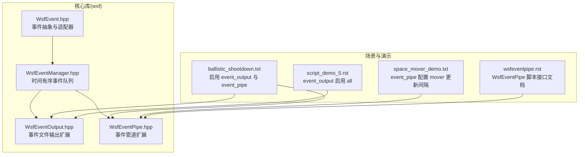
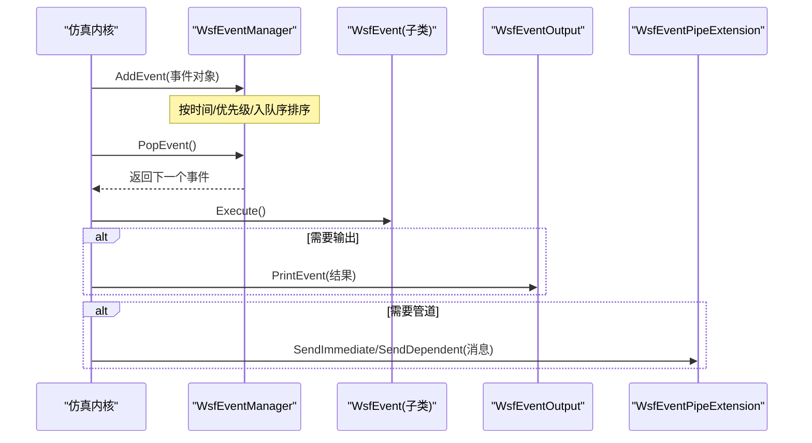
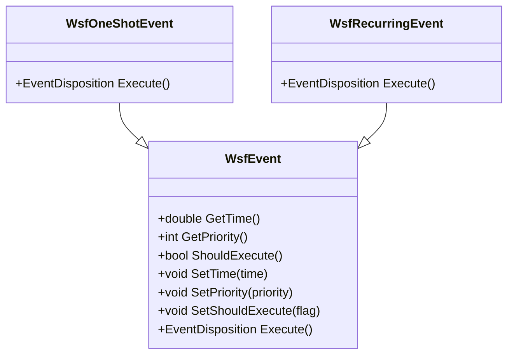
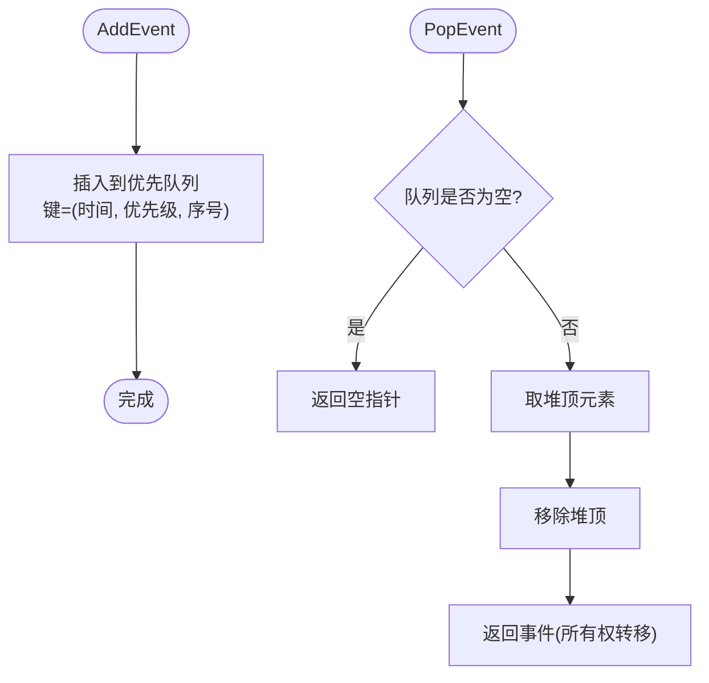
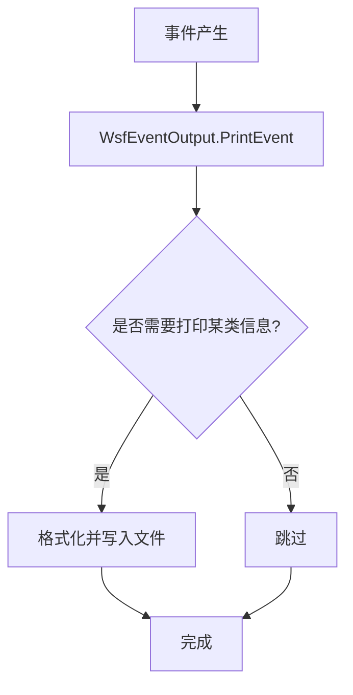
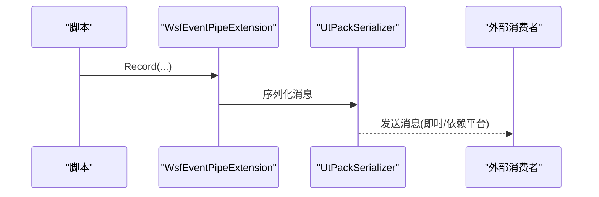
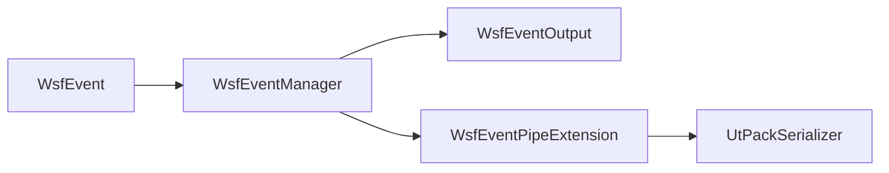

# 事件驱动系统

<cite>
**本文引用的文件**   
- [WsfEvent.hpp](file://swdev/src/core/wsf/source/WsfEvent.hpp)
- [WsfEventManager.hpp](file://swdev/src/core/wsf/source/WsfEventManager.hpp)
- [WsfEventOutput.hpp](file://swdev/src/core/wsf/source/WsfEventOutput.hpp)
- [WsfEventPipe.hpp](file://swdev/src/core/wsf/source/event_pipe/WsfEventPipe.hpp)
- [ballistic_shootdown.txt](file://demos/ballistic_missile_shootdown/ballistic_shootdown.txt)
- [space_mover_demo.txt](file://demos/multiresolution_demos/space_mover_demo.txt)
- [script_demo_5.rst](file://documentation/html/_sources/docs/script_demo_5.txt.rst.txt)
- [wsfeventpipe.rst](file://documentation/html/_sources/docs/script/wsfeventpipe.rst.txt)
</cite>

## 目录
1. [简介](#简介)
2. [项目结构](#项目结构)
3. [核心组件](#核心组件)
4. [架构总览](#架构总览)
5. [详细组件分析](#详细组件分析)
6. [依赖关系分析](#依赖关系分析)
7. [性能考虑](#性能考虑)
8. [故障排查指南](#故障排查指南)
9. [结论](#结论)
10. [附录](#附录)

## 简介
本文件面向AFSIM中的“事件驱动系统”，系统性阐述事件模型的设计原理、事件管理器（队列与优先级调度）、时间步进控制、事件输出系统与事件管道（实时流处理与外部系统集成）。文档同时提供脚本侧使用示例的引用路径，以及调试与性能分析的实践建议。

## 项目结构
围绕事件系统的核心代码位于核心库 wsf 中：
- 事件基类与适配器：WsfEvent.hpp
- 事件管理器（时间有序队列）：WsfEventManager.hpp
- 事件输出扩展：WsfEventOutput.hpp
- 事件管道扩展：WsfEventPipe.hpp
- 场景/演示配置用于启用事件输出与事件管道：ballistic_shootdown.txt、space_mover_demo.txt、script_demo_5.rst、wsfeventpipe.rst

图表来源
- [WsfEvent.hpp:21-113](file://swdev/src/core/wsf/source/WsfEvent.hpp#L21-L113)
- [WsfEventManager.hpp:28-110](file://swdev/src/core/wsf/source/WsfEventManager.hpp#L28-L110)
- [WsfEventOutput.hpp:31-47](file://swdev/src/core/wsf/source/WsfEventOutput.hpp#L31-L47)
- [WsfEventPipe.hpp:34-84](file://swdev/src/core/wsf/source/event_pipe/WsfEventPipe.hpp#L34-L84)
- [ballistic_shootdown.txt:12-19](file://demos/ballistic_missile_shootdown/ballistic_shootdown.txt#L12-L19)
- [space_mover_demo.txt:33-36](file://demos/multiresolution_demos/space_mover_demo.txt#L33-L36)
- [script_demo_5.rst:36-39](file://documentation/html/_sources/docs/script_demo_5.txt.rst.txt#L36-L39)
- [wsfeventpipe.rst:12-21](file://documentation/html/_sources/docs/script/wsfeventpipe.rst.txt#L12-L21)

章节来源
- [WsfEvent.hpp:21-113](file://swdev/src/core/wsf/source/WsfEvent.hpp#L21-L113)
- [WsfEventManager.hpp:28-110](file://swdev/src/core/wsf/source/WsfEventManager.hpp#L28-L110)
- [WsfEventOutput.hpp:31-47](file://swdev/src/core/wsf/source/WsfEventOutput.hpp#L31-L47)
- [WsfEventPipe.hpp:34-84](file://swdev/src/core/wsf/source/event_pipe/WsfEventPipe.hpp#L34-L84)
- [ballistic_shootdown.txt:12-19](file://demos/ballistic_missile_shootdown/ballistic_shootdown.txt#L12-L19)
- [space_mover_demo.txt:33-36](file://demos/multiresolution_demos/space_mover_demo.txt#L33-L36)
- [script_demo_5.rst:36-39](file://documentation/html/_sources/docs/script_demo_5.txt.rst.txt#L36-L39)
- [wsfeventpipe.rst:12-21](file://documentation/html/_sources/docs/script/wsfeventpipe.rst.txt#L12-L21)

## 核心组件
- 事件抽象与适配器
  - WsfEvent：定义事件的时间、优先级、执行语义（一次性或可重调度），并提供取消执行的能力。
  - WsfOneShotEvent / WsfRecurringEvent：基于 std::function 的事件适配器，简化一次性与周期性事件的创建。
- 事件管理器
  - WsfEventManager：维护时间有序的事件队列，按“仿真时间→优先级→入队顺序”稳定排序；支持添加、查看、弹出事件。
- 事件输出
  - WsfEventOutput：作为仿真扩展，将事件结果写入文件，并包含若干打印开关。
- 事件管道
  - WsfEventPipeExtension：场景扩展，负责解析 event_pipe 配置、注册扩展消息模式、管理事件名称与ID映射，并与 UtPackSerializer 集成以进行序列化与分发。

章节来源
- [WsfEvent.hpp:21-172](file://swdev/src/core/wsf/source/WsfEvent.hpp#L21-L172)
- [WsfEventManager.hpp:28-110](file://swdev/src/core/wsf/source/WsfEventManager.hpp#L28-L110)
- [WsfEventOutput.hpp:22-47](file://swdev/src/core/wsf/source/WsfEventOutput.hpp#L22-L47)
- [WsfEventPipe.hpp:34-84](file://swdev/src/core/wsf/source/event_pipe/WsfEventPipe.hpp#L34-L84)

## 架构总览
下图展示事件从创建到分发的整体流程，以及事件输出与事件管道的参与方式。

图表来源
- [WsfEventManager.hpp:50-79](file://swdev/src/core/wsf/source/WsfEventManager.hpp#L50-L79)
- [WsfEvent.hpp:61-99](file://swdev/src/core/wsf/source/WsfEvent.hpp#L61-L99)
- [WsfEventOutput.hpp:31-47](file://swdev/src/core/wsf/source/WsfEventOutput.hpp#L31-L47)
- [WsfEventPipe.hpp:34-84](file://swdev/src/core/wsf/source/event_pipe/WsfEventPipe.hpp#L34-L84)

## 详细组件分析

### 事件模型与调度
- 事件类型
  - 一次性事件：执行一次后删除。
  - 周期事件：执行后可重新调度下一次执行时间。
- 调度关键属性
  - 仿真时间：决定事件在时间轴上的位置。
  - 优先级：同一时刻内的事件排序依据。
  - 入队顺序：同时间同优先级的稳定性保证（FIFO）。
- 执行语义
  - Execute() 返回处置策略（删除或重调度）。
  - 可通过 SetShouldExecute(false) 取消事件。

图表来源
- [WsfEvent.hpp:21-172](file://swdev/src/core/wsf/source/WsfEvent.hpp#L21-L172)

章节来源
- [WsfEvent.hpp:21-172](file://swdev/src/core/wsf/source/WsfEvent.hpp#L21-L172)

### 事件管理器（队列与优先级调度）
- 数据结构
  - 使用优先队列，键为 (时间, 优先级, 入队序号)，确保稳定排序。
- 主要操作
  - AddEvent：插入事件并拥有所有权。
  - PeekEvent：查看下一个待处理事件。
  - PopEvent：取出并转移所有权给调用者。
- 并发安全
  - 内部使用递归互斥量保护队列访问。

图表来源
- [WsfEventManager.hpp:50-110](file://swdev/src/core/wsf/source/WsfEventManager.hpp#L50-L110)

章节来源
- [WsfEventManager.hpp:28-110](file://swdev/src/core/wsf/source/WsfEventManager.hpp#L28-L110)

### 事件输出系统（记录、格式化与文件输出）
- 扩展点
  - WsfEventOutput 继承自仿真扩展基类，拦截事件结果并写入文件。
- 配置项
  - 通过数据对象包含若干布尔开关，控制是否打印特定类型的失败尝试等。
- 典型用法
  - 在场景文件中通过 event_output 命令启用，指定输出文件与可选过滤。

图表来源
- [WsfEventOutput.hpp:22-47](file://swdev/src/core/wsf/source/WsfEventOutput.hpp#L22-L47)
- [script_demo_5.rst:36-39](file://documentation/html/_sources/docs/script_demo_5.txt.rst.txt#L36-L39)

章节来源
- [WsfEventOutput.hpp:22-47](file://swdev/src/core/wsf/source/WsfEventOutput.hpp#L22-L47)
- [script_demo_5.rst:36-39](file://documentation/html/_sources/docs/script_demo_5.txt.rst.txt#L36-L39)

### 事件管道（实时事件流与外部系统集成）
- 角色
  - WsfEventPipeExtension 作为场景扩展，负责解析 event_pipe 配置、注册扩展消息模式、维护事件名与ID映射，并通过 UtPackSerializer 进行序列化与分发。
- 配置要点
  - file：输出文件路径。
  - use_preset：预设级别（default/low/high/full）。
  - maximum_mover_update_interval：限制 mover 更新频率，影响实时流吞吐。
- 脚本接口
  - WsfEventPipe.Record：向管道发布数据（注意新版本已弃用带时间的重载）。
  - WsfEventPipe.AddBookmark：为场景添加书签。

图表来源
- [WsfEventPipe.hpp:34-84](file://swdev/src/core/wsf/source/event_pipe/WsfEventPipe.hpp#L34-L84)
- [wsfeventpipe.rst:12-21](file://documentation/html/_sources/docs/script/wsfeventpipe.rst.txt#L12-L21)

章节来源
- [WsfEventPipe.hpp:34-84](file://swdev/src/core/wsf/source/event_pipe/WsfEventPipe.hpp#L34-L84)
- [wsfeventpipe.rst:12-21](file://documentation/html/_sources/docs/script/wsfeventpipe.rst.txt#L12-L21)

### 时间步进控制与事件调度耦合
- 事件调度由仿真内核驱动，事件管理器按时间步推进，依次弹出并执行事件。
- 事件管道可通过 maximum_mover_update_interval 调节 mover 更新频率，从而间接影响事件产生的节奏与外部系统负载。

章节来源
- [space_mover_demo.txt:33-36](file://demos/multiresolution_demos/space_mover_demo.txt#L33-L36)

## 依赖关系分析
- 低耦合设计
  - 事件抽象与调度解耦：WsfEvent 不感知输出与管道，仅暴露执行语义。
  - 输出与管道作为扩展接入：通过仿真扩展机制挂载，避免侵入核心调度。
- 直接依赖
  - WsfEventManager 依赖 WsfEvent。
  - WsfEventOutput 依赖事件结果接口（SimulationExtension）。
  - WsfEventPipeExtension 依赖 UtPack 序列化与场景扩展框架。
- 潜在循环依赖
  - 通过扩展点与回调注册机制避免直接循环依赖。

图表来源
- [WsfEvent.hpp:21-113](file://swdev/src/core/wsf/source/WsfEvent.hpp#L21-L113)
- [WsfEventManager.hpp:28-110](file://swdev/src/core/wsf/source/WsfEventManager.hpp#L28-L110)
- [WsfEventOutput.hpp:31-47](file://swdev/src/core/wsf/source/WsfEventOutput.hpp#L31-L47)
- [WsfEventPipe.hpp:34-84](file://swdev/src/core/wsf/source/event_pipe/WsfEventPipe.hpp#L34-L84)

章节来源
- [WsfEvent.hpp:21-113](file://swdev/src/core/wsf/source/WsfEvent.hpp#L21-L113)
- [WsfEventManager.hpp:28-110](file://swdev/src/core/wsf/source/WsfEventManager.hpp#L28-L110)
- [WsfEventOutput.hpp:31-47](file://swdev/src/core/wsf/source/WsfEventOutput.hpp#L31-L47)
- [WsfEventPipe.hpp:34-84](file://swdev/src/core/wsf/source/event_pipe/WsfEventPipe.hpp#L34-L84)

## 性能考虑
- 事件队列复杂度
  - 插入与弹出均为对数级复杂度（优先队列），适合大规模事件调度。
- 优先级与稳定性
  - 合理设置优先级可减少同时间事件的不确定性；保持入队顺序稳定有助于可重复性。
- I/O 与管道
  - 事件输出与管道均涉及I/O，建议在高频场景中：
    - 使用合适的 use_preset 降低带宽。
    - 调整 maximum_mover_update_interval 平衡实时性与吞吐。
    - 批量写入或异步写盘（若扩展支持）以降低阻塞。
- 内存与所有权
  - 事件管理器与适配器使用智能指针管理生命周期，避免泄漏。

[本节为通用指导，不直接分析具体文件]

## 故障排查指南
- 事件未触发
  - 检查事件是否被 SetShouldExecute(false) 取消。
  - 确认事件时间设置正确且未被覆盖。
- 事件顺序异常
  - 检查优先级设置是否符合预期；同时间同优先级遵循入队顺序。
- 事件输出为空
  - 确认已在场景文件中启用 event_output 并指定输出文件。
- 事件管道无数据
  - 确认 event_pipe 配置正确（file、use_preset）。
  - 检查脚本是否正确调用 WsfEventPipe.Record（避免使用已弃用的带时间重载）。

章节来源
- [WsfEvent.hpp:77-99](file://swdev/src/core/wsf/source/WsfEvent.hpp#L77-L99)
- [WsfEventManager.hpp:50-79](file://swdev/src/core/wsf/source/WsfEventManager.hpp#L50-L79)
- [script_demo_5.rst:36-39](file://documentation/html/_sources/docs/script_demo_5.txt.rst.txt#L36-L39)
- [ballistic_shootdown.txt:15-19](file://demos/ballistic_missile_shootdown/ballistic_shootdown.txt#L15-L19)
- [wsfeventpipe.rst:12-21](file://documentation/html/_sources/docs/script/wsfeventpipe.rst.txt#L12-L21)

## 结论
AFSIM 的事件驱动系统以清晰的分层与扩展点实现高内聚、低耦合的事件模型：事件抽象与调度解耦，输出与管道通过扩展接入。事件管理器提供稳定、可预测的调度语义；事件输出与管道分别承担离线分析与实时集成的职责。通过合理的优先级设置、I/O 与管道参数调优，可在复杂仿真中获得良好的性能与可观测性。

[本节为总结性内容，不直接分析具体文件]

## 附录

### 使用示例与参考路径
- 启用事件输出与事件管道
  - ballistic_shootdown.txt：展示 event_output 与 event_pipe 的配置与启用。
- 事件管道 mover 更新间隔
  - space_mover_demo.txt：展示 event_pipe 中 maximum_mover_update_interval 的设置。
- 事件输出全量启用
  - script_demo_5.rst：展示 event_output enable all 的用法。
- 事件管道脚本接口
  - wsfeventpipe.rst：WsfEventPipe 的脚本方法与说明。

章节来源
- [ballistic_shootdown.txt:12-19](file://demos/ballistic_missile_shootdown/ballistic_shootdown.txt#L12-L19)
- [space_mover_demo.txt:33-36](file://demos/multiresolution_demos/space_mover_demo.txt#L33-L36)
- [script_demo_5.rst:36-39](file://documentation/html/_sources/docs/script_demo_5.txt.rst.txt#L36-L39)
- [wsfeventpipe.rst:12-21](file://documentation/html/_sources/docs/script/wsfeventpipe.rst.txt#L12-L21)