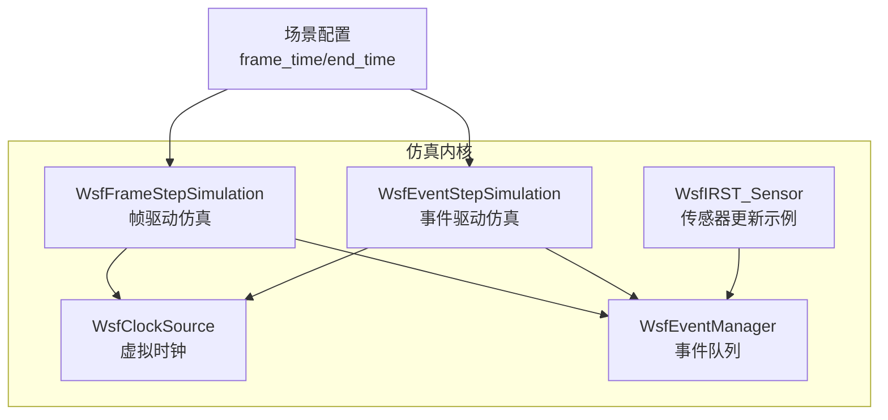
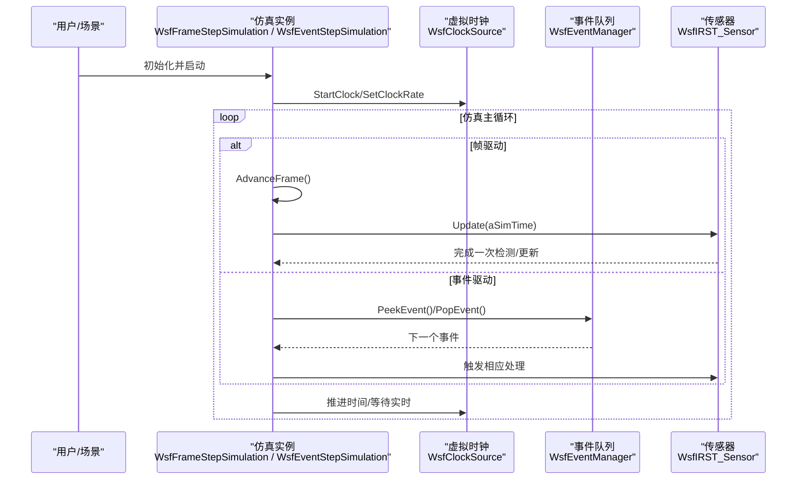
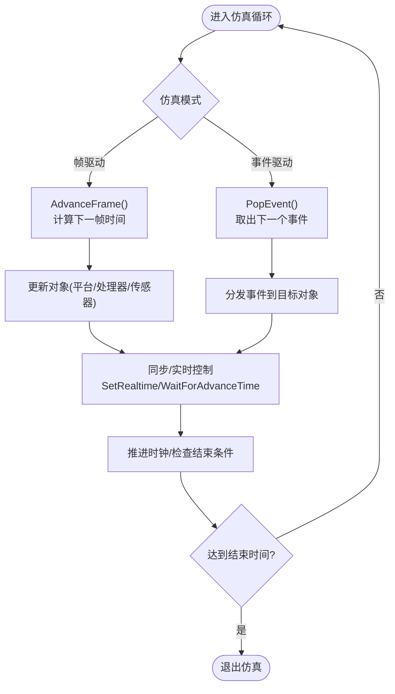
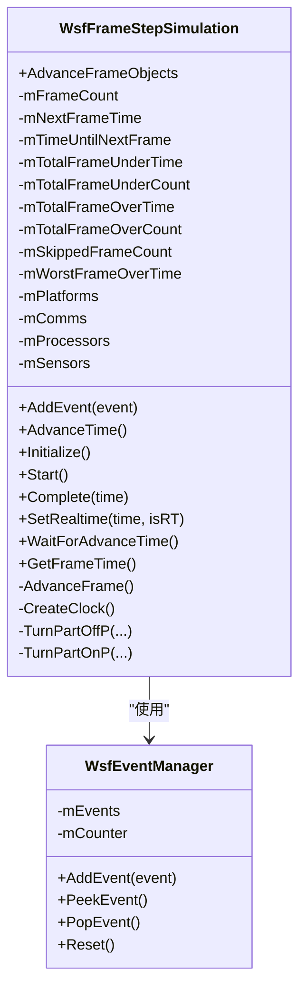
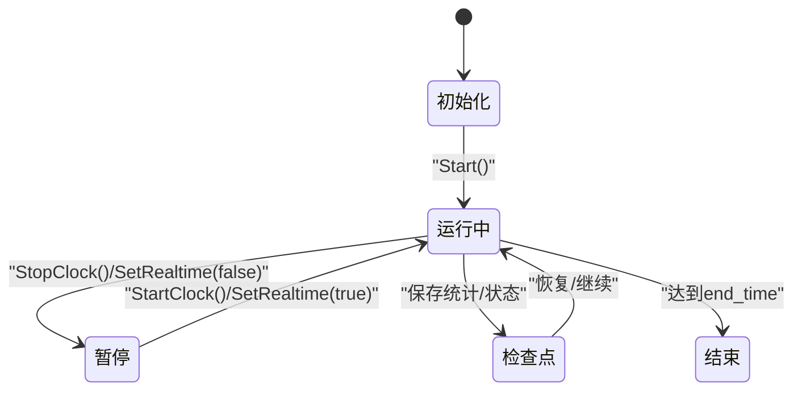
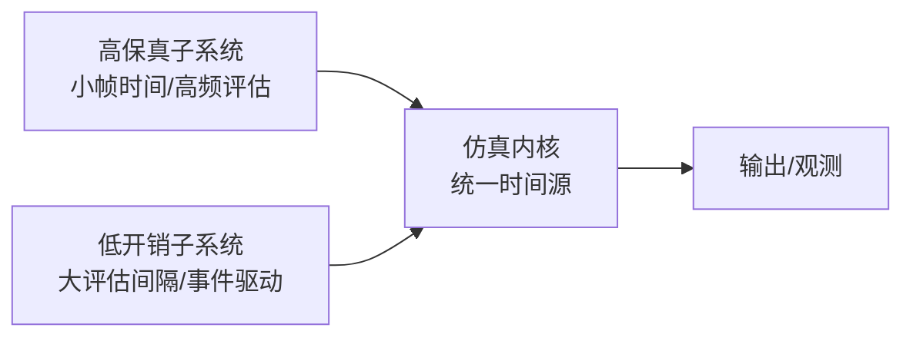
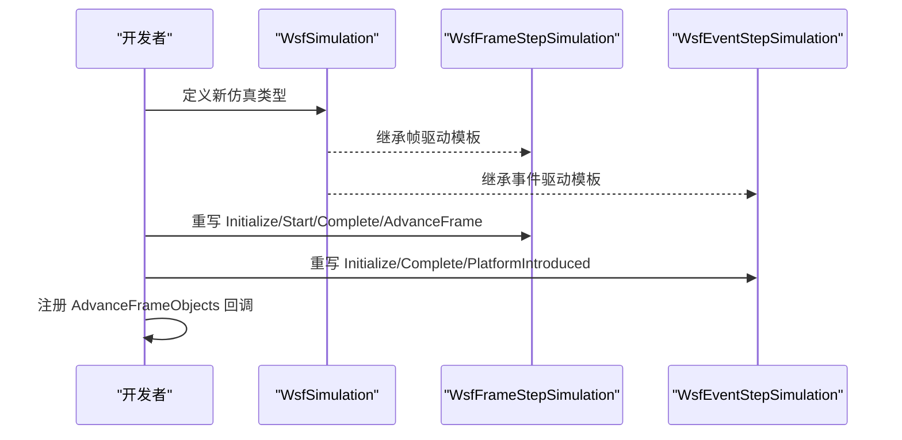
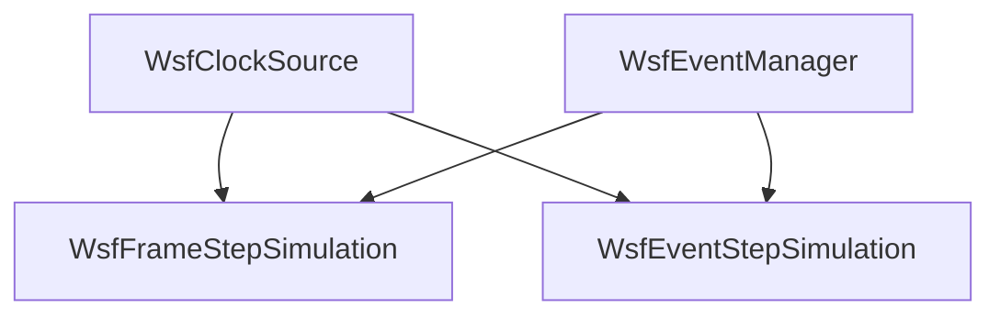

# 仿真引擎核心

<cite>
**本文引用的文件**   
- [WsfClockSource.hpp](file://swdev/src/core/wsf/source/WsfClockSource.hpp)
- [WsfEventManager.hpp](file://swdev/src/core/wsf/source/WsfEventManager.hpp)
- [WsfFrameStepSimulation.hpp](file://swdev/src/core/wsf/source/WsfFrameStepSimulation.hpp)
- [WsfEventStepSimulation.hpp](file://swdev/src/core/wsf/source/WsfEventStepSimulation.hpp)
- [WsfIRST_Sensor.cpp](file://swdev/src/core/wsf_mil/source/sensor/WsfIRST_Sensor.cpp)
- [test_grid_pkgen_runs.txt](file://swdev/src/engage/tests/auto_grid_site_Pk_table_multirun/test_grid_pkgen_runs.txt)
</cite>

## 目录
1. [简介](#简介)
2. [项目结构](#项目结构)
3. [核心组件](#核心组件)
4. [架构总览](#架构总览)
5. [详细组件分析](#详细组件分析)
6. [依赖关系分析](#依赖关系分析)
7. [性能考虑](#性能考虑)
8. [故障排查指南](#故障排查指南)
9. [结论](#结论)
10. [附录](#附录)

## 简介
本文件聚焦 AFSIM 仿真引擎的核心机制，围绕以下主题展开：
- 仿真时间管理：虚拟时钟、时间步进与同步策略
- 仿真循环：帧更新、事件处理与状态保存
- 仿真状态管理：检查点、恢复与并行仿真支持
- 多分辨率仿真：不同粒度模型共存原理
- 扩展方式：如何扩展仿真引擎功能（含代码路径）
- 性能调优与调试技巧

## 项目结构
AFSIM 的仿真内核位于 swdev/src/core/wsf 及其相关插件模块中。本次文档重点涉及：
- 时间与调度：WsfClockSource（虚拟时钟）、WsfEventManager（事件队列）
- 仿真步进实现：WsfFrameStepSimulation（固定步长帧驱动）、WsfEventStepSimulation（事件驱动）
- 传感器更新时序示例：WsfIRST_Sensor（展示按调度周期更新的典型模式）
- 场景配置中的帧时间与结束时间：test_grid_pkgen_runs.txt

**图表来源**
- [WsfClockSource.hpp:17-60](file://swdev/src/core/wsf/source/WsfClockSource.hpp#L17-L60)
- [WsfEventManager.hpp:28-110](file://swdev/src/core/wsf/source/WsfEventManager.hpp#L28-L110)
- [WsfFrameStepSimulation.hpp:21-95](file://swdev/src/core/wsf/source/WsfFrameStepSimulation.hpp#L21-L95)
- [WsfEventStepSimulation.hpp:20-52](file://swdev/src/core/wsf/source/WsfEventStepSimulation.hpp#L20-L52)
- [WsfIRST_Sensor.cpp:66-75](file://swdev/src/core/wsf_mil/source/sensor/WsfIRST_Sensor.cpp#L66-L75)
- [test_grid_pkgen_runs.txt:131-134](file://swdev/src/engage/tests/auto_grid_site_Pk_table_multirun/test_grid_pkgen_runs.txt#L131-L134)

**章节来源**
- [WsfClockSource.hpp:17-60](file://swdev/src/core/wsf/source/WsfClockSource.hpp#L17-L60)
- [WsfEventManager.hpp:28-110](file://swdev/src/core/wsf/source/WsfEventManager.hpp#L28-L110)
- [WsfFrameStepSimulation.hpp:21-95](file://swdev/src/core/wsf/source/WsfFrameStepSimulation.hpp#L21-L95)
- [WsfEventStepSimulation.hpp:20-52](file://swdev/src/core/wsf/source/WsfEventStepSimulation.hpp#L20-L52)
- [WsfFIRST_Sensor.cpp:66-75](file://swdev/src/core/wsf_mil/source/sensor/WsfIRST_Sensor.cpp#L66-L75)
- [test_grid_pkgen_runs.txt:131-134](file://swdev/src/engage/tests/auto_grid_site_Pk_table_multirun/test_grid_pkgen_runs.txt#L131-L134)

## 核心组件
- 虚拟时钟 WsfClockSource
  - 提供当前仿真时间、时钟速率、暂停/启动、最大时钟等能力
  - 用于统一时间源，支撑帧驱动与事件驱动的步进逻辑
- 事件管理器 WsfEventManager
  - 维护按仿真时间排序的事件队列，同时间按优先级与入队顺序稳定排序
  - 提供 AddEvent/PeekEvent/PopEvent/Reset 等接口
- 帧驱动仿真 WsfFrameStepSimulation
  - 基于固定帧间隔 AdvanceFrame 推进仿真，统计帧耗时与跳过次数
  - 暴露 AdvanceFrameObjects 回调以在每帧执行对象更新
- 事件驱动仿真 WsfEventStepSimulation
  - 基于事件队列推进仿真，按需设置部件更新间隔，控制部件开关
- 传感器更新示例 WsfIRST_Sensor
  - 通过调度器与跟踪器初始化，Update 中根据 mNextUpdateTime 判断是否执行检测，体现“按调度周期更新”的模式

**章节来源**
- [WsfClockSource.hpp:17-60](file://swdev/src/core/wsf/source/WsfClockSource.hpp#L17-L60)
- [WsfEventManager.hpp:28-110](file://swdev/src/core/wsf/source/WsfEventManager.hpp#L28-L110)
- [WsfFrameStepSimulation.hpp:21-95](file://swdev/src/core/wsf/source/WsfFrameStepSimulation.hpp#L21-L95)
- [WsfEventStepSimulation.hpp:20-52](file://swdev/src/core/wsf/source/WsfEventStepSimulation.hpp#L20-L52)
- [WsfFIRST_Sensor.cpp:34-75](file://swdev/src/core/wsf_mil/source/sensor/WsfIRST_Sensor.cpp#L34-L75)

## 架构总览
下图展示了仿真内核的关键交互：时钟为所有组件提供统一时间；帧驱动与事件驱动两种仿真模式分别组织更新与事件处理；传感器等子系统通过调度器与事件队列协同工作。

**图表来源**
- [WsfFrameStepSimulation.hpp:31-62](file://swdev/src/core/wsf/source/WsfFrameStepSimulation.hpp#L31-L62)
- [WsfEventStepSimulation.hpp:23-47](file://swdev/src/core/wsf/source/WsfEventStepSimulation.hpp#L23-L47)
- [WsfClockSource.hpp:32-46](file://swdev/src/core/wsf/source/WsfClockSource.hpp#L32-L46)
- [WsfEventManager.hpp:50-79](file://swdev/src/core/wsf/source/WsfEventManager.hpp#L50-L79)
- [WsfFIRST_Sensor.cpp:66-75](file://swdev/src/core/wsf_mil/source/sensor/WsfIRST_Sensor.cpp#L66-L75)

## 详细组件分析

### 时间管理机制（虚拟时钟、时间步进、同步策略）
- 虚拟时钟
  - 提供 GetClock/SetClock/SetClockRate/StartClock/StopClock/IsStopped 等方法
  - 支持最大时钟限制，便于仿真终止或外部约束
- 时间步进
  - 帧驱动：AdvanceFrame 内部计算下一帧时间，统计帧耗时与跳过计数
  - 事件驱动：从事件队列弹出事件，按仿真时间推进
- 同步策略
  - 支持实时运行 SetRealtime/WaitForAdvanceTime，结合时钟速率控制实际推进节奏
  - 传感器通过调度器与 mNextUpdateTime 避免不必要的设备更新

**图表来源**
- [WsfFrameStepSimulation.hpp:31-62](file://swdev/src/core/wsf/source/WsfFrameStepSimulation.hpp#L31-L62)
- [WsfEventStepSimulation.hpp:23-47](file://swdev/src/core/wsf/source/WsfEventStepSimulation.hpp#L23-L47)
- [WsfClockSource.hpp:32-46](file://swdev/src/core/wsf/source/WsfClockSource.hpp#L32-L46)

**章节来源**
- [WsfClockSource.hpp:32-46](file://swdev/src/core/wsf/source/WsfClockSource.hpp#L32-L46)
- [WsfFrameStepSimulation.hpp:31-62](file://swdev/src/core/wsf/source/WsfFrameStepSimulation.hpp#L31-L62)
- [WsfEventStepSimulation.hpp:23-47](file://swdev/src/core/wsf/source/WsfEventStepSimulation.hpp#L23-L47)

### 仿真循环（帧更新、事件处理、状态保存）
- 帧更新
  - WsfFrameStepSimulation::AdvanceFrame 负责逐帧推进，统计帧耗时与跳过次数
  - 通过 AdvanceFrameObjects 回调允许扩展每帧行为
- 事件处理
  - WsfEventManager 维护有序事件队列，确保时间优先、优先级次之、入队顺序稳定的排序
  - 事件驱动仿真通过 PopEvent 获取并处理事件
- 状态保存
  - 帧驱动仿真包含大量统计字段（如 mTotalFrameOverTime、mSkippedFrameCount），可用于诊断与回放
  - 场景级输出频率由 output_rate 表控制（见测试用例）

**图表来源**
- [WsfFrameStepSimulation.hpp:31-95](file://swdev/src/core/wsf/source/WsfFrameStepSimulation.hpp#L31-L95)
- [WsfEventManager.hpp:50-110](file://swdev/src/core/wsf/source/WsfEventManager.hpp#L50-L110)

**章节来源**
- [WsfFrameStepSimulation.hpp:31-95](file://swdev/src/core/wsf/source/WsfFrameStepSimulation.hpp#L31-L95)
- [WsfEventManager.hpp:50-110](file://swdev/src/core/wsf/source/WsfEventManager.hpp#L50-L110)
- [test_grid_pkgen_runs.txt:136-142](file://swdev/src/engage/tests/auto_grid_site_Pk_table_multirun/test_grid_pkgen_runs.txt#L136-L142)

### 仿真状态管理（检查点、恢复、并行仿真）
- 检查点与恢复
  - 帧驱动仿真维护丰富的运行时统计（帧耗时、跳过计数、最坏超时时延等），可作为检查点数据的一部分，用于回放与诊断
  - 事件驱动仿真通过部件更新间隔与开关控制，便于在关键时间点冻结/恢复部分状态
- 并行仿真支持
  - 帧驱动仿真类中包含线程池引用（头文件引入 WsfThreadPool），表明其具备并行化扩展的基础设施
  - 事件队列使用递归互斥保护，保证多线程访问安全

**图表来源**
- [WsfFrameStepSimulation.hpp:71-95](file://swdev/src/core/wsf/source/WsfFrameStepSimulation.hpp#L71-L95)
- [WsfEventManager.hpp:102-110](file://swdev/src/core/wsf/source/WsfEventManager.hpp#L102-L110)

**章节来源**
- [WsfFrameStepSimulation.hpp:71-95](file://swdev/src/core/wsf/source/WsfFrameStepSimulation.hpp#L71-L95)
- [WsfEventManager.hpp:102-110](file://swdev/src/core/wsf/source/WsfEventManager.hpp#L102-L110)

### 多分辨率仿真（不同粒度的模型共存）
- 原理概述
  - 通过不同的仿真步进模式（帧驱动 vs 事件驱动）以及可配置的 update_interval/evaluation_interval，使高保真子系统与低开销子系统在同一仿真中协作
  - 传感器通过调度器与跟踪器进行周期性更新，避免频繁计算，从而降低细粒度模型的开销
- 实践要点
  - 在高保真区域使用更小的帧时间或更频繁的评估间隔
  - 在粗粒度区域使用较大的评估间隔或事件驱动以减少计算量

[本图为概念性示意，不直接映射具体源码文件]

**章节来源**
- [WsfFIRST_Sensor.cpp:66-75](file://swdev/src/core/wsf_mil/source/sensor/WsfFIRST_Sensor.cpp#L66-L75)
- [test_grid_pkgen_runs.txt:100-118](file://swdev/src/engage/tests/auto_grid_site_Pk_table_multirun/test_grid_pkgen_runs.txt#L100-L118)

### 扩展仿真引擎功能（代码示例与路径）
- 自定义帧驱动仿真
  - 继承 WsfSimulation，参考 WsfFrameStepSimulation 的实现，重写 Initialize/Start/Complete/AdvanceFrame 等
  - 利用 AdvanceFrameObjects 回调注册每帧更新逻辑
- 自定义事件驱动仿真
  - 继承 WsfSimulation，参考 WsfEventStepSimulation 的实现，重写 Initialize/Complete/PlatformIntroduced 等
  - 通过 SetPartUpdateInterval 控制部件更新频率
- 传感器更新扩展
  - 参考 WsfIRST_Sensor::Update 的调度判断模式，结合调度器与跟踪器进行周期性检测

**图表来源**
- [WsfFrameStepSimulation.hpp:31-62](file://swdev/src/core/wsf/source/WsfFrameStepSimulation.hpp#L31-L62)
- [WsfEventStepSimulation.hpp:23-47](file://swdev/src/core/wsf/source/WsfEventStepSimulation.hpp#L23-L47)

**章节来源**
- [WsfFrameStepSimulation.hpp:31-62](file://swdev/src/core/wsf/source/WsfFrameStepSimulation.hpp#L31-L62)
- [WsfEventStepSimulation.hpp:23-47](file://swdev/src/core/wsf/source/WsfEventStepSimulation.hpp#L23-L47)
- [WsfFIRST_Sensor.cpp:66-75](file://swdev/src/core/wsf_mil/source/sensor/WsfFIRST_Sensor.cpp#L66-L75)

## 依赖关系分析
- 耦合关系
  - WsfFrameStepSimulation 与 WsfEventManager 存在强耦合（事件添加/处理）
  - WsfEventStepSimulation 与 WsfEventManager 同样依赖事件队列
  - 两者均依赖 WsfClockSource 提供统一时间源
- 内聚性
  - 帧驱动仿真将平台、通信、处理器、传感器等集合统一管理，提升内聚性
  - 事件管理器封装了优先级队列与并发保护，职责单一

**图表来源**
- [WsfClockSource.hpp:17-60](file://swdev/src/core/wsf/source/WsfClockSource.hpp#L17-L60)
- [WsfEventManager.hpp:28-110](file://swdev/src/core/wsf/source/WsfEventManager.hpp#L28-L110)
- [WsfFrameStepSimulation.hpp:21-95](file://swdev/src/core/wsf/source/WsfFrameStepSimulation.hpp#L21-L95)
- [WsfEventStepSimulation.hpp:20-52](file://swdev/src/core/wsf/source/WsfEventStepSimulation.hpp#L20-L52)

**章节来源**
- [WsfClockSource.hpp:17-60](file://swdev/src/core/wsf/source/WsfClockSource.hpp#L17-L60)
- [WsfEventManager.hpp:28-110](file://swdev/src/core/wsf/source/WsfEventManager.hpp#L28-L110)
- [WsfFrameStepSimulation.hpp:21-95](file://swdev/src/core/wsf/source/WsfFrameStepSimulation.hpp#L21-L95)
- [WsfEventStepSimulation.hpp:20-52](file://swdev/src/core/wsf/source/WsfEventStepSimulation.hpp#L20-L52)

## 性能考虑
- 帧驱动优化
  - 合理设置 frame_time，避免过小导致帧过多
  - 监控 mTotalFrameOverTime/mSkippedFrameCount，识别瓶颈与丢帧情况
- 事件驱动优化
  - 调整 evaluation_interval，减少不必要的高频评估
  - 使用 SetPartUpdateInterval 控制部件更新频率，降低计算负载
- 实时同步
  - 使用 SetRealtime/WaitForAdvanceTime 控制真实时间推进，避免 UI 卡顿
- 传感器更新
  - 遵循调度器与 mNextUpdateTime 的判断模式，避免频繁设备更新

**章节来源**
- [WsfFrameStepSimulation.hpp:71-95](file://swdev/src/core/wsf/source/WsfFrameStepSimulation.hpp#L71-L95)
- [WsfEventStepSimulation.hpp:33-40](file://swdev/src/core/wsf/source/WsfEventStepSimulation.hpp#L33-L40)
- [WsfFIRST_Sensor.cpp:66-75](file://swdev/src/core/wsf_mil/source/sensor/WsfFIRST_Sensor.cpp#L66-L75)
- [test_grid_pkgen_runs.txt:100-118](file://swdev/src/engage/tests/auto_grid_site_Pk_table_multirun/test_grid_pkgen_runs.txt#L100-L118)

## 故障排查指南
- 常见问题
  - 帧跳变或丢帧：检查 frame_time 与系统负载，关注 mSkippedFrameCount
  - 事件延迟：确认事件优先级与入队顺序，必要时调整优先级
  - 传感器无更新：检查调度器设置与 mNextUpdateTime 阈值
- 定位方法
  - 启用输出频率表（output_rate）观察关键指标
  - 使用实时模式（SetRealtime）配合 UI 工具观察滞后情况

**章节来源**
- [WsfFrameStepSimulation.hpp:71-95](file://swdev/src/core/wsf/source/WsfFrameStepSimulation.hpp#L71-L95)
- [WsfEventManager.hpp:50-79](file://swdev/src/core/wsf/source/WsfEventManager.hpp#L50-L79)
- [WsfFIRST_Sensor.cpp:66-75](file://swdev/src/core/wsf_mil/source/sensor/WsfFIRST_Sensor.cpp#L66-L75)
- [test_grid_pkgen_runs.txt:136-142](file://swdev/src/engage/tests/auto_grid_site_Pk_table_multirun/test_grid_pkgen_runs.txt#L136-L142)

## 结论
AFSIM 仿真引擎通过统一的虚拟时钟与灵活的事件队列，提供了帧驱动与事件驱动两种仿真步进模式。传感器等子系统通过调度器与周期性更新机制，有效平衡了精度与性能。借助丰富的运行时统计与可扩展的回调机制，开发者可以方便地扩展仿真功能并进行性能调优。在多分辨率仿真场景中，通过差异化配置与调度策略，可实现不同粒度模型的共存与协作。

## 附录
- 关键配置项
  - frame_time：帧驱动仿真的帧间隔
  - end_time：仿真结束时间
  - output_rate：输出频率表，控制记录频率
- 扩展建议
  - 优先复用 WsfFrameStepSimulation/WsfEventStepSimulation 的框架
  - 通过 AdvanceFrameObjects 与 SetPartUpdateInterval 精细控制更新节奏

**章节来源**
- [test_grid_pkgen_runs.txt:131-142](file://swdev/src/engage/tests/auto_grid_site_Pk_table_multirun/test_grid_pkgen_runs.txt#L131-L142)
- [WsfFrameStepSimulation.hpp:59-62](file://swdev/src/core/wsf/source/WsfFrameStepSimulation.hpp#L59-L62)
- [WsfEventStepSimulation.hpp:33-40](file://swdev/src/core/wsf/source/WsfEventStepSimulation.hpp#L33-L40)