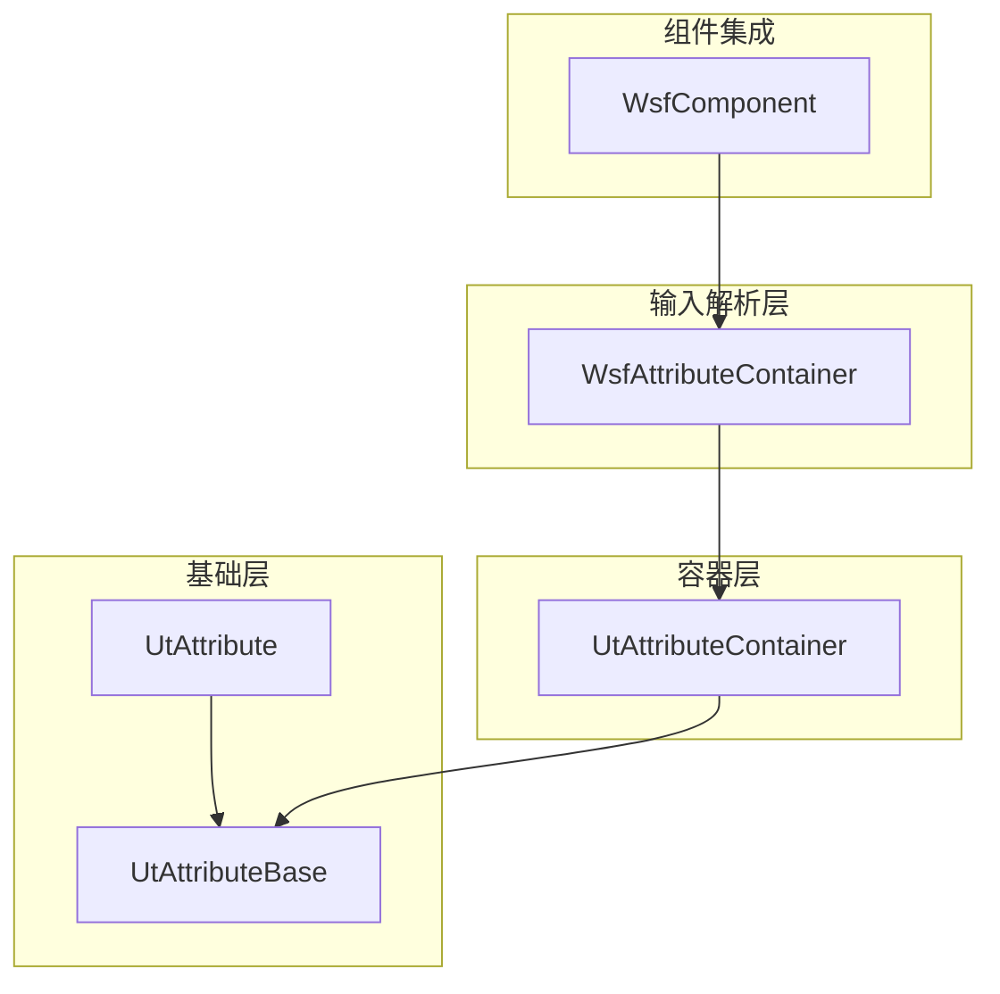
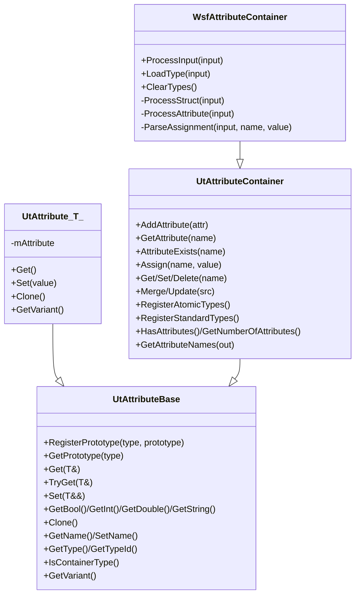
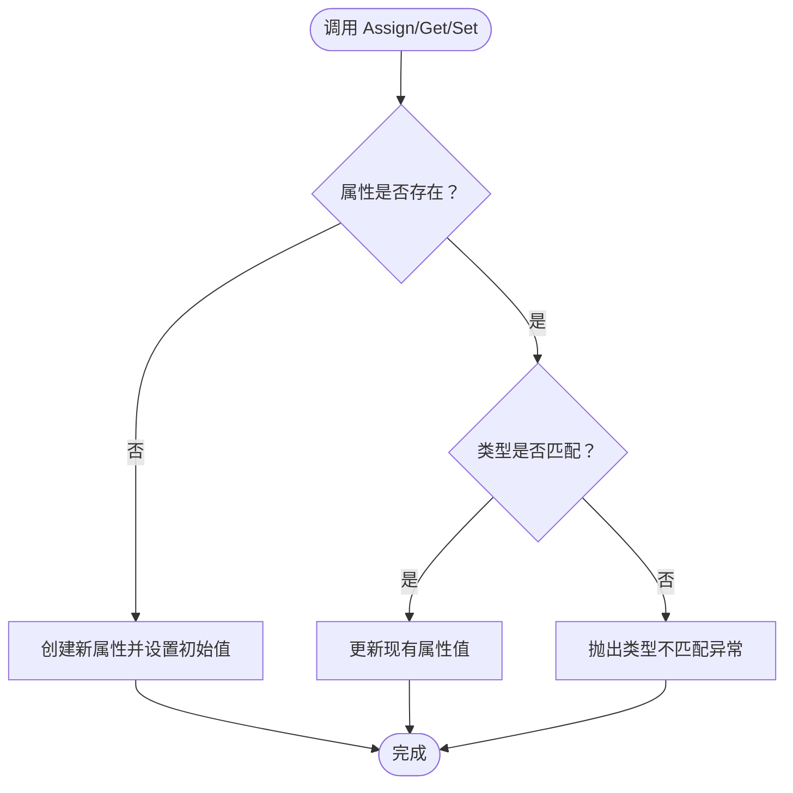
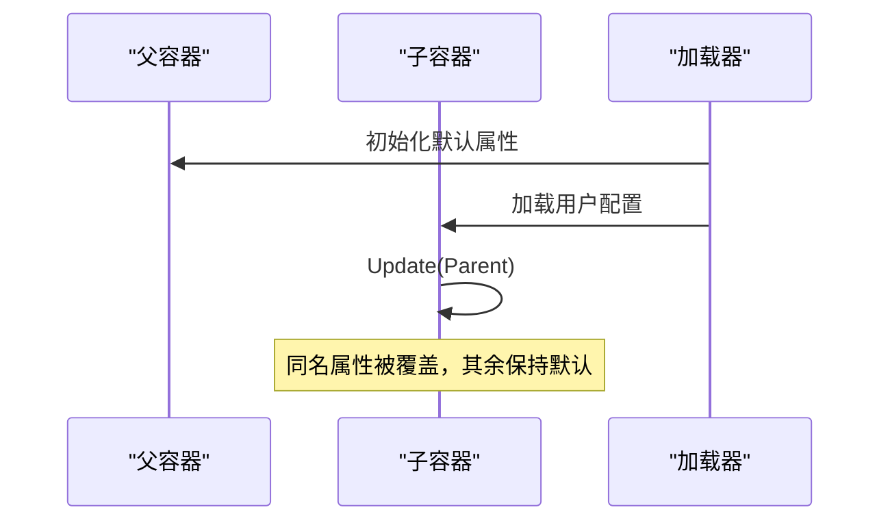
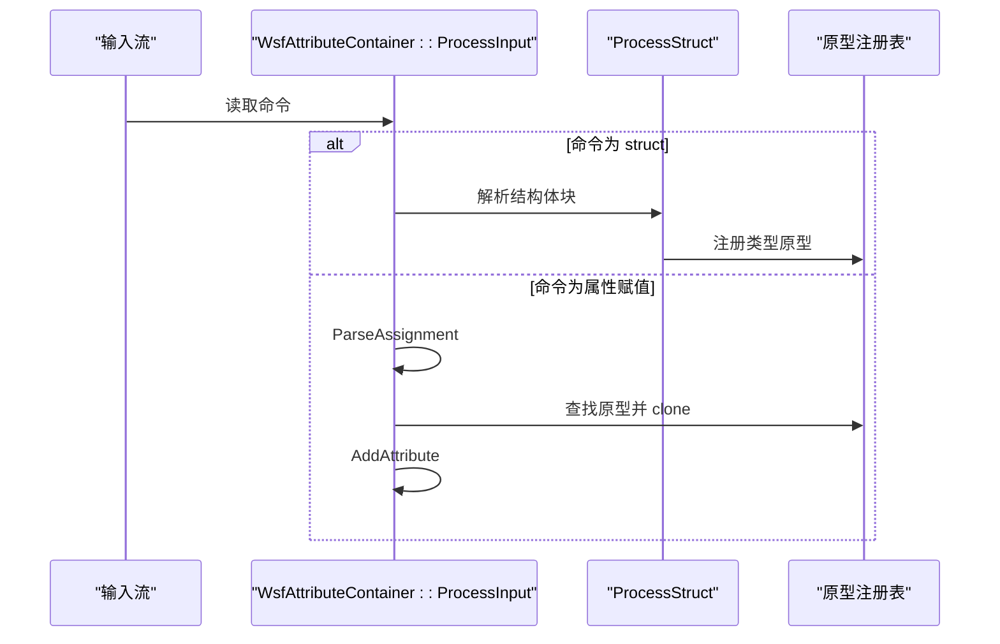
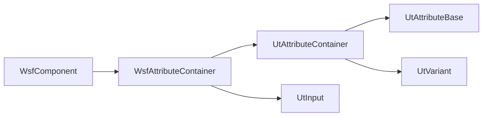

# 属性系统

<cite>
**本文引用的文件**   
- [WsfAttribute.hpp](file://swdev/src/core/wsf/source/WsfAttribute.hpp)
- [WsfAttributeContainer.hpp](file://swdev/src/core/wsf/source/WsfAttributeContainer.hpp)
- [WsfAttributeContainer.cpp](file://swdev/src/core/wsf/source/WsfAttributeContainer.cpp)
- [UtAttribute.hpp](file://swdev/src/tools/util/source/UtAttribute.hpp)
- [UtAttributeBase.hpp](file://swdev/src/tools/util/source/UtAttributeBase.hpp)
- [UtAttributeContainer.hpp](file://swdev/src/tools/util/source/UtAttributeContainer.hpp)
- [WsfComponent.hpp](file://swdev/src/core/wsf/source/WsfComponent.hpp)
</cite>

## 目录
1. [简介](#简介)
2. [项目结构](#项目结构)
3. [核心组件](#核心组件)
4. [架构总览](#架构总览)
5. [详细组件分析](#详细组件分析)
6. [依赖关系分析](#依赖关系分析)
7. [性能考虑](#性能考虑)
8. [故障排查指南](#故障排查指南)
9. [结论](#结论)
10. [附录：配置示例与最佳实践](#附录配置示例与最佳实践)

## 简介
本文件系统化阐述 AFSIM 属性系统的定义、访问、继承与覆盖、序列化（保存/加载）以及性能优化策略。属性系统以类型化、可克隆的 UtAttribute 为基础，通过 UtAttributeContainer 提供容器化的多属性管理，并由 WsfAttributeContainer 扩展输入解析能力，支持从配置文件动态注册“struct”类型并批量赋值。该机制广泛用于平台、传感器、处理器等 WSF 组件的属性化配置与运行时访问。

## 项目结构
属性系统由三层组成：
- 基础层：UtAttributeBase 提供统一基类、原型注册表、类型字典与迭代器接口；UtAttribute<T> 实现具体类型的属性值封装。
- 容器层：UtAttributeContainer 维护属性名到属性的映射，提供添加、查找、赋值、合并、更新等操作。
- 输入解析层：WsfAttributeContainer 在容器基础上增加 ProcessInput/LoadType/ProcessStruct 等能力，用于解析配置文件中的 struct 定义与属性赋值。

图表来源
- [UtAttributeBase.hpp:37-231](file://swdev/src/tools/util/source/UtAttributeBase.hpp#L37-L231)
- [UtAttribute.hpp:21-197](file://swdev/src/tools/util/source/UtAttribute.hpp#L21-L197)
- [UtAttributeContainer.hpp:28-282](file://swdev/src/tools/util/source/UtAttributeContainer.hpp#L28-L282)
- [WsfAttributeContainer.hpp:21-51](file://swdev/src/core/wsf/source/WsfAttributeContainer.hpp#L21-L51)
- [WsfComponent.hpp:35-111](file://swdev/src/core/wsf/source/WsfComponent.hpp#L35-L111)

章节来源
- [WsfAttributeContainer.hpp:21-51](file://swdev/src/core/wsf/source/WsfAttributeContainer.hpp#L21-L51)
- [UtAttributeContainer.hpp:28-282](file://swdev/src/tools/util/source/UtAttributeContainer.hpp#L28-L282)
- [UtAttributeBase.hpp:37-231](file://swdev/src/tools/util/source/UtAttributeBase.hpp#L37-L231)
- [UtAttribute.hpp:21-197](file://swdev/src/tools/util/source/UtAttribute.hpp#L21-L197)

## 核心组件
- UtAttributeBase：属性抽象基类，负责原型注册、类型字典、Get/Set/TryGet 通用接口、迭代器抽象、NotConvertibleException 异常类型。
- UtAttribute<T>：模板化属性实现，封装具体类型 T 的值，提供 Get/Set/Clone/GetVariant 等方法，并为 int/bool/double/string 提供特化。
- UtAttributeContainer：属性容器，维护 unordered_map<name, attribute>，提供 Add/Assign/Get/Set/Delete/Merge/Update 等批量操作，以及标准原子类型注册。
- WsfAttributeContainer：在容器之上增加输入解析，支持 bool/int/double/unitary/string/attribute/struct 命令，以及 LoadType/ClearTypes/ProcessStruct。
- WsfAttribute（已弃用别名）：为旧代码保留的别名，指向 UtAttribute 系列。

章节来源
- [UtAttributeBase.hpp:37-231](file://swdev/src/tools/util/source/UtAttributeBase.hpp#L37-L231)
- [UtAttribute.hpp:21-197](file://swdev/src/tools/util/source/UtAttribute.hpp#L21-L197)
- [UtAttributeContainer.hpp:28-282](file://swdev/src/tools/util/source/UtAttributeContainer.hpp#L28-L282)
- [WsfAttributeContainer.hpp:21-51](file://swdev/src/core/wsf/source/WsfAttributeContainer.hpp#L21-L51)
- [WsfAttribute.hpp:20-29](file://swdev/src/core/wsf/source/WsfAttribute.hpp#L20-L29)

## 架构总览
属性系统采用“原型+克隆”的设计：
- 通过 RegisterPrototype 将类型字符串与原型对象关联，运行时根据名称查找原型并 clone 出实例。
- 容器层聚合多个属性，支持按名访问与批量操作。
- 输入解析层将文本命令转换为属性赋值或结构体类型注册，便于从配置文件驱动系统行为。

图表来源
- [UtAttributeBase.hpp:37-231](file://swdev/src/tools/util/source/UtAttributeBase.hpp#L37-L231)
- [UtAttribute.hpp:21-197](file://swdev/src/tools/util/source/UtAttribute.hpp#L21-L197)
- [UtAttributeContainer.hpp:28-282](file://swdev/src/tools/util/source/UtAttributeContainer.hpp#L28-L282)
- [WsfAttributeContainer.hpp:21-51](file://swdev/src/core/wsf/source/WsfAttributeContainer.hpp#L21-L51)

## 详细组件分析

### 属性定义机制：类型、验证规则与默认值
- 类型系统
  - 基本类型：int、bool、double、string、variant，分别对应 UtIntAttribute、UtBoolAttribute、UtDoubleAttribute、UtStringAttribute、UtVariantAttribute。
  - 自定义类型：通过 RegisterPrototype 注册类型名与原型，随后可在输入中声明 struct 类型并在实例中使用。
- 验证规则
  - 输入解析时进行语法校验：如 string 必须使用引号包裹；unitary 需要单位转换；assignment 两侧需有空格分隔。
  - 类型不匹配时抛出 NotConvertibleException 或 BadValue 异常。
- 默认值
  - AssignXxx/AddXxx 提供默认初始值（如 false、0、0.0、空串）。
  - 解析器对未显式赋值的字段使用相应类型的默认值。

章节来源
- [UtAttribute.hpp:21-197](file://swdev/src/tools/util/source/UtAttribute.hpp#L21-L197)
- [UtAttributeContainer.hpp:82-134](file://swdev/src/tools/util/source/UtAttributeContainer.hpp#L82-L134)
- [WsfAttributeContainer.cpp:41-163](file://swdev/src/core/wsf/source/WsfAttributeContainer.cpp#L41-L163)

### 属性访问接口：读取、写入与批量操作
- 读取
  - 通过 GetAttribute(name).Get(T&) 或便捷方法 GetBool/GetInt/GetDouble/GetString。
  - TryGet 提供无异常的安全读取路径。
- 写入
  - Assign(name, value) 自动创建或替换同名属性；Set(name, value) 要求属性存在。
  - 批量赋值：AssignBool/AssignInt/AssignDouble/AssignString/AssignVar。
- 批量操作
  - Merge/Update 将源容器的属性合并或增量更新到目标容器。
  - HasAttributes/GetNumberOfAttributes/GetAttributeNames 用于枚举与统计。

图表来源
- [UtAttributeContainer.hpp:82-134](file://swdev/src/tools/util/source/UtAttributeContainer.hpp#L82-L134)
- [UtAttributeBase.hpp:53-158](file://swdev/src/tools/util/source/UtAttributeBase.hpp#L53-L158)

章节来源
- [UtAttributeContainer.hpp:59-134](file://swdev/src/tools/util/source/UtAttributeContainer.hpp#L59-L134)
- [UtAttributeBase.hpp:53-158](file://swdev/src/tools/util/source/UtAttributeBase.hpp#L53-L158)

### 继承与覆盖机制：平台层次结构的属性传递
- 原型继承
  - 通过 RegisterPrototype 注册类型原型，后续实例化均基于原型 clone，天然具备“模板化”的继承语义。
- 容器覆盖
  - Merge 将源属性合并到目标；Update 仅覆盖同名属性，适合子级覆盖父级配置的场景。
- 平台层次
  - WSF 组件（如平台、部件）通常组合多个属性容器，上层容器可包含默认值，下层容器通过 Update 覆盖特定属性，形成层次化配置。

图表来源
- [UtAttributeContainer.hpp:202-206](file://swdev/src/tools/util/source/UtAttributeContainer.hpp#L202-L206)

章节来源
- [UtAttributeContainer.hpp:202-206](file://swdev/src/tools/util/source/UtAttributeContainer.hpp#L202-L206)

### 序列化机制：保存与加载
- 加载
  - ProcessInput 解析命令：bool/int/double/unitary/string/attribute/struct。
  - LoadType 专门处理顶层 struct 类型声明，将其注册到原型表。
  - ProcessStruct 递归解析嵌套 struct，构建类型原型并注册。
- 保存
  - 通过 GetVariant/GetAttributeMap 可将属性导出为变体或键值映射，供外部序列化为 JSON/CSV 等格式。
- 清理
  - ClearTypes 清空静态原型与类型注册，适用于插件卸载或重加载场景。

图表来源
- [WsfAttributeContainer.cpp:35-199](file://swdev/src/core/wsf/source/WsfAttributeContainer.cpp#L35-L199)
- [WsfAttributeContainer.cpp:224-269](file://swdev/src/core/wsf/source/WsfAttributeContainer.cpp#L224-L269)

章节来源
- [WsfAttributeContainer.cpp:35-199](file://swdev/src/core/wsf/source/WsfAttributeContainer.cpp#L35-L199)
- [WsfAttributeContainer.cpp:201-221](file://swdev/src/core/wsf/source/WsfAttributeContainer.cpp#L201-L221)
- [WsfAttributeContainer.cpp:224-269](file://swdev/src/core/wsf/source/WsfAttributeContainer.cpp#L224-L269)

### 复杂属性结构与配置示例
- 定义 struct 类型
  - 在配置文件中声明 struct 类型，内部可包含基本类型与嵌套 struct。
  - 使用 RegisterPrototype 将类型名与原型关联，以便后续实例化。
- 使用 struct 类型
  - 在组件或容器中通过 Assign/Add 指定属性名与初始值，或使用 ProcessInput 从输入流批量赋值。
- 覆盖与合并
  - 使用 Update 覆盖同名属性，使用 Merge 合并不同命名空间下的属性集合。

章节来源
- [WsfAttributeContainer.cpp:224-269](file://swdev/src/core/wsf/source/WsfAttributeContainer.cpp#L224-L269)
- [UtAttributeContainer.hpp:82-134](file://swdev/src/tools/util/source/UtAttributeContainer.hpp#L82-L134)

## 依赖关系分析
- 耦合关系
  - WsfAttributeContainer 依赖 UtAttributeContainer 与 UtInput/UtLog 等工具类。
  - UtAttributeContainer 依赖 UtAttributeBase 与 UtVariant。
  - WsfComponent 作为组件基类，常组合属性容器以实现可配置性。
- 潜在循环依赖
  - 属性系统与组件体系解耦，通过组合而非继承降低耦合。
- 外部依赖
  - 输入解析依赖 UtInput/UtInputBlock 等解析库；日志输出依赖 UtLog。

图表来源
- [WsfAttributeContainer.hpp:21-51](file://swdev/src/core/wsf/source/WsfAttributeContainer.hpp#L21-L51)
- [UtAttributeContainer.hpp:28-282](file://swdev/src/tools/util/source/UtAttributeContainer.hpp#L28-L282)
- [UtAttributeBase.hpp:37-231](file://swdev/src/tools/util/source/UtAttributeBase.hpp#L37-L231)
- [WsfComponent.hpp:35-111](file://swdev/src/core/wsf/source/WsfComponent.hpp#L35-L111)

章节来源
- [WsfAttributeContainer.hpp:21-51](file://swdev/src/core/wsf/source/WsfAttributeContainer.hpp#L21-L51)
- [UtAttributeContainer.hpp:28-282](file://swdev/src/tools/util/source/UtAttributeContainer.hpp#L28-L282)
- [UtAttributeBase.hpp:37-231](file://swdev/src/tools/util/source/UtAttributeBase.hpp#L37-L231)
- [WsfComponent.hpp:35-111](file://swdev/src/core/wsf/source/WsfComponent.hpp#L35-L111)

## 性能考虑
- 时间复杂度
  - 属性查找/插入：unordered_map 平均 O(1)。
  - 遍历属性：O(n)，n 为属性数量。
  - 输入解析：线性扫描命令，整体 O(m)，m 为命令数。
- 内存占用
  - 每个属性对象包含类型信息与值；容器存储指针与哈希表开销。
  - 避免频繁 clone 大型结构体，优先使用 Update/Merge 增量更新。
- 优化建议
  - 预注册常用类型与原子类型，减少运行时注册开销。
  - 批量赋值时使用 AssignXxx/AddXxx 以减少重复查找。
  - 使用 TryGet 替代可能抛异常的 Get，避免异常分支成本。
  - 合理组织属性命名空间，减少冲突与覆盖次数。

[本节为通用指导，不直接分析具体文件]

## 故障排查指南
- 常见错误
  - 类型不匹配：Get/Set 时抛出 NotConvertibleException。检查属性类型是否与期望一致。
  - 未注册类型：ProcessAttribute 找不到原型时报错。确认 RegisterPrototype 已调用且类型名正确。
  - 字符串未加引号：string 赋值必须使用双引号包裹。
  - 赋值语法错误：= 两侧需有空格，否则报 BadValue。
- 调试步骤
  - 启用日志输出，查看解析过程中的警告与错误信息。
  - 打印属性名与类型，确认容器内状态。
  - 逐步缩小输入范围，定位问题命令。

章节来源
- [WsfAttributeContainer.cpp:164-199](file://swdev/src/core/wsf/source/WsfAttributeContainer.cpp#L164-L199)
- [WsfAttributeContainer.cpp:271-294](file://swdev/src/core/wsf/source/WsfAttributeContainer.cpp#L271-L294)
- [UtAttributeBase.hpp:238-242](file://swdev/src/tools/util/source/UtAttributeBase.hpp#L238-L242)

## 结论
AFSIM 属性系统以类型安全、可扩展的原型机制为核心，结合容器化的批量操作与强大的输入解析能力，为平台与组件的配置提供了灵活而高效的支撑。通过合理的类型注册、命名规范与覆盖策略，可以在复杂的层次结构中清晰管理属性，同时保持良好的性能与可维护性。

[本节为总结性内容，不直接分析具体文件]

## 附录：配置示例与最佳实践
- 定义 struct 类型
  - 在配置文件中声明 struct 类型，包含基本字段与嵌套结构。
  - 确保类型名唯一，避免重复注册。
- 使用与覆盖
  - 在组件中通过 Assign/Add 设置属性，或通过 ProcessInput 从输入流加载。
  - 使用 Update 覆盖父级默认值，使用 Merge 合并不同来源的属性。
- 最佳实践
  - 预注册原子类型与标准类型，减少运行时开销。
  - 使用 TryGet 进行安全读取，避免异常分支。
  - 合理组织属性命名空间，避免冲突。
  - 对大型结构体谨慎 clone，优先增量更新。

[本节为概念性指导，不直接分析具体文件]