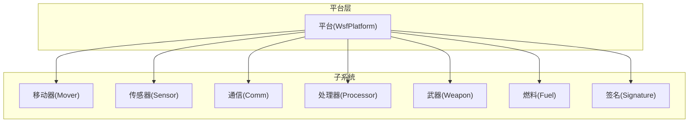
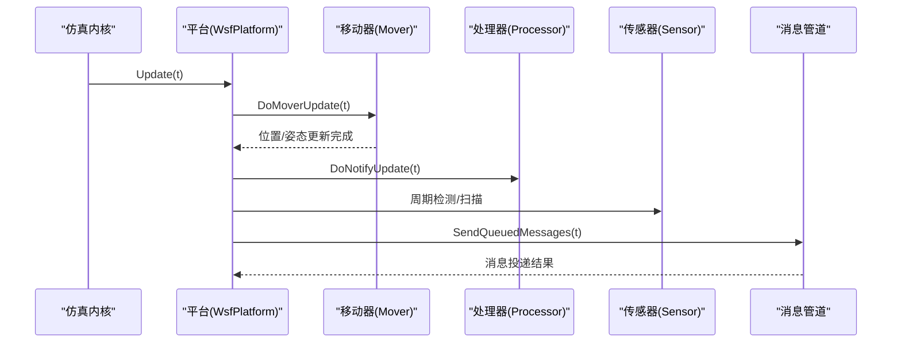
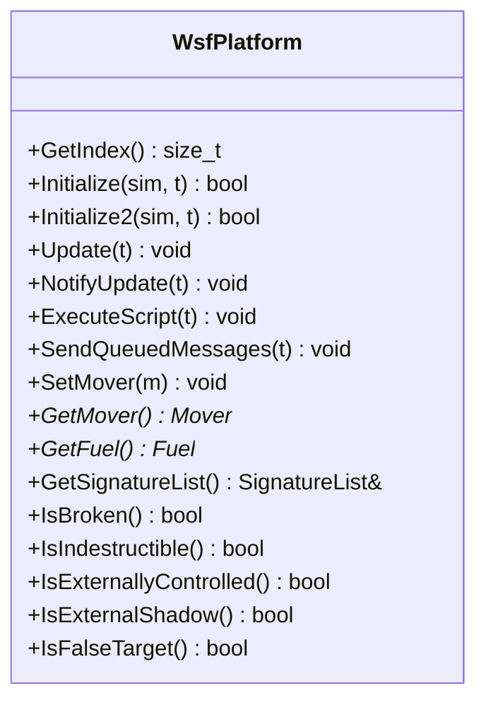
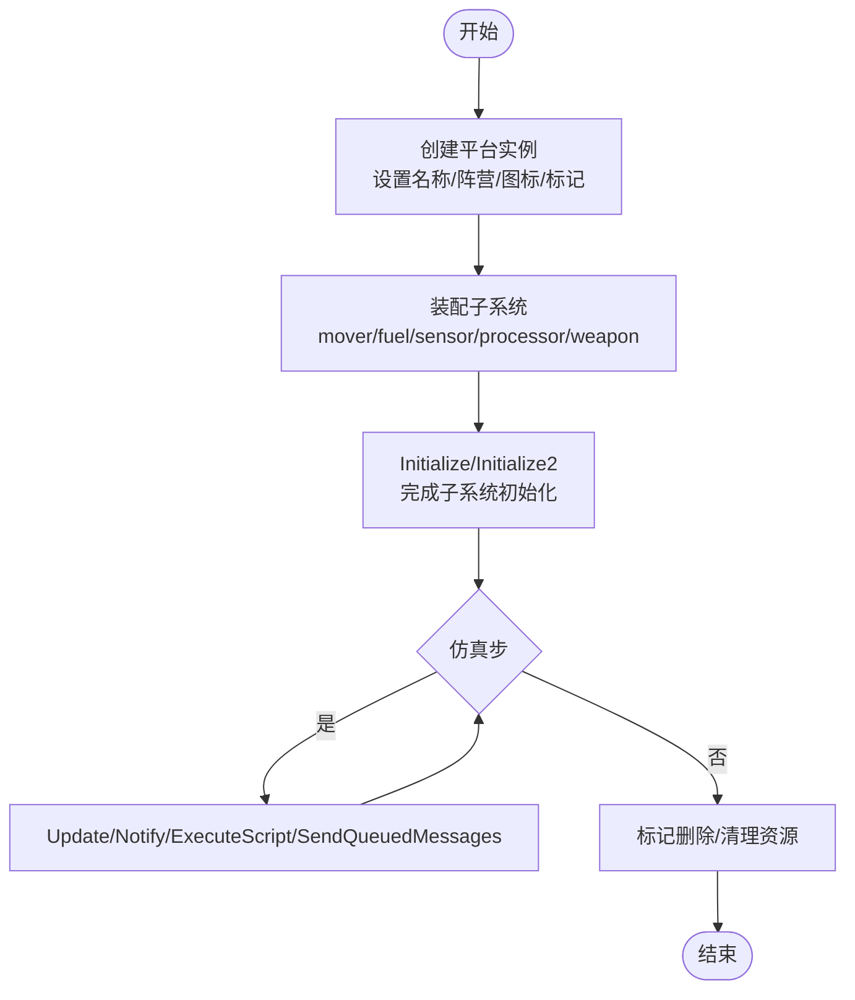
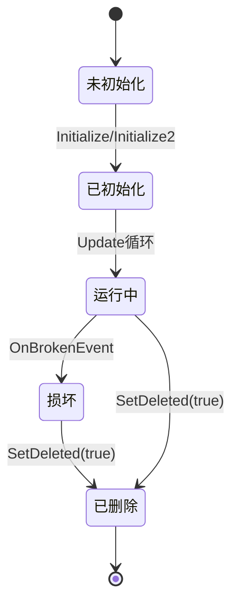
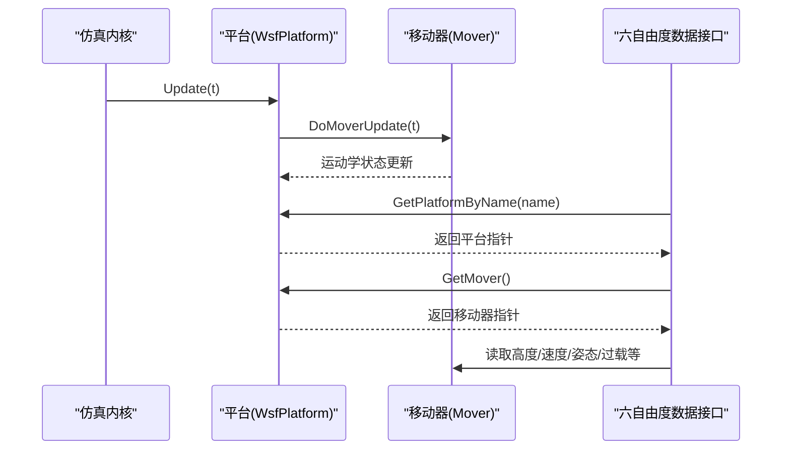
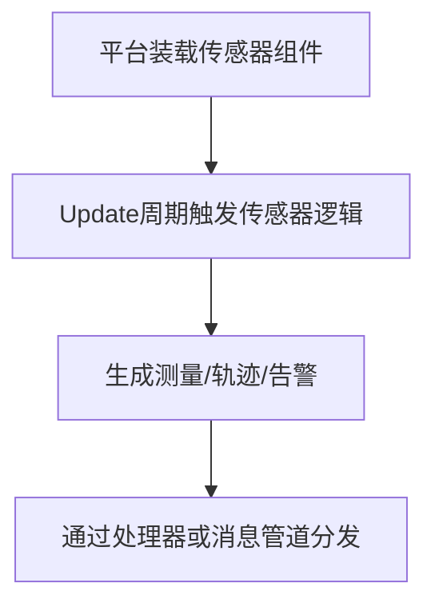
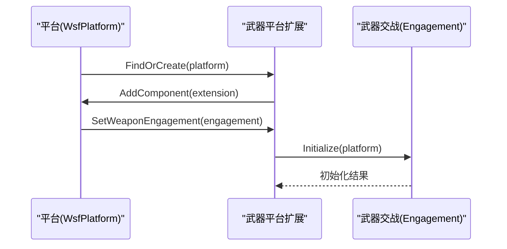
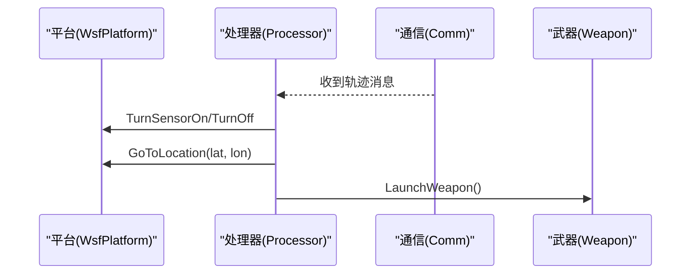
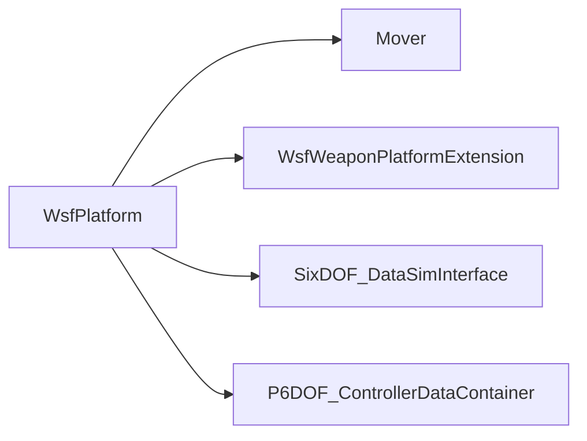

# 平台对象系统

<cite>
**本文引用的文件**   
- [WsfPlatform.hpp](file://swdev/src/core/wsf/source/WsfPlatform.hpp)
- [bomber.txt](file://demos/base_types/platforms/bomber.txt)
- [car.txt](file://training/user/4_Sensors/scenarios/solutions/7_Sensors_And_Tracks/floridistan/platforms/car.txt)
- [SixDOF_DataSimInterface.cpp](file://swdev/src/warlock/plugins/SixDOF_Data/source/SixDOF_DataSimInterface.cpp)
- [P6DOF_ControllerDataContainer.cpp](file://swdev/src/warlock/plugins/P6DOF_Controller/source/P6DOF_ControllerDataContainer.cpp)
- [WsfWeaponPlatformExtension.cpp](file://swdev/src/core/wsf_mil/source/weapon/WsfWeaponPlatformExtension.cpp)
- [script_demo_5.txt.rst](file://documentation/html/_sources/docs/script_demo_5.txt.rst.txt)
</cite>

## 目录
1. [简介](#简介)
2. [项目结构](#项目结构)
3. [核心组件](#核心组件)
4. [架构总览](#架构总览)
5. [详细组件分析](#详细组件分析)
6. [依赖关系分析](#依赖关系分析)
7. [性能考虑](#性能考虑)
8. [故障排查指南](#故障排查指南)
9. [结论](#结论)
10. [附录](#附录)

## 简介
本文件系统化阐述 AFSIM 平台对象系统的层次结构与继承体系、生命周期管理（创建、初始化、更新、销毁）、状态管理机制（状态转换与事件处理），以及与移动器、传感器、武器等子系统的集成方式。文档同时提供配置示例与最佳实践，帮助读者快速构建高质量的平台定义并优化仿真性能。

## 项目结构
AFSIM 将“平台”作为仿真实体的容器，承载移动器、通信、处理器、传感器、武器、燃料、签名等子系统。平台类型通过输入脚本声明，实例化后由仿真内核驱动其生命周期。

[本图为概念性结构图，不直接映射具体源码文件]

## 核心组件
- 平台基类：WsfPlatform 是平台对象的根类，负责平台生命周期、属性、子系统装配、更新调度、事件与脚本执行、分组与类别管理等。
- 子系统接口：移动器、传感器、处理器、通信、武器、燃料、签名等均以组件形式挂载到平台，遵循统一的组件框架。
- 扩展点：武器平台扩展、六自由度数据接口、控制器平台管理等为平台能力提供扩展。

章节来源
- [WsfPlatform.hpp:66-114](file://swdev/src/core/wsf/source/WsfPlatform.hpp#L66-L114)

## 架构总览
平台在仿真中的典型交互流程如下：仿真内核调用平台的 Update/Notify/ExecuteScript/SendQueuedMessages；平台内部委托移动器更新位置与姿态，触发处理器与传感器的周期性逻辑，并通过消息管道与其他平台交互。

图表来源
- [WsfPlatform.hpp:152-206](file://swdev/src/core/wsf/source/WsfPlatform.hpp#L152-L206)

章节来源
- [WsfPlatform.hpp:152-206](file://swdev/src/core/wsf/source/WsfPlatform.hpp#L152-L206)

## 详细组件分析

### 平台基类与继承体系
- WsfPlatform 继承自多个基础接口，包括对象标识、组件列表、实体基类、辅助数据支持等，形成统一的可克隆、可序列化、可脚本化的平台模型。
- 平台具备“损坏/不可摧毁/外部控制/外部移动/影子实体/假目标”等标志位，用于表达运行期状态与行为约束。
- 平台维护尺寸、质量、外观、能力字、隐身因子、损伤因子等物理与表现属性。

图表来源
- [WsfPlatform.hpp:108-206](file://swdev/src/core/wsf/source/WsfPlatform.hpp#L108-L206)
- [WsfPlatform.hpp:272-303](file://swdev/src/core/wsf/source/WsfPlatform.hpp#L272-L303)
- [WsfPlatform.hpp:411-533](file://swdev/src/core/wsf/source/WsfPlatform.hpp#L411-L533)

章节来源
- [WsfPlatform.hpp:108-206](file://swdev/src/core/wsf/source/WsfPlatform.hpp#L108-L206)
- [WsfPlatform.hpp:272-303](file://swdev/src/core/wsf/source/WsfPlatform.hpp#L272-L303)
- [WsfPlatform.hpp:411-533](file://swdev/src/core/wsf/source/WsfPlatform.hpp#L411-L533)

### 平台生命周期管理
- 创建与装配：通过输入脚本定义 platform_type，指定 mover、fuel、sensor、processor、weapon 等子系统；运行时由仿真内核根据场景实例化平台。
- 初始化：Initialize/Initialize2 完成子系统初始化与上下文绑定；CompleteLoad 完成加载后的收尾工作。
- 更新：Update 仅更新平台自身位置与燃料消耗；子系统更新顺序由仿真执行器控制，以保证一致性。
- 销毁：平台可在任意时刻被标记删除，引用应使用索引而非持久指针。

图表来源
- [WsfPlatform.hpp:149-153](file://swdev/src/core/wsf/source/WsfPlatform.hpp#L149-L153)
- [WsfPlatform.hpp:155-206](file://swdev/src/core/wsf/source/WsfPlatform.hpp#L155-L206)
- [WsfPlatform.hpp:298-303](file://swdev/src/core/wsf/source/WsfPlatform.hpp#L298-L303)

章节来源
- [WsfPlatform.hpp:149-153](file://swdev/src/core/wsf/source/WsfPlatform.hpp#L149-L153)
- [WsfPlatform.hpp:155-206](file://swdev/src/core/wsf/source/WsfPlatform.hpp#L155-L206)
- [WsfPlatform.hpp:298-303](file://swdev/src/core/wsf/source/WsfPlatform.hpp#L298-L303)

### 状态管理与事件处理
- 状态标志：包含已初始化、损坏、删除、外部控制/移动、外部影子、假目标、更新允许/锁定等布尔标志。
- 损坏处理：OnBrokenEvent 根据 OnBrokenAction 决定移除、禁用或保留但限制移动。
- 事件回调：PlatformAdded/PlatformDeleted 供扩展监听平台加入/移除；AttachObserver/DetachObserver 订阅平台运动与删除通知。
- 脚本钩子：ExecuteScriptAtTime 支持定时脚本；HasScript/ExecuteScript 支持动态脚本调用。

图表来源
- [WsfPlatform.hpp:121-130](file://swdev/src/core/wsf/source/WsfPlatform.hpp#L121-L130)
- [WsfPlatform.hpp:285-303](file://swdev/src/core/wsf/source/WsfPlatform.hpp#L285-L303)
- [WsfPlatform.hpp:328-331](file://swdev/src/core/wsf/source/WsfPlatform.hpp#L328-L331)
- [WsfPlatform.hpp:567-574](file://swdev/src/core/wsf/source/WsfPlatform.hpp#L567-L574)
- [WsfPlatform.hpp:379-392](file://swdev/src/core/wsf/source/WsfPlatform.hpp#L379-L392)

章节来源
- [WsfPlatform.hpp:121-130](file://swdev/src/core/wsf/source/WsfPlatform.hpp#L121-L130)
- [WsfPlatform.hpp:285-303](file://swdev/src/core/wsf/source/WsfPlatform.hpp#L285-L303)
- [WsfPlatform.hpp:328-331](file://swdev/src/core/wsf/source/WsfPlatform.hpp#L328-L331)
- [WsfPlatform.hpp:567-574](file://swdev/src/core/wsf/source/WsfPlatform.hpp#L567-L574)
- [WsfPlatform.hpp:379-392](file://swdev/src/core/wsf/source/WsfPlatform.hpp#L379-L392)

### 与移动器的集成
- 平台通过 SetMover/GetMover 持有移动器指针，并在 DoMoverUpdate 中更新位置、速度、姿态等运动学量。
- 六自由度插件通过 SimInterface 从平台获取 Mover 并读取飞行参数（高度、空速、马赫数、动压、航向、俯仰、滚转、过载等）。

图表来源
- [WsfPlatform.hpp:401-409](file://swdev/src/core/wsf/source/WsfPlatform.hpp#L401-L409)
- [SixDOF_DataSimInterface.cpp:41-65](file://swdev/src/warlock/plugins/SixDOF_Data/source/SixDOF_DataSimInterface.cpp#L41-L65)

章节来源
- [WsfPlatform.hpp:401-409](file://swdev/src/core/wsf/source/WsfPlatform.hpp#L401-L409)
- [SixDOF_DataSimInterface.cpp:41-65](file://swdev/src/warlock/plugins/SixDOF_Data/source/SixDOF_DataSimInterface.cpp#L41-L65)

### 与传感器的集成
- 平台通过 AddComponent 挂载传感器组件；传感器在 Update 周期内执行探测、跟踪、报告等逻辑。
- 多分辨率处理器可作为平台上的处理器容器，延迟选择具体处理器实现至运行期。

[本图为概念流程图，不直接映射具体源码文件]

章节来源
- [WsfPlatform.hpp:155-206](file://swdev/src/core/wsf/source/WsfPlatform.hpp#L155-L206)

### 与武器的集成
- 武器平台扩展（WsfWeaponPlatformExtension）为平台提供武器交战管理能力，包括武器效果、交战对象初始化与生命周期管理。
- Find/FindOrCreate 提供按角色查找或自动创建武器扩展的便捷方法。

图表来源
- [WsfWeaponPlatformExtension.cpp:235-269](file://swdev/src/core/wsf_mil/source/weapon/WsfWeaponPlatformExtension.cpp#L235-L269)

章节来源
- [WsfWeaponPlatformExtension.cpp:235-269](file://swdev/src/core/wsf_mil/source/weapon/WsfWeaponPlatformExtension.cpp#L235-L269)

### 与通信和处理的集成
- 平台可挂载通信收发器与处理器，处理器可响应消息、执行脚本逻辑、驱动武器发射等。
- 脚本演示展示了处理器接收轨迹消息、控制武器计算机开关、引导平台飞向目标等行为。

图表来源
- [script_demo_5.txt.rst:343-385](file://documentation/html/_sources/docs/script_demo_5.txt.rst.txt#L343-L385)

章节来源
- [script_demo_5.txt.rst:343-385](file://documentation/html/_sources/docs/script_demo_5.txt.rst.txt#L343-L385)

### 平台配置示例
- 轰炸机平台类型：定义图标、空气移动器、可变速率燃料、轨迹处理器等。
- 车辆平台类型：定义红外/光学/雷达签名与地面移动器。

章节来源
- [bomber.txt:13-58](file://demos/base_types/platforms/bomber.txt#L13-L58)
- [car.txt:12-22](file://training/user/4_Sensors/scenarios/solutions/7_Sensors_And_Tracks/floridistan/platforms/car.txt#L12-L22)

## 依赖关系分析
- 平台与子系统松耦合：通过组件框架装配，便于替换与扩展。
- 关键依赖：
  - 移动器：提供运动学状态，供六自由度数据接口读取。
  - 武器平台扩展：封装武器交战逻辑，依赖平台与交战对象。
  - 控制器平台管理：维护平台集合与连接状态，感知平台增删。

图表来源
- [WsfPlatform.hpp:401-409](file://swdev/src/core/wsf/source/WsfPlatform.hpp#L401-L409)
- [WsfWeaponPlatformExtension.cpp:252-269](file://swdev/src/core/wsf_mil/source/weapon/WsfWeaponPlatformExtension.cpp#L252-L269)
- [SixDOF_DataSimInterface.cpp:41-65](file://swdev/src/warlock/plugins/SixDOF_Data/source/SixDOF_DataSimInterface.cpp#L41-L65)
- [P6DOF_ControllerDataContainer.cpp:48-81](file://swdev/src/warlock/plugins/P6DOF_Controller/source/P6DOF_ControllerDataContainer.cpp#L48-L81)

章节来源
- [WsfPlatform.hpp:401-409](file://swdev/src/core/wsf/source/WsfPlatform.hpp#L401-L409)
- [WsfWeaponPlatformExtension.cpp:252-269](file://swdev/src/core/wsf_mil/source/weapon/WsfWeaponPlatformExtension.cpp#L252-L269)
- [SixDOF_DataSimInterface.cpp:41-65](file://swdev/src/warlock/plugins/SixDOF_Data/source/SixDOF_DataSimInterface.cpp#L41-L65)
- [P6DOF_ControllerDataContainer.cpp:48-81](file://swdev/src/warlock/plugins/P6DOF_Controller/source/P6DOF_ControllerDataContainer.cpp#L48-L81)

## 性能考虑
- 更新节流：Update 内部检查 mUpdateAllowed 与 mLastUpdateTime，避免重复更新；多线程模式下使用 UpdateMultiThread 以规避锁竞争。
- 子系统批量更新：处理器与传感器按 update_interval 与 purge_interval 控制频率，减少高频计算开销。
- 对象复用：通过 Clone/CloneComponent 复用平台与组件，降低分配与构造成本。
- 外部控制与影子实体：对 IsExternallyControlled/IsExternalShadow 进行条件判断，避免不必要的传感器探测与数据处理。

章节来源
- [WsfPlatform.hpp:165-181](file://swdev/src/core/wsf/source/WsfPlatform.hpp#L165-L181)
- [bomber.txt:52-56](file://demos/base_types/platforms/bomber.txt#L52-L56)
- [WsfPlatform.hpp:228-270](file://swdev/src/core/wsf/source/WsfPlatform.hpp#L228-L270)

## 故障排查指南
- 平台未初始化：检查 Initialize/Initialize2 返回值与 CompleteLoad 是否成功；确认所有子系统已正确装配。
- 平台损坏：查看 OnBrokenAction 与 IsBroken；必要时调整损坏策略或修复子系统。
- 外部控制异常：核对 IsExternallyControlled/IsExternallyMoved/IsExternalShadow 标志，确保外部应用同步状态。
- 武器交战失败：检查 WsfWeaponPlatformExtension::SetWeaponEngagement 与 Engagement::Initialize 的结果日志。
- 六自由度数据缺失：确认平台存在且移动器为六自由度类型，再读取相关属性。

章节来源
- [WsfPlatform.hpp:285-303](file://swdev/src/core/wsf/source/WsfPlatform.hpp#L285-L303)
- [WsfWeaponPlatformExtension.cpp:235-249](file://swdev/src/core/wsf_mil/source/weapon/WsfWeaponPlatformExtension.cpp#L235-L249)
- [SixDOF_DataSimInterface.cpp:41-65](file://swdev/src/warlock/plugins/SixDOF_Data/source/SixDOF_DataSimInterface.cpp#L41-L65)

## 结论
平台对象系统是 AFSIM 的核心抽象，通过统一的组件框架将移动器、传感器、处理器、通信、武器、燃料、签名等子系统有机整合。理解平台的生命周期、状态管理与事件机制，有助于构建稳定高效的仿真模型。结合配置示例与性能优化建议，可显著提升建模效率与运行性能。

## 附录
- 最佳实践
  - 明确平台类型职责边界，合理拆分子系统，避免单体平台过于臃肿。
  - 使用 update_interval/purge_interval 控制处理器与传感器频率，平衡精度与性能。
  - 对外部控制平台与影子实体进行显式区分，避免误判与冗余计算。
  - 通过分类与分组（Category/Group）组织平台，提升查询与管理效率。
  - 谨慎使用脚本钩子，优先采用处理器与消息机制解耦逻辑。

[本节为通用指导，不直接分析具体文件]