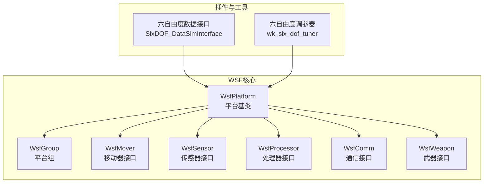
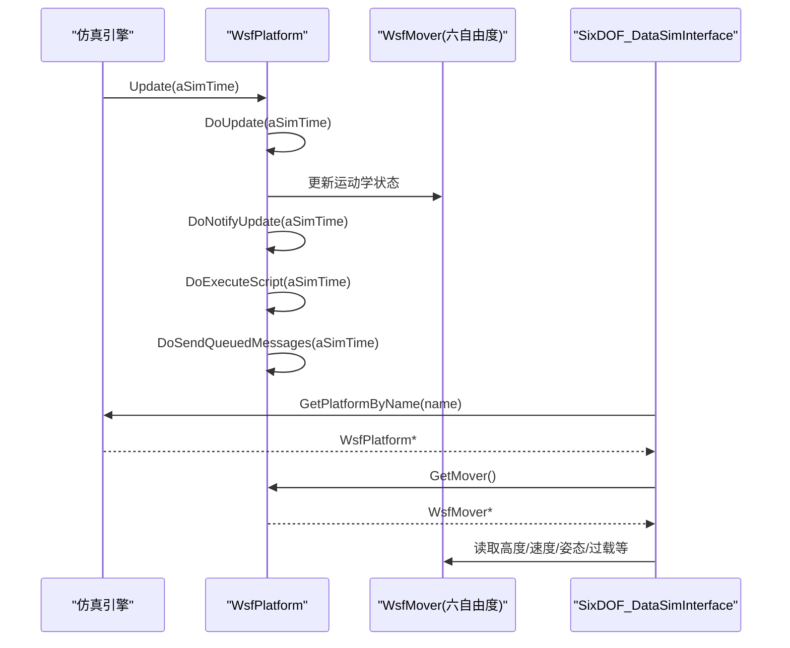
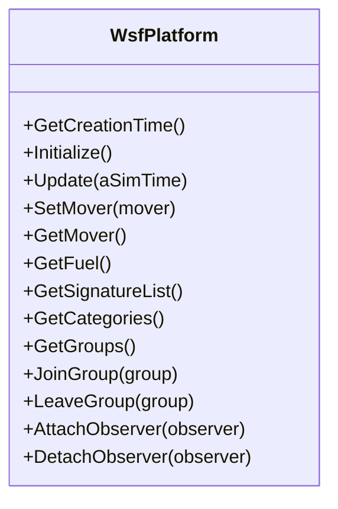
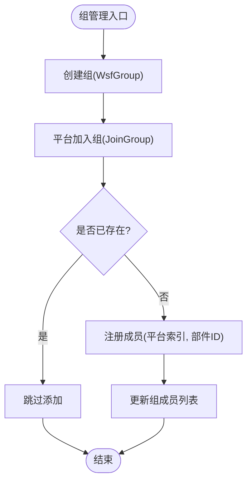
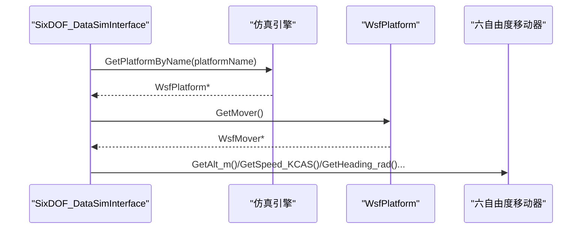
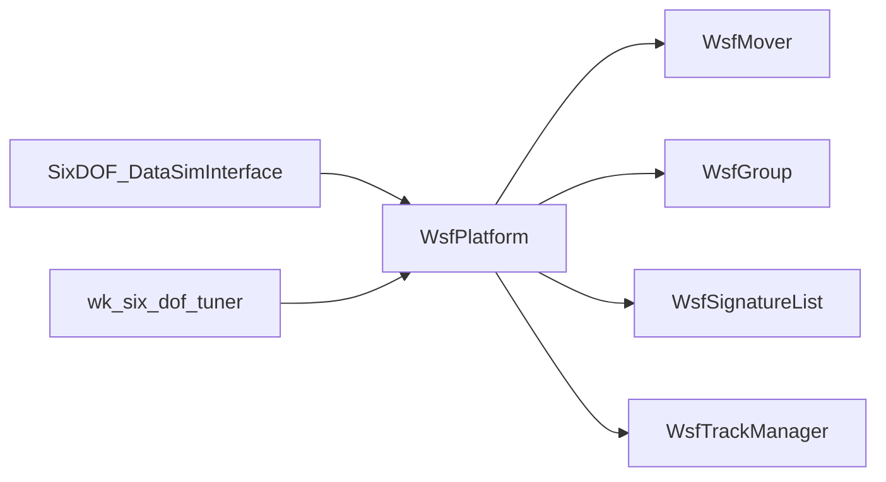

# 平台管理系统

<cite>
**本文引用的文件**   
- [WsfPlatform.hpp](file://swdev/src/core/wsf/source/WsfPlatform.hpp)
- [WsfGroup.hpp](file://swdev/src/core/wsf/source/WsfGroup.hpp)
- [SixDOF_DataSimInterface.cpp](file://swdev/src/warlock/plugins/SixDOF_Data/source/SixDOF_DataSimInterface.cpp)
- [wsfformationdetachcommand.html](file://documentation/html/docs/script/wsfformationdetachcommand.html)
- [multiresolution_processor.html](file://documentation/html/docs/multiresolution_processor.html)
- [wk_six_dof_tuner.html](file://documentation/html/docs/wkf_plugin/wk_six_dof_tuner.html)
- [rv_sa_display.html](file://documentation/html/docs/wkf_plugin/rv_sa_display.html)
</cite>

## 目录
1. [简介](#简介)
2. [项目结构](#项目结构)
3. [核心组件](#核心组件)
4. [架构总览](#架构总览)
5. [详细组件分析](#详细组件分析)
6. [依赖关系分析](#依赖关系分析)
7. [性能考虑](#性能考虑)
8. [故障排查指南](#故障排查指南)
9. [结论](#结论)
10. [附录](#附录)

## 简介
本文件面向AFSIM平台管理系统的深入文档，聚焦以下目标：
- 解释平台对象的层次结构与继承体系，明确基类与派生类的职责分工。
- 详细说明平台的属性系统（定义、访问与修改机制）。
- 文档化平台组管理机制（组的创建、成员管理与组间通信）。
- 解释平台与移动器、传感器、武器等子系统的集成方式。
- 提供配置示例路径，展示如何定义复杂平台结构。
- 给出大规模平台仿真的性能优化建议与最佳实践。

## 项目结构
AFSIM的核心平台抽象位于WSF（Warfare Simulation Framework）中，平台对象作为仿真实体的容器，聚合移动器、传感器、处理器、通信、武器等子系统。平台类型与实例通过输入脚本/文本定义，运行时由仿真引擎调度更新。

图表来源
- [WsfPlatform.hpp:66-114](file://swdev/src/core/wsf/source/WsfPlatform.hpp#L66-L114)
- [WsfGroup.hpp:28-66](file://swdev/src/core/wsf/source/WsfGroup.hpp#L28-L66)
- [SixDOF_DataSimInterface.cpp:41-65](file://swdev/src/warlock/plugins/SixDOF_Data/source/SixDOF_DataSimInterface.cpp#L41-L65)

章节来源
- [WsfPlatform.hpp:66-114](file://swdev/src/core/wsf/source/WsfPlatform.hpp#L66-L114)
- [WsfGroup.hpp:28-66](file://swdev/src/core/wsf/source/WsfGroup.hpp#L28-L66)

## 核心组件
- WsfPlatform：平台基类，负责生命周期、组件管理、运动状态、质量与外观、类别与分组、轨迹管理等。
- WsfGroup：平台组，维护组成员列表与加入/离开操作。
- 移动器（WsfMover）：提供平台运动学状态（高度、速度、姿态、过载等），六自由度扩展通过派生实现。
- 传感器/处理器/通信/武器：以组件形式挂载到平台，遵循统一的组件接口。

章节来源
- [WsfPlatform.hpp:66-114](file://swdev/src/core/wsf/source/WsfPlatform.hpp#L66-L114)
- [WsfGroup.hpp:28-66](file://swdev/src/core/wsf/source/WsfGroup.hpp#L28-L66)

## 架构总览
平台在仿真中的典型调用流程如下：仿真引擎按时间步调用平台Update，平台内部协调移动器更新、组件通知、脚本执行与消息队列发送；外部工具（如六自由度数据接口）通过仿真API获取平台指针并读取移动器状态。

图表来源
- [WsfPlatform.hpp:165-206](file://swdev/src/core/wsf/source/WsfPlatform.hpp#L165-L206)
- [WsfPlatform.hpp:596-601](file://swdev/src/core/wsf/source/WsfPlatform.hpp#L596-L601)
- [SixDOF_DataSimInterface.cpp:41-65](file://swdev/src/warlock/plugins/SixDOF_Data/source/SixDOF_DataSimInterface.cpp#L41-L65)

## 详细组件分析

### 平台基类与继承体系
WsfPlatform继承自多个基础接口，承担平台实体在仿真中的综合职责：
- 组件基础设施：统一组件角色、克隆、查询接口。
- 框架方法：脚本上下文、克隆、分配仿真、输入处理、初始化与更新。
- 仿真接口：创建时间、最后更新时间、外部控制/移动标志、不可摧毁标志、损坏动作、索引与场景关联。
- 自我感知：位置误差、地形上下文。
- 团队与标识：side/icon/marking。
- 空间域：land/air/space等。
- 组件管理：ArticulatedPart、组件列表。
- 移动器系统：设置/交换/获取移动器。
- 燃料系统：质量与燃料质量。
- 外观与能力：尺寸、外观字、能力位、隐身因子、损伤因子。
- 轨迹管理：本地轨迹、主轨迹列表、轨迹管理器。
- 类别与分组：类别集合、组列表、加入/离开组。
- 观察者：平台状态变化通知。

图表来源
- [WsfPlatform.hpp:132-206](file://swdev/src/core/wsf/source/WsfPlatform.hpp#L132-L206)
- [WsfPlatform.hpp:401-466](file://swdev/src/core/wsf/source/WsfPlatform.hpp#L401-L466)
- [WsfPlatform.hpp:468-556](file://swdev/src/core/wsf/source/WsfPlatform.hpp#L468-L556)
- [WsfPlatform.hpp:558-574](file://swdev/src/core/wsf/source/WsfPlatform.hpp#L558-L574)

章节来源
- [WsfPlatform.hpp:66-114](file://swdev/src/core/wsf/source/WsfPlatform.hpp#L66-L114)
- [WsfPlatform.hpp:132-206](file://swdev/src/core/wsf/source/WsfPlatform.hpp#L132-L206)
- [WsfPlatform.hpp:401-574](file://swdev/src/core/wsf/source/WsfPlatform.hpp#L401-L574)

### 平台属性系统（定义、访问与修改）
- 定义：平台属性通过输入块（ProcessInputBlock）加载，支持类型与实例的分离定义。
- 访问：提供大量Getter方法（如GetHeight、GetWidth、GetLength、GetAppearance、GetCapabilities、GetDamageFactor、GetConcealmentFactor等）。
- 修改：提供Setter方法（如SetLength、SetWidth、SetHeight、SetAppearance、SetCapabilities、SetDamageFactor、SetConcealmentFactor等），部分属性受脚本覆盖或掩码控制。
- 质量与燃料：空重、载荷、燃料质量可独立设置，总质量为三者之和。
- 外观与能力：外观字与能力位用于本地显示与DIS交互；隐身因子与损伤因子影响探测与生存性。

章节来源
- [WsfPlatform.hpp:468-556](file://swdev/src/core/wsf/source/WsfPlatform.hpp#L468-L556)
- [WsfPlatform.hpp:431-466](file://swdev/src/core/wsf/source/WsfPlatform.hpp#L431-L466)
- [WsfPlatform.hpp:576-580](file://swdev/src/core/wsf/source/WsfPlatform.hpp#L576-L580)

### 平台组管理机制（创建、成员管理、组间通信）
- 组对象：WsfGroup维护成员列表（平台索引+部件ID），提供IsGroupMember、JoinGroup、LeaveGroup等方法。
- 平台侧：WsfPlatform持有WsfGroupList，提供JoinGroup、LeaveGroup、IsGroupMember、GetGroups。
- 可视化：SA显示中组以圆圈表示，包含成员范围与不确定性增长效果。
- 编队命令：存在编队相关命令（如WsfFormationDetachCommand），用于编队脱离等战术行为。

图表来源
- [WsfGroup.hpp:46-57](file://swdev/src/core/wsf/source/WsfGroup.hpp#L46-L57)
- [WsfPlatform.hpp:558-565](file://swdev/src/core/wsf/source/WsfPlatform.hpp#L558-L565)
- [rv_sa_display.html:160-164](file://documentation/html/docs/wkf_plugin/rv_sa_display.html#L160-L164)

章节来源
- [WsfGroup.hpp:28-66](file://swdev/src/core/wsf/source/WsfGroup.hpp#L28-L66)
- [WsfPlatform.hpp:558-565](file://swdev/src/core/wsf/source/WsfPlatform.hpp#L558-L565)
- [wsfformationdetachcommand.html:77-100](file://documentation/html/docs/script/wsfformationdetachcommand.html#L77-L100)
- [rv_sa_display.html:160-164](file://documentation/html/docs/wkf_plugin/rv_sa_display.html#L160-L164)

### 平台与子系统集成（移动器、传感器、武器）
- 移动器集成：平台通过SetMover/GetMover管理移动器；六自由度扩展通过动态转换获取具体Mover并读取状态（高度、速度、姿态、过载等）。
- 传感器/处理器/通信/武器：作为组件挂载到平台，遵循统一组件接口；可通过多分辨率处理器容器在运行时选择具体处理器。
- 六自由度调参：调参器允许冻结/设定平台状态、发送连续或定时命令，观察平台状态与PID信号。

图表来源
- [SixDOF_DataSimInterface.cpp:41-65](file://swdev/src/warlock/plugins/SixDOF_Data/source/SixDOF_DataSimInterface.cpp#L41-L65)
- [WsfPlatform.hpp:401-409](file://swdev/src/core/wsf/source/WsfPlatform.hpp#L401-L409)

章节来源
- [SixDOF_DataSimInterface.cpp:41-65](file://swdev/src/warlock/plugins/SixDOF_Data/source/SixDOF_DataSimInterface.cpp#L41-L65)
- [WsfPlatform.hpp:401-409](file://swdev/src/core/wsf/source/WsfPlatform.hpp#L401-L409)
- [multiresolution_processor.html:113-129](file://documentation/html/docs/multiresolution_processor.html#L113-L129)
- [wk_six_dof_tuner.html:92-114](file://documentation/html/docs/wkf_plugin/wk_six_dof_tuner.html#L92-L114)

### 配置示例与复杂平台结构
- 平台类型与实例：通过输入脚本定义平台类型（platform_type）与实例（platform），可在运行时创建实例。
- 多分辨率处理器：在平台内定义多分辨率处理器容器，运行时选择具体处理器。
- 编队命令：使用编队相关命令进行编队行为控制（如脱离编队）。
- 参考示例路径：demos/base_types/platforms下包含多种平台类型定义，可作为复杂结构的参考。

章节来源
- [multiresolution_processor.html:113-129](file://documentation/html/docs/multiresolution_processor.html#L113-L129)
- [wsfformationdetachcommand.html:77-100](file://documentation/html/docs/script/wsfformationdetachcommand.html#L77-L100)
- [demos/base_types/platforms](file://demos/base_types/platforms)

## 依赖关系分析
- 组件耦合：WsfPlatform与WsfMover、WsfGroup、WsfSignatureList、WsfTrackManager等存在强依赖；组件通过统一接口解耦。
- 外部依赖：六自由度数据接口依赖仿真API与移动器接口；调参器依赖平台状态与命令链。
- 潜在循环依赖：通过前向声明与接口隔离避免循环依赖。

图表来源
- [WsfPlatform.hpp:619-694](file://swdev/src/core/wsf/source/WsfPlatform.hpp#L619-L694)
- [SixDOF_DataSimInterface.cpp:41-65](file://swdev/src/warlock/plugins/SixDOF_Data/source/SixDOF_DataSimInterface.cpp#L41-L65)

章节来源
- [WsfPlatform.hpp:619-694](file://swdev/src/core/wsf/source/WsfPlatform.hpp#L619-L694)
- [SixDOF_DataSimInterface.cpp:41-65](file://swdev/src/warlock/plugins/SixDOF_Data/source/SixDOF_DataSimInterface.cpp#L41-L65)

## 性能考虑
- 批量更新：利用UpdateMultiThread与DoUpdateMultiThread减少锁竞争，适合多线程仿真环境。
- 组件懒加载：签名列表等按需创建，降低初始化开销。
- 属性访问优化：避免频繁脚本覆盖检查，合理使用掩码与缓存。
- 组管理优化：组成员变更时最小化列表更新与通知。
- 大规模平台：优先使用索引而非指针，避免平台销毁后的悬垂引用；合理划分场景与线程池。

[本节为通用指导，不直接分析具体文件]

## 故障排查指南
- 平台未更新：检查mUpdateAllowed与mUpdateLocked标志，确认DoUpdate是否被调用。
- 移动器状态异常：确认GetMover返回非空且为正确的六自由度派生类型；检查外部控制/移动标志。
- 组成员不一致：核对JoinGroup/LeaveGroup调用与成员列表；检查平台索引与部件ID匹配。
- 脚本执行失败：检查HasScript与ExecuteScript参数；确认脚本上下文正确绑定。

章节来源
- [WsfPlatform.hpp:165-206](file://swdev/src/core/wsf/source/WsfPlatform.hpp#L165-L206)
- [WsfPlatform.hpp:379-392](file://swdev/src/core/wsf/source/WsfPlatform.hpp#L379-L392)
- [WsfPlatform.hpp:558-565](file://swdev/src/core/wsf/source/WsfPlatform.hpp#L558-L565)

## 结论
AFSIM的平台管理系统以WsfPlatform为核心，通过组件化设计将移动器、传感器、处理器、通信、武器等子系统有机整合；平台组提供灵活的编队与协作能力；六自由度扩展与调参工具增强了高保真飞行建模与调试体验。通过合理的属性管理、组管理与多线程更新策略，可实现大规模平台仿真的高效与稳定。

[本节为总结性内容，不直接分析具体文件]

## 附录
- 平台类型与实例定义参考：demos/base_types/platforms
- 多分辨率处理器用法参考：documentation/html/docs/multiresolution_processor.html
- 六自由度调参器界面参考：documentation/html/docs/wkf_plugin/wk_six_dof_tuner.html
- SA显示中组可视化参考：documentation/html/docs/wkf_plugin/rv_sa_display.html

[本节为参考链接汇总，不直接分析具体文件]