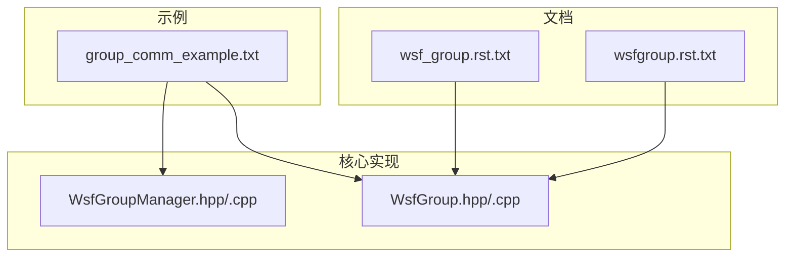
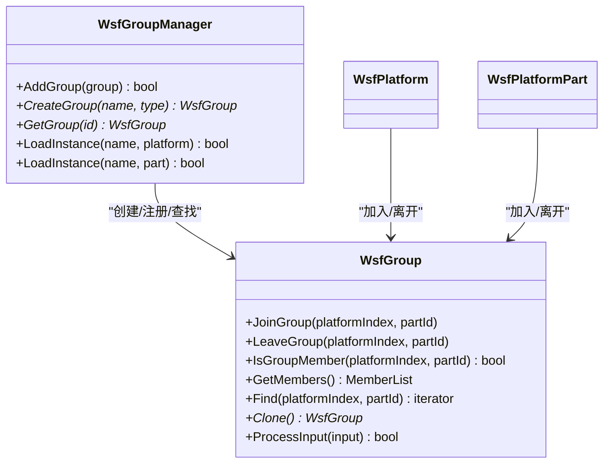
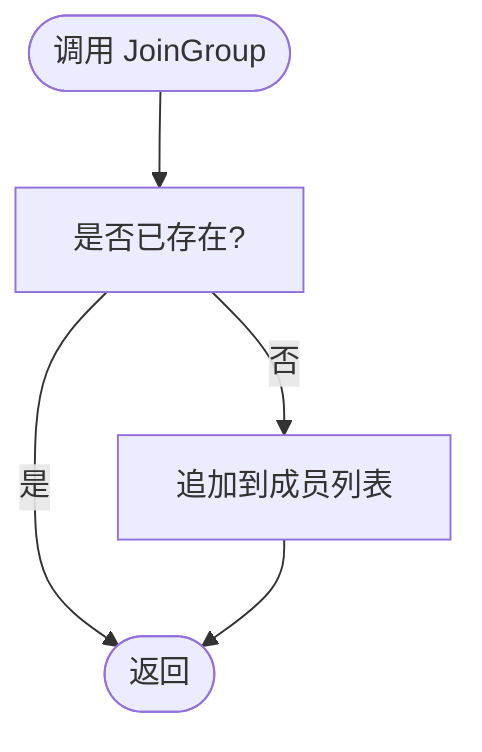
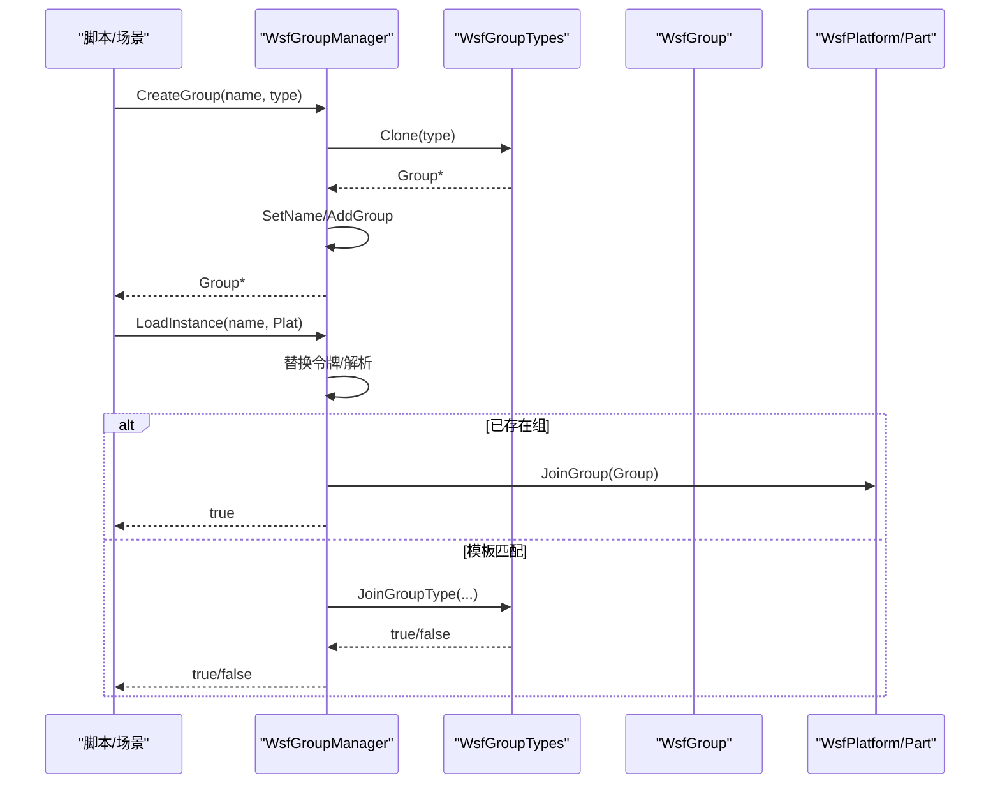
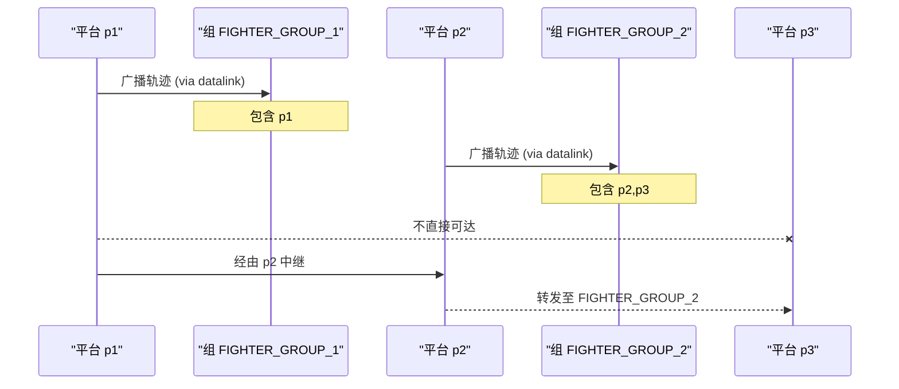
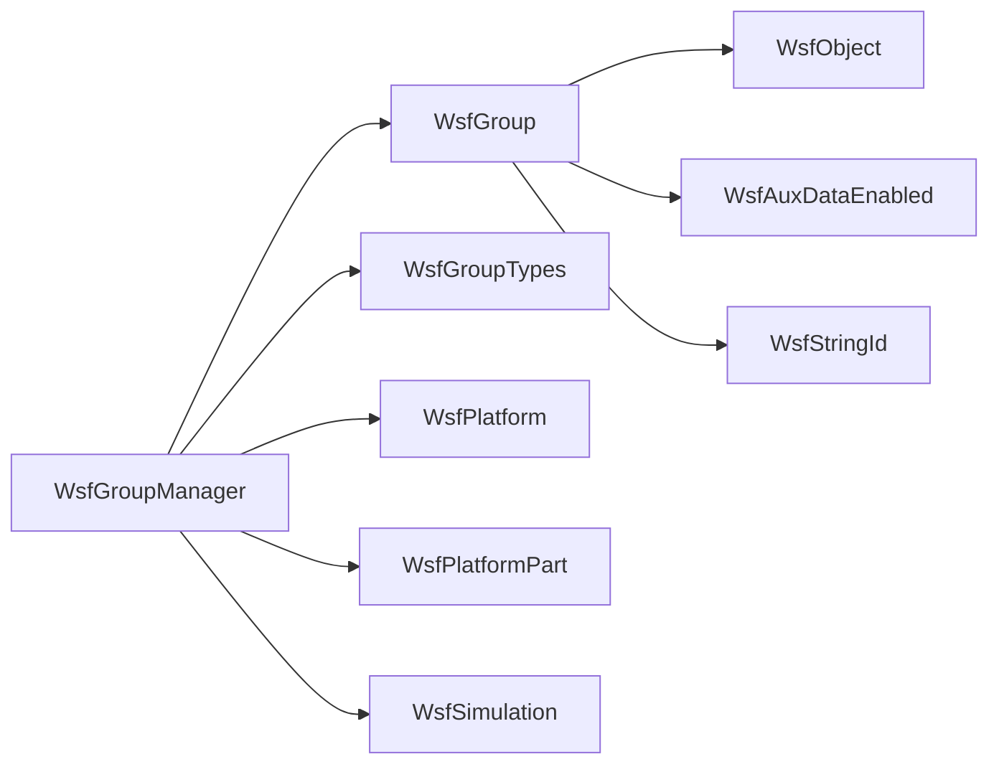

# 组管理系统

<cite>
**本文引用的文件**   
- [group_comm_example.txt](file://demos/comm/group_comm_example.txt)
- [wsf_group.rst.txt](file://documentation/html/_sources/docs/wsf_group.rst.txt)
- [wsfgroup.rst.txt](file://documentation/html/_sources/docs/script/wsfgroup.rst.txt)
- [WsfGroup.hpp](file://swdev/src/core/wsf/source/WsfGroup.hpp)
- [WsfGroup.cpp](file://swdev/src/core/wsf/source/WsfGroup.cpp)
- [WsfGroupManager.hpp](file://swdev/src/core/wsf/source/WsfGroupManager.hpp)
- [WsfGroupManager.cpp](file://swdev/src/core/wsf/source/WsfGroupManager.cpp)
</cite>

## 目录
1. [简介](#简介)
2. [项目结构](#项目结构)
3. [核心组件](#核心组件)
4. [架构总览](#架构总览)
5. [详细组件分析](#详细组件分析)
6. [依赖关系分析](#依赖关系分析)
7. [性能考虑](#性能考虑)
8. [故障排查指南](#故障排查指南)
9. [结论](#结论)
10. [附录：配置示例与最佳实践](#附录配置示例与最佳实践)

## 简介
本文件面向 AFSIM 的“组（Group）”子系统，系统性阐述组的层次结构与组织模式、成员管理机制、组间通信协议（广播、定向传输与过滤）、运行时动态管理能力，并提供可操作的配置示例与性能优化建议。文档以源码与官方脚本文档为依据，确保技术准确性与可追溯性。

## 项目结构
围绕“组管理”的相关代码与示例分布如下：
- 核心实现位于 swdev/src/core/wsf/source 下的 WsfGroup* 系列头/源文件，提供组对象、成员管理与实例化能力。
- 脚本 API 文档位于 documentation/html/_sources/docs/script/wsfgroup.rst.txt，描述 WsfGroup 的脚本接口与用法。
- 概念说明位于 documentation/html/_sources/docs/wsf_group.rst.txt，定义 WSF_GROUP 类型。
- 场景示例位于 demos/comm/group_comm_example.txt，演示基于组的消息转发与路由。

图表来源
- [WsfGroup.hpp:28-66](file://swdev/src/core/wsf/source/WsfGroup.hpp#L28-L66)
- [WsfGroupManager.hpp:29-57](file://swdev/src/core/wsf/source/WsfGroupManager.hpp#L29-L57)
- [wsfgroup.rst.txt:12-98](file://documentation/html/_sources/docs/script/wsfgroup.rst.txt#L12-L98)
- [wsf_group.rst.txt:12-17](file://documentation/html/_sources/docs/wsf_group.rst.txt#L12-L17)
- [group_comm_example.txt:44-54](file://demos/comm/group_comm_example.txt#L44-L54)

章节来源
- [WsfGroup.hpp:28-66](file://swdev/src/core/wsf/source/WsfGroup.hpp#L28-L66)
- [WsfGroupManager.hpp:29-57](file://swdev/src/core/wsf/source/WsfGroupManager.hpp#L29-L57)
- [wsfgroup.rst.txt:12-98](file://documentation/html/_sources/docs/script/wsfgroup.rst.txt#L12-L98)
- [wsf_group.rst.txt:12-17](file://documentation/html/_sources/docs/wsf_group.rst.txt#L12-L17)
- [group_comm_example.txt:44-54](file://demos/comm/group_comm_example.txt#L44-L54)

## 核心组件
- WsfGroup：表示一个组，维护成员列表（平台或平台部件），支持加入/离开、查找、克隆等基础操作。
- WsfGroupManager：单例式管理器，负责组的创建、注册、查找与按模板/令牌解析实例化并让平台/部件加入。
- 脚本接口 WsfGroup：对外暴露 Members/MembersByName/Size/AddMember/RemoveMember/CreateGroup/Group/Groups 等方法，便于在脚本中动态构建与管理组。
- WSF_GROUP：最基础的组类型，作为模板用于 CreateGroup 或 group 声明。

章节来源
- [WsfGroup.hpp:28-66](file://swdev/src/core/wsf/source/WsfGroup.hpp#L28-L66)
- [WsfGroup.cpp:44-84](file://swdev/src/core/wsf/source/WsfGroup.cpp#L44-L84)
- [WsfGroupManager.hpp:29-57](file://swdev/src/core/wsf/source/WsfGroupManager.hpp#L29-L57)
- [WsfGroupManager.cpp:61-84](file://swdev/src/core/wsf/source/WsfGroupManager.cpp#L61-L84)
- [wsfgroup.rst.txt:12-98](file://documentation/html/_sources/docs/script/wsfgroup.rst.txt#L12-L98)
- [wsf_group.rst.txt:12-17](file://documentation/html/_sources/docs/wsf_group.rst.txt#L12-L17)

## 架构总览
下图展示组管理的核心类关系与交互：

图表来源
- [WsfGroup.hpp:28-66](file://swdev/src/core/wsf/source/WsfGroup.hpp#L28-L66)
- [WsfGroupManager.hpp:29-57](file://swdev/src/core/wsf/source/WsfGroupManager.hpp#L29-L57)

## 详细组件分析

### 组对象 WsfGroup
- 数据结构：内部使用成员列表存储 <平台索引, 部件ID> 对，支持去重加入与快速查找。
- 关键行为：
  - JoinGroup/LeaveGroup：增删成员，避免重复。
  - IsGroupMember/Find：成员判定与定位。
  - Clone/Initialize/ProcessInput：生命周期与输入处理。
- 复杂度：
  - 加入/离开：均摊 O(1) 插入，删除为 O(n) 线性扫描。
  - 查询：O(n) 线性查找；若成员规模大且频繁查询，可考虑索引优化。

图表来源
- [WsfGroup.cpp:44-51](file://swdev/src/core/wsf/source/WsfGroup.cpp#L44-L51)

章节来源
- [WsfGroup.hpp:28-66](file://swdev/src/core/wsf/source/WsfGroup.hpp#L28-L66)
- [WsfGroup.cpp:44-84](file://swdev/src/core/wsf/source/WsfGroup.cpp#L44-L84)

### 组管理器 WsfGroupManager
- 职责：
  - 创建组：根据类型克隆并注册，触发观察者事件。
  - 查找组：按名称获取。
  - 实例化与加入：支持令牌替换（如 <plat_type>/<plat_name>），匹配已有组或模板后让平台/部件加入。
- 错误处理：未知类型或未找到组时记录错误日志。

图表来源
- [WsfGroupManager.cpp:61-84](file://swdev/src/core/wsf/source/WsfGroupManager.cpp#L61-L84)
- [WsfGroupManager.cpp:105-160](file://swdev/src/core/wsf/source/WsfGroupManager.cpp#L105-L160)
- [WsfGroupManager.cpp:168-230](file://swdev/src/core/wsf/source/WsfGroupManager.cpp#L168-L230)

章节来源
- [WsfGroupManager.hpp:29-57](file://swdev/src/core/wsf/source/WsfGroupManager.hpp#L29-L57)
- [WsfGroupManager.cpp:61-84](file://swdev/src/core/wsf/source/WsfGroupManager.cpp#L61-L84)
- [WsfGroupManager.cpp:105-160](file://swdev/src/core/wsf/source/WsfGroupManager.cpp#L105-L160)
- [WsfGroupManager.cpp:168-230](file://swdev/src/core/wsf/source/WsfGroupManager.cpp#L168-L230)

### 脚本接口 WsfGroup
- 访问器：Members/MembersByName/Size/Member(index)。
- 组操作：AddMember/RemoveMember/CreateGroup/Group/Groups。
- 典型用法：通过 WsfSimulation.CreateGroup 创建组，遍历组成员进行广播或定向通信。

章节来源
- [wsfgroup.rst.txt:12-98](file://documentation/html/_sources/docs/script/wsfgroup.rst.txt#L12-L98)

### 组间通信与消息路由
- 示例场景 group_comm_example.txt 展示了：
  - 定义通信收发器 BASIC_COMM 与处理器 BASIC_TRACK_PROC。
  - 创建两个组 FIGHTER_GROUP_1/FIGHTER_GROUP_2。
  - p1 将轨迹报告给 FIGHTER_GROUP_1，p2 同时属于两组成员，并将轨迹转发至 FIGHTER_GROUP_2。
  - p3 仅属于 FIGHTER_GROUP_2，无法直接接收 p1 的消息，需经 p2 中转。
- 关键点：
  - report_to_group via datalink：向指定组广播消息。
  - peers：向同组对等节点发送（示例中注释）。
  - 事件输出 MESSAGE_TRANSMITTED/MESSAGE_DELIVERY_ATTEMPT/MESSAGE_RECEIVED 可用于追踪消息流。

图表来源
- [group_comm_example.txt:22-54](file://demos/comm/group_comm_example.txt#L22-L54)
- [group_comm_example.txt:98-151](file://demos/comm/group_comm_example.txt#L98-L151)
- [group_comm_example.txt:161-171](file://demos/comm/group_comm_example.txt#L161-L171)

章节来源
- [group_comm_example.txt:22-54](file://demos/comm/group_comm_example.txt#L22-L54)
- [group_comm_example.txt:98-151](file://demos/comm/group_comm_example.txt#L98-L151)
- [group_comm_example.txt:161-171](file://demos/comm/group_comm_example.txt#L161-L171)

## 依赖关系分析
- WsfGroup 依赖 WsfObject、WsfAuxDataEnabled、WsfStringId 等基础类型。
- WsfGroupManager 依赖 WsfGroupTypes、WsfPlatform、WsfPlatformPart、WsfSimulation 以及观察者机制。
- 脚本层通过 WsfGroup 的静态方法创建/查询组，并通过平台/部件的加入/离开接口与底层组对象交互。

图表来源
- [WsfGroup.hpp:28-66](file://swdev/src/core/wsf/source/WsfGroup.hpp#L28-L66)
- [WsfGroupManager.hpp:29-57](file://swdev/src/core/wsf/source/WsfGroupManager.hpp#L29-L57)

章节来源
- [WsfGroup.hpp:28-66](file://swdev/src/core/wsf/source/WsfGroup.hpp#L28-L66)
- [WsfGroupManager.hpp:29-57](file://swdev/src/core/wsf/source/WsfGroupManager.hpp#L29-L57)

## 性能考虑
- 成员管理：
  - 当前成员查找为线性扫描 O(n)，适合中小规模组；当组规模较大且频繁查询时，可在上层缓存成员集合或使用哈希索引。
  - 加入/离开操作应避免重复加入，利用现有去重逻辑减少冗余。
- 组实例化：
  - 令牌替换与模板匹配发生在 LoadInstance 路径，建议在场景初始化阶段完成，避免运行期频繁解析。
- 通信广播：
  - 使用 report_to_group 广播时，注意组大小与消息频率，必要时采用分层转发（如示例中的 p2 中继）降低全网泛洪。
- 事件输出：
  - 开启 MESSAGE_* 事件有助于诊断，但会增大 I/O 开销，应在调试阶段启用。

[本节为通用指导，无需特定文件引用]

## 故障排查指南
- 常见错误：
  - 未知组类型：CreateGroup 时类型不存在会记录错误日志。
  - 未找到组：LoadInstance 无法匹配任何组或模板时会记录错误日志，并附带平台/部件信息。
- 排查步骤：
  - 检查组名与类型拼写，确认模板是否存在。
  - 检查令牌替换是否正确（<plat_type>/<plat_name>）。
  - 使用事件输出 MESSAGE_TRANSMITTED/MESSAGE_DELIVERY_ATTEMPT/MESSAGE_RECEIVED 验证消息流向。
  - 在脚本中打印组成员列表，确认加入/离开是否符合预期。

章节来源
- [WsfGroupManager.cpp:61-84](file://swdev/src/core/wsf/source/WsfGroupManager.cpp#L61-L84)
- [WsfGroupManager.cpp:105-160](file://swdev/src/core/wsf/source/WsfGroupManager.cpp#L105-L160)
- [WsfGroupManager.cpp:168-230](file://swdev/src/core/wsf/source/WsfGroupManager.cpp#L168-L230)
- [group_comm_example.txt:161-171](file://demos/comm/group_comm_example.txt#L161-L171)

## 结论
AFSIM 的组管理系统通过 WsfGroup 与 WsfGroupManager 提供了灵活的组建模与成员管理能力，结合脚本接口可实现动态编队与运行时重组。配合通信子系统，组可作为消息广播与定向传输的逻辑边界，支撑复杂的多跳中继与过滤策略。遵循本文的最佳实践与性能建议，可在大规模仿真中保持稳定的可扩展性与可观测性。

[本节为总结性内容，无需特定文件引用]

## 附录：配置示例与最佳实践

### 配置示例：构建复杂编队
- 定义基础通信与处理器：
  - 定义 BASIC_COMM 与 BASIC_TRACK_PROC，并在处理器中订阅 WSF_TRACK_MESSAGE。
- 创建组模板与实例：
  - 使用 group fg_template WSF_GROUP 定义模板。
  - 通过 WsfSimulation.CreateGroup("FIGHTER_GROUP_1","fg_template") 与 CreateGroup("FIGHTER_GROUP_2","fg_template") 创建两个组。
- 平台加入组与消息转发：
  - p1 加入 FIGHTER_GROUP_1，并使用 report_to_group FIGHTER_GROUP_1 via datalink 广播轨迹。
  - p2 同时加入 FIGHTER_GROUP_1 与 FIGHTER_GROUP_2，并向 FIGHTER_GROUP_2 转发轨迹。
  - p3 仅加入 FIGHTER_GROUP_2，间接接收来自 p1 的轨迹。
- 事件输出：
  - 启用 MESSAGE_RECEIVED/MESSAGE_TRANSMITTED/MESSAGE_DELIVERY_ATTEMPT 以便追踪消息流。

章节来源
- [group_comm_example.txt:22-54](file://demos/comm/group_comm_example.txt#L22-L54)
- [group_comm_example.txt:98-151](file://demos/comm/group_comm_example.txt#L98-L151)
- [group_comm_example.txt:161-171](file://demos/comm/group_comm_example.txt#L161-L171)

### 最佳实践
- 组设计
  - 明确组边界与职责，优先使用最小必要成员集。
  - 对于跨域通信，采用分层中继（如示例中的 p2）避免全网泛洪。
- 成员管理
  - 在场景初始化阶段完成所有组实例化与成员加入，减少运行期开销。
  - 使用脚本接口遍历组成员进行统计与监控。
- 通信策略
  - 合理使用 report_to_group 与 peers，避免不必要的广播。
  - 在处理器中增加过滤逻辑（例如忽略同源消息），防止环路。
- 可观测性
  - 仅在调试阶段开启详细事件输出，生产环境按需关闭以降低 I/O 压力。
- 扩展性
  - 借助令牌替换与模板机制，按平台类型/名称动态生成组名，提升复用性。

[本节为通用指导，无需特定文件引用]