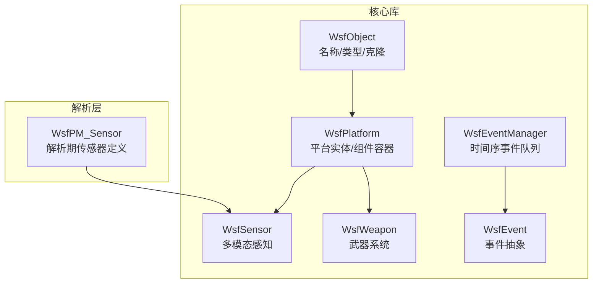
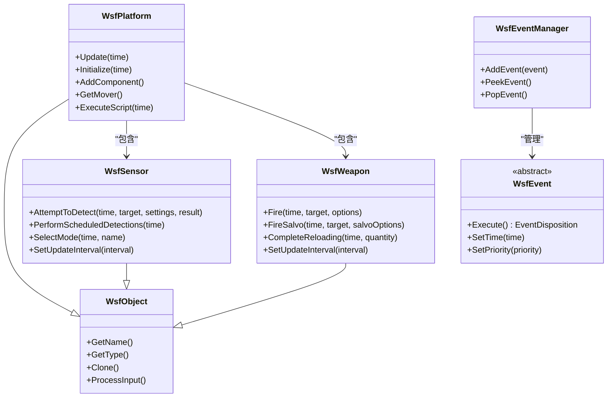
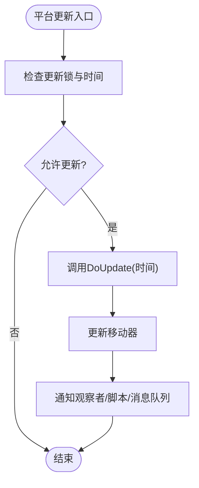
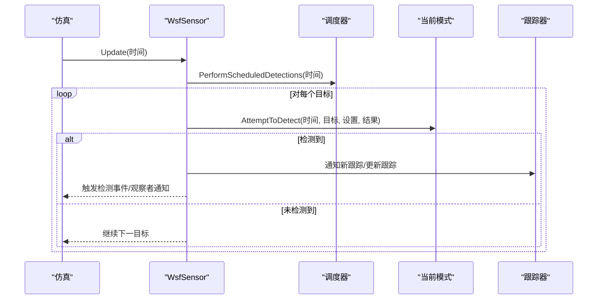
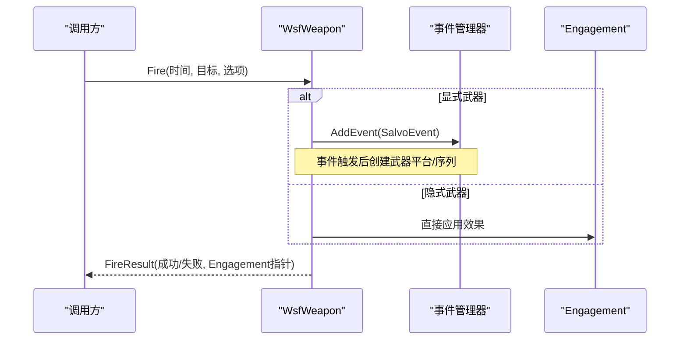
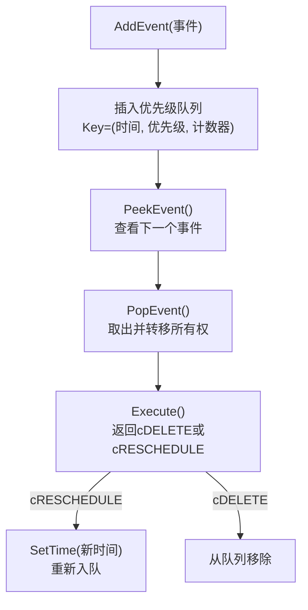
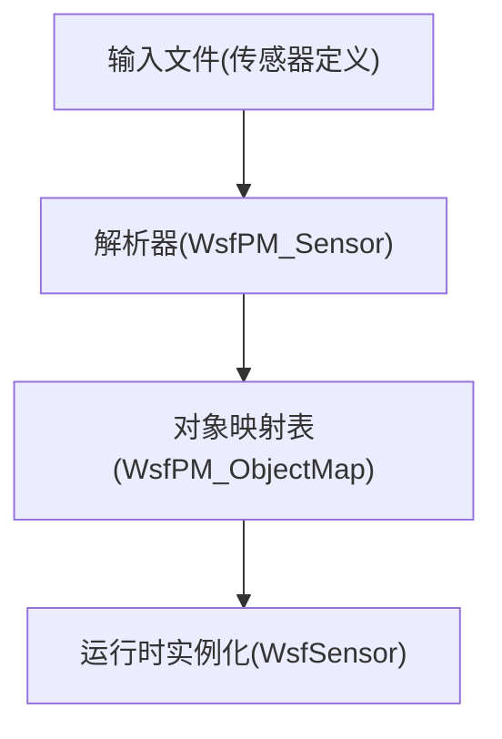
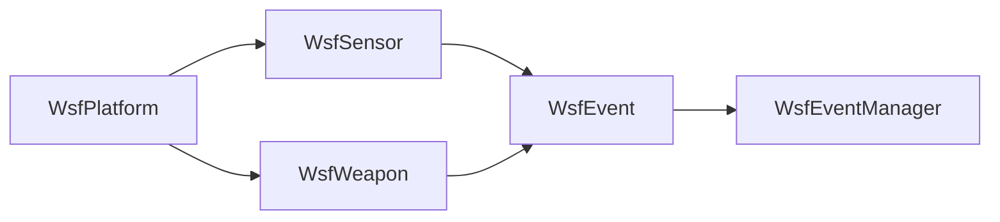

# 核心框架架构

<cite>
**本文引用的文件**   
- [WsfObject.hpp](file://swdev/src/core/wsf/source/WsfObject.hpp)
- [WsfPlatform.hpp](file://swdev/src/core/wsf/source/WsfPlatform.hpp)
- [WsfSensor.hpp](file://swdev/src/core/wsf/source/sensor/WsfSensor.hpp)
- [WsfWeapon.hpp](file://swdev/src/core/wsf_mil/source/weapon/WsfWeapon.hpp)
- [WsfEvent.hpp](file://swdev/src/core/wsf/source/WsfEvent.hpp)
- [WsfEventManager.hpp](file://swdev/src/core/wsf/source/WsfEventManager.hpp)
- [WsfPM_Sensor.hpp](file://swdev/src/core/wsf_parser/source/WsfPM_Sensor.hpp)
</cite>

## 目录
1. [引言](#引言)
2. [项目结构](#项目结构)
3. [核心组件](#核心组件)
4. [架构总览](#架构总览)
5. [详细组件分析](#详细组件分析)
6. [依赖关系分析](#依赖关系分析)
7. [性能考虑](#性能考虑)
8. [故障排查指南](#故障排查指南)
9. [结论](#结论)
10. [附录](#附录)

## 引言
本文件面向AFSIM的WSF（Warfare Simulation Framework）核心框架，系统性阐述其设计模式与实现原理，重点覆盖：
- 平台管理、事件驱动机制、对象生命周期管理
- 核心模块组织与继承层次（platform、sensor、weapon等）
- 事件系统的创建、分发与处理流程
- 配置解析系统如何工作以及配置文件到内存对象的映射
- 架构图与数据流图，帮助读者建立整体认知
- 使用核心API进行仿真建模的实践要点

## 项目结构
WSF核心位于 swdev/src/core/wsf，扩展领域模型（如武器）位于 swdev/src/core/wsf_mil，配置解析在 swdev/src/core/wsf_parser。关键源文件包括：
- 基础对象与类型系统：WsfObject
- 平台实体：WsfPlatform
- 传感器基类：WsfSensor
- 武器基类：WsfWeapon
- 事件抽象与管理器：WsfEvent、WsfEventManager
- 解析阶段传感器定义：WsfPM_Sensor

**图表来源** 
- [WsfObject.hpp:30-142](file://swdev/src/core/wsf/source/WsfObject.hpp#L30-L142)
- [WsfPlatform.hpp:66-114](file://swdev/src/core/wsf/source/WsfPlatform.hpp#L66-L114)
- [WsfSensor.hpp:45-91](file://swdev/src/core/wsf/source/sensor/WsfSensor.hpp#L45-L91)
- [WsfWeapon.hpp:39-62](file://swdev/src/core/wsf_mil/source/weapon/WsfWeapon.hpp#L39-L62)
- [WsfEvent.hpp:21-67](file://swdev/src/core/wsf/source/WsfEvent.hpp#L21-L67)
- [WsfEventManager.hpp:28-40](file://swdev/src/core/wsf/source/WsfEventManager.hpp#L28-L40)
- [WsfPM_Sensor.hpp:23-30](file://swdev/src/core/wsf_parser/source/WsfPM_Sensor.hpp#L23-L30)

**章节来源**
- [WsfObject.hpp:30-142](file://swdev/src/core/wsf/source/WsfObject.hpp#L30-L142)
- [WsfPlatform.hpp:66-114](file://swdev/src/core/wsf/source/WsfPlatform.hpp#L66-L114)
- [WsfSensor.hpp:45-91](file://swdev/src/core/wsf/source/sensor/WsfSensor.hpp#L45-L91)
- [WsfWeapon.hpp:39-62](file://swdev/src/core/wsf_mil/source/weapon/WsfWeapon.hpp#L39-L62)
- [WsfEvent.hpp:21-67](file://swdev/src/core/wsf/source/WsfEvent.hpp#L21-L67)
- [WsfEventManager.hpp:28-40](file://swdev/src/core/wsf/source/WsfEventManager.hpp#L28-L40)
- [WsfPM_Sensor.hpp:23-30](file://swdev/src/core/wsf_parser/source/WsfPM_Sensor.hpp#L23-L30)

## 核心组件
- 对象与类型系统（WsfObject）
  - 提供名称、类型、类型层级、克隆接口，是所有用户级对象的根。
  - 支持脚本可访问与引用追踪，便于调试与序列化。
- 平台（WsfPlatform）
  - 仿真中的实体容器，承载移动器、燃料、签名、组件列表等。
  - 提供初始化、更新、脚本执行、消息发送、观察者通知等生命周期钩子。
- 传感器（WsfSensor）
  - 多模态感知基类，封装检测调度器与跟踪器，统一检测尝试流程。
  - 支持线程安全标记、模式选择、轨道请求、状态通知等。
- 武器（WsfWeapon）
  - 武器系统抽象，支持显式/隐式武器、发射序列、库存与再装填、干扰任务等。
  - 通过事件驱动完成齐射、补弹、终止等时序逻辑。
- 事件系统（WsfEvent / WsfEventManager）
  - 基于时间优先、同时间按优先级与入队顺序的稳定排序队列。
  - 提供一次性与可重调度事件适配器，简化回调式事件编程。

**章节来源**
- [WsfObject.hpp:30-142](file://swdev/src/core/wsf/source/WsfObject.hpp#L30-L142)
- [WsfPlatform.hpp:66-114](file://swdev/src/core/wsf/source/WsfPlatform.hpp#L66-L114)
- [WsfSensor.hpp:45-91](file://swdev/src/core/wsf/source/sensor/WsfSensor.hpp#L45-L91)
- [WsfWeapon.hpp:39-62](file://swdev/src/core/wsf_mil/source/weapon/WsfWeapon.hpp#L39-L62)
- [WsfEvent.hpp:21-67](file://swdev/src/core/wsf/source/WsfEvent.hpp#L21-L67)
- [WsfEventManager.hpp:28-40](file://swdev/src/core/wsf/source/WsfEventManager.hpp#L28-L40)

## 架构总览
WSF采用“对象-组件-事件”三层架构：
- 对象层：所有实体继承自WsfObject，具备类型系统与克隆能力。
- 组件层：平台作为容器，挂载传感器、武器、通信等子系统；各子系统遵循统一的组件接口与初始化顺序。
- 事件层：仿真推进由事件管理器驱动，平台/传感器/武器的周期性更新与业务动作均通过事件触发。

**图表来源**
- [WsfObject.hpp:30-142](file://swdev/src/core/wsf/source/WsfObject.hpp#L30-L142)
- [WsfPlatform.hpp:66-114](file://swdev/src/core/wsf/source/WsfPlatform.hpp#L66-L114)
- [WsfSensor.hpp:45-91](file://swdev/src/core/wsf/source/sensor/WsfSensor.hpp#L45-L91)
- [WsfWeapon.hpp:39-62](file://swdev/src/core/wsf_mil/source/weapon/WsfWeapon.hpp#L39-L62)
- [WsfEvent.hpp:21-67](file://swdev/src/core/wsf/source/WsfEvent.hpp#L21-L67)
- [WsfEventManager.hpp:28-40](file://swdev/src/core/wsf/source/WsfEventManager.hpp#L28-L40)

## 详细组件分析

### 平台（WsfPlatform）
- 职责
  - 作为仿真实体的容器，维护移动器、燃料、地形上下文、类别/分组、签名列表等。
  - 提供生命周期方法：Initialize/Initialize2/Update/NotifyUpdate/ExecuteScript/SendQueuedMessages。
  - 支持外部控制/移动、不可摧毁、损坏行为策略、观察者通知等。
- 关键设计点
  - 通过组件列表统一管理子系统，确保初始化顺序与销毁顺序。
  - 提供索引化访问以安全地跨平台引用，避免悬垂指针。
  - 与仿真时间紧密耦合，Update/DoUpdate内部有锁与时间检查，保证一致性。

**图表来源**
- [WsfPlatform.hpp:155-206](file://swdev/src/core/wsf/source/WsfPlatform.hpp#L155-L206)
- [WsfPlatform.hpp:596-601](file://swdev/src/core/wsf/source/WsfPlatform.hpp#L596-L601)

**章节来源**
- [WsfPlatform.hpp:66-114](file://swdev/src/core/wsf/source/WsfPlatform.hpp#L66-L114)
- [WsfPlatform.hpp:155-206](file://swdev/src/core/wsf/source/WsfPlatform.hpp#L155-L206)
- [WsfPlatform.hpp:596-601](file://swdev/src/core/wsf/source/WsfPlatform.hpp#L596-L601)

### 传感器（WsfSensor）
- 职责
  - 定义多模态传感器的通用接口：模式选择、检测尝试、调度与跟踪、轨道请求/状态通知。
  - 提供检测流程模板：遮挡判断、视场检查、探测概率计算、地形遮蔽最后判定。
- 关键设计点
  - 通过WsfSensorScheduler与WsfSensorTracker解耦检测时机与轨迹管理。
  - 支持线程安全标记，允许多线程环境下的安全更新。
  - 提供脚本扩展点，可在检测事件中注入自定义约束或输出。

**图表来源**
- [WsfSensor.hpp:45-91](file://swdev/src/core/wsf/source/sensor/WsfSensor.hpp#L45-L91)
- [WsfSensor.hpp:192-213](file://swdev/src/core/wsf/source/sensor/WsfSensor.hpp#L192-L213)
- [WsfSensor.hpp:230-244](file://swdev/src/core/wsf/source/sensor/WsfSensor.hpp#L230-L244)
- [WsfSensor.hpp:400-417](file://swdev/src/core/wsf/source/sensor/WsfSensor.hpp#L400-L417)

**章节来源**
- [WsfSensor.hpp:45-91](file://swdev/src/core/wsf/source/sensor/WsfSensor.hpp#L45-L91)
- [WsfSensor.hpp:192-213](file://swdev/src/core/wsf/source/sensor/WsfSensor.hpp#L192-L213)
- [WsfSensor.hpp:230-244](file://swdev/src/core/wsf/source/sensor/WsfSensor.hpp#L230-L244)
- [WsfSensor.hpp:400-417](file://swdev/src/core/wsf/source/sensor/WsfSensor.hpp#L400-L417)

### 武器（WsfWeapon）
- 职责
  - 抽象武器系统，支持显式/隐式武器、齐射、库存管理、再装填、干扰任务、IFC集成等。
  - 通过事件驱动完成齐射间隔、补弹完成、终止回调等时序逻辑。
- 关键设计点
  - Fire/FireSalvo返回FireResult，封装成功标志与关联的Engagement对象。
  - 通过SalvoEvent/CompleteReloadEvent等事件协调复杂时序。
  - 提供丰富的查询接口用于上层决策（如已发射数、活跃数、待发射数）。

**图表来源**
- [WsfWeapon.hpp:343-363](file://swdev/src/core/wsf_mil/source/weapon/WsfWeapon.hpp#L343-L363)
- [WsfWeapon.hpp:631-655](file://swdev/src/core/wsf_mil/source/weapon/WsfWeapon.hpp#L631-L655)

**章节来源**
- [WsfWeapon.hpp:39-62](file://swdev/src/core/wsf_mil/source/weapon/WsfWeapon.hpp#L39-L62)
- [WsfWeapon.hpp:343-363](file://swdev/src/core/wsf_mil/source/weapon/WsfWeapon.hpp#L343-L363)
- [WsfWeapon.hpp:631-655](file://swdev/src/core/wsf_mil/source/weapon/WsfWeapon.hpp#L631-L655)

### 事件系统（WsfEvent / WsfEventManager）
- 职责
  - WsfEvent定义事件抽象与执行契约（Execute），支持一次性与可重调度事件适配器。
  - WsfEventManager维护时间优先、同时间按优先级与入队顺序的稳定排序队列。
- 关键设计点
  - 通过std::priority_queue与Key(tuple<时间, 优先级, 计数器>)实现稳定排序。
  - 提供AddedToEventQueue回调，使事件能获取所属仿真实例。

**图表来源**
- [WsfEvent.hpp:21-67](file://swdev/src/core/wsf/source/WsfEvent.hpp#L21-L67)
- [WsfEvent.hpp:115-172](file://swdev/src/core/wsf/source/WsfEvent.hpp#L115-L172)
- [WsfEventManager.hpp:28-40](file://swdev/src/core/wsf/source/WsfEventManager.hpp#L28-L40)
- [WsfEventManager.hpp:83-110](file://swdev/src/core/wsf/source/WsfEventManager.hpp#L83-L110)

**章节来源**
- [WsfEvent.hpp:21-67](file://swdev/src/core/wsf/source/WsfEvent.hpp#L21-L67)
- [WsfEvent.hpp:115-172](file://swdev/src/core/wsf/source/WsfEvent.hpp#L115-L172)
- [WsfEventManager.hpp:28-40](file://swdev/src/core/wsf/source/WsfEventManager.hpp#L28-L40)
- [WsfEventManager.hpp:83-110](file://swdev/src/core/wsf/source/WsfEventManager.hpp#L83-L110)

### 配置解析系统（WsfPM_Sensor）
- 职责
  - 在解析阶段将文本配置转换为内存对象（例如传感器定义）。
  - 作为平台部件（PlatformPart）的一种，参与类型/实例加载流程。
- 关键设计点
  - 与WsfPM_ObjectMap配合，构建对象映射表，供后续实例化使用。
  - 通过WsfPProxyNode读取节点信息，填充传感器定义。

**图表来源**
- [WsfPM_Sensor.hpp:23-30](file://swdev/src/core/wsf_parser/source/WsfPM_Sensor.hpp#L23-L30)

**章节来源**
- [WsfPM_Sensor.hpp:23-30](file://swdev/src/core/wsf_parser/source/WsfPM_Sensor.hpp#L23-L30)

## 依赖关系分析
- 组件内聚与耦合
  - WsfPlatform高内聚：集中管理移动器、燃料、签名、组件列表，降低子系统间直接耦合。
  - WsfSensor与WsfWeapon通过平台间接耦合，减少相互依赖。
- 直接/间接依赖
  - 传感器/武器依赖平台提供的上下文（位置、地形、组/类别）。
  - 事件系统独立于具体组件，仅通过WsfSimulation桥接。
- 外部依赖与集成点
  - 脚本上下文（WsfScriptContext）为平台/传感器/武器提供脚本扩展点。
  - DIS/EM收发器等扩展组件通过传感器/武器暴露的接口接入。

**图表来源**
- [WsfPlatform.hpp:66-114](file://swdev/src/core/wsf/source/WsfPlatform.hpp#L66-L114)
- [WsfSensor.hpp:45-91](file://swdev/src/core/wsf/source/sensor/WsfSensor.hpp#L45-L91)
- [WsfWeapon.hpp:39-62](file://swdev/src/core/wsf_mil/source/weapon/WsfWeapon.hpp#L39-L62)
- [WsfEvent.hpp:21-67](file://swdev/src/core/wsf/source/WsfEvent.hpp#L21-L67)
- [WsfEventManager.hpp:28-40](file://swdev/src/core/wsf/source/WsfEventManager.hpp#L28-L40)

**章节来源**
- [WsfPlatform.hpp:66-114](file://swdev/src/core/wsf/source/WsfPlatform.hpp#L66-L114)
- [WsfSensor.hpp:45-91](file://swdev/src/core/wsf/source/sensor/WsfSensor.hpp#L45-L91)
- [WsfWeapon.hpp:39-62](file://swdev/src/core/wsf_mil/source/weapon/WsfWeapon.hpp#L39-L62)
- [WsfEvent.hpp:21-67](file://swdev/src/core/wsf/source/WsfEvent.hpp#L21-L67)
- [WsfEventManager.hpp:28-40](file://swdev/src/core/wsf/source/WsfEventManager.hpp#L28-L40)

## 性能考虑
- 事件队列稳定性
  - 使用稳定排序键（时间、优先级、入队序号）保证确定性执行顺序，避免抖动。
- 传感器检测优化
  - 先做低成本过滤（遮挡、视场、距离），再做昂贵地形遮蔽计算，减少CPU开销。
- 多线程更新
  - 传感器支持线程安全标记，平台更新存在锁与时间检查，避免并发冲突。
- 资源复用
  - 事件适配器复用函数对象，减少分配；传感器/武器模式列表与调度器/跟踪器按需创建。

[本节为通用指导，不直接分析具体文件]

## 故障排查指南
- 平台未更新
  - 检查UpdateAllowed与UpdateLocked标志，确认DoUpdate是否被调用。
  - 核对更新时间戳与仿真时间，避免重复或跳过更新。
- 传感器未触发检测
  - 检查UpdateInterval是否为正，UpdateEventActive是否开启。
  - 确认模式已选择且AllowDetectionChancesFor返回true。
- 武器未发射
  - 检查库存数量与FiringDelay/SalvoInterval分布。
  - 核查FireResult.success与Engagement指针是否正确返回。
- 事件未按预期执行
  - 检查事件时间/优先级设置，确认ShouldExecute为true。
  - 若需重调度，确保Execute中调用了SetTime并返回cRESCHEDULE。

**章节来源**
- [WsfPlatform.hpp:155-206](file://swdev/src/core/wsf/source/WsfPlatform.hpp#L155-L206)
- [WsfSensor.hpp:419-451](file://swdev/src/core/wsf/source/sensor/WsfSensor.hpp#L419-L451)
- [WsfWeapon.hpp:365-393](file://swdev/src/core/wsf_mil/source/weapon/WsfWeapon.hpp#L365-L393)
- [WsfEvent.hpp:77-100](file://swdev/src/core/wsf/source/WsfEvent.hpp#L77-L100)

## 结论
WSF通过清晰的层次化对象模型、稳定的事件驱动机制与可扩展的组件体系，为大规模军事仿真提供了坚实基础。平台作为实体容器，传感器与武器作为功能子系统，事件系统贯穿全链路，既保证了执行的可预测性，又为脚本与插件扩展留足空间。在实际建模中，建议：
- 明确平台/传感器/武器的职责边界，合理拆分模式与子系统
- 利用事件适配器简化时序逻辑，避免硬编码循环
- 充分利用传感器检测优化路径，提升仿真吞吐
- 谨慎管理平台生命周期与索引引用，避免悬垂指针

[本节为总结性内容，不直接分析具体文件]

## 附录
- 使用核心API进行仿真建模的建议步骤
  - 定义平台类型与实例，设置名称、阵营、移动器与组件
  - 添加传感器与武器，配置模式、更新间隔与检测参数
  - 通过事件管理器注册周期性更新或一次性动作
  - 在传感器/武器中实现检测与发射逻辑，必要时接入脚本扩展
  - 运行仿真并观察事件输出与平台状态变化

[本节为概念性内容，不直接分析具体文件]