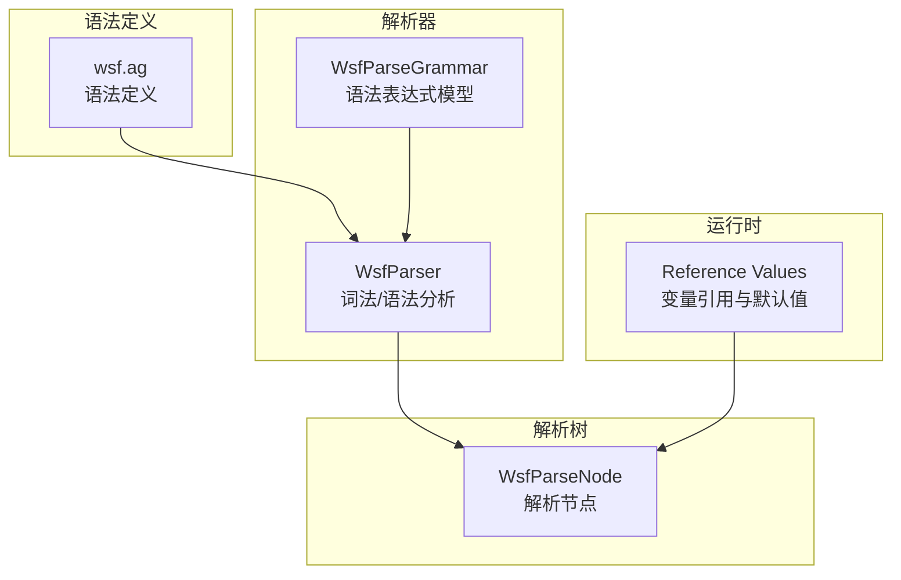
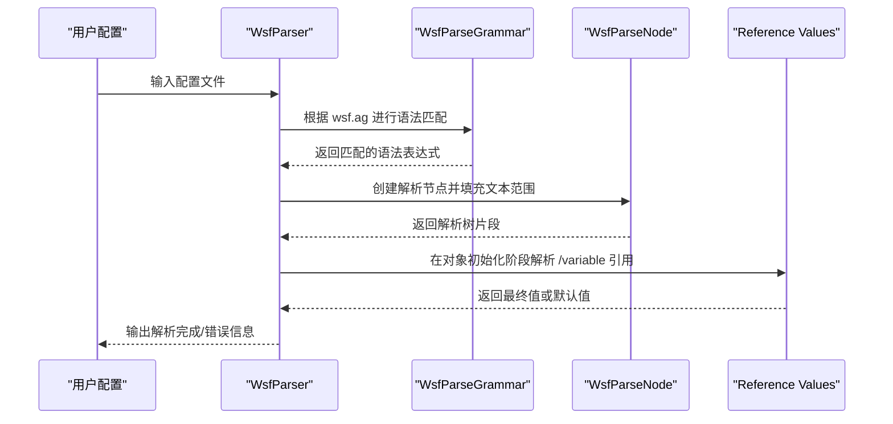
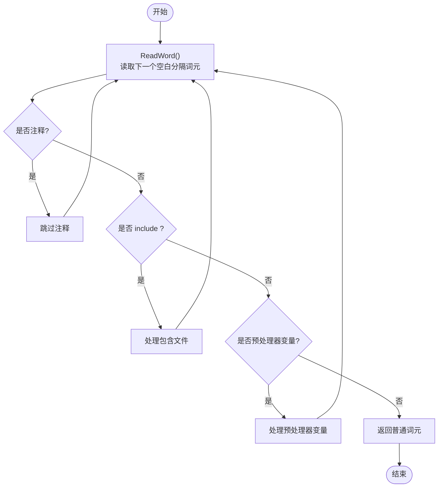
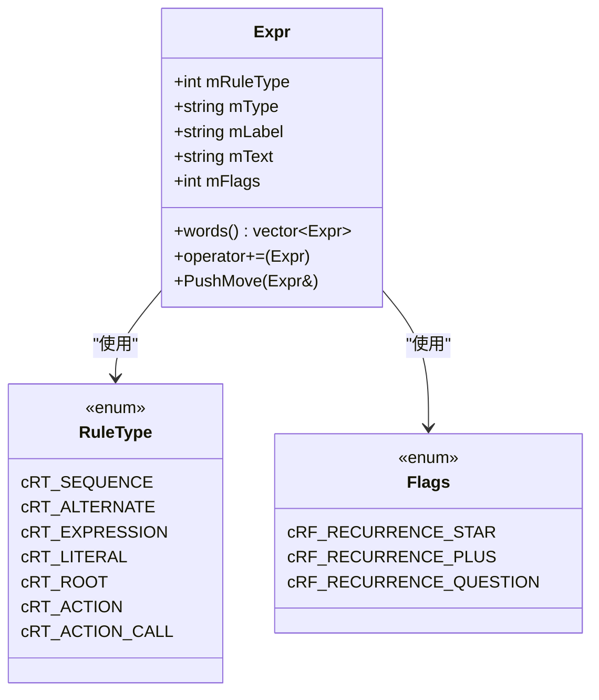
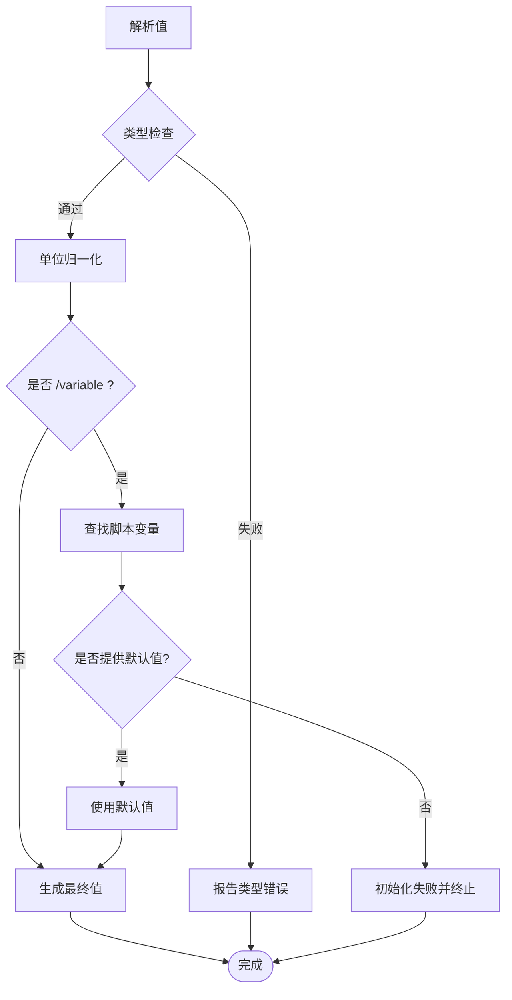
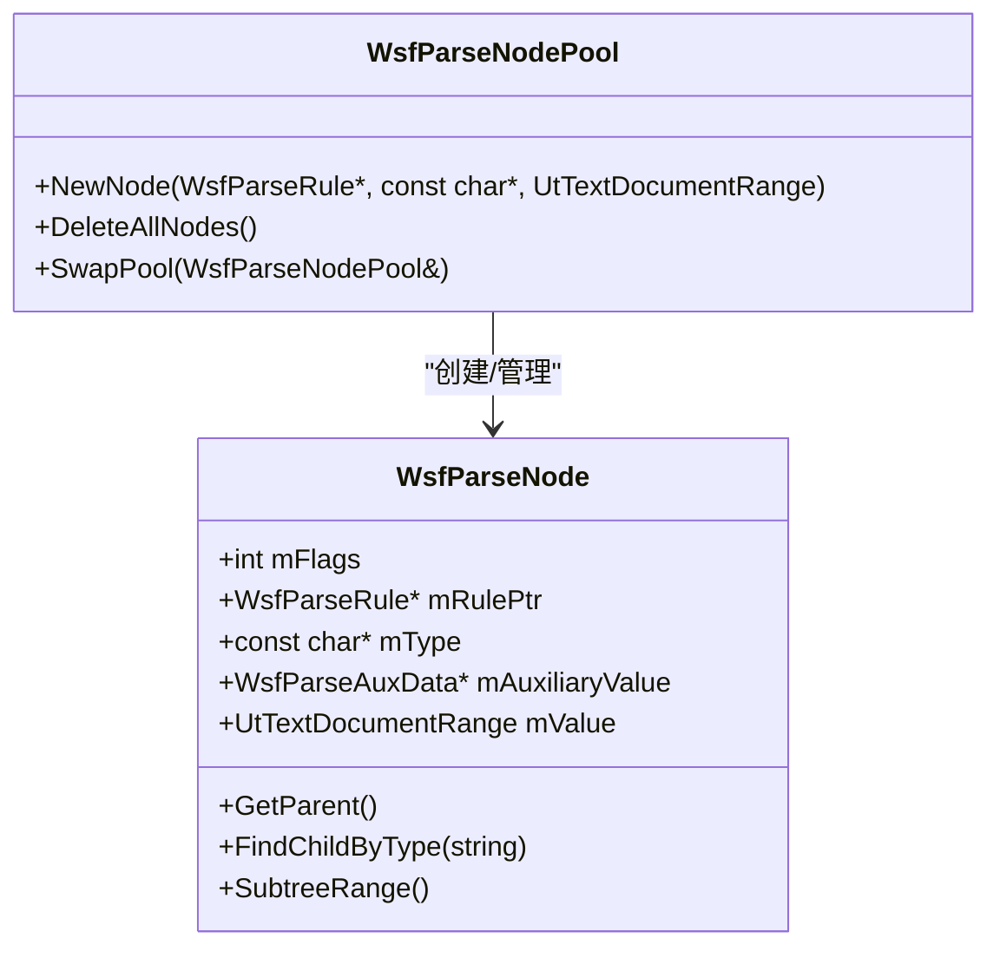
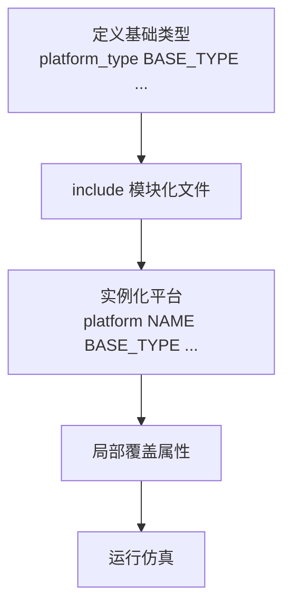
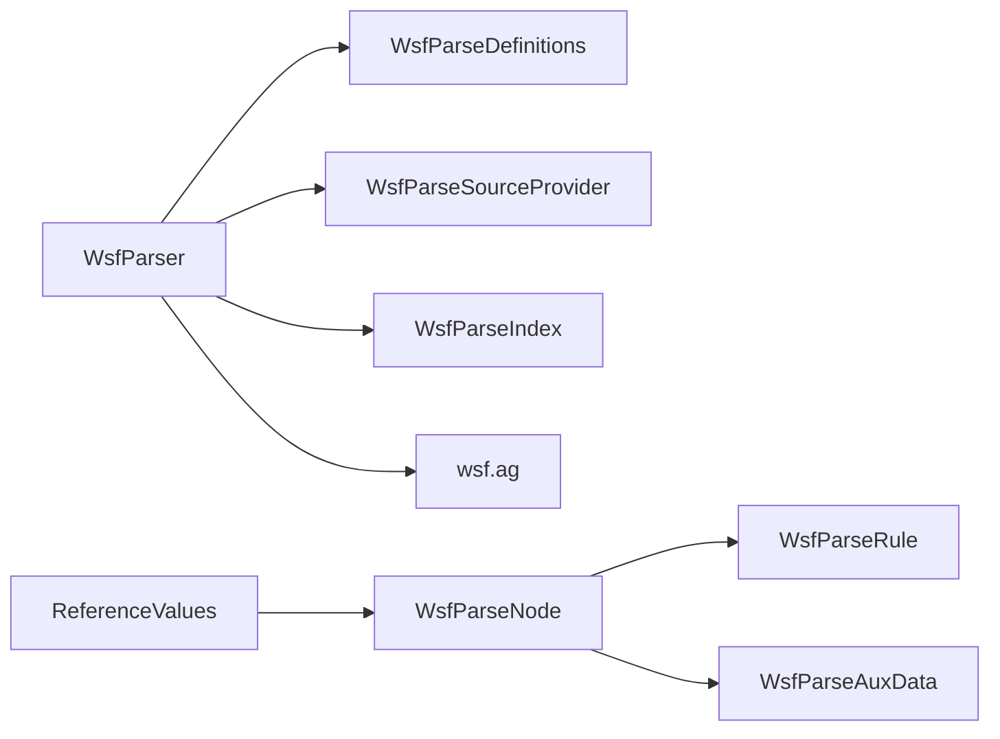

# 配置解析系统

<cite>
**本文引用的文件**   
- [WsfParser.hpp](file://swdev/src/core/wsf_parser/source/WsfParser.hpp)
- [WsfParseNode.hpp](file://swdev/src/core/wsf_parser/source/WsfParseNode.hpp)
- [WsfParseGrammar.hpp](file://swdev/src/core/wsf_parser/source/WsfParseGrammar.hpp)
- [wsf.ag](file://swdev/src/core/wsf/grammar/wsf.ag)
- [reference_values.rst.txt](file://documentation/html/_sources/docs/reference_values.rst.txt)
</cite>

## 目录
1. [简介](#简介)
2. [项目结构](#项目结构)
3. [核心组件](#核心组件)
4. [架构总览](#架构总览)
5. [详细组件分析](#详细组件分析)
6. [依赖关系分析](#依赖关系分析)
7. [性能考虑](#性能考虑)
8. [故障排查指南](#故障排查指南)
9. [结论](#结论)
10. [附录](#附录)

## 简介
本文件系统化阐述 AFSIM WSF 配置解析系统的语法、结构与实现机制，覆盖声明式配置语言的语法规则、词法与语法分析流程、语义验证、配置到内存对象的映射（含类型转换与默认值）、继承与覆盖机制、模块化组织方式，以及配置验证与错误诊断工具的使用方法。文档面向不同技术背景的读者，提供从高层概览到代码级细节的渐进式说明，并辅以可视化图示帮助理解。

## 项目结构
WSF 配置解析系统主要由以下部分组成：
- 语法定义层：使用 .ag 语法文件描述命令、值类型、结构体、枚举、函数等。
- 解析器层：负责词法扫描、语法分析与构建解析树节点。
- 节点模型层：表示解析结果的结构化节点，支持辅助数据、延迟加载、索引等。
- 运行时变量与引用：支持在运行期通过脚本变量解析配置值，并提供默认值回退策略。

**图表来源**
- [wsf.ag:106-146](file://swdev/src/core/wsf/grammar/wsf.ag#L106-L146)
- [WsfParser.hpp:33-120](file://swdev/src/core/wsf_parser/source/WsfParser.hpp#L33-L120)
- [WsfParseGrammar.hpp:162-277](file://swdev/src/core/wsf_parser/source/WsfParseGrammar.hpp#L162-L277)
- [reference_values.rst.txt:139-165](file://documentation/html/_sources/docs/reference_values.rst.txt#L139-L165)

**章节来源**
- [wsf.ag:106-146](file://swdev/src/core/wsf/grammar/wsf.ag#L106-L146)
- [WsfParser.hpp:33-120](file://swdev/src/core/wsf_parser/source/WsfParser.hpp#L33-L120)
- [WsfParseGrammar.hpp:162-277](file://swdev/src/core/wsf_parser/source/WsfParseGrammar.hpp#L162-L277)
- [reference_values.rst.txt:139-165](file://documentation/html/_sources/docs/reference_values.rst.txt#L139-L165)

## 核心组件
- WsfParser：解析器的核心类，负责读取输入源、词法扫描、调用语法规则匹配、构建解析树、管理包含文件与延迟加载、错误收集等。
- WsfParseNode：解析树节点，承载匹配到的文本范围、规则类型、辅助数据、父子/兄弟指针、标志位等。
- WsfParseGrammar：语法表达式的内部数据结构，用于表示序列、选择、字面量、动作等语法元素。
- wsf.ag：WSF 配置语言语法定义，包含值类型、结构体、枚举、函数、变量引用等。
- Reference Values：运行时变量引用机制，允许在对象初始化时从脚本变量解析配置值，并提供默认值回退。

**章节来源**
- [WsfParser.hpp:33-120](file://swdev/src/core/wsf_parser/source/WsfParser.hpp#L33-L120)
- [WsfParseNode.hpp:58-199](file://swdev/src/core/wsf_parser/source/WsfParseNode.hpp#L58-L199)
- [WsfParseGrammar.hpp:162-277](file://swdev/src/core/wsf_parser/source/WsfParseGrammar.hpp#L162-L277)
- [wsf.ag:106-146](file://swdev/src/core/wsf/grammar/wsf.ag#L106-L146)
- [reference_values.rst.txt:139-165](file://documentation/html/_sources/docs/reference_values.rst.txt#L139-L165)

## 架构总览
下图展示配置解析的整体流程：从语法定义到解析器执行，再到解析树构建与运行时变量解析。

**图表来源**
- [WsfParser.hpp:33-120](file://swdev/src/core/wsf_parser/source/WsfParser.hpp#L33-L120)
- [WsfParseGrammar.hpp:162-277](file://swdev/src/core/wsf_parser/source/WsfParseGrammar.hpp#L162-L277)
- [WsfParseNode.hpp:58-199](file://swdev/src/core/wsf_parser/source/WsfParseNode.hpp#L58-L199)
- [reference_values.rst.txt:139-165](file://documentation/html/_sources/docs/reference_values.rst.txt#L139-L165)

## 详细组件分析

### 词法分析（Lexer）
- 功能：将输入流切分为空白分隔的词元，处理注释、包含指令、预处理器变量与普通词元。
- 关键接口：ReadWord、ReadTerminator、UndoRead、PushToUndoStack。
- 特性：支持有限回溯（UndoRead），便于语法分析中的试探性匹配；维护终止符栈以控制词元读取边界。

**图表来源**
- [WsfParser.hpp:56-76](file://swdev/src/core/wsf_parser/source/WsfParser.hpp#L56-L76)
- [WsfParser.hpp:210-221](file://swdev/src/core/wsf_parser/source/WsfParser.hpp#L210-L221)

**章节来源**
- [WsfParser.hpp:56-76](file://swdev/src/core/wsf_parser/source/WsfParser.hpp#L56-L76)
- [WsfParser.hpp:210-221](file://swdev/src/core/wsf_parser/source/WsfParser.hpp#L210-L221)

### 语法分析（Parser）
- 功能：基于 wsf.ag 定义的语法，将词元序列组合为结构化解析树。
- 关键数据结构：Expr（语法表达式）、RuleType（规则类型）、Flags（重复/可选标记）。
- 关键能力：序列（Sequence）、选择（Alternate）、字面量（Literal）、动作（Action）等。

**图表来源**
- [WsfParseGrammar.hpp:162-277](file://swdev/src/core/wsf_parser/source/WsfParseGrammar.hpp#L162-L277)

**章节来源**
- [WsfParseGrammar.hpp:162-277](file://swdev/src/core/wsf_parser/source/WsfParseGrammar.hpp#L162-L277)

### 语义验证与类型系统
- 值类型：wsf.ag 中定义了丰富的物理量单位与基本类型（如 Length、Time、Speed、Angle、Bool、String 等）。
- 结构体与枚举：支持聚合字段、命名颜色、枚举选项等。
- 函数：允许在语法层调用外部函数进行值转换（如 NormalizeColor3/4、HexStringToColor）。
- 变量引用：支持 /variable <name> [/default <value>] 语法，在对象初始化阶段解析。

**图表来源**
- [wsf.ag:130-212](file://swdev/src/core/wsf/grammar/wsf.ag#L130-L212)
- [wsf.ag:642-687](file://swdev/src/core/wsf/grammar/wsf.ag#L642-L687)
- [reference_values.rst.txt:139-165](file://documentation/html/_sources/docs/reference_values.rst.txt#L139-L165)

**章节来源**
- [wsf.ag:130-212](file://swdev/src/core/wsf/grammar/wsf.ag#L130-L212)
- [wsf.ag:642-687](file://swdev/src/core/wsf/grammar/wsf.ag#L642-L687)
- [reference_values.rst.txt:139-165](file://documentation/html/_sources/docs/reference_values.rst.txt#L139-L165)

### 配置到内存对象的映射机制
- 解析节点：每个匹配的规则产生一个 WsfParseNode，携带文本范围、规则类型、辅助数据等。
- 节点池：WsfParseNodePool 管理节点分配与释放，提升性能。
- 辅助数据：支持附加文件引用、延迟加载信息等。
- 延迟加载：支持按需解析大型配置块，减少初始开销。

**图表来源**
- [WsfParseNode.hpp:58-199](file://swdev/src/core/wsf_parser/source/WsfParseNode.hpp#L58-L199)
- [WsfParseNode.hpp:202-293](file://swdev/src/core/wsf_parser/source/WsfParseNode.hpp#L202-L293)

**章节来源**
- [WsfParseNode.hpp:58-199](file://swdev/src/core/wsf_parser/source/WsfParseNode.hpp#L58-L199)
- [WsfParseNode.hpp:202-293](file://swdev/src/core/wsf_parser/source/WsfParseNode.hpp#L202-L293)

### 继承与覆盖机制（模块化配置）
- 基础类型与平台类型：通过 platform_type 定义可复用的平台模板，实例化时使用 platform 命令创建具体实体。
- 包含与路径变量：通过 define_path_variable 与 include 指令组织模块化配置。
- 覆盖策略：在实例化时可局部覆盖父类型的属性，而不修改共享的基础定义。

**图表来源**
- [ballistic_shootdown.txt:9-28](file://demos/ballistic_missile_shootdown/ballistic_shootdown.txt#L9-L28)

**章节来源**
- [ballistic_shootdown.txt:9-28](file://demos/ballistic_missile_shootdown/ballistic_shootdown.txt#L9-L28)

### 配置示例与最佳实践
- 变量引用与默认值：使用 /variable PROCESSING_TIME /default 5.0 sec 形式，结合 script_variables 与 on_initialize 动态赋值。
- 模块化组织：通过 include 拆分场景、平台、传感器等模块，提高可维护性。
- 单位与类型安全：明确指定单位（如 sec、m、deg），避免隐式转换错误。

**章节来源**
- [reference_values.rst.txt:139-165](file://documentation/html/_sources/docs/reference_values.rst.txt#L139-L165)
- [ballistic_shootdown.txt:9-28](file://demos/ballistic_missile_shootdown/ballistic_shootdown.txt#L9-L28)

## 依赖关系分析
- WsfParser 依赖 WsfParseDefinitions、WsfParseSourceProvider、WsfParseIndex 等组件进行源管理与索引。
- WsfParseNode 依赖 WsfParseRule 与 WsfParseAuxData 以承载规则信息与辅助数据。
- wsf.ag 作为语法定义被解析器消费，驱动语法表达式模型的构建。
- Reference Values 在对象初始化阶段与解析树交互，完成变量解析与默认值回退。

**图表来源**
- [WsfParser.hpp:33-120](file://swdev/src/core/wsf_parser/source/WsfParser.hpp#L33-L120)
- [WsfParseNode.hpp:58-199](file://swdev/src/core/wsf_parser/source/WsfParseNode.hpp#L58-L199)
- [wsf.ag:106-146](file://swdev/src/core/wsf/grammar/wsf.ag#L106-L146)
- [reference_values.rst.txt:139-165](file://documentation/html/_sources/docs/reference_values.rst.txt#L139-L165)

**章节来源**
- [WsfParser.hpp:33-120](file://swdev/src/core/wsf_parser/source/WsfParser.hpp#L33-L120)
- [WsfParseNode.hpp:58-199](file://swdev/src/core/wsf_parser/source/WsfParseNode.hpp#L58-L199)
- [wsf.ag:106-146](file://swdev/src/core/wsf/grammar/wsf.ag#L106-L146)
- [reference_values.rst.txt:139-165](file://documentation/html/_sources/docs/reference_values.rst.txt#L139-L165)

## 性能考虑
- 节点池分配：WsfParseNodePool 使用内存池减少频繁分配/释放开销。
- 延迟加载：对大型配置块采用延迟解析，降低启动时间。
- 完全展开节点：可通过 FullyExpandNodes 控制是否生成完整节点树，权衡内存与后处理便利性。
- 词法回溯限制：UndoRead 支持有限回溯，避免过度回溯导致性能退化。

**章节来源**
- [WsfParseNode.hpp:202-293](file://swdev/src/core/wsf_parser/source/WsfParseNode.hpp#L202-L293)
- [WsfParser.hpp:148-150](file://swdev/src/core/wsf_parser/source/WsfParser.hpp#L148-L150)
- [WsfParser.hpp:112-120](file://swdev/src/core/wsf_parser/source/WsfParser.hpp#L112-L120)

## 故障排查指南
- 常见错误类型：
  - 语法错误：词法或语法不匹配，需检查命令拼写、括号闭合、单位格式。
  - 类型错误：值类型与期望类型不一致，需确认单位与数值范围。
  - 变量未找到：/variable 指向的脚本变量不存在且无默认值，导致初始化失败。
- 诊断方法：
  - 查看解析错误列表：通过 GetErrors 获取错误集合。
  - 检查日志文件：Reference Values 解析结果会写入 log_file。
  - 调试解析树：使用 DebugPrint 或 Print 输出节点结构。
- 修复建议：
  - 修正语法与单位。
  - 确保脚本变量已定义或在 /default 提供回退值。
  - 使用 include 拆分大文件，逐步定位问题模块。

**章节来源**
- [WsfParser.hpp:104-105](file://swdev/src/core/wsf_parser/source/WsfParser.hpp#L104-L105)
- [reference_values.rst.txt:159-165](file://documentation/html/_sources/docs/reference_values.rst.txt#L159-L165)
- [WsfParseNode.hpp:70-71](file://swdev/src/core/wsf_parser/source/WsfParseNode.hpp#L70-L71)

## 结论
WSF 配置解析系统通过清晰的语法定义、高效的解析器与灵活的运行时变量机制，提供了强大而稳定的配置管理能力。其模块化组织、类型安全与默认值回退策略，使得复杂仿真场景的配置变得可维护、可扩展且易于调试。在实际使用中，建议遵循单位规范、合理拆分模块、充分利用变量引用与默认值，以获得最佳的配置体验。

## 附录
- 术语表：
  - 词法分析：将输入文本切分为词元的过程。
  - 语法分析：将词元组合为结构化解析树的过程。
  - 语义验证：检查值的类型、单位与业务约束。
  - 延迟加载：按需解析配置块以减少初始开销。
- 参考链接：
  - WSF 语法指南与用户手册（见 documentation/html 下的相关文档）。