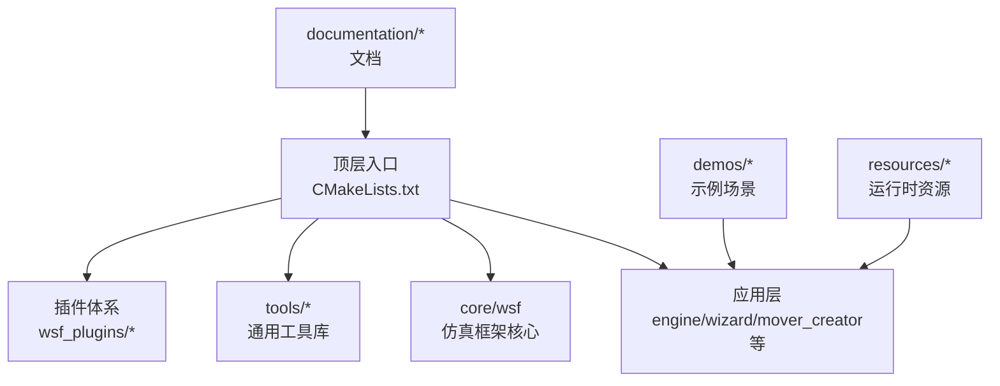
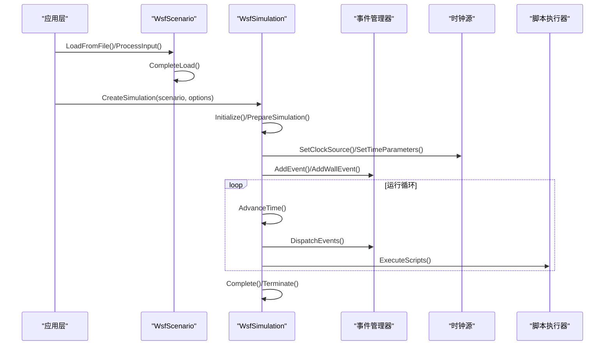
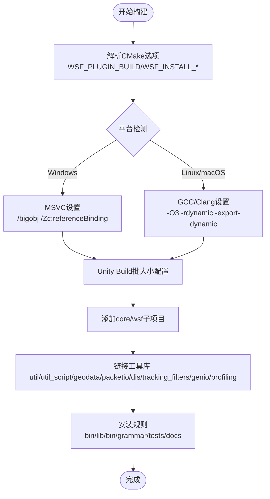
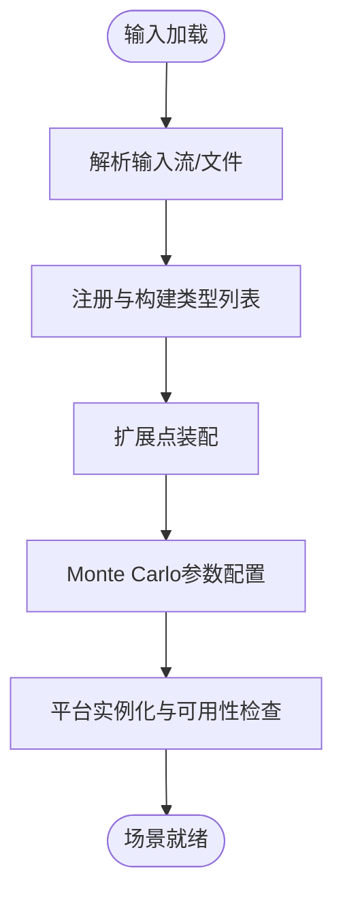
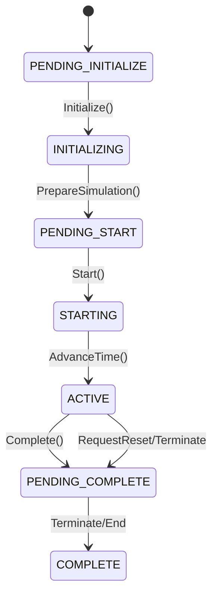
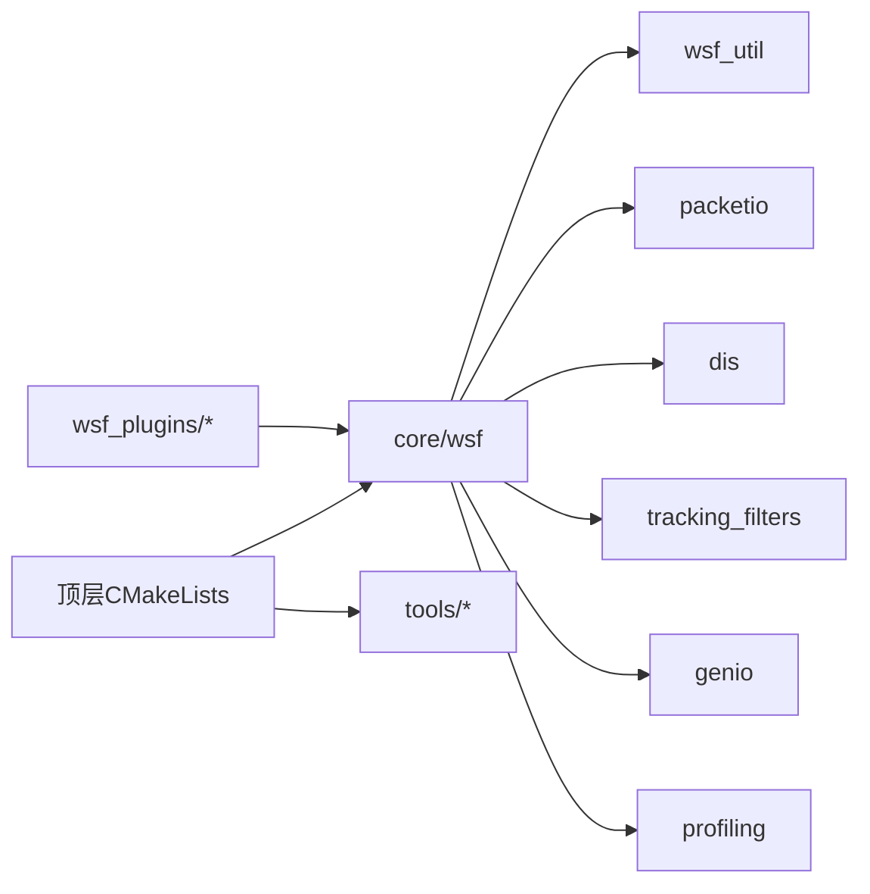

# 开发者指南

<cite>
**本文引用的文件**   
- [swdev/src/CMakeLists.txt](file://swdev/src/CMakeLists.txt)
- [swdev/src/core/wsf/CMakeLists.txt](file://swdev/src/core/wsf/CMakeLists.txt)
- [swdev/src/core/wsf/source/CMakeLists.txt](file://swdev/src/core/wsf/source/CMakeLists.txt)
- [swdev/src/core/wsf/source/WsfSimulation.hpp](file://swdev/src/core/wsf/source/WsfSimulation.hpp)
- [swdev/src/core/wsf/source/WsfScenario.hpp](file://swdev/src/core/wsf/source/WsfScenario.hpp)
</cite>

## 目录
1. [简介](#简介)
2. [项目结构](#项目结构)
3. [核心组件](#核心组件)
4. [架构总览](#架构总览)
5. [详细组件分析](#详细组件分析)
6. [依赖关系分析](#依赖关系分析)
7. [性能与调试](#性能与调试)
8. [代码规范与质量](#代码规范与质量)
9. [版本控制与协作流程](#版本控制与协作流程)
10. [新贡献者入门](#新贡献者入门)
11. [API设计与向后兼容](#api设计与向后兼容)
12. [社区参与与贡献](#社区参与与贡献)
13. [结论](#结论)

## 简介
本指南面向AFSIM（Advanced Framework for Simulation, Integration, and Modeling）的开发者，系统阐述项目的代码架构、模块职责划分、构建与依赖管理、代码规范与质量标准、调试与性能分析方法、版本控制与协作流程，以及API设计最佳实践。文档同时提供新贡献者的环境搭建与首个补丁指引，帮助快速上手并高质量地参与开发。

## 项目结构
仓库采用分层组织：
- swdev/src：核心源码与子系统实现，包含核心库wsf、工具库、应用层（如engine、wizard等）、插件体系。
- demos：大量示例场景，覆盖传感器、武器、通信、空间、网络战等领域，用于验证功能与演示用法。
- tools：辅助脚本与工具链，包括事件处理、数据转换、绘图与分析工具。
- documentation：用户手册、开发者文档与变更日志。
- resources：运行时资源（地图、模型、着色器等）。
- training：培训材料（用户/开发者）。

图表来源
- [swdev/src/CMakeLists.txt:130-195](file://swdev/src/CMakeLists.txt#L130-L195)
- [swdev/src/core/wsf/CMakeLists.txt:16-44](file://swdev/src/core/wsf/CMakeLists.txt#L16-L44)

章节来源
- [swdev/src/CMakeLists.txt:130-195](file://swdev/src/CMakeLists.txt#L130-L195)

## 核心组件
- WsfScenario：场景定义与输入解析中心，负责加载输入文件、类型注册、扩展点装配、Monte Carlo迭代配置、平台实例化等。
- WsfSimulation：仿真主控制器，维护事件队列、时间推进、平台生命周期、观察者机制、多线程与实时模式、随机数源、脚本执行上下文等。

```mermaid
classDiagram
class WsfScenario {
+FromInput(input)
+LoadFromFile(file)
+ProcessInput(input)
+CompleteLoad()
+GetEnvironment()
+GetScriptManager()
+FindType(kind,name)
+CloneType(kind,name)
+RegisterComponentFactory(factory)
+AddTypeList(list)
+GetTypes(kind)
+GetPlatformTypes()
+GetSensorTypes()
+GetProcessorTypes()
+GetMoverTypes()
+GetRouteTypes()
+GetZoneTypes()
+GetCommTypes()
+GetNetworkTypes()
+GetProtocolTypes()
+GetRouterTypes()
+GetMediumTypes()
+GetEM_AttenuationTypes()
+GetEM_ClutterTypes()
+GetEM_PropagationTypes()
+GetRadarSignatureTypes()
+GetVisualPartTypes()
+GetThermalSystemTypes()
+GetThermalSystemComponentTypes()
+GetTrackExtrapolationStrategyTypes()
+GetTrackReportingStrategyTypes()
+GetCorrelationTypes()
+GetFusionTypes()
+GetFilterTypes()
+GetFuelTypes()
+GetNoiseCloudTypes()
+GetPathFinderTypes()
+GetAntennaPatternTypes()
+GetMaskingPatternTypes()
+GetGroupTypes()
+GetCallbackTypes()
+GetBehaviorTreeNodeTypes()
+GetAdvancedBehaviorTreeNodeTypes()
+GetInitalRunNumber()
+GetFinalRunNumber()
+GetRunNumberIncrement()
+SetInitialRunNumber(n)
+SetFinalRunNumber(n)
+SetRunNumberIncrement(n)
+GetRandomSeed(run)
+GetInitialSeed()
+SetInitialSeed(seed)
+GetClassificationString()
+GetClassificationColor()
+AddInputPlatform(platform)
+GetInputPlatformByName(name)
+GetInputPlatformCount()
+GetInputPlatformEntry(i)
+PlatformIsAvailable(platform,sim)
+UseQuantitativeTrackQuality()
+GetSignatureListPrototype()
+HadUnexpectedError()
+ExpectInputError()
+GetSimulationName()
}
class WsfSimulation {
+Initialize()
+PrepareSimulation()
+AddEvent(event)
+AddWallEvent(event)
+AdvanceTime()
+Start()
+Pause()
+Resume()
+Complete(time)
+RequestReset()
+WaitForAdvanceTime()
+IsActive()
+GetState()
+GetStateString()
+GetCompletionReason()
+GetCompletionReasonString()
+RequestTermination()
+SetEndTime(t)
+GetSimTime()
+GetEndTime()
+GetNextEventTime()
+GetRealTime()
+IsRealTime()
+GetWallTime()
+GetTimeBehind()
+GetTimestep()
+GetSyncTimestep()
+SetRealtime(t,isRT)
+SetIsExternallyStarted(flag)
+IsExternallyStarted()
+MultiThreadingActive()
+SetMultiThreadingActive(flag)
+IsEventStepSimulation()
+SetAmAnEventStepSimulation(flag)
+SetClockSource(source)
+GetClockSource()
+GetClockRate()
+SetClockRate(rate)
+SetTimeParameters(scheme,t,rate,step,advance)
+AddPlatform(platform)
+AddPlatform(time,platform)
+DeletePlatform(time,platform,delMem)
+GetPlatformByIndex(i)
+GetPlatformByName(id)
+PlatformExists(i)
+GetPlatformNameId(i)
+GetPlatformTypeId(i)
+GetPlatformCount()
+GetPlatformEntry(i)
+TurnPartOff(time,part)
+TurnPartOn(time,part)
+SetPartOperational(time,part,op)
+SetPartUpdateInterval(time,part,interval)
+PlatformDeleted(time,old)
+ProcessRemovePlatformEvent(time,platform,del)
+ProcessPlatformBrokenEvent(time,platform)
+SimulationStarting()
+SimulationComplete(time)
+IsFlexibleRealtime()
+SetFlexibleRealtime()
+GetAdvancedBehaviorObserver()
+GetBehaviorObserver()
+GetCommObserver()
+GetDisObserver()
+GetExchangeObserver()
+GetFuelObserver()
+GetMoverObserver()
+GetPlatformObserver()
+GetPlatformPartObserver()
+GetProcessorObserver()
+GetScriptStateMachineObserver()
+GetSensorObserver()
+GetSimulationObserver()
+GetTaskObserver()
+GetTrackObserver()
+GetZoneObserver()
+FindExtension(name)
+GetExtension(name)
+GetExtensions()
+RegisterExtension(name,ext)
+GetExtensionNames()
+AssignUniqueId()
+GetRandom()
+LockRandom()
+UnlockRandom()
+GetScriptRandom()
+LockScriptRandom()
+UnlockScriptRandom()
+GetTerrainInterface()
+GetDateTime()
+GetGroupManager()
+GetCommNetworkManager()
+GetMultiThreadManager()
+GetPathFinderList()
+GetScriptContext()
+GetLOS_Manager()
+GetZoneAttenuation()
+GetEM_Manager()
+GetScriptExecutor()
+GetAtmosphere()
+GetEnvironment()
+GetSystemLog()
+GetIFF_Manager()
+NextMessageSerialNumber()
+NextEngagementSerialNumber()
+PreviousEngagementSerialNumber()
+ReclaimPreviousEngagementSerialNumber()
+CreateMessageDataTag()
+MultiThreaded()
+GetRunNumber()
+GetFinalRunNumber()
+RandomizeFrequency()
+UseDefaultFrequency()
+GetMinimumMoverTimestep()
+GetSimulationInput()
+SubstituteOutputFileVariables(path)
}
WsfScenario --> WsfSimulation : "创建并驱动"
```

图表来源
- [swdev/src/core/wsf/source/WsfScenario.hpp:109-516](file://swdev/src/core/wsf/source/WsfScenario.hpp#L109-L516)
- [swdev/src/core/wsf/source/WsfSimulation.hpp:91-701](file://swdev/src/core/wsf/source/WsfSimulation.hpp#L91-L701)

章节来源
- [swdev/src/core/wsf/source/WsfScenario.hpp:109-516](file://swdev/src/core/wsf/source/WsfScenario.hpp#L109-L516)
- [swdev/src/core/wsf/source/WsfSimulation.hpp:91-701](file://swdev/src/core/wsf/source/WsfSimulation.hpp#L91-L701)

## 架构总览
AFSIM以WSF（Warfare Simulation Framework）为核心，围绕“场景-仿真”双主体展开：
- 场景（WsfScenario）负责输入解析、类型系统、扩展装配、Monte Carlo参数、平台原型与可用性。
- 仿真（WsfSimulation）负责事件调度、时间推进、平台生命周期、观察者回调、多线程与实时约束、脚本执行与全局上下文。

图表来源
- [swdev/src/core/wsf/source/WsfScenario.hpp:129-136](file://swdev/src/core/wsf/source/WsfScenario.hpp#L129-L136)
- [swdev/src/core/wsf/source/WsfSimulation.hpp:181-223](file://swdev/src/core/wsf/source/WsfSimulation.hpp#L181-L223)

## 详细组件分析

### 构建系统与依赖管理（CMake）
- 顶层CMakeLists定义项目选项、安装路径、构建类型、静态/动态库策略、跨平台开关（MSVC/GCC）、Unity Build批大小、Doxygen/Sphinx集成、Git钩子与版本号生成。
- core/wsf子项目通过wsf_project模板统一配置，自动收集语法文件、生成导出头、链接工具库、安装测试与文档输入。
- 关键特性：
  - 支持插件构建（WSF_PLUGIN_BUILD），默认共享库；非Windows启用-fPIC。
  - MSVC下使用/bigobj避免大对象编译失败；Debug增量链接限制调整。
  - 非Windows Release优化-O3，ABI兼容标志，导出符号。
  - 可选ccache加速重编译。
  - 自动生成版本信息头文件。

图表来源
- [swdev/src/CMakeLists.txt:214-337](file://swdev/src/CMakeLists.txt#L214-L337)
- [swdev/src/core/wsf/source/CMakeLists.txt:77-114](file://swdev/src/core/wsf/source/CMakeLists.txt#L77-L114)

章节来源
- [swdev/src/CMakeLists.txt:214-337](file://swdev/src/CMakeLists.txt#L214-L337)
- [swdev/src/core/wsf/source/CMakeLists.txt:77-114](file://swdev/src/core/wsf/source/CMakeLists.txt#L77-L114)

### 场景加载与类型系统（WsfScenario）
- 从输入流或文件加载场景，支持条件块、扩展输入、延迟输入、字符串表、分类级别与颜色。
- 类型系统集中管理各类实体（平台、传感器、处理器、移动器、路线、区域、通信协议、雷达签名、视觉部件、热系统等），并提供查找与克隆接口。
- Monte Carlo迭代控制：初始/最终轮次、步长、随机种子。
- 平台实例化与可用性检查，支持外部可用性策略。

图表来源
- [swdev/src/core/wsf/source/WsfScenario.hpp:129-185](file://swdev/src/core/wsf/source/WsfScenario.hpp#L129-L185)
- [swdev/src/core/wsf/source/WsfScenario.hpp:204-287](file://swdev/src/core/wsf/source/WsfScenario.hpp#L204-L287)
- [swdev/src/core/wsf/source/WsfScenario.hpp:289-340](file://swdev/src/core/wsf/source/WsfScenario.hpp#L289-L340)

章节来源
- [swdev/src/core/wsf/source/WsfScenario.hpp:129-185](file://swdev/src/core/wsf/source/WsfScenario.hpp#L129-L185)
- [swdev/src/core/wsf/source/WsfScenario.hpp:204-287](file://swdev/src/core/wsf/source/WsfScenario.hpp#L204-L287)
- [swdev/src/core/wsf/source/WsfScenario.hpp:289-340](file://swdev/src/core/wsf/source/WsfScenario.hpp#L289-L340)

### 仿真主循环与事件调度（WsfSimulation）
- 状态机：PENDING_INITIALIZE -> INITIALIZING -> PENDING_START -> STARTING -> ACTIVE -> PENDING_COMPLETE -> COMPLETE。
- 时间推进：支持事件驱动与固定步长，实时与非实时模式，墙钟与仿真时钟分离。
- 平台管理：添加/删除、子系统启停、更新间隔、故障处理。
- 观察者体系：行为、通信、DIS、交换、燃料、移动器、平台、处理器、脚本状态机、传感器、任务、轨迹、区域等。
- 扩展机制：按名称注册与查询扩展，维护扩展列表。
- 随机性：仿真与脚本独立随机源，线程安全访问。

图表来源
- [swdev/src/core/wsf/source/WsfSimulation.hpp:111-131](file://swdev/src/core/wsf/source/WsfSimulation.hpp#L111-L131)
- [swdev/src/core/wsf/source/WsfSimulation.hpp:181-223](file://swdev/src/core/wsf/source/WsfSimulation.hpp#L181-L223)

章节来源
- [swdev/src/core/wsf/source/WsfSimulation.hpp:111-131](file://swdev/src/core/wsf/source/WsfSimulation.hpp#L111-L131)
- [swdev/src/core/wsf/source/WsfSimulation.hpp:181-223](file://swdev/src/core/wsf/source/WsfSimulation.hpp#L181-L223)

## 依赖关系分析
- 顶层CMake将core/wsf作为核心库，链接工具库集（util、util_script、geodata、packetio、dis、tracking_filters、genio、profiling）。
- wsf子项目通过wsf_project模板统一配置，自动收集语法文件、生成导出头、安装测试与文档输入。
- 插件与扩展通过optional_projects.cmake发现与构建，支持额外扩展路径。

图表来源
- [swdev/src/CMakeLists.txt:364-395](file://swdev/src/CMakeLists.txt#L364-L395)
- [swdev/src/core/wsf/CMakeLists.txt:29-44](file://swdev/src/core/wsf/CMakeLists.txt#L29-L44)

章节来源
- [swdev/src/CMakeLists.txt:364-395](file://swdev/src/CMakeLists.txt#L364-L395)
- [swdev/src/core/wsf/CMakeLists.txt:29-44](file://swdev/src/core/wsf/CMakeLists.txt#L29-L44)

## 性能与调试
- 构建期优化：
  - Windows：/bigobj避免大对象失败；Debug增量链接限制调整。
  - 非Windows：Release使用-O3，导出符号便于动态加载与调试。
  - Unity Build批大小限制（wsf目标最大128）提升并行编译效率。
- 运行时性能：
  - 多线程支持（MultiThreadingActive/MultiThreaded），注意随机源与观察者回调的线程安全。
  - 实时模式（IsRealTime/FlexibleRealtime）用于硬件在环或半实物仿真。
- 调试技巧：
  - 使用观察者（Behavior/Platform/Sensor/Processor等）注入诊断逻辑。
  - 利用SystemLog输出结构化日志，结合事件管道（event_pipe）进行离线分析。
  - 借助profiling工具（tools/profiling）采集CPU/内存热点。
- 内存分析：
  - 使用Valgrind（Linux）或Visual Studio诊断工具（Windows）定位泄漏与越界。
  - 关注大对象（如WsfEventOutputBase.cpp、script相关类）的分批编译与内存占用。

章节来源
- [swdev/src/core/wsf/source/CMakeLists.txt:53-71](file://swdev/src/core/wsf/source/CMakeLists.txt#L53-L71)
- [swdev/src/core/wsf/source/CMakeLists.txt:89-98](file://swdev/src/core/wsf/source/CMakeLists.txt#L89-L98)
- [swdev/src/CMakeLists.txt:260-337](file://swdev/src/CMakeLists.txt#L260-L337)

## 代码规范与质量
- 编码风格：
  - C++11标准，禁用编译器扩展；MSVC开启/Zc:referenceBinding提高标准一致性。
  - 命名约定：类名PascalCase，成员变量m_前缀，常量c_前缀。
- 注释规范：
  - Doxygen风格注释，配合add_wsf_doxygen_input生成API文档。
  - 关键类与方法需说明用途、参数、返回值与异常。
- 测试要求：
  - 单元测试框架集成（ConfigureUnitTests），每个子项目可独立运行测试。
  - 回归测试与自动化测试目标（auto_test/regression_test）。
- 静态分析：
  - Cppcheck集成，生成XML报告供CI流水线分析。
  - Git hooks（clang-format pre-commit）确保格式一致。

章节来源
- [swdev/src/CMakeLists.txt:32-34](file://swdev/src/CMakeLists.txt#L32-L34)
- [swdev/src/CMakeLists.txt:304-314](file://swdev/src/CMakeLists.txt#L304-L314)
- [swdev/src/CMakeLists.txt:174-186](file://swdev/src/CMakeLists.txt#L174-L186)
- [swdev/src/core/wsf/CMakeLists.txt:50-57](file://swdev/src/core/wsf/CMakeLists.txt#L50-L57)

## 版本控制与协作流程
- Git工作流：
  - 分支策略：feature/*、bugfix/*、release/*、main/master。
  - 提交规范：语义化提交消息，关联Issue编号。
  - Git hooks：pre-commit执行clang-format，post-commit触发CI。
- 代码审查：
  - Pull Request必须通过CI（构建、测试、静态分析）。
  - 至少一名核心维护者审查合并。
- 发布管理：
  - 版本号由CMakeLists.txt中AFSIM_VERSION_*控制，Git标签vX.Y.Z对应发布。
  - 安装包通过CPack生成，包含二进制、文档与示例。

章节来源
- [swdev/src/CMakeLists.txt:69-125](file://swdev/src/CMakeLists.txt#L69-L125)
- [swdev/src/CMakeLists.txt:430-444](file://swdev/src/CMakeLists.txt#L430-L444)

## 新贡献者入门
- 环境搭建：
  - 安装CMake 3.7+、MSVC或GCC/Clang、Python（Sphinx/Doxygen可选）。
  - 克隆仓库，初始化子模块（如有）。
- 首次构建：
  - 创建构建目录，运行cmake --preset=...或cmake -B build -S .
  - 构建核心库与示例：cmake --build build --config Release
- 第一个补丁：
  - 创建feature分支，修改代码，添加单元测试。
  - 提交PR，描述变更动机与影响范围。
- 常见问题：
  - 32位构建已弃用，建议使用64位工具链。
  - 大对象编译失败：确认/bigobj已启用或拆分源文件。
  - 动态库加载失败：确保bin目录下存在所需DLL。

章节来源
- [swdev/src/CMakeLists.txt:21-30](file://swdev/src/CMakeLists.txt#L21-L30)
- [swdev/src/core/wsf/source/CMakeLists.txt:53-71](file://swdev/src/core/wsf/source/CMakeLists.txt#L53-L71)

## API设计与向后兼容
- 设计原则：
  - 稳定公共接口，内部实现可演进。
  - 使用RAII与智能指针管理资源。
  - 观察者模式解耦组件交互。
- 向后兼容：
  - 废弃方法标记为Deprecated，保留旧接口一段时间。
  - 输入语法通过Grammar文件管理，新增字段需兼容旧版本。
  - 扩展点通过注册机制扩展，不破坏现有行为。

章节来源
- [swdev/src/core/wsf/source/WsfSimulation.hpp:393-399](file://swdev/src/core/wsf/source/WsfSimulation.hpp#L393-L399)
- [swdev/src/core/wsf/CMakeLists.txt:16-27](file://swdev/src/core/wsf/CMakeLists.txt#L16-L27)

## 社区参与与贡献
- 参与方式：
  - 报告Bug与提出Feature请求，附上复现步骤与期望行为。
  - 提交Pull Request，遵循代码规范与测试要求。
  - 参与讨论与评审，帮助提升代码质量。
- 资源与支持：
  - 查看demos与documentation学习用法。
  - 加入邮件列表或论坛获取支持与反馈。

[本节为概念性内容，不涉及具体文件分析]

## 结论
AFSIM以WSF为核心，通过清晰的场景-仿真架构、完善的构建系统与插件生态，为复杂仿真建模提供了强大支撑。开发者应遵循代码规范与测试要求，合理使用观察者与扩展机制，借助调试与性能工具优化实现。通过规范的版本控制与协作流程，社区可持续贡献高质量代码与功能。

[本节为总结性内容，不涉及具体文件分析]