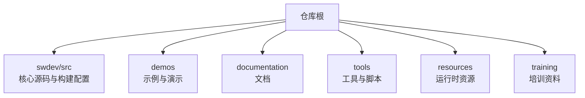
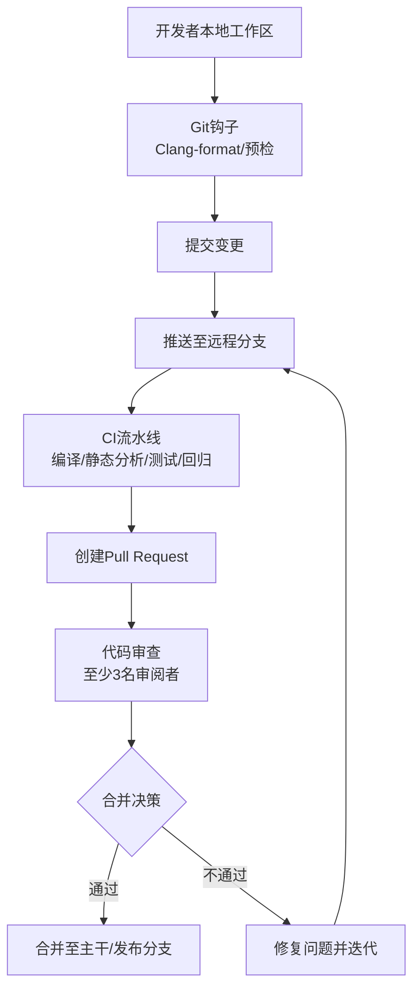
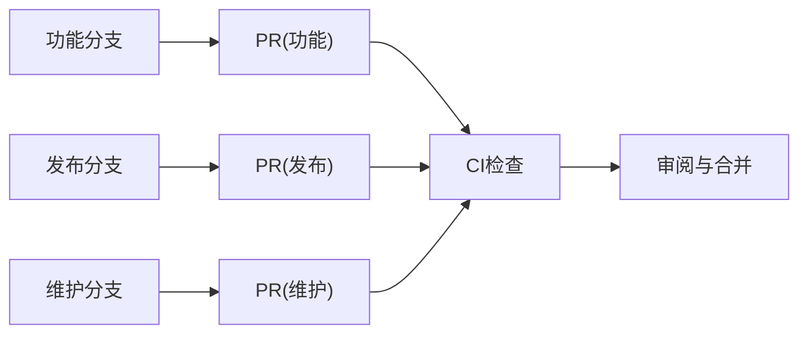
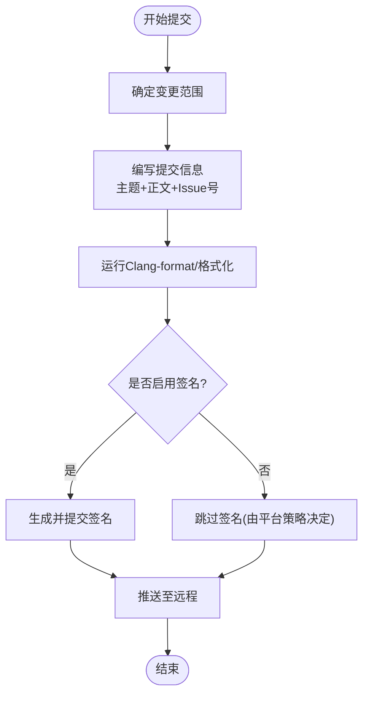
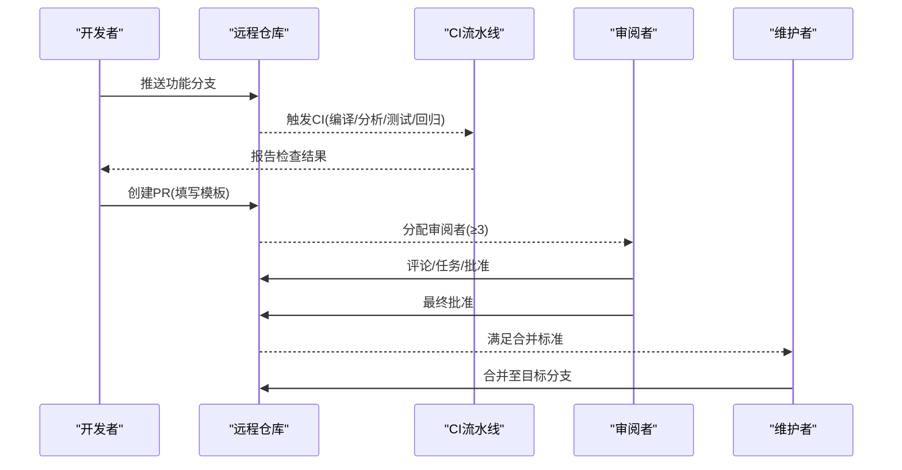
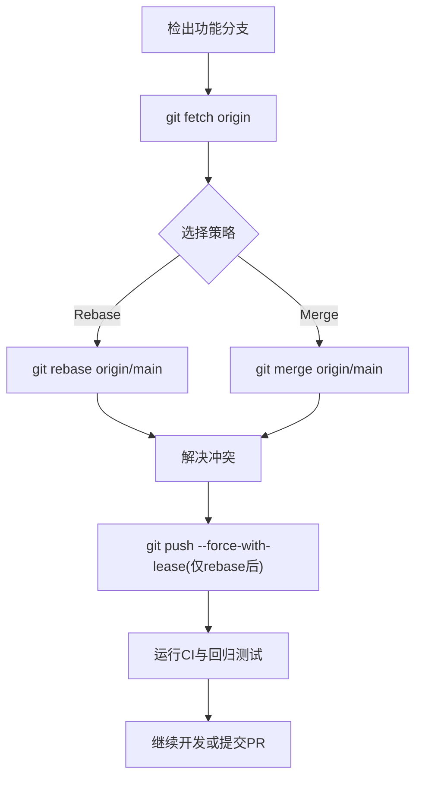
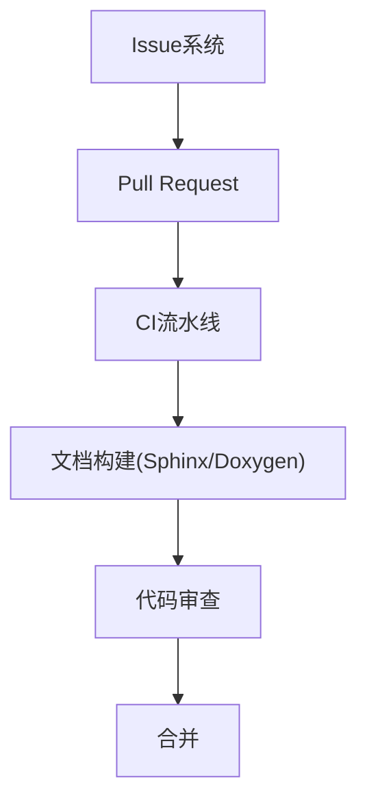
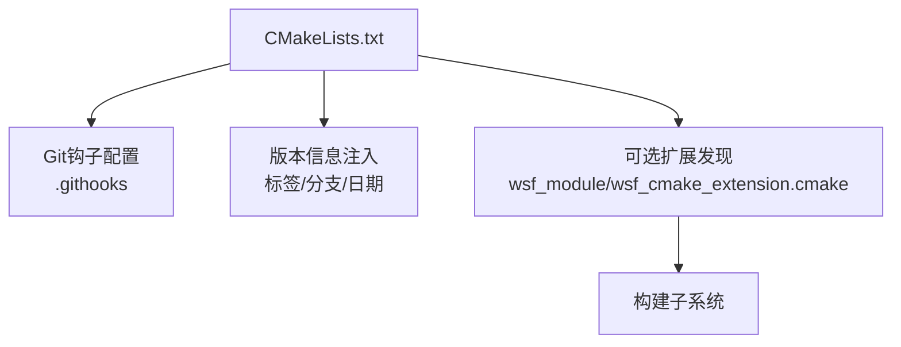

# 版本控制与协作开发

<cite>
**本文引用的文件**   
- [CONTRIBUTING.md](file://swdev/src/CONTRIBUTING.md)
- [CMakeLists.txt](file://swdev/src/CMakeLists.txt)
</cite>

## 目录
1. [简介](#简介)
2. [项目结构](#项目结构)
3. [核心组件](#核心组件)
4. [架构总览](#架构总览)
5. [详细组件分析](#详细组件分析)
6. [依赖关系分析](#依赖关系分析)
7. [性能考虑](#性能考虑)
8. [故障排查指南](#故障排查指南)
9. [结论](#结论)
10. [附录](#附录)

## 简介
本指南面向AFSIM项目的贡献者与协作者，系统化说明版本控制与协作开发的实践规范。内容覆盖Git工作流与分支策略、提交与签名要求、代码审查流程、冲突解决与同步最佳实践，以及团队协作工具（Issue跟踪、项目管理、文档协作）的配置与使用建议。同时提供新贡献者入门指引与常见问题解答，帮助团队在保持高质量与稳定性的前提下高效协作。

## 项目结构
AFSIM仓库采用“核心+扩展”的组织方式：
- swdev/src：核心源代码与构建配置（CMake），包含贡献指南、构建脚本、可选扩展发现机制等。
- demos：示例场景与演示用例，用于验证功能与回归测试。
- documentation：用户与开发者文档（Sphinx/Doxygen）。
- tools：辅助工具链与脚本。
- resources：运行时资源（数据、模型、着色器等）。
- training：培训材料。

[本节为概念性概述，不直接分析具体文件]

## 核心组件
围绕版本控制与协作开发的核心要素包括：
- 贡献准入与质量门槛：按共享/托管/分发三类代码区设定不同验收标准，主仓为最高门槛。
- 编码与文档规范：遵循AFSIM编码标准与文档标准，确保可读性与可维护性。
- 自动化检查与CI：Clang-format、Cppcheck、Valgrind、Fortify等工具在CI中执行。
- Git钩子与版本信息：通过CMake配置Git钩子路径，并在构建时注入Git标签/分支/日期到版本号。
- 变更日志与弃用管理：新增/修改需更新Changelog；弃用需带警告、文档标注与迁移指引。
- 测试与回归：单元测试、集成测试、回归测试与性能分析贯穿提交流程。

**章节来源**
- [CONTRIBUTING.md:20-42](file://swdev/src/CONTRIBUTING.md#L20-L42)
- [CONTRIBUTING.md:70-80](file://swdev/src/CONTRIBUTING.md#L70-L80)
- [CONTRIBUTING.md:85-97](file://swdev/src/CONTRIBUTING.md#L85-L97)
- [CONTRIBUTING.md:166-181](file://swdev/src/CONTRIBUTING.md#L166-L181)
- [CONTRIBUTING.md:183-191](file://swdev/src/CONTRIBUTING.md#L183-L191)
- [CONTRIBUTING.md:193-201](file://swdev/src/CONTRIBUTING.md#L193-L201)
- [CONTRIBUTING.md:205-247](file://swdev/src/CONTRIBUTING.md#L205-L247)
- [CONTRIBUTING.md:248-294](file://swdev/src/CONTRIBUTING.md#L248-L294)
- [CONTRIBUTING.md:296-406](file://swdev/src/CONTRIBUTING.md#L296-L406)
- [CONTRIBUTING.md:407-467](file://swdev/src/CONTRIBUTING.md#L407-L467)
- [CMakeLists.txt:69-125](file://swdev/src/CMakeLists.txt#L69-L125)

## 架构总览
下图展示从本地开发到合并入主干的端到端协作流程，体现Git钩子、CI检查、PR审查与发布分支管理的协同关系。

[本图为概念性流程图，不直接映射具体源文件]

## 详细组件分析

### Git工作流与分支管理策略
- 分支类型与用途
  - 功能分支：实现单一特性或修复，命名清晰，范围明确。
  - 发布分支：用于候选发布与冻结期，仅接受必要修复与文档更新。
  - 维护分支：针对已发布版本的补丁与安全问题修复。
- 分支命名与隔离
  - 功能分支以短小、聚焦为原则，避免跨域改动。
  - 发布分支应保持稳定，避免引入新功能。
  - 维护分支与主干保持最小差异，便于回滚与热修复。
- 分支保护与合并策略
  - 主干与发布分支启用保护规则，禁止强制推送。
  - 合并前必须通过CI与至少3名审阅者批准。
  - 发布分支合并回主干需经过完整回归与兼容性验证。

[本图为概念性流程图，不直接映射具体源文件]

**章节来源**
- [CONTRIBUTING.md:20-42](file://swdev/src/CONTRIBUTING.md#L20-L42)
- [CONTRIBUTING.md:230-247](file://swdev/src/CONTRIBUTING.md#L230-L247)
- [CONTRIBUTING.md:416-424](file://swdev/src/CONTRIBUTING.md#L416-L424)

### 代码提交规范与签名验证
- 提交信息格式
  - 主题行简明扼要，描述“做了什么”，避免模糊表述。
  - 正文补充动机、影响范围与关联Issue编号。
  - 变更范围要小而集中，便于审阅与回滚。
- 变更描述要求
  - 新增/修改接口需同步更新Changelog与用户文档。
  - 弃用项需在代码与文档中标注，并提供替代方案。
- 签名验证
  - 建议在平台侧开启提交签名校验（如GPG/SSH），结合CI进行验证。
  - 若平台未强制签名，应在PR模板中提醒贡献者完成签名。

**章节来源**
- [CONTRIBUTING.md:85-97](file://swdev/src/CONTRIBUTING.md#L85-L97)
- [CONTRIBUTING.md:183-191](file://swdev/src/CONTRIBUTING.md#L183-L191)
- [CONTRIBUTING.md:248-294](file://swdev/src/CONTRIBUTING.md#L248-L294)

### 代码审查流程（PR模板、清单与合并标准）
- Pull Request模板
  - 必填字段：变更目的、影响范围、测试覆盖、文档更新、Changelog条目、关联Issue。
  - 可选字段：性能对比、安全扫描结果、兼容性说明。
- 审查清单
  - 功能正确性、边界条件、错误处理、性能影响、可维护性、文档一致性。
  - 安全与合规：网络/权限相关逻辑需通过安全扫描（如Fortify）。
- 合并标准
  - CI全绿、至少3名审阅者批准、无遗留任务、回归测试通过。
  - 对公共接口的变更需提前公告与弃用周期管理。

**章节来源**
- [CONTRIBUTING.md:407-467](file://swdev/src/CONTRIBUTING.md#L407-L467)

### 冲突解决策略与代码同步最佳实践
- 冲突预防
  - 频繁rebase/sync主干，减少大跨度分支漂移。
  - 拆分提交粒度，降低冲突概率。
- 冲突解决步骤
  - 拉取最新主干，本地rebase或merge解决冲突。
  - 重新运行CI与回归测试，确认无破坏性变更。
  - 必要时与相邻模块负责人沟通接口契约。
- 同步最佳实践
  - 发布分支定期同步主干（仅合入必要修复）。
  - 维护分支优先从对应发布分支派生，避免直接操作主干。

[本图为概念性流程图，不直接映射具体源文件]

### 团队协作工具配置与使用
- Issue跟踪
  - 所有变更关联Issue，便于追踪与审计。
  - Issue模板包含复现步骤、期望行为、环境信息与优先级。
- 项目管理
  - 使用看板/里程碑组织需求、缺陷与改进项。
  - 将CI状态与PR状态纳入项目视图，提升透明度。
- 文档协作
  - 文档变更随代码提交，构建失败即阻断合并。
  - 使用Sphinx/Doxygen统一文档风格，自动校验链接与语法。

[本图为概念性流程图，不直接映射具体源文件]

**章节来源**
- [CONTRIBUTING.md:166-181](file://swdev/src/CONTRIBUTING.md#L166-L181)
- [CONTRIBUTING.md:296-406](file://swdev/src/CONTRIBUTING.md#L296-L406)

### 新贡献者入门指导
- 环境与工具
  - 安装CMake、Git、Clang-format、Cppcheck、Valgrind（Linux）、Fortify（可选）。
  - 配置IDE集成Clang-format，启用保存时格式化。
- 首次贡献
  - Fork仓库，创建功能分支，完成小范围修复或文档改进。
  - 运行本地CI等效检查，确保无警告与错误。
  - 提交PR，填写模板，邀请至少3名审阅者。
- 常见陷阱
  - 变更范围过大导致审阅困难。
  - 未更新Changelog或文档导致构建失败。
  - 忽略弃用流程造成接口破坏。

**章节来源**
- [CONTRIBUTING.md:85-97](file://swdev/src/CONTRIBUTING.md#L85-L97)
- [CONTRIBUTING.md:166-181](file://swdev/src/CONTRIBUTING.md#L166-L181)
- [CONTRIBUTING.md:296-406](file://swdev/src/CONTRIBUTING.md#L296-L406)

## 依赖关系分析
- 构建系统与Git集成
  - CMake在配置阶段检测Git，设置钩子目录并写入core.hooksPath。
  - 非release分支构建时，版本号追加最近提交日期；release候选分支添加“-rc”后缀。
- 可选扩展与插件
  - 通过wsf_module与wsf_cmake_extension.cmake发现并构建可选扩展。
  - 支持外部扩展路径WSF_ADD_EXTENSION_PATH，便于社区贡献集成。

**图表来源**
- [CMakeLists.txt:83-120](file://swdev/src/CMakeLists.txt#L83-L120)
- [CMakeLists.txt:135-165](file://swdev/src/CMakeLists.txt#L135-L165)

**章节来源**
- [CMakeLists.txt:83-120](file://swdev/src/CMakeLists.txt#L83-L120)
- [CMakeLists.txt:135-165](file://swdev/src/CMakeLists.txt#L135-L165)

## 性能考虑
- 构建性能
  - 启用ccache（非Windows）加速增量构建。
  - 合理划分单元构建，避免过度耦合导致的长链路编译。
- 运行性能
  - 对热点路径进行基准测试，确保新增功能不引入瓶颈。
  - 使用性能剖析工具定位热点，优化算法与数据结构。
- 内存与并发
  - 使用Valgrind检测内存泄漏与线程问题。
  - 多线程场景下注意锁粒度与死锁风险。

[本节为通用指导，不直接分析具体文件]

## 故障排查指南
- 构建失败
  - 检查CMake选项与依赖版本，确认编译器与标准库兼容。
  - 查看CI日志，定位具体模块与错误上下文。
- 静态分析与安全扫描
  - 根据Cppcheck/Fortify报告逐项修复，避免引入已知漏洞。
- 测试与回归
  - 运行auto_test与regression targets，比对基线输出。
  - 对预期变更更新回归基线，并附变更说明。
- 文档构建
  - 使用DOCUMENTATION/DOXYGEN目标验证文档构建无误。
  - 修正链接、语法与缺失注释，确保生成HTML无警告。

**章节来源**
- [CONTRIBUTING.md:296-406](file://swdev/src/CONTRIBUTING.md#L296-L406)
- [CONTRIBUTING.md:166-181](file://swdev/src/CONTRIBUTING.md#L166-L181)

## 结论
通过严格的分支策略、提交规范、代码审查与自动化检查，AFSIM项目在保持高质量与稳定性的同时实现了高效的团队协作。贡献者应遵循本指南，从小范围、聚焦的变更入手，逐步熟悉流程与工具，共同维护AFSIM的可演进性与可维护性。

[本节为总结性内容，不直接分析具体文件]

## 附录
- 快速检查清单
  - 变更范围明确且单一
  - 已运行Clang-format与静态分析
  - 已更新Changelog与文档
  - 已通过CI与回归测试
  - PR模板填写完整，至少3名审阅者批准
- 常用命令参考
  - 本地格式化：依据IDE或命令行调用Clang-format
  - 运行测试：auto_test.py与regression targets
  - 构建文档：DOCUMENTATION/DOXYGEN CMake目标

[本节为补充信息，不直接分析具体文件]