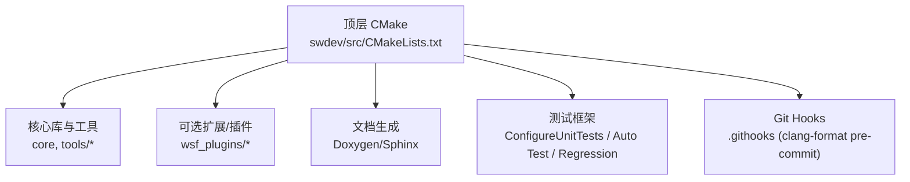
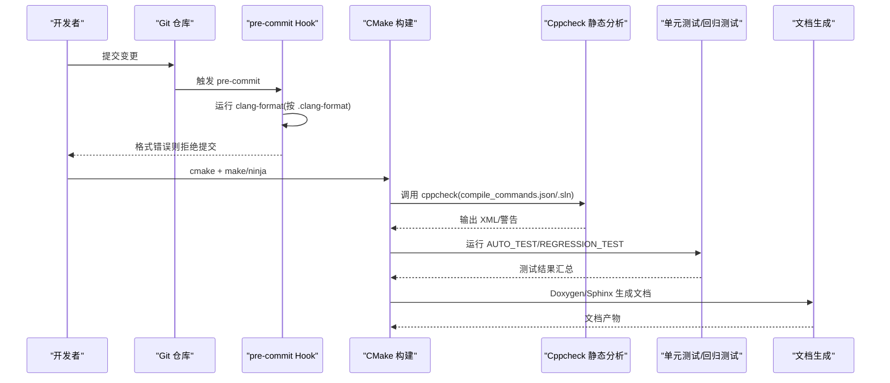
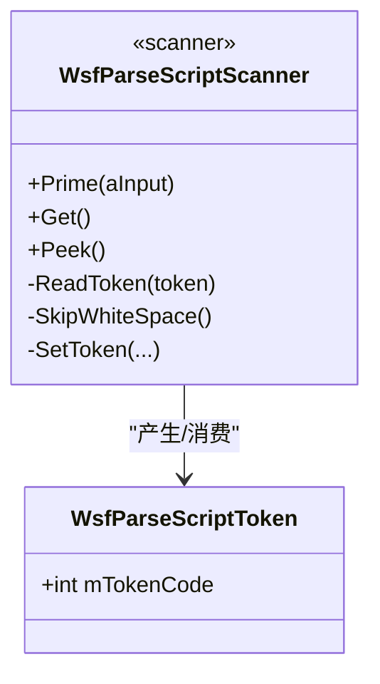
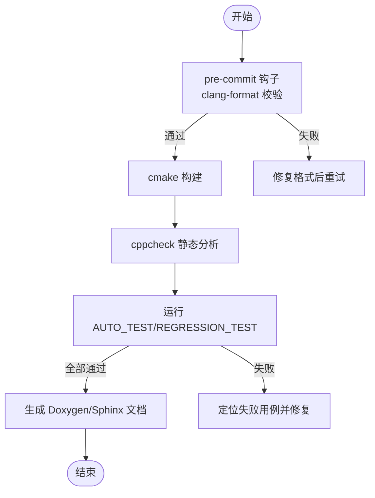
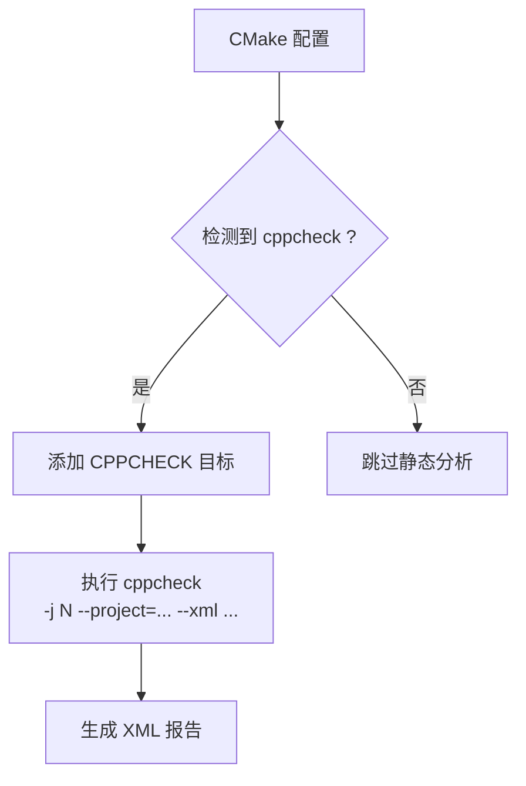
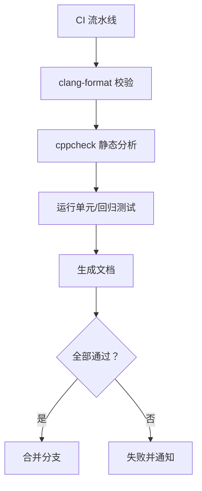
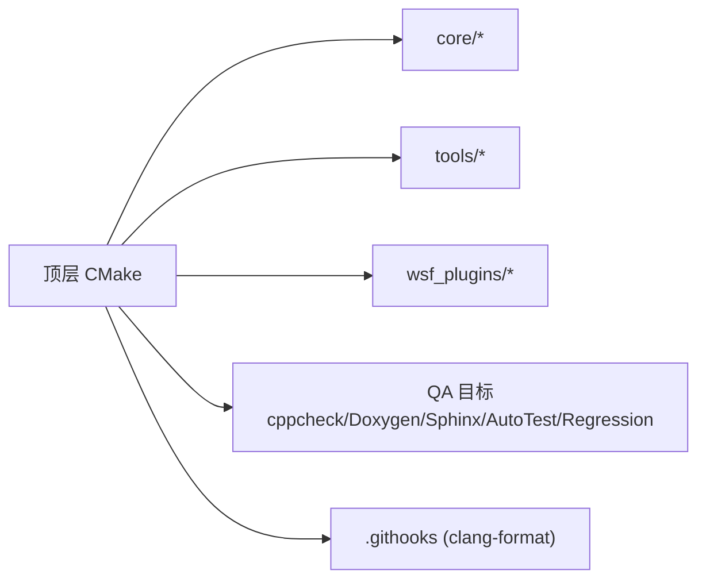

# 编码规范与质量标准

<cite>
**本文引用的文件**   
- [CMakeLists.txt](file://swdev/src/CMakeLists.txt)
- [CONTRIBUTING.md](file://swdev/src/CONTRIBUTING.md)
- [Cppcheck.cmake](file://swdev/src/cmake/Modules/Cppcheck.cmake)
- [WsfParseScriptScanner.hpp](file://swdev/src/core/wsf_parser/source/WsfParseScriptScanner.hpp)
- [SubsystemCalibrationCommandWriter.h](file://swdev/src/wsf_plugins/wsf_oms_uci/source/uci/writer/SubsystemCalibrationCommandWriter.h)
- [run.bat](file://swdev/src/core/wsf_mil/test_mission/xio/run.bat)
</cite>

## 目录
1. [简介](#简介)
2. [项目结构](#项目结构)
3. [核心组件](#核心组件)
4. [架构总览](#架构总览)
5. [详细组件分析](#详细组件分析)
6. [依赖关系分析](#依赖关系分析)
7. [性能考量](#性能考量)
8. [故障排查指南](#故障排查指南)
9. [结论](#结论)
10. [附录](#附录)

## 简介
本文件为 AFSIM 的“编码规范与质量标准”权威文档，面向 C++ 代码贡献者与维护者。内容覆盖：
- C++ 编码风格、命名约定、格式化与注释规范
- 代码审查流程与静态检查工具（clang-format、cppcheck）
- 单元测试与回归测试要求
- 性能基准测试与质量指标定义及监控方法
- 安全编码最佳实践与漏洞防护
- 重构指南与向后兼容性考虑
- 持续集成中的质量门禁与自动化检查流程

## 项目结构
AFSIM 源码位于 swdev/src，构建系统基于 CMake；文档与示例位于 documentation 与 demos；工具链与脚本位于 tools。根级 CMake 负责统一配置、子模块引入、安装规则、文档生成与测试框架集成。

**图示来源**
- [CMakeLists.txt:13-26](file://swdev/src/CMakeLists.txt#L13-L26)
- [CMakeLists.txt:174-187](file://swdev/src/CMakeLists.txt#L174-L187)
- [CMakeLists.txt:228-232](file://swdev/src/CMakeLists.txt#L228-L232)
- [CMakeLists.txt:360-362](file://swdev/src/CMakeLists.txt#L360-L362)
- [CMakeLists.txt:114-119](file://swdev/src/CMakeLists.txt#L114-L119)

**章节来源**
- [CMakeLists.txt:13-26](file://swdev/src/CMakeLists.txt#L13-L26)
- [CMakeLists.txt:174-187](file://swdev/src/CMakeLists.txt#L174-L187)
- [CMakeLists.txt:228-232](file://swdev/src/CMakeLists.txt#L228-L232)
- [CMakeLists.txt:360-362](file://swdev/src/CMakeLists.txt#L360-L362)
- [CMakeLists.txt:114-119](file://swdev/src/CMakeLists.txt#L114-L119)

## 核心组件
- 构建与版本管理：统一设置 C++ 标准、输出目录、平台相关编译选项、版本号与发布元数据。
- 静态分析与文档：集成 cppcheck、Doxygen、Sphinx，提供可复用的目标与安装规则。
- 测试框架：启用单元测试与回归测试目标，支持 Valgrind 等内存检测工具。
- Git Hooks：通过 CMake 自动配置 .githooks，实现提交前 clang-format 校验。

**章节来源**
- [CMakeLists.txt:32-36](file://swdev/src/CMakeLists.txt#L32-L36)
- [CMakeLists.txt:69-76](file://swdev/src/CMakeLists.txt#L69-L76)
- [CMakeLists.txt:174-187](file://swdev/src/CMakeLists.txt#L174-L187)
- [CMakeLists.txt:228-232](file://swdev/src/CMakeLists.txt#L228-L232)
- [CMakeLists.txt:360-362](file://swdev/src/CMakeLists.txt#L360-L362)
- [CMakeLists.txt:114-119](file://swdev/src/CMakeLists.txt#L114-L119)

## 架构总览
下图展示从源码到质量门禁的关键路径：开发者提交触发 Git Hook，运行 clang-format；构建阶段执行 cppcheck 静态扫描；测试阶段运行单元/回归测试；文档阶段生成 API 与用户文档。

**图示来源**
- [CMakeLists.txt:114-119](file://swdev/src/CMakeLists.txt#L114-L119)
- [CMakeLists.txt:174-187](file://swdev/src/CMakeLists.txt#L174-L187)
- [CMakeLists.txt:228-232](file://swdev/src/CMakeLists.txt#L228-L232)
- [CMakeLists.txt:360-362](file://swdev/src/CMakeLists.txt#L360-L362)
- [CONTRIBUTING.md:88-123](file://swdev/src/CONTRIBUTING.md#L88-L123)

## 详细组件分析

### C++ 编码风格与格式化
- 强制使用 clang-format 进行代码格式化，配置文件位于仓库根目录（.clang-format）。
- 最低版本要求：clang-format 9.0+。
- IDE 集成：Visual Studio 等支持内置或插件集成；VS2017 默认版本较低需手动指定 9.0+ 的二进制。
- 提交前钩子：通过 CMake 配置 core.hooksPath 指向 .githooks，包含 pre-commit 钩子对变更文件执行 clang-format 校验。

建议：
- 在本地提交前先运行 clang-format，避免服务器端钩子失败。
- 对工具生成的变更单独提交，便于审计。

**章节来源**
- [CONTRIBUTING.md:88-123](file://swdev/src/CONTRIBUTING.md#L88-L123)
- [CMakeLists.txt:114-119](file://swdev/src/CMakeLists.txt#L114-L119)

### 命名约定与代码组织
- 头文件保护宏采用全大写加下划线分隔形式，如 Uci__Type__AirSampleSettingsCommandStatusMT_h。
- 类名与方法名遵循驼峰或下划线混合风格，成员变量以 m 前缀标识（例如 mTokenCode）。
- 枚举常量以 cTC_/cCC_ 等前缀区分类别，提高可读性与可维护性。
- 命名空间分层清晰，如 uci::type、uci::writer，体现类型与编解码职责分离。

**图示来源**
- [WsfParseScriptScanner.hpp:22-35](file://swdev/src/core/wsf_parser/source/WsfParseScriptScanner.hpp#L22-L35)
- [WsfParseScriptScanner.hpp:37-159](file://swdev/src/core/wsf_parser/source/WsfParseScriptScanner.hpp#L37-L159)

**章节来源**
- [WsfParseScriptScanner.hpp:22-35](file://swdev/src/core/wsf_parser/source/WsfParseScriptScanner.hpp#L22-L35)
- [WsfParseScriptScanner.hpp:37-159](file://swdev/src/core/wsf_parser/source/WsfParseScriptScanner.hpp#L37-L159)

### 注释规范
- 所有源文件顶部包含版权与许可声明块（CUI 头部），确保合规与溯源。
- 自动生成文件附带生成器信息与日期，便于追踪来源。
- 关键接口与复杂逻辑应补充 Doxygen 风格注释，配合 Doxygen 生成 API 文档。

**章节来源**
- [SubsystemCalibrationCommandWriter.h:1-24](file://swdev/src/wsf_plugins/wsf_oms_uci/source/uci/writer/SubsystemCalibrationCommandWriter.h#L1-L24)
- [WsfParseScriptScanner.hpp:1-13](file://swdev/src/core/wsf_parser/source/WsfParseScriptScanner.hpp#L1-L13)

### 代码审查流程
- 提交前：pre-commit 钩子执行 clang-format，阻止不符合风格的提交。
- 构建期：CMake 集成 cppcheck，输出 XML 报告供 CI 解析与可视化。
- 测试期：AUTO_TEST 与 REGRESSION_TEST 目标驱动单元测试与回归测试。
- 文档期：Doxygen/Sphinx 生成并安装文档，保证 API 与用户文档同步更新。

**图示来源**
- [CMakeLists.txt:114-119](file://swdev/src/CMakeLists.txt#L114-L119)
- [CMakeLists.txt:174-187](file://swdev/src/CMakeLists.txt#L174-L187)
- [CMakeLists.txt:228-232](file://swdev/src/CMakeLists.txt#L228-L232)
- [CMakeLists.txt:360-362](file://swdev/src/CMakeLists.txt#L360-L362)

**章节来源**
- [CMakeLists.txt:114-119](file://swdev/src/CMakeLists.txt#L114-L119)
- [CMakeLists.txt:174-187](file://swdev/src/CMakeLists.txt#L174-L187)
- [CMakeLists.txt:228-232](file://swdev/src/CMakeLists.txt#L228-L232)
- [CMakeLists.txt:360-362](file://swdev/src/CMakeLists.txt#L360-L362)

### 静态代码分析与工具链
- cppcheck 目标由 Cppcheck.cmake 提供，支持并行执行、XML 输出、忽略第三方目录、启用 warning/performance/portability/missingInclude 等规则集。
- 在 MSVC 环境下使用解决方案文件（.sln），在非 MSVC 环境使用 compile_commands.json。
- 可通过环境变量或缓存变量调整输出参数与平台标识。

**图示来源**
- [Cppcheck.cmake:12-57](file://swdev/src/cmake/Modules/Cppcheck.cmake#L12-L57)

**章节来源**
- [Cppcheck.cmake:12-57](file://swdev/src/cmake/Modules/Cppcheck.cmake#L12-L57)

### 单元测试与回归测试
- 通过 ConfigureUnitTests 启用单元测试框架，提供 <application>_AUTO_TEST 目标。
- 通过 wsf_regression_test 提供回归测试目标，用于场景/行为一致性验证。
- 文档中提及可使用 valgrind 输出 XML 以供解析（内存泄漏/越界等）。

**章节来源**
- [CMakeLists.txt:228-232](file://swdev/src/CMakeLists.txt#L228-L232)
- [CMakeLists.txt:360-362](file://swdev/src/CMakeLists.txt#L360-L362)

### 性能基准测试与质量指标
- 构建系统支持 Unity Build 与批大小控制，有助于提升大规模项目的编译性能。
- 非 Windows 平台 Release 优化级别提升至 -O3，并导出动态符号以便调试与分析。
- 建议在 CI 中增加运行时性能基线（如仿真步长、吞吐、延迟）与覆盖率指标，结合 cppcheck 结果形成质量仪表盘。

**章节来源**
- [CMakeLists.txt:260-270](file://swdev/src/CMakeLists.txt#L260-L270)
- [CMakeLists.txt:326-337](file://swdev/src/CMakeLists.txt#L326-L337)

### 安全编码最佳实践与漏洞防护
- 严格遵循 C++11 标准，禁用语言扩展，减少未定义行为风险。
- 使用智能指针与 RAII 资源管理，避免裸指针与悬挂引用。
- 输入边界检查与异常处理：对外部输入（场景、传感器、武器模型）进行有效性校验，抛出明确异常并记录日志。
- 敏感数据与出口管制：自动生成文件包含 ITAR 与分发声明，严禁将受控技术数据外发。

**章节来源**
- [CMakeLists.txt:32-34](file://swdev/src/CMakeLists.txt#L32-L34)
- [SubsystemCalibrationCommandWriter.h:1-24](file://swdev/src/wsf_plugins/wsf_oms_uci/source/uci/writer/SubsystemCalibrationCommandWriter.h#L1-L24)

### 重构指南与向后兼容性
- 保持 ABI/API 稳定：新增功能优先通过扩展点（插件、处理器、传感器）接入，避免修改公共接口。
- 渐进式迁移：对旧接口保留兼容层，逐步废弃并给出迁移指引。
- 测试先行：重构前完善单测与回归用例，确保行为不变。
- 文档同步：任何接口变更需更新 Doxygen 与 Sphinx 文档。

[本节为通用指导，不直接分析具体文件]

### 持续集成中的质量门禁与自动化检查
- 提交门禁：pre-commit 钩子强制 clang-format，失败即阻断提交。
- 构建门禁：cppcheck 必须通过，XML 报告进入 CI 看板。
- 测试门禁：AUTO_TEST 与 REGRESSION_TEST 必须全部通过。
- 文档门禁：Doxygen/Sphinx 构建成功且无严重警告。

**图示来源**
- [CMakeLists.txt:114-119](file://swdev/src/CMakeLists.txt#L114-L119)
- [CMakeLists.txt:174-187](file://swdev/src/CMakeLists.txt#L174-L187)
- [CMakeLists.txt:228-232](file://swdev/src/CMakeLists.txt#L228-L232)
- [CMakeLists.txt:360-362](file://swdev/src/CMakeLists.txt#L360-L362)

**章节来源**
- [CMakeLists.txt:114-119](file://swdev/src/CMakeLists.txt#L114-L119)
- [CMakeLists.txt:174-187](file://swdev/src/CMakeLists.txt#L174-L187)
- [CMakeLists.txt:228-232](file://swdev/src/CMakeLists.txt#L228-L232)
- [CMakeLists.txt:360-362](file://swdev/src/CMakeLists.txt#L360-L362)

## 依赖关系分析
- 顶层 CMake 聚合 core、tools、plugins 等子项目，并注入文档与测试能力。
- 测试与静态分析作为独立目标存在，便于在 CI 中按需启用。
- Git Hooks 由 CMake 在配置阶段写入，降低协作成本。

**图示来源**
- [CMakeLists.txt:174-187](file://swdev/src/CMakeLists.txt#L174-L187)
- [CMakeLists.txt:228-232](file://swdev/src/CMakeLists.txt#L228-L232)
- [CMakeLists.txt:360-362](file://swdev/src/CMakeLists.txt#L360-L362)
- [CMakeLists.txt:114-119](file://swdev/src/CMakeLists.txt#L114-L119)

**章节来源**
- [CMakeLists.txt:174-187](file://swdev/src/CMakeLists.txt#L174-L187)
- [CMakeLists.txt:228-232](file://swdev/src/CMakeLists.txt#L228-L232)
- [CMakeLists.txt:360-362](file://swdev/src/CMakeLists.txt#L360-L362)
- [CMakeLists.txt:114-119](file://swdev/src/CMakeLists.txt#L114-L119)

## 性能考量
- 编译性能：启用 Unity Build 与批量编译，MSVC 下开启 /bigobj 以避免对象文件符号限制。
- 运行性能：Release 使用 -O3 优化；非 Windows 平台导出动态符号便于性能剖析。
- 线程与栈：Windows 下设置默认栈大小为 2MB，平衡多线程与内存占用。

**章节来源**
- [CMakeLists.txt:260-270](file://swdev/src/CMakeLists.txt#L260-L270)
- [CMakeLists.txt:304-337](file://swdev/src/CMakeLists.txt#L304-L337)

## 故障排查指南
- clang-format 失败：确认本地已安装 clang-format 9.0+，并在 IDE 中正确配置二进制路径；提交前先本地格式化。
- cppcheck 无法运行：检查是否安装 cppcheck，或在 MSVC 环境下是否正确生成 .sln；查看 Cppcheck.cmake 中的平台与输出参数。
- 测试失败：先运行最小化用例定位问题，再结合 Valgrind 输出 XML 分析内存问题。
- 文档构建失败：确认 Doxygen/Sphinx 已安装且版本满足要求。

**章节来源**
- [CONTRIBUTING.md:88-123](file://swdev/src/CONTRIBUTING.md#L88-L123)
- [Cppcheck.cmake:12-57](file://swdev/src/cmake/Modules/Cppcheck.cmake#L12-L57)

## 结论
通过统一的 CMake 构建体系、严格的 clang-format 前置校验、全面的 cppcheck 静态分析、完善的单元与回归测试，以及规范的文档生成流程，AFSIM 建立了端到端的质量保障闭环。贡献者应遵循本规范，确保代码风格一致、质量可控、可维护性强，并持续演进性能与安全特性。

## 附录
- 快速命令参考
  - 本地格式化：使用 clang-format 9.0+ 对变更文件执行格式化
  - 静态分析：构建 CPPCHECK 目标，查看 XML 报告
  - 运行测试：执行 AUTO_TEST 与 REGRESSION_TEST 目标
  - 生成文档：构建 DOXYGEN 与 DOCUMENTATION 目标

[本节为通用指导，不直接分析具体文件]