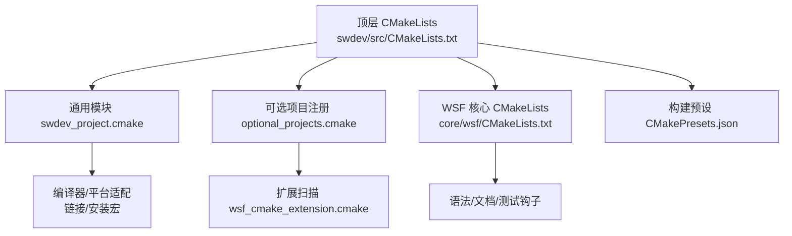
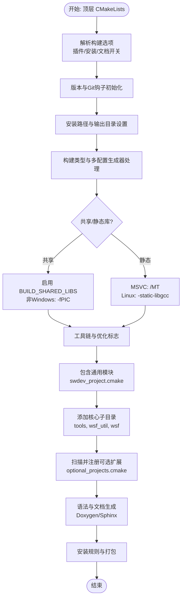
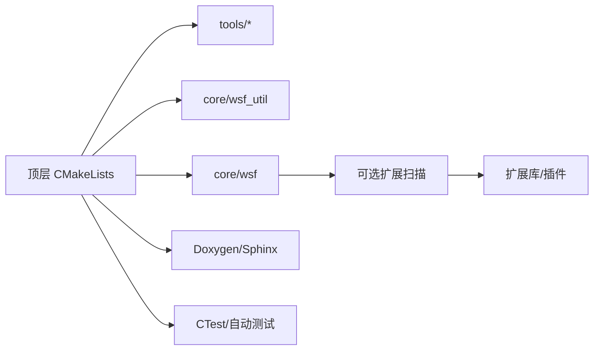

# 编译构建系统

<cite>
**本文引用的文件**   
- [swdev/src/CMakeLists.txt](file://swdev/src/CMakeLists.txt)
- [swdev/src/cmake/Modules/swdev_project.cmake](file://swdev/src/cmake/Modules/swdev_project.cmake)
- [swdev/src/cmake/Modules/cmake_utils.cmake](file://swdev/src/cmake/Modules/cmake_utils.cmake)
- [swdev/src/core/wsf/CMakeLists.txt](file://swdev/src/core/wsf/CMakeLists.txt)
- [swdev/src/core/wsf/optional_projects.cmake](file://swdev/src/core/wsf/optional_projects.cmake)
- [swdev/src/CMakePresets.json](file://swdev/src/CMakePresets.json)
</cite>

## 目录
1. [简介](#简介)
2. [项目结构](#项目结构)
3. [核心组件](#核心组件)
4. [架构总览](#架构总览)
5. [详细组件分析](#详细组件分析)
6. [依赖关系分析](#依赖关系分析)
7. [性能与优化](#性能与优化)
8. [故障排查指南](#故障排查指南)
9. [结论](#结论)
10. [附录](#附录)

## 简介
本指南面向AFSIM的CMake构建系统，系统性说明主CMakeLists.txt的结构、子模块配置选项、依赖管理策略、跨平台编译设置、构建优化（调试/发布）、常见问题诊断与解决方案，以及自动化构建脚本与CI/CD集成示例。文档以仓库中实际存在的CMake配置为依据，帮助开发者在不同平台上快速完成构建与安装。

## 项目结构
AFSIM采用分层CMake工程组织：顶层CMakeLists负责全局配置、选项开关、安装路径、构建类型、工具链与第三方库发现；核心框架wsf及其扩展通过可选项目机制动态纳入；cmake Modules提供通用宏与平台适配；CMakePresets.json为多生成器与编译器预设提供统一入口。

**图示来源**
- [swdev/src/CMakeLists.txt:13-18](file://swdev/src/CMakeLists.txt#L13-L18)
- [swdev/src/CMakeLists.txt:167-186](file://swdev/src/CMakeLists.txt#L167-L186)
- [swdev/src/core/wsf/CMakeLists.txt:16-27](file://swdev/src/core/wsf/CMakeLists.txt#L16-L27)
- [swdev/src/CMakePresets.json:1-10](file://swdev/src/CMakePresets.json#L1-L10)

**章节来源**
- [swdev/src/CMakeLists.txt:13-18](file://swdev/src/CMakeLists.txt#L13-L18)
- [swdev/src/CMakeLists.txt:167-186](file://swdev/src/CMakeLists.txt#L167-L186)
- [swdev/src/core/wsf/CMakeLists.txt:16-27](file://swdev/src/core/wsf/CMakeLists.txt#L16-L27)
- [swdev/src/CMakePresets.json:1-10](file://swdev/src/CMakePresets.json#L1-L10)

## 核心组件
- 顶层CMakeLists.txt
  - 定义最小CMake版本、C++标准、全局属性、构建选项（插件/安装/文档等）
  - 版本信息与Git钩子集成
  - 安装路径与输出目录（Windows与非Windows差异）
  - 构建类型默认值与多配置生成器处理
  - 共享/静态库切换、MSVC运行时链接、非Windows优化与导出符号
  - 包含通用模块与模板，添加核心子目录与可选扩展
  - 语法/文档/测试钩子与打包
- swdev_project.cmake
  - 编译器检测与警告级别、异常处理、并行编译
  - 共享库安装路径、RPATH设置、PDB安装
  - 线程库、dl库、Socket库
  - 库后缀命名规则（含GCC版本与位数）
  - MSVC运行库自动安装
  - 单元测试启用
- cmake_utils.cmake
  - 目标属性追加宏，便于统一追加编译选项
- core/wsf/CMakeLists.txt
  - WSF基础库构建、语法文件复制与注册、文档与测试钩子
- optional_projects.cmake
  - 可选扩展扫描、注册、生成头文件、链接与测试发现
- CMakePresets.json
  - 多生成器（Visual Studio、Ninja、Clang）与多编译器（MSVC、clang-cl、clang）预设
  - Debug/Release构建预设组合

**章节来源**
- [swdev/src/CMakeLists.txt:21-55](file://swdev/src/CMakeLists.txt#L21-L55)
- [swdev/src/CMakeLists.txt:69-125](file://swdev/src/CMakeLists.txt#L69-L125)
- [swdev/src/CMakeLists.txt:190-226](file://swdev/src/CMakeLists.txt#L190-L226)
- [swdev/src/CMakeLists.txt:234-337](file://swdev/src/CMakeLists.txt#L234-L337)
- [swdev/src/CMakeLists.txt:339-395](file://swdev/src/CMakeLists.txt#L339-L395)
- [swdev/src/CMakeLists.txt:397-458](file://swdev/src/CMakeLists.txt#L397-L458)
- [swdev/src/cmake/Modules/swdev_project.cmake:14-45](file://swdev/src/cmake/Modules/swdev_project.cmake#L14-L45)
- [swdev/src/cmake/Modules/swdev_project.cmake:47-90](file://swdev/src/cmake/Modules/swdev_project.cmake#L47-L90)
- [swdev/src/cmake/Modules/swdev_project.cmake:100-178](file://swdev/src/cmake/Modules/swdev_project.cmake#L100-L178)
- [swdev/src/cmake/Modules/swdev_project.cmake:321-357](file://swdev/src/cmake/Modules/swdev_project.cmake#L321-L357)
- [swdev/src/cmake/Modules/swdev_project.cmake:375-416](file://swdev/src/cmake/Modules/swdev_project.cmake#L375-L416)
- [swdev/src/cmake/Modules/cmake_utils.cmake:10-17](file://swdev/src/cmake/Modules/cmake_utils.cmake#L10-L17)
- [swdev/src/core/wsf/CMakeLists.txt:16-27](file://swdev/src/core/wsf/CMakeLists.txt#L16-L27)
- [swdev/src/core/wsf/CMakeLists.txt:29-38](file://swdev/src/core/wsf/CMakeLists.txt#L29-L38)
- [swdev/src/core/wsf/CMakeLists.txt:40-68](file://swdev/src/core/wsf/CMakeLists.txt#L40-L68)
- [swdev/src/core/wsf/optional_projects.cmake:17-53](file://swdev/src/core/wsf/optional_projects.cmake#L17-L53)
- [swdev/src/core/wsf/optional_projects.cmake:55-139](file://swdev/src/core/wsf/optional_projects.cmake#L55-L139)
- [swdev/src/core/wsf/optional_projects.cmake:141-192](file://swdev/src/core/wsf/optional_projects.cmake#L141-L192)
- [swdev/src/CMakePresets.json:1-10](file://swdev/src/CMakePresets.json#L1-L10)
- [swdev/src/CMakePresets.json:133-235](file://swdev/src/CMakePresets.json#L133-L235)
- [swdev/src/CMakePresets.json:237-349](file://swdev/src/CMakePresets.json#L237-L349)

## 架构总览
下图展示从顶层CMake到核心库与可选扩展的构建流程，包括安装与文档生成的关键节点。

**图示来源**
- [swdev/src/CMakeLists.txt:234-337](file://swdev/src/CMakeLists.txt#L234-L337)
- [swdev/src/CMakeLists.txt:339-395](file://swdev/src/CMakeLists.txt#L339-L395)
- [swdev/src/CMakeLists.txt:397-458](file://swdev/src/CMakeLists.txt#L397-L458)
- [swdev/src/core/wsf/optional_projects.cmake:55-139](file://swdev/src/core/wsf/optional_projects.cmake#L55-L139)

## 详细组件分析

### 顶层CMakeLists.txt结构与选项
- 版本与标准
  - 要求CMake 3.7...3.12，C++11标准，关闭扩展
  - 输出编译命令、全局目标文件夹、lib64路径查找
- 构建选项
  - 插件构建、基础语法安装、源码/演示/场景/工具/培训/文档/依赖安装开关
  - API构建开关、扩展搜索路径
- 版本与Git
  - 版本号、发布日期、Git标签/分支/提交日期注入
  - Git hooks目录配置
- 安装路径
  - Windows与非Windows的DLL/EXE/Plugin路径差异
  - 数据安装与测试钩子
- 构建类型
  - 单配置生成器默认Release；多配置生成器将默认配置置前
  - Unity Build批大小与MSVC bigobj支持
- 共享/静态库
  - 共享库：BUILD_SHARED_LIBS、-fPIC
  - 静态库：MSVC /MT、Linux -static-libgcc
- 平台相关
  - Windows栈大小、referenceBinding一致性
  - Linux ccache加速、GLIBCXX ABI兼容、导出符号
- 子目录与扩展
  - 添加tools、wsf_util、wsf等核心目录
  - 扫描并注册可选扩展，生成扩展头文件
- 文档与安装
  - Doxygen/Sphinx文档生成与安装
  - 安装包与仅运行时安装目标

**章节来源**
- [swdev/src/CMakeLists.txt:21-55](file://swdev/src/CMakeLists.txt#L21-L55)
- [swdev/src/CMakeLists.txt:69-125](file://swdev/src/CMakeLists.txt#L69-L125)
- [swdev/src/CMakeLists.txt:190-226](file://swdev/src/CMakeLists.txt#L190-L226)
- [swdev/src/CMakeLists.txt:234-337](file://swdev/src/CMakeLists.txt#L234-L337)
- [swdev/src/CMakeLists.txt:339-395](file://swdev/src/CMakeLists.txt#L339-L395)
- [swdev/src/CMakeLists.txt:397-458](file://swdev/src/CMakeLists.txt#L397-L458)

### swdev_project.cmake通用模块
- 编译器检测与警告
  - GCC版本解析、MSVC并行编译、异常处理开关
- 安装与RPATH
  - 插件安装、Linux RPATH设置、PDB调试信息安装
- 线程与动态加载
  - Threads::Threads、dl库、Windows ws2_32
- 库后缀命名
  - Windows _d；Linux基于GCC版本与位数后缀
- MSVC运行库
  - 自动安装UCRT与系统运行库
- 单元测试
  - enable_testing()启用CTest

**章节来源**
- [swdev/src/cmake/Modules/swdev_project.cmake:14-45](file://swdev/src/cmake/Modules/swdev_project.cmake#L14-L45)
- [swdev/src/cmake/Modules/swdev_project.cmake:47-90](file://swdev/src/cmake/Modules/swdev_project.cmake#L47-L90)
- [swdev/src/cmake/Modules/swdev_project.cmake:100-178](file://swdev/src/cmake/Modules/swdev_project.cmake#L100-L178)
- [swdev/src/cmake/Modules/swdev_project.cmake:321-357](file://swdev/src/cmake/Modules/swdev_project.cmake#L321-L357)
- [swdev/src/cmake/Modules/swdev_project.cmake:375-416](file://swdev/src/cmake/Modules/swdev_project.cmake#L375-L416)

### cmake_utils.cmake辅助宏
- append_target_properties：为目标追加编译属性，避免覆盖已有值

**章节来源**
- [swdev/src/cmake/Modules/cmake_utils.cmake:10-17](file://swdev/src/cmake/Modules/cmake_utils.cmake#L10-L17)

### core/wsf/CMakeLists.txt核心库
- 语法文件复制与全局列表注册
- WSF库依赖与源目录暴露
- WsfEventPipe配置与子目录添加
- 文档与测试钩子、安装规则

**章节来源**
- [swdev/src/core/wsf/CMakeLists.txt:16-27](file://swdev/src/core/wsf/CMakeLists.txt#L16-L27)
- [swdev/src/core/wsf/CMakeLists.txt:29-38](file://swdev/src/core/wsf/CMakeLists.txt#L29-L38)
- [swdev/src/core/wsf/CMakeLists.txt:40-68](file://swdev/src/core/wsf/CMakeLists.txt#L40-L68)

### optional_projects.cmake可选扩展机制
- 扫描wsf_cmake_extension.cmake并注册扩展
- 生成wsf_extensions.hpp，按类型（lib/plugin/exe）处理
- 链接可选扩展到目标
- 收集扩展中的测试目录

**章节来源**
- [swdev/src/core/wsf/optional_projects.cmake:17-53](file://swdev/src/core/wsf/optional_projects.cmake#L17-L53)
- [swdev/src/core/wsf/optional_projects.cmake:55-139](file://swdev/src/core/wsf/optional_projects.cmake#L55-L139)
- [swdev/src/core/wsf/optional_projects.cmake:141-192](file://swdev/src/core/wsf/optional_projects.cmake#L141-L192)

### CMakePresets.json构建预设
- 生成器与架构
  - Visual Studio 2015/2017/2019、Ninja Multi-Config
  - x64架构
- 编译器
  - clang-cl（Windows）、clang（Linux）
- 预设组合
  - default-vs2019、default-ninja、default-ninja-clang-linux等
- 构建预设
  - Debug/Release组合，覆盖各生成器与编译器

**章节来源**
- [swdev/src/CMakePresets.json:1-10](file://swdev/src/CMakePresets.json#L1-L10)
- [swdev/src/CMakePresets.json:133-235](file://swdev/src/CMakePresets.json#L133-L235)
- [swdev/src/CMakePresets.json:237-349](file://swdev/src/CMakePresets.json#L237-L349)

## 依赖关系分析
AFSIM构建依赖如下：
- 内部依赖
  - tools/util、util_script、geodata、packetio、dis、tracking_filters、genio、scene_gen、profiling、artificer
  - core/wsf_util、core/wsf
- 可选扩展
  - 通过wsf_cmake_extension.cmake发现的扩展，按类型加入构建
- 外部依赖
  - Git（版本与钩子）
  - Threads、dl（Linux）
  - ws2_32（Windows）
  - Doxygen/Sphinx（文档）
  - ccache（可选加速）

**图示来源**
- [swdev/src/CMakeLists.txt:364-395](file://swdev/src/CMakeLists.txt#L364-L395)
- [swdev/src/core/wsf/optional_projects.cmake:55-139](file://swdev/src/core/wsf/optional_projects.cmake#L55-L139)

**章节来源**
- [swdev/src/CMakeLists.txt:364-395](file://swdev/src/CMakeLists.txt#L364-L395)
- [swdev/src/core/wsf/optional_projects.cmake:55-139](file://swdev/src/core/wsf/optional_projects.cmake#L55-L139)

## 性能与优化
- 构建类型
  - 单配置生成器默认Release；多配置生成器将默认配置置前
- 优化等级
  - 非Windows Release使用-O3替代-O2
- 链接与导出
  - 非Windows导出符号（-rdynamic -export-dynamic）
- 并行与Unity Build
  - MSVC /MP并行编译；Unity Build批大小可配置
- 缓存加速
  - 非Windows可选ccache加速重编译
- 静态/共享库
  - 静态库在Linux下静态链接libgcc；MSVC使用/MT减少运行时依赖

**章节来源**
- [swdev/src/CMakeLists.txt:234-270](file://swdev/src/CMakeLists.txt#L234-L270)
- [swdev/src/CMakeLists.txt:272-337](file://swdev/src/CMakeLists.txt#L272-L337)
- [swdev/src/cmake/Modules/swdev_project.cmake:47-57](file://swdev/src/cmake/Modules/swdev_project.cmake#L47-L57)

## 故障排查指南
- 32位构建弃用警告
  - 现象：提示已弃用32位构建
  - 解决：使用x64或64位工具链
- 链接错误（未找到ws2_32）
  - 现象：Windows下网络相关链接失败
  - 解决：确保在Windows平台链接ws2_32（由swdev_project.cmake自动处理）
- 运行时找不到DLL
  - 现象：执行时无法加载动态库
  - 解决：检查INSTALL_DLL_PATH与RPATH设置；Windows需与exe同目录；Linux需设置$ORIGIN路径
- GLIBCXX ABI不匹配
  - 现象：非Windows平台链接第三方库时报ABI错误
  - 解决：保持-D_GLIBCXX_USE_CXX11_ABI=0（与第三方库一致）
- 符号导出问题
  - 现象：动态库函数不可见
  - 解决：确认非Windows导出符号标志已启用
- Unity Build与bigobj
  - 现象：MSVC报对象文件符号过多
  - 解决：启用Unity Build或在受影响源上添加/bigobj
- 编译器兼容性
  - 现象：新编译器构建失败
  - 解决：使用CMakePresets.json提供的预设（如vs2019、ninja-clang）或调整CMAKE_C/CXX_COMPILER

**章节来源**
- [swdev/src/CMakeLists.txt:28-30](file://swdev/src/CMakeLists.txt#L28-L30)
- [swdev/src/CMakeLists.txt:304-337](file://swdev/src/CMakeLists.txt#L304-L337)
- [swdev/src/cmake/Modules/swdev_project.cmake:100-178](file://swdev/src/cmake/Modules/swdev_project.cmake#L100-L178)
- [swdev/src/CMakePresets.json:133-235](file://swdev/src/CMakePresets.json#L133-L235)

## 结论
AFSIM的CMake构建系统通过顶层CMakeLists集中管理选项与流程，借助swdev_project.cmake实现跨平台适配与安装规范，并通过optional_projects.cmake灵活扩展功能。CMakePresets.json提供了多生成器与编译器的标准化构建入口。遵循本文档的配置与优化建议，可在Windows、Linux与macOS上稳定构建AFSIM，并在CI/CD环境中高效自动化。

## 附录

### 常用构建命令（基于CMakePresets）
- 使用Visual Studio 2019构建Debug
  - cmake --preset=default-vs2019
  - cmake --build --preset=vs2019-debug
- 使用Ninja构建Release（Linux/Clang）
  - cmake --preset=default-ninja-clang-linux
  - cmake --build --preset=ninja-clang-linux-release

**章节来源**
- [swdev/src/CMakePresets.json:133-235](file://swdev/src/CMakePresets.json#L133-L235)
- [swdev/src/CMakePresets.json:237-349](file://swdev/src/CMakePresets.json#L237-L349)

### CI/CD集成示例（GitHub Actions）
- 步骤要点
  - 安装CMake与所需编译器（MSVC/Clang/GCC）
  - 选择预设进行configure与build
  - 可选：安装Doxygen/Sphinx生成文档
  - 可选：运行ctest执行测试
- 示例片段（概念性）
  - uses: actions/setup-cmake@vX
  - run: cmake --preset=default-vs2019
  - run: cmake --build --preset=vs2019-debug
  - run: ctest --output-on-failure

[本节为概念性指导，不涉及具体代码文件]