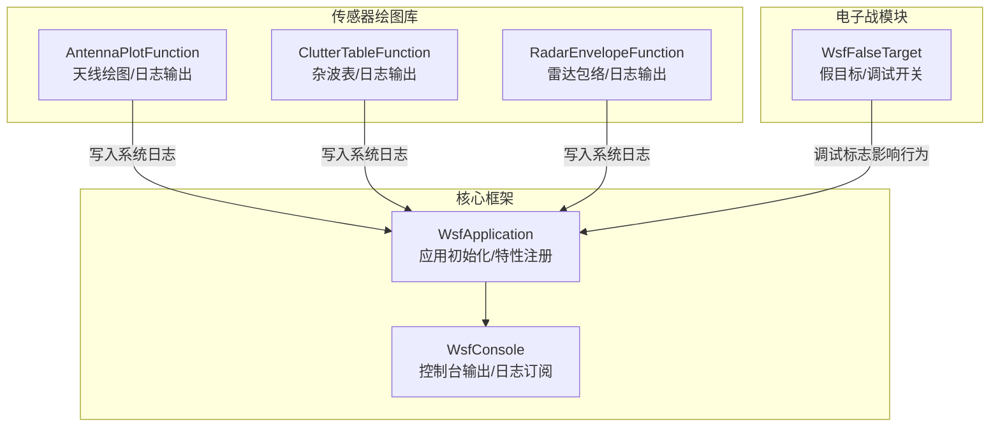
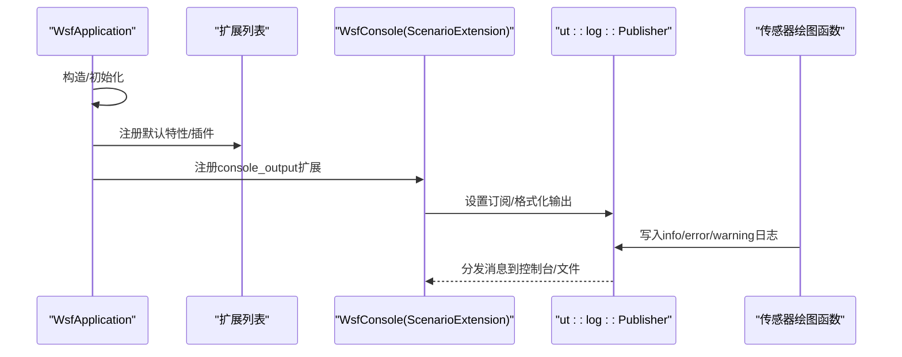
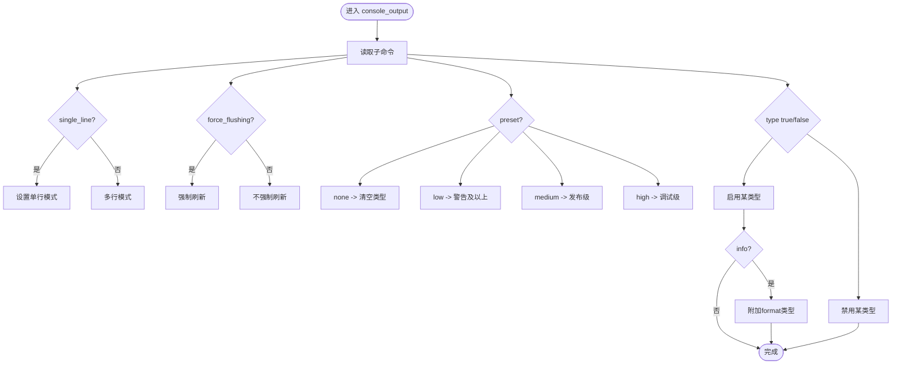
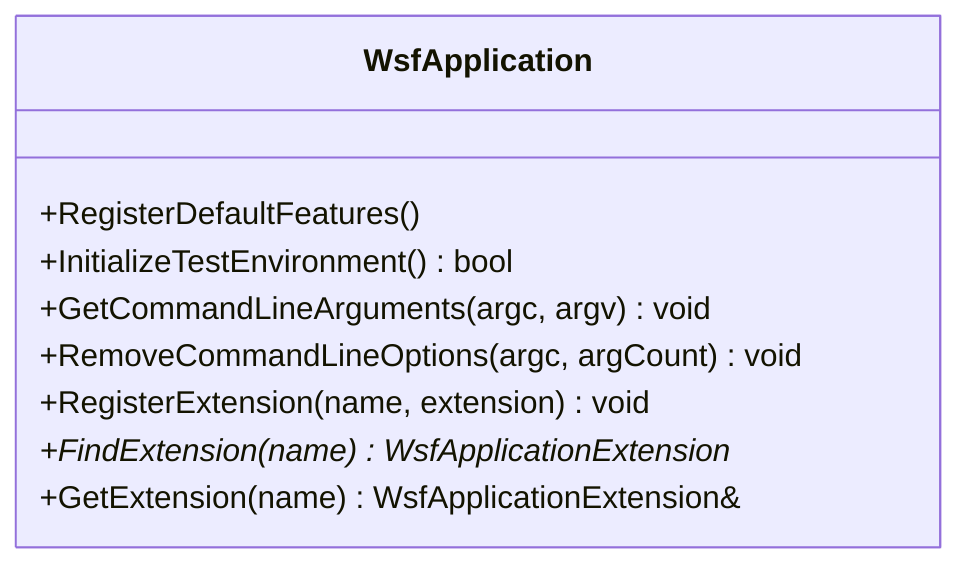
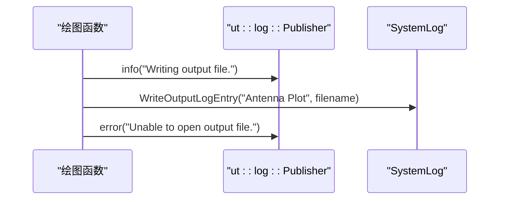
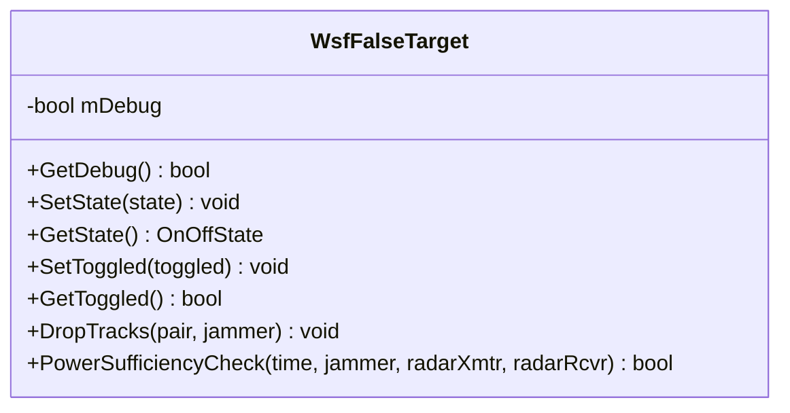
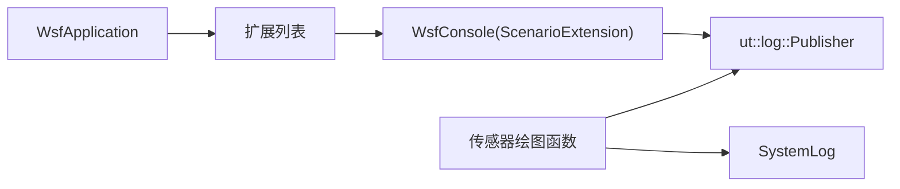

# 调试与性能分析

<cite>
**本文引用的文件**   
- [WsfConsole.cpp](file://swdev/src/core/wsf/source/WsfConsole.cpp)
- [WsfApplication.cpp](file://swdev/src/core/wsf/source/WsfApplication.cpp)
- [WsfFalseTarget.hpp](file://swdev/src/core/wsf_mil/source/ew/WsfFalseTarget.hpp)
- [AntennaPlotFunction.cpp](file://swdev/src/core/sensor_plot_lib/source/AntennaPlotFunction.cpp)
- [ClutterTableFunction.cpp](file://swdev/src/core/sensor_plot_lib/source/ClutterTableFunction.cpp)
- [RadarEnvelopeFunction.cpp](file://swdev/src/core/sensor_plot_lib/source/RadarEnvelopeFunction.cpp)
</cite>

## 目录
1. [简介](#简介)
2. [项目结构](#项目结构)
3. [核心组件](#核心组件)
4. [架构总览](#架构总览)
5. [详细组件分析](#详细组件分析)
6. [依赖关系分析](#依赖关系分析)
7. [性能考虑](#性能考虑)
8. [故障排查指南](#故障排查指南)
9. [结论](#结论)
10. [附录](#附录)

## 简介
本指南面向AFSIM仿真系统的调试与性能分析，聚焦以下目标：
- 使用GDB、Visual Studio调试器进行断点、堆栈与变量检查
- 配置与使用内置日志系统（含不同级别输出）
- 性能分析方法：CPU剖析、内存泄漏检测、瓶颈识别
- 仿真优化技巧：算法优化、数据结构选择、并行计算应用
- 常见性能问题诊断案例与解决方案
- 调试脚本与自定义调试工具扩展

## 项目结构
AFSIM仓库包含演示场景、文档、资源与源代码。与调试和性能相关的关键路径位于：
- swdev/src/core/wsf：核心框架、控制台输出、应用生命周期、系统日志
- swdev/src/core/sensor_plot_lib：传感器绘图函数，内部广泛使用日志记录
- swdev/src/core/wsf_mil：电子战模块，包含可开关的调试标志

图表来源
- [WsfApplication.cpp:47-121](file://swdev/src/core/wsf/source/WsfApplication.cpp#L47-L121)
- [WsfConsole.cpp:27-34](file://swdev/src/core/wsf/source/WsfConsole.cpp#L27-L34)
- [AntennaPlotFunction.cpp:540-606](file://swdev/src/core/sensor_plot_lib/source/AntennaPlotFunction.cpp#L540-L606)
- [ClutterTableFunction.cpp:105-151](file://swdev/src/core/sensor_plot_lib/source/ClutterTableFunction.cpp#L105-L151)
- [RadarEnvelopeFunction.cpp:111-148](file://swdev/src/core/sensor_plot_lib/source/RadarEnvelopeFunction.cpp#L111-L148)
- [WsfFalseTarget.hpp:228-290](file://swdev/src/core/wsf_mil/source/ew/WsfFalseTarget.hpp#L228-L290)

章节来源
- [WsfApplication.cpp:47-121](file://swdev/src/core/wsf/source/WsfApplication.cpp#L47-L121)
- [WsfConsole.cpp:27-34](file://swdev/src/core/wsf/source/WsfConsole.cpp#L27-L34)

## 核心组件
- 应用生命周期与特性注册：负责构建环境、插件加载、默认特性（如操作系统、CPU、编译器、构建类型）注册，以及测试环境初始化。
- 控制台输出与日志订阅：提供console_output命令块，支持单行输出、强制刷新、预设级别（none/low/medium/high），以及按类型过滤（fatal/error/warning/info/debug/developer）。
- 传感器绘图函数：在生成输出文件或GNU Plot脚本时，通过系统日志记录关键步骤与错误信息。
- 电子战假目标：提供调试开关以控制更详细的处理流程或中间状态输出。

章节来源
- [WsfApplication.cpp:235-277](file://swdev/src/core/wsf/source/WsfApplication.cpp#L235-L277)
- [WsfConsole.cpp:36-63](file://swdev/src/core/wsf/source/WsfConsole.cpp#L36-L63)
- [WsfConsole.cpp:254-294](file://swdev/src/core/wsf/source/WsfConsole.cpp#L254-L294)
- [WsfConsole.cpp:310-330](file://swdev/src/core/wsf/source/WsfConsole.cpp#L310-L330)
- [AntennaPlotFunction.cpp:177-207](file://swdev/src/core/sensor_plot_lib/source/AntennaPlotFunction.cpp#L177-L207)
- [ClutterTableFunction.cpp:105-151](file://swdev/src/core/sensor_plot_lib/source/ClutterTableFunction.cpp#L105-L151)
- [RadarEnvelopeFunction.cpp:111-148](file://swdev/src/core/sensor_plot_lib/source/RadarEnvelopeFunction.cpp#L111-L148)
- [WsfFalseTarget.hpp:228-290](file://swdev/src/core/wsf_mil/source/ew/WsfFalseTarget.hpp#L228-L290)

## 架构总览
下图展示应用启动、扩展注册、日志订阅与输出之间的关系。

图表来源
- [WsfApplication.cpp:47-121](file://swdev/src/core/wsf/source/WsfApplication.cpp#L47-L121)
- [WsfConsole.cpp:27-34](file://swdev/src/core/wsf/source/WsfConsole.cpp#L27-L34)
- [WsfConsole.cpp:159-181](file://swdev/src/core/wsf/source/WsfConsole.cpp#L159-L181)
- [AntennaPlotFunction.cpp:177-207](file://swdev/src/core/sensor_plot_lib/source/AntennaPlotFunction.cpp#L177-L207)

## 详细组件分析

### 控制台输出与日志子系统
- 功能要点
  - 支持console_output命令块，配置single_line、force_flushing、preset与type开关
  - 预设级别：none、low、medium、high，分别对应不同的日志类型集合
  - 支持的日志类型：fatal、error、warning、info、debug、developer；info自动附带format
  - 输出目标：控制台与文件（FileSubscriber），支持重定向与强制刷新
- 典型用法
  - 在场景中启用console_output并设置preset为high以获取详细调试信息
  - 将特定类型的日志输出到独立文件，便于离线分析

图表来源
- [WsfConsole.cpp:214-236](file://swdev/src/core/wsf/source/WsfConsole.cpp#L214-L236)
- [WsfConsole.cpp:254-294](file://swdev/src/core/wsf/source/WsfConsole.cpp#L254-L294)
- [WsfConsole.cpp:296-330](file://swdev/src/core/wsf/source/WsfConsole.cpp#L296-L330)

章节来源
- [WsfConsole.cpp:36-63](file://swdev/src/core/wsf/source/WsfConsole.cpp#L36-L63)
- [WsfConsole.cpp:159-181](file://swdev/src/core/wsf/source/WsfConsole.cpp#L159-L181)
- [WsfConsole.cpp:214-236](file://swdev/src/core/wsf/source/WsfConsole.cpp#L214-L236)
- [WsfConsole.cpp:254-294](file://swdev/src/core/wsf/source/WsfConsole.cpp#L254-L294)
- [WsfConsole.cpp:296-330](file://swdev/src/core/wsf/source/WsfConsole.cpp#L296-L330)

### 应用初始化与特性注册
- 功能要点
  - 捕获标准流，记录版本与构建信息
  - 注册默认特性：操作系统、CPU、编译器、构建类型（debug/release）
  - 初始化测试环境（AUTO_TEST环境变量），Windows下关闭异常对话框
- 调试意义
  - 通过特性查询判断当前运行环境（例如build:debug/build:release）
  - 自动化测试模式下避免阻塞式弹窗导致测试挂起

图表来源
- [WsfApplication.cpp:47-121](file://swdev/src/core/wsf/source/WsfApplication.cpp#L47-L121)
- [WsfApplication.cpp:235-277](file://swdev/src/core/wsf/source/WsfApplication.cpp#L235-L277)
- [WsfApplication.cpp:329-345](file://swdev/src/core/wsf/source/WsfApplication.cpp#L329-L345)

章节来源
- [WsfApplication.cpp:47-121](file://swdev/src/core/wsf/source/WsfApplication.cpp#L47-L121)
- [WsfApplication.cpp:235-277](file://swdev/src/core/wsf/source/WsfApplication.cpp#L235-L277)
- [WsfApplication.cpp:329-345](file://swdev/src/core/wsf/source/WsfApplication.cpp#L329-L345)

### 传感器绘图函数的日志输出
- AntennaPlotFunction
  - 在写入输出文件或GNU Plot脚本时记录info日志，失败时记录error日志
- ClutterTableFunction
  - 处理海拔高度时记录info日志，完成后记录输出文件名
- RadarEnvelopeFunction
  - 参数校验失败时记录error日志，打开输出文件失败时记录error日志

图表来源
- [AntennaPlotFunction.cpp:177-207](file://swdev/src/core/sensor_plot_lib/source/AntennaPlotFunction.cpp#L177-L207)
- [AntennaPlotFunction.cpp:540-606](file://swdev/src/core/sensor_plot_lib/source/AntennaPlotFunction.cpp#L540-L606)
- [ClutterTableFunction.cpp:105-151](file://swdev/src/core/sensor_plot_lib/source/ClutterTableFunction.cpp#L105-L151)
- [RadarEnvelopeFunction.cpp:111-148](file://swdev/src/core/sensor_plot_lib/source/RadarEnvelopeFunction.cpp#L111-L148)

章节来源
- [AntennaPlotFunction.cpp:177-207](file://swdev/src/core/sensor_plot_lib/source/AntennaPlotFunction.cpp#L177-L207)
- [AntennaPlotFunction.cpp:540-606](file://swdev/src/core/sensor_plot_lib/source/AntennaPlotFunction.cpp#L540-L606)
- [ClutterTableFunction.cpp:105-151](file://swdev/src/core/sensor_plot_lib/source/ClutterTableFunction.cpp#L105-L151)
- [RadarEnvelopeFunction.cpp:111-148](file://swdev/src/core/sensor_plot_lib/source/RadarEnvelopeFunction.cpp#L111-L148)

### 电子战假目标的调试开关
- 提供mDebug布尔字段用于控制详细调试输出
- 其他调试相关字段包括初始假目标数量、持久性、范围约束等

图表来源
- [WsfFalseTarget.hpp:228-290](file://swdev/src/core/wsf_mil/source/ew/WsfFalseTarget.hpp#L228-L290)

章节来源
- [WsfFalseTarget.hpp:228-290](file://swdev/src/core/wsf_mil/source/ew/WsfFalseTarget.hpp#L228-L290)

## 依赖关系分析
- 控制台输出依赖日志发布者（ut::log::Publisher）进行消息分发与格式化
- 传感器绘图函数依赖系统日志记录输出文件路径与处理状态
- 应用层通过扩展机制注册控制台输出，并在场景创建后初始化订阅者

图表来源
- [WsfApplication.cpp:47-121](file://swdev/src/core/wsf/source/WsfApplication.cpp#L47-L121)
- [WsfConsole.cpp:27-34](file://swdev/src/core/wsf/source/WsfConsole.cpp#L27-L34)
- [AntennaPlotFunction.cpp:540-606](file://swdev/src/core/sensor_plot_lib/source/AntennaPlotFunction.cpp#L540-L606)

章节来源
- [WsfApplication.cpp:47-121](file://swdev/src/core/wsf/source/WsfApplication.cpp#L47-L121)
- [WsfConsole.cpp:27-34](file://swdev/src/core/wsf/source/WsfConsole.cpp#L27-L34)
- [AntennaPlotFunction.cpp:540-606](file://swdev/src/core/sensor_plot_lib/source/AntennaPlotFunction.cpp#L540-L606)

## 性能考虑
- CPU剖析
  - 使用AFPerf（默认剖析器）对热点函数进行采样，结合日志中的关键路径定位瓶颈
  - 在传感器绘图函数中，关注IO密集操作（写文件、生成GNU Plot脚本）
- 内存泄漏检测
  - Windows平台可使用CRT调试堆（_CrtSetReportMode/_CrtSetReportFile）配合断点与堆转储
  - 在自动化测试模式下，确保异常对话框被禁用以避免阻塞
- 瓶颈识别
  - 通过日志级别提升（preset=high）观察频繁调用路径
  - 使用单行模式减少日志开销，必要时开启强制刷新保证实时性
- 优化建议
  - 算法层面：减少不必要的重复计算，缓存中间结果
  - 数据结构：优先使用连续内存布局（如vector）以提升缓存命中率
  - 并行计算：对独立任务拆分线程，注意同步开销与数据竞争

[本节为通用指导，不直接分析具体文件]

## 故障排查指南
- 常见问题
  - 无法打开输出文件：检查路径变量替换与权限，查看error日志
  - 日志过多导致性能下降：调整preset或关闭debug/developer类型
  - 自动化测试卡住：确认AUTO_TEST环境变量已设置且Windows异常对话框已禁用
- 排查步骤
  - 启用console_output并将preset设为high，收集完整日志
  - 针对传感器绘图函数，检查是否成功写入输出文件与GNU Plot脚本
  - 在关键分支插入临时日志（利用info/error），逐步缩小问题范围

章节来源
- [AntennaPlotFunction.cpp:201-207](file://swdev/src/core/sensor_plot_lib/source/AntennaPlotFunction.cpp#L201-L207)
- [AntennaPlotFunction.cpp:246-252](file://swdev/src/core/sensor_plot_lib/source/AntennaPlotFunction.cpp#L246-L252)
- [RadarEnvelopeFunction.cpp:111-148](file://swdev/src/core/sensor_plot_lib/source/RadarEnvelopeFunction.cpp#L111-L148)
- [WsfApplication.cpp:329-345](file://swdev/src/core/wsf/source/WsfApplication.cpp#L329-L345)

## 结论
AFSIM的调试与性能分析围绕应用生命周期、控制台日志系统与传感器绘图函数展开。通过合理配置日志级别、使用剖析工具与内存检测手段，并结合代码级的调试开关，可以有效定位性能瓶颈与逻辑问题。建议在开发过程中持续使用高详细度日志与自动化测试环境，以确保问题早期发现与快速修复。

[本节为总结性内容，不直接分析具体文件]

## 附录
- 调试工具使用要点
  - GDB：设置断点于关键函数入口，查看调用栈与局部变量；使用backtrace定位崩溃点
  - Visual Studio：使用“诊断工具”进行CPU/GPU剖析，结合“内存使用情况”检测泄漏
  - AFPerf：采集热点函数调用次数与耗时，导出报告进行分析
- 日志配置最佳实践
  - 开发阶段使用preset=high，生产阶段使用preset=low或medium
  - 将关键输出单独写入文件，便于离线分析与对比
- 自定义调试工具扩展
  - 通过扩展机制注册新的控制台命令，复用console_output的输出能力
  - 在传感器绘图函数中增加可选的调试输出，配合日志系统进行追踪

[本节为补充说明，不直接分析具体文件]