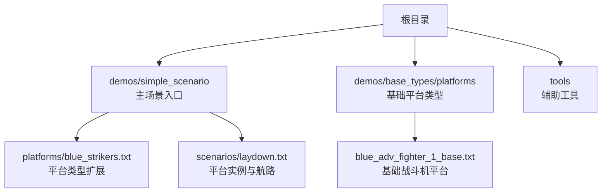
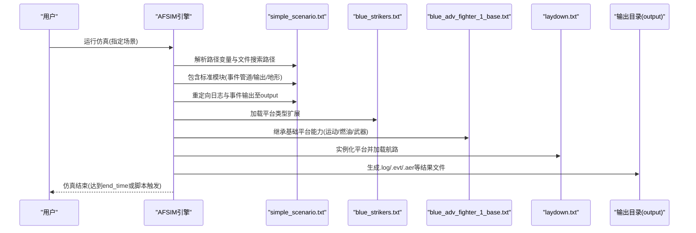
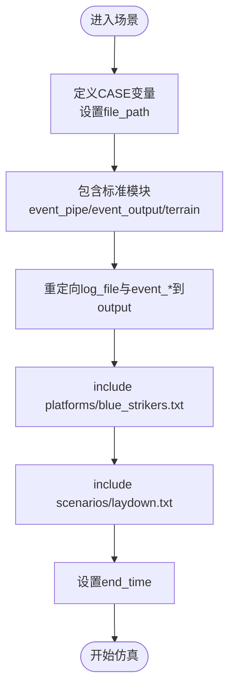
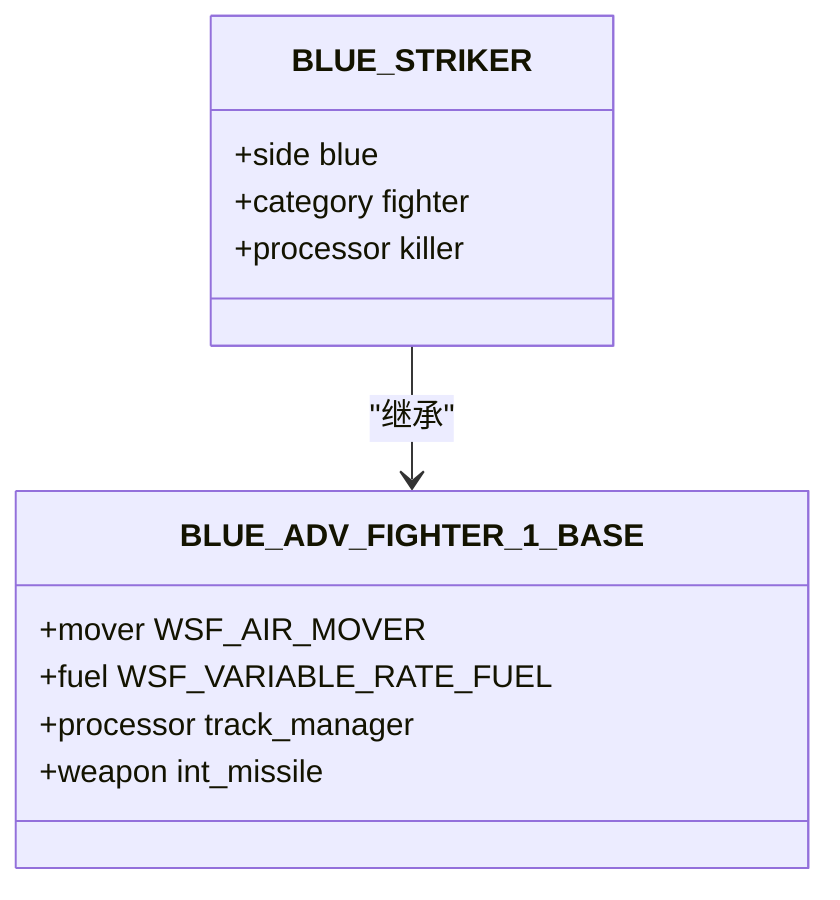
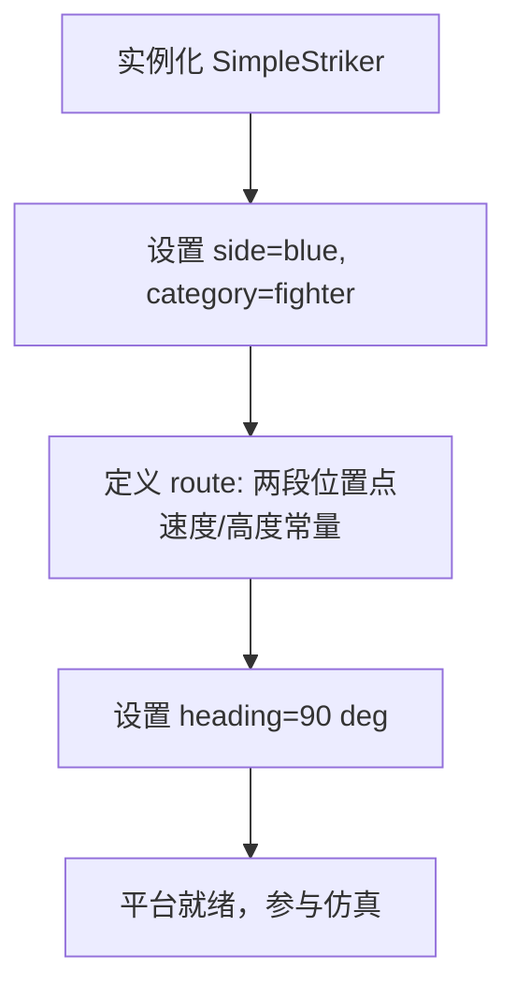
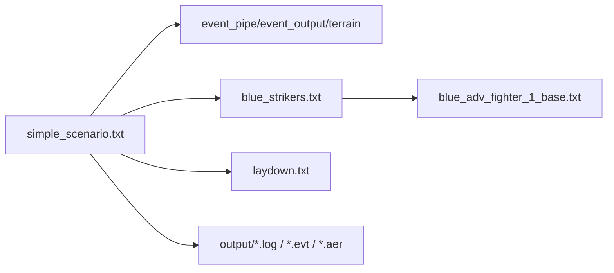

# 快速开始

<cite>
**本文引用的文件**   
- [simple_scenario.txt](file://demos/simple_scenario/simple_scenario.txt)
- [blue_strikers.txt](file://demos/simple_scenario/platforms/blue_strikers.txt)
- [laydown.txt](file://demos/simple_scenario/scenarios/laydown.txt)
- [blue_adv_fighter_1_base.txt](file://demos/base_types/platforms/blue_adv_fighter_1_base.txt)
- [Start_cmd.bat](file://tools/Start_cmd.bat)
</cite>

## 目录
1. [简介](#简介)
2. [项目结构](#项目结构)
3. [核心组件](#核心组件)
4. [架构总览](#架构总览)
5. [详细组件分析](#详细组件分析)
6. [依赖关系分析](#依赖关系分析)
7. [性能考虑](#性能考虑)
8. [故障排除指南](#故障排除指南)
9. [结论](#结论)
10. [附录](#附录)

## 简介
本指南面向AFSIM新用户，目标是在最短时间内完成安装、配置并运行第一个仿真案例（simple_scenario），建立对平台定义、传感器建模与武器系统等基本概念的直观认识。文档同时提供Windows平台的完整安装步骤、环境路径设置、命令行工具使用方法以及常见问题排查建议。

## 项目结构
AFSIM仓库包含示例演示、文档、资源与工具等目录。本次快速开始聚焦以下关键路径：
- demos/simple_scenario：入门级仿真场景
- demos/base_types/platforms：基础平台类型定义（被simple_scenario引用）
- tools：辅助工具与脚本（如启动命令批处理）

图表来源
- [simple_scenario.txt:10-26](file://demos/simple_scenario/simple_scenario.txt#L10-L26)
- [blue_strikers.txt:11-14](file://demos/simple_scenario/platforms/blue_strikers.txt#L11-L14)
- [laydown.txt:18-29](file://demos/simple_scenario/scenarios/laydown.txt#L18-L29)
- [blue_adv_fighter_1_base.txt:13-55](file://demos/base_types/platforms/blue_adv_fighter_1_base.txt#L13-L55)

章节来源
- [simple_scenario.txt:10-26](file://demos/simple_scenario/simple_scenario.txt#L10-L26)

## 核心组件
- 场景入口文件：负责路径变量定义、文件搜索路径、标准模块包含、日志与事件输出重定向、平台与场景加载、仿真结束时间设置。
- 平台类型定义：在基础平台类型之上扩展自定义平台类型，并可附加处理器逻辑（例如自动结束仿真）。
- 平台实例与航路：创建具体平台实体，定义其所属阵营、类别、飞行航路与初始姿态。
- 基础平台类型：提供飞行器运动学、燃油、跟踪处理器与武器挂载等通用能力。

章节来源
- [simple_scenario.txt:10-26](file://demos/simple_scenario/simple_scenario.txt#L10-L26)
- [blue_strikers.txt:11-38](file://demos/simple_scenario/platforms/blue_strikers.txt#L11-L38)
- [laydown.txt:18-29](file://demos/simple_scenario/scenarios/laydown.txt#L18-L29)
- [blue_adv_fighter_1_base.txt:13-55](file://demos/base_types/platforms/blue_adv_fighter_1_base.txt#L13-L55)

## 架构总览
下图展示从场景入口到平台实例的加载与执行流程，以及输出文件的生成位置。

图表来源
- [simple_scenario.txt:10-28](file://demos/simple_scenario/simple_scenario.txt#L10-L28)
- [blue_strikers.txt:11-38](file://demos/simple_scenario/platforms/blue_strikers.txt#L11-L38)
- [laydown.txt:18-29](file://demos/simple_scenario/scenarios/laydown.txt#L18-L29)
- [blue_adv_fighter_1_base.txt:13-55](file://demos/base_types/platforms/blue_adv_fighter_1_base.txt#L13-L55)

## 详细组件分析

### 场景入口：simple_scenario.txt
- 路径变量与搜索路径：定义CASE变量，设置当前目录与base_types为文件搜索路径，便于include其他文件。
- 标准模块：包含事件管道、事件输出与地形数据。
- 输出重定向：将日志与事件输出写入output目录，文件名使用CASE变量。
- 平台与场景：引入平台类型扩展与场景布局。
- 仿真时长：设置仿真结束时间。

图表来源
- [simple_scenario.txt:10-28](file://demos/simple_scenario/simple_scenario.txt#L10-L28)

章节来源
- [simple_scenario.txt:10-28](file://demos/simple_scenario/simple_scenario.txt#L10-L28)

### 平台类型扩展：blue_strikers.txt
- 继承基础平台类型：通过include_once引入基础战斗机平台类型。
- 自定义平台类型：定义BLUE_STRIKER，设置阵营、类别、调试开关。
- 处理器逻辑：附加WSF_SCRIPT_PROCESSOR，按固定间隔更新，当仿真时间超过阈值时调用接口结束仿真。

图表来源
- [blue_strikers.txt:11-38](file://demos/simple_scenario/platforms/blue_strikers.txt#L11-L38)
- [blue_adv_fighter_1_base.txt:13-55](file://demos/base_types/platforms/blue_adv_fighter_1_base.txt#L13-L55)

章节来源
- [blue_strikers.txt:11-38](file://demos/simple_scenario/platforms/blue_strikers.txt#L11-L38)

### 平台实例与航路：laydown.txt
- 平台实例：创建SimpleStriker，类型为BLUE_STRIKER，设置阵营与类别。
- 航路定义：两段直线航路，速度恒定，高度固定。
- 初始朝向：设定heading。

图表来源
- [laydown.txt:18-29](file://demos/simple_scenario/scenarios/laydown.txt#L18-L29)

章节来源
- [laydown.txt:18-29](file://demos/simple_scenario/scenarios/laydown.txt#L18-L29)

### 基础平台类型：blue_adv_fighter_1_base.txt
- 运动模型：WSF_AIR_MOVER，限制滚转速率、加速度、爬升率、最大速度与高度包线。
- 燃油系统：可变消耗率，初始与最大油量。
- 跟踪处理器：WSF_TRACK_PROCESSOR，配置清理与更新间隔。
- 武器挂载：内置空对空导弹武器。

章节来源
- [blue_adv_fighter_1_base.txt:13-55](file://demos/base_types/platforms/blue_adv_fighter_1_base.txt#L13-L55)

## 依赖关系分析
- simple_scenario.txt依赖：
  - event_pipe.txt、event_output.txt、terrain.txt（标准模块）
  - platforms/blue_strikers.txt（平台类型扩展）
  - scenarios/laydown.txt（平台实例与航路）
- blue_strikers.txt依赖：
  - base_types/platforms/blue_adv_fighter_1_base.txt（基础平台类型）
- 输出依赖：
  - output目录用于存放日志与事件文件

图表来源
- [simple_scenario.txt:10-26](file://demos/simple_scenario/simple_scenario.txt#L10-L26)
- [blue_strikers.txt:11-14](file://demos/simple_scenario/platforms/blue_strikers.txt#L11-L14)
- [laydown.txt:18-29](file://demos/simple_scenario/scenarios/laydown.txt#L18-L29)
- [blue_adv_fighter_1_base.txt:13-55](file://demos/base_types/platforms/blue_adv_fighter_1_base.txt#L13-L55)

章节来源
- [simple_scenario.txt:10-26](file://demos/simple_scenario/simple_scenario.txt#L10-L26)

## 性能考虑
- 处理器更新间隔：在平台处理器中设置update_interval可平衡精度与性能。
- 跟踪处理器清理间隔：合理设置purge_interval避免轨迹数据膨胀。
- 输出频率：事件输出与管道输出的频率会影响I/O开销，建议在开发阶段降低频率，验证后提高。
- 多核并行：复杂场景可结合多线程选项（如有）提升仿真吞吐。

[本节为通用指导，不直接分析具体文件]

## 故障排除指南
- 无法找到include文件：
  - 检查file_path是否包含base_types与当前目录。
  - 确认相对路径是否正确。
- 输出文件未生成：
  - 确认output目录存在且可写。
  - 检查log_file与event_*的路径配置。
- 仿真提前结束：
  - 检查平台处理器中的结束条件（如TIME_NOW阈值）。
- 平台行为异常：
  - 检查mover参数（速度、加速度、高度包线）是否符合预期。
  - 检查燃油消耗与初始油量是否匹配任务时长。
- 命令行工具问题：
  - 使用tools/Start_cmd.bat打开命令窗口，确保AFSIM可执行文件在PATH中或从正确目录运行。

章节来源
- [simple_scenario.txt:10-28](file://demos/simple_scenario/simple_scenario.txt#L10-L28)
- [blue_strikers.txt:21-35](file://demos/simple_scenario/platforms/blue_strikers.txt#L21-L35)
- [Start_cmd.bat:1-12](file://tools/Start_cmd.bat#L1-L12)

## 结论
通过本指南，您已了解AFSIM的基本概念与simple_scenario的运行流程。建议进一步探索demos下的其他示例，逐步掌握传感器建模、电子战、通信与轨道仿真等高级主题。

[本节为总结性内容，不直接分析具体文件]

## 附录

### Windows平台安装与运行步骤
- 解压AFSIM安装包至本地目录（例如C:\afsim）。
- 打开“开始”菜单，运行tools/Start_cmd.bat以启动命令窗口。
- 切换到demos/simple_scenario目录。
- 运行AFSIM仿真命令（请根据实际可执行文件名称调整），例如：
  - afsim.exe simple_scenario.txt
- 查看输出：
  - 日志文件：output/simple_scenario.log
  - 事件文件：output/simple_scenario.evt
  - 事件管道：output/simple_scenario.aer

章节来源
- [Start_cmd.bat:1-12](file://tools/Start_cmd.bat#L1-L12)
- [simple_scenario.txt:21-28](file://demos/simple_scenario/simple_scenario.txt#L21-L28)

### 基本概念速览
- 平台定义：通过platform_type定义平台类型，继承基础能力并扩展行为；通过platform创建具体实例。
- 传感器建模：在平台或独立模块中定义传感器模型，用于探测、跟踪与测量。
- 武器系统：在平台中挂载武器，定义发射计算机与弹道/制导模型。
- 处理器：通过processor扩展平台行为，如跟踪管理、脚本控制、战术决策等。
- 航路与运动：使用mover定义运动学约束，route定义航路点序列。

[本节为概念性说明，不直接分析具体文件]