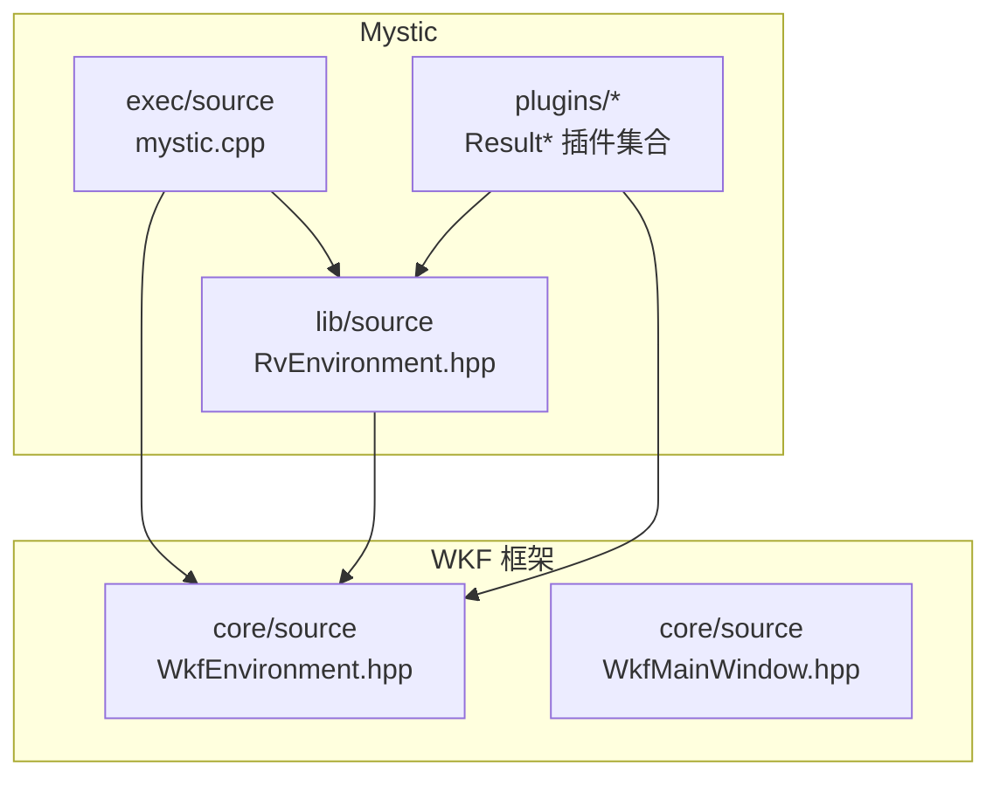
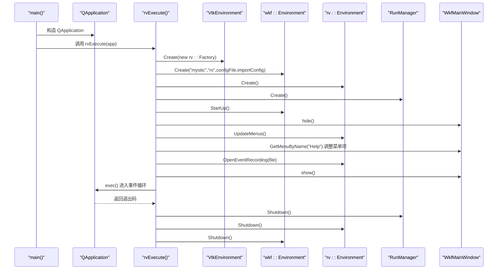
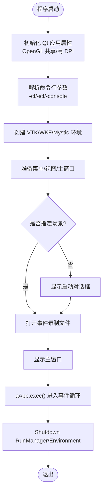
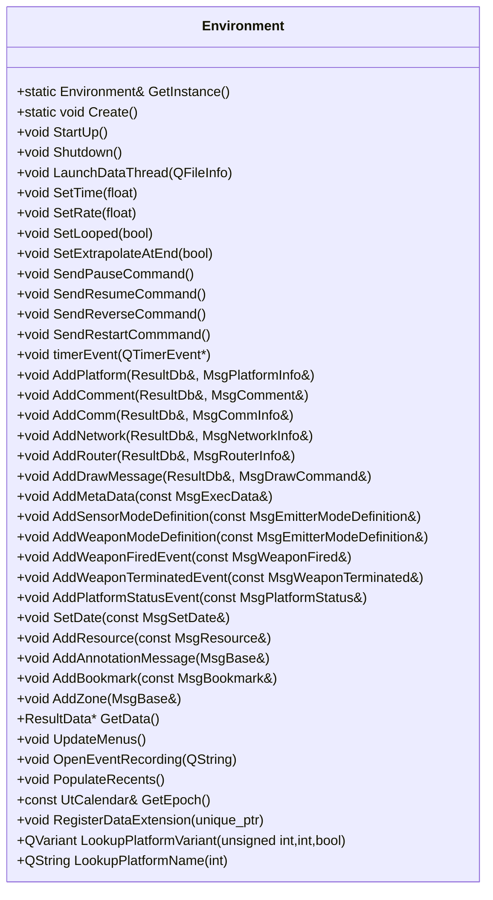
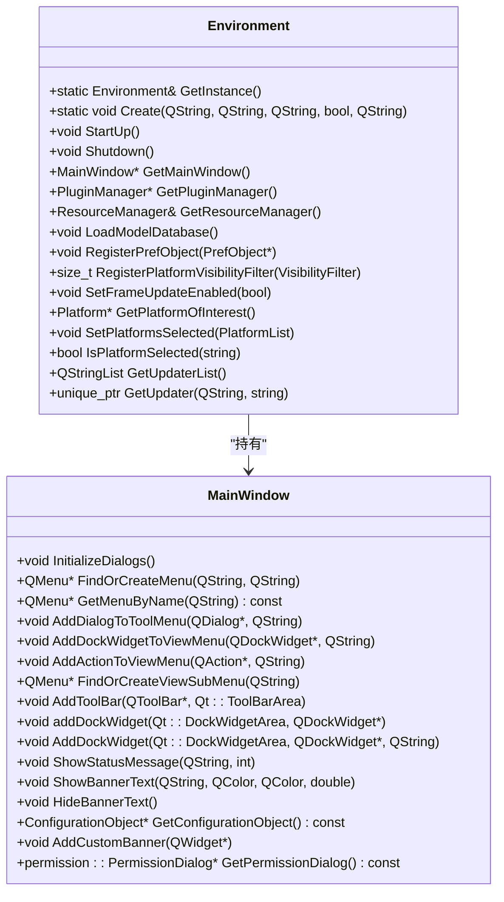
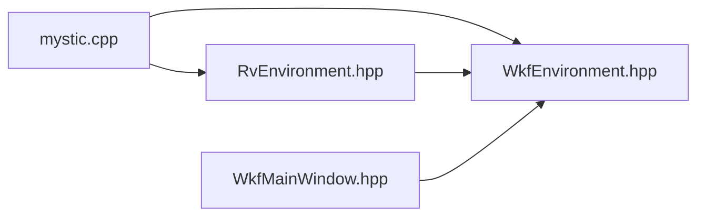

# GUI架构设计

<cite>
**本文引用的文件**   
- [mystic.cpp](file://swdev/src/mystic/exec/source/mystic.cpp)
- [RvEnvironment.hpp](file://swdev/src/mystic/lib/source/RvEnvironment.hpp)
- [WkfEnvironment.hpp](file://swdev/src/tools/wkf/core/source/WkfEnvironment.hpp)
- [WkfMainWindow.hpp](file://swdev/src/tools/wkf/core/source/WkfMainWindow.hpp)
</cite>

## 目录
1. [简介](#简介)
2. [项目结构](#项目结构)
3. [核心组件](#核心组件)
4. [架构总览](#架构总览)
5. [详细组件分析](#详细组件分析)
6. [依赖关系分析](#依赖关系分析)
7. [性能与资源管理](#性能与资源管理)
8. [故障排查指南](#故障排查指南)
9. [结论](#结论)

## 简介
本文件为 Mystic GUI 架构的技术文档，聚焦于基于 Qt 的图形界面集成、应用程序生命周期管理、事件循环机制与窗口系统架构。重点解析主入口 mystic.cpp 的初始化流程、配置加载、插件系统启动与用户界面构建；并说明模块化插件架构（发现、动态加载、接口规范）以及资源管理系统（模型、纹理与内存优化策略）。同时给出架构决策的技术背景与权衡，以及扩展点的设计模式。

## 项目结构
Mystic 作为 AFSIM 的可视化前端，位于 swdev/src/mystic 下，包含可执行程序入口、库层环境与大量结果展示插件；GUI 框架与通用窗口/环境能力由 wkf 工具链提供，位于 swdev/src/tools/wkf。

图表来源
- [mystic.cpp:107-262](file://swdev/src/mystic/exec/source/mystic.cpp#L107-L262)
- [RvEnvironment.hpp:59-167](file://swdev/src/mystic/lib/source/RvEnvironment.hpp#L59-L167)
- [WkfEnvironment.hpp:55-265](file://swdev/src/tools/wkf/core/source/WkfEnvironment.hpp#L55-L265)
- [WkfMainWindow.hpp:32-118](file://swdev/src/tools/wkf/core/source/WkfMainWindow.hpp#L32-L118)

章节来源
- [mystic.cpp:1-292](file://swdev/src/mystic/exec/source/mystic.cpp#L1-L292)
- [RvEnvironment.hpp:1-170](file://swdev/src/mystic/lib/source/RvEnvironment.hpp#L1-L170)
- [WkfEnvironment.hpp:1-307](file://swdev/src/tools/wkf/core/source/WkfEnvironment.hpp#L1-L307)
- [WkfMainWindow.hpp:1-121](file://swdev/src/tools/wkf/core/source/WkfMainWindow.hpp#L1-L121)

## 核心组件
- 应用程序入口与生命周期：mystic.cpp 负责 Qt 应用创建、参数解析、日志与异常处理、OpenGL 上下文共享与高 DPI 设置，随后创建 WKF/VTK 环境、Mystic 运行环境与运行管理器，进入 Qt 事件循环。
- 运行时环境：RvEnvironment 是 Mystic 的运行时单例，负责数据读取线程、播放控制、菜单更新、事件记录打开、平台/注释/通信等消息分发与信号广播。
- 窗口与环境基座：WkfEnvironment 提供应用级环境、插件管理器、资源管理器、权限管理、偏好对象注册、平台选择与可见性过滤、更新器工厂等；WkfMainWindow 提供菜单栏、工具栏、停靠窗体、状态栏与横幅文本等 UI 基础设施。

章节来源
- [mystic.cpp:266-292](file://swdev/src/mystic/exec/source/mystic.cpp#L266-L292)
- [RvEnvironment.hpp:59-167](file://swdev/src/mystic/lib/source/RvEnvironment.hpp#L59-L167)
- [WkfEnvironment.hpp:55-265](file://swdev/src/tools/wkf/core/source/WkfEnvironment.hpp#L55-L265)
- [WkfMainWindow.hpp:32-118](file://swdev/src/tools/wkf/core/source/WkfMainWindow.hpp#L32-L118)

## 架构总览
下图展示了从 main() 到 Qt 事件循环的关键调用序列，包括环境创建、菜单与视图准备、事件录制打开与主窗口显示。

图表来源
- [mystic.cpp:107-262](file://swdev/src/mystic/exec/source/mystic.cpp#L107-L262)

## 详细组件分析

### 主应用程序入口 mystic.cpp
- 初始化流程
  - 设置全局异常处理器与应用日志。
  - 启用 OpenGL 上下文共享与高 DPI 缩放。
  - 构造 QApplication 并进入 rvExecute。
- 参数解析与配置加载
  - 支持 -cf/-icf/-console 等命令行参数，校验配置文件可读性，必要时弹出提示或显示帮助对话框。
  - 在 Windows 上可选择附加控制台输出。
- 环境创建与 UI 构建
  - 创建 VTK 环境并注入 rv::Factory。
  - 创建 WKF 环境（应用名、前缀、配置文件路径、是否导入配置）。
  - 创建 rv::Environment 与 RunManager。
  - 隐藏主窗口，禁用框选，更新菜单，调整“帮助”菜单项文案。
  - 若未指定场景文件则弹出启动对话框；否则直接打开事件录制文件。
  - 显示主窗口并进入 Qt 事件循环。
- 清理阶段
  - 退出时依次关闭 RunManager、rv::Environment、wkf::Environment。

图表来源
- [mystic.cpp:107-262](file://swdev/src/mystic/exec/source/mystic.cpp#L107-L262)

章节来源
- [mystic.cpp:107-262](file://swdev/src/mystic/exec/source/mystic.cpp#L107-L262)
- [mystic.cpp:266-292](file://swdev/src/mystic/exec/source/mystic.cpp#L266-L292)

### 运行时环境 RvEnvironment
- 职责
  - 单例管理与生命周期（GetInstance/Create/StartUp/Shutdown）。
  - 数据读取线程（LaunchDataThread）与定时器驱动（timerEvent）。
  - 播放控制（SetTime/SetRate/SetLooped/ExtrapolateAtEnd）与命令发送（Pause/Resume/Reverse/Restart）。
  - 数据与消息接入（AddPlatform/AddComment/AddComm/AddNetwork/AddRouter/AddDrawMessage/AddMetaData/...）。
  - 菜单更新（UpdateMenus）、事件录制打开（OpenEventRecording）、最近文件列表（PopulateRecents）。
  - 数据扩展注册（RegisterDataExtension）与查询（GetExtensions）。
  - 通过信号（AdvanceTimeRead/RegularRead/ClearScenario/...）向 UI 与插件广播数据变化。
- 关键数据结构
  - ResultData* 指向当前结果数据。
  - QBasicTimer 与 UtWallClock 用于定时刷新。
  - QMutex 保护并发访问。
  - DataExtension 向量用于扩展数据管线。

图表来源
- [RvEnvironment.hpp:59-167](file://swdev/src/mystic/lib/source/RvEnvironment.hpp#L59-L167)

章节来源
- [RvEnvironment.hpp:59-167](file://swdev/src/mystic/lib/source/RvEnvironment.hpp#L59-L167)

### 窗口与环境基座 WkfEnvironment / WkfMainWindow
- WkfEnvironment
  - 应用环境单例，负责应用名称/前缀、数据目录、资源目录、用户/共享/应用数据设置文件。
  - 插件管理器（PluginManager）获取与使用。
  - 权限管理（permission::Manager）与资源管理器（ResourceManager）。
  - 偏好对象注册/查询（PrefObjectMap），更新器工厂（UpdaterFactory）。
  - 平台选择与可见性过滤（SelectedPlatforms/VisibilityFilter）。
  - 图标加载器（MilStd2525d）与提示容器（TipContainer）。
- WkfMainWindow
  - 菜单栏/工具栏/停靠窗体的统一添加与管理。
  - 查找/创建菜单（FindOrCreateMenu）、按名称获取菜单（GetMenuByName）。
  - 将对话框/停靠窗体添加到 View/Tool 菜单。
  - 状态栏消息与横幅文本显示。
  - 权限对话框与配置对象访问。

图表来源
- [WkfEnvironment.hpp:55-265](file://swdev/src/tools/wkf/core/source/WkfEnvironment.hpp#L55-L265)
- [WkfMainWindow.hpp:32-118](file://swdev/src/tools/wkf/core/source/WkfMainWindow.hpp#L32-L118)

章节来源
- [WkfEnvironment.hpp:55-265](file://swdev/src/tools/wkf/core/source/WkfEnvironment.hpp#L55-L265)
- [WkfMainWindow.hpp:32-118](file://swdev/src/tools/wkf/core/source/WkfMainWindow.hpp#L32-L118)

### 插件架构与扩展点
- 插件组织
  - 每个 Result* 插件位于 swdev/src/mystic/plugins/Result*/，通常包含 source、doc、README 与 mystic_plugin.cmake，体现统一的插件工程模板。
- 插件发现与动态加载
  - 通过 wkf::Environment::GetPluginManager() 暴露插件管理能力，具体发现与加载逻辑由 WKF 框架实现；Mystic 侧通过 RvEnvironment 与 WkfEnvironment 协作完成插件相关菜单与功能挂载。
- 接口规范
  - 插件通过注册数据扩展（RvEnvironment::RegisterDataExtension）与订阅 RvEnvironment 的信号（如 AdvanceTimeRead/RegularRead/ClearScenario 等）与 UI 解耦。
  - 借助 WkfMainWindow 提供的菜单/工具栏/停靠窗体 API 扩展用户界面。
- 扩展点设计模式
  - 工厂模式：wkf::Environment::RegisterUpdater 提供更新器工厂，按名称动态创建 Updater 实例。
  - 观察者模式：RvEnvironment 通过 Qt 信号通知 UI 与插件数据变更。
  - 策略模式：VisibilityFilter 允许外部注入平台可见性判断策略。

章节来源
- [RvEnvironment.hpp:104-167](file://swdev/src/mystic/lib/source/RvEnvironment.hpp#L104-L167)
- [WkfEnvironment.hpp:101-130](file://swdev/src/tools/wkf/core/source/WkfEnvironment.hpp#L101-L130)
- [WkfMainWindow.hpp:44-74](file://swdev/src/tools/wkf/core/source/WkfMainWindow.hpp#L44-L74)

## 依赖关系分析
- 入口依赖
  - mystic.cpp 依赖 Qt 基础类（QApplication/QMenu/QSettings 等）与内部头文件（RvEnvironment/RvRunManager/RvStartupDialog 等），以及 WKF 环境（WkfEnvironment/WkfMainWindow/WkfVtkEnvironment）。
- 运行时依赖
  - RvEnvironment 依赖 WKF 环境以复用窗口与资源能力，并通过 Qt 信号槽与 UI 解耦。
- 窗口系统依赖
  - WkfMainWindow 继承 QMainWindow，封装常用 UI 操作，供插件与上层应用使用。

图表来源
- [mystic.cpp:12-30](file://swdev/src/mystic/exec/source/mystic.cpp#L12-L30)
- [RvEnvironment.hpp:18-24](file://swdev/src/mystic/lib/source/RvEnvironment.hpp#L18-L24)
- [WkfEnvironment.hpp:28-38](file://swdev/src/tools/wkf/core/source/WkfEnvironment.hpp#L28-L38)
- [WkfMainWindow.hpp:14-22](file://swdev/src/tools/wkf/core/source/WkfMainWindow.hpp#L14-L22)

章节来源
- [mystic.cpp:12-30](file://swdev/src/mystic/exec/source/mystic.cpp#L12-L30)
- [RvEnvironment.hpp:18-24](file://swdev/src/mystic/lib/source/RvEnvironment.hpp#L18-L24)
- [WkfEnvironment.hpp:28-38](file://swdev/src/tools/wkf/core/source/WkfEnvironment.hpp#L28-L38)
- [WkfMainWindow.hpp:14-22](file://swdev/src/tools/wkf/core/source/WkfMainWindow.hpp#L14-L22)

## 性能与资源管理
- 事件循环与渲染
  - Qt 事件循环 aApp.exec() 阻塞式运行，直到主窗口关闭或 quit() 被调用；期间 UI 响应与渲染由 Qt 调度。
  - 通过 QApplication::setAttribute(Qt::AA_ShareOpenGLContexts) 共享 OpenGL 上下文，减少多视口/多渲染器的开销。
  - 启用高 DPI 缩放（AA_EnableHighDpiScaling）提升高分屏体验。
- 数据读取与刷新
  - RvEnvironment 使用 QBasicTimer 与 UtWallClock 进行定时刷新，避免频繁 I/O 与重复计算。
  - 通过 LaunchDataThread 将数据读取与 UI 线程分离，降低卡顿风险。
- 资源管理
  - WkfEnvironment 提供 ResourceManager 与 MilStd 图标加载器，集中管理模型、纹理与图标等资源。
  - 通过 LoadModelDatabase 与 GetResourcesDir 统一管理资源路径，便于缓存与复用。
- 内存优化建议
  - 按需加载大型资源（延迟加载、流式加载）。
  - 使用引用计数与智能指针（std::unique_ptr）管理对象生命周期，避免悬垂指针与重复释放。
  - 对高频更新的数据采用增量更新与批处理，减少信号风暴与重绘次数。

章节来源
- [mystic.cpp:272-274](file://swdev/src/mystic/exec/source/mystic.cpp#L272-L274)
- [mystic.cpp:254-256](file://swdev/src/mystic/exec/source/mystic.cpp#L254-L256)
- [RvEnvironment.hpp:155-167](file://swdev/src/mystic/lib/source/RvEnvironment.hpp#L155-L167)
- [WkfEnvironment.hpp:157-168](file://swdev/src/tools/wkf/core/source/WkfEnvironment.hpp#L157-L168)

## 故障排查指南
- 异常处理与崩溃报告
  - 入口层设置全局异常处理器（ut::qt::TerminateHandler），并在 try/catch 中捕获异常后通过 ut::qt::ReportException 弹出错误报告对话框，确保崩溃信息可收集。
- 日志与调试
  - 使用 ut::SetupApplicationLog 初始化应用日志，文件名与版本信息来自常量定义；在 Windows 下可通过 -console 附加控制台输出以便实时查看。
- 常见问题定位
  - 配置文件不可读：-cf/-icf 参数校验失败时会弹出警告并记录日志，检查路径与权限。
  - 菜单项缺失：若“帮助”菜单不存在，代码会安全跳过；可在 WkfMainWindow 中确认菜单创建顺序。
  - 事件录制无法打开：OpenEventRecording 传入空文件或无效路径时需回退到启动对话框。

章节来源
- [mystic.cpp:266-292](file://swdev/src/mystic/exec/source/mystic.cpp#L266-L292)
- [mystic.cpp:117-183](file://swdev/src/mystic/exec/source/mystic.cpp#L117-L183)
- [mystic.cpp:221-236](file://swdev/src/mystic/exec/source/mystic.cpp#L221-L236)
- [mystic.cpp:238-251](file://swdev/src/mystic/exec/source/mystic.cpp#L238-L251)

## 结论
Mystic 的 GUI 架构以 Qt 为核心，结合 WKF 提供的通用窗口与环境能力，形成清晰的分层：入口层负责应用生命周期与参数解析；运行时层（RvEnvironment）负责数据读取、播放控制与消息分发；UI 层（WkfMainWindow）提供统一的菜单/工具栏/停靠窗体管理；插件体系通过工厂、观察者与策略模式实现可扩展的功能模块。该架构在保证交互流畅性的同时，提供了良好的扩展性与可维护性，适合大规模仿真可视化的持续演进。