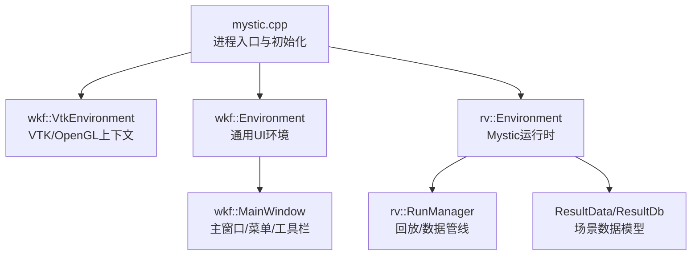
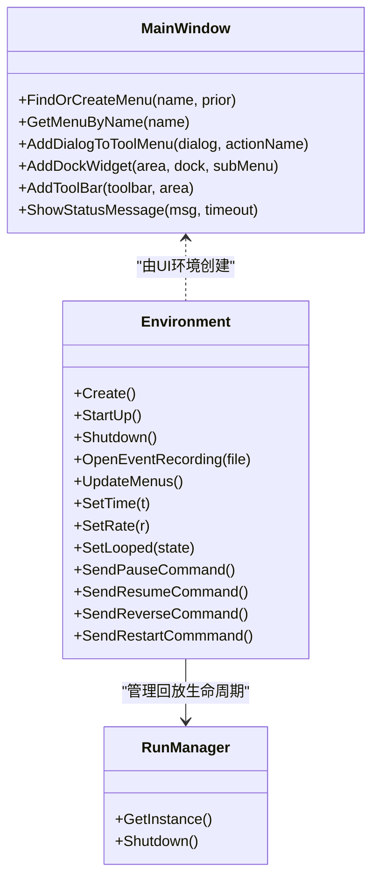
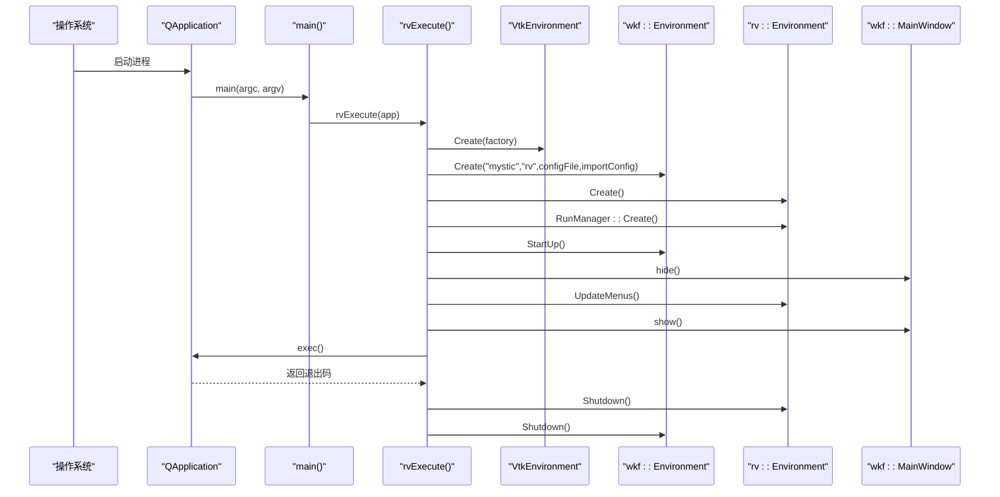
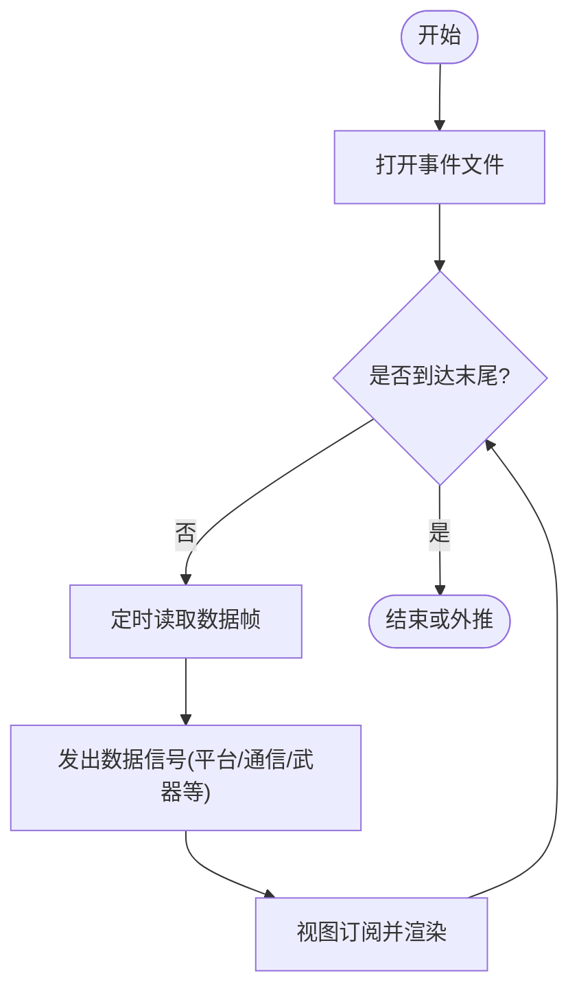
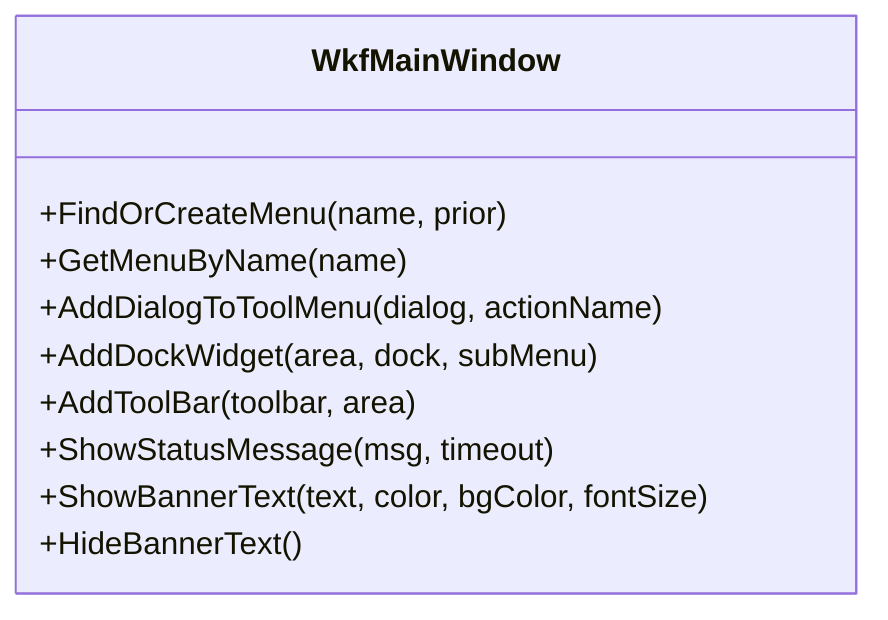
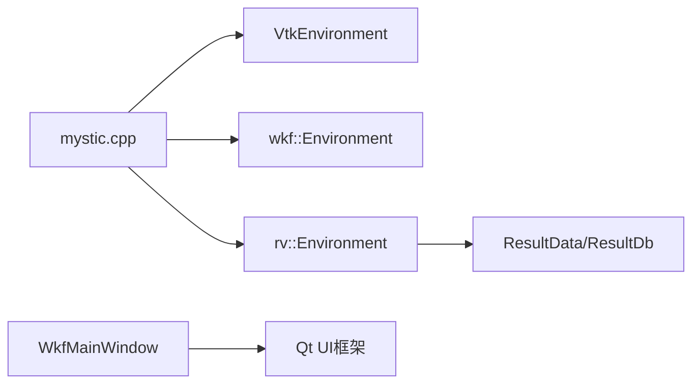

# Mystic GUI界面

<cite>
**本文引用的文件**   
- [mystic.cpp](file://swdev/src/mystic/exec/source/mystic.cpp)
- [RvEnvironment.hpp](file://swdev/src/mystic/lib/source/RvEnvironment.hpp)
- [WkfMainWindow.hpp](file://swdev/src/tools/wkf/core/source/WkfMainWindow.hpp)
</cite>

## 目录
1. [简介](#简介)
2. [项目结构](#项目结构)
3. [核心组件](#核心组件)
4. [架构总览](#架构总览)
5. [详细组件分析](#详细组件分析)
6. [依赖关系分析](#依赖关系分析)
7. [性能考虑](#性能考虑)
8. [故障排查指南](#故障排查指南)
9. [结论](#结论)
10. [附录](#附录)

## 简介
本文件面向Mystic图形用户界面的开发者与高级用户，系统性阐述GUI架构设计、Qt框架集成、窗口管理与事件循环；解析主应用程序入口点mystic.cpp的初始化流程、配置加载与UI启动；说明渲染系统（2D/3D可视化、场景管理、绘制优化）在Mystic中的组织方式；解释用户交互机制（鼠标、键盘、手势）；文档化视图系统（多视图、布局、缩放导航）；并提供自定义界面开发指南（插件、主题、工具栏扩展）以及性能优化建议（视锥剔除、纹理管理、GPU加速）。

## 项目结构
Mystic作为AFSIM的可视化与回放应用，采用“执行入口 + 环境/运行时 + 通用UI框架”的分层组织：
- 执行入口：mystic.cpp负责进程启动、Qt应用初始化、参数解析、环境与窗口创建、事件循环。
- 运行环境：RvEnvironment提供数据读取、时间推进、回放控制、菜单更新等运行时能力。
- UI框架：WkfMainWindow提供主窗口、菜单/工具栏/停靠窗口的统一管理能力，供Mystic扩展。

图表来源
- [mystic.cpp:207-256](file://swdev/src/mystic/exec/source/mystic.cpp#L207-L256)
- [RvEnvironment.hpp:59-167](file://swdev/src/mystic/lib/source/RvEnvironment.hpp#L59-L167)
- [WkfMainWindow.hpp:32-118](file://swdev/src/tools/wkf/core/source/WkfMainWindow.hpp#L32-L118)

章节来源
- [mystic.cpp:1-292](file://swdev/src/mystic/exec/source/mystic.cpp#L1-L292)
- [RvEnvironment.hpp:1-170](file://swdev/src/mystic/lib/source/RvEnvironment.hpp#L1-L170)
- [WkfMainWindow.hpp:1-121](file://swdev/src/tools/wkf/core/source/WkfMainWindow.hpp#L1-L121)

## 核心组件
- 主程序入口（mystic.cpp）
  - Qt应用属性设置（OpenGL共享上下文、高DPI缩放）
  - 命令行参数解析（-cf/-icf/-console/-help）
  - 创建VTK/OpenGL环境、通用UI环境、Mystic运行时
  - 隐藏主窗口直至启动对话框完成，随后显示并进入事件循环
  - 退出时按序关闭RunManager、rv环境、wkf环境
- 运行环境（RvEnvironment）
  - 单例模式，提供StartUp/Shutdown、OpenEventRecording、UpdateMenus
  - 时间推进与回放控制（SetTime/SetRate/SetLooped/ExtrapolateAtEnd）
  - 通过信号槽分发平台、通信、网络、武器、注释、书签等消息
  - 定时器驱动定期读取数据，避免阻塞UI线程
- 主窗口（WkfMainWindow）
  - 统一的菜单/工具栏/停靠窗口管理接口
  - 支持动态添加View子菜单项、DockWidget、ToolBar
  - 状态栏消息队列与横幅文本展示
  - 权限对话框与偏好页触发

章节来源
- [mystic.cpp:107-263](file://swdev/src/mystic/exec/source/mystic.cpp#L107-L263)
- [RvEnvironment.hpp:59-167](file://swdev/src/mystic/lib/source/RvEnvironment.hpp#L59-L167)
- [WkfMainWindow.hpp:32-118](file://swdev/src/tools/wkf/core/source/WkfMainWindow.hpp#L32-L118)

## 架构总览
Mystic以Qt为UI框架，结合VTK进行3D渲染，并通过wkf通用UI框架统一管理窗口与控件。Mystic运行时（rv::Environment）负责数据读取、回放控制与消息分发，插件体系在此基础上扩展具体视图与工具。

图表来源
- [WkfMainWindow.hpp:32-118](file://swdev/src/tools/wkf/core/source/WkfMainWindow.hpp#L32-L118)
- [RvEnvironment.hpp:59-167](file://swdev/src/mystic/lib/source/RvEnvironment.hpp#L59-L167)
- [mystic.cpp:212-213](file://swdev/src/mystic/exec/source/mystic.cpp#L212-L213)

## 详细组件分析

### 主程序入口与初始化流程（mystic.cpp）
- 关键职责
  - 设置应用标识、图标、版本信息
  - 解析命令行参数，处理配置文件导入/保存与控制台输出开关
  - 创建VTK环境（用于OpenGL/VTK上下文）、wkf通用UI环境、rv运行时
  - 隐藏主窗口直到启动对话框完成，再显示主窗口并进入Qt事件循环
  - 清理阶段调用RunManager与环境的Shutdown
- 重要流程
  - 参数校验与提示（-cf/-icf/-console）
  - Windows下控制台附加/分配与stdout/stderr重定向
  - 帮助菜单项可见性调整与“关于”文案修改
  - 自动打开事件录制文件或弹出启动对话框

图表来源
- [mystic.cpp:266-291](file://swdev/src/mystic/exec/source/mystic.cpp#L266-L291)
- [mystic.cpp:107-263](file://swdev/src/mystic/exec/source/mystic.cpp#L107-L263)

章节来源
- [mystic.cpp:107-263](file://swdev/src/mystic/exec/source/mystic.cpp#L107-L263)
- [mystic.cpp:266-291](file://swdev/src/mystic/exec/source/mystic.cpp#L266-L291)

### 运行环境与回放控制（RvEnvironment）
- 设计要点
  - 单例模式，全局访问便捷
  - 通过信号（AdvanceTimeRead/RegularRead/PlatformAddedRead等）将数据变化广播给视图层
  - 使用定时器与计时器对象实现周期性数据读取，避免阻塞UI线程
  - 提供播放状态（暂停/播放/倒放/重启）与速率、循环、末端外推等控制
- 数据流
  - OpenEventRecording后，环境内部根据回放进度触发相应信号
  - 视图订阅信号并刷新对应图层/标注/轨迹等

图表来源
- [RvEnvironment.hpp:72-107](file://swdev/src/mystic/lib/source/RvEnvironment.hpp#L72-L107)
- [RvEnvironment.hpp:119-146](file://swdev/src/mystic/lib/source/RvEnvironment.hpp#L119-L146)

章节来源
- [RvEnvironment.hpp:59-167](file://swdev/src/mystic/lib/source/RvEnvironment.hpp#L59-L167)

### 主窗口与UI框架（WkfMainWindow）
- 功能概览
  - 菜单与工具栏的动态创建与管理（FindOrCreateMenu/AddToolBar等）
  - DockWidget与View子菜单的统一注册（AddDockWidget/AddActionToViewMenu）
  - 状态栏消息队列与横幅文本展示（ShowStatusMessage/ShowBannerText）
  - 权限对话框与偏好页触发（GetPermissionDialog/ShowPreferencePage）
- 扩展点
  - 插件可通过上述API向View菜单添加自定义视图
  - 通过AddToolBar扩展工具栏区域
  - 通过AddDialogToToolMenu快速暴露对话框

图表来源
- [WkfMainWindow.hpp:32-118](file://swdev/src/tools/wkf/core/source/WkfMainWindow.hpp#L32-L118)

章节来源
- [WkfMainWindow.hpp:32-118](file://swdev/src/tools/wkf/core/source/WkfMainWindow.hpp#L32-L118)

### 渲染系统与场景管理
- 渲染后端
  - 通过VTK/OpenGL上下文进行3D渲染，2D叠加层由Qt/QGraphics实现
  - 视图类通常继承自QOpenGLWidget或QGraphicsView，分别承载3D与2D场景
- 场景管理
  - 场景图（Scene Graph）由VTK/Osg等底层库维护，Mystic通过环境层注入实体、轨迹、注释、传感器体积等
  - 视图按需订阅数据信号，增量更新场景节点
- 绘制优化
  - 批量绘制与实例化渲染（如轨迹线、符号）
  - LOD与视锥剔除（由底层渲染库与视图策略共同实现）
  - 纹理复用与图集（Texture Atlas）减少Draw Call

[本节为概念性说明，不直接分析具体文件]

### 用户交互机制
- 鼠标事件
  - 选择、框选、平移、缩放、旋转等操作通常在QGraphicsView/QOpenGLWidget的事件处理器中实现
  - 常见回调：mousePressEvent/mouseMoveEvent/mouseReleaseEvent/wheelEvent
- 键盘输入
  - 快捷键绑定到QAction，或通过重写keyPressEvent处理组合键
- 手势识别
  - 触控板/多点触控可由Qt手势API或平台原生API扩展
- 交互与渲染解耦
  - 交互逻辑仅更新相机/选择状态，实际绘制在渲染循环中执行

[本节为概念性说明，不直接分析具体文件]

### 视图系统与多视图支持
- 多视图
  - 通过DockWidget实现多视图并列，每个视图可独立订阅数据信号
- 布局管理
  - 使用QSplitter/QTabWidget等容器组织视图
- 缩放与导航
  - 2D视图常用QGraphicsView的缩放/平移；3D视图通过相机控制（滚轮缩放、拖拽旋转）

[本节为概念性说明，不直接分析具体文件]

### 自定义界面开发指南
- 插件开发
  - 基于Mystic插件体系，继承视图基类，注册到View菜单
  - 通过Environment的信号订阅数据变更，更新自身视图
- 主题定制
  - 使用wkf主题资源与样式表（QSS）覆盖默认外观
- 工具栏扩展
  - 通过AddToolBar添加自定义工具条，配合QAction实现命令

[本节为概念性说明，不直接分析具体文件]

## 依赖关系分析
- 组件耦合
  - mystic.cpp对VTK环境、wkf环境、rv环境存在强依赖
  - RvEnvironment对ResultData/ResultDb及各类消息类型存在依赖
  - WkfMainWindow对Qt控件与UI框架有强依赖
- 外部依赖
  - Qt（QApplication/QMainWindow/QOpenGLWidget等）
  - VTK/OpenGL（通过VtkEnvironment）
  - wkf通用UI框架（菜单/工具栏/停靠窗口）

图表来源
- [mystic.cpp:207-256](file://swdev/src/mystic/exec/source/mystic.cpp#L207-L256)
- [RvEnvironment.hpp:59-167](file://swdev/src/mystic/lib/source/RvEnvironment.hpp#L59-L167)
- [WkfMainWindow.hpp:32-118](file://swdev/src/tools/wkf/core/source/WkfMainWindow.hpp#L32-L118)

章节来源
- [mystic.cpp:207-256](file://swdev/src/mystic/exec/source/mystic.cpp#L207-L256)
- [RvEnvironment.hpp:59-167](file://swdev/src/mystic/lib/source/RvEnvironment.hpp#L59-L167)
- [WkfMainWindow.hpp:32-118](file://swdev/src/tools/wkf/core/source/WkfMainWindow.hpp#L32-L118)

## 性能考虑
- 视锥剔除
  - 在3D场景中启用视锥剔除，减少不可见对象的绘制开销
- 纹理管理
  - 使用纹理图集、压缩纹理格式，降低内存占用与带宽压力
- GPU加速
  - 利用VTK/OpenGL批渲染、实例化渲染，减少CPU-GPU同步
- 数据读取与UI分离
  - 通过定时器与异步读取避免阻塞UI线程，保持交互流畅
- 增量更新
  - 仅更新变化的场景节点，避免全量重建

[本节为通用性能建议，不直接分析具体文件]

## 故障排查指南
- 常见问题定位
  - 控制台输出未显示：检查-console参数与Windows控制台附加逻辑
  - 配置文件无法打开：确认-cf/-icf路径可读性与权限
  - 主窗口未显示：确认启动对话框流程与show时机
  - 异常崩溃：查看异常报告弹窗与日志文件（mystic-exception.log）
- 调试建议
  - 在rvExecute中增加关键步骤日志
  - 使用Qt调试器断点于事件循环与信号槽连接处
  - 逐步禁用插件以定位问题来源

章节来源
- [mystic.cpp:178-205](file://swdev/src/mystic/exec/source/mystic.cpp#L178-L205)
- [mystic.cpp:266-291](file://swdev/src/mystic/exec/source/mystic.cpp#L266-L291)

## 结论
Mystic GUI以Qt为核心，结合VTK/OpenGL实现高性能可视化，通过wkf通用UI框架统一管理窗口与控件，并由rv::Environment协调数据读取与回放控制。其清晰的层次结构与可扩展的插件体系，使得在2D/3D可视化、交互与视图管理方面具备良好的可维护性与扩展性。遵循本文档的架构与优化建议，可有效提升用户体验与系统性能。

## 附录
- 命令行选项参考
  - -cf：指定配置文件并保存修改
  - -icf：导入配置文件但不保存
  - -console：启用控制台输出
  - -h/-help：显示帮助并退出

章节来源
- [mystic.cpp:79-105](file://swdev/src/mystic/exec/source/mystic.cpp#L79-L105)