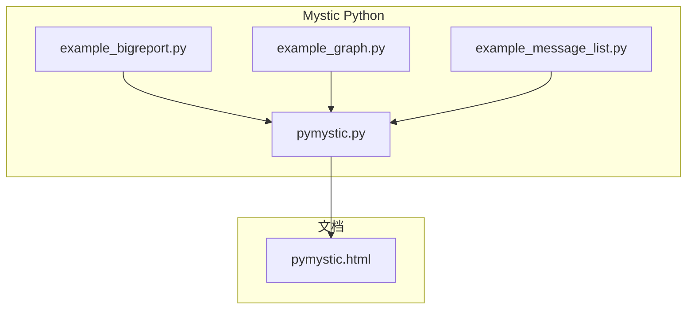
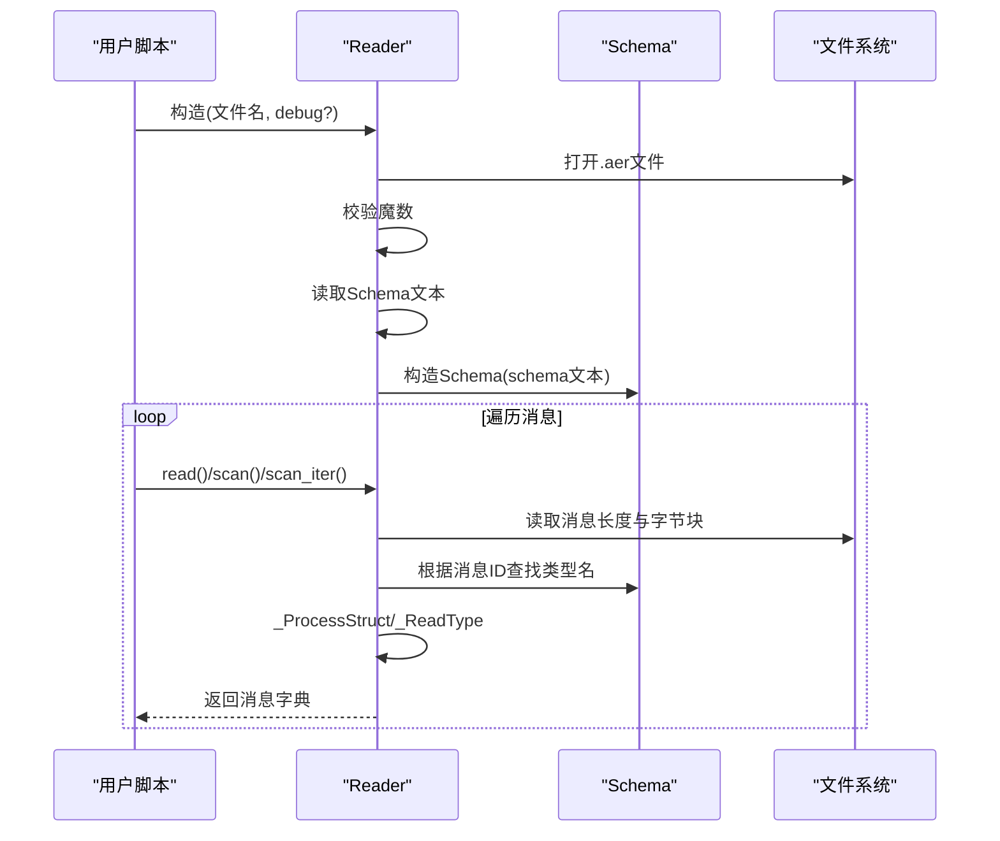
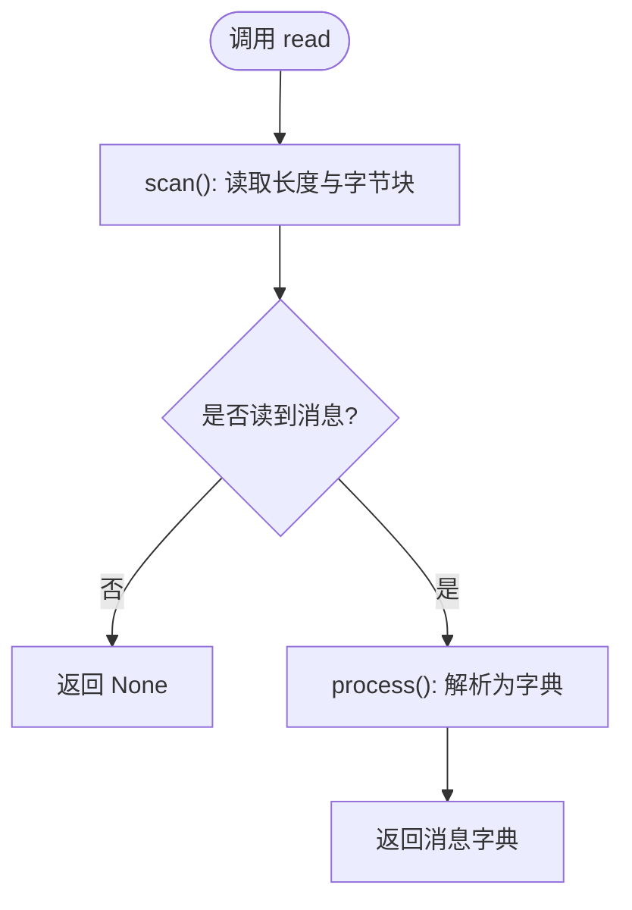
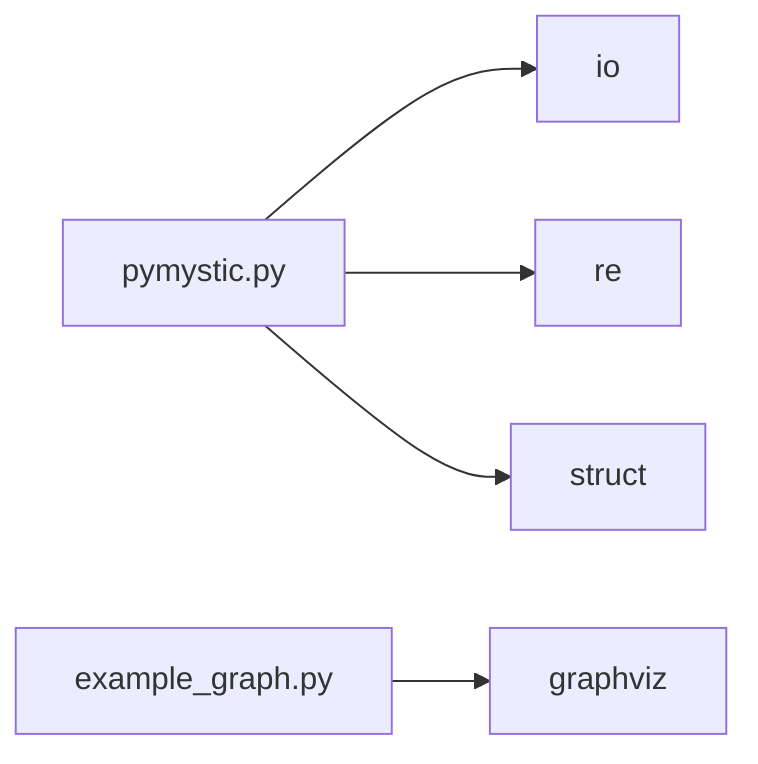

# Python集成

<cite>
**本文引用的文件**   
- [pymystic.py](file://swdev/src/mystic/python/pymystic.py)
- [example_bigreport.py](file://swdev/src/mystic/python/example_bigreport.py)
- [example_graph.py](file://swdev/src/mystic/python/example_graph.py)
- [example_message_list.py](file://swdev/src/mystic/python/example_message_list.py)
- [pymystic.html](file://documentation/html/docs/pymystic.html)
</cite>

## 目录
1. [简介](#简介)
2. [项目结构](#项目结构)
3. [核心组件](#核心组件)
4. [架构总览](#架构总览)
5. [详细组件分析](#详细组件分析)
6. [依赖关系分析](#依赖关系分析)
7. [性能与内存管理](#性能与内存管理)
8. [Python脚本开发环境](#python脚本开发环境)
9. [常用脚本模式](#常用脚本模式)
10. [与外部库集成（NumPy、Matplotlib、Pandas）](#与外部库集成numpymatplotlibpandas)
11. [Python API参考](#python-api参考)
12. [故障排查指南](#故障排查指南)
13. [结论](#结论)

## 简介
本文件为Mystic的Python集成提供全面文档，重点说明：
- PyMystic模块如何解析AFSIM生成的AER事件回放文件，并通过内嵌Schema进行类型安全的数据反序列化。
- Reader/Schema类的职责边界、数据流与控制流。
- 典型Python脚本模式：批量处理、消息列表输出、可视化图生成等。
- 与外部数据分析/可视化库（NumPy、Matplotlib、Pandas）的集成方式。
- 面向IDE的调试与代码补全建议。
- 完整的API参考与常见问题排查。

注意：当前仓库中未包含C++与Python之间的PyBind11绑定源码；本文基于已存在的纯Python实现（pymystic）进行说明。

## 项目结构
与Python集成直接相关的文件位于mystic/python目录，包括核心模块与示例脚本；同时存在由Sphinx生成的HTML文档页面。

图示来源
- [pymystic.py:1-651](file://swdev/src/mystic/python/pymystic.py#L1-L651)
- [example_bigreport.py:1-41](file://swdev/src/mystic/python/example_bigreport.py#L1-L41)
- [example_graph.py:1-37](file://swdev/src/mystic/python/example_graph.py#L1-L37)
- [example_message_list.py:1-32](file://swdev/src/mystic/python/example_message_list.py#L1-L32)
- [pymystic.html:72-209](file://documentation/html/docs/pymystic.html#L72-L209)

章节来源
- [pymystic.py:1-651](file://swdev/src/mystic/python/pymystic.py#L1-L651)
- [pymystic.html:72-209](file://documentation/html/docs/pymystic.html#L72-L209)

## 核心组件
- Schema类：解析并构建AER文件头中的Schema定义，建立消息ID到结构名的映射，维护基础类型、枚举、联合体、结构体、列表等的元信息。
- Reader类：打开AER文件，读取二进制消息，按Schema解码为Python字典；支持迭代器、上下文管理器、扫描过滤等能力。

关键特性
- 使用struct对基本类型进行解包，支持float/double、整型、字符串、位域与可选字段。
- 通过嵌套作用域栈解析带命名空间的子类型。
- 支持time/index特殊类型的快速路径。

章节来源
- [pymystic.py:51-343](file://swdev/src/mystic/python/pymystic.py#L51-L343)
- [pymystic.py:344-651](file://swdev/src/mystic/python/pymystic.py#L344-L651)

## 架构总览
下图展示从Reader读取AER文件到输出结构化消息字典的整体流程。

图示来源
- [pymystic.py:351-487](file://swdev/src/mystic/python/pymystic.py#L351-L487)
- [pymystic.py:490-651](file://swdev/src/mystic/python/pymystic.py#L490-L651)

## 详细组件分析

### Schema类
职责
- 清理并分词Schema字符串。
- 解析Settings（message_id_or、double_time）。
- 解析BasicType/List/Enum/Struct/Union等类型定义，构建类型表与消息ID映射。
- 计算bitsetsize以支持位域与可选字段。

复杂度
- 初始化过程对Schema文本进行一次线性扫描与分词，随后递归解析各类型定义，整体时间复杂度近似O(N)，N为Schema token数量。

错误处理
- 遇到未知命令或枚举/联合体格式异常时抛出异常，便于早期发现Schema不兼容问题。

章节来源
- [pymystic.py:51-343](file://swdev/src/mystic/python/pymystic.py#L51-L343)

### Reader类
职责
- 打开AER文件，校验魔数，提取Schema文本并构造Schema。
- 提供read/scan/scan_iter/process/close等方法。
- 实现迭代器协议与上下文管理器协议。
- 将二进制消息按Schema解码为Python字典。

关键方法
- scan/scan_iter：仅读取消息头部（id、类型名、原始字节），用于按类型过滤。
- process：将scan结果转换为结构化字典。
- read：便捷方法，等价于scan+process。
- close：显式关闭文件句柄。

内部机制
- _LookupType/_ScopeLookup：在嵌套作用域中查找类型定义。
- _ReadType：根据类型定义解析基本类型、结构体、列表、枚举、联合体。
- _ProcessStruct：处理结构体字段、基类继承、位域与可选字段。

时序图（read流程）

图示来源
- [pymystic.py:402-487](file://swdev/src/mystic/python/pymystic.py#L402-L487)

章节来源
- [pymystic.py:344-651](file://swdev/src/mystic/python/pymystic.py#L344-L651)

### 示例脚本
- example_bigreport.py：批量读取多个AER文件，提取执行版本与时间戳。
- example_graph.py：从MsgPlatformInfo中提取命令链关系，使用GraphViz生成场景命令链图。
- example_message_list.py：遍历消息，打印时间与消息类型，并在实体状态消息中输出平台名称。

章节来源
- [example_bigreport.py:1-41](file://swdev/src/mystic/python/example_bigreport.py#L1-L41)
- [example_graph.py:1-37](file://swdev/src/mystic/python/example_graph.py#L1-L37)
- [example_message_list.py:1-32](file://swdev/src/mystic/python/example_message_list.py#L1-L32)

## 依赖关系分析
- pymystic.py仅依赖Python标准库（io、re、struct），无第三方依赖。
- 示例脚本可能依赖第三方库（如GraphViz的graphviz模块）。

图示来源
- [pymystic.py:47-49](file://swdev/src/mystic/python/pymystic.py#L47-L49)
- [example_graph.py:23-25](file://swdev/src/mystic/python/example_graph.py#L23-L25)

章节来源
- [pymystic.py:47-49](file://swdev/src/mystic/python/pymystic.py#L47-L49)
- [example_graph.py:23-25](file://swdev/src/mystic/python/example_graph.py#L23-L25)

## 性能与内存管理
- 文件I/O：Reader以二进制模式打开文件，避免编码开销；建议使用上下文管理器确保句柄释放。
- 解析效率：scan/scan_iter可先过滤消息类型，再调用process减少不必要的解析。
- 数据结构：消息被解析为Python字典，嵌套结构可能导致内存占用增长；建议在批处理中对大文件采用流式处理与增量聚合。
- 位域与可选字段：通过bitsetsize与位掩码解析，避免额外对象创建。

优化建议
- 对超大AER文件，优先使用scan_iter进行类型过滤，按需process。
- 对频繁访问的字段（如simTime、msgtype）做局部缓存或索引。
- 避免在循环中重复创建临时对象，尽量复用容器。

章节来源
- [pymystic.py:351-487](file://swdev/src/mystic/python/pymystic.py#L351-L487)
- [pymystic.py:521-651](file://swdev/src/mystic/python/pymystic.py#L521-L651)

## Python脚本开发环境
- IDE配置
  - 使用PyCharm或VS Code，启用Python解释器指向安装AFSIM的Python环境。
  - 添加项目根目录到PYTHONPATH，以便import pymystic。
- 调试支持
  - 在Reader构造时设置debug=True，可在控制台看到字段解析日志。
  - 对示例脚本设置断点，逐步检查消息字典结构。
- 代码补全
  - 由于pymystic为纯Python模块，IDE可自动识别Reader/Schema类与方法签名。
  - 对于示例脚本中的第三方依赖（如graphviz），需确保已安装对应包以获得补全。

章节来源
- [pymystic.py:351-383](file://swdev/src/mystic/python/pymystic.py#L351-L383)
- [example_graph.py:23-25](file://swdev/src/mystic/python/example_graph.py#L23-L25)

## 常用脚本模式
- 批量处理
  - 读取aerlist.txt中的文件列表，逐个调用Reader.read()，提取MsgExecData的版本与时间戳。
- 消息列表输出
  - 遍历所有消息，记录simTime与msgtype；当遇到MsgEntityState时，结合MsgPlatformInfo的平台索引映射输出平台名称。
- 可视化图生成
  - 从MsgPlatformInfo中提取commandChains，构建有向图并使用GraphViz渲染PDF。

章节来源
- [example_bigreport.py:21-41](file://swdev/src/mystic/python/example_bigreport.py#L21-L41)
- [example_message_list.py:23-32](file://swdev/src/mystic/python/example_message_list.py#L23-L32)
- [example_graph.py:27-37](file://swdev/src/mystic/python/example_graph.py#L27-L37)

## 与外部库集成（NumPy、Matplotlib、Pandas）
虽然pymystic本身不依赖这些库，但可将解析后的消息字典转换为NumPy数组或Pandas DataFrame，再进行统计分析或绘图。

常见模式
- NumPy
  - 将位置/速度/姿态等数值字段收集为数组，进行统计或滤波。
- Matplotlib
  - 绘制轨迹、雷达探测范围、信号强度随时间变化曲线。
- Pandas
  - 将消息序列转为DataFrame，按时间窗口聚合、分组统计、导出CSV/Excel。

步骤概览
- 使用Reader迭代消息，筛选目标类型（如MsgEntityState）。
- 抽取数值字段，填充至列表或数组。
- 使用Pandas进行清洗、聚合与导出；使用Matplotlib进行可视化。

章节来源
- [pymystic.py:448-487](file://swdev/src/mystic/python/pymystic.py#L448-L487)

## Python API参考
本节汇总pymystic模块提供的公共接口与行为说明。

- 模块级
  - 导入方式：import pymystic
  - 主要用途：解析AER事件回放文件，将二进制消息反序列化为Python字典。

- 类：Schema
  - 构造：Schema(aSchemaStr)
  - 功能：解析Schema字符串，构建类型定义与消息ID映射。
  - 内部方法（非公开）：_ProcessType、_ProcessBasicType、_ProcessListType、_ProcessEnumType、_ProcessUnionType、_ProcessStructType等。

- 类：Reader
  - 构造：Reader(filename, debug=False)
  - 上下文管理器：with Reader(...) as r: ...
  - 迭代器：for msg in r: ...
  - 方法：
    - scan() -> (int, str, bytes)
    - scan_iter() -> iterator of (int, str, bytes)
    - process(msgdata) -> dict
    - read() -> dict or None
    - close() -> void

- 消息表示
  - 每个消息为Python字典，包含id、msgtype及按Schema解析的字段。
  - 嵌套结构以字典表示；列表字段为Python list；枚举值为整数；time/index有特殊处理。

- 示例脚本
  - example_bigreport.py：批量报告版本与时间戳。
  - example_graph.py：生成命令链图。
  - example_message_list.py：输出消息列表与平台名称映射。

章节来源
- [pymystic.py:51-651](file://swdev/src/mystic/python/pymystic.py#L51-L651)
- [pymystic.html:98-209](file://documentation/html/docs/pymystic.html#L98-L209)

## 故障排查指南
常见问题与定位
- 不是有效的AER文件
  - 现象：构造Reader时报错，提示魔数不匹配。
  - 原因：传入的文件扩展名或内容不符合AER格式。
  - 解决：确认文件后缀为.aer且由AFSIM/Mystic生成。
- 未知消息ID
  - 现象：scan()后process()抛异常，提示无法找到消息结构。
  - 原因：Schema中未定义该消息ID，或版本不兼容。
  - 解决：核对AFSIM版本与Schema一致性；必要时升级或重新生成AER。
- 类型查找失败
  - 现象：_LookupType/_ScopeLookup抛异常。
  - 原因：Schema中存在命名空间路径或子类型定义不一致。
  - 解决：检查Schema中Struct/Union/Enum的定义完整性。
- 文件提前结束
  - 现象：打印“文件以不完整消息结尾”。
  - 原因：写入过程中中断或磁盘空间不足。
  - 解决：重新运行仿真，确保完整写入。

调试技巧
- 开启debug模式：Reader(..., debug=True)可打印字段解析过程。
- 使用scan_iter过滤消息类型，减少不必要的解析开销。
- 对关键消息（如MsgPlatformInfo、MsgEntityState）单独验证字段是否存在。

章节来源
- [pymystic.py:351-383](file://swdev/src/mystic/python/pymystic.py#L351-L383)
- [pymystic.py:402-487](file://swdev/src/mystic/python/pymystic.py#L402-L487)
- [pymystic.py:490-651](file://swdev/src/mystic/python/pymystic.py#L490-L651)

## 结论
PyMystic为Mystic提供了轻量、稳定的Python接口，专注于AER文件的解析与批处理能力。其设计以Schema为中心，确保跨版本兼容性；Reader类提供简洁的迭代与上下文管理体验。通过示例脚本，用户可以快速上手批量处理、消息分析与可视化任务。尽管当前仓库未包含PyBind11绑定源码，PyMystic仍可作为纯Python工具链的核心，配合NumPy/Pandas/Matplotlib完成数据处理与分析工作流。