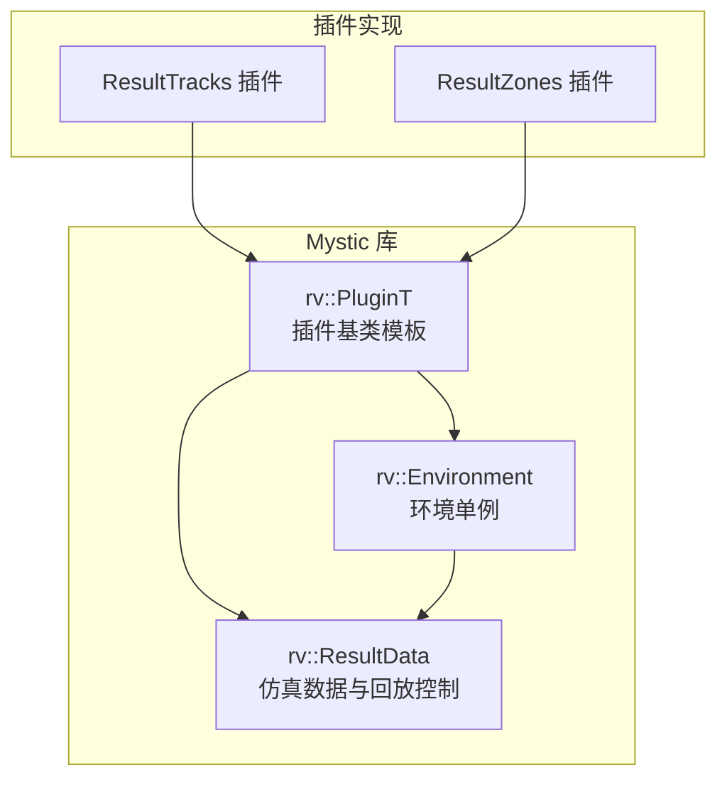
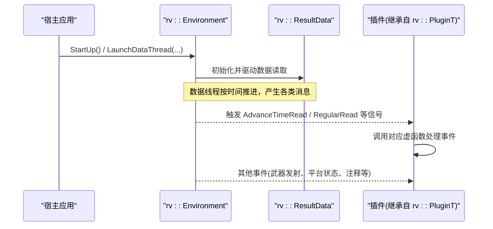
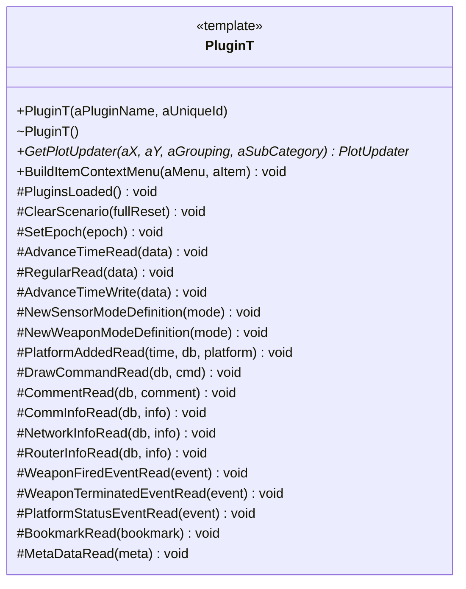
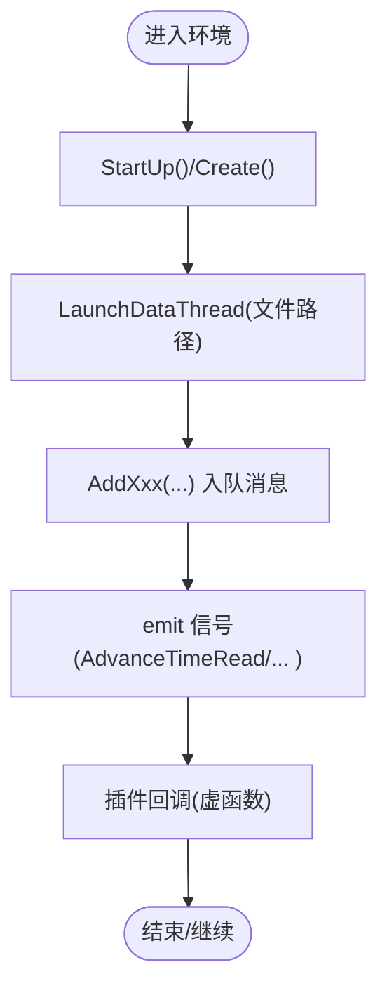
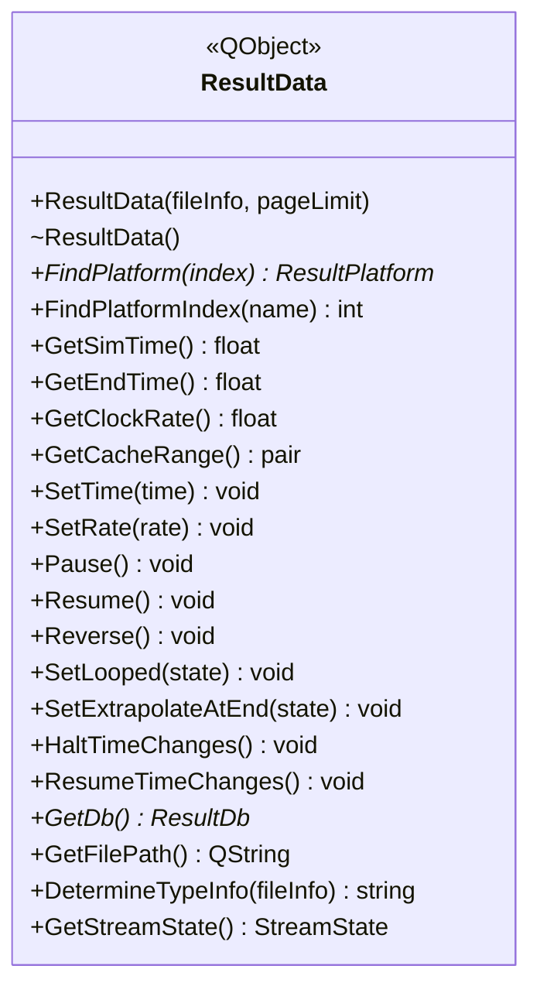
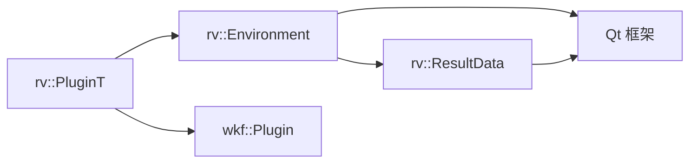

# 插件API参考

<cite>
**本文引用的文件**   
- [RvPlugin.hpp](file://swdev/src/mystic/lib/source/RvPlugin.hpp)
- [RvEnvironment.hpp](file://swdev/src/mystic/lib/source/RvEnvironment.hpp)
- [RvResultData.hpp](file://swdev/src/mystic/lib/source/RvResultData.hpp)
- [MysticPluginZoneDockWidget.cpp](file://swdev/src/mystic/plugins/ResultZones/source/MysticPluginZoneDockWidget.cpp)
- [mystic_plugin.cmake](file://swdev/src/mystic/plugins/ResultTracks/mystic_plugin.cmake)
</cite>

## 目录
1. [简介](#简介)
2. [项目结构](#项目结构)
3. [核心组件](#核心组件)
4. [架构总览](#架构总览)
5. [详细组件分析](#详细组件分析)
6. [依赖关系分析](#依赖关系分析)
7. [性能考虑](#性能考虑)
8. [故障排查指南](#故障排查指南)
9. [结论](#结论)
10. [附录：代码示例与最佳实践](#附录代码示例与最佳实践)

## 简介
本文件为 Mystic 可视化结果查看器（RV）的插件系统 API 参考文档，聚焦以下目标：
- 公共接口与基类定义、虚函数原型、参数说明与返回值描述
- 插件生命周期方法：初始化、运行、暂停、销毁等回调
- 事件处理机制：事件类型、回调注册与分发逻辑
- 数据访问接口：仿真时间控制、平台查询、状态获取与属性修改
- 错误处理、异常与兼容性注意事项
- 提供可操作的代码示例路径与使用建议

## 项目结构
Mystic 插件体系由“插件基类模板 + 环境单例 + 数据流管道”构成。典型插件通过继承 rv::PluginT<wkf::Plugin> 获得事件订阅能力，并通过全局环境 rvEnv 访问运行时数据与控制播放行为。

图表来源
- [RvPlugin.hpp:35-118](file://swdev/src/mystic/lib/source/RvPlugin.hpp#L35-L118)
- [RvEnvironment.hpp:59-167](file://swdev/src/mystic/lib/source/RvEnvironment.hpp#L59-L167)
- [RvResultData.hpp:28-78](file://swdev/src/mystic/lib/source/RvResultData.hpp#L28-L78)

章节来源
- [RvPlugin.hpp:35-118](file://swdev/src/mystic/lib/source/RvPlugin.hpp#L35-L118)
- [RvEnvironment.hpp:59-167](file://swdev/src/mystic/lib/source/RvEnvironment.hpp#L59-L167)
- [RvResultData.hpp:28-78](file://swdev/src/mystic/lib/source/RvResultData.hpp#L28-L78)

## 核心组件
- rv::PluginT<PClass>：插件基类模板，封装 Qt 信号到插件虚函数的桥接，提供生命周期与事件回调钩子。
- rv::Environment：全局环境单例，负责数据线程、回放控制、消息入队与信号广播。
- rv::ResultData：仿真数据容器与回放控制器，提供时间轴、速率、循环、外推等控制，以及平台查找与数据库访问。

章节来源
- [RvPlugin.hpp:35-118](file://swdev/src/mystic/lib/source/RvPlugin.hpp#L35-L118)
- [RvEnvironment.hpp:59-167](file://swdev/src/mystic/lib/source/RvEnvironment.hpp#L59-L167)
- [RvResultData.hpp:28-78](file://swdev/src/mystic/lib/source/RvResultData.hpp#L28-L78)

## 架构总览
下图展示插件在启动后如何订阅环境信号，并在仿真数据变化时接收回调。

图表来源
- [RvEnvironment.hpp:119-142](file://swdev/src/mystic/lib/source/RvEnvironment.hpp#L119-L142)
- [RvPlugin.hpp:44-71](file://swdev/src/mystic/lib/source/RvPlugin.hpp#L44-L71)

## 详细组件分析

### 插件基类与生命周期回调（rv::PluginT）
- 继承关系：rv::PluginT<PClass> 要求 PClass 派生自 wkf::Plugin。
- 构造阶段：在构造函数中连接 Environment 的信号到插件私有槽函数，确保在主线程同步执行（DirectConnection）。
- 生命周期回调（均为虚函数，默认空实现，插件可重写）：
  - PluginsLoaded：所有插件加载完成后回调，适合跨插件注册信息收集。
  - ClearScenario：场景清空或重置时回调。
  - SetEpoch：设置纪元时间回调。
  - AdvanceTimeRead / AdvanceTimeWrite：仿真时间推进时的读/写回调。
  - RegularRead：非时间推进时的周期性更新回调（约2Hz）。
  - NewSensorModeDefinition / NewWeaponModeDefinition：传感器/武器模式定义变更。
  - PlatformAddedRead：平台加入事件（以读取时机为准）。
  - DrawCommandRead：绘制命令事件。
  - CommentRead：注释事件。
  - CommInfoRead / NetworkInfoRead / RouterInfoRead：通信/网络/路由器信息。
  - WeaponFiredEventRead / WeaponTerminatedEventRead：武器发射/终止事件。
  - PlatformStatusEventRead：平台状态事件。
  - BookmarkRead：书签事件。
  - MetaDataRead：执行元数据事件。
- 扩展点：
  - GetPlotUpdater：返回特定X/Y轴与分组下的绘图更新器（可选）。
  - BuildItemContextMenu：为树项构建上下文菜单（可选）。

图表来源
- [RvPlugin.hpp:35-118](file://swdev/src/mystic/lib/source/RvPlugin.hpp#L35-L118)

章节来源
- [RvPlugin.hpp:35-118](file://swdev/src/mystic/lib/source/RvPlugin.hpp#L35-L118)

### 环境单例与事件分发（rv::Environment）
- 角色：全局环境单例，管理数据线程、回放控制、消息入队与信号广播。
- 关键能力：
  - 启动/关闭：StartUp / Shutdown
  - 数据线程：LaunchDataThread(QFileInfo)
  - 回放控制：SetTime / SetRate / SetLooped / SetExtrapolateAtEnd / SendPauseCommand / SendResumeCommand / SendReverseCommand / SendRestartCommmand
  - 消息入队：AddPlatform / AddComment / AddComm / AddNetwork / AddRouter / AddDrawMessage / AddMetaData / AddSensorModeDefinition / AddWeaponModeDefinition / AddWeaponFiredEvent / AddWeaponTerminatedEvent / AddPlatformStatusEvent / SetDate / AddResource / AddAnnotationMessage / AddBookmark / AddZone
  - 数据访问：GetData() -> ResultData*
  - 平台查询：LookupPlatformVariant / LookupPlatformName
  - 扩展点：RegisterDataExtension / GetExtensions
  - 信号：大量用于通知插件的 Qt 信号（如 AdvanceTimeRead、RegularRead、PlatformAddedRead 等）

图表来源
- [RvEnvironment.hpp:69-103](file://swdev/src/mystic/lib/source/RvEnvironment.hpp#L69-L103)
- [RvEnvironment.hpp:119-142](file://swdev/src/mystic/lib/source/RvEnvironment.hpp#L119-L142)

章节来源
- [RvEnvironment.hpp:59-167](file://swdev/src/mystic/lib/source/RvEnvironment.hpp#L59-L167)

### 仿真数据与回放控制（rv::ResultData）
- 角色：仿真数据容器与回放控制器，持有 ResultDb 指针并提供时间轴控制。
- 关键能力：
  - 平台查询：FindPlatform(int) / FindPlatformIndex(string)
  - 时间控制：GetSimTime / SetTime / GetEndTime / GetCacheRange
  - 速率与回放：GetClockRate / SetRate / Pause / Resume / Reverse / SetLooped / SetExtrapolateAtEnd
  - 数据库访问：GetDb() -> ResultDb*
  - 文件与流：GetFilePath / DetermineFileType / GetStreamState
  - 定时器：timerEvent 重载用于驱动回放

图表来源
- [RvResultData.hpp:28-78](file://swdev/src/mystic/lib/source/RvResultData.hpp#L28-L78)

章节来源
- [RvResultData.hpp:28-78](file://swdev/src/mystic/lib/source/RvResultData.hpp#L28-L78)

### 插件示例与集成要点
- 插件声明与构建：每个插件目录包含 mystic_plugin.cmake，用于自动注册插件名称与源码路径。
- 插件UI集成：例如 ResultZones 插件通过 DockWidget 与 wkf 环境交互，演示了如何在插件中访问场景对象与平台。

章节来源
- [mystic_plugin.cmake:11-14](file://swdev/src/mystic/plugins/ResultTracks/mystic_plugin.cmake#L11-L14)
- [MysticPluginZoneDockWidget.cpp:23-39](file://swdev/src/mystic/plugins/ResultZones/source/MysticPluginZoneDockWidget.cpp#L23-L39)

## 依赖关系分析
- 耦合关系：
  - rv::PluginT 强依赖 rv::Environment 提供的信号；通过 Qt 信号槽机制解耦具体事件源。
  - rv::Environment 聚合 rv::ResultData，负责将底层数据流转换为高层事件。
  - 插件仅依赖 rv::PluginT 与 rv::Environment，避免直接耦合底层数据结构。
- 外部依赖：
  - Qt 框架（QObject、QTimer、QBasicTimer、QString 等）
  - wkf 框架（wkf::Plugin、wkf::Environment 等）

图表来源
- [RvPlugin.hpp:35-118](file://swdev/src/mystic/lib/source/RvPlugin.hpp#L35-L118)
- [RvEnvironment.hpp:59-167](file://swdev/src/mystic/lib/source/RvEnvironment.hpp#L59-L167)
- [RvResultData.hpp:28-78](file://swdev/src/mystic/lib/source/RvResultData.hpp#L28-L78)

章节来源
- [RvPlugin.hpp:35-118](file://swdev/src/mystic/lib/source/RvPlugin.hpp#L35-L118)
- [RvEnvironment.hpp:59-167](file://swdev/src/mystic/lib/source/RvEnvironment.hpp#L59-L167)
- [RvResultData.hpp:28-78](file://swdev/src/mystic/lib/source/RvResultData.hpp#L28-L78)

## 性能考虑
- 事件频率：RegularRead 为非时间推进时的周期性回调（约2Hz），适合做轻量刷新；对重计算应进行节流或缓存。
- 线程模型：插件回调通过 DirectConnection 在主线程执行，避免跨线程访问 UI；不要在回调中进行阻塞操作。
- 数据访问：优先使用 ResultData 提供的查询接口，避免频繁解析底层数据库。
- 回放控制：合理设置循环与外推策略，减少不必要的重复计算。

[本节为通用指导，不直接分析具体文件]

## 故障排查指南
- 插件未收到事件：
  - 确认插件已正确继承 rv::PluginT<wkf::Plugin> 并在构造中完成信号连接（由基类自动完成）。
  - 检查 Environment 是否已启动且数据线程已创建。
- 界面无更新：
  - 检查是否在 AdvanceTimeRead 或 RegularRead 中更新了 UI。
  - 确认未在回调中进行耗时操作导致主线程阻塞。
- 回放异常：
  - 检查 SetTime/SetRate/Reverse 等调用顺序是否符合预期。
  - 确认文件路径与数据类型识别正确。

章节来源
- [RvPlugin.hpp:44-71](file://swdev/src/mystic/lib/source/RvPlugin.hpp#L44-L71)
- [RvEnvironment.hpp:69-103](file://swdev/src/mystic/lib/source/RvEnvironment.hpp#L69-L103)
- [RvResultData.hpp:44-57](file://swdev/src/mystic/lib/source/RvResultData.hpp#L44-L57)

## 结论
Mystic 插件系统通过 rv::PluginT 提供统一的事件回调入口，借助 rv::Environment 实现数据与事件的解耦分发，并由 rv::ResultData 提供稳定的数据访问与回放控制。插件开发者只需关注业务逻辑，即可快速接入可视化与交互功能。

[本节为总结性内容，不直接分析具体文件]

## 附录：代码示例与最佳实践

- 示例一：在插件中响应时间推进与定期更新
  - 重写 AdvanceTimeRead 与 RegularRead，在回调中读取 rvEnv.GetData()->GetSimTime() 并更新 UI。
  - 参考路径：[RvPlugin.hpp:94-96](file://swdev/src/mystic/lib/source/RvPlugin.hpp#L94-L96)

- 示例二：监听平台加入事件
  - 重写 PlatformAddedRead，从 ResultDb 中获取新平台信息并进行本地缓存。
  - 参考路径：[RvPlugin.hpp:102](file://swdev/src/mystic/lib/source/RvPlugin.hpp#L102)

- 示例三：控制回放与时间轴
  - 通过 rvEnv.SetTime/SetRate/Pause/Resume 等方法控制回放。
  - 参考路径：[RvEnvironment.hpp:76-83](file://swdev/src/mystic/lib/source/RvEnvironment.hpp#L76-L83)

- 示例四：查询平台与数据库
  - 使用 rvEnv.GetData()->FindPlatform/FindPlatformIndex 进行平台定位。
  - 参考路径：[RvResultData.hpp:35-36](file://swdev/src/mystic/lib/source/RvResultData.hpp#L35-L36)

- 示例五：插件构建配置
  - 在插件目录中添加 mystic_plugin.cmake，声明插件名与源码路径。
  - 参考路径：[mystic_plugin.cmake:11-14](file://swdev/src/mystic/plugins/ResultTracks/mystic_plugin.cmake#L11-L14)

- 示例六：插件UI与场景交互
  - 在 DockWidget 中通过 wkf 环境访问标准场景与平台，实现删除/过滤等操作。
  - 参考路径：[MysticPluginZoneDockWidget.cpp:23-39](file://swdev/src/mystic/plugins/ResultZones/source/MysticPluginZoneDockWidget.cpp#L23-L39)

- 最佳实践
  - 保持回调轻量，避免阻塞主线程。
  - 使用缓存与增量更新策略，降低高频事件带来的开销。
  - 在 PluginsLoaded 中完成跨插件的注册与协作。
  - 谨慎处理异常与边界条件（如无平台、无效时间等）。

[本节为示例与指导，不直接分析具体文件]