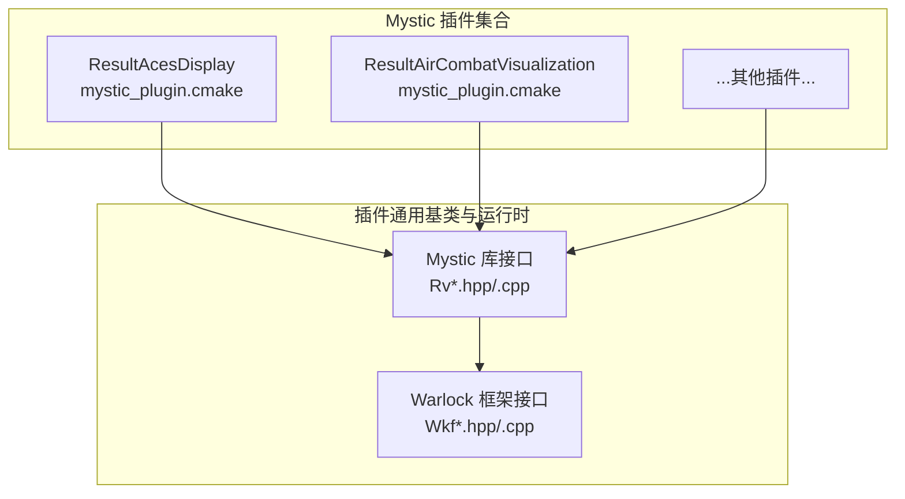
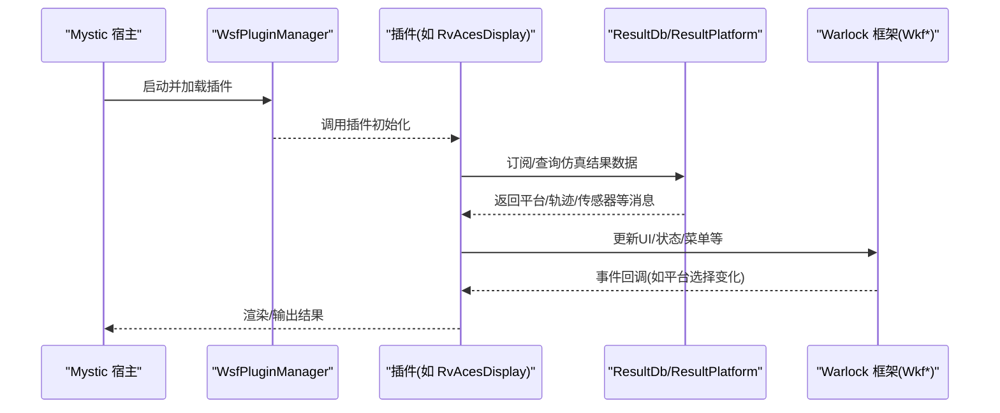
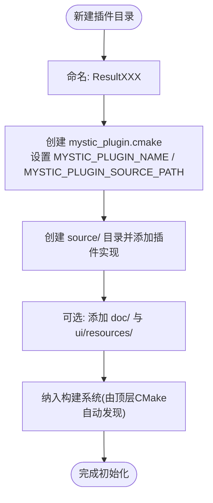
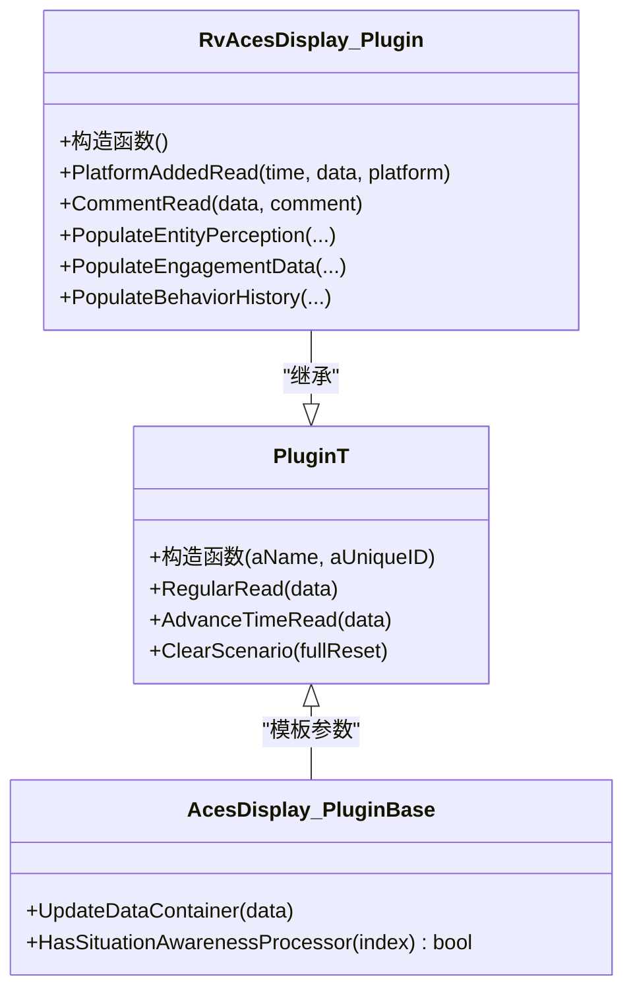
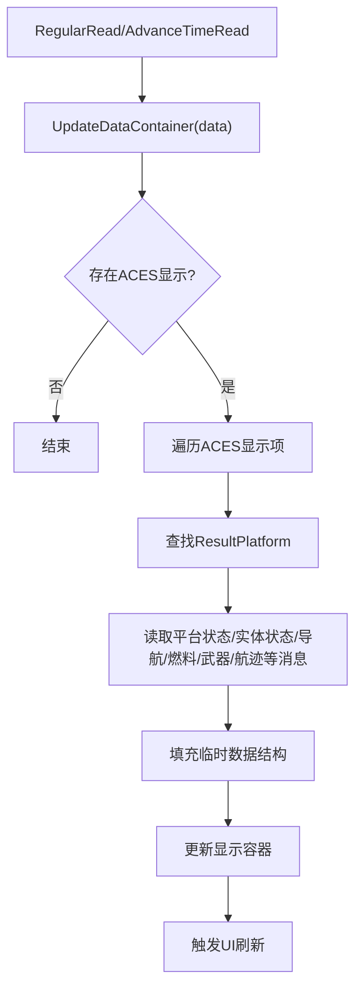
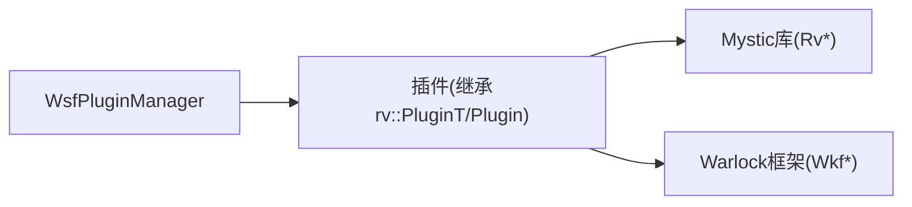

# 插件开发指南

<cite>
**本文引用的文件**   
- [swdev/src/mystic/README.md](file://swdev/src/mystic/README.md)
- [swdev/src/mystic/plugins/ResultAcesDisplay/mystic_plugin.cmake](file://swdev/src/mystic/plugins/ResultAcesDisplay/mystic_plugin.cmake)
- [swdev/src/mystic/plugins/ResultAirCombatVisualization/mystic_plugin.cmake](file://swdev/src/mystic/plugins/ResultAirCombatVisualization/mystic_plugin.cmake)
- [swdev/src/mystic/plugins/ResultAcesDisplay/source/RvAcesDisplayPlugin.cpp](file://swdev/src/mystic/plugins/ResultAcesDisplay/source/RvAcesDisplayPlugin.cpp)
- [swdev/src/mystic/lib/source/RvPlatformDataDockWidget.cpp](file://swdev/src/mystic/lib/source/RvPlatformDataDockWidget.cpp)
- [swdev/src/core/wsf/source/WsfPlugin.hpp](file://swdev/src/core/wsf/source/WsfPlugin.hpp)
- [swdev/src/core/wsf/source/WsfPluginManager.cpp](file://swdev/src/core/wsf/source/WsfPluginManager.cpp)
- [swdev/src/tools/util/source/UtPlugin.hpp](file://swdev/src/tools/util/source/UtPlugin.hpp)
- [documentation/html/docs/wkf_plugin/rv_tracks.html](file://documentation/html/docs/wkf_plugin/rv_tracks.html)
</cite>

## 目录
1. [简介](#简介)
2. [项目结构](#项目结构)
3. [核心组件](#核心组件)
4. [架构总览](#架构总览)
5. [详细组件分析](#详细组件分析)
6. [依赖关系分析](#依赖关系分析)
7. [性能与优化建议](#性能与优化建议)
8. [调试与故障排查](#调试与故障排查)
9. [结论](#结论)
10. [附录：快速上手清单](#附录快速上手清单)

## 简介
本指南面向希望在 AFSIM Mystic 可视化环境中进行插件开发的工程师，提供从项目初始化、模板使用、构建配置到开发与部署的完整流程说明。内容涵盖插件目录组织、CMake 配置要点、源代码布局、常见扩展场景（结果显示、数据分析、工具扩展）、调试技巧与性能优化建议，并给出最佳实践指导。

## 项目结构
Mystic 插件位于 swdev/src/mystic/plugins 下，每个插件是一个独立子目录，包含文档、源码、可选 UI 资源以及 mystic_plugin.cmake 配置文件。典型插件结构如下：
- 插件根目录：包含 README、NO_EXPORT.md、mystic_plugin.cmake
- source：插件 C++ 实现
- doc：插件用户/开发者文档
- ui/resources：UI 资源（图标、样式等）

图表来源
- [swdev/src/mystic/plugins/ResultAcesDisplay/mystic_plugin.cmake:36-39](file://swdev/src/mystic/plugins/ResultAcesDisplay/mystic_plugin.cmake#L36-L39)
- [swdev/src/mystic/plugins/ResultAirCombatVisualization/mystic_plugin.cmake:11-14](file://swdev/src/mystic/plugins/ResultAirCombatVisualization/mystic_plugin.cmake#L11-L14)

章节来源
- [swdev/src/mystic/README.md:1-35](file://swdev/src/mystic/README.md#L1-L35)

## 核心组件
- 插件注册与版本管理
  - WSF_PLUGIN_API_* 宏定义插件 API 版本，确保插件与宿主 ABI 兼容。
  - UtPluginVersion 用于构造插件版本对象，配合 UT_PLUGIN_API_COMPILER_STRING 标识编译器环境。
- 插件管理器
  - WsfPluginManager 继承 UtPluginManager，负责加载、发现与生命周期管理。
- 插件基类
  - rv::PluginT<T> 或 rv::Plugin 为 Mystic 插件的基类，提供结果数据回调、UI 集成等能力。
- 示例插件
  - ResultAcesDisplay 展示了如何订阅平台选择变更、读取仿真结果消息、更新显示容器等。

章节来源
- [swdev/src/core/wsf/source/WsfPlugin.hpp:18-20](file://swdev/src/core/wsf/source/WsfPlugin.hpp#L18-L20)
- [swdev/src/tools/util/source/UtPlugin.hpp:190-196](file://swdev/src/tools/util/source/UtPlugin.hpp#L190-L196)
- [swdev/src/core/wsf/source/WsfPluginManager.cpp:33-33](file://swdev/src/core/wsf/source/WsfPluginManager.cpp#L33-L33)
- [swdev/src/mystic/plugins/ResultAcesDisplay/source/RvAcesDisplayPlugin.cpp:27-35](file://swdev/src/mystic/plugins/ResultAcesDisplay/source/RvAcesDisplayPlugin.cpp#L27-L35)

## 架构总览
下图展示 Mystic 插件在运行时的关键交互：插件通过基类回调接收结果数据，访问 ResultDb/ResultPlatform 获取平台与轨迹信息，并与 Warlock 框架（Wkf*）进行 UI 与场景交互。

图表来源
- [swdev/src/core/wsf/source/WsfPluginManager.cpp:33-33](file://swdev/src/core/wsf/source/WsfPluginManager.cpp#L33-L33)
- [swdev/src/mystic/plugins/ResultAcesDisplay/source/RvAcesDisplayPlugin.cpp:27-83](file://swdev/src/mystic/plugins/ResultAcesDisplay/source/RvAcesDisplayPlugin.cpp#L27-L83)
- [swdev/src/mystic/lib/source/RvPlatformDataDockWidget.cpp:11-35](file://swdev/src/mystic/lib/source/RvPlatformDataDockWidget.cpp#L11-L35)

## 详细组件分析

### 插件模板与项目初始化
- 插件目录命名规范：以“Result”前缀表示可视化/结果类插件，例如 ResultAcesDisplay、ResultAirCombatVisualization。
- 必须文件：
  - mystic_plugin.cmake：声明插件名称与源码路径，供构建系统自动收录。
  - README.md：插件使用说明与发布控制说明。
  - source/：插件实现代码。
  - doc/：插件文档（可选）。
  - ui/resources/：UI 资源（可选）。

图表来源
- [swdev/src/mystic/plugins/ResultAcesDisplay/mystic_plugin.cmake:36-39](file://swdev/src/mystic/plugins/ResultAcesDisplay/mystic_plugin.cmake#L36-L39)
- [swdev/src/mystic/plugins/ResultAirCombatVisualization/mystic_plugin.cmake:11-14](file://swdev/src/mystic/plugins/ResultAirCombatVisualization/mystic_plugin.cmake#L11-L14)

章节来源
- [swdev/src/mystic/plugins/ResultAcesDisplay/mystic_plugin.cmake:36-39](file://swdev/src/mystic/plugins/ResultAcesDisplay/mystic_plugin.cmake#L36-L39)
- [swdev/src/mystic/plugins/ResultAirCombatVisualization/mystic_plugin.cmake:11-14](file://swdev/src/mystic/plugins/ResultAirCombatVisualization/mystic_plugin.cmake#L11-L14)

### 插件编译配置（CMake）
- 关键字段：
  - MYSTIC_PLUGIN_NAME：插件目标名。
  - MYSTIC_PLUGIN_SOURCE_PATH：源码目录（通常为 source）。
- 构建系统会自动将插件链接到 Mystic 库与 Warlock 框架，无需手动指定头文件路径与依赖库。

章节来源
- [swdev/src/mystic/plugins/ResultAcesDisplay/mystic_plugin.cmake:36-39](file://swdev/src/mystic/plugins/ResultAcesDisplay/mystic_plugin.cmake#L36-L39)
- [swdev/src/mystic/plugins/ResultAirCombatVisualization/mystic_plugin.cmake:11-14](file://swdev/src/mystic/plugins/ResultAirCombatVisualization/mystic_plugin.cmake#L11-L14)

### 插件基类与生命周期
- 插件基类：
  - rv::PluginT<T>：带模板参数的插件基类，常用于对接特定业务基类（如 wkf::AcesDisplay::PluginBase）。
  - rv::Plugin：通用插件基类。
- 生命周期回调：
  - 插件构造函数中可连接宿主事件（如平台选择变化），并在 RegularRead/AdvanceTimeRead 等回调中处理数据更新。
  - 通过 WKF_PLUGIN_DEFINE_SYMBOLS 宏导出插件元信息（名称、描述、所属模块、是否默认加载）。

图表来源
- [swdev/src/mystic/plugins/ResultAcesDisplay/source/RvAcesDisplayPlugin.cpp:27-83](file://swdev/src/mystic/plugins/ResultAcesDisplay/source/RvAcesDisplayPlugin.cpp#L27-L83)
- [swdev/src/mystic/plugins/ResultAcesDisplay/source/RvAcesDisplayPlugin.cpp:86-179](file://swdev/src/mystic/plugins/ResultAcesDisplay/source/RvAcesDisplayPlugin.cpp#L86-L179)
- [swdev/src/mystic/plugins/ResultAcesDisplay/source/RvAcesDisplayPlugin.cpp:181-235](file://swdev/src/mystic/plugins/ResultAcesDisplay/source/RvAcesDisplayPlugin.cpp#L181-L235)

章节来源
- [swdev/src/mystic/plugins/ResultAcesDisplay/source/RvAcesDisplayPlugin.cpp:27-83](file://swdev/src/mystic/plugins/ResultAcesDisplay/source/RvAcesDisplayPlugin.cpp#L27-L83)
- [swdev/src/mystic/plugins/ResultAcesDisplay/source/RvAcesDisplayPlugin.cpp:86-179](file://swdev/src/mystic/plugins/ResultAcesDisplay/source/RvAcesDisplayPlugin.cpp#L86-L179)
- [swdev/src/mystic/plugins/ResultAcesDisplay/source/RvAcesDisplayPlugin.cpp:181-235](file://swdev/src/mystic/plugins/ResultAcesDisplay/source/RvAcesDisplayPlugin.cpp#L181-L235)

### 结果显示与数据读取（示例：Aces Display）
- 订阅平台选择变化：在插件构造函数中连接宿主事件，动态维护目标平台列表。
- 读取平台与实体状态：通过 ResultPlatform 查找 MsgEntityState/MsgPlatformStatus 等消息，填充显示所需字段。
- 行为历史与交战数据：从 MsgBehaviorTreeState、MsgSA_EngagementSummaryData 等消息聚合数据，供 UI 渲染。

图表来源
- [swdev/src/mystic/plugins/ResultAcesDisplay/source/RvAcesDisplayPlugin.cpp:171-179](file://swdev/src/mystic/plugins/ResultAcesDisplay/source/RvAcesDisplayPlugin.cpp#L171-L179)
- [swdev/src/mystic/plugins/ResultAcesDisplay/source/RvAcesDisplayPlugin.cpp:374-458](file://swdev/src/mystic/plugins/ResultAcesDisplay/source/RvAcesDisplayPlugin.cpp#L374-L458)
- [swdev/src/mystic/plugins/ResultAcesDisplay/source/RvAcesDisplayPlugin.cpp:459-755](file://swdev/src/mystic/plugins/ResultAcesDisplay/source/RvAcesDisplayPlugin.cpp#L459-L755)

章节来源
- [swdev/src/mystic/plugins/ResultAcesDisplay/source/RvAcesDisplayPlugin.cpp:171-179](file://swdev/src/mystic/plugins/ResultAcesDisplay/source/RvAcesDisplayPlugin.cpp#L171-L179)
- [swdev/src/mystic/plugins/ResultAcesDisplay/source/RvAcesDisplayPlugin.cpp:374-458](file://swdev/src/mystic/plugins/ResultAcesDisplay/source/RvAcesDisplayPlugin.cpp#L374-L458)
- [swdev/src/mystic/plugins/ResultAcesDisplay/source/RvAcesDisplayPlugin.cpp:459-755](file://swdev/src/mystic/plugins/ResultAcesDisplay/source/RvAcesDisplayPlugin.cpp#L459-L755)

### 工具扩展（示例：平台数据停靠窗口）
- 通过继承现有 DockWidget 基类扩展平台详情面板，接入事件管道与结果数据库，提供交互式查看与分析能力。
- 常用依赖：Qt 控件、WkfEnvironment/WkfFactory/WkfMainWindow 等框架接口。

章节来源
- [swdev/src/mystic/lib/source/RvPlatformDataDockWidget.cpp:11-35](file://swdev/src/mystic/lib/source/RvPlatformDataDockWidget.cpp#L11-L35)

### 常见扩展场景
- 结果显示类插件：基于 ResultDb/ResultPlatform 读取消息，结合 Qt/VTK 进行可视化（参考 ResultAcesDisplay）。
- 数据分析类插件：对轨迹、传感器、通信等数据进行统计、过滤、关联分析（参考 ResultInteractionPlots、ResultStatistics）。
- 工具类插件：扩展 UI 工具（单位换算、位置转换、地形工具等），复用 Wkf 框架能力（参考 ResultUnitConverterTool、ResultTerrainTools）。

[本节为概念性总结，不直接分析具体文件]

## 依赖关系分析
- 插件与宿主
  - 插件通过 WsfPluginManager 被加载与管理，需匹配 WSF_PLUGIN_API_* 版本。
- 插件与 Mystic 库
  - 插件继承 rv::PluginT 或 rv::Plugin，使用 Rv* 接口访问结果数据与 UI 能力。
- 插件与 Warlock 框架
  - 插件通过 Wkf* 接口与主界面、场景、工厂等进行交互。

图表来源
- [swdev/src/core/wsf/source/WsfPluginManager.cpp:33-33](file://swdev/src/core/wsf/source/WsfPluginManager.cpp#L33-L33)
- [swdev/src/core/wsf/source/WsfPlugin.hpp:18-20](file://swdev/src/core/wsf/source/WsfPlugin.hpp#L18-L20)
- [swdev/src/tools/util/source/UtPlugin.hpp:190-196](file://swdev/src/tools/util/source/UtPlugin.hpp#L190-L196)

章节来源
- [swdev/src/core/wsf/source/WsfPluginManager.cpp:33-33](file://swdev/src/core/wsf/source/WsfPluginManager.cpp#L33-L33)
- [swdev/src/core/wsf/source/WsfPlugin.hpp:18-20](file://swdev/src/core/wsf/source/WsfPlugin.hpp#L18-L20)
- [swdev/src/tools/util/source/UtPlugin.hpp:190-196](file://swdev/src/tools/util/source/UtPlugin.hpp#L190-L196)

## 性能与优化建议
- 数据访问最小化：仅在必要时查询 ResultDb/ResultPlatform，避免每帧重复查找；缓存稳定数据（如平台索引映射）。
- 批量更新：合并多次 UI 更新，减少重绘开销；使用增量更新策略。
- 线程安全：避免在回调中执行耗时任务；必要时异步处理并回传结果。
- 内存管理：及时释放临时容器，避免大对象频繁分配；复用向量/映射以减少碎片。
- 渲染优化：按需绘制可见目标；使用 LOD（细节层次）与视锥剔除。

[本节为通用指导，不直接分析具体文件]

## 调试与故障排查
- 插件未加载
  - 检查 mystic_plugin.cmake 是否正确声明插件名与源码路径。
  - 确认插件未在默认加载列表中误配（可通过插件管理器启用/禁用）。
- 版本不兼容
  - 核对 WSF_PLUGIN_API_* 与宿主一致；使用 UtPluginVersion 构造版本对象时传入正确的编译器字符串。
- 结果数据为空
  - 确认仿真已产生对应消息类型（如 MsgEntityState、MsgSA_*）；检查时间戳与查询边界。
- UI 无响应
  - 检查 Qt 信号槽连接是否正确；避免在主线程阻塞操作。
- 参考文档
  - 官方文档站点中包含 Tracks、SA Display 等页面，可作为功能对照与问题定位参考。

章节来源
- [documentation/html/docs/wkf_plugin/rv_tracks.html:73-76](file://documentation/html/docs/wkf_plugin/rv_tracks.html#L73-L76)

## 结论
通过遵循本指南的项目结构与构建约定，开发者可以快速搭建 Mystic 插件工程，复用 Mystic 与 Warlock 框架能力，实现丰富的结果显示、数据分析与工具扩展。建议在开发过程中严格遵循版本与 ABI 约束，采用高效的数据访问与 UI 更新策略，并结合官方文档与示例插件持续迭代优化。

[本节为总结性内容，不直接分析具体文件]

## 附录快速上手清单
- 新建插件
  - 在 swdev/src/mystic/plugins 下创建 ResultXXX 目录
  - 编写 mystic_plugin.cmake（设置 MYSTIC_PLUGIN_NAME 与 MYSTIC_PLUGIN_SOURCE_PATH）
  - 在 source/ 中实现继承自 rv::PluginT 或 rv::Plugin 的插件类
  - 使用 WKF_PLUGIN_DEFINE_SYMBOLS 导出插件元信息
- 构建与测试
  - 使用顶层 CMake 构建，确保插件被自动收录
  - 在 Mystic 中通过插件管理器启用插件
- 常见问题
  - 版本不匹配：核对 WSF_PLUGIN_API_* 与 UtPluginVersion
  - 数据为空：检查仿真消息与时间范围
  - UI 卡顿：优化数据访问与渲染逻辑

[本节为操作性清单，不直接分析具体文件]