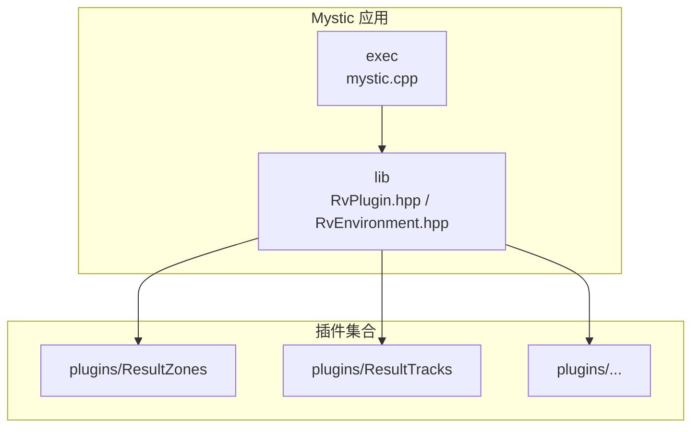
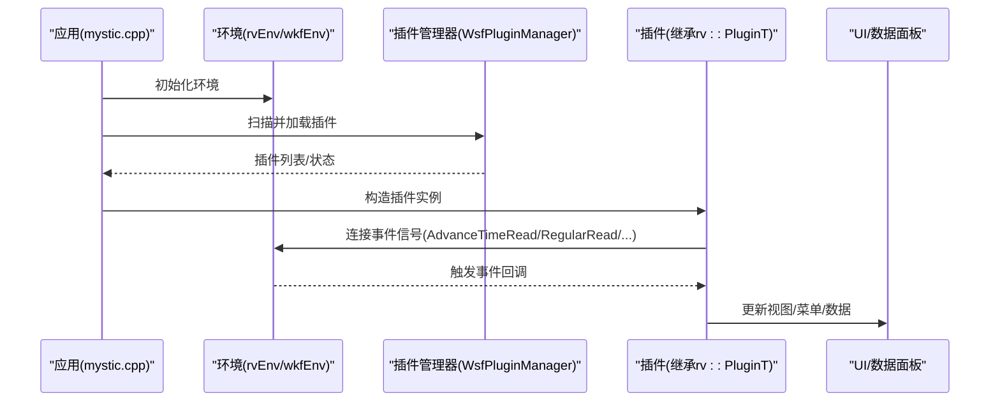
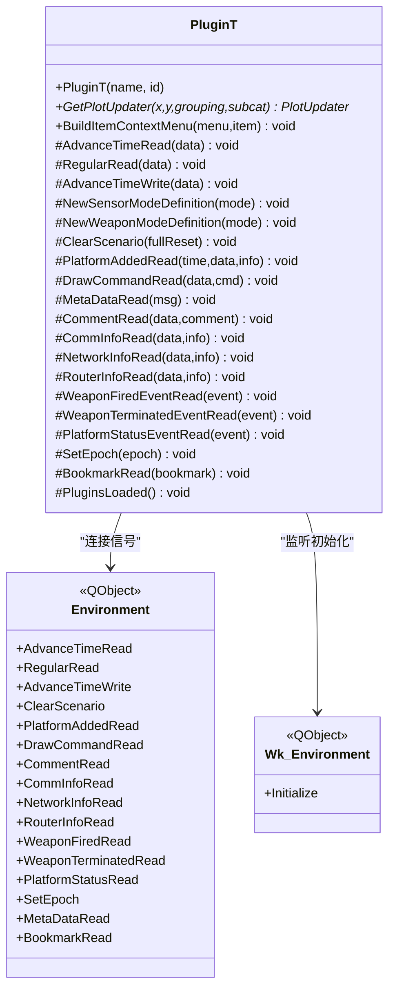
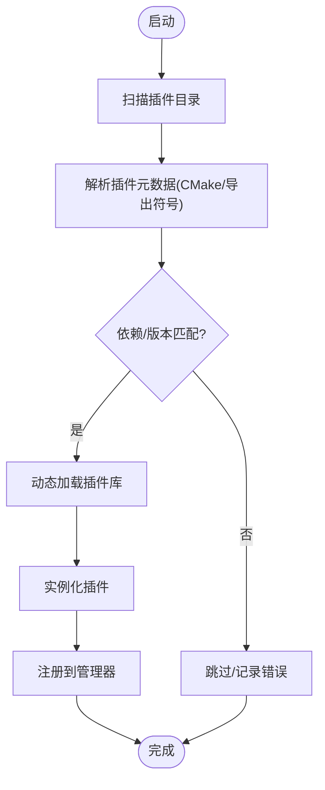
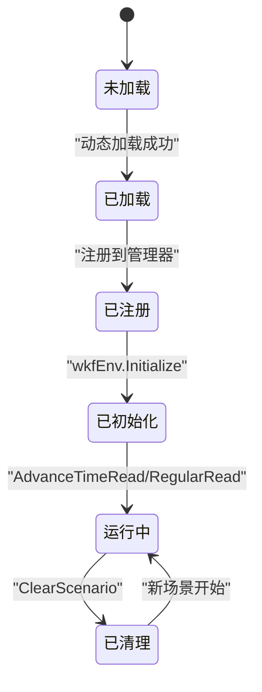
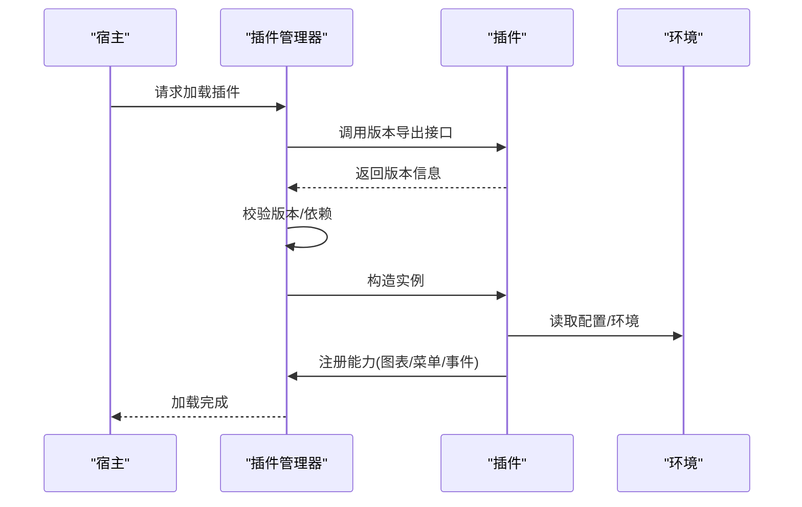
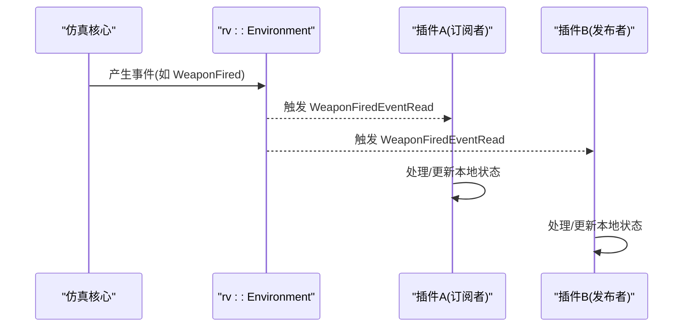
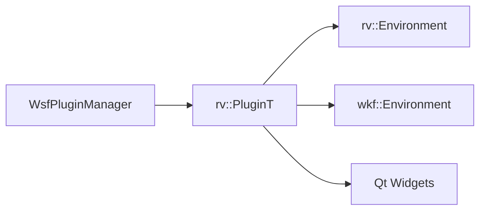

# 插件架构设计

<cite>
**本文引用的文件**   
- [RvPlugin.hpp](file://swdev/src/mystic/lib/source/RvPlugin.hpp)
- [WsfPluginManager.hpp](file://swdev/src/core/wsf/source/WsfPluginManager.hpp)
- [mystic.cpp](file://swdev/src/mystic/exec/source/mystic.cpp)
- [MysticPluginZoneDockWidget.cpp](file://swdev/src/mystic/plugins/ResultZones/source/MysticPluginZoneDockWidget.cpp)
- [RvPlatformDataDockWidget.cpp](file://swdev/src/mystic/lib/source/RvPlatformDataDockWidget.cpp)
- [rv_tracks.rst](file://swdev/src/mystic/plugins/ResultTracks/doc/wkf_plugin/rv_tracks.rst)
</cite>

## 目录
1. [简介](#简介)
2. [项目结构](#项目结构)
3. [核心组件](#核心组件)
4. [架构总览](#架构总览)
5. [详细组件分析](#详细组件分析)
6. [依赖关系分析](#依赖关系分析)
7. [性能考虑](#性能考虑)
8. [故障排查指南](#故障排查指南)
9. [结论](#结论)
10. [附录](#附录)

## 简介
本文件面向 Mystic 插件系统，系统性阐述其模块化架构、动态加载机制与生命周期管理；说明插件发现（目录扫描）、元数据解析与依赖检查；文档化插件接口规范（基类、虚函数、事件回调）；描述注册流程（能力声明、版本兼容、配置管理）；解释插件间通信（消息传递、共享数据访问、事件订阅）。文中包含架构图表与代码级流程图，帮助读者从高层到实现细节全面理解。

## 项目结构
Mystic 的插件体系位于 swdev/src/mystic 下：
- exec: 可执行程序入口与启动逻辑
- lib: 运行时库，提供插件框架、环境对象、事件总线等基础设施
- plugins: 具体功能插件集合（每个插件一个子目录，内含 source、文档与构建脚本）
- python: Python 工具与示例

图表来源
- [mystic.cpp:1-200](file://swdev/src/mystic/exec/source/mystic.cpp#L1-L200)
- [RvPlugin.hpp:1-122](file://swdev/src/mystic/lib/source/RvPlugin.hpp#L1-L122)

章节来源
- [mystic.cpp:1-200](file://swdev/src/mystic/exec/source/mystic.cpp#L1-L200)
- [RvPlugin.hpp:1-122](file://swdev/src/mystic/lib/source/RvPlugin.hpp#L1-L122)

## 核心组件
- 插件基类与模板封装
  - wkf::Plugin：WSF 层通用插件抽象（名称、ID、生命周期钩子等）
  - rv::PluginT<PClass>：在 WSF 插件之上扩展 Mystic 的事件订阅与 UI 集成能力
- 环境与事件总线
  - rv::Environment：Mystic 运行期环境，发布 AdvanceTimeRead/RegularRead/ClearScenario 等信号
  - wkf::Environment：WSF 环境，提供 Initialize 等生命周期信号
- 插件管理器
  - WsfPluginManager：负责插件的动态加载、版本校验、依赖解析与注册

章节来源
- [RvPlugin.hpp:1-122](file://swdev/src/mystic/lib/source/RvPlugin.hpp#L1-L122)
- [WsfPluginManager.hpp:1-200](file://swdev/src/core/wsf/source/WsfPluginManager.hpp#L1-L200)

## 架构总览
下图展示 Mystic 插件系统的整体交互：应用启动后由执行器初始化环境并加载插件；插件通过继承 rv::PluginT 接入事件总线；UI 控件与数据面板通过插件提供的能力进行扩展。

图表来源
- [mystic.cpp:1-200](file://swdev/src/mystic/exec/source/mystic.cpp#L1-L200)
- [RvPlugin.hpp:44-71](file://swdev/src/mystic/lib/source/RvPlugin.hpp#L44-L71)
- [WsfPluginManager.hpp:1-200](file://swdev/src/core/wsf/source/WsfPluginManager.hpp#L1-L200)

## 详细组件分析

### 插件基类与事件模型（rv::PluginT）
- 设计要点
  - 模板派生自任意 wkf::Plugin 子类，保证类型安全
  - 构造函数中统一将 rv::Environment 与 wkf::Environment 的信号连接到插件内部槽函数，采用 Qt::DirectConnection 确保在主线程同步调用
  - 暴露一组受保护的虚函数供插件重写，如时间推进、常规刷新、场景清空、平台新增、绘制命令、注释、通信信息、武器发射/终止、平台状态、纪元设置、书签、以及“所有插件已加载”后的二次注册阶段
  - 提供 GetPlotUpdater 与 BuildItemContextMenu 等扩展点用于图表与上下文菜单

图表来源
- [RvPlugin.hpp:35-117](file://swdev/src/mystic/lib/source/RvPlugin.hpp#L35-L117)

章节来源
- [RvPlugin.hpp:35-117](file://swdev/src/mystic/lib/source/RvPlugin.hpp#L35-L117)

### 插件发现与动态加载
- 插件目录扫描
  - 插件以独立目录形式组织于 plugins/ 下，每个插件包含 source 与可选 doc/ui 资源
  - 构建系统通过各插件的 CMake 配置（例如 mystic_plugin.cmake）声明插件名与源码路径，便于自动纳入构建
- 元数据解析与依赖检查
  - 插件通过导出符号与版本接口向宿主报告 API 版本，宿主据此进行兼容性判断
  - 插件管理器在加载时解析插件元数据，校验版本与依赖，失败则跳过或报错
- 动态加载
  - 宿主在启动阶段调用插件管理器，按策略扫描目录、解析元数据、加载动态库并实例化插件

图表来源
- [WsfPluginManager.hpp:1-200](file://swdev/src/core/wsf/source/WsfPluginManager.hpp#L1-L200)

章节来源
- [WsfPluginManager.hpp:1-200](file://swdev/src/core/wsf/source/WsfPluginManager.hpp#L1-L200)

### 插件接口规范与生命周期
- 基类定义
  - 所有 Mystic 插件需继承 rv::PluginT<T>，其中 T 为 wkf::Plugin 的子类
- 虚函数接口
  - 时间推进与常规刷新：AdvanceTimeRead/RegularRead/AdvanceTimeWrite
  - 场景与实体：ClearScenario/PlatformAddedRead
  - 渲染与交互：DrawCommandRead/BuildItemContextMenu
  - 通信与网络：CommInfoRead/NetworkInfoRead/RouterInfoRead
  - 武器与平台事件：WeaponFiredEventRead/WeaponTerminatedEventRead/PlatformStatusEventRead
  - 系统与元数据：SetEpoch/MetaDataRead/BookmarkRead
  - 插件就绪：PluginsLoaded（在所有插件加载完成后回调，适合跨插件注册）
- 事件回调机制
  - 基于 Qt 信号/槽，使用 DirectConnection 确保主线程同步执行，避免竞态

图表来源
- [RvPlugin.hpp:44-117](file://swdev/src/mystic/lib/source/RvPlugin.hpp#L44-L117)

章节来源
- [RvPlugin.hpp:44-117](file://swdev/src/mystic/lib/source/RvPlugin.hpp#L44-L117)

### 插件注册流程（能力声明、版本兼容、配置管理）
- 能力声明
  - 插件通过继承特定基类（如某些领域插件基类）声明自身能力域
  - 通过重写 GetPlotUpdater 提供图表能力，通过 BuildItemContextMenu 提供上下文菜单能力
- 版本兼容性
  - 插件导出版本符号，宿主根据 WSF 插件 API 主版本号进行校验
- 配置管理
  - 插件可通过 wkf::Environment 与 rv::Environment 获取运行时配置与环境信息
  - 部分插件在 PluginsLoaded 阶段收集其他插件的能力信息，完成二次注册

图表来源
- [WsfPluginManager.hpp:1-200](file://swdev/src/core/wsf/source/WsfPluginManager.hpp#L1-L200)
- [RvPlugin.hpp:75-83](file://swdev/src/mystic/lib/source/RvPlugin.hpp#L75-L83)

章节来源
- [WsfPluginManager.hpp:1-200](file://swdev/src/core/wsf/source/WsfPluginManager.hpp#L1-L200)
- [RvPlugin.hpp:75-83](file://swdev/src/mystic/lib/source/RvPlugin.hpp#L75-L83)

### 插件间通信机制（消息、共享数据、事件订阅）
- 消息传递
  - 通过 rv::Environment 发布的 Msg* 消息（如 DrawCommand、Comment、CommInfo、NetworkInfo、RouterInfo、WeaponFired/Terminated、PlatformStatus、Bookmark 等）进行解耦通信
- 共享数据访问
  - 插件通过 wkf::Environment 与 rv::Environment 访问场景、平台、结果数据库等共享数据
- 事件订阅模式
  - 插件在构造时连接环境信号，实现订阅；在析构时由 Qt 自动断开

图表来源
- [RvPlugin.hpp:54-69](file://swdev/src/mystic/lib/source/RvPlugin.hpp#L54-L69)

章节来源
- [RvPlugin.hpp:54-69](file://swdev/src/mystic/lib/source/RvPlugin.hpp#L54-L69)

### 典型插件用例：区域与轨道可视化（ResultZones）
- 该插件通过 DockWidget 扩展界面，访问场景中的平台与区域数据，并在地图显示中进行标注与交互
- 展示了插件如何与 wkf::Scenario、wkf::Platform 等对象协作

章节来源
- [MysticPluginZoneDockWidget.cpp:1-39](file://swdev/src/mystic/plugins/ResultZones/source/MysticPluginZoneDockWidget.cpp#L1-L39)

### 典型插件用例：轨迹显示（ResultTracks）
- 负责在地图显示上呈现轨迹图标，并在平台详情面板中展示主轨迹与传感器轨迹列表
- 支持右键菜单进行轨迹追踪与绘图

章节来源
- [rv_tracks.rst:1-41](file://swdev/src/mystic/plugins/ResultTracks/doc/wkf_plugin/rv_tracks.rst#L1-L41)

### 典型插件用例：平台数据面板（RvPlatformDataDockWidget）
- 演示插件如何通过 wkf::Environment 与 wkf::PluginManager 进行交互，扩展平台详情面板的上下文菜单与行为

章节来源
- [RvPlatformDataDockWidget.cpp:1-42](file://swdev/src/mystic/lib/source/RvPlatformDataDockWidget.cpp#L1-L42)

## 依赖关系分析
- 松耦合
  - 插件仅依赖 wsF 与 Mystic 的基础设施（Environment、Plugin），不直接耦合具体业务模块
- 内聚性
  - 每个插件聚焦单一能力（如轨迹、区域、通信可视化等），职责清晰
- 外部依赖
  - Qt 信号/槽用于事件驱动
  - CMake 用于插件构建与自动发现

图表来源
- [RvPlugin.hpp:44-71](file://swdev/src/mystic/lib/source/RvPlugin.hpp#L44-L71)
- [WsfPluginManager.hpp:1-200](file://swdev/src/core/wsf/source/WsfPluginManager.hpp#L1-L200)

章节来源
- [RvPlugin.hpp:44-71](file://swdev/src/mystic/lib/source/RvPlugin.hpp#L44-L71)
- [WsfPluginManager.hpp:1-200](file://swdev/src/core/wsf/source/WsfPluginManager.hpp#L1-L200)

## 性能考虑
- 事件调度
  - 使用 Qt::DirectConnection 保证主线程同步回调，避免额外线程切换开销，但需注意回调内耗时操作会阻塞主循环
- 刷新频率
  - RegularRead 提供非时间推进时的低频刷新（约 2Hz），适合 UI 重绘与统计聚合
- 数据访问
  - 避免在高频回调中频繁查询大型数据集；建议缓存必要数据或在后台线程预处理
- 插件数量
  - 过多插件会增加初始化与事件分发成本；按需启用插件，减少不必要的订阅

[本节为通用指导，不涉及具体文件]

## 故障排查指南
- 插件未加载
  - 检查插件目录结构与 CMake 配置是否正确
  - 查看插件导出的版本符号是否与宿主兼容
- 事件未触发
  - 确认插件是否在构造时正确连接了环境信号
  - 检查是否误用了异步连接导致回调不在预期线程
- UI 无响应
  - 避免在事件回调中执行长时间任务；必要时使用 Qt 定时器或工作线程
- 依赖缺失
  - 确认插件依赖的其他插件已先加载且版本匹配

章节来源
- [RvPlugin.hpp:44-71](file://swdev/src/mystic/lib/source/RvPlugin.hpp#L44-L71)
- [WsfPluginManager.hpp:1-200](file://swdev/src/core/wsf/source/WsfPluginManager.hpp#L1-L200)

## 结论
Mystic 插件系统以 wkf::Plugin 为基础，通过 rv::PluginT 扩展出面向可视化与交互的统一事件模型；借助 WsfPluginManager 实现插件的发现、加载与注册；通过 rv::Environment 与 wkf::Environment 提供稳定的运行时环境与事件总线。该设计实现了高内聚、低耦合的模块化架构，支持丰富的插件生态与可扩展的可视化能力。

[本节为总结性内容，不涉及具体文件]

## 附录
- 术语
  - 插件：实现特定能力的动态库模块
  - 宿主：Mystic 应用程序本身
  - 环境：运行时对象，提供场景、数据与事件通道
- 最佳实践
  - 明确插件职责边界，避免跨插件直接耦合
  - 在 PluginsLoaded 阶段完成跨插件能力注册
  - 谨慎处理高频事件回调，避免阻塞主线程

[本节为补充说明，不涉及具体文件]