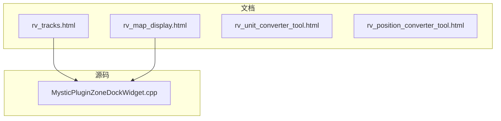
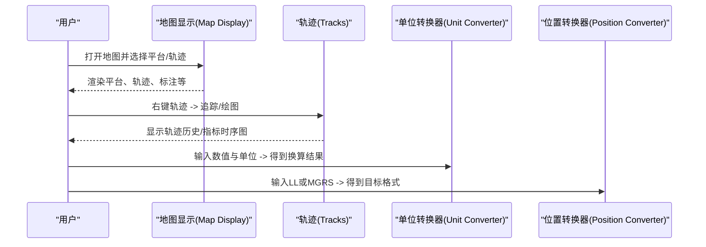
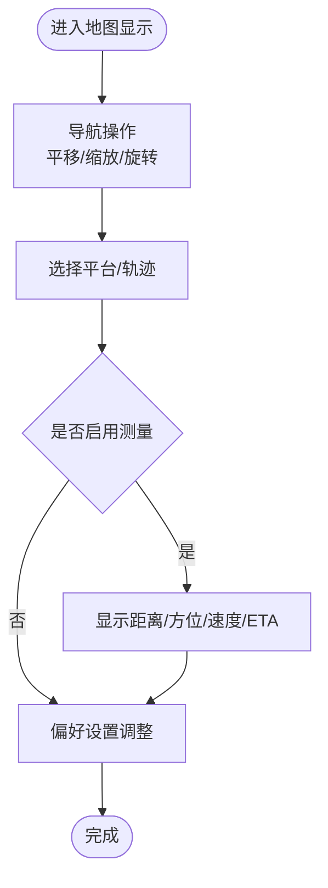
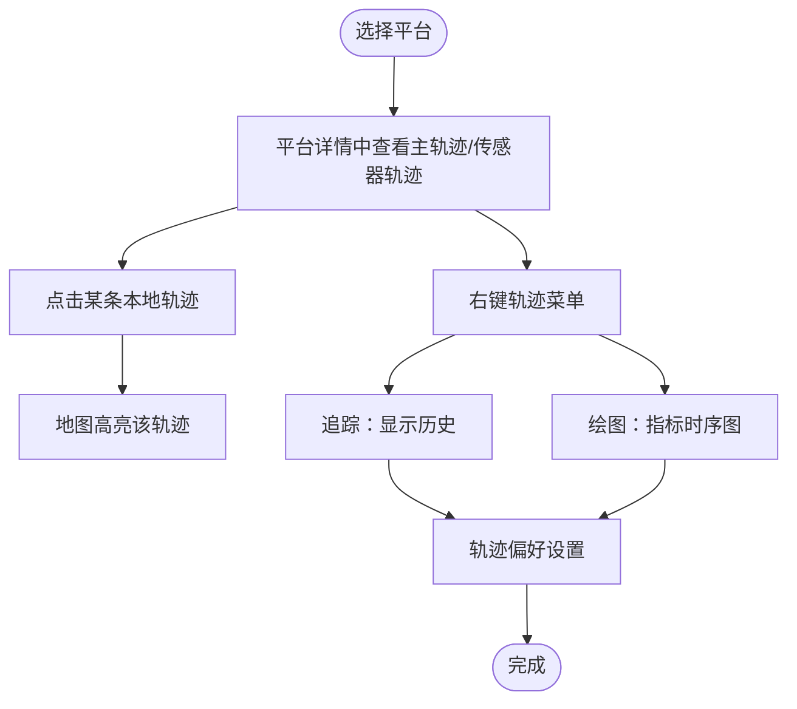
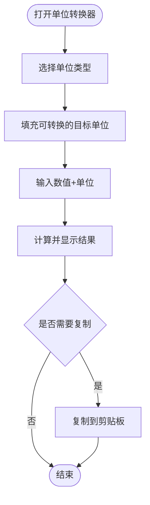
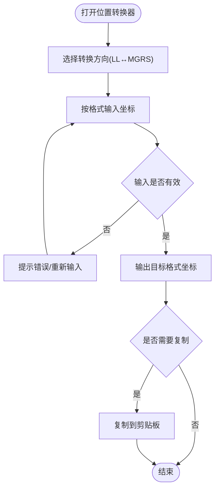
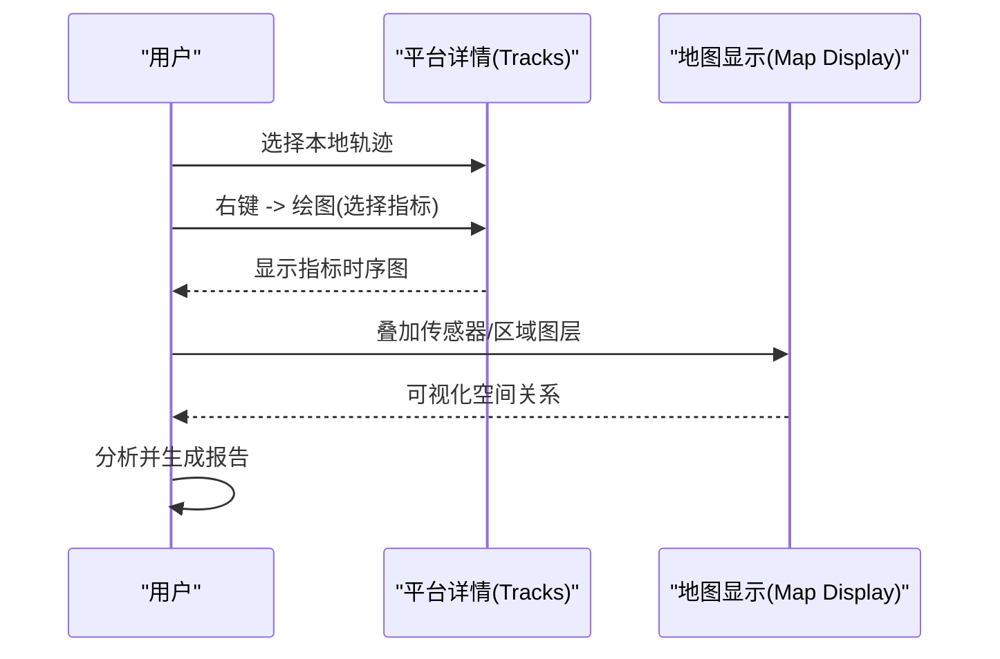
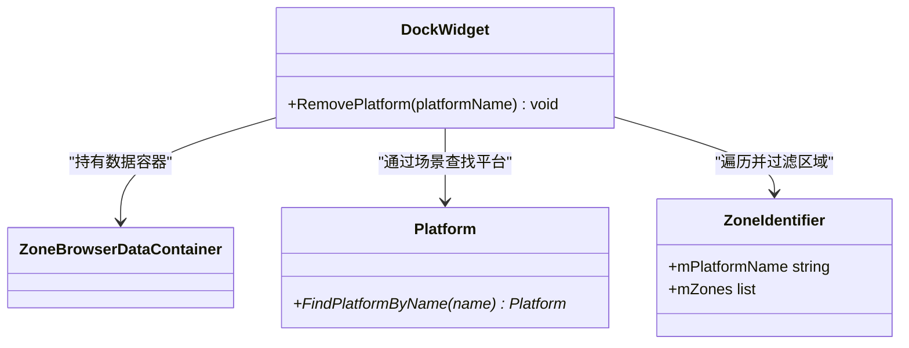
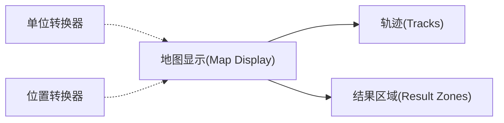

# 插件示例集合

<cite>
**本文引用的文件**   
- [rv_tracks.html](file://documentation/html/docs/wkf_plugin/rv_tracks.html)
- [rv_map_display.html](file://documentation/html/docs/wkf_plugin/rv_map_display.html)
- [rv_unit_converter_tool.html](file://documentation/html/docs/wkf_plugin/rv_unit_converter_tool.html)
- [rv_position_converter_tool.html](file://documentation/html/docs/wkf_plugin/rv_position_converter_tool.html)
- [MysticPluginZoneDockWidget.cpp](file://swdev/src/mystic/plugins/ResultZones/source/MysticPluginZoneDockWidget.cpp)
</cite>

## 目录
1. [简介](#简介)
2. [项目结构](#项目结构)
3. [核心组件](#核心组件)
4. [架构总览](#架构总览)
5. [详细组件分析](#详细组件分析)
6. [依赖关系分析](#依赖关系分析)
7. [性能与可用性考虑](#性能与可用性考虑)
8. [故障排查指南](#故障排查指南)
9. [结论](#结论)
10. [附录：可运行示例与组合用法](#附录可运行示例与组合用法)

## 简介
本文件面向希望基于 AFSIM Mystic 扩展开发“插件”的工程师，提供一套围绕“结果显示类、数据分析类、工具类”三类插件的示例集合文档。内容涵盖：
- 结果展示型插件：地图显示、轨迹（Tracks）等
- 数据分析型插件：轨迹分析、统计报告等（以现有 UI 能力为基座进行扩展）
- 工具型插件：单位转换、位置坐标转换等

每个示例均包含：
- 功能说明与适用场景
- 配置与使用要点
- 实现思路与关键流程
- 与其他插件的组合模式与高级技巧

为保证准确性，本文所有事实性描述均来自仓库内官方文档与源码片段，并通过“章节来源”和“图示来源”进行严格溯源。

## 项目结构
AFSIM 仓库中与 Mystic 插件相关的文档位于 documentation/html/docs/wkf_plugin 下；部分插件 C++ 实现位于 swdev/src/mystic/plugins 下。下图给出与本示例集直接相关的文件组织关系。

**图示来源**
- [rv_tracks.html:73-118](file://documentation/html/docs/wkf_plugin/rv_tracks.html#L73-L118)
- [rv_map_display.html:73-302](file://documentation/html/docs/wkf_plugin/rv_map_display.html#L73-L302)
- [MysticPluginZoneDockWidget.cpp:1-39](file://swdev/src/mystic/plugins/ResultZones/source/MysticPluginZoneDockWidget.cpp#L1-L39)

**章节来源**
- [rv_tracks.html:73-118](file://documentation/html/docs/wkf_plugin/rv_tracks.html#L73-L118)
- [rv_map_display.html:73-302](file://documentation/html/docs/wkf_plugin/rv_map_display.html#L73-L302)
- [MysticPluginZoneDockWidget.cpp:1-39](file://swdev/src/mystic/plugins/ResultZones/source/MysticPluginZoneDockWidget.cpp#L1-L39)

## 核心组件
本节聚焦三类插件的核心能力与典型用法。

- 结果显示类插件
  - 地图显示（Map Display）：世界地图、平台与轨迹可视化、测量工具、偏好设置等
  - 轨迹（Tracks）：在地图上显示本地轨迹，并在平台详情中展示主轨迹与传感器轨迹列表，支持追踪历史与指标绘图
- 数据分析类插件
  - 轨迹分析与统计报告：依托 Tracks 的 Plot 能力对指标时序进行分析；结合 Map Display 的图层控制进行空间分析
- 工具类插件
  - 单位转换器（Unit Converter Tool）：常用物理量单位换算
  - 位置转换器（Position Converter Tool）：经纬度（LL）与 MGRS 互转

**章节来源**
- [rv_map_display.html:73-302](file://documentation/html/docs/wkf_plugin/rv_map_display.html#L73-L302)
- [rv_tracks.html:73-118](file://documentation/html/docs/wkf_plugin/rv_tracks.html#L73-L118)
- [rv_unit_converter_tool.html:73-77](file://documentation/html/docs/wkf_plugin/rv_unit_converter_tool.html#L73-L77)
- [rv_position_converter_tool.html:73-78](file://documentation/html/docs/wkf_plugin/rv_position_converter_tool.html#L73-L78)

## 架构总览
下图展示了“用户交互—UI 插件—数据源”的基本交互路径，以及工具类插件如何作为辅助能力被其他插件复用。

[本图为概念流程图，不直接映射具体源码文件]

## 详细组件分析

### 结果显示类插件：地图显示（Map Display）
- 功能要点
  - 导航操作：拖拽平移、滚轮缩放、双击缩放、中键旋转倾斜、方向键移动、Home 复位
  - 平台标签：可在平台选项中开启名称标签
  - 测量工具：测距、相对方位、接近速度、预计到达时间等
  - 偏好设置：地图选择、亮度/对比度/饱和度、光照、ECI/ECF 视图、网格线、海岸线、国界、湖泊河流、屏幕中心范围环、昼夜分界线、太阳/月球投影点、太阳轨迹、比例尺、指南针、工具提示等
- 适用场景
  - 态势可视化、战术复盘、传感器覆盖分析、航路规划与校验

**图示来源**
- [rv_map_display.html:73-252](file://documentation/html/docs/wkf_plugin/rv_map_display.html#L73-L252)

**章节来源**
- [rv_map_display.html:73-252](file://documentation/html/docs/wkf_plugin/rv_map_display.html#L73-L252)

### 结果显示类插件：轨迹（Tracks）
- 功能要点
  - 在地图上显示本地轨迹图标
  - 平台详情中展示主轨迹与传感器轨迹列表，点击高亮地图上的轨迹
  - 右键轨迹提供“追踪（Trace）”与“绘图（Plot）”
  - 追踪：显示轨迹历史
  - 绘图：按时间绘制指标历史，可选显示真值与贡献传感器轨迹
  - 偏好：可见性策略（无/仅本地/全部可见队伍/指定队伍/网络仿真）、样式（队色、ID 标签、朝向、字体、缩放、默认/自定义/规则化图标）
- 适用场景
  - 多传感器融合结果可视化、轨迹质量评估、传感器贡献分析

**图示来源**
- [rv_tracks.html:73-118](file://documentation/html/docs/wkf_plugin/rv_tracks.html#L73-L118)

**章节来源**
- [rv_tracks.html:73-118](file://documentation/html/docs/wkf_plugin/rv_tracks.html#L73-L118)

### 工具类插件：单位转换器（Unit Converter Tool）
- 功能要点
  - 选择“单位类型”，自动填充“转换为”下拉框中的常用单位
  - 输入带单位的数值，结果区即时显示换算后的值
  - 支持手动复制或使用“复制结果”按钮快速复制到剪贴板
- 适用场景
  - 参数调试、报告撰写、跨单位数据对齐

**图示来源**
- [rv_unit_converter_tool.html:73-77](file://documentation/html/docs/wkf_plugin/rv_unit_converter_tool.html#L73-L77)

**章节来源**
- [rv_unit_converter_tool.html:73-77](file://documentation/html/docs/wkf_plugin/rv_unit_converter_tool.html#L73-L77)

### 工具类插件：位置转换器（Position Converter Tool）
- 功能要点
  - 支持 LL（经纬度）与 MGRS 之间的双向转换
  - 选择转换方向后，按指定格式输入坐标，合法输入即生成目标格式结果
  - 支持手动复制或一键复制到剪贴板
- 适用场景
  - 坐标系统对齐、任务规划、地理围栏定义

**图示来源**
- [rv_position_converter_tool.html:73-78](file://documentation/html/docs/wkf_plugin/rv_position_converter_tool.html#L73-L78)

**章节来源**
- [rv_position_converter_tool.html:73-78](file://documentation/html/docs/wkf_plugin/rv_position_converter_tool.html#L73-L78)

### 数据分析类插件：轨迹分析与统计报告（基于现有能力的扩展）
- 设计思路
  - 利用 Tracks 的 Plot 能力对任意指标（如高度、速度、误差）进行时序分析
  - 结合 Map Display 的图层控制与测量工具，进行空间维度的关联分析（例如将轨迹与传感器覆盖范围叠加）
  - 通过“平台详情”的主/传感器轨迹列表，定位贡献源，进行多源一致性评估
- 典型工作流
  - 在平台详情中选择某条本地轨迹
  - 右键选择“绘图”，挑选待分析指标
  - 在 Map Display 上叠加相关图层（如传感器体积、区域），观察时空相关性
  - 导出或截图用于报告

[本图为概念流程图，不直接映射具体源码文件]

### 源码级示例：结果区域（Result Zones）停靠窗口
- 作用
  - 提供与区域（Zone）相关的停靠窗口，用于管理与删除与平台绑定的区域数据
- 关键点
  - 通过场景查找平台，遍历区域数据并按平台名过滤
  - 当匹配到目标平台时，清理其关联的区域对象

**图示来源**
- [MysticPluginZoneDockWidget.cpp:23-39](file://swdev/src/mystic/plugins/ResultZones/source/MysticPluginZoneDockWidget.cpp#L23-L39)

**章节来源**
- [MysticPluginZoneDockWidget.cpp:1-39](file://swdev/src/mystic/plugins/ResultZones/source/MysticPluginZoneDockWidget.cpp#L1-L39)

## 依赖关系分析
- 组件耦合
  - 地图显示（Map Display）与轨迹（Tracks）存在强耦合：轨迹需在地图上渲染，且受地图偏好影响
  - 工具类插件（单位/位置转换器）独立性强，主要服务于用户交互与数据准备
  - 结果区域（Result Zones）停靠窗口依赖场景与平台数据结构，属于结果可视化的支撑组件
- 外部依赖
  - 地图显示依赖地图定义与地形数据库（TMS）
  - 轨迹与平台详情依赖仿真输出的轨迹数据与传感器数据

**图示来源**
- [rv_map_display.html:73-302](file://documentation/html/docs/wkf_plugin/rv_map_display.html#L73-L302)
- [rv_tracks.html:73-118](file://documentation/html/docs/wkf_plugin/rv_tracks.html#L73-L118)
- [MysticPluginZoneDockWidget.cpp:23-39](file://swdev/src/mystic/plugins/ResultZones/source/MysticPluginZoneDockWidget.cpp#L23-L39)

**章节来源**
- [rv_map_display.html:73-302](file://documentation/html/docs/wkf_plugin/rv_map_display.html#L73-L302)
- [rv_tracks.html:73-118](file://documentation/html/docs/wkf_plugin/rv_tracks.html#L73-L118)
- [MysticPluginZoneDockWidget.cpp:23-39](file://swdev/src/mystic/plugins/ResultZones/source/MysticPluginZoneDockWidget.cpp#L23-L39)

## 性能与可用性考虑
- 地图显示
  - 大量轨迹与模型图标可能影响渲染性能，建议按需开启“显示本地轨迹/仅可见队伍轨迹”等可见性策略
  - 合理设置网格线密度、海岸线/国界等矢量层，避免过度渲染
- 轨迹分析
  - 长时间序列绘图会占用较多内存，建议在 Plot 前筛选必要指标
- 工具类插件
  - 单位/位置转换均为轻量计算，几乎不影响整体性能

[本节为通用指导，不直接分析具体文件]

## 故障排查指南
- 地图无法加载或显示异常
  - 检查地图定义是否正确，TMS 高程数据库是否可用
  - 确认 ECI/ECF 视图切换是否符合预期
- 轨迹未显示或不可见
  - 检查 Tracks 偏好中的可见性策略（如“显示本地轨迹”）
  - 确认平台团队可见性与网络仿真轨迹开关
- 单位/位置转换结果不正确
  - 核对输入格式与单位后缀
  - 确保选择的转换方向正确（LL↔MGRS）

**章节来源**
- [rv_map_display.html:118-252](file://documentation/html/docs/wkf_plugin/rv_map_display.html#L118-L252)
- [rv_tracks.html:92-118](file://documentation/html/docs/wkf_plugin/rv_tracks.html#L92-L118)
- [rv_unit_converter_tool.html:73-77](file://documentation/html/docs/wkf_plugin/rv_unit_converter_tool.html#L73-L77)
- [rv_position_converter_tool.html:73-78](file://documentation/html/docs/wkf_plugin/rv_position_converter_tool.html#L73-L78)

## 结论
本示例集合围绕 AFSIM Mystic 的三大插件类别，给出了从“结果展示—数据分析—工具辅助”的完整实践路径。开发者可以：
- 以地图显示与轨迹为核心构建态势可视化
- 借助 Plot 能力开展轨迹与时序指标分析
- 使用单位/位置转换器提升数据准备效率
- 参考结果区域停靠窗口的实现思路，扩展更多结果可视化能力

[本节为总结性内容，不直接分析具体文件]

## 附录：可运行示例与组合用法
- 组合模式
  - 地图显示 + 轨迹：在地图上叠加轨迹，右键进行追踪与绘图，结合测量工具进行空间分析
  - 轨迹 + 单位/位置转换器：在报告中统一单位与坐标格式，保证图表与地图的一致性
  - 结果区域 + 地图显示：将区域与平台/轨迹关联，便于分区管控与可视化
- 使用步骤（概览）
  - 打开地图显示，选择合适的地图与图层
  - 在平台详情中选择本地轨迹，执行追踪/绘图
  - 使用单位/位置转换器统一数据格式
  - 根据需要启用结果区域停靠窗口，管理区域数据
- 注意事项
  - 保持输入格式规范（单位后缀、坐标格式）
  - 根据场景规模调整可见性与图层密度，平衡性能与可读性

[本节为操作性指导，不直接分析具体文件]