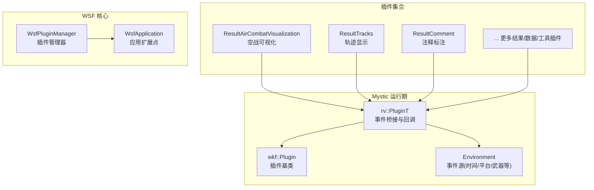
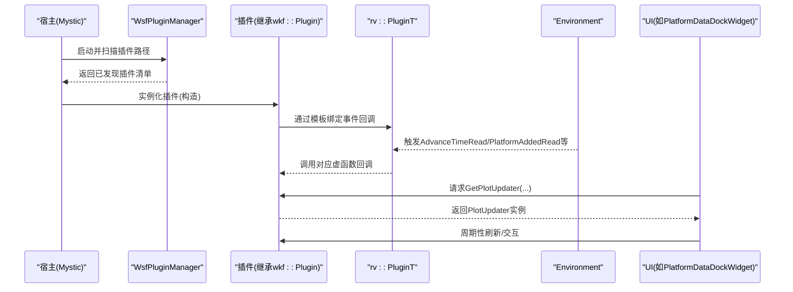
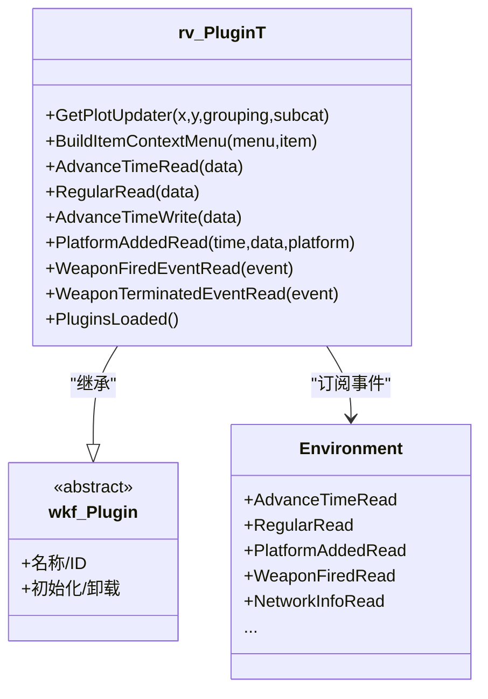
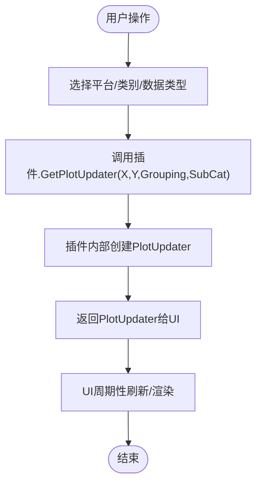
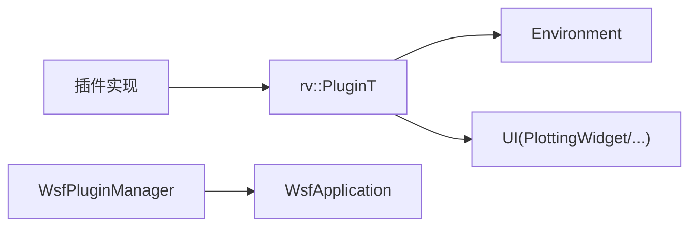

# 插件系统

<cite>
**本文引用的文件**   
- [RvPlugin.hpp](file://swdev/src/mystic/lib/source/RvPlugin.hpp)
- [RvPlatformDataDockWidget.cpp](file://swdev/src/mystic/lib/source/RvPlatformDataDockWidget.cpp)
- [WsfPluginManager.hpp](file://swdev/src/core/wsf/source/WsfPluginManager.hpp)
- [WsfApplication.hpp](file://swdev/src/core/wsf/source/WsfApplication.hpp)
- [mystic_plugin.cmake](file://swdev/src/mystic/plugins/ResultAirCombatVisualization/mystic_plugin.cmake)
- [README.md](file://swdev/src/mystic/README.md)
- [SixDOF_DataSimInterface.cpp](file://swdev/src/warlock/plugins/SixDOF_Data/source/SixDOF_DataSimInterface.cpp)
- [WsfUCI_Component.cpp](file://swdev/src/wsf_plugins/wsf_oms_uci/source/WsfUCI_Component.cpp)
- [rv_tracks.html](file://documentation/html/docs/wkf_plugin/rv_tracks.html)
</cite>

## 目录
1. [简介](#简介)
2. [项目结构](#项目结构)
3. [核心组件](#核心组件)
4. [架构总览](#架构总览)
5. [详细组件分析](#详细组件分析)
6. [依赖关系分析](#依赖关系分析)
7. [性能考虑](#性能考虑)
8. [故障排查指南](#故障排查指南)
9. [结论](#结论)
10. [附录](#附录)

## 简介
本文件为 Mystic 插件系统的权威技术文档，面向插件开发者与集成工程师。内容覆盖：
- 插件架构设计：插件发现、动态加载、生命周期管理
- 插件接口规范：基类继承、虚函数重写、事件回调机制
- 插件开发流程：模板、编译配置、依赖管理
- 插件注册机制：元数据声明、能力声明、版本兼容性检查
- 插件间通信：消息传递、共享数据、事件订阅
- 典型示例：结果显示、数据分析、工具扩展
- 调试技巧与性能优化建议

## 项目结构
Mystic 的插件位于 swdev/src/mystic/plugins 下，每个插件是一个独立子模块，包含源码、文档与 mystic_plugin.cmake 构建脚本；Mystic 运行时通过 wkf::Plugin 基类与 rv::PluginT 模板提供统一的插件框架与事件总线。

图表来源
- [RvPlugin.hpp:35-118](file://swdev/src/mystic/lib/source/RvPlugin.hpp#L35-L118)
- [WsfPluginManager.hpp:39-39](file://swdev/src/core/wsf/source/WsfPluginManager.hpp#L39-L39)
- [WsfApplication.hpp:27-27](file://swdev/src/core/wsf/source/WsfApplication.hpp#L27-L27)

章节来源
- [README.md:1-35](file://swdev/src/mystic/README.md#L1-L35)

## 核心组件
- 插件基类与模板
  - wkf::Plugin：所有插件必须继承的基础抽象类，承载插件标识、初始化、卸载等通用行为。
  - rv::PluginT<PClass>：在 wkf::Plugin 之上封装了 Mystic 的事件桥接，将 Environment 发出的信号（时间推进、平台增删、武器发射、网络信息等）转发给插件的虚函数回调。
- 事件与环境
  - Environment：集中发布仿真相关事件，如 AdvanceTimeRead/Write、RegularRead、PlatformAddedRead、WeaponFiredRead、NetworkInfoRead 等。
  - PlotUpdater：由插件实现，供“绘图更新器”按需生成特定维度的曲线或图表。
- 插件管理器与应用扩展
  - WsfPluginManager：负责插件的动态发现、加载、生命周期管理与版本校验。
  - WsfApplication：提供扩展点注册（RegisterFeature/RegisterExtension），用于能力声明与功能开关。

章节来源
- [RvPlugin.hpp:35-118](file://swdev/src/mystic/lib/source/RvPlugin.hpp#L35-L118)
- [WsfPluginManager.hpp:39-39](file://swdev/src/core/wsf/source/WsfPluginManager.hpp#L39-L39)
- [WsfApplication.hpp:27-27](file://swdev/src/core/wsf/source/WsfApplication.hpp#L27-L27)

## 架构总览
下图展示从宿主到插件的调用链与事件流：宿主启动时加载插件，插件通过 rv::PluginT 订阅 Environment 事件，并在需要时向 UI 层（如 PlatformDataDockWidget）提供 PlotUpdater 以渲染数据。

图表来源
- [RvPlugin.hpp:44-71](file://swdev/src/mystic/lib/source/RvPlugin.hpp#L44-L71)
- [RvPlatformDataDockWidget.cpp:43-65](file://swdev/src/mystic/lib/source/RvPlatformDataDockWidget.cpp#L43-L65)

## 详细组件分析

### 插件基类与事件桥接（rv::PluginT）
- 职责
  - 在构造时将 Environment 的多类事件连接到插件的虚函数槽，确保在仿真主线程中同步执行（DirectConnection）。
  - 暴露 GetPlotUpdater 与 BuildItemContextMenu 等扩展点，供 UI 与上下文菜单使用。
- 关键回调
  - 时间推进：AdvanceTimeRead / RegularRead / AdvanceTimeWrite
  - 场景变化：ClearScenario / PlatformAddedRead
  - 传感器/武器模式：NewSensorModeDefinition / NewWeaponModeDefinition
  - 事件读取：CommentRead / CommInfoRead / NetworkInfoRead / RouterInfoRead / WeaponFiredEventRead / WeaponTerminatedEventRead / PlatformStatusEventRead
  - 元数据与书签：MetaDataRead / BookmarkRead / SetEpoch
  - 插件就绪：PluginsLoaded（在所有插件加载完成后回调，便于跨插件协作注册）

图表来源
- [RvPlugin.hpp:35-118](file://swdev/src/mystic/lib/source/RvPlugin.hpp#L35-L118)

章节来源
- [RvPlugin.hpp:35-118](file://swdev/src/mystic/lib/source/RvPlugin.hpp#L35-L118)

### 插件发现与动态加载（WsfPluginManager）
- 职责
  - 基于 WSF 插件框架进行插件二进制文件的发现、加载、版本校验与生命周期管理。
  - 与 WsfApplication 配合，完成扩展点注册与能力开关。
- 关键点
  - 插件需导出统一入口（例如 WsfPluginVersion/WsfPluginSetup），以便宿主识别与初始化。
  - 支持按能力（feature）与扩展（extension）维度启用/禁用插件。

章节来源
- [WsfPluginManager.hpp:39-39](file://swdev/src/core/wsf/source/WsfPluginManager.hpp#L39-L39)
- [WsfApplication.hpp:27-27](file://swdev/src/core/wsf/source/WsfApplication.hpp#L27-L27)

### 插件注册与能力声明（WsfApplication 扩展点）
- 能力注册
  - RegisterFeature：声明一个能力（如 wsf_coverage），供其他模块或插件查询是否可用。
  - RegisterExtension：注册具体扩展实现，通常与 Feature 一一对应。
- 典型用法
  - 在插件的 Setup 阶段检查 ExtensionIsRegistered，若未注册则进行注册，避免重复注册。

章节来源
- [WsfApplication.hpp:27-27](file://swdev/src/core/wsf/source/WsfApplication.hpp#L27-L27)

### 插件与 UI 的数据通道（PlotUpdater）
- 作用
  - 插件通过 GetPlotUpdater 返回 PlotUpdater 实例，供 UI 控件（如 PlatformDataDockWidget）绘制指定维度的曲线。
- 流程
  - 用户选择某平台/类别后，UI 调用插件的 GetPlotUpdater，传入 X/Y 轴与分组信息。
  - 插件根据参数创建对应的 PlotUpdater 并返回，UI 持有该对象进行周期刷新。

图表来源
- [RvPlatformDataDockWidget.cpp:43-65](file://swdev/src/mystic/lib/source/RvPlatformDataDockWidget.cpp#L43-L65)
- [RvPlugin.hpp:75-83](file://swdev/src/mystic/lib/source/RvPlugin.hpp#L75-L83)

章节来源
- [RvPlatformDataDockWidget.cpp:43-65](file://swdev/src/mystic/lib/source/RvPlatformDataDockWidget.cpp#L43-L65)
- [RvPlugin.hpp:75-83](file://swdev/src/mystic/lib/source/RvPlugin.hpp#L75-L83)

### 插件间通信与事件订阅
- 事件驱动
  - 插件通过 rv::PluginT 订阅 Environment 事件，实现松耦合的消息传递。
  - 适合场景：轨迹显示、注释标注、通信可视化、武器发射标记等。
- 共享数据
  - 通过 ResultDb/ResultData 等数据结构在事件回调中访问最新仿真快照。
- 跨插件协作
  - PluginsLoaded 回调可用于收集其他插件的能力/元数据，完成二次注册或联动。

章节来源
- [RvPlugin.hpp:44-71](file://swdev/src/mystic/lib/source/RvPlugin.hpp#L44-L71)

### 插件开发流程与模板
- 目录结构
  - 每个插件位于 swdev/src/mystic/plugins/<PluginName>/source，包含头文件与实现。
  - 每个插件根目录包含 mystic_plugin.cmake，用于定义插件目标、依赖与安装规则。
- 构建配置
  - 使用 CMake 构建，遵循 WSF/Mystic 的 cmake 扩展约定。
  - 插件可依赖 core/wsf、tools/wkf 等公共库。
- 依赖管理
  - 在 mystic_plugin.cmake 中声明对外部库的依赖，确保链接顺序与导出符号正确。

章节来源
- [mystic_plugin.cmake:1-1](file://swdev/src/mystic/plugins/ResultAirCombatVisualization/mystic_plugin.cmake#L1-L1)

### 典型插件示例
- 结果显示类
  - 轨迹显示（Tracks）：在地图显示上呈现轨迹图标与详情。
  - 参考文档：[rv_tracks.html](file://documentation/html/docs/wkf_plugin/rv_tracks.html)
- 数据分析类
  - 六自由度数据（SixDOF Data）：通过 SimInterface 获取平台姿态/运动学数据。
  - 参考实现：[SixDOF_DataSimInterface.cpp](file://swdev/src/warlock/plugins/SixDOF_Data/source/SixDOF_DataSimInterface.cpp)
- 工具扩展类
  - UCI 组件：演示如何通过 WsfApplication 扩展点进行能力注册与生命周期管理。
  - 参考实现：[WsfUCI_Component.cpp](file://swdev/src/wsf_plugins/wsf_oms_uci/source/WsfUCI_Component.cpp)

章节来源
- [rv_tracks.html:73-76](file://documentation/html/docs/wkf_plugin/rv_tracks.html#L73-L76)
- [SixDOF_DataSimInterface.cpp:21-43](file://swdev/src/warlock/plugins/SixDOF_Data/source/SixDOF_DataSimInterface.cpp#L21-L43)
- [WsfUCI_Component.cpp:28-51](file://swdev/src/wsf_plugins/wsf_oms_uci/source/WsfUCI_Component.cpp#L28-L51)

## 依赖关系分析
- 内聚性
  - rv::PluginT 高内聚地封装了事件桥接逻辑，插件只需关注业务回调与数据更新。
- 耦合度
  - 插件与 Environment 解耦，通过事件订阅降低直接依赖。
  - 插件与 UI 通过 PlotUpdater 接口解耦，UI 不感知插件内部实现。
- 外部依赖
  - 依赖 WSF 插件框架（WsfPluginManager/WsfApplication）进行加载与扩展点管理。
  - 依赖 Qt 与 VTK（通过 wkf 生态）进行 UI 与可视化。

图表来源
- [RvPlugin.hpp:35-118](file://swdev/src/mystic/lib/source/RvPlugin.hpp#L35-L118)
- [WsfPluginManager.hpp:39-39](file://swdev/src/core/wsf/source/WsfPluginManager.hpp#L39-L39)
- [WsfApplication.hpp:27-27](file://swdev/src/core/wsf/source/WsfApplication.hpp#L27-L27)

## 性能考虑
- 事件处理线程
  - rv::PluginT 使用 DirectConnection 保证回调在主线程执行，避免 UI 与仿真线程竞争。
- 更新频率控制
  - 利用 RegularRead 进行低频刷新（如 2Hz），避免高频重绘造成卡顿。
- 数据访问
  - 在事件回调中尽量只读取必要字段，避免大对象拷贝；必要时使用引用或指针。
- 插件初始化
  - 将昂贵初始化放入 PluginsLoaded 或延迟初始化，减少启动开销。
- 资源释放
  - 在析构或卸载钩子中释放 UI 对象、定时器与缓存，防止内存泄漏。

## 故障排查指南
- 插件未加载
  - 检查 WsfPluginManager 是否正确扫描插件路径；确认插件导出了统一入口（版本/设置函数）。
- 事件未触发
  - 确认插件构造函数中已通过 rv::PluginT 连接事件；检查 Environment 是否发出对应信号。
- UI 无数据
  - 检查 GetPlotUpdater 是否返回有效对象；确认 X/Y 轴与分组参数匹配。
- 崩溃或死锁
  - 避免在回调中进行阻塞 IO；注意互斥量使用（如 SixDOF_DataSimInterface 中的 QMutexLocker）。
- 能力不可用
  - 检查 WsfApplication 的 RegisterFeature/RegisterExtension 是否被调用；确认 ExtensionIsRegistered 判断逻辑。

章节来源
- [RvPlugin.hpp:44-71](file://swdev/src/mystic/lib/source/RvPlugin.hpp#L44-L71)
- [RvPlatformDataDockWidget.cpp:43-65](file://swdev/src/mystic/lib/source/RvPlatformDataDockWidget.cpp#L43-L65)
- [SixDOF_DataSimInterface.cpp:21-43](file://swdev/src/warlock/plugins/SixDOF_Data/source/SixDOF_DataSimInterface.cpp#L21-L43)

## 结论
Mystic 插件系统以 wkf::Plugin 为基类、以 rv::PluginT 为事件桥接，结合 WsfPluginManager 与 WsfApplication 的扩展点机制，提供了稳定、可扩展且高性能的插件生态。开发者可通过标准模板快速实现结果显示、数据分析与工具扩展类插件，并通过事件订阅与 PlotUpdater 机制与宿主及其他插件协同工作。

## 附录
- 术语表
  - 插件（Plugin）：可插拔的功能模块，遵循统一接口与生命周期。
  - 能力（Feature）：系统级功能开关，用于声明与启用某项能力。
  - 扩展（Extension）：能力的具体实现，由插件注册。
  - 事件（Event）：仿真过程中产生的状态变更或动作通知。
  - 更新器（PlotUpdater）：为 UI 提供数据更新的适配器。