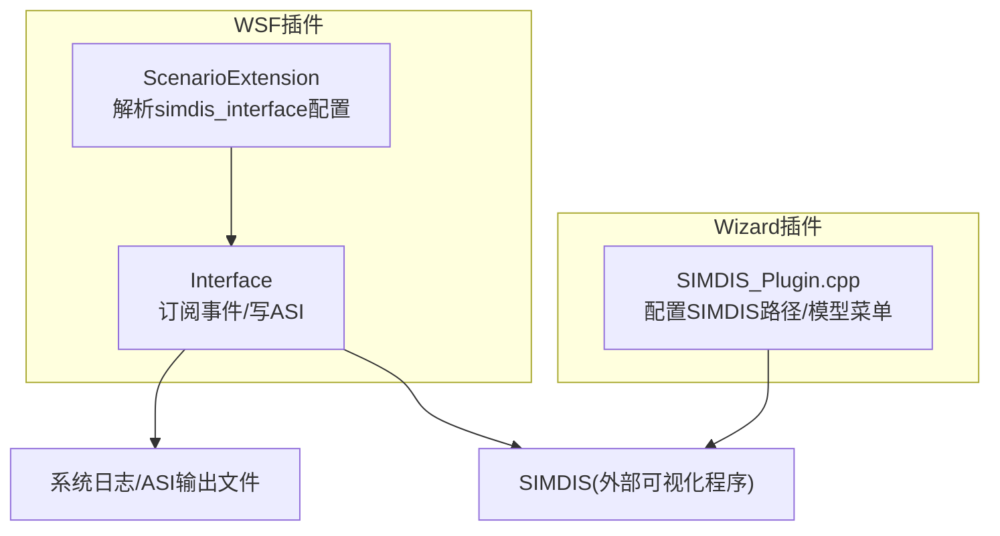
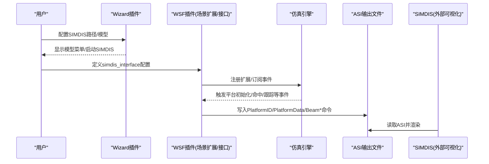
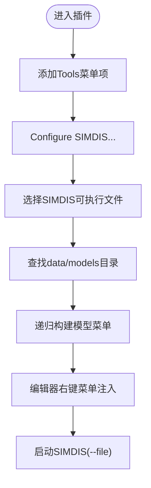
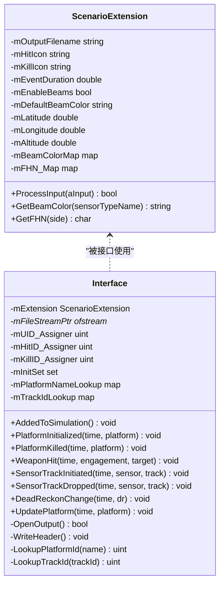
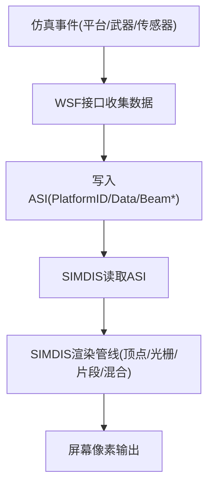
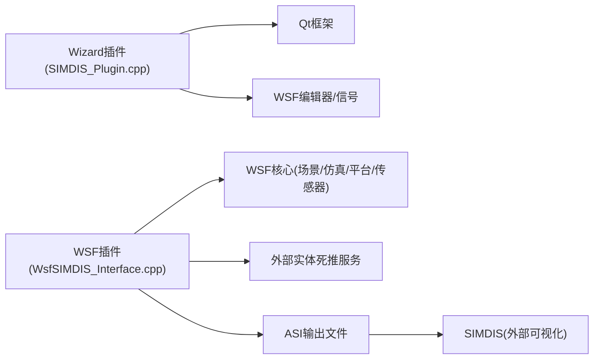

# 2D/3D渲染管线

<cite>
**本文引用的文件**   
- [SIMDIS_Plugin.cpp](file://swdev/src/wizard/plugins/SIMDIS/source/SIMDIS_Plugin.cpp)
- [WsfSIMDIS_Interface.cpp](file://swdev/src/wsf_plugins/wsf_simdis/source/WsfSIMDIS_Interface.cpp)
</cite>

## 目录
1. [简介](#简介)
2. [项目结构](#项目结构)
3. [核心组件](#核心组件)
4. [架构总览](#架构总览)
5. [详细组件分析](#详细组件分析)
6. [依赖关系分析](#依赖关系分析)
7. [性能考虑](#性能考虑)
8. [故障排查指南](#故障排查指南)
9. [结论](#结论)
10. [附录](#附录)

## 简介
本文件面向AFSIM工程中的可视化与渲染相关能力，聚焦于“仿真数据到外部可视化工具”的集成路径。仓库中并未包含自研的OpenGL/Vulkan渲染后端实现；实际渲染由外部工具SIMDIS完成。AFSIM侧通过插件机制生成SIMDIS可识别的ASCII场景输入（ASI），驱动SIMDIS进行2D/3D绘制。因此，本文档将围绕以下主题展开：
- 渲染后端的“选择机制”：AFSIM不直接选择OpenGL或Vulkan，而是通过WSF插件输出ASI给SIMDIS，由SIMDIS在其内部渲染管线中进行GPU渲染。
- 初始化流程与状态管理：从场景扩展配置、仿真生命周期回调到ASI写入。
- 渲染管线阶段映射：从平台位置/姿态更新、传感器波束到命中/击杀特效等事件的数据流。
- 场景图层次与变换：平台实体、跟踪目标、波束等对象在SIMDIS中的组织方式与坐标系统。
- 绘制调用优化：批处理、实例化、状态排序等在ASI层面的体现与建议。
- 调试与性能分析方法：日志、输出文件、SIMDIS端调试手段。
- 自定义渲染效果扩展：通过新增传感器类型颜色、图标、波束参数等进行扩展。

## 项目结构
与渲染相关的代码主要位于两个位置：
- Wizard插件层：提供UI交互，帮助用户配置SIMDIS可执行文件路径与模型目录，并在编辑器上下文中提供快捷操作。
- WSF插件层：在仿真运行期注册扩展、解析场景配置、订阅仿真事件并持续输出ASI至SIMDIS。

图示来源
- [SIMDIS_Plugin.cpp:57-144](file://swdev/src/wizard/plugins/SIMDIS/source/SIMDIS_Plugin.cpp#L57-L144)
- [WsfSIMDIS_Interface.cpp:41-91](file://swdev/src/wsf_plugins/wsf_simdis/source/WsfSIMDIS_Interface.cpp#L41-L91)
- [WsfSIMDIS_Interface.cpp:239-272](file://swdev/src/wsf_plugins/wsf_simdis/source/WsfSIMDIS_Interface.cpp#L239-L272)

章节来源
- [SIMDIS_Plugin.cpp:57-144](file://swdev/src/wizard/plugins/SIMDIS/source/SIMDIS_Plugin.cpp#L57-L144)
- [WsfSIMDIS_Interface.cpp:41-91](file://swdev/src/wsf_plugins/wsf_simdis/source/WsfSIMDIS_Interface.cpp#L41-L91)

## 核心组件
- Wizard插件（SIMDIS_Plugin.cpp）
  - 负责在IDE中提供“配置SIMDIS”菜单项，定位SIMDIS可执行文件与模型目录，构建模型菜单树，支持在编辑器右键菜单中替换图标或颜色值，以及启动SIMDIS。
- WSF场景扩展（ScenarioExtension）
  - 解析场景输入块 simdis_interface，读取输出文件、图标、事件持续时间、默认波束颜色、参考LLA、FHN映射等配置。
- WSF仿真接口（Interface）
  - 在仿真创建时注册扩展，打开ASI输出文件，订阅平台初始化、平台被毁、武器命中、传感器跟踪开始/结束等事件，并通过外部实体死推服务获取平台位姿变化，持续写出PlatformData/Beam命令。

章节来源
- [SIMDIS_Plugin.cpp:57-144](file://swdev/src/wizard/plugins/SIMDIS/source/SIMDIS_Plugin.cpp#L57-L144)
- [WsfSIMDIS_Interface.cpp:93-184](file://swdev/src/wsf_plugins/wsf_simdis/source/WsfSIMDIS_Interface.cpp#L93-L184)
- [WsfSIMDIS_Interface.cpp:239-272](file://swdev/src/wsf_plugins/wsf_simdis/source/WsfSIMDIS_Interface.cpp#L239-L272)

## 架构总览
AFSIM侧不直接实现OpenGL/Vulkan渲染，而是通过WSF插件将仿真数据转换为SIMDIS可理解的ASI文本流。SIMDIS作为外部进程接收该输入并进行实际的GPU渲染。

图示来源
- [SIMDIS_Plugin.cpp:250-261](file://swdev/src/wizard/plugins/SIMDIS/source/SIMDIS_Plugin.cpp#L250-L261)
- [WsfSIMDIS_Interface.cpp:88-91](file://swdev/src/wsf_plugins/wsf_simdis/source/WsfSIMDIS_Interface.cpp#L88-L91)
- [WsfSIMDIS_Interface.cpp:239-272](file://swdev/src/wsf_plugins/wsf_simdis/source/WsfSIMDIS_Interface.cpp#L239-L272)
- [WsfSIMDIS_Interface.cpp:280-292](file://swdev/src/wsf_plugins/wsf_simdis/source/WsfSIMDIS_Interface.cpp#L280-L292)

## 详细组件分析

### Wizard插件：SIMDIS集成入口
- 功能要点
  - 在“Tools”菜单下添加“Configure SIMDIS...”动作，引导用户选择SIMDIS可执行文件与模型目录。
  - 扫描模型目录，递归构建模型菜单树，便于在编辑器中快速替换平台图标或simdis-interface-command的值。
  - 支持在编辑器右键菜单中插入颜色值（ARGB十六进制）。
  - 提供“Open with SIMDIS”以当前文件为参数启动SIMDIS。
- 关键流程
  - 配置SIMDIS：选择exe路径，推导data/models目录，若不存在则允许手动指定。
  - 构建模型菜单：遍历文件/子目录，生成嵌套菜单。
  - 编辑器上下文：根据解析节点规则（如<Platform>、<simdis-interface-command>）动态注入菜单项。
  - 启动SIMDIS：使用QProcess启动外部进程，传递--file参数。

图示来源
- [SIMDIS_Plugin.cpp:57-75](file://swdev/src/wizard/plugins/SIMDIS/source/SIMDIS_Plugin.cpp#L57-L75)
- [SIMDIS_Plugin.cpp:93-144](file://swdev/src/wizard/plugins/SIMDIS/source/SIMDIS_Plugin.cpp#L93-L144)
- [SIMDIS_Plugin.cpp:147-178](file://swdev/src/wizard/plugins/SIMDIS/source/SIMDIS_Plugin.cpp#L147-L178)
- [SIMDIS_Plugin.cpp:180-247](file://swdev/src/wizard/plugins/SIMDIS/source/SIMDIS_Plugin.cpp#L180-L247)
- [SIMDIS_Plugin.cpp:250-261](file://swdev/src/wizard/plugins/SIMDIS/source/SIMDIS_Plugin.cpp#L250-L261)

章节来源
- [SIMDIS_Plugin.cpp:57-144](file://swdev/src/wizard/plugins/SIMDIS/source/SIMDIS_Plugin.cpp#L57-L144)
- [SIMDIS_Plugin.cpp:147-178](file://swdev/src/wizard/plugins/SIMDIS/source/SIMDIS_Plugin.cpp#L147-L178)
- [SIMDIS_Plugin.cpp:180-247](file://swdev/src/wizard/plugins/SIMDIS/source/SIMDIS_Plugin.cpp#L180-L247)
- [SIMDIS_Plugin.cpp:250-261](file://swdev/src/wizard/plugins/SIMDIS/source/SIMDIS_Plugin.cpp#L250-L261)

### WSF插件：场景扩展与仿真接口
- 场景扩展（ScenarioExtension）
  - 解析simdis_interface命令块，支持file、hit_icon、kill_icon、event_duration、enable_beams、default_beam_color、beam_color、reference_lla、define_fhn等参数。
  - 提供GetBeamColor与GetFHN等方法供接口层查询。
- 仿真接口（Interface）
  - AddedToSimulation：打开ASI输出文件，写入头部（Version、RefLLA、CoordSystem等），订阅平台初始化、平台被毁、武器命中、传感器跟踪开始/结束等事件，启用外部实体死推服务。
  - PlatformInitialized：首次输出平台ID、名称、图标、FHN、参考LLA。
  - PlatformKilled/WeaponHit：按配置的图标与事件持续时间输出临时特效平台数据。
  - SensorTrackInitiated/Dropped：根据enable_beams与beam_color输出BeamID/BeamType/BeamDesc/VertBW/HorzBW/BeamOnOffCmd/BeamColorCmd/BeamTargetIdCmd等命令。
  - DeadReckonChange/UpdatePlatform：基于外部实体死推服务获取平台ECEF位置、姿态角、速度，输出PlatformData。

图示来源
- [WsfSIMDIS_Interface.cpp:68-91](file://swdev/src/wsf_plugins/wsf_simdis/source/WsfSIMDIS_Interface.cpp#L68-L91)
- [WsfSIMDIS_Interface.cpp:93-184](file://swdev/src/wsf_plugins/wsf_simdis/source/WsfSIMDIS_Interface.cpp#L93-L184)
- [WsfSIMDIS_Interface.cpp:186-226](file://swdev/src/wsf_plugins/wsf_simdis/source/WsfSIMDIS_Interface.cpp#L186-L226)
- [WsfSIMDIS_Interface.cpp:228-272](file://swdev/src/wsf_plugins/wsf_simdis/source/WsfSIMDIS_Interface.cpp#L228-L272)
- [WsfSIMDIS_Interface.cpp:274-292](file://swdev/src/wsf_plugins/wsf_simdis/source/WsfSIMDIS_Interface.cpp#L274-L292)
- [WsfSIMDIS_Interface.cpp:294-312](file://swdev/src/wsf_plugins/wsf_simdis/source/WsfSIMDIS_Interface.cpp#L294-L312)
- [WsfSIMDIS_Interface.cpp:314-369](file://swdev/src/wsf_plugins/wsf_simdis/source/WsfSIMDIS_Interface.cpp#L314-L369)
- [WsfSIMDIS_Interface.cpp:371-420](file://swdev/src/wsf_plugins/wsf_simdis/source/WsfSIMDIS_Interface.cpp#L371-L420)
- [WsfSIMDIS_Interface.cpp:422-474](file://swdev/src/wsf_plugins/wsf_simdis/source/WsfSIMDIS_Interface.cpp#L422-L474)

章节来源
- [WsfSIMDIS_Interface.cpp:68-91](file://swdev/src/wsf_plugins/wsf_simdis/source/WsfSIMDIS_Interface.cpp#L68-L91)
- [WsfSIMDIS_Interface.cpp:93-184](file://swdev/src/wsf_plugins/wsf_simdis/source/WsfSIMDIS_Interface.cpp#L93-L184)
- [WsfSIMDIS_Interface.cpp:186-226](file://swdev/src/wsf_plugins/wsf_simdis/source/WsfSIMDIS_Interface.cpp#L186-L226)
- [WsfSIMDIS_Interface.cpp:228-272](file://swdev/src/wsf_plugins/wsf_simdis/source/WsfSIMDIS_Interface.cpp#L228-L272)
- [WsfSIMDIS_Interface.cpp:274-292](file://swdev/src/wsf_plugins/wsf_simdis/source/WsfSIMDIS_Interface.cpp#L274-L292)
- [WsfSIMDIS_Interface.cpp:294-312](file://swdev/src/wsf_plugins/wsf_simdis/source/WsfSIMDIS_Interface.cpp#L294-L312)
- [WsfSIMDIS_Interface.cpp:314-369](file://swdev/src/wsf_plugins/wsf_simdis/source/WsfSIMDIS_Interface.cpp#L314-L369)
- [WsfSIMDIS_Interface.cpp:371-420](file://swdev/src/wsf_plugins/wsf_simdis/source/WsfSIMDIS_Interface.cpp#L371-L420)
- [WsfSIMDIS_Interface.cpp:422-474](file://swdev/src/wsf_plugins/wsf_simdis/source/WsfSIMDIS_Interface.cpp#L422-L474)

### 渲染管线阶段映射（从数据到像素）
由于实际渲染在SIMDIS中完成，AFSIM侧的职责是生成正确的场景描述与实时数据。可将AFSIM的输出映射到典型渲染阶段：
- 顶点处理（SIMDIS内部）：读取PlatformData中的位置/姿态/速度，构建几何体顶点。
- 光栅化（SIMDIS内部）：将几何体投影到屏幕空间。
- 片段着色（SIMDIS内部）：根据材质/颜色/透明度等属性计算像素颜色。
- 深度/混合（SIMDIS内部）：处理遮挡与透明叠加。
AFSIM侧的关键输出包括：
- 平台初始化：PlatformID/PlatformName/PlatformIcon/PlatformFHN/PlatformRefLLA。
- 平台更新：PlatformData（ECEF位置、欧拉姿态角、速度）。
- 传感器波束：BeamID/BeamType/BeamDesc/VertBW/HorzBW/BeamOnOffCmd/BeamColorCmd/BeamTargetIdCmd。
- 特效：命中/击杀时的临时平台数据。

图示来源
- [WsfSIMDIS_Interface.cpp:280-292](file://swdev/src/wsf_plugins/wsf_simdis/source/WsfSIMDIS_Interface.cpp#L280-L292)
- [WsfSIMDIS_Interface.cpp:294-312](file://swdev/src/wsf_plugins/wsf_simdis/source/WsfSIMDIS_Interface.cpp#L294-L312)
- [WsfSIMDIS_Interface.cpp:314-369](file://swdev/src/wsf_plugins/wsf_simdis/source/WsfSIMDIS_Interface.cpp#L314-L369)
- [WsfSIMDIS_Interface.cpp:371-420](file://swdev/src/wsf_plugins/wsf_simdis/source/WsfSIMDIS_Interface.cpp#L371-L420)
- [WsfSIMDIS_Interface.cpp:422-446](file://swdev/src/wsf_plugins/wsf_simdis/source/WsfSIMDIS_Interface.cpp#L422-L446)

章节来源
- [WsfSIMDIS_Interface.cpp:280-292](file://swdev/src/wsf_plugins/wsf_simdis/source/WsfSIMDIS_Interface.cpp#L280-L292)
- [WsfSIMDIS_Interface.cpp:294-312](file://swdev/src/wsf_plugins/wsf_simdis/source/WsfSIMDIS_Interface.cpp#L294-L312)
- [WsfSIMDIS_Interface.cpp:314-369](file://swdev/src/wsf_plugins/wsf_simdis/source/WsfSIMDIS_Interface.cpp#L314-L369)
- [WsfSIMDIS_Interface.cpp:371-420](file://swdev/src/wsf_plugins/wsf_simdis/source/WsfSIMDIS_Interface.cpp#L371-L420)
- [WsfSIMDIS_Interface.cpp:422-446](file://swdev/src/wsf_plugins/wsf_simdis/source/WsfSIMDIS_Interface.cpp#L422-L446)

### 场景图层次结构与变换
- 场景图概念（SIMDIS侧）
  - 平台实体：每个平台具有唯一ID、名称、图标、FHN（友/敌/中性）、参考LLA。
  - 跟踪目标：传感器跟踪产生Beam对象，连接发射源与目标平台。
  - 特效对象：命中/击杀产生的临时平台，用于视觉反馈。
- 变换矩阵计算（SIMDIS侧）
  - 平台位置采用ECEF坐标系，姿态以欧拉角表示，速度向量用于运动表现。
  - 波束方向与宽度由目标相对位置与距离估算，结合垂直/水平波宽设置。
- 父子关系管理（SIMDIS侧）
  - BeamTargetIdCmd将波束与目标平台关联，形成父子关系。
- 视锥剔除（SIMDIS侧）
  - 由SIMDIS内部相机与视锥剔除逻辑决定可见性，AFSIM侧无需实现。

章节来源
- [WsfSIMDIS_Interface.cpp:294-312](file://swdev/src/wsf_plugins/wsf_simdis/source/WsfSIMDIS_Interface.cpp#L294-L312)
- [WsfSIMDIS_Interface.cpp:371-420](file://swdev/src/wsf_plugins/wsf_simdis/source/WsfSIMDIS_Interface.cpp#L371-L420)
- [WsfSIMDIS_Interface.cpp:422-446](file://swdev/src/wsf_plugins/wsf_simdis/source/WsfSIMDIS_Interface.cpp#L422-L446)

### 绘制调用优化技术
- 批处理渲染
  - 通过集中输出PlatformData减少频繁IO抖动，SIMDIS侧可对同材质/同状态的实体进行批处理。
- 实例化绘制
  - 对重复几何体（如大量相同图标）建议使用同一图标资源，避免重复加载。
- 状态排序
  - 建议按材质/透明度分组输出，减少SIMDIS侧状态切换开销。
- 波束优化
  - 对不可见或全透明的波束（颜色前缀0x00）跳过渲染，已在代码中显式判断。

章节来源
- [WsfSIMDIS_Interface.cpp:395-401](file://swdev/src/wsf_plugins/wsf_simdis/source/WsfSIMDIS_Interface.cpp#L395-L401)

### 自定义渲染效果扩展指南
- 新增传感器类型颜色
  - 在simdis_interface中使用beam_color命令为特定传感器类型绑定颜色。
- 自定义图标
  - 通过hit_icon/kill_icon配置命中/击杀特效图标。
- 波束样式
  - 通过VertBW/HorzBW控制波束张角，结合BeamColorCmd设置颜色。
- 参考坐标系
  - reference_lla用于设定场景参考经纬高，确保坐标一致性。

章节来源
- [WsfSIMDIS_Interface.cpp:147-162](file://swdev/src/wsf_plugins/wsf_simdis/source/WsfSIMDIS_Interface.cpp#L147-L162)
- [WsfSIMDIS_Interface.cpp:117-141](file://swdev/src/wsf_plugins/wsf_simdis/source/WsfSIMDIS_Interface.cpp#L117-L141)
- [WsfSIMDIS_Interface.cpp:371-420](file://swdev/src/wsf_plugins/wsf_simdis/source/WsfSIMDIS_Interface.cpp#L371-L420)
- [WsfSIMDIS_Interface.cpp:163-168](file://swdev/src/wsf_plugins/wsf_simdis/source/WsfSIMDIS_Interface.cpp#L163-L168)

## 依赖关系分析
- Wizard插件依赖Qt框架（QMenu/QFileDialog/QProcess等）与WSF编辑器信号。
- WSF插件依赖WSF核心（WsfApplication/WsfScenario/WsfSimulation/WsfPlatform/WsfSensor等）与外部实体死推服务。
- 两者均不直接依赖OpenGL/Vulkan；渲染由SIMDIS完成。

图示来源
- [SIMDIS_Plugin.cpp:15-35](file://swdev/src/wizard/plugins/SIMDIS/source/SIMDIS_Plugin.cpp#L15-L35)
- [SIMDIS_Plugin.cpp:57-75](file://swdev/src/wizard/plugins/SIMDIS/source/SIMDIS_Plugin.cpp#L57-L75)
- [WsfSIMDIS_Interface.cpp:27-39](file://swdev/src/wsf_plugins/wsf_simdis/source/WsfSIMDIS_Interface.cpp#L27-L39)
- [WsfSIMDIS_Interface.cpp:266-272](file://swdev/src/wsf_plugins/wsf_simdis/source/WsfSIMDIS_Interface.cpp#L266-L272)

章节来源
- [SIMDIS_Plugin.cpp:15-35](file://swdev/src/wizard/plugins/SIMDIS/source/SIMDIS_Plugin.cpp#L15-L35)
- [SIMDIS_Plugin.cpp:57-75](file://swdev/src/wizard/plugins/SIMDIS/source/SIMDIS_Plugin.cpp#L57-L75)
- [WsfSIMDIS_Interface.cpp:27-39](file://swdev/src/wsf_plugins/wsf_simdis/source/WsfSIMDIS_Interface.cpp#L27-L39)
- [WsfSIMDIS_Interface.cpp:266-272](file://swdev/src/wsf_plugins/wsf_simdis/source/WsfSIMDIS_Interface.cpp#L266-L272)

## 性能考虑
- I/O优化
  - 批量写入PlatformData，减少文件句柄频繁刷新。
  - 仅在必要时输出Beam命令（enable_beams开关）。
- 数据量控制
  - 对全透明波束（颜色前缀0x00）跳过渲染，避免无效绘制。
- 事件频率
  - 合理设置update_interval与event_duration，平衡实时性与负载。
- 外部实体死推
  - 通过DR服务按需请求平台位姿，降低仿真主循环压力。

章节来源
- [WsfSIMDIS_Interface.cpp:147-150](file://swdev/src/wsf_plugins/wsf_simdis/source/WsfSIMDIS_Interface.cpp#L147-L150)
- [WsfSIMDIS_Interface.cpp:395-401](file://swdev/src/wsf_plugins/wsf_simdis/source/WsfSIMDIS_Interface.cpp#L395-L401)
- [WsfSIMDIS_Interface.cpp:266-272](file://swdev/src/wsf_plugins/wsf_simdis/source/WsfSIMDIS_Interface.cpp#L266-L272)

## 故障排查指南
- 无法启动SIMDIS
  - 检查Wizard插件是否正确配置SIMDIS可执行文件路径。
  - 确认模型目录存在且可读。
- ASI文件未生成或为空
  - 检查simdis_interface.file是否设置为非NULL。
  - 查看系统日志是否记录ASI输出路径。
- 平台未显示或位置错误
  - 确认reference_lla设置正确。
  - 检查PlatformRefLLA与PlatformData输出是否一致。
- 波束未显示
  - 确认enable_beams为true。
  - 检查beam_color是否为有效颜色（非0x00开头）。
- 命中/击杀特效不出现
  - 检查hit_icon/kill_icon是否配置为非空。
  - 确认event_duration大于0。

章节来源
- [SIMDIS_Plugin.cpp:93-144](file://swdev/src/wizard/plugins/SIMDIS/source/SIMDIS_Plugin.cpp#L93-L144)
- [WsfSIMDIS_Interface.cpp:239-258](file://swdev/src/wsf_plugins/wsf_simdis/source/WsfSIMDIS_Interface.cpp#L239-L258)
- [WsfSIMDIS_Interface.cpp:280-292](file://swdev/src/wsf_plugins/wsf_simdis/source/WsfSIMDIS_Interface.cpp#L280-L292)
- [WsfSIMDIS_Interface.cpp:314-369](file://swdev/src/wsf_plugins/wsf_simdis/source/WsfSIMDIS_Interface.cpp#L314-L369)
- [WsfSIMDIS_Interface.cpp:371-420](file://swdev/src/wsf_plugins/wsf_simdis/source/WsfSIMDIS_Interface.cpp#L371-L420)

## 结论
AFSIM在本仓库中通过Wizard与WSF插件协同工作，将仿真数据转换为SIMDIS可识别的ASI格式，从而驱动SIMDIS进行2D/3D渲染。AFSIM侧不负责OpenGL/Vulkan的具体实现，而是专注于数据生成、事件订阅与配置管理。通过合理的配置与优化策略，可在保证视觉效果的同时提升整体性能。

## 附录
- 常用配置项速查
  - file：ASI输出文件路径
  - hit_icon/kill_icon：命中/击杀特效图标
  - event_duration：特效持续时间
  - enable_beams：是否输出传感器波束
  - default_beam_color：默认波束颜色
  - beam_color：按传感器类型指定波束颜色
  - reference_lla：场景参考经纬高
  - define_fhn：按阵营映射FHN字符

章节来源
- [WsfSIMDIS_Interface.cpp:103-168](file://swdev/src/wsf_plugins/wsf_simdis/source/WsfSIMDIS_Interface.cpp#L103-L168)