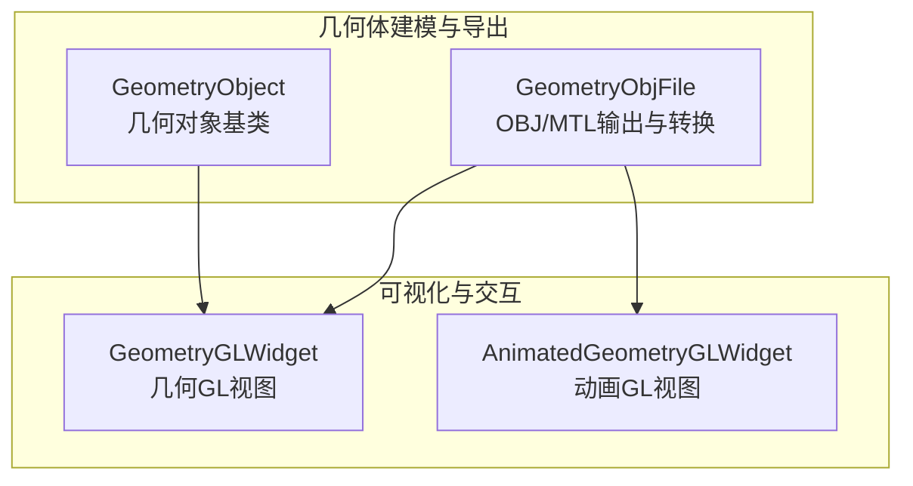
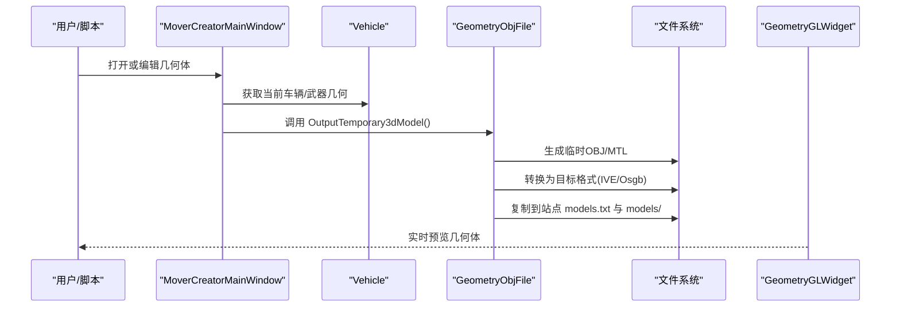
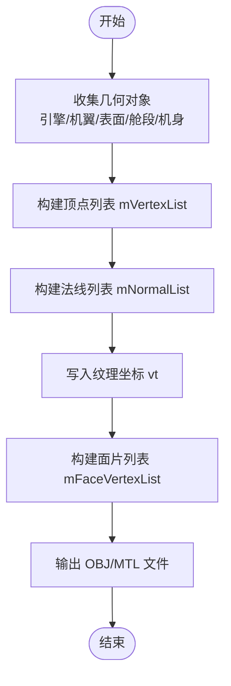
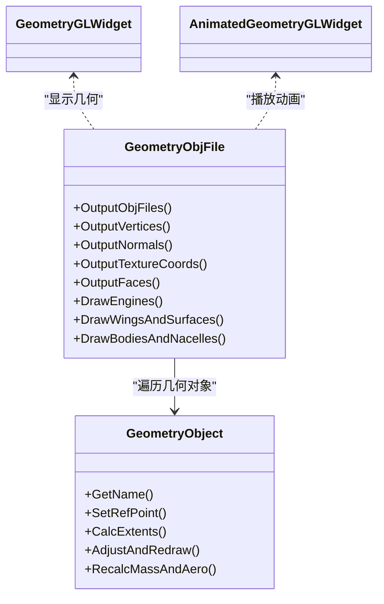

# 几何体渲染

<cite>
**本文引用的文件**   
- [GeometryObjFile.cpp](file://swdev/src/mover_creator/source/GeometryObjFile.cpp)
- [GeometryObject.cpp](file://swdev/src/mover_creator/source/GeometryObject.cpp)
- [AnimatedGeometryGLWidget.cpp](file://swdev/src/mover_creator/source/AnimatedGeometryGLWidget.cpp)
- [GeometryGLWidget.cpp](file://swdev/src/mover_creator/source/GeometryGLWidget.cpp)
</cite>

## 目录
1. [简介](#简介)
2. [项目结构](#项目结构)
3. [核心组件](#核心组件)
4. [架构总览](#架构总览)
5. [详细组件分析](#详细组件分析)
6. [依赖关系分析](#依赖关系分析)
7. [性能考虑](#性能考虑)
8. [故障排查指南](#故障排查指南)
9. [结论](#结论)
10. [附录](#附录)

## 简介
本文件面向“几何体渲染系统”的完整技术文档，聚焦以下主题：
- 网格数据组织：顶点、法线、纹理坐标与骨骼动画数据的结构与流转
- 缓冲区管理：VBO/IBO/UBO的使用策略与生命周期
- LOD（细节层次）：按距离自动调整模型复杂度
- 实例化渲染：高效绘制大量相同几何体
- 碰撞检测几何基础：包围盒与凸包计算
- 几何体优化工具与性能分析方法
- 自定义几何体的创建与导入流程

本仓库包含几何体建模与导出工具链（Mover Creator），以及可视化与OpenGL交互组件。下文将基于源码对关键实现进行系统化说明。

## 项目结构
与几何体渲染相关的代码主要位于 mover_creator 子系统中，负责几何体建模、OBJ导出、场景树管理与GL视图交互；同时提供动画与GL控件以支持实时预览与调试。

图表来源
- [GeometryObjFile.cpp:100-189](file://swdev/src/mover_creator/source/GeometryObjFile.cpp#L100-L189)
- [GeometryObject.cpp:33-78](file://swdev/src/mover_creator/source/GeometryObject.cpp#L33-L78)
- [GeometryGLWidget.cpp](file://swdev/src/mover_creator/source/GeometryGLWidget.cpp)
- [AnimatedGeometryGLWidget.cpp](file://swdev/src/mover_creator/source/AnimatedGeometryGLWidget.cpp)

章节来源
- [GeometryObjFile.cpp:100-189](file://swdev/src/mover_creator/source/GeometryObjFile.cpp#L100-L189)
- [GeometryObject.cpp:33-78](file://swdev/src/mover_creator/source/GeometryObject.cpp#L33-L78)

## 核心组件
- GeometryObjFile：负责从内部几何描述生成 OBJ/MTL 文件，并转换为 IVE/Osgb 等格式；维护顶点、法线、纹理坐标与面片列表，完成材质与面索引写入。
- GeometryObject：几何对象的抽象基类，封装名称、参考点、UI树节点、质量与惯性属性计算、审计与更新逻辑。
- GeometryGLWidget / AnimatedGeometryGLWidget：用于在Qt中显示几何体与动画，承载OpenGL渲染上下文与交互。

章节来源
- [GeometryObjFile.cpp:100-189](file://swdev/src/mover_creator/source/GeometryObjFile.cpp#L100-L189)
- [GeometryObject.cpp:33-78](file://swdev/src/mover_creator/source/GeometryObject.cpp#L33-L78)
- [GeometryGLWidget.cpp](file://swdev/src/mover_creator/source/GeometryGLWidget.cpp)
- [AnimatedGeometryGLWidget.cpp](file://swdev/src/mover_creator/source/AnimatedGeometryGLWidget.cpp)

## 架构总览
几何体渲染管线从建模到导出的整体流程如下：

图表来源
- [GeometryObjFile.cpp:192-250](file://swdev/src/mover_creator/source/GeometryObjFile.cpp#L192-L250)
- [GeometryObjFile.cpp:306-426](file://swdev/src/mover_creator/source/GeometryObjFile.cpp#L306-L426)

## 详细组件分析

### 网格数据组织（顶点、法线、纹理坐标、面片）
- 顶点与法线：通过遍历内部几何对象集合，生成 v/vn 记录，并在 OBJ 文件中输出。
- 纹理坐标：默认写入少量 vt 记录，供外部材质使用。
- 面片与索引：以 f 命令输出多边形面，间接形成索引缓冲（IBO）语义。
- 材质：输出 MTL 文件，定义基础材质参数。

图表来源
- [GeometryObjFile.cpp:428-497](file://swdev/src/mover_creator/source/GeometryObjFile.cpp#L428-L497)
- [GeometryObjFile.cpp:499-800](file://swdev/src/mover_creator/source/GeometryObjFile.cpp#L499-L800)

章节来源
- [GeometryObjFile.cpp:428-497](file://swdev/src/mover_creator/source/GeometryObjFile.cpp#L428-L497)
- [GeometryObjFile.cpp:499-800](file://swdev/src/mover_creator/source/GeometryObjFile.cpp#L499-L800)

### 缓冲区管理机制（VBO/IBO/UBO）
- VBO（顶点缓冲对象）：由 OBJ 的顶点序列映射而来，通常在加载至图形API时建立。
- IBO（索引缓冲对象）：由 OBJ 的面片索引隐式表达，渲染时通过索引访问顶点。
- UBO（统一缓冲对象）：用于传递变换矩阵、材质参数等常量数据；具体绑定与布局需结合着色器与驱动层实现。

注意：本节为通用渲染管线建议，具体实现细节取决于上层渲染框架与着色器配置。

### LOD（细节层次）系统
- 目标：根据相机/实体距离动态切换模型的三角面密度、贴图分辨率或LOD组。
- 常见策略：
  - 预生成多级LOD网格，运行时按距离选择。
  - 基于屏幕空间误差阈值进行细分/简化。
  - 合并近处高模与远处低模的渲染批次。
- 与导出流程集成：可在 OBJ/MTL 阶段输出多个LOD变体，或在运行时由加载器解析不同精度资源。

[本节为概念性说明，不直接分析具体文件]

### 实例化渲染技术
- 适用场景：大量相同几何体（如植被、弹药、粒子簇）。
- 关键点：
  - 使用 glDrawArraysInstanced/glDrawElementsInstanced 减少CPU-GPU调用开销。
  - 将每实例属性（位置、缩放、旋转、颜色）放入实例缓冲（Instance Buffer）。
  - 合理批处理与状态切换，避免频繁改变材质与VAO。
- 与几何体导出：确保OBJ中的几何体可被复用，避免重复顶点与冗余索引。

[本节为概念性说明，不直接分析具体文件]

### 碰撞检测的几何基础
- 包围盒（AABB/OBB）：快速粗略检测，适合大规模筛选。
- 凸包（Convex Hull）：用于精确碰撞与分离轴定理（SAT）。
- 与几何体数据的关系：顶点与面片可用于构建包围体；法线可用于光照与反射计算。

[本节为概念性说明，不直接分析具体文件]

### 几何体优化工具与性能分析方法
- 优化方向：
  - 顶点去重与索引压缩
  - 剔除不可见面片（背面剔除）
  - 合并材质与纹理图集
  - 减少状态切换与批次数量
- 分析方法：
  - 帧时间剖析（GPU/CPU占比）
  - 绘制调用计数与三角形计数
  - 内存带宽与缓存命中率

[本节为概念性说明，不直接分析具体文件]

### 自定义几何体的创建与导入指南
- 创建流程：
  1) 在 Mover Creator 中设计几何体（机身、机翼、舵面、发动机等）。
  2) 生成临时 OBJ/MTL，并转换为 IVE/Osgb。
  3) 将模型复制到站点 models/ 目录，并注册到 models.txt。
- 导入流程：
  - 通过场景或平台定义引用模型名称或别名。
  - 在可视化窗口中预览与验证几何体。

章节来源
- [GeometryObjFile.cpp:192-250](file://swdev/src/mover_creator/source/GeometryObjFile.cpp#L192-L250)
- [GeometryObjFile.cpp:306-426](file://swdev/src/mover_creator/source/GeometryObjFile.cpp#L306-L426)

## 依赖关系分析
- GeometryObjFile 依赖 VehicleGeometry 与各类几何对象（Engine/Wing/Surface/Fuselage/Body/Dish），以遍历并生成网格数据。
- GeometryObject 作为基类，被具体几何类型继承，提供统一的参考点、UI树节点与质量/惯性计算接口。
- GeometryGLWidget 与 AnimatedGeometryGLWidget 负责OpenGL渲染与动画展示，与上述几何数据解耦。

图表来源
- [GeometryObjFile.cpp:499-800](file://swdev/src/mover_creator/source/GeometryObjFile.cpp#L499-L800)
- [GeometryObject.cpp:33-78](file://swdev/src/mover_creator/source/GeometryObject.cpp#L33-L78)

章节来源
- [GeometryObjFile.cpp:499-800](file://swdev/src/mover_creator/source/GeometryObjFile.cpp#L499-L800)
- [GeometryObject.cpp:33-78](file://swdev/src/mover_creator/source/GeometryObject.cpp#L33-L78)

## 性能考虑
- 减少绘制调用：合并批次，使用实例化渲染。
- 降低顶点与索引规模：按需LOD、剔除不可见部分。
- 纹理与材质优化：图集与共享材质，减少状态切换。
- GPU/CPU平衡：将批量计算移至GPU（如顶点着色器），减少CPU侧循环。
- 内存与带宽：避免频繁重建缓冲，重用VAO/VBO/IBO。

[本节为通用指导，不直接分析具体文件]

## 故障排查指南
- OBJ导出失败：检查路径权限与资源目录是否存在；确认车辆对象是否已初始化。
- 模型未出现在站点：确认 models.txt 已正确添加相对路径；检查 models/ 目录复制结果。
- 渲染异常：检查几何对象参考点与对称设置；确认UI树项与GL视图联动正常。
- 动画不生效：确认动画GL控件已启用，且几何对象具备动画相关属性。

章节来源
- [GeometryObjFile.cpp:100-189](file://swdev/src/mover_creator/source/GeometryObjFile.cpp#L100-L189)
- [GeometryObjFile.cpp:306-426](file://swdev/src/mover_creator/source/GeometryObjFile.cpp#L306-L426)
- [GeometryObject.cpp:296-332](file://swdev/src/mover_creator/source/GeometryObject.cpp#L296-L332)

## 结论
本系统通过 Mover Creator 提供了从几何建模到OBJ/MTL导出与格式转换的完整链路，并结合GL视图进行实时预览与动画演示。在此基础上，可进一步扩展LOD、实例化渲染与碰撞检测能力，以满足大规模场景的高性能渲染需求。

[本节为总结性内容，不直接分析具体文件]

## 附录
- 术语表：
  - VBO：顶点缓冲对象
  - IBO：索引缓冲对象
  - UBO：统一缓冲对象
  - LOD：细节层次
  - OBJ/MTL：Wavefront 3D模型与材质文件格式
  - IVE/Osgb：OpenSceneGraph支持的模型格式

[本节为补充信息，不直接分析具体文件]